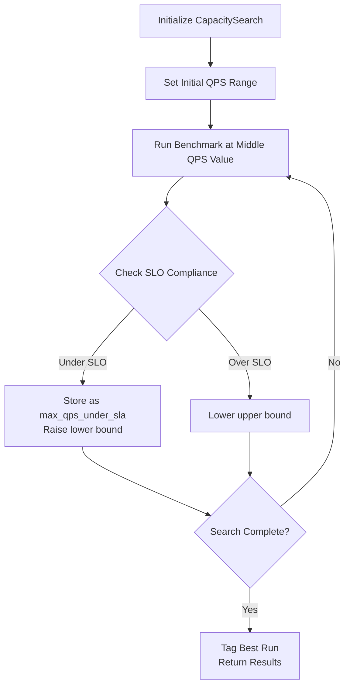
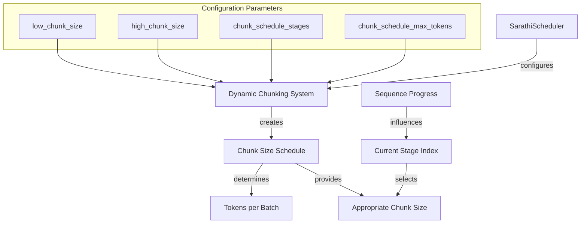
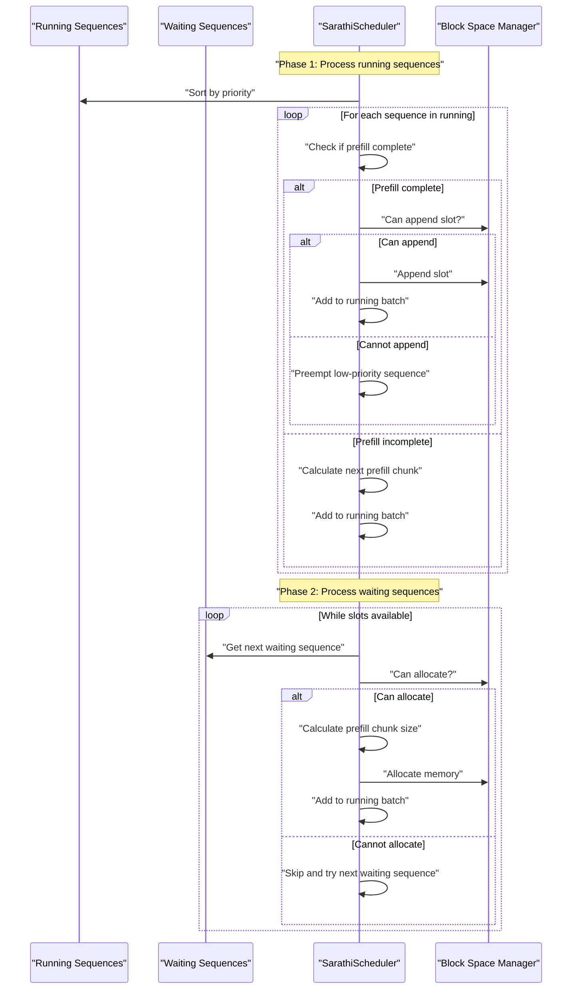
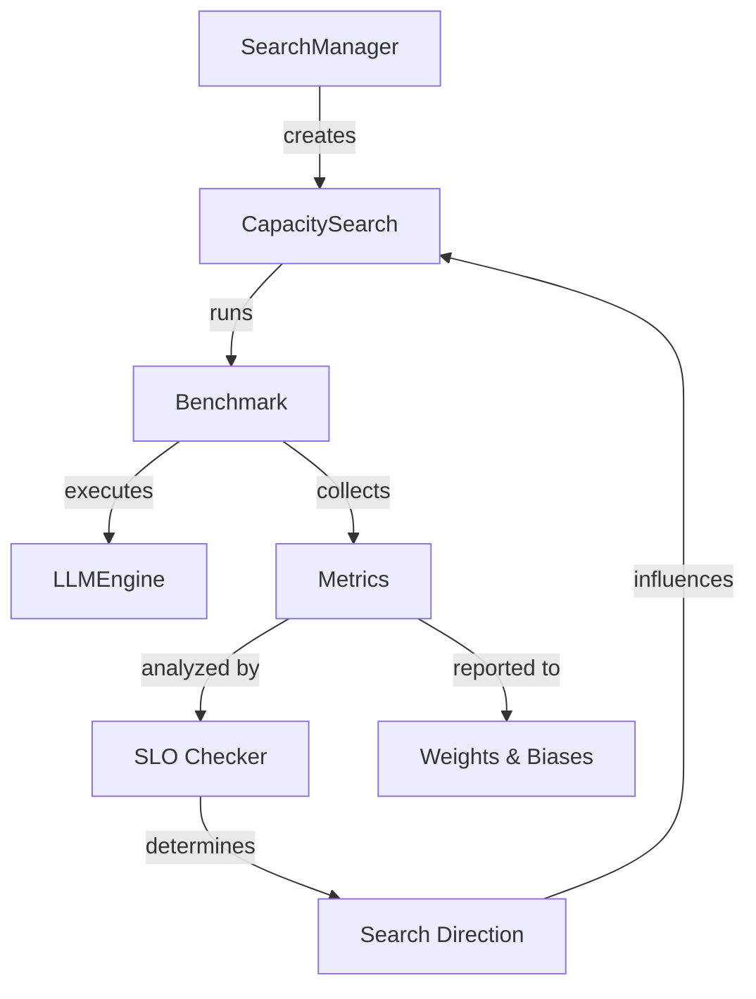

<!-- source: DeepWiki mcp.deepwiki.com · repo microsoft/sarathi-serve · page 7 Advanced Topics · fetched 2026-10-26 -->

# Advanced Topics

<details>
<summary>Relevant source files</summary>

The following files were used as context for generating this wiki page:

- [sarathi/benchmark/capacity_search/capacity_search.py](sarathi/benchmark/capacity_search/capacity_search.py)
- [sarathi/benchmark/capacity_search/main.py](sarathi/benchmark/capacity_search/main.py)
- [sarathi/core/scheduler/sarathi_scheduler.py](sarathi/core/scheduler/sarathi_scheduler.py)

</details>


## Purpose and Scope

This document covers advanced features and usage scenarios in Sarathi-Serve that go beyond basic setup and operation. It focuses on techniques for maximizing system performance, optimizing resource utilization, and understanding the internals of the scheduling system for sophisticated workloads. For specific information about performance tuning techniques, see [Performance Tuning](#7.1).

## Capacity Search System

Capacity search is a powerful feature in Sarathi-Serve that automates the process of finding the maximum throughput your system can handle while maintaining desired latency constraints.

### How Capacity Search Works

Capacity search uses a sophisticated binary search algorithm to find the optimal queries per second (QPS) value that meets specified Service Level Objectives (SLOs).



The capacity search system measures two critical metrics:
- **Scheduling delay**: Time between request arrival and processing
- **Token-by-token time (TBT)**: Time to process each token during decoding

The search continues until it finds the maximum QPS that keeps both metrics below your specified thresholds.

Sources:
- [sarathi/benchmark/capacity_search/capacity_search.py:152-239]()
- [sarathi/benchmark/capacity_search/main.py:1-13]()

### Configuring Capacity Search

The capacity search system offers several parameters for customization:

| Parameter | Description | Default |
|-----------|-------------|---------|
| `min-search-granularity` | Minimum precision of search (%) | 2.5 |
| `scheduling-delay-slo-value` | Maximum allowed scheduling delay (ms) | 2.0 |
| `scheduling-delay-slo-quantile` | Quantile level for delay measurement | 0.50 |
| `tbt-slo-value` | Maximum allowed token-by-token time (ms) | 0.2 |
| `tbt-slo-quantile` | Quantile level for TBT measurement | 0.99 |
| `max-iterations` | Maximum search iterations | 20 |
| `time-limit` | Time limit for each benchmark (minutes) | 30 |

The search algorithm adaptively adjusts its strategy based on the measured metrics. For example, if the scheduling delay is very low, it will increase the QPS more aggressively:

```
if scheduling_delay < self.args.scheduling_delay_slo_value / 8:
    right = min(right * 4, min_qps_over_sla)
elif scheduling_delay < self.args.scheduling_delay_slo_value / 4:
    right = min(right * 2, min_qps_over_sla)
```

Sources:
- [sarathi/benchmark/capacity_search/capacity_search.py:197-207]()
- [sarathi/benchmark/capacity_search/main.py:24-49]()

## Dynamic Chunking Mechanism

Sarathi-Serve implements an advanced dynamic chunking mechanism in its scheduler which is crucial for efficient processing of requests, especially during the prefill phase.

### Dynamic Chunking Architecture

The dynamic chunking system allows the scheduler to adaptively adjust chunk sizes based on the processing stage of each request:



When dynamic chunking is enabled, the system creates a schedule of progressively smaller chunk sizes. As a request progresses through its prefill phase, the scheduler selects an appropriate chunk size based on how many tokens have already been processed.

Sources:
- [sarathi/core/scheduler/sarathi_scheduler.py:34-53]()
- [sarathi/core/scheduler/sarathi_scheduler.py:74-96]()

### Implementing Dynamic Chunk Scheduling

The `SarathiScheduler` class computes a chunk size schedule during initialization:

```python
def _compute_chunk_size_schedule(self):
    # create num_steps equally spaced chunk sizes between low_chunk_size and high_chunk_size
    chunk_sizes = np.linspace(
        self.low_chunk_size,
        self.high_chunk_size,
        self.chunk_schedule_stages,
        dtype=np.int32,
    )[::-1]
    # align each chunk size to the nearest multiple of 32 or self.low_chunk_size
    round_of_chunk_sizes = min(32, self.low_chunk_size)
    chunk_sizes = (
        np.round(chunk_sizes / round_of_chunk_sizes) * round_of_chunk_sizes
    )
    chunk_sizes = chunk_sizes.astype(np.int64).tolist()

    return chunk_sizes
```

When determining how many tokens to process for a sequence, the scheduler checks the sequence's progress and selects the appropriate chunk size:

```python
request_stage_idx = int(
    np.ceil(
        seq.get_num_prompt_tokens_stage_processed()
        // self._tokens_per_stage
    )
)
assert request_stage_idx < len(self._chunk_sizes)
chunk_size = self._chunk_sizes[request_stage_idx]
```

This approach balances throughput and latency by using larger chunks early in processing and smaller chunks as it nears completion.

Sources:
- [sarathi/core/scheduler/sarathi_scheduler.py:54-69]()
- [sarathi/core/scheduler/sarathi_scheduler.py:79-87]()

## Advanced Scheduling System

The Sarathi scheduler implements sophisticated scheduling strategies to optimize both throughput and latency.

### Two-Phase Scheduling Process

The scheduler operates in two distinct phases:



This approach prioritizes:
1. First processing sequences that are already running
2. Then allocating resources to new sequences

Sources:
- [sarathi/core/scheduler/sarathi_scheduler.py:98-118]()
- [sarathi/core/scheduler/sarathi_scheduler.py:190-246]()

### Preemption and Resource Management

The scheduler includes sophisticated preemption logic to handle cases where resources are constrained:

1. When processing decode tokens (after prefill):
   - If no slots are available, preempt the lowest-priority running sequence
   - If no other sequences can be preempted, preempt the current sequence

2. For new sequences:
   - Check if the sequence's prompt length is within limits
   - Verify if the block manager can allocate memory for the sequence
   - Ensure the total number of running sequences doesn't exceed the maximum

This approach ensures that high-priority sequences receive resources even in constrained environments, and that the system adapts dynamically to changing workloads.

Sources:
- [sarathi/core/scheduler/sarathi_scheduler.py:141-156]()
- [sarathi/core/scheduler/sarathi_scheduler.py:203-217]()

## Integration with Benchmarking System

The advanced features of Sarathi-Serve integrate closely with its benchmarking system for performance evaluation.

### End-to-End Benchmark Workflow



The capacity search system creates benchmarks with varying QPS values, collects detailed metrics, and analyzes them to determine if the system is meeting SLOs. The results guide the search process and are reported to tracking systems for visualization and analysis.

Sources:
- [sarathi/benchmark/capacity_search/capacity_search.py:65-104]()
- [sarathi/benchmark/capacity_search/main.py:82-99]()

### Metrics Collection and Analysis

The system collects and analyzes key metrics:

| Metric | Description | Collection Method |
|--------|-------------|-------------------|
| Request Scheduling Delay | Time between request arrival and processing | Quantile analysis (P50 by default) |
| Token-by-Token Time | Processing time per token in decode phase | Quantile analysis (P99 by default) |
| Maximum QPS Under SLA | Highest throughput meeting SLO constraints | Binary search result |

These metrics are written to CSV files for detailed analysis and reported to Weights & Biases for tracking and visualization.

Sources:
- [sarathi/benchmark/capacity_search/capacity_search.py:73-91]()
- [sarathi/benchmark/capacity_search/capacity_search.py:225-238]()

## Conclusion

The advanced features in Sarathi-Serve provide powerful tools for optimizing LLM serving in production environments. The capacity search system automates the process of finding optimal throughput settings, while the dynamic chunking and sophisticated scheduling mechanisms ensure efficient resource utilization. By understanding and leveraging these advanced features, users can achieve significantly better performance for their specific workloads.

For detailed techniques on tuning these systems for specific deployment scenarios, see [Performance Tuning](#7.1).

Sources:
- [sarathi/benchmark/capacity_search/capacity_search.py]()
- [sarathi/benchmark/capacity_search/main.py]()
- [sarathi/core/scheduler/sarathi_scheduler.py]()

---

