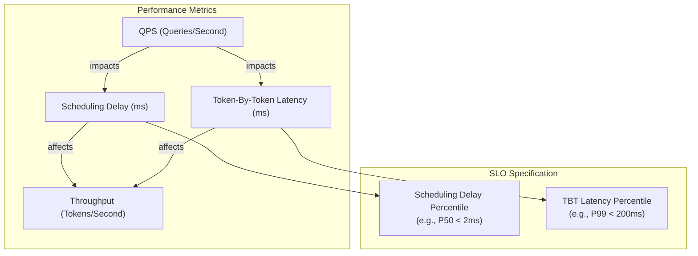
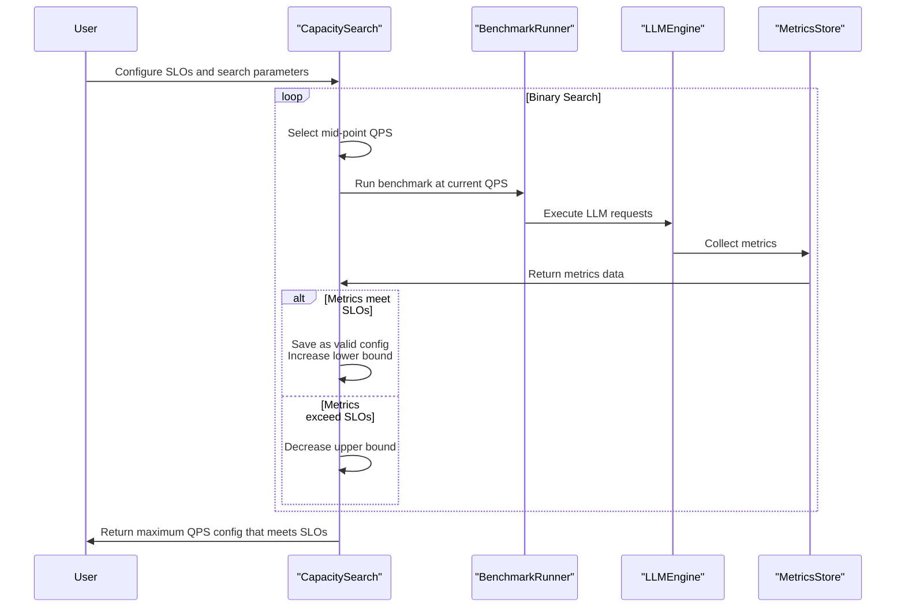
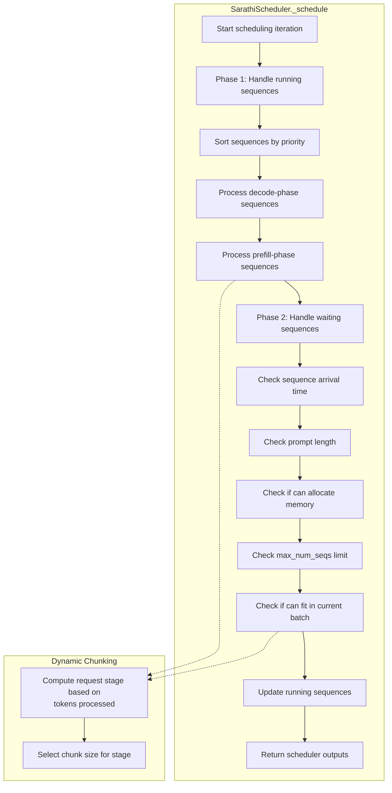
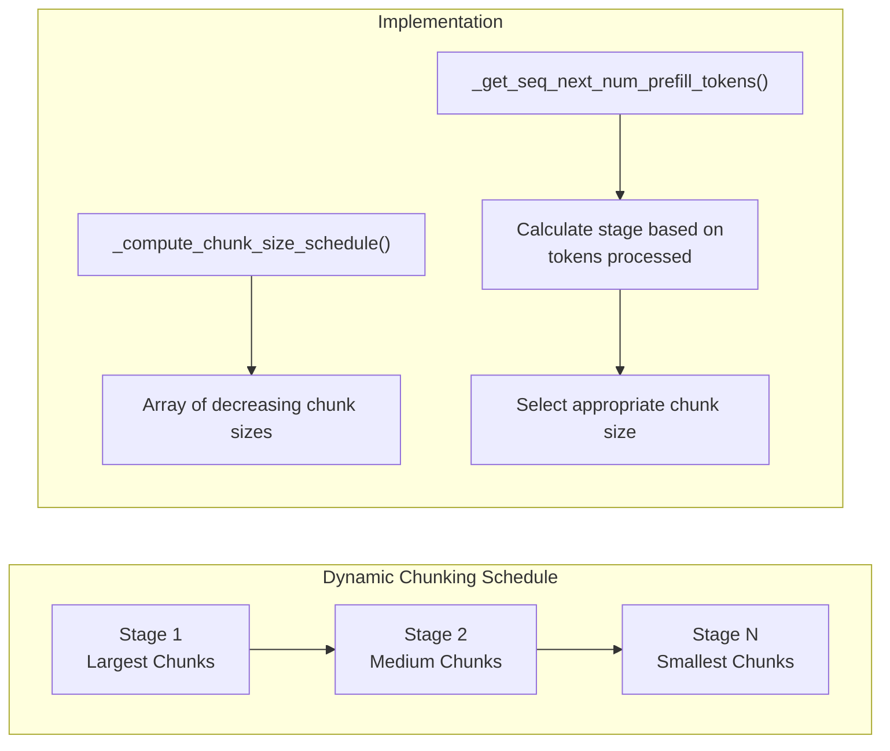
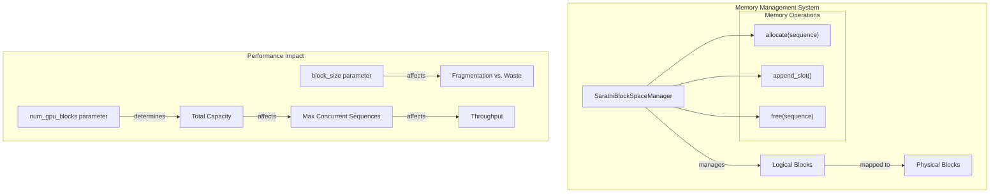
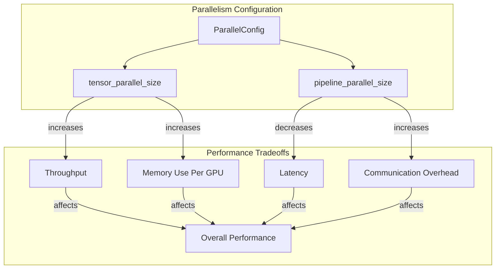
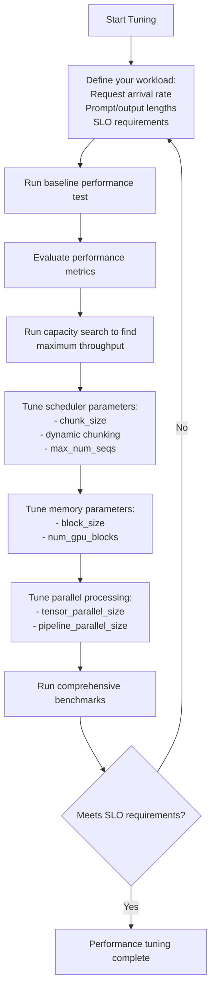

<!-- source: DeepWiki mcp.deepwiki.com · repo microsoft/sarathi-serve · page 7.1 Performance Tuning · fetched 2026-10-26 -->

# Performance Tuning

<details>
<summary>Relevant source files</summary>

The following files were used as context for generating this wiki page:

- [sarathi/benchmark/capacity_search/capacity_search.py](sarathi/benchmark/capacity_search/capacity_search.py)
- [sarathi/benchmark/capacity_search/main.py](sarathi/benchmark/capacity_search/main.py)
- [sarathi/core/scheduler/sarathi_scheduler.py](sarathi/core/scheduler/sarathi_scheduler.py)

</details>


This page provides a comprehensive guide to optimizing performance in Sarathi-Serve for specific workloads. It covers capacity planning, scheduler optimization, and performance benchmarking techniques to achieve the best throughput-latency tradeoff for your LLM serving deployment.

For information about the general system architecture, see [System Architecture](#2). For details on benchmarking system capabilities, see [Benchmarking](#5).

## Performance Metrics and SLOs

When tuning Sarathi-Serve, it's important to focus on key metrics that determine overall system performance:

1. **QPS (Queries Per Second)**: The number of queries the system can handle per second.
2. **Scheduling Delay**: The time a request waits before being scheduled for processing.
3. **TBT (Token-By-Token latency)**: The time taken to generate each token during decoding.
4. **Throughput**: The total number of tokens generated per second.

These metrics are interdependent - optimizing for one often affects others. Sarathi-Serve allows setting Service Level Objectives (SLOs) based on percentiles of these metrics.



Sources: [sarathi/benchmark/capacity_search/capacity_search.py:72-103]()

## Capacity Planning with CapacitySearch

Sarathi-Serve includes a `CapacitySearch` utility that automatically finds the maximum QPS your system can handle while meeting specified SLOs.

### How CapacitySearch Works

The capacity search performs a binary search to identify the maximum QPS at which your system can maintain specified SLOs for scheduling delay and token-by-token latency.



Sources: [sarathi/benchmark/capacity_search/capacity_search.py:152-238]()

### Configuring CapacitySearch

To run a capacity search, you need to configure:

1. **SLO thresholds**:
   - Scheduling delay SLO value and percentile
   - Token-by-token latency SLO value and percentile

2. **Search parameters**:
   - Initial QPS value
   - Minimum search granularity
   - Maximum iterations

```bash
python -m sarathi.benchmark.capacity_search.main \
  --config-path your_config.yaml \
  --output-dir output \
  --scheduling-delay-slo-value 2.0 \
  --scheduling-delay-slo-quantile 0.50 \
  --tbt-slo-value 0.2 \
  --tbt-slo-quantile 0.99 \
  --min-search-granularity 2.5 \
  --max-iterations 20 \
  --time-limit 30
```

Sources: [sarathi/benchmark/capacity_search/main.py:24-56]()

## Scheduler Optimization

The scheduler is a critical component affecting performance. Sarathi-Serve offers the `SarathiScheduler` with various tunable parameters.

### SarathiScheduler Configuration Parameters

| Parameter | Description | Impact |
|-----------|-------------|--------|
| `chunk_size` | Default size of chunks for processing prefill tokens | Larger chunks increase throughput but may increase scheduling delay |
| `enable_dynamic_chunking_schedule` | Whether to use dynamic chunk sizing | Enables optimization for different request patterns |
| `low_chunk_size` | Minimum chunk size when using dynamic chunking | Sets lower bound for chunks (must be multiple of 32) |
| `high_chunk_size` | Maximum chunk size when using dynamic chunking | Sets upper bound for chunks (must be multiple of 32) |
| `chunk_schedule_max_tokens` | Maximum tokens considered for dynamic scheduling | Defines the token window for dynamic chunking |
| `chunk_schedule_stages` | Number of stages in the dynamic chunking schedule | Controls granularity of chunk size changes |
| `max_num_seqs` | Maximum number of sequences in RUNNING state | Limits concurrent sequences |

Sources: [sarathi/core/scheduler/sarathi_scheduler.py:23-43]()

### Workflow of SarathiScheduler

The `SarathiScheduler` makes scheduling decisions based on request state and available resources:



Sources: [sarathi/core/scheduler/sarathi_scheduler.py:98-246]()

### Dynamic Chunking Optimization

When `enable_dynamic_chunking_schedule` is enabled, the scheduler uses different chunk sizes as the request progresses:

1. Initially, larger chunk sizes are used (from `high_chunk_size`)
2. As more tokens are processed, chunk size decreases (toward `low_chunk_size`)

This approach optimizes the tradeoff between throughput and latency:
- Large chunks in early stages maximize prefill throughput
- Smaller chunks in later stages minimize scheduling delay for multiple sequences



Sources: [sarathi/core/scheduler/sarathi_scheduler.py:54-96]()

## Memory Management Optimization

Memory management significantly affects LLM serving performance. Two key areas to optimize:

1. **Block space management**: How token blocks are allocated in GPU memory
2. **KV cache configuration**: How key-value cache is sized and managed

### Block Space Manager Configuration

The `SarathiBlockSpaceManager` is used with the `SarathiScheduler` to manage GPU memory allocation for tokens. Important parameters to configure:

| Parameter | Description | Tuning Consideration |
|-----------|-------------|---------------------|
| `block_size` | Number of tokens per block | Larger blocks reduce fragmentation but may waste space |
| `num_gpu_blocks` | Total number of blocks in GPU memory | Determines total KV cache capacity |
| `watermark` | Memory usage threshold for admission control | Higher values increase capacity but risk OOM |



Sources: [sarathi/core/scheduler/sarathi_scheduler.py:71-72]()

## Parallel Processing Configuration

Properly configuring parallel processing can significantly improve performance.

### Tensor and Pipeline Parallelism

Sarathi-Serve supports both tensor parallelism (splitting model weights across GPUs) and pipeline parallelism (splitting model layers across GPUs).



## Performance Tuning Workflow

When optimizing Sarathi-Serve for your specific workload, follow this workflow:



## Best Practices

1. **Start with capacity search**: Use the `CapacitySearch` utility to establish baseline performance with default settings.

2. **Optimize scheduler parameters**:
   - For workloads with many short requests, use smaller chunk sizes
   - For workloads with few large requests, use larger chunk sizes 
   - Enable dynamic chunking for mixed workloads

3. **Memory optimization**:
   - Adjust `block_size` based on your average sequence length
   - Set `num_gpu_blocks` based on available GPU memory and model size

4. **Parallel processing**:
   - Increase tensor parallelism for larger models
   - Use pipeline parallelism when model layers can be effectively distributed

5. **Continuous monitoring**:
   - Regularly benchmark with representative workloads
   - Adjust parameters as workload characteristics change

Sources: [sarathi/benchmark/capacity_search/capacity_search.py:152-238](), [sarathi/core/scheduler/sarathi_scheduler.py:23-43]()