# Page: Overview

# Overview

<details>
<summary>Relevant source files</summary>

The following files were used as context for generating this wiki page:

- [README.md](README.md)

</details>


Sarathi-Serve is a high-throughput, low-latency framework designed specifically for serving Large Language Models (LLMs). It originated as a research-focused fork of the vLLM project, optimized for faster research iterations in LLM serving technology. The system specializes in optimizing the throughput-latency tradeoff in LLM inference through innovative scheduling and resource management techniques.

For detailed installation instructions, see [Installation](#1.1). For a quick start guide, refer to [Getting Started](#1.2).

Sources: [README.md:1-3](), [README.md:55-57]()

## System Architecture

Sarathi-Serve employs a modular architecture with several key components that work together to provide efficient LLM inference. The following diagram illustrates the high-level architecture:

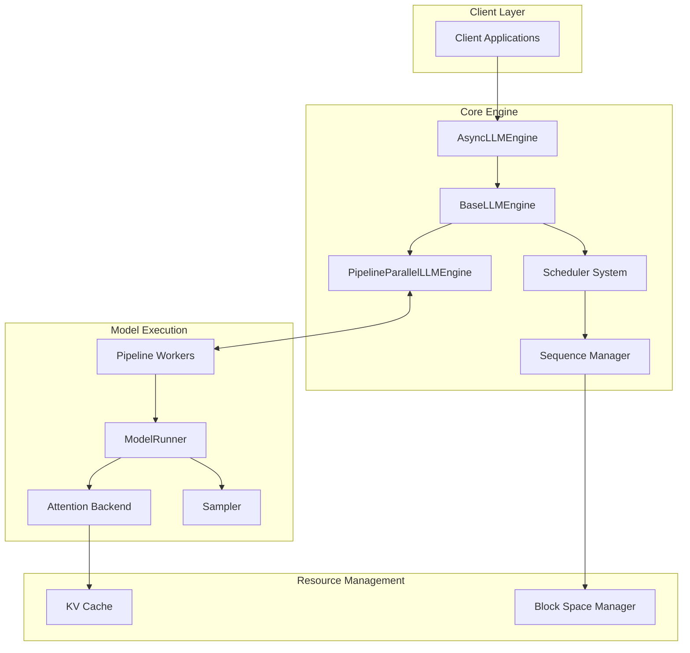

Sources: [README.md:3]()

## Key Components

### Engine Components

1. **AsyncLLMEngine**: Provides an asynchronous interface to the LLM engine, enabling non-blocking request handling for clients.

2. **BaseLLMEngine**: The core engine component that manages the execution of model inference requests.

3. **PipelineParallelLLMEngine**: Extends the base engine to support pipeline parallelism, allowing model layers to be distributed across multiple GPUs for improved performance.

For more detailed information on these components, see [Engine Components](#2.1).

### Scheduler System

The Scheduler is responsible for determining which sequences to process in each engine step, optimizing for both throughput and latency. Sarathi-Serve implements several scheduler strategies:

- **VllmScheduler**: Based on the original vLLM scheduling approach
- **SimpleChunkingScheduler**: Implements basic sequence chunking for efficiency
- **OrcaScheduler**: Based on the Orca scheduling algorithm
- **FasterTransformerScheduler**: Implements scheduling optimized for the FasterTransformer backend
- **SarathiScheduler**: The system's namesake scheduler that optimizes the throughput-latency tradeoff

For detailed information on schedulers, see [Scheduler Configuration](#4.1).

### Sequence Management

The Sequence Manager tracks and manages the lifecycle of all active sequences (requests) in the system, handling their state transitions from prefill to decode phases and eventual completion.

For more on sequence management, see [Sequence Management](#2.3).

### Memory Management

Sarathi-Serve uses an efficient block-based memory management system for the KV cache:

1. **KV Cache**: Stores key-value pairs for attention mechanisms to avoid redundant computation
2. **Block Space Manager**: Allocates and deallocates memory blocks for sequences, managing the physical memory resources

For more details on memory management, see [Memory Management](#2.4).

## Request Processing Flow

The following diagram illustrates how requests flow through the Sarathi-Serve system:

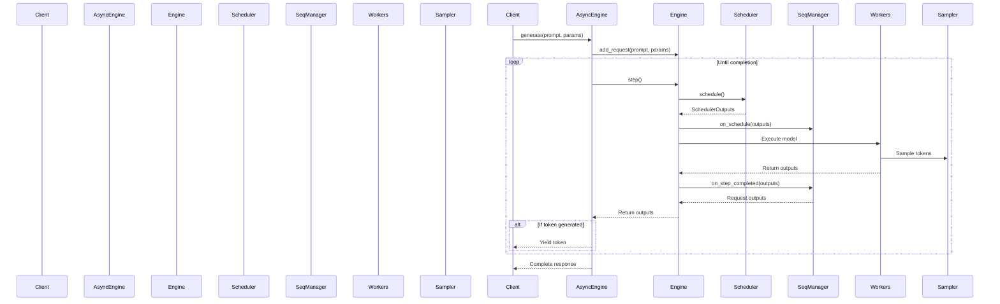

## Parallel Processing

Sarathi-Serve supports two main parallelism approaches:

1. **Tensor Parallelism**: Splits model weights across multiple GPUs, allowing larger models to fit in memory and improving computational efficiency.

2. **Pipeline Parallelism**: Partitions model layers across multiple GPUs, with each GPU handling a subset of the layers, enabling processing of multiple batches simultaneously.

For more details on parallel processing, see [Parallel Processing](#3.3).

## Attention Mechanisms

The system includes optimized attention implementations:

1. **FlashInfer Attention**: High-performance attention implementation
2. **NoOp Attention**: Used for testing and benchmarking

For detailed information about attention mechanisms, see [Attention Mechanisms](#3.1).

## Configuration System

Sarathi-Serve uses a comprehensive configuration system to customize various aspects of the engine:

```mermaid
classDiagram
    class "SystemConfig" {
        +model_config: ModelConfig
        +cache_config: CacheConfig
        +parallel_config: ParallelConfig
        +scheduler_config: BaseSchedulerConfig
    }
    
    class "ModelConfig" {
        +model: str
        +dtype: str
        +max_model_len: int
    }
    
    class "CacheConfig" {
        +block_size: int
        +num_gpu_blocks: int
    }
    
    class "ParallelConfig" {
        +tensor_parallel_size: int
        +pipeline_parallel_size: int
    }
    
    class "BaseSchedulerConfig" {
        +max_num_seqs: int
        +get_type()
    }
    
    SystemConfig *-- ModelConfig
    SystemConfig *-- CacheConfig
    SystemConfig *-- ParallelConfig
    SystemConfig *-- BaseSchedulerConfig
    
    BaseSchedulerConfig <|-- VllmSchedulerConfig
    BaseSchedulerConfig <|-- SarathiSchedulerConfig
```

For detailed information on configuration options, see [Configuration System](#4).

## Benchmarking

Sarathi-Serve includes a comprehensive benchmarking system to measure performance and optimize configurations:

1. **BenchmarkRunner**: Executes benchmarks against the LLM engine
2. **CapacitySearch**: Automatically finds optimal throughput configurations
3. **MetricsStore**: Collects and analyzes performance metrics

For more information on benchmarking, see [Benchmarking](#5).

## Hardware Requirements

Sarathi-Serve has been tested with CUDA 12.3 on H100 and A100 GPUs.

Sources: [README.md:7-9]()

## Origins and Research

Sarathi-Serve was developed as part of research on optimizing the throughput-latency tradeoff in LLM inference. The system's design and performance are detailed in the OSDI'24 paper "Taming Throughput-Latency Tradeoff in LLM Inference with Sarathi-Serve."

Sources: [README.md:3](), [README.md:42-53]()

## Installation and Setup

To set up Sarathi-Serve, you need to:

1. Clone the repository
2. Set up a Python 3.10 environment
3. Install the package with required dependencies

Detailed installation instructions can be found in the [Installation](#1.1) page.

Sources: [README.md:11-36]()

---

# Page: Installation

# Installation

<details>
<summary>Relevant source files</summary>

The following files were used as context for generating this wiki page:

- [Makefile](Makefile)
- [README.md](README.md)
- [pyproject.toml](pyproject.toml)
- [requirements.txt](requirements.txt)

</details>


This document provides comprehensive instructions for installing Sarathi-Serve, a high-throughput, low-latency framework for serving Large Language Models (LLMs). For basic usage after installation, please refer to [Getting Started](#1.2).

## System Requirements

### Hardware Requirements

Sarathi-Serve has specific hardware requirements to ensure optimal performance.

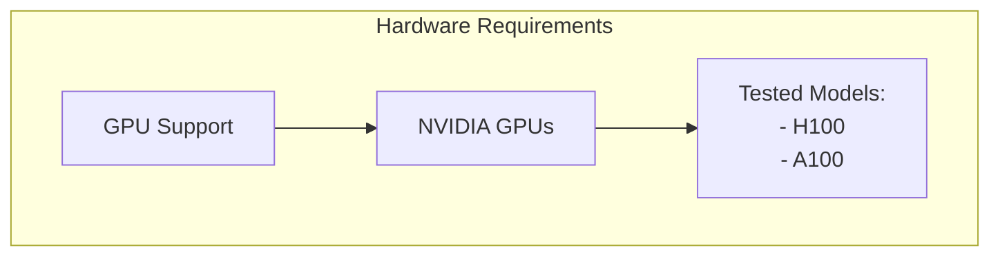

Sources: [README.md:7-9]()

### Software Prerequisites

Before installing Sarathi-Serve, ensure your system meets the following software requirements:

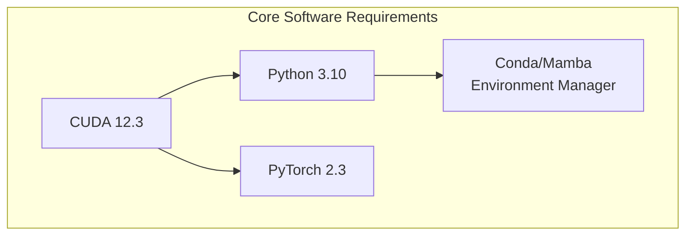

Sources: [README.md:7-9](), [README.md:21-30](), [requirements.txt:8]()

## Installation Process

The installation process involves four main steps:


### 1. Setting up CUDA

Sarathi-Serve has been tested with CUDA 12.3 on H100 and A100 GPUs. Make sure you have the appropriate CUDA toolkit installed on your system.

Sources: [README.md:7-9]()

### 2. Cloning the Repository

Clone the Sarathi-Serve repository from GitHub:

```bash
git clone git@github.com:microsoft/sarathi-serve.git
```

Sources: [README.md:13-15]()

### 3. Creating a Python Environment

Sarathi-Serve recommends using Mamba to create a Python 3.10 environment. If you don't already have Mamba installed, you can set it up with:

```bash
wget https://github.com/conda-forge/miniforge/releases/latest/download/Mambaforge-Linux-x86_64.sh
bash Mambaforge-Linux-x86_64.sh # follow the instructions from there
```

Then create a Python 3.10 environment:

```bash
mamba create -p ./env python=3.10
```

Sources: [README.md:17-30]()

### 4. Installing Sarathi-Serve

Once you've set up the Python environment, install Sarathi-Serve:

```bash
pip install -e . --extra-index-url https://flashinfer.ai/whl/cu121/torch2.3/
```

This command installs Sarathi-Serve in development mode (`-e`) and uses the FlashInfer wheel repository as an additional index.

Sources: [README.md:32-36]()

## Dependencies

Sarathi-Serve relies on multiple dependencies to function properly. Below is a comprehensive view of the key dependencies:

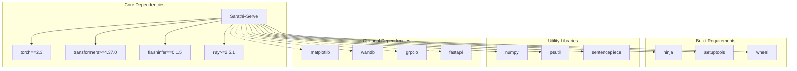

The full list of dependencies can be found in the requirements.txt file.

Sources: [requirements.txt:1-24](), [pyproject.toml:2-8]()

## Installation Verification

After installing Sarathi-Serve, you can verify the installation by running a simple inference test. The verification process is detailed in the [Getting Started](#1.2) page.

## Installation Directory Structure

After installation, the Sarathi-Serve directory structure will look like this:

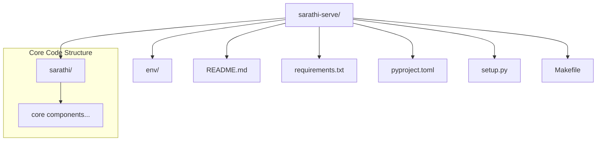

Sources: [README.md:13-36]()

## Common Installation Issues

### CUDA Compatibility

Make sure your CUDA version (12.3) is compatible with the installed GPU drivers. Incompatible CUDA versions may result in runtime errors.

### FlashInfer Dependency

The installation command includes a specific extra index URL for FlashInfer. If you encounter issues with this dependency, ensure the URL is accessible and the wheel is available for your specific CUDA and PyTorch configuration.

### Python Version

Sarathi-Serve is specifically tested with Python 3.10. Using different Python versions may lead to compatibility issues with certain dependencies.

Sources: [README.md:7-9](), [README.md:32-36](), [requirements.txt:17]()

## Advanced Installation Options

For development purposes, you might want to consider additional tools:

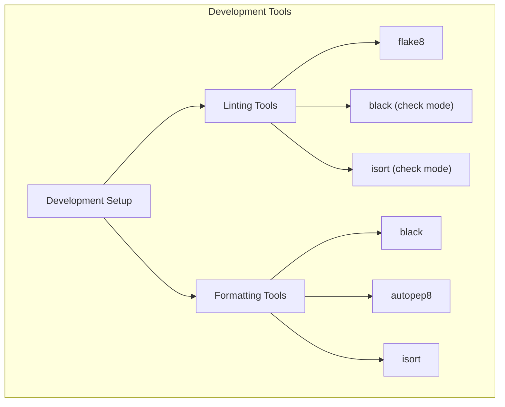

These tools can be used through the provided Makefile with commands like `make lint` and `make format`.

Sources: [Makefile:1-24]()

## Acknowledgment

Sarathi-Serve originated as a fork of the vLLM project, designed as a research prototype for faster iterations in LLM serving research. It maintains only the most critical features needed for research purposes.

Sources: [README.md:55-57]()

---

# Page: Getting Started

# Getting Started

<details>
<summary>Relevant source files</summary>

The following files were used as context for generating this wiki page:

- [README.md](README.md)
- [examples/offline_inference.py](examples/offline_inference.py)

</details>


This guide provides step-by-step instructions for setting up Sarathi-Serve and running your first LLM inference. The document covers basic installation, configuration, and executing a simple inference example. For more advanced topics, please refer to [System Architecture](#2) or [Performance Tuning](#7.1).

## Prerequisites

Before getting started with Sarathi-Serve, ensure you have:

- A CUDA-compatible GPU (tested with H100 and A100 GPUs)
- CUDA 12.3 installed
- Basic familiarity with Python and command-line operations

## System Architecture Overview

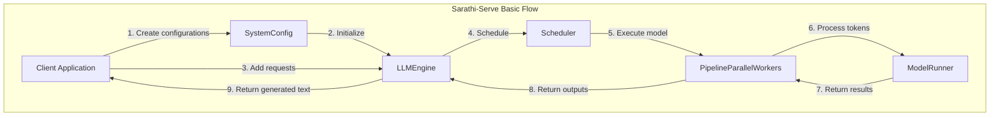

Sources: [examples/offline_inference.py:5-6](), [examples/offline_inference.py:58-86]()

## Installation

### 1. Clone the Repository

```bash
git clone git@github.com:microsoft/sarathi-serve.git
cd sarathi-serve
```

### 2. Create a Python Environment

Using Mamba (recommended for faster dependency resolution):

```bash
wget https://github.com/conda-forge/miniforge/releases/latest/download/Mambaforge-Linux-x86_64.sh
bash Mambaforge-Linux-x86_64.sh

# After installation completes
mamba create -p ./env python=3.10
mamba activate ./env
```

### 3. Install Sarathi-Serve

```bash
pip install -e . --extra-index-url https://flashinfer.ai/whl/cu121/torch2.3/
```

Sources: [README.md:8-36]()

## Configuration Components

Before running inference, you need to configure several components that control Sarathi-Serve's behavior:

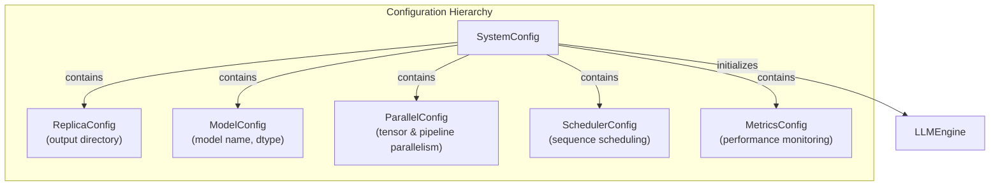

Sources: [examples/offline_inference.py:5](), [examples/offline_inference.py:28-57]()

### Basic Configuration Setup

Here's how to create a minimal configuration for inference:

```python
from sarathi.config import ModelConfig, ParallelConfig, SarathiSchedulerConfig, MetricsConfig, SystemConfig, ReplicaConfig
from sarathi import LLMEngine, SamplingParams

# Output directory configuration
replica_config = ReplicaConfig(
    output_dir="./output",
)

# Model configuration
model_config = ModelConfig(
    model="mistralai/Mixtral-8x7B-Instruct-v0.1",  # Example model
)

# Parallelism configuration (adjust based on available hardware)
parallel_config = ParallelConfig(
    tensor_parallel_size=1,  # Number of GPUs for tensor parallelism
    pipeline_parallel_size=4,  # Number of GPUs for pipeline parallelism
)

# Scheduler configuration
scheduler_config = SarathiSchedulerConfig(
    chunk_size=100,
    max_num_seqs=10,  # Maximum concurrent sequences
)

# Metrics configuration
metrics_config = MetricsConfig(
    write_metrics=True,
    enable_chrome_trace=True,  # Enables detailed performance tracing
)

# Create the system configuration
system_config = SystemConfig(
    replica_config=replica_config,
    model_config=model_config,
    parallel_config=parallel_config,
    scheduler_config=scheduler_config,
    metrics_config=metrics_config,
)
```

Sources: [examples/offline_inference.py:28-57]()

## Running Your First Inference

Once your configuration is ready, follow these steps to run inference:

### 1. Initialize the LLM Engine

```python
llm_engine = LLMEngine.from_system_config(system_config)
```

### 2. Prepare Prompts and Sampling Parameters

```python
# Example prompts
prompts = [
    "Hello, my name is",
    "The president of the United States is",
    "The capital of France is",
]

# Configure text generation behavior
sampling_params = SamplingParams(
    temperature=0.8,  # Controls randomness (higher = more random)
    top_p=0.95,       # Nucleus sampling parameter
    max_tokens=100    # Maximum number of tokens to generate
)
```

### 3. Generate Text

Here's a function that processes prompts through the LLM engine:

```python
def generate(llm_engine, prompts, sampling_params):
    # Add all prompts to the engine queue
    for prompt in prompts:
        llm_engine.add_request(prompt, sampling_params)
    
    # Track progress
    num_requests = llm_engine.get_num_unfinished_requests()
    
    # Process all requests until completion
    outputs = []
    while llm_engine.has_unfinished_requests():
        step_outputs = llm_engine.step()
        for output in step_outputs:
            if output.finished:
                outputs.append(output)
    
    # Sort outputs by sequence ID
    outputs = sorted(outputs, key=lambda x: int(x.seq_id))
    return outputs

# Run the generation
outputs = generate(llm_engine, prompts, sampling_params)
```

### 4. Process the Results

```python
# Print the generated text for each prompt
for output in outputs:
    prompt = output.prompt
    generated_text = output.text
    print(f"Prompt: {prompt!r}")
    print(f"Generated text: {generated_text!r}")
```

Sources: [examples/offline_inference.py:62-100]()

## Inference Process Flow

The following sequence diagram shows how requests flow through Sarathi-Serve:

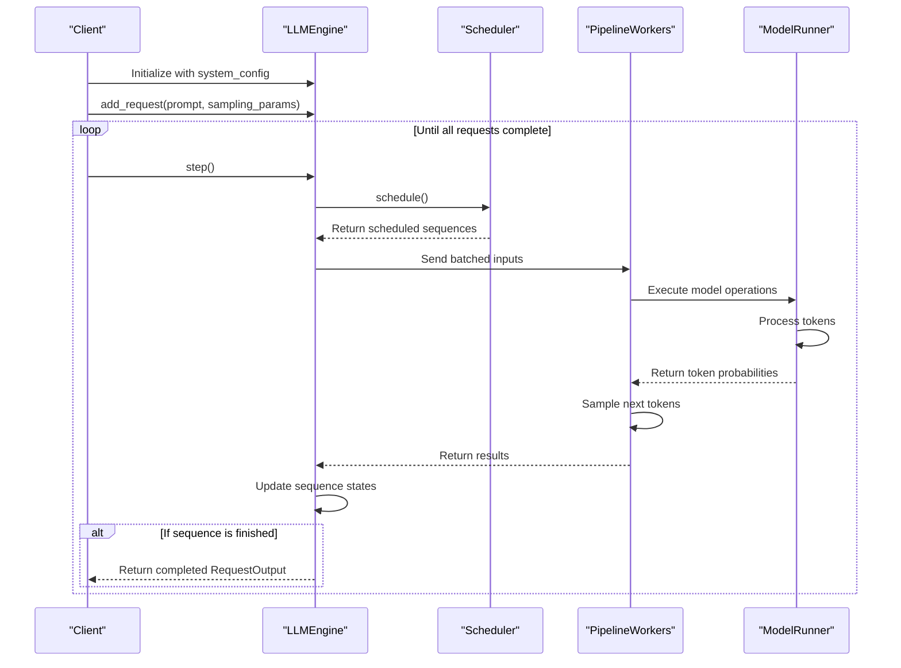

Sources: [examples/offline_inference.py:62-87]()

## Analyzing Performance

After running inference, you can collect and visualize performance metrics:

```python
# Collect metrics from workers
llm_engine.pull_worker_metrics()

# Generate visualization plots
llm_engine.plot_metrics()
```

Sources: [examples/offline_inference.py:103-104]()

## Complete Example

Here's a complete example script that puts everything together:

```python
import datetime
from typing import List

from sarathi.config import ModelConfig, ParallelConfig, SarathiSchedulerConfig, MetricsConfig, SystemConfig, ReplicaConfig
from sarathi import LLMEngine, SamplingParams, RequestOutput

# Set up output directory
output_dir = f"./output/{datetime.datetime.now().strftime('%Y-%m-%d_%H-%M-%S')}"

# Configuration
replica_config = ReplicaConfig(output_dir=output_dir)
model_config = ModelConfig(model="mistralai/Mixtral-8x7B-Instruct-v0.1")
parallel_config = ParallelConfig(tensor_parallel_size=1, pipeline_parallel_size=4)
scheduler_config = SarathiSchedulerConfig(chunk_size=100, max_num_seqs=10)
metrics_config = MetricsConfig(write_metrics=True, enable_chrome_trace=True)

system_config = SystemConfig(
    replica_config=replica_config,
    model_config=model_config,
    parallel_config=parallel_config,
    scheduler_config=scheduler_config,
    metrics_config=metrics_config,
)

# Initialize engine
llm_engine = LLMEngine.from_system_config(system_config)

# Prepare prompts and sampling parameters
prompts = [
    "Hello, my name is",
    "The president of the United States is",
    "The capital of France is",
]
sampling_params = SamplingParams(temperature=0.8, top_p=0.95, max_tokens=100)

# Generate text
def generate(
    llm_engine: LLMEngine,
    prompts: List[str],
    sampling_params: SamplingParams,
) -> List[RequestOutput]:
    for prompt in prompts:
        llm_engine.add_request(prompt, sampling_params)
    
    outputs = []
    while llm_engine.has_unfinished_requests():
        step_outputs = llm_engine.step()
        for output in step_outputs:
            if output.finished:
                outputs.append(output)
    
    outputs = sorted(outputs, key=lambda x: int(x.seq_id))
    return outputs

outputs = generate(llm_engine, prompts, sampling_params)

# Print results
for output in outputs:
    print(f"Prompt: {output.prompt!r}")
    print(f"Generated text: {output.text!r}")

# Analyze performance
llm_engine.pull_worker_metrics()
llm_engine.plot_metrics()
```

Sources: [examples/offline_inference.py]()

## Next Steps

Now that you've run your first inference with Sarathi-Serve, you can explore:

- For understanding the system architecture in more detail, see [System Architecture](#2)
- To learn about available model configurations, see [Supported Models](#3.4)
- For optimizing performance, see [Performance Tuning](#7.1)
- To run performance evaluations, see [Running Benchmarks](#5.1)

For more complex inference scenarios, check [Offline Inference](#6.1) which provides additional examples and workflows.

---

# Page: System Architecture

# System Architecture

<details>
<summary>Relevant source files</summary>

The following files were used as context for generating this wiki page:

- [sarathi/engine/async_llm_engine.py](sarathi/engine/async_llm_engine.py)
- [sarathi/engine/base_llm_engine.py](sarathi/engine/base_llm_engine.py)
- [sarathi/engine/pipeline_parallel_llm_engine.py](sarathi/engine/pipeline_parallel_llm_engine.py)
- [sarathi/utils/__init__.py](sarathi/utils/__init__.py)
- [sarathi/worker/pipeline_parallel_worker.py](sarathi/worker/pipeline_parallel_worker.py)

</details>


This document provides a high-level overview of Sarathi-Serve's system architecture, detailing the core components and how they interact with each other to deliver high-throughput, low-latency LLM inference. Sarathi-Serve is designed as a distributed serving system that optimizes the throughput-latency tradeoff through innovative scheduling and resource management techniques.

For information about specific engine components, see [Engine Components](#2.1). For details about worker implementation, see [Worker Architecture](#2.2).

## Engine Hierarchy

Sarathi-Serve implements a tiered engine architecture with different layers of abstraction to support various execution modes and parallelism strategies.

```mermaid
classDiagram
    class "BaseLLMEngine" {
        +init(config: SystemConfig)
        +add_request(prompt, sampling_params)
        +step(): List[RequestOutput]
        +get_model_config(): ModelConfig
        -_init_workers_ray()
        -_init_cache()
        -_on_step_completed()
    }
    
    class "PipelineParallelLLMEngine" {
        -scheduler_output_queue: Queue
        -output_queue: Queue
        -pending_step_outputs: List
        +start_execution_loops()
        -_schedule_loop()
        -_output_loop()
        -_microbatch_watch_loop()
    }
    
    class "AsyncLLMEngine" {
        -engine: _AsyncLLMEngine
        -request_tracker: RequestTracker
        -background_loop: Future
        +generate(prompt, sampling_params): AsyncIterator
        +add_request(request_id, prompt, sampling_params): AsyncStream
        +abort(request_id)
        -run_engine_loop()
    }
    
    class "_AsyncLLMEngine" {
        -engine: LLMEngine
        +add_request(seq_id, prompt, sampling_params)
        +step_async(): List[RequestOutput]
    }
    
    class "RequestTracker" {
        -_request_streams: Dict[str, AsyncStream]
        -_finished_requests: Queue
        -_new_requests: Queue
        +add_request(request_id, **kwargs): AsyncStream
        +abort_request(request_id)
        +process_request_output(request_output)
    }
    
    class "AsyncStream" {
        -request_id: str
        -_queue: Queue
        -_finished: bool
        +put(item)
        +finish()
    }
    
    BaseLLMEngine <|-- PipelineParallelLLMEngine
    AsyncLLMEngine *-- "_AsyncLLMEngine"
    "_AsyncLLMEngine" *-- BaseLLMEngine
    AsyncLLMEngine *-- "RequestTracker"
    "RequestTracker" *-- "AsyncStream"
```

The engine hierarchy forms the central component of Sarathi-Serve, with `BaseLLMEngine` providing core functionality and specialized implementations for different use cases:

1. **BaseLLMEngine** ([sarathi/engine/base_llm_engine.py]()) - The foundation class that handles:
   - Worker initialization and management
   - Memory profiling and cache initialization
   - Scheduling and execution of generation steps
   - Request processing and output generation

2. **PipelineParallelLLMEngine** ([sarathi/engine/pipeline_parallel_llm_engine.py]()) - Extends `BaseLLMEngine` to support pipeline-parallel model execution across multiple GPUs with:
   - Asynchronous scheduling and execution loops
   - Queue-based communication between scheduling and output processing
   - Microbatch management for pipeline parallelism

3. **AsyncLLMEngine** ([sarathi/engine/async_llm_engine.py]()) - Provides an asynchronous API wrapper around the engine:
   - Non-blocking request handling through `AsyncStream`
   - Background processing loop for continuous request handling
   - Request tracking and management through `RequestTracker`
   - Asynchronous token generation through Python's async iterators

Sources: [sarathi/engine/base_llm_engine.py:34-487](), [sarathi/engine/pipeline_parallel_llm_engine.py:31-197](), [sarathi/engine/async_llm_engine.py:238-512]()

## Request Processing Flow

The request processing flow in Sarathi-Serve follows a multi-stage pipeline from client input to generated output.

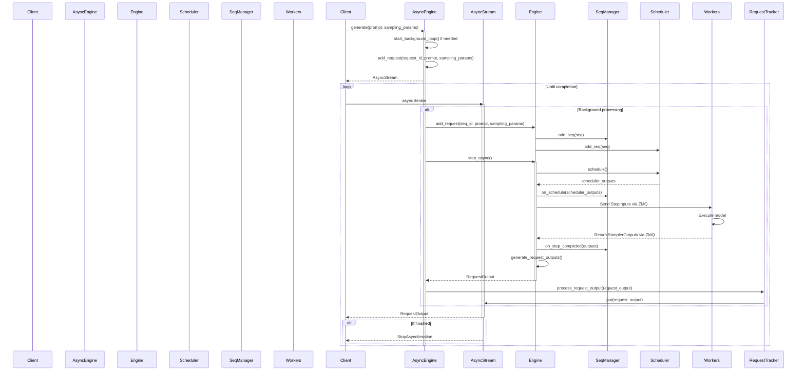

The request processing stages include:

1. **Request Submission**:
   - Client calls `generate()` on `AsyncLLMEngine`
   - Request is added to the engine with a unique ID
   - An `AsyncStream` is returned for asynchronous iteration

2. **Request Scheduling**:
   - Request is tokenized and added to scheduler queue
   - Scheduler determines which sequences to process in each step
   - `SequenceManager` tracks sequence state and allocates resources

3. **Model Execution**:
   - Scheduled sequences are sent to workers for processing
   - Workers execute the model (prefill or decode steps)
   - Results are returned from workers to engine

4. **Output Processing**:
   - Generated tokens are processed by `SequenceManager`
   - `RequestOutput` objects are created for completed steps
   - Results are yielded to client via `AsyncStream`

5. **Request Completion**:
   - Request is marked as finished when stop conditions are met
   - Final results are delivered to client
   - Resources are released for other requests

Sources: [sarathi/engine/async_llm_engine.py:392-462](), [sarathi/engine/base_llm_engine.py:364-398](), [sarathi/engine/pipeline_parallel_llm_engine.py:114-180]()

## Communication Architecture

Sarathi-Serve uses ZeroMQ (ZMQ) for efficient communication between engine and workers, supporting both local and distributed deployment patterns.

```mermaid
graph TD
    subgraph "Engine Component"
        EnqueueSocket["enqueue_socket (PUB)"]
        OutputSocket["output_socket (PULL)"]
        MicrobatchSocket["microbatch_socket (PULL)"]
    end

    subgraph "Worker Components"
        Worker1["Worker 1"]
        Worker2["Worker 2"]
        WorkerN["Worker N"]
        
        Worker1 --> EnqueueListener1["enqueue_socket (SUB)"]
        Worker1 --> OutputSender1["output_socket (PUSH)"]
        Worker1 --> MBSender1["microbatch_socket (PUSH)"]
        
        Worker2 --> EnqueueListener2["enqueue_socket (SUB)"]
        Worker2 --> OutputSender2["output_socket (PUSH)"]
        Worker2 --> MBSender2["microbatch_socket (PUSH)"]
        
        WorkerN --> EnqueueListenerN["enqueue_socket (SUB)"]
        WorkerN --> OutputSenderN["output_socket (PUSH)"]
        WorkerN --> MBSenderN["microbatch_socket (PUSH)"]
    end
    
    EnqueueSocket -->|"StepInputs"| EnqueueListener1
    EnqueueSocket -->|"StepInputs"| EnqueueListener2
    EnqueueSocket -->|"StepInputs"| EnqueueListenerN
    
    OutputSender1 -->|"SamplerOutputs"| OutputSocket
    OutputSender2 -->|"SamplerOutputs"| OutputSocket
    OutputSenderN -->|"SamplerOutputs"| OutputSocket
    
    MBSender1 -->|"Microbatch signals"| MicrobatchSocket
    MBSender2 -->|"Microbatch signals"| MicrobatchSocket
    MBSenderN -->|"Microbatch signals"| MicrobatchSocket
```

The ZMQ-based communication system includes:

1. **Socket Initialization**:
   - Engine initializes ZMQ context and sockets in `_init_zmq_sockets()`
   - Workers connect to engine's sockets at startup

2. **Message Types**:
   - `StepInputs`: Contains scheduler outputs and new sequences
   - `SamplerOutputs`: Contains model execution results
   - Microbatch signals: Used for pipeline parallelism coordination

3. **Communication Patterns**:
   - Publish-Subscribe: Engine publishes step inputs to all workers
   - Push-Pull: Workers push results to engine's output socket
   - Pipeline parallel stages use microbatch sockets for coordination

4. **Socket Types**:
   - `PUB`/`SUB`: For broadcasting step inputs to workers
   - `PUSH`/`PULL`: For collecting outputs and microbatch signals

For pipeline parallel execution, the microbatch socket enables coordination between pipeline stages, allowing the engine to schedule new batches when previous ones are completed.

Sources: [sarathi/engine/base_llm_engine.py:117-122](), [sarathi/engine/pipeline_parallel_llm_engine.py:68-73](), [sarathi/worker/pipeline_parallel_worker.py:26-32]()

## Parallel Processing

Sarathi-Serve supports both tensor parallelism and pipeline parallelism to efficiently distribute large models across multiple GPUs.

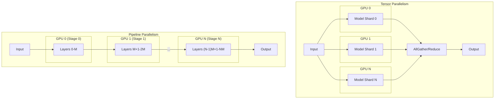

The parallelism implementation includes:

1. **Tensor Parallelism**:
   - Splits individual layers across multiple GPUs
   - Each GPU holds a portion of the model weights
   - Operations like matrix multiplications are distributed
   - Results are aggregated through AllGather or Reduce operations

2. **Pipeline Parallelism**:
   - Divides model into stages executed on different GPUs
   - Each GPU processes a subset of model layers
   - `PipelineParallelLLMEngine` manages the execution flow
   - Uses `PipelineParallelWorker` for processing individual stages
   - Microbatch signaling coordinates between stages

3. **Worker Initialization and Management**:
   - Workers are initialized through Ray ([sarathi/engine/base_llm_engine.py:136-196]())
   - Each worker is assigned a specific GPU and model partition
   - Communication between workers uses distributed process groups
   - Workers report their model parallel ranks for routing

4. **Execution Flow**:
   - Engine sends step inputs to all workers
   - Workers process their portion of the model
   - Results are passed between pipeline stages
   - Final stage sends outputs back to engine

In pipeline parallel mode, each worker executes a portion of the model and passes intermediate activations to the next worker in the pipeline. The process continues until the last worker completes processing and returns final outputs to the engine.

Sources: [sarathi/engine/base_llm_engine.py:136-196](), [sarathi/engine/pipeline_parallel_llm_engine.py:31-66](), [sarathi/worker/pipeline_parallel_worker.py:18-79]()

## Configuration System

Sarathi-Serve uses a comprehensive configuration system to control all aspects of system behavior.

```mermaid
classDiagram
    class "SystemConfig" {
        +replica_config: ReplicaConfig
        +model_config: ModelConfig
        +worker_config: WorkerConfig
        +cache_config: CacheConfig
        +parallel_config: ParallelConfig
        +scheduler_config: BaseSchedulerConfig
        +metrics_config: MetricsConfig
    }
    
    class "ModelConfig" {
        +model: str
        +trust_remote_code: bool
        +dtype: str
        +max_model_len: int
        +seed: int
        +revision: str
    }
    
    class "ParallelConfig" {
        +tensor_parallel_size: int
        +pipeline_parallel_size: int
        +world_size: int
    }
    
    class "CacheConfig" {
        +block_size: int
        +num_gpu_blocks: int
    }
    
    class "BaseSchedulerConfig" {
        <<abstract>>
        +max_num_seqs: int
        +get_max_num_batched_tokens()
        +get_type()
    }
    
    class "WorkerConfig" {
        +gpu_memory_utilization: float
    }
    
    class "ReplicaConfig" {
        +replica_id: int
        +get_resource_mapping()
    }
    
    class "MetricsConfig" {
        +enable_metrics: bool
    }
    
    SystemConfig *-- ModelConfig
    SystemConfig *-- ParallelConfig
    SystemConfig *-- CacheConfig
    SystemConfig *-- BaseSchedulerConfig
    SystemConfig *-- WorkerConfig
    SystemConfig *-- ReplicaConfig
    SystemConfig *-- MetricsConfig
```

The configuration components include:

1. **SystemConfig**: Central configuration class that contains all configuration components:
   - Used to initialize the engine and workers
   - Passed to various system components during initialization

2. **ModelConfig**: Controls model-specific parameters:
   - `model`: HuggingFace model ID or local path
   - `max_model_len`: Maximum sequence length
   - `dtype`: Model precision (float16, bfloat16, etc.)

3. **ParallelConfig**: Defines parallelism strategy:
   - `tensor_parallel_size`: Number of GPUs for tensor parallelism
   - `pipeline_parallel_size`: Number of pipeline stages
   - `world_size`: Total number of GPUs

4. **CacheConfig**: Controls KV cache parameters:
   - `block_size`: Size of KV cache blocks
   - `num_gpu_blocks`: Number of blocks per GPU

5. **SchedulerConfig**: Defines scheduling behavior:
   - Various scheduler implementations with different strategies
   - Controls batch formation and sequence prioritization

6. **ReplicaConfig**: Manages deployment configuration:
   - Maps processes to specific hardware resources
   - Controls replica identification in distributed settings

The configuration system provides fine-grained control over all aspects of model serving, allowing users to optimize for their specific hardware and workload requirements.

Sources: [sarathi/engine/base_llm_engine.py:45-69](), [sarathi/engine/pipeline_parallel_llm_engine.py:45-64](), [sarathi/engine/async_llm_engine.py:263-268]()

## Sequence Management

The sequence management system tracks and manages request states throughout their lifecycle, from initial submission to completion.

```mermaid
graph TD
    subgraph "Sequence Lifecycle"
        NewRequest["New Request"]
        ScheduledSeq["Scheduled Sequence"]
        ProcessingSeq["Processing Sequence"]
        CompletedSeq["Completed Sequence"]
        
        NewRequest -->|"add_request()"| ScheduledSeq
        ScheduledSeq -->|"schedule()"| ProcessingSeq
        ProcessingSeq -->|"on_step_completed()"| ProcessingSeq
        ProcessingSeq -->|"Stop criteria met"| CompletedSeq
    end
    
    subgraph "SequenceManager Components"
        EngineSeqManager["EngineSequenceManager"]
        WorkerSeqManager["WorkerSequenceManager"]
        BlockManager["BlockSpaceManager"]
        Sequence["Sequence"]
        
        EngineSeqManager -->|"manages"| Sequence
        WorkerSeqManager -->|"manages"| Sequence
        EngineSeqManager -->|"allocates blocks via"| BlockManager
        WorkerSeqManager -->|"uses blocks via"| BlockManager
    end
    
    subgraph "Sequence Data"
        SeqData["Sequence"]
        SeqMetadata["SequenceMetadata"]
        SamplerOut["SamplerOutputs"]
        RequestOut["RequestOutput"]
        
        SeqData -->|"contains"| SeqMetadata
        SamplerOut -->|"updates"| SeqData
        SeqData -->|"generates"| RequestOut
    end
```

The sequence management components include:

1. **Sequence** ([sarathi/core/datatypes/sequence.py]()): Core data structure representing a request:
   - Contains prompt, token ids, and generation parameters
   - Tracks sequence state, generated tokens, and completion status
   - Manages sequence logical blocks and physical block mappings

2. **EngineSequenceManager** ([sarathi/core/sequence_manager/engine_sequence_manager.py]()): Manages sequences in the engine:
   - Handles sequence creation and resource allocation
   - Maps between logical and physical blocks
   - Processes model outputs and updates sequence states
   - Generates `RequestOutput` objects for completed steps

3. **WorkerSequenceManager** ([sarathi/core/sequence_manager/worker_sequence_manager.py]()): Manages sequences in workers:
   - Maintains worker-side view of sequence states
   - Provides access to sequence data for model execution
   - Updates sequences with model outputs

4. **BlockSpaceManager** ([sarathi/core/block_manager/block_space_manager.py]()): Manages memory blocks:
   - Allocates and deallocates physical blocks
   - Maps logical to physical blocks
   - Tracks block usage and availability

The sequence management process flows through:

1. **Sequence Creation**:
   - `add_request()` creates a new `Sequence`
   - Sequence is added to `SequenceManager` and scheduler

2. **Scheduling**:
   - Scheduler selects sequences for processing
   - `on_schedule()` prepares sequences for execution

3. **Execution and Processing**:
   - Model generates outputs for scheduled sequences
   - `on_step_completed()` updates sequences with new tokens
   - Sequence state is updated (finished or continuing)

4. **Output Generation**:
   - `generate_request_outputs()` creates outputs for clients
   - Completed sequences are removed and resources freed

Sources: [sarathi/engine/base_llm_engine.py:257-283](), [sarathi/engine/base_llm_engine.py:288-342](), [sarathi/engine/pipeline_parallel_llm_engine.py:171-180]()

## Worker Implementation

Workers are responsible for executing the model on GPUs and managing associated resources.

```mermaid
classDiagram
    class "BaseWorker" {
        +init_worker(config, local_rank, global_rank, comm_info)
        +init_model()
        +init_cache_engine(cache_config)
        +execute_model(scheduler_outputs): SamplerOutputs
        +profile_num_available_blocks(block_size)
        -_execution_loop()
        -_init_zmq_sockets()
    }
    
    class "PipelineParallelWorker" {
        -microbatch_socket: zmq.Socket
        +on_step_completed()
        +on_sampling_completed()
        -_execution_loop()
        +get_model_parallel_ranks(): Tuple[int, int]
    }
    
    class "ModelRunner" {
        -model: PreTrainedModel
        -model_executor: ModelExecutor
        +execute_model()
    }
    
    class "RayWorker" {
        +execute_method(method_name, *args, **kwargs)
    }
    
    BaseWorker <|-- PipelineParallelWorker
    BaseWorker *-- ModelRunner
    RayWorker *-- BaseWorker
```

The worker components include:

1. **BaseWorker** ([sarathi/worker/base_worker.py]()): Base worker implementation:
   - Initializes model, cache, and communication channels
   - Manages sequence state on the worker side
   - Executes the model on input data
   - Handles communication with the engine

2. **PipelineParallelWorker** ([sarathi/worker/pipeline_parallel_worker.py]()): Specialized worker for pipeline parallelism:
   - Manages pipeline stage execution
   - Coordinates with other stages through microbatch signaling
   - Passes intermediate activations between stages
   - Handles completion notification for pipeline stages

3. **RayWorker** ([sarathi/engine/ray_utils.py]()): Ray-based wrapper for distributed execution:
   - Provides remote execution capabilities through Ray
   - Allows method execution across distributed workers
   - Manages resource allocation and scheduling

The worker execution flow includes:

1. **Initialization**:
   - Create worker instances via Ray
   - Initialize distributed process groups
   - Load model weights and prepare cache

2. **Execution Loop**:
   - Receive step inputs from engine
   - Process input sequences through model
   - Generate outputs (tokens for last stage, activations for intermediate stages)
   - Send results back to engine

3. **Resource Management**:
   - Profile available GPU memory for cache blocks
   - Manage KV cache on worker side
   - Track sequence states and allocated memory

Sources: [sarathi/worker/pipeline_parallel_worker.py:18-79](), [sarathi/engine/base_llm_engine.py:136-196](), [sarathi/engine/base_llm_engine.py:400-457]()

## Summary

Sarathi-Serve implements a sophisticated system architecture for high-performance LLM serving with the following key components:

1. **Engine Hierarchy**: Layered engine design with specialized implementations for different parallelism strategies and execution modes
2. **Request Processing**: Multi-stage pipeline from request submission to token generation and output delivery
3. **Communication**: ZMQ-based messaging system for efficient communication between engine and workers
4. **Parallel Processing**: Support for both tensor and pipeline parallelism to scale models across multiple GPUs
5. **Configuration**: Comprehensive configuration system to control all aspects of system behavior
6. **Sequence Management**: Tracking and management of request states throughout their lifecycle
7. **Worker Implementation**: Specialized workers for model execution and resource management

This architecture enables Sarathi-Serve to provide high-throughput, low-latency LLM inference for various deployment scenarios and hardware configurations.

---

# Page: Engine Components

# Engine Components

<details>
<summary>Relevant source files</summary>

The following files were used as context for generating this wiki page:

- [sarathi/engine/async_llm_engine.py](sarathi/engine/async_llm_engine.py)
- [sarathi/engine/base_llm_engine.py](sarathi/engine/base_llm_engine.py)
- [sarathi/engine/pipeline_parallel_llm_engine.py](sarathi/engine/pipeline_parallel_llm_engine.py)
- [sarathi/utils/__init__.py](sarathi/utils/__init__.py)
- [sarathi/worker/pipeline_parallel_worker.py](sarathi/worker/pipeline_parallel_worker.py)

</details>


This document details the core engine components of the Sarathi-Serve framework, which are responsible for orchestrating the LLM inference process. The engine components serve as the central coordination mechanism for handling requests, scheduling batches, managing model execution, and processing outputs. For worker architecture details, see [Worker Architecture](#2.2).

## Engine Hierarchy

Sarathi implements a hierarchical engine architecture with three main engine implementations that serve different deployment scenarios:

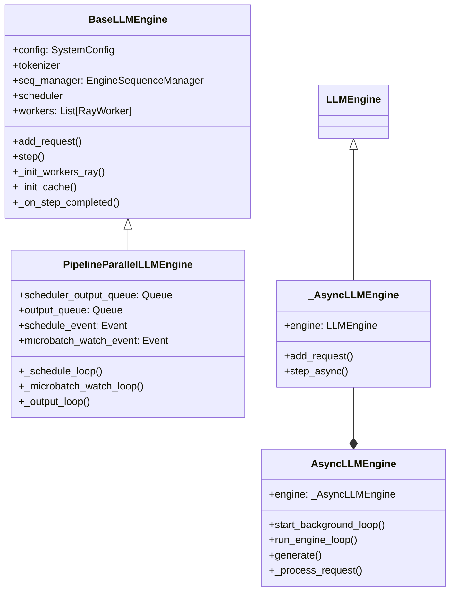

Sources: [sarathi/engine/base_llm_engine.py:34-487](), [sarathi/engine/pipeline_parallel_llm_engine.py:31-197](), [sarathi/engine/async_llm_engine.py:238-512]()

## Engine Implementations

### BaseLLMEngine

The `BaseLLMEngine` is the foundation of the engine hierarchy, providing core functionality for request processing, model execution coordination, and output handling. It's designed for simple single-stage inference workloads.

Key responsibilities:
- Initializing workers via Ray
- Setting up ZMQ communication channels
- Managing the token cache
- Coordinating with schedulers
- Processing model outputs

```mermaid
flowchart TB
    subgraph "BaseLLMEngine"
        init["Initialize Components"]
        request["add_request()"]
        step["step()"]
        schedule["Schedule sequences"]
        execute["Execute model via workers"]
        process["Process outputs"]
        
        init --> request
        request --> step
        step --> schedule
        schedule --> execute
        execute --> process
    end
    
    Client[/"Client application"/] -->|"prompt, sampling_params"| request
    process -->|"RequestOutput"| Client
    
    subgraph "Key Components"
        tokenizer["Tokenizer"]
        seq_manager["EngineSequenceManager"]
        scheduler["Scheduler"]
        workers["Ray Workers"]
    end
    
    init --> tokenizer
    init --> seq_manager
    init --> scheduler
    init --> workers
    
    schedule --> scheduler
    execute --> workers
    process --> seq_manager
```

Sources: [sarathi/engine/base_llm_engine.py:34-487]()

### PipelineParallelLLMEngine

The `PipelineParallelLLMEngine` extends the base engine to support pipeline parallelism, a technique that distributes model layers across multiple GPUs to handle larger models. This implementation uses a multi-threaded architecture with dedicated threads for scheduling, output processing, and microbatch coordination.

Key features:
- Thread-based asynchronous scheduling
- ZMQ-based communication with workers
- Pipeline stage coordination using events and queues

```mermaid
flowchart TB
    subgraph "PipelineParallelLLMEngine"
        direction LR
        schedule_thread["schedule_thread"]
        output_thread["output_thread"]
        microbatch_thread["microbatch_watch_thread"]
        
        schedule_thread -->|"SchedulerOutputs"| scheduler_queue["scheduler_output_queue"]
        scheduler_queue --> output_thread
        microbatch_thread -->|"completion signal"| schedule_thread
        output_thread -->|"RequestOutput"| output_queue["output_queue"]
    end
    
    Client[/"Client application"/] -->|"step()"| output_queue
    
    subgraph "Pipeline Workers"
        direction TB
        worker1["Worker 1\n(Early Layers)"]
        worker2["Worker 2\n(Middle Layers)"]
        worker3["Worker 3\n(Last Layers)"]
        
        worker1 --> worker2
        worker2 --> worker3
    end
    
    schedule_thread -->|"StepInputs"| worker1
    worker3 -->|"SamplerOutputs"| output_thread
    worker3 -->|"Microbatch completion"| microbatch_thread
```

Sources: [sarathi/engine/pipeline_parallel_llm_engine.py:31-197](), [sarathi/worker/pipeline_parallel_worker.py:18-79]()

### AsyncLLMEngine

The `AsyncLLMEngine` provides an asynchronous API for non-blocking request handling, making it suitable for web server integration. It runs a background loop that continuously processes requests, allowing clients to submit jobs without waiting for completion.

Key features:
- Non-blocking request handling via asyncio
- Streaming token generation
- Background processing loop

```mermaid
flowchart TB
    subgraph "AsyncLLMEngine"
        generate["generate()"]
        process["_process_request()"]
        background["run_engine_loop()"]
        add_request["add_request()"]
        step_async["step_async()"]
    end
    
    Client[/"Client application"/] -->|"prompt, sampling_params"| generate
    generate --> process
    process --> add_request
    
    subgraph "AsyncStream Handling"
        stream["AsyncStream"]
        request_tracker["RequestTracker"]
        
        request_tracker -->|"create"| stream
        add_request -->|"add to"| request_tracker
        background -->|"process"| request_tracker
        stream -->|"yield tokens"| Client
    end
    
    subgraph "_AsyncLLMEngine"
        underlying["Underlying LLMEngine"]
        step_async -->|"run_in_executor"| underlying
    end
    
    background -->|"periodic"| step_async
```

Sources: [sarathi/engine/async_llm_engine.py:27-512]()

## Request Processing Flow

The engine components process requests through several distinct stages, from initial submission to final output generation.

```mermaid
sequenceDiagram
    participant Client
    participant AsyncLLMEngine
    participant BaseLLMEngine
    participant Scheduler
    participant SequenceManager
    participant Worker
    
    Client->>AsyncLLMEngine: generate(prompt, sampling_params)
    AsyncLLMEngine->>BaseLLMEngine: add_request(prompt, sampling_params)
    BaseLLMEngine->>SequenceManager: add_seq(seq)
    BaseLLMEngine->>Scheduler: add_seq(seq)
    
    loop Until completion
        AsyncLLMEngine->>BaseLLMEngine: step()
        BaseLLMEngine->>Scheduler: schedule()
        Scheduler-->>BaseLLMEngine: SchedulerOutputs
        
        BaseLLMEngine->>SequenceManager: on_schedule(scheduler_outputs)
        SequenceManager-->>BaseLLMEngine: ignored_seqs, seq_metadata_list
        
        BaseLLMEngine->>Worker: send StepInputs via ZMQ
        Worker->>Worker: execute_model()
        Worker-->>BaseLLMEngine: SamplerOutputs via ZMQ
        
        BaseLLMEngine->>SequenceManager: on_step_completed(scheduler_outputs, sampler_outputs)
        SequenceManager->>SequenceManager: Update sequence states
        SequenceManager-->>BaseLLMEngine: RequestOutputs
        
        BaseLLMEngine-->>AsyncLLMEngine: RequestOutputs
        AsyncLLMEngine-->>Client: Yield tokens
    end
```

Sources: [sarathi/engine/async_llm_engine.py:392-462](), [sarathi/engine/base_llm_engine.py:364-398]()

## Engine Initialization and Configuration

The engine components rely on a comprehensive configuration system to correctly initialize all required resources and parameters.

```mermaid
flowchart TB
    subgraph "Engine Initialization"
        init["__init__()"]
        verify["_verify_args()"]
        init_workers["_init_workers_ray()"]
        init_cache["_init_cache()"]
        init_worker_map["_init_worker_map()"]
        init_scheduler["Create scheduler"]
        
        init --> verify
        verify --> init_workers
        init_workers --> init_cache
        init_cache --> init_worker_map
        init_worker_map --> init_scheduler
    end
    
    subgraph "Configuration"
        system_config["SystemConfig"]
        model_config["ModelConfig"]
        parallel_config["ParallelConfig"]
        cache_config["CacheConfig"]
        scheduler_config["SchedulerConfig"]
    end
    
    system_config --> init
    model_config --> verify
    parallel_config --> verify
    cache_config --> init_cache
    scheduler_config --> init_scheduler
    
    init_workers -->|"create workers"| workers["Ray Workers"]
    init_cache -->|"set num_gpu_blocks"| cache_config
    init_worker_map -->|"map model_parallel_ranks"| worker_map["Worker Map"]
```

Sources: [sarathi/engine/base_llm_engine.py:48-106]()

## Engine-Worker Communication

The engine components communicate with workers using ZeroMQ (ZMQ) sockets for efficient message passing.

```mermaid
flowchart LR
    subgraph "Engine Components"
        direction TB
        engine["BaseLLMEngine/PipelineParallelLLMEngine"]
        enqueue_socket["enqueue_socket (PUB)"]
        output_socket["output_socket (PULL)"]
        microbatch_socket["microbatch_socket (PULL)\n(Pipeline only)"]
    end
    
    subgraph "Worker Components"
        direction TB
        worker["Worker"]
        worker_enqueue["enqueue_socket (SUB)"]
        worker_output["output_socket (PUSH)"]
        worker_microbatch["microbatch_socket (PUSH)\n(Pipeline only)"]
    end
    
    engine -->|"init_zmq_sockets()"| enqueue_socket
    engine -->|"init_zmq_sockets()"| output_socket
    engine -->|"init_zmq_sockets()"| microbatch_socket
    
    worker -->|"init_zmq_sockets()"| worker_enqueue
    worker -->|"init_zmq_sockets()"| worker_output
    worker -->|"init_zmq_sockets()"| worker_microbatch
    
    enqueue_socket -->|"StepInputs"| worker_enqueue
    worker_output -->|"SamplerOutputs"| output_socket
    worker_microbatch -->|"Completion signal"| microbatch_socket
```

Sources: [sarathi/engine/base_llm_engine.py:117-122](), [sarathi/engine/pipeline_parallel_llm_engine.py:68-72](), [sarathi/worker/pipeline_parallel_worker.py:26-32]()

## Key Data Structures

The engine components utilize several key data structures to manage the inference process:

| Data Structure | Purpose | Key Properties |
|----------------|---------|---------------|
| `Sequence` | Represents a single request | Prompt, token IDs, sampling parameters, state |
| `SchedulerOutputs` | Represents the scheduler's decisions | Prefill batch, decode batch, ignored sequences |
| `StepInputs` | Input to workers for each step | Scheduler outputs, new sequences, pending step outputs |
| `SamplerOutputs` | Results from token sampling | Next tokens, logprobs, finished flags |
| `RequestOutput` | Response sent to client | Generated text, token IDs, finish reason |

Sources: [sarathi/engine/base_llm_engine.py:257-283](), [sarathi/engine/pipeline_parallel_llm_engine.py:143-180]()

## Engine-Specific Optimizations

### BaseLLMEngine Optimizations
- Direct synchronous execution flow
- Efficient memory usage tracking and block allocation
- Worker coordination via Ray

### PipelineParallelLLMEngine Optimizations
- Multi-threaded execution for higher throughput
- Microbatch completion signaling for continuous execution
- Asynchronous scheduling loop

### AsyncLLMEngine Optimizations
- Non-blocking request handling
- Token streaming capability
- Background processing to maximize throughput

Sources: [sarathi/engine/base_llm_engine.py:364-398](), [sarathi/engine/pipeline_parallel_llm_engine.py:113-180](), [sarathi/engine/async_llm_engine.py:355-366]()

---

# Page: Worker Architecture

# Worker Architecture

<details>
<summary>Relevant source files</summary>

The following files were used as context for generating this wiki page:

- [sarathi/core/datatypes/comm_info.py](sarathi/core/datatypes/comm_info.py)
- [sarathi/core/datatypes/sequence.py](sarathi/core/datatypes/sequence.py)
- [sarathi/core/datatypes/step_inputs.py](sarathi/core/datatypes/step_inputs.py)
- [sarathi/core/scheduler/simple_chunking_scheduler.py](sarathi/core/scheduler/simple_chunking_scheduler.py)
- [sarathi/core/sequence_manager/worker_sequence_manager.py](sarathi/core/sequence_manager/worker_sequence_manager.py)
- [sarathi/worker/base_worker.py](sarathi/worker/base_worker.py)

</details>


This page documents the worker architecture in Sarathi-Serve, focusing on how worker components process model requests and interact with the engine. For information about engine components, see [Engine Components](#2.1).

## Overview

In Sarathi-Serve, workers are responsible for executing model inference on individual GPUs. Each worker is associated with a single GPU and manages the key-value (KV) cache, executes the model, and maintains sequence information for request processing. In distributed inference scenarios, workers collaborate to process model partitions in parallel.

```mermaid
flowchart TD
    subgraph "Worker Architecture"
        Worker["BaseWorker"] --> ModelRunner
        Worker --> SeqManager["WorkerSequenceManager"]
        Worker --> ZMQ["ZMQ Communication"]
        Worker --> KVCache["KV Cache Management"]
        
        ModelRunner --> ModelExecution["Model Execution"]
        ModelRunner --> Sampler["Token Sampling"]
        
        SeqManager --> BlockManager["Block Space Manager"]

        ZMQ --> EnqueueSocket["Enqueue Socket (SUB)"]
        ZMQ --> OutputSocket["Output Socket (PUSH)"]
    end

    Engine["LLM Engine"] <--"SchedulerOutputs & Sequences"--> ZMQ
    ZMQ --"SamplerOutputs"--> Engine

    BlockManager <--> KVCache
```

Sources: [sarathi/worker/base_worker.py:34-68](), [sarathi/worker/base_worker.py:75-85]()

## Worker Components

### BaseWorker

The `BaseWorker` class serves as the foundation of worker functionality. Each worker:

1. Initializes a GPU device
2. Sets up communication channels with the engine
3. Manages sequence processing
4. Handles model execution
5. Tracks metrics

The worker initialization follows a two-phase process:
1. First, initialize the core components and model
2. Then, initialize the cache engine with the specified configuration

```mermaid
sequenceDiagram
    participant Engine as "LLM Engine"
    participant Worker as "BaseWorker"
    participant Model as "ModelRunner"
    participant SeqManager as "WorkerSequenceManager"
    participant BlockManager as "Block Space Manager"
    
    Engine->>Worker: Initialize(config, rank, comm_info)
    Worker->>Worker: _init_zmq_sockets()
    Worker->>Worker: init_model()
    Worker->>Model: Initialize ModelRunner
    
    Engine->>Worker: init_cache_engine(cache_config)
    Worker->>Model: init_kv_cache(num_gpu_blocks)
    Worker->>SeqManager: Initialize WorkerSequenceManager
    SeqManager->>BlockManager: Initialize BlockSpaceManager
    Worker->>Worker: Start execution_thread
    Worker-->>Engine: Signal Ready
```

Sources: [sarathi/worker/base_worker.py:42-72](), [sarathi/worker/base_worker.py:92-139](), [sarathi/worker/base_worker.py:143-154]()

### Communication System

Workers communicate with the engine using ZeroMQ (ZMQ) sockets:

1. **Enqueue Socket (SUB)**: Receives step inputs from the engine
2. **Output Socket (PUSH)**: Sends sampler outputs back to the engine

The communication flow is unidirectional for each socket, creating a clean pipeline for request processing.

Sources: [sarathi/worker/base_worker.py:75-85](), [sarathi/core/datatypes/comm_info.py:4-12]()

### WorkerSequenceManager

The `WorkerSequenceManager` tracks and manages sequences assigned to the worker. It:

1. Maintains the mapping between sequence IDs and sequence objects
2. Handles block allocation and deallocation for sequences
3. Updates sequence status and metadata

The sequence manager uses a block space manager which is responsible for memory allocation in the KV cache.

Sources: [sarathi/core/sequence_manager/worker_sequence_manager.py:11-60]()

## Execution Flow

The worker's main execution loop runs in a dedicated thread and performs the following steps:

1. Receive step inputs via ZMQ
2. Add new sequences to the sequence manager
3. Execute the model based on scheduler outputs
4. Send the resulting sampler outputs back to the engine

```mermaid
flowchart TD
    subgraph "Worker Execution Loop"
        direction LR
        Receive["Receive Step Inputs"] --> AddNewSeqs["Add New Sequences"]
        AddNewSeqs --> SeqManager["Update Sequence Manager"]
        SeqManager --> RunModel["Execute Model"]
        RunModel --> SendOutputs["Send Outputs to Engine"]
    end

    subgraph "Step Inputs Components"
        StepInputs["StepInputs"] --> SchedulerOutputs["SchedulerOutputs"]
        StepInputs --> NewSequences["New Sequences"]
    end

    subgraph "Model Execution"
        OnSchedule["seq_manager.on_schedule()"] --> ModelRun["model_runner.run()"]
        ModelRun --> OnStepCompleted["on_step_completed()"]
    end

    StepInputs --> Receive
    SeqManager --> OnSchedule
    ModelRun --> SendOutputs
```

Sources: [sarathi/worker/base_worker.py:200-217](), [sarathi/worker/base_worker.py:164-198](), [sarathi/core/datatypes/step_inputs.py:8-21]()

## Request Processing Stages

Workers process two types of requests:

1. **Prompt Processing (Prefill)**: Process multiple tokens from the prompt at once
2. **Token Generation (Decode)**: Generate one token at a time based on previous output

The scheduler determines whether to perform prefill or decode operations for each sequence in a given step.

```mermaid
flowchart LR
    subgraph "Sequence Processing Stages"
        Prompt["Prompt Phase (Prefill)"] --> Generate["Generation Phase (Decode)"]
    end

    subgraph "Prompt Phase Details"
        PromptReceive["Receive Prompt Tokens"] --> PromptExecute["Execute Multiple Tokens"]
        PromptExecute --> UpdateStageProcessed["Update prompt_tokens_stage_processed"]
        UpdateStageProcessed --> CheckComplete["Check if Prompt Complete"]
    end

    subgraph "Generation Phase Details"
        TokenGenerate["Generate Next Token"] --> AppendToken["Append Token to Sequence"]
        AppendToken --> UpdateBlocks["Update Block Allocation"]
        UpdateBlocks --> CheckFinished["Check if Generation Complete"]
    end

    Prompt --> PromptReceive
    CheckComplete --> Generate
    Generate --> TokenGenerate
```

Sources: [sarathi/core/datatypes/sequence.py:11-216](), [sarathi/core/sequence_manager/worker_sequence_manager.py:41-52](), [sarathi/core/datatypes/sequence.py:220-277]()

## Memory Management

Workers manage GPU memory primarily through the block space manager. Each sequence is allocated logical token blocks which map to physical GPU memory blocks for the KV cache.

The allocation process:
1. When a sequence is scheduled, check if it already has memory allocated
2. If not, allocate new blocks from the block space manager
3. If already allocated, append a new slot for the next token
4. When a sequence is completed or preempted, free its allocated blocks

Sources: [sarathi/core/sequence_manager/worker_sequence_manager.py:28-40](), [sarathi/core/sequence_manager/worker_sequence_manager.py:41-52]()

## Parallel Processing Support

Sarathi-Serve workers support two forms of parallelism:

1. **Tensor Parallelism**: Distributing model weights across multiple GPUs
2. **Pipeline Parallelism**: Distributing model layers across multiple GPUs

Each worker is initialized with its tensor and pipeline parallel ranks, which determine its role in the distributed inference process.

```mermaid
flowchart TD
    subgraph "Tensor Parallelism"
        TP["Tensor-Parallel Workers"] --- TP1["Worker 0: TP Rank 0"]
        TP --- TP2["Worker 1: TP Rank 1"]
        TP --- TP3["Worker 2: TP Rank 2"]
        TP --- TP4["Worker 3: TP Rank 3"]
    end
    
    subgraph "Pipeline Parallelism"
        PP["Pipeline-Parallel Workers"] --- PP1["Worker 0: PP Rank 0<br>Layers 1-N/4"]
        PP --- PP2["Worker 1: PP Rank 1<br>Layers N/4+1-N/2"]
        PP --- PP3["Worker 2: PP Rank 2<br>Layers N/2+1-3N/4"]
        PP --- PP4["Worker 3: PP Rank 3<br>Layers 3N/4+1-N"]
        
        PP1 -->|"Hidden States"| PP2
        PP2 -->|"Hidden States"| PP3
        PP3 -->|"Hidden States"| PP4
    end
    
    Model["Model"] --- TP
    Model --- PP
```

The distributed environment is initialized during worker startup:

1. Initialize torch.distributed process group
2. Set tensor and pipeline parallel ranks
3. Initialize model parallel state
4. Load appropriate model partitions based on the rank

Sources: [sarathi/worker/base_worker.py:110-130](), [sarathi/worker/base_worker.py:259-285]()

## Interaction with Scheduler

The scheduler determines which sequences should be processed in each step and communicates this to workers through `SchedulerOutputs`. The worker processes these instructions by:

1. Updating sequence states based on scheduler decisions
2. Allocating or freeing blocks as needed
3. Processing the scheduled sequences in the current batch

Schedulers like `SimpleChunkingScheduler` alternate between prefill and decode operations to maximize throughput while maintaining reasonable latency.

| Operation Type | Characteristics | When Used |
|----------------|----------------|-----------|
| Prefill        | Process multiple tokens at once | For new prompts or partial prompt processing |
| Decode         | Generate one token at a time | For continuing generation after prompt processing |

Sources: [sarathi/core/scheduler/simple_chunking_scheduler.py:28-205](), [sarathi/worker/base_worker.py:164-198]()

## Worker Metrics Collection

Workers track various metrics during execution:

1. Batch processing time
2. Memory usage
3. Token generation throughput
4. Model execution latency

These metrics are stored in a `MetricsStore` instance and can be accessed for performance analysis and optimization.

Sources: [sarathi/worker/base_worker.py:189-198](), [sarathi/worker/base_worker.py:219-228]()

---

# Page: Sequence Management

# Sequence Management

<details>
<summary>Relevant source files</summary>

The following files were used as context for generating this wiki page:

- [sarathi/core/datatypes/scheduler_output.py](sarathi/core/datatypes/scheduler_output.py)
- [sarathi/core/scheduler/base_scheduler.py](sarathi/core/scheduler/base_scheduler.py)
- [sarathi/core/sequence_manager/base_sequence_manager.py](sarathi/core/sequence_manager/base_sequence_manager.py)
- [sarathi/entrypoints/openai/serving_completion.py](sarathi/entrypoints/openai/serving_completion.py)

</details>


## Purpose and Scope

This document describes the Sequence Management system in Sarathi-Serve, which is responsible for tracking and managing sequences (representing user inference requests) throughout their lifecycle. The Sequence Manager handles sequence state transitions, token processing, and coordinates with the Scheduler and Block Space Manager components. For information about memory management of these sequences, see [Memory Management](#2.4).

## Sequence Lifecycle

A sequence in Sarathi-Serve represents a text generation request and goes through multiple states during its lifetime. The `SequenceStatus` enum defines these states.

```mermaid
stateDiagram-v2
    [*] --> "WAITING"
    "WAITING" --> "RUNNING": scheduled
    "RUNNING" --> "PAUSED": after step completed
    "PAUSED" --> "RUNNING": rescheduled
    "RUNNING" --> "FINISHED": generation complete
    "WAITING" --> "FINISHED_IGNORED": constraints not met
    "PAUSED" --> "WAITING": preempted
    "FINISHED" --> [*]
    "FINISHED_IGNORED" --> [*]
```

Sources: [sarathi/core/sequence_manager/base_sequence_manager.py:14-145]()

## BaseSequenceManager Architecture

The sequence management system is built around the abstract `BaseSequenceManager` class, which defines the interface and core functionality for managing sequences.

```mermaid
classDiagram
    class "BaseSequenceManager" {
        +Dict[str, Sequence] seq_map
        +add_seq(seq: Sequence)
        +on_schedule(scheduler_outputs: SchedulerOutputs)
        +on_step_completed(scheduler_outputs, sampler_outputs)
        +generate_request_outputs(ignored_seqs, seq_metadata_list)
        -_free_seq(seq_id: str)
        -_preempt_seq(seq_id: str)
        -_pause_seq(seq_id: str)
        -_resume_seq(seq_id: str)
        -_on_seq_scheduled(seq_sched_metadata)
        -_process_seq_output(seq, sample)
        #_get_block_table(seq)* abstract
        #_on_append_token(seq)* abstract
    }
    
    class "Sequence" {
        +str seq_id
        +List[int] token_ids
        +bool prompt_processing_finished
        +SequenceStatus status
        +append_token_id(token_id)
        +check_stop()
        +is_finished()
        +is_running()
        +is_waiting()
        +is_executing()
        +is_paused()
        +reset_for_recompute()
        +set_status(status)
    }
    
    class "SchedulerOutputs" {
        +List[str] ignored_seq_ids
        +List[str] preempted_seq_ids
        +List[SequenceScheduleMetadata] scheduled_seq_metadata_list
        +bool is_empty()
        +bool has_no_output()
        +List[str] seq_ids
    }
    
    class "SequenceMetadata" {
        +Sequence seq
        +List[int] block_table
        +int num_prompt_tokens
    }
    
    class "SamplerOutput" {
        +str seq_id
        +int output_token
        +bool is_prompt_processed
    }
    
    "BaseSequenceManager" "1" -- "many" "Sequence": manages
    "BaseSequenceManager" -- "SchedulerOutputs": processes
    "BaseSequenceManager" .. "SequenceMetadata": creates
    "BaseSequenceManager" .. "SamplerOutput": processes
```

Sources: [sarathi/core/sequence_manager/base_sequence_manager.py:18-152](), [sarathi/core/datatypes/scheduler_output.py:6-54]()

## Sequence Management Workflow

The sequence management system follows a specific workflow for processing sequences, interacting with the scheduler, and handling token generation.

```mermaid
sequenceDiagram
    participant "Client" as Client
    participant "AsyncLLMEngine" as Engine
    participant "BaseScheduler" as Scheduler
    participant "BaseSequenceManager" as SequenceManager
    participant "ModelExecutor" as ModelExecution
    
    Client->>Engine: generate(prompt, sampling_params)
    Engine->>SequenceManager: add_seq(sequence)
    
    loop Until request completed
        Engine->>Scheduler: schedule()
        Scheduler-->>Engine: SchedulerOutputs
        Engine->>SequenceManager: on_schedule(scheduler_outputs)
        Note over SequenceManager: Update sequence states
        
        Engine->>ModelExecution: Execute model step
        ModelExecution-->>Engine: SamplerOutputs
        
        Engine->>SequenceManager: on_step_completed(scheduler_outputs, sampler_outputs)
        Note over SequenceManager: Process tokens
        Note over SequenceManager: Update states
        
        SequenceManager-->>Engine: RequestOutputs
        
        alt If token is generated
            Engine-->>Client: Yield token
        end
    end
```

Sources: [sarathi/core/sequence_manager/base_sequence_manager.py:58-151](), [sarathi/entrypoints/openai/serving_completion.py:50-282]()

## Key Operations

### Sequence Addition

New sequences are added to the `seq_map` dictionary using the `add_seq` method. This method is synchronized to ensure thread safety.

```python
@synchronized
def add_seq(self, seq: Sequence) -> None:
    assert seq.seq_id not in self.seq_map
    self.seq_map[seq.seq_id] = seq
```

Sources: [sarathi/core/sequence_manager/base_sequence_manager.py:23-26]()

### Scheduling Process

The `on_schedule` method processes scheduler outputs to determine which sequences to execute next:

1. Free ignored sequences (remove from management)
2. Preempt sequences as needed (reset for recomputation)
3. Prepare metadata for scheduled sequences (resume paused sequences)

```python
@synchronized
def on_schedule(
    self,
    scheduler_outputs: SchedulerOutputs,
) -> Tuple[List[Sequence], List[SequenceMetadata]]:
    ignored_seqs: List[Sequence] = []
    for seq_id in scheduler_outputs.ignored_seq_ids:
        assert seq_id in self.seq_map
        seq = self.seq_map[seq_id]
        ignored_seqs.append(seq)
        self._free_seq(seq_id)

    for seq_id in scheduler_outputs.preempted_seq_ids:
        self._preempt_seq(seq_id)

    seq_metadata_list: List[SequenceMetadata] = []

    for seq_sched_metadata in scheduler_outputs.scheduled_seq_metadata_list:
        self._on_seq_scheduled(seq_sched_metadata)
        seq = self.seq_map[seq_sched_metadata.seq_id]
        seq_metadata_list.append(
            SequenceMetadata(
                seq,
                self._get_block_table(seq),
                seq_sched_metadata.num_prompt_tokens,
            )
        )

    return ignored_seqs, seq_metadata_list
```

Sources: [sarathi/core/sequence_manager/base_sequence_manager.py:58-86]()

### Processing Results

The `on_step_completed` method handles the results from a model execution step:

1. Process each scheduled sequence's output from the sampler
2. Update sequence states and metadata
3. Process generated tokens
4. Check for sequence completion

```python
@synchronized
def on_step_completed(
    self,
    scheduler_outputs: SchedulerOutputs,
    sampler_outputs: Optional[SamplerOutputs],
) -> None:
    for scheduled_seq_metadata, sampler_output in zip(
        scheduler_outputs.scheduled_seq_metadata_list, sampler_outputs
    ):
        assert scheduled_seq_metadata.seq_id == sampler_output.seq_id
        seq = self.seq_map[scheduled_seq_metadata.seq_id]
        if seq.is_waiting():
            # seq is preempted
            continue

        if not seq.prompt_processing_finished:
            seq.update_prompt_tokens_stage_processed(
                scheduled_seq_metadata.prompt_chunk_len
            )
            seq.update_prompt_tokens_processed(
                scheduled_seq_metadata.prompt_chunk_len
            )

        self._pause_seq(scheduled_seq_metadata.seq_id)

        self._process_seq_output(
            seq,
            sampler_output,
        )
```

Sources: [sarathi/core/sequence_manager/base_sequence_manager.py:111-143]()

### Token Processing

When a token is generated, the `_process_seq_output` method:

1. Appends the token to the sequence
2. Calls the abstract `_on_append_token` method for implementation-specific handling
3. Checks if stop conditions are met
4. Frees the sequence if it's finished

```python
def _process_seq_output(
    self,
    seq: Sequence,
    sample: SamplerOutput,
) -> None:
    # at this point, the seq should be in paused state
    assert not seq.is_finished()

    if not seq.prompt_processing_finished:
        return

    seq.append_token_id(sample.output_token)
    self._on_append_token(seq)
    # this function will update the seq status
    # to finished if the stop condition is met
    seq.check_stop()
    if seq.is_finished():
        self._free_seq(seq.seq_id)
```

Sources: [sarathi/core/sequence_manager/base_sequence_manager.py:92-109]()

## Integration with Other Components

### Scheduler Integration

The Sequence Manager closely interacts with the Scheduler component, which determines which sequences to process in each step. The Scheduler's decisions are communicated through the `SchedulerOutputs` class.

```mermaid
flowchart TD
    subgraph "Scheduler System"
        direction LR
        BS["BaseScheduler"] --> |"produces"| SO["SchedulerOutputs"]
        SO --> |"contains"| IG["ignored_seq_ids"]
        SO --> |"contains"| PR["preempted_seq_ids"]
        SO --> |"contains"| SM["scheduled_seq_metadata_list"]
    end
    
    subgraph "Sequence Management"
        direction LR
        BSM["BaseSequenceManager"] --> |"maintains"| SEQM["seq_map: Dict[str, Sequence]"]
        BSM --> |"implements"| ONSCHED["on_schedule()"]
        BSM --> |"implements"| ONSTEP["on_step_completed()"]
    end
    
    SO --> ONSCHED
    ONSTEP --> |"updates"| SEQM
```

Sources: [sarathi/core/scheduler/base_scheduler.py:17-134](), [sarathi/core/datatypes/scheduler_output.py:6-54]()

### Block Space Manager Integration

The abstract `_get_block_table` method must be implemented by concrete sequence managers to interact with a block space manager, which allocates memory for sequences.

## Abstract Methods for Implementation

The `BaseSequenceManager` class defines two abstract methods that must be implemented by concrete subclasses:

1. `_get_block_table(seq: Sequence) -> List[int]`: Returns the memory block table for a sequence
2. `_on_append_token(seq: Sequence) -> None`: Handles token appending logic specific to the implementation

These methods allow for flexibility in how different implementations manage memory and handle token generation.

Sources: [sarathi/core/sequence_manager/base_sequence_manager.py:54-56](), [sarathi/core/sequence_manager/base_sequence_manager.py:88-90]()

## Thread Safety

The Sequence Manager uses the `@synchronized` decorator on critical methods to ensure thread safety when managing sequences. This includes:

- `add_seq`: Adding new sequences
- `on_schedule`: Processing scheduler outputs
- `on_step_completed`: Processing model execution results

This synchronization is essential since the sequence manager can be accessed from multiple threads in the async processing environment.

Sources: [sarathi/core/sequence_manager/base_sequence_manager.py:23-26](), [sarathi/core/sequence_manager/base_sequence_manager.py:58-86](), [sarathi/core/sequence_manager/base_sequence_manager.py:111-143]()

---

# Page: Memory Management

# Memory Management

<details>
<summary>Relevant source files</summary>

The following files were used as context for generating this wiki page:

- [sarathi/core/datatypes/block.py](sarathi/core/datatypes/block.py)
- [sarathi/model_executor/attention/attention_backend_registry.py](sarathi/model_executor/attention/attention_backend_registry.py)
- [sarathi/model_executor/attention/flashinfer_attention_wrapper.py](sarathi/model_executor/attention/flashinfer_attention_wrapper.py)

</details>


This document provides a technical overview of the memory management system in Sarathi-Serve, focusing on how Key-Value (KV) cache and token blocks are managed to optimize memory usage during LLM inference. For information about sequence management implementation, see [Sequence Management](#2.3).

## Overview

Sarathi-Serve employs a sophisticated memory management system that is critical for achieving high throughput and low latency. The system organizes tokens into blocks to efficiently manage the GPU memory allocated for the KV cache, which stores intermediate attention states of tokens during generation.

```mermaid
graph TD
    subgraph "Memory Management Components"
        BSM["BlockSpaceManager"] --> LTB["LogicalTokenBlocks"]
        BSM --> PTB["PhysicalTokenBlocks"]
        KVC["KVCache"] --> BSM
        
        SEQ["SequenceManager"] --> BSM
        ATT["AttentionWrapper"] --> KVC
    end

    subgraph "Sequence Processing"
        REQ["Request"] --> SEQ
        SEQ --> BLOCKS["Token Blocks"]
        BLOCKS --> MEM["GPU Memory"]
    end
```

Sources: [sarathi/core/datatypes/block.py:1-69](), [sarathi/model_executor/attention/flashinfer_attention_wrapper.py:1-271]()

## Token Block Architecture

The memory management system is built around the concept of token blocks, which come in two forms:

### Logical Token Blocks

Logical token blocks represent the content and state of token sequences, tracking which tokens are stored in which memory locations. They provide a high-level abstraction for managing token collections.

```mermaid
classDiagram
    class LogicalTokenBlock {
        +block_number: int
        +block_size: int
        +token_ids: List[int]
        +num_tokens: int
        +is_empty() bool
        +get_num_empty_slots() int
        +is_full() bool
        +append_tokens(token_ids: List[int]) void
        +get_token_ids() List[int]
        +get_last_token_id() int
    }
```

Sources: [sarathi/core/datatypes/block.py:12-51]()

### Physical Token Blocks

Physical token blocks correspond to actual memory blocks in the GPU's KV cache. They represent the physical storage location for the token state information retained during generation.

```mermaid
classDiagram
    class PhysicalTokenBlock {
        +block_number: int
        +block_size: int
    }
```

Sources: [sarathi/core/datatypes/block.py:53-68]()

## KV Cache System

The KV Cache (Key-Value Cache) is a critical component for efficient LLM inference, storing intermediate attention states to avoid redundant computation during autoregressive generation.

### Structure and Implementation

In Sarathi-Serve, the KV cache is implemented as a paged memory system, where tokens are organized into fixed-size blocks. This approach allows for efficient memory allocation and retrieval.

```mermaid
graph TD
    subgraph "KV Cache Structure"
        KVC["KV Cache"]
        KVC --> B1["Block 1"]
        KVC --> B2["Block 2"]
        KVC --> BN["Block N"]
        
        subgraph "Block Components"
            B1 --> K1["Keys"]
            B1 --> V1["Values"]
            K1 --> KH1["Head Dimensions"]
            V1 --> VH1["Head Dimensions"]
        end
    end
```

Sources: [sarathi/model_executor/attention/flashinfer_attention_wrapper.py:52-72]()

### GPU Cache Initialization

The KV cache is initialized in GPU memory for optimal performance. The code below shows how the FlashinferAttentionWrapper initializes the GPU cache:

```mermaid
sequenceDiagram
    participant "AttentionWrapper" as AW
    participant "GPU Memory" as GM
    
    AW->>AW: init_gpu_cache(num_gpu_blocks)
    loop For each layer
        AW->>GM: Allocate block(num_blocks, dtype, device)
        GM-->>AW: Return allocated tensor
        AW->>AW: Add tensor to gpu_cache list
    end
```

Sources: [sarathi/model_executor/attention/flashinfer_attention_wrapper.py:52-72]()

## Attention and Memory Interaction

The attention mechanism is a key consumer of memory in Sarathi-Serve. The framework supports multiple attention backends, with FlashInfer being a primary implementation.

### Attention Backends

Sarathi-Serve provides a registry for different attention backends, allowing for flexibility in implementation:

```mermaid
classDiagram
    class BaseAttentionWrapper {
        <<abstract>>
    }
    class FlashinferAttentionWrapper {
        +init_gpu_cache(num_gpu_blocks)
        +begin_forward(seq_metadata_list)
        +forward(query, key, value, layer_cache_idx)
        +end_forward()
    }
    class NoOpAttentionWrapper {
    }
    
    BaseAttentionWrapper <|-- FlashinferAttentionWrapper
    BaseAttentionWrapper <|-- NoOpAttentionWrapper
```

Sources: [sarathi/model_executor/attention/attention_backend_registry.py:1-19]()

### Memory Layout for Attention

The attention mechanism uses a specialized memory layout for efficient computation:

```mermaid
graph TD
    subgraph "Attention Memory Layout"
        Input["Input Tensor"] --> QT["Query Tensor"]
        Input --> KT["Key Tensor"]
        Input --> VT["Value Tensor"]
        
        QT --> QR["Reshape: [batch, heads, dim]"]
        KT --> KR["Reshape: [batch, heads, dim]"]
        VT --> VR["Reshape: [batch, heads, dim]"]
        
        QR --> ATT["Attention Computation"]
        KR --> KVC["KV Cache Storage"]
        VR --> KVC
        
        KVC --> ATT
        ATT --> OUT["Output Tensor"]
    end
```

Sources: [sarathi/model_executor/attention/flashinfer_attention_wrapper.py:214-271]()

## Paged KV Cache

Sarathi-Serve implements a paged KV cache system that allows for efficient memory utilization, particularly when handling multiple sequences of varying lengths.

### Page Management

The paged KV cache system manages blocks of memory as pages, with each sequence allocated one or more pages as needed. This approach provides flexibility in memory allocation and efficient memory reuse.

```mermaid
graph TD
    subgraph "Paged KV Cache"
        PG["PagedKVCache"] --> IDX["Page Indices"]
        PG --> INDPTR["Page Indptr"]
        PG --> LPL["Last Page Length"]
        
        IDX --> BLOCKS["GPU Memory Blocks"]
        INDPTR --> SEQ["Sequence Mapping"]
        LPL --> UTIL["Page Utilization"]
    end
```

Sources: [sarathi/model_executor/attention/flashinfer_attention_wrapper.py:87-103]()

### Memory Layout Optimization

The FlashInfer attention wrapper uses an optimized memory layout for both prefill (processing new tokens) and decode (generating next tokens) operations:

```mermaid
sequenceDiagram
    participant "Engine" as E
    participant "AttentionWrapper" as AW
    participant "KVCache" as KVC
    
    E->>AW: begin_forward(seq_metadata_list)
    AW->>AW: Prepare qo_indptr, kv_page_indices, etc.
    AW->>AW: Initialize prefill/decode wrappers
    
    E->>AW: forward(query, key, value, layer_cache_idx)
    AW->>KVC: append_paged_kv_cache(key, value)
    
    alt Contains prefill
        AW->>AW: Process prefill tokens
    end
    
    alt Contains decode
        AW->>AW: Process decode tokens
    end
    
    AW-->>E: Return output
    
    E->>AW: end_forward()
    AW->>AW: Clean up resources
```

Sources: [sarathi/model_executor/attention/flashinfer_attention_wrapper.py:74-212]()

## Memory Management Workflow

Below is a comprehensive view of how memory is managed during the inference process:

```mermaid
graph TD
    subgraph "Request Processing"
        REQ["Client Request"] --> TOK["Tokenize Input"]
        TOK --> SEQ["Create Sequence"]
    end
    
    subgraph "Memory Allocation"
        SEQ --> BSM["BlockSpaceManager"]
        BSM --> ALLOC["Allocate Blocks"]
        ALLOC --> LTB["Assign LogicalTokenBlocks"]
        LTB --> BT["Create Block Table"]
    end
    
    subgraph "Attention Processing"
        BT --> AW["AttentionWrapper"]
        AW --> BEGIN["begin_forward()"]
        BEGIN --> FWD["forward()"]
        FWD --> SAVE["Save to KV Cache"]
        SAVE --> COMP["Compute Attention"]
        COMP --> END["end_forward()"]
    end
    
    subgraph "Memory Reuse"
        END --> DONE["Sequence Done?"]
        DONE -->|Yes| FREE["Free Blocks"]
        FREE --> BSM
        DONE -->|No| CONT["Continue Processing"]
        CONT --> AW
    end
```

Sources: [sarathi/model_executor/attention/flashinfer_attention_wrapper.py:1-271](), [sarathi/core/datatypes/block.py:1-69]()

## Memory Efficiency Strategies

Sarathi-Serve employs several strategies to optimize memory usage:

1. **Block-based allocation**: Memory is allocated in fixed-size blocks, reducing fragmentation
2. **Paged KV cache**: Efficient organization of memory for attention operations
3. **Memory reuse**: Blocks are freed and reused when sequences complete
4. **Optimized memory layouts**: Specialized layouts for prefill and decode operations

### Block Size Configuration

The block size is a critical parameter that affects memory efficiency and is configured through the `CacheConfig`:

```mermaid
classDiagram
    class CacheConfig {
        +block_size: int
        +num_gpu_blocks: int
    }
    
    class AttentionWrapper {
        -block_size: int
        -num_gpu_blocks: int
        +init_gpu_cache(num_gpu_blocks)
    }
    
    CacheConfig --> AttentionWrapper: Configures
```

Sources: [sarathi/model_executor/attention/flashinfer_attention_wrapper.py:14-21]()

## Conclusion

The memory management system in Sarathi-Serve is a sophisticated component that enables efficient LLM inference. By organizing memory into blocks, implementing paged KV cache, and optimizing memory layouts for attention operations, Sarathi-Serve achieves high throughput and low latency while maintaining memory efficiency.

The system's design allows for flexibility in handling variable-length sequences and efficient memory reuse, making it well-suited for production LLM serving environments.

---

# Page: Model Execution

# Model Execution

<details>
<summary>Relevant source files</summary>

The following files were used as context for generating this wiki page:

- [sarathi/model_executor/model_runner.py](sarathi/model_executor/model_runner.py)
- [sarathi/model_executor/models/mistral.py](sarathi/model_executor/models/mistral.py)
- [sarathi/model_executor/models/mixtral.py](sarathi/model_executor/models/mixtral.py)

</details>


This document explains how Sarathi-Serve executes language models during inference, covering the model execution workflow, model implementations, and key optimization mechanisms. For information about attention mechanisms specifically, see [Attention Mechanisms](#3.1). For details on parallel processing configurations, see [Parallel Processing](#3.3).

## Model Execution Overview

Model execution in Sarathi-Serve refers to the process of running inference on a language model, from preparing input tokens to generating output tokens. The framework supports various model architectures (like Mistral and Mixtral) and employs optimizations for high-throughput, low-latency inference.

```mermaid
flowchart TD
    subgraph "Model Execution Flow"
        A["Input Preparation"] --> B["Model Forward Pass"]
        B --> C["Token Sampling"]
        C --> D["Output Generation"]
        
        B --> B1["Embedding Layer"]
        B --> B2["Transformer Layers"]
        B --> B3["Output Layer"]
        
        B2 --> B2A["Self-Attention"]
        B2 --> B2B["Feed-Forward/MoE"]
    end
```

Sources: [sarathi/model_executor/model_runner.py:225-257]()

## ModelRunner

The `ModelRunner` class is the central component responsible for model execution, handling input preparation, model initialization, and inference.

```mermaid
classDiagram
    class ModelRunner {
        +config: SystemConfig
        +device: torch.device
        +rank: int
        +attention_backend_wrapper: BaseAttentionWrapper
        +model: CausalLM
        +sampler: Sampler
        +init_kv_cache(num_gpu_blocks)
        +_prepare_inputs(seq_metadata_list)
        +run(seq_metadata_list)
        +profile_num_available_blocks(block_size, gpu_memory_utilization)
    }

    ModelRunner --> "1" BaseAttentionWrapper: uses
    ModelRunner --> "1" CausalLM: executes
    ModelRunner --> "1" Sampler: samples tokens
```

Sources: [sarathi/model_executor/model_runner.py:24-66]()

### Input Preparation

Before executing the model, `ModelRunner` prepares inputs by:
1. Collecting tokens from prompt sequences (for prefill phase)
2. Collecting last tokens from generation sequences (for decode phase)
3. Converting inputs to tensors and optimizing for GPU execution

```mermaid
flowchart LR
    A["Input Sequences"] --> B["Extract Tokens"]
    B --> C["Extract Positions"]
    C --> D["Pad to Alignment"]
    D --> E["Convert to Tensors"]
```

Sources: [sarathi/model_executor/model_runner.py:67-117]()

### Model Execution Process

The `run` method in `ModelRunner` is the main entry point for model execution:

```mermaid
sequenceDiagram
    participant Scheduler
    participant ModelRunner
    participant AttentionBackend
    participant Model
    participant Sampler
    
    Scheduler->>ModelRunner: run(seq_metadata_list)
    ModelRunner->>ModelRunner: _prepare_inputs()
    ModelRunner->>AttentionBackend: begin_forward()
    ModelRunner->>Model: forward(hidden_states, positions, attention_backend_wrapper)
    
    loop For each layer
        Model->>Model: Process layer
        Model->>AttentionBackend: forward(q, k, v)
    end
    
    Model-->>ModelRunner: Return logits
    ModelRunner->>Sampler: Sample next tokens
    ModelRunner->>AttentionBackend: end_forward()
    ModelRunner-->>Scheduler: Return sampled tokens
```

Sources: [sarathi/model_executor/model_runner.py:225-257]()

## Model Implementations

Sarathi-Serve supports different model architectures, each with its own implementation. The model implementations follow a similar structure, with architecture-specific differences.

### Common Model Structure

```mermaid
classDiagram
    class BaseCausalLM {
        +config
        +model
        +lm_head
        +forward(hidden_states, positions, attention_backend_wrapper)
        +load_weights(model_name_or_path)
    }
    
    class BaseModel {
        +embed_tokens
        +layers
        +norm
        +forward(hidden_states, positions, attention_backend_wrapper)
    }
    
    class DecoderLayer {
        +self_attn
        +mlp/moe
        +layernorms
        +forward(positions, hidden_states, layer_cache_idx, attention_backend_wrapper)
    }
    
    BaseCausalLM --> BaseModel: contains
    BaseModel --> DecoderLayer: contains
```

Sources: [sarathi/model_executor/models/mistral.py:292-316](), [sarathi/model_executor/models/mixtral.py:317-341]()

### Model-Specific Implementations

#### Mistral Model

The Mistral model uses a standard feed-forward MLP in each decoder layer:

```mermaid
flowchart TD
    subgraph "MistralDecoderLayer"
        A["Input"] --> B["Self-Attention"]
        B --> C["MLP (Feed-Forward)"]
        C --> D["Output"]
        
        B1["Input LayerNorm"] --> B
        C1["Post-Attention LayerNorm"] --> C
    end
```

Sources: [sarathi/model_executor/models/mistral.py:180-232]()

#### Mixtral Model

The Mixtral model uses a Mixture of Experts (MoE) architecture in place of the standard MLP:

```mermaid
flowchart TD
    subgraph "MixtralDecoderLayer"
        A["Input"] --> B["Self-Attention"]
        B --> C["Mixture of Experts (MoE)"]
        C --> D["Output"]
        
        B1["Input LayerNorm"] --> B
        C1["Post-Attention LayerNorm"] --> C
        
        C --> C2["Router/Gate"]
        C2 --> C3["Select Top-k Experts"]
        C3 --> C4["Combine Expert Outputs"]
    end
```

Sources: [sarathi/model_executor/models/mixtral.py:194-258]()

## Parallelism in Model Execution

Sarathi-Serve implements two forms of parallelism for model execution:

### Tensor Parallelism

Tensor parallelism splits individual tensors across multiple GPUs:

```mermaid
flowchart TD
    subgraph "Tensor Parallelism"
        A["Model Weights"] --> B["Split Across GPUs"]
        
        subgraph "GPU 0"
            C0["Weight Shard 0"]
        end
        
        subgraph "GPU 1"
            C1["Weight Shard 1"]
        end
        
        subgraph "GPU 2"
            C2["Weight Shard 2"]
        end
        
        B --> C0
        B --> C1
        B --> C2
        
        C0 --> D0["Local Computation"]
        C1 --> D1["Local Computation"]
        C2 --> D2["Local Computation"]
        
        D0 --> E["All-Reduce/All-Gather"]
        D1 --> E
        D2 --> E
        
        E --> F["Final Output"]
    end
```

Sources: [sarathi/model_executor/models/mistral.py:128-177](), [sarathi/model_executor/models/mixtral.py:146-191]()

### Pipeline Parallelism

Pipeline parallelism splits the model layers across multiple GPUs:

```mermaid
flowchart LR
    subgraph "Pipeline Parallelism"
        A["Input"] --> B["GPU 0: Embedding + Layers 0-N/3"]
        B --> C["GPU 1: Layers N/3+1-2N/3"]
        C --> D["GPU 2: Layers 2N/3+1-N + Output"]
        D --> E["Result"]
    end
```

Sources: [sarathi/model_executor/models/mistral.py:235-289](), [sarathi/model_executor/models/mixtral.py:261-316]()

## Memory Optimization

Model execution in Sarathi-Serve incorporates several memory optimizations:

1. **KV Cache Management**: Stores key-value pairs to avoid recomputing them for already processed tokens
2. **Tensor Alignment**: Pads tensors to optimize for hardware acceleration (tensor cores)
3. **Memory Profiling**: Profiles memory usage to allocate optimal number of blocks for KV cache

```mermaid
flowchart TD
    subgraph "Memory Optimization"
        A["ModelRunner.profile_num_available_blocks()"] --> B["Empty CUDA Cache"]
        B --> C["Execute Model Profile Run"]
        C --> D["Measure Peak Memory"]
        D --> E["Calculate Available Blocks"]
        E --> F["Initialize KV Cache"]
    end
```

Sources: [sarathi/model_executor/model_runner.py:119-223]()

## Token Sampling

After model execution, Sarathi-Serve uses a sampling mechanism to select the next token:

```mermaid
flowchart LR
    A["Model Logits"] --> B["Sampler"]
    B --> C["Apply Sampling Parameters"]
    C --> D["Select Next Token"]
    
    C --> C1["Temperature"]
    C --> C2["Top-K/Top-P"]
    C --> C3["Repetition Penalty"]
```

Sources: [sarathi/model_executor/model_runner.py:250-252]()

## Model Execution Workflow

The complete model execution workflow combines all these components:

```mermaid
flowchart TD
    A["Scheduler Selects Sequences"] --> B["Prepare Input Tokens & Positions"]
    B --> C["Initialize Attention Backend"]
    C --> D["Execute Model Forward Pass"]
    
    D --> D1["Embedding Lookup"]
    D1 --> D2["Process Through Transformer Layers"]
    D2 --> D3["Process Final Norm Layer"]
    
    D2 --> D2A["Self-Attention with KV Cache"]
    D2 --> D2B["Feed-Forward or MoE"]
    
    D3 --> E["Sample Next Token"]
    E --> F["Update Sequence State"]
    F --> G["Continue Until Completion"]
```

Sources: [sarathi/model_executor/model_runner.py:225-257](), [sarathi/model_executor/models/mistral.py:292-316](), [sarathi/model_executor/models/mixtral.py:317-341]()

---

# Page: Attention Mechanisms

# Attention Mechanisms

<details>
<summary>Relevant source files</summary>

The following files were used as context for generating this wiki page:

- [sarathi/model_executor/attention/__init__.py](sarathi/model_executor/attention/__init__.py)
- [sarathi/model_executor/attention/base_attention_wrapper.py](sarathi/model_executor/attention/base_attention_wrapper.py)
- [sarathi/model_executor/attention/flashinfer_attention_wrapper.py](sarathi/model_executor/attention/flashinfer_attention_wrapper.py)
- [sarathi/model_executor/attention/no_op_attention_wrapper.py](sarathi/model_executor/attention/no_op_attention_wrapper.py)

</details>


This page documents the attention mechanism implementations in Sarathi-Serve, which are critical components for efficient LLM inference. Attention mechanisms are responsible for computing token interactions and managing the key-value (KV) cache during both prefill and decode operations. 

For information about sampling mechanisms used after attention computation, see [Sampling Mechanism](#3.2).

## 1. Attention System Overview

Sarathi-Serve implements a flexible attention backend system that allows different attention implementations to be used. The system is designed around a common interface, with specialized implementations optimized for different use cases.

```mermaid
classDiagram
    class BaseAttentionWrapper {
        <<abstract>>
        +init_gpu_cache(num_gpu_blocks)
        +get_cache_block(num_blocks)
        +begin_forward(seq_metadata_list)
        +end_forward()
        +forward(query, key, value, layer_cache_idx)
    }
    
    class FlashinferAttentionWrapper {
        -prefill_wrapper: BatchPrefillWithPagedKVCacheWrapper
        -decode_wrapper: BatchPrefillWithPagedKVCacheWrapper
        -gpu_cache: List[Tensor]
        +init_gpu_cache(num_gpu_blocks)
        +begin_forward(seq_metadata_list)
        +forward(query, key, value, layer_cache_idx)
        +end_forward()
    }
    
    class NoOpAttentionWrapper {
        +init_gpu_cache(num_gpu_blocks)
        +begin_forward(seq_metadata_list)
        +forward(query, key, value, layer_cache_idx)
        +end_forward()
    }
    
    BaseAttentionWrapper <|-- FlashinferAttentionWrapper
    BaseAttentionWrapper <|-- NoOpAttentionWrapper
```

Sources:
- [sarathi/model_executor/attention/base_attention_wrapper.py:12-80]()
- [sarathi/model_executor/attention/flashinfer_attention_wrapper.py:12-271]()
- [sarathi/model_executor/attention/no_op_attention_wrapper.py:10-48]()

## 2. Attention Backends

Sarathi-Serve currently supports two attention backends:

1. **FlashInfer Attention** - A high-performance attention implementation using the FlashInfer library, optimized for both prefill and decode operations with paged KV cache.
2. **NoOp Attention** - A no-operation implementation that returns empty tensors, primarily used for testing and benchmarking purposes.

The active attention backend is configured through an enum-based system:

```mermaid
flowchart TD
    subgraph "Attention Backend Selection"
        Config["AttentionBackend Enum"] -->|"set_attention_backend()"| ActiveBackend["ATTENTION_BACKEND"]
        ActiveBackend -->|"get_attention_wrapper()"| Wrapper["Attention Wrapper Instance"]
    end
    
    subgraph "Supported Backends"
        Wrapper -->|"FLASHINFER"| FlashInfer["FlashinferAttentionWrapper"]
        Wrapper -->|"NO_OP"| NoOp["NoOpAttentionWrapper"]
    end
    
    FlashInfer --> ModelExecutor["Model Executor"]
    NoOp --> ModelExecutor
```

Sources:
- [sarathi/model_executor/attention/__init__.py:1-34]()
- [sarathi/types.py]() (referenced but not shown)

## 3. FlashInfer Attention Implementation

The primary attention implementation used in Sarathi-Serve is the `FlashinferAttentionWrapper`, which leverages the FlashInfer library to optimize attention computation.

### 3.1 Key Components

- **GPU Cache Management**: Allocates and manages the KV cache blocks in GPU memory
- **Paged KV Cache**: Implements a paged memory system for efficient KV cache storage
- **Sequence Metadata Handling**: Processes sequence information for both prefill and decode operations
- **Performance Timing**: Tracks performance metrics for different attention operations

### 3.2 Attention Flow

The attention mechanism operates in several distinct phases:

```mermaid
sequenceDiagram
    participant Engine as LLM Engine
    participant Wrapper as AttentionWrapper
    participant KVCache as GPU KV Cache
    participant FlashInfer as FlashInfer Library
    
    Engine->>Wrapper: begin_forward(seq_metadata_list)
    Note over Wrapper: Initialize sequence metadata
    Wrapper->>Wrapper: Process prompt & generation tokens
    Wrapper->>FlashInfer: Initialize prefill/decode wrappers
    
    loop For each model layer
        Engine->>Wrapper: forward(query, key, value, layer_idx)
        Wrapper->>KVCache: Save KV to paged cache
        
        alt Contains prefill sequences
            Wrapper->>FlashInfer: Compute prefill attention
            FlashInfer-->>Wrapper: Prefill output
        end
        
        alt Contains decode sequences
            Wrapper->>FlashInfer: Compute decode attention
            FlashInfer-->>Wrapper: Decode output
        end
        
        Wrapper-->>Engine: Combined attention output
    end
    
    Engine->>Wrapper: end_forward()
    Wrapper->>FlashInfer: Clean up wrappers
```

Sources:
- [sarathi/model_executor/attention/flashinfer_attention_wrapper.py:74-211]()
- [sarathi/model_executor/attention/flashinfer_attention_wrapper.py:214-271]()

## 4. Memory Management for Attention

The attention mechanism is closely tied to memory management through the KV cache, which stores past key and value tensors to avoid recomputing them during generation.

### 4.1 Paged KV Cache

Sarathi-Serve implements a paged KV cache system, where tokens are organized into fixed-size blocks:

```mermaid
graph TD
    subgraph "KV Cache Structure"
        Cache["KV Cache"] --> Layer1["Layer 1 Cache"]
        Cache --> Layer2["Layer 2 Cache"]
        Cache --> LayerN["Layer N Cache"]
        
        Layer1 --> Blocks["GPU Blocks (num_gpu_blocks)"]
        
        Blocks --> Block1["Block 1
        [block_size × num_kv_heads × head_dim]"]
        Blocks --> Block2["Block 2
        [block_size × num_kv_heads × head_dim]"]
        Blocks --> BlockM["Block M
        [block_size × num_kv_heads × head_dim]"]
    end
    
    subgraph "Sequence to Block Mapping"
        Seq1["Sequence 1"] --> BlockTable1["Block Table [3, 7, 12]"]
        Seq2["Sequence 2"] --> BlockTable2["Block Table [5, 8, 9]"]
        
        BlockTable1 -.-> Block1
        BlockTable1 -.-> Block2
        BlockTable2 -.-> Block2
    end
```

Sources:
- [sarathi/model_executor/attention/flashinfer_attention_wrapper.py:52-72]()
- [sarathi/model_executor/attention/base_attention_wrapper.py:43-49]()

### 4.2 Ragged Tensor Representation

FlashInfer uses a ragged tensor representation to handle variable-length sequences efficiently:

```mermaid
graph TD
    subgraph "Ragged Tensor for Sequences"
        Tokens["Token Sequence"] --> Structure["
        |<---- prefill tokens ---->|<-- decode tokens -->|
        |<-seq1->|<-seq2->|<-seq3->|<-gen1->|<-gen2->|...
        "]
        
        RaggedRep["Ragged Representation"] --> QOIndptr["QO Indptr: [0, len1, len1+len2, len1+len2+len3, ...]"]
        RaggedRep --> KVPageIndices["KV Page Indices: [block_ids for all sequences]"]
        RaggedRep --> KVPageIndptr["KV Page Indptr: [0, num_blocks1, num_blocks1+num_blocks2, ...]"]
    end
```

Sources:
- [sarathi/model_executor/attention/flashinfer_attention_wrapper.py:79-103]()

## 5. Performance Optimization

The attention implementation includes several performance optimizations:

1. **Separate Prefill and Decode Paths**: Optimized computation paths for prefill (multi-token) and decode (single-token) operations
2. **Performance Timing**: Detailed performance metrics for different attention operations using `CudaTimer`
3. **Batched Processing**: Efficient batching of operations for better GPU utilization
4. **Workspace Buffers**: Pre-allocated workspace buffers to avoid memory allocations during inference

### 5.1 Performance Metrics Collected

| Operation Metric | Description |
| ---------------- | ----------- |
| `ATTN_INPUT_RESHAPE` | Time spent reshaping input tensors |
| `ATTN_KV_CACHE_SAVE` | Time spent saving key-value pairs to cache |
| `ATTN_PREFILL` | Time spent on prefill attention computation |
| `ATTN_DECODE` | Time spent on decode attention computation |
| `ATTN_OUTPUT_RESHAPE` | Time spent reshaping output tensors |

Sources:
- [sarathi/model_executor/attention/flashinfer_attention_wrapper.py:229-269]()
- [sarathi/model_executor/attention/base_attention_wrapper.py:36-41]()

## 6. Configuring Attention Backends

To use a specific attention backend in Sarathi-Serve, you can set it through the `set_attention_backend` function:

```python
from sarathi.model_executor.attention import set_attention_backend
from sarathi.types import AttentionBackend

# Use FlashInfer attention backend
set_attention_backend(AttentionBackend.FLASHINFER)

# Or use the string representation
set_attention_backend("FLASHINFER")
```

The default backend is `NO_OP` as defined in the initialization file.

Sources:
- [sarathi/model_executor/attention/__init__.py:12-26]()

## 7. Integration with Model Execution

The attention mechanism is integrated into the model execution pipeline, where it's used to compute the attention component of transformer layers:

```mermaid
flowchart TD
    subgraph "Model Execution Flow"
        ModelRunner["ModelRunner"] --> ModelExecutor["ModelExecutor"]
        ModelExecutor --> TransformerLayer["Transformer Layer"]
        TransformerLayer --> SelfAttention["Self Attention"]
        SelfAttention --> AttentionWrapper["AttentionWrapper.forward()"]
    end
    
    subgraph "Attention Processing"
        AttentionWrapper --> PrefillPath["Prefill Path"]
        AttentionWrapper --> DecodePath["Decode Path"]
        
        PrefillPath --> FlashInfer1["FlashInfer Prefill Kernel"]
        DecodePath --> FlashInfer2["FlashInfer Decode Kernel"]
        
        FlashInfer1 --> KVCache["Paged KV Cache"]
        FlashInfer2 --> KVCache
    end
```

Sources:
- [sarathi/model_executor/attention/flashinfer_attention_wrapper.py:214-271]()

## Summary

The attention mechanisms in Sarathi-Serve provide a flexible and high-performance system for computing attention in LLM inference. The primary implementation leverages the FlashInfer library to optimize performance, with a focus on efficient memory usage through paged KV cache and separate optimized paths for prefill and decode operations.

---

# Page: Sampling Mechanism

# Sampling Mechanism

<details>
<summary>Relevant source files</summary>

The following files were used as context for generating this wiki page:

- [sarathi/core/datatypes/sampling_params.py](sarathi/core/datatypes/sampling_params.py)
- [sarathi/core/scheduler/orca_scheduler.py](sarathi/core/scheduler/orca_scheduler.py)
- [sarathi/core/scheduler/vllm_scheduler.py](sarathi/core/scheduler/vllm_scheduler.py)
- [sarathi/entrypoints/openai/protocol.py](sarathi/entrypoints/openai/protocol.py)
- [sarathi/model_executor/layers/sampler.py](sarathi/model_executor/layers/sampler.py)

</details>


## Purpose and Scope

This document describes the token sampling mechanism in Sarathi-Serve, which is responsible for generating the next token in sequence during LLM inference. Sampling determines how the model selects the next token from the probability distribution over the vocabulary, balancing between deterministic and stochastic outputs based on configurable parameters.

This page focuses on the implementation and workflows of the token sampling components. For information about schedulers that determine which sequences to process, see [Scheduler Configuration](#4.1).

## Sampling Parameters

Sarathi-Serve uses a `SamplingParams` class to encapsulate the configuration for text generation. These parameters control the token selection strategy during inference.

### Key Sampling Parameters

| Parameter | Type | Default | Description |
|-----------|------|---------|-------------|
| temperature | float | 1.0 | Controls randomness of sampling. Lower values make outputs more deterministic. |
| top_p | float | 1.0 | Nucleus sampling parameter - considers tokens with cumulative probability ≤ top_p. |
| top_k | int | -1 | Considers only the top k tokens. -1 disables top-k truncation. |
| stop | list[str] | [] | Sequences that stop token generation when generated. |
| ignore_eos | bool | False | Whether to ignore the EOS token and continue generation. |
| max_tokens | int | 2048 | Maximum number of tokens to generate per output sequence. |

The sampling type is determined automatically:
- If temperature < 1e-5, greedy sampling is used
- Otherwise, random sampling with appropriate parameters is used

Sources: [sarathi/core/datatypes/sampling_params.py:15-91]()

### Parameter Validation

The `SamplingParams` class validates input parameters to ensure they meet requirements:
- temperature must be non-negative
- top_p must be in (0, 1]
- top_k must be -1 (disable) or ≥ 1
- When using greedy sampling (temperature ≈ 0), top_p must be 1 and top_k must be -1

Sources: [sarathi/core/datatypes/sampling_params.py:57-76]()

## Sampler Implementation

The `Sampler` class implements the token sampling mechanism. It is part of the model executor layer and is responsible for selecting the next token at each generation step.

```mermaid
classDiagram
    class Sampler {
        +embedding: torch.Tensor
        +vocab_size: int
        +forward(hidden_states, seq_metadata_list)
        -_prune_hidden_states()
        -_get_logits()
        -_get_temperatures()
        -_get_top_p_top_k()
        -_top_k_top_p_with_flashinfer()
        -_sample_with_flashinfer()
    }
    
    class SamplingParams {
        +temperature: float
        +top_p: float
        +top_k: int
        +stop: List[str]
        +ignore_eos: bool
        +max_tokens: int
        +sampling_type: SamplingType
    }
    
    class SamplingType {
        <<enumeration>>
        GREEDY
        RANDOM
    }
    
    class SequenceMetadata {
        +seq: Sequence
        +prompt_chunk_len: int
        +is_prompt: bool
    }
    
    SamplingParams --> SamplingType
    Sampler ..> SequenceMetadata: uses
    SequenceMetadata --> SamplingParams: contains via seq
```

Sources: [sarathi/model_executor/layers/sampler.py:27-47](), [sarathi/core/datatypes/sampling_params.py:10-15](), [sarathi/core/datatypes/sampling_params.py:77-81]()

### Sampling Process Flow

```mermaid
flowchart TD
    subgraph "Sampler Forward Pass"
        A["Input: hidden_states & seq_metadata_list"] --> B["Prune hidden states\n(keep only tokens for sampling)"]
        B --> C["Calculate logits\nfrom hidden states"]
        C --> D["Apply temperature scaling\nto logits"]
        D --> E{"Do top-p or\ntop-k filtering?"}
        E -->|"Yes"| F["Apply top-k, top-p\nwith FlashInfer"]
        E -->|"No"| G["Convert logits to probabilities"]
        G --> H["Sample with FlashInfer"]
        F --> I["Return SamplerOutputs"]
        H --> I
    end
```

Sources: [sarathi/model_executor/layers/sampler.py:47-86]()

### Key Steps in Sampling Process

1. **Hidden State Pruning**: For each sequence, only the last token is used for sampling in decode phase, or the last token of prompt in prefill phase.

2. **Logit Calculation**: Compute logits by multiplying hidden states with the embedding matrix transpose.

3. **Temperature Scaling**: Scale logits by dividing with temperature, affecting randomness of outputs.

4. **Top-p and Top-k Filtering**:
   - If top-p < 1.0 or top-k != vocab_size, apply filtering to restrict token selection
   - Uses FlashInfer library for efficient implementation

5. **Token Selection**: Sample final tokens from the filtered probability distribution.

Sources: [sarathi/model_executor/layers/sampler.py:100-176]()

## Sampling Strategies

### Greedy Sampling vs. Random Sampling

```mermaid
flowchart LR
    subgraph "Sampling Strategies"
        direction TB
        A["Logits/Probabilities"] --> B{"SamplingType"}
        B -->|"GREEDY\n(temperature ≈ 0)"| C["Select token with\nhighest probability"]
        B -->|"RANDOM\n(temperature > 0)"| D["Sample token based\non probability distribution"]
        D --> E{"Apply filtering?"}
        E -->|"Yes"| F["Top-K\n(limit to k tokens)"]
        E -->|"Yes"| G["Top-P\n(nucleus sampling)"]
        F --> H["Sample from\nfiltered distribution"]
        G --> H
    end
```

Sources: [sarathi/core/datatypes/sampling_params.py:77-81](), [sarathi/model_executor/layers/sampler.py:68-81]()

### Top-K and Top-P Implementation Details

For top-k sampling, the algorithm:
1. Sorts token probabilities in descending order
2. Selects only the top k tokens with highest probabilities
3. Renormalizes the probabilities of selected tokens
4. Samples from this truncated distribution

For top-p (nucleus) sampling, the algorithm:
1. Sorts token probabilities in descending order
2. Selects tokens until their cumulative probability exceeds top-p threshold
3. Renormalizes the probabilities of selected tokens
4. Samples from this truncated distribution

The implementation uses FlashInfer for optimized performance.

Sources: [sarathi/model_executor/layers/sampler.py:152-169]()

## Integration with System Components

### API Parameter Mapping

Sarathi-Serve provides OpenAI-compatible API endpoints that map request parameters to sampling parameters:

```mermaid
sequenceDiagram
    participant Client
    participant API as "OpenAI API Endpoint"
    participant Request as "Request Object"
    participant Sampling as "SamplingParams"
    participant Engine as "LLM Engine"
    participant Sampler

    Client->>API: Request with sampling parameters
    API->>Request: Parse request (CompletionRequest/ChatCompletionRequest)
    Request->>Sampling: to_sampling_params()
    Sampling->>Engine: Apply to sequence generation
    Engine->>Sampler: Use params during token sampling
    Sampler-->>Client: Generated tokens
```

The OpenAI-compatible API adapts parameters from requests into the internal `SamplingParams` format:

| OpenAI API Parameter | Internal Parameter |
|----------------------|-------------------|
| temperature | temperature |
| top_p | top_p |
| top_k | top_k |
| stop | stop |
| ignore_eos | ignore_eos |
| max_tokens | max_tokens |

Sources: [sarathi/entrypoints/openai/protocol.py:169-177](), [sarathi/entrypoints/openai/protocol.py:216-226]()

### Scheduler Integration

Schedulers use sampling parameters to determine resource allocation for sequences. The schedulers enforce limits on prompt lengths and decide which sequences to execute based partly on the sampling parameters they use.

Sources: [sarathi/core/scheduler/vllm_scheduler.py:35-78](), [sarathi/core/scheduler/orca_scheduler.py:30-74]()

## Performance Considerations

The sampling implementation utilizes the FlashInfer library for high-performance token sampling, providing optimized implementations for:

1. Basic sampling from probability distributions
2. Combined top-k and top-p sampling from logits

This allows for efficient batch processing of sampling operations across multiple sequences with different sampling parameters.

Sources: [sarathi/model_executor/layers/sampler.py:8-11](), [sarathi/model_executor/layers/sampler.py:152-176]()

---

# Page: Parallel Processing

# Parallel Processing

<details>
<summary>Relevant source files</summary>

The following files were used as context for generating this wiki page:

- [sarathi/benchmark/capacity_search/search_manager.py](sarathi/benchmark/capacity_search/search_manager.py)
- [sarathi/engine/async_llm_engine.py](sarathi/engine/async_llm_engine.py)
- [sarathi/engine/pipeline_parallel_llm_engine.py](sarathi/engine/pipeline_parallel_llm_engine.py)
- [sarathi/model_executor/parallel_utils/tensor_parallel/layers.py](sarathi/model_executor/parallel_utils/tensor_parallel/layers.py)
- [sarathi/transformers_utils/tokenizer.py](sarathi/transformers_utils/tokenizer.py)
- [sarathi/utils/__init__.py](sarathi/utils/__init__.py)
- [sarathi/worker/pipeline_parallel_worker.py](sarathi/worker/pipeline_parallel_worker.py)

</details>


This document details the parallel processing capabilities of Sarathi-Serve, which enable efficient execution of large language models across multiple GPUs. Sarathi-Serve implements two primary forms of parallelism for model execution: tensor parallelism and pipeline parallelism. These techniques can be used individually or combined to achieve optimal performance depending on model size and hardware configuration.

For information on scheduling algorithms that work with parallel processing, see [Scheduler Configuration](#4.1).

## Overview of Parallel Processing in Sarathi-Serve

Large language models (LLMs) often exceed the memory capacity of a single GPU, necessitating distributed execution across multiple devices. Sarathi-Serve supports two complementary parallelization strategies:

1. **Tensor Parallelism**: Splits individual tensors across multiple GPUs, allowing for parallel computation of matrix operations.
2. **Pipeline Parallelism**: Divides the model layers across multiple GPUs, with each GPU responsible for a specific segment of the network.

These approaches can be configured through the `ParallelConfig` component of the system configuration.

```mermaid
flowchart TD
    subgraph "Parallel Processing System"
        ParallelConfig["ParallelConfig
        - tensor_parallel_size
        - pipeline_parallel_size
        - world_size"]
        
        subgraph "Tensor Parallelism"
            TP["Tensor Parallel Operations"]
            VPE["VocabParallelEmbedding"]
            CPL["ColumnParallelLinear"]
            RPL["RowParallelLinear"]
            
            TP --> VPE
            TP --> CPL
            TP --> RPL
        end
        
        subgraph "Pipeline Parallelism"
            PP["Pipeline Parallel Operations"]
            PPLLME["PipelineParallelLLMEngine"]
            PPW["PipelineParallelWorker"]
            
            PP --> PPLLME
            PP --> PPW
        end
        
        ParallelConfig --> TP
        ParallelConfig --> PP
    end
    
    ModelExec["Model Execution"] --> ParallelConfig
```

Sources:
- [sarathi/config.py]() - System configuration definitions including ParallelConfig
- [sarathi/engine/pipeline_parallel_llm_engine.py:31-65]() - PipelineParallelLLMEngine class definition
- [sarathi/worker/pipeline_parallel_worker.py:18-36]() - PipelineParallelWorker class definition
- [sarathi/model_executor/parallel_utils/tensor_parallel/layers.py:72-454]() - Tensor parallel layer implementations

## Tensor Parallelism

Tensor parallelism partitions individual tensors (weights, activations) across multiple GPUs, allowing for parallel computation of neural network operations. This approach is particularly effective for large models with significant memory requirements for their parameters.

### Implementation in Sarathi-Serve

Sarathi-Serve implements tensor parallelism based on techniques from NVIDIA's Megatron-LM, with three key component types:

```mermaid
flowchart TD
    subgraph "Tensor Parallelism Implementation"
        direction LR
        
        subgraph "Input Tensor"
            Input["Input Tensor"]
        end
        
        subgraph "Parallel Operations"
            VPE["VocabParallelEmbedding
            - Splits vocabulary dimension"]
            
            CPL["ColumnParallelLinear
            - Splits output dimension
            - Y = XA + b
            - A is parallelized as [A_1, A_2, ..., A_p]"]
            
            RPL["RowParallelLinear
            - Splits input dimension
            - Y = XA + b
            - X is parallelized as [X_1, X_2, ..., X_p]"]
        end
        
        subgraph "Communication"
            Reduce["reduce_from_tensor_model_parallel_region()"]
            Gather["gather_from_tensor_model_parallel_region()"]
            Scatter["scatter_to_tensor_model_parallel_region()"]
        end
        
        Input --> VPE
        Input --> CPL
        Input --> RPL
        
        VPE --> Reduce
        CPL --> Gather
        RPL --> Reduce
        
        Scatter --> RPL
    end
```

Sources:
- [sarathi/model_executor/parallel_utils/tensor_parallel/layers.py:72-177]() - VocabParallelEmbedding implementation
- [sarathi/model_executor/parallel_utils/tensor_parallel/layers.py:180-308]() - ColumnParallelLinear implementation
- [sarathi/model_executor/parallel_utils/tensor_parallel/layers.py:311-454]() - RowParallelLinear implementation

### Key Components

1. **VocabParallelEmbedding**: Partitions the embedding table across the vocabulary dimension, with each GPU handling a subset of the vocabulary.

2. **ColumnParallelLinear**: Implements linear layers with column parallelism where the weight matrix is partitioned along its second dimension.
   - Each GPU performs a smaller matrix multiplication with its partition of weights.
   - Results are gathered across GPUs when the `gather_output` flag is True.

3. **RowParallelLinear**: Implements linear layers with row parallelism where the weight matrix is partitioned along its first dimension.
   - Input is optionally scattered across GPUs.
   - Each GPU performs a smaller matrix multiplication.
   - Results are reduced (summed) across GPUs when the `reduce_results` flag is True.

### Communication Patterns

Tensor parallelism relies on three communication primitives:

| Operation | Description | Used In |
|-----------|-------------|---------|
| `reduce_from_tensor_model_parallel_region` | Performs an all-reduce operation across GPUs | VocabParallelEmbedding, RowParallelLinear |
| `gather_from_tensor_model_parallel_region` | Gathers tensors from all GPUs | ColumnParallelLinear |
| `scatter_to_tensor_model_parallel_region` | Scatters input to all GPUs | RowParallelLinear |

Sources:
- [sarathi/model_executor/parallel_utils/tensor_parallel/layers.py:22-25]() - Import statements for mapping functions
- [sarathi/model_executor/parallel_utils/tensor_parallel/mappings.py]() - Implementation of communication primitives

## Pipeline Parallelism

Pipeline parallelism splits a model's layers across multiple GPUs, allowing each GPU to handle a specific segment of the neural network. This approach is effective for models with many layers that benefit from distributing computation but may not have individual tensor operations large enough to benefit from tensor parallelism.

### Implementation in Sarathi-Serve

Sarathi-Serve implements pipeline parallelism through a specialized engine and worker architecture:

```mermaid
sequenceDiagram
    participant Engine as PipelineParallelLLMEngine
    participant Worker1 as PipelineParallelWorker (Stage 1)
    participant Worker2 as PipelineParallelWorker (Stage 2)
    participant Worker3 as PipelineParallelWorker (Stage N)
    
    Engine->>Engine: _schedule_loop()
    Engine->>Worker1: Enqueue step inputs via ZMQ
    Worker1->>Worker1: Execute model partition
    Worker1->>Worker2: Forward activations
    Worker2->>Worker2: Execute model partition
    Worker2->>Worker3: Forward activations
    Worker3->>Worker3: Execute model partition & sample
    Worker3->>Engine: Return sampler outputs via output_socket
    Engine->>Engine: _on_step_completed()
    
    Note over Engine,Worker3: Communication via ZMQ sockets
```

Sources:
- [sarathi/engine/pipeline_parallel_llm_engine.py:113-151]() - _schedule_loop method
- [sarathi/engine/pipeline_parallel_llm_engine.py:161-180]() - _output_loop method
- [sarathi/worker/pipeline_parallel_worker.py:50-76]() - _execution_loop method

### Key Components

1. **PipelineParallelLLMEngine**: Extends the base LLM engine to handle pipeline parallelism.
   - Manages communication between pipeline stages via ZMQ sockets.
   - Schedules execution across pipeline stages.
   - Handles coordination of microbatch processing.

2. **PipelineParallelWorker**: Worker class that executes a partition of the model.
   - Processes assigned model layers on its GPU.
   - Communicates with other pipeline stages via ZMQ.
   - Only the final stage performs token sampling.

### Communication Infrastructure

Pipeline parallelism in Sarathi-Serve uses ZeroMQ (ZMQ) for efficient communication between stages:

| Socket | Purpose | Direction |
|--------|---------|-----------|
| `enqueue_socket` | Sends model inputs to first stage | Engine → Worker |
| `output_socket` | Returns sampler outputs from last stage | Worker → Engine |
| `microbatch_socket` | Signals microbatch completion | Worker → Engine |

These sockets enable asynchronous communication between the engine and workers, allowing for efficient pipeline execution.

Sources:
- [sarathi/engine/pipeline_parallel_llm_engine.py:68-72]() - _init_zmq_sockets method for the engine
- [sarathi/worker/pipeline_parallel_worker.py:26-32]() - _init_zmq_sockets method for the worker

## Parallel Configuration

The parallel processing approach in Sarathi-Serve is configured through the `ParallelConfig` component of the system configuration:

```python
class ParallelConfig:
    tensor_parallel_size: int  # Number of GPUs for tensor parallelism
    pipeline_parallel_size: int  # Number of GPUs for pipeline parallelism
    world_size: int  # Total number of GPUs (tensor_parallel_size * pipeline_parallel_size)
```

Important configuration considerations:

1. For tensor parallelism only: Set `tensor_parallel_size > 1` and `pipeline_parallel_size = 1`
2. For pipeline parallelism only: Set `pipeline_parallel_size > 1` and `tensor_parallel_size = 1`
3. For combined parallelism: Set both `tensor_parallel_size > 1` and `pipeline_parallel_size > 1`

Sources:
- [sarathi/config.py]() - ParallelConfig definition

## Integration with AsyncLLMEngine

The parallel processing capabilities are exposed to clients through the `AsyncLLMEngine`, which provides an asynchronous interface for generating text with LLMs:

```mermaid
flowchart TD
    Client["Client Application"] --> AsyncLLMEngine
    
    subgraph "AsyncLLMEngine"
        AsyncAPI["Async API
        - generate()
        - add_request()
        - step_async()"]
        RequestTracker["RequestTracker
        - Tracks request streams"]
    end
    
    AsyncLLMEngine --> LLMEngine
    
    subgraph "LLM Engine"
        BaseLLMEngine["BaseLLMEngine"]
        PPLLME["PipelineParallelLLMEngine"]
        
        BaseLLMEngine --> PPLLME
    end
    
    LLMEngine --> Workers
    
    subgraph "Workers"
        PPW1["PipelineParallelWorker 1"]
        PPW2["PipelineParallelWorker 2"]
        PPWN["PipelineParallelWorker N"]
        
        PPW1 --> PPW2
        PPW2 --> PPWN
    end
```

Sources:
- [sarathi/engine/async_llm_engine.py:238-512]() - AsyncLLMEngine implementation
- [sarathi/engine/pipeline_parallel_llm_engine.py:31-197]() - PipelineParallelLLMEngine implementation

## Performance Considerations

### Tensor vs Pipeline Parallelism

| Parallelism Type | Best Used When | Advantages | Limitations |
|------------------|----------------|------------|-------------|
| Tensor Parallelism | Model has large individual layers | Lower communication overhead for large matrices | Limited by matrix sizes in the model |
| Pipeline Parallelism | Model has many layers | Can scale to more GPUs | Introduces pipeline bubbles and latency |
| Combined | Very large models on many GPUs | Maximizes parallelization potential | Most complex to configure and optimize |

### Common Bottlenecks

1. **Communication Overhead**: The cost of transferring data between GPUs can become a bottleneck, especially in pipeline parallelism.

2. **Load Balancing**: Uneven distribution of computation across GPUs can lead to inefficient resource utilization.

3. **Pipeline Bubbles**: In pipeline parallelism, waiting for earlier stages to complete can create idle time (bubbles).

## Conclusion

The parallel processing capabilities in Sarathi-Serve provide flexible options for distributing large language models across multiple GPUs. By leveraging tensor parallelism, pipeline parallelism, or a combination of both, users can optimize for their specific hardware configuration and model characteristics.

For guidance on optimal configuration of parallel processing for specific models and hardware setups, see [Performance Tuning](#7.1).

Sources:
- [sarathi/engine/pipeline_parallel_llm_engine.py]()
- [sarathi/worker/pipeline_parallel_worker.py]()
- [sarathi/model_executor/parallel_utils/tensor_parallel/layers.py]()

---

# Page: Supported Models

# Supported Models

<details>
<summary>Relevant source files</summary>

The following files were used as context for generating this wiki page:

- [sarathi/model_executor/models/internlm.py](sarathi/model_executor/models/internlm.py)
- [sarathi/model_executor/models/mistral.py](sarathi/model_executor/models/mistral.py)
- [sarathi/model_executor/models/mixtral.py](sarathi/model_executor/models/mixtral.py)

</details>


This page documents the model architectures currently supported by Sarathi-Serve, their implementations, and key features. For information about parallelization strategies used with these models, see [Parallel Processing](#3.3).

## Overview

Sarathi-Serve is designed to efficiently serve various Large Language Model (LLM) architectures with optimized inference capabilities. The framework currently supports several state-of-the-art decoder-only transformer architectures, focusing on high-throughput, low-latency inference.

```mermaid
flowchart TD
    subgraph "Sarathi-Serve Model Support"
        Models["Supported Model Architectures"]
        
        Models --> Mistral["Mistral (7B, 8x7B)"]
        Models --> Mixtral["Mixtral (MoE Transformer)"]
        Models --> InternLM["InternLM"]
        
        subgraph "Common Features"
            TensorParallel["Tensor Parallelism"]
            PipelineParallel["Pipeline Parallelism"]
            RoPE["Rotary Position Embeddings"]
            KVCaching["KV Cache Management"]
            WeightLoading["Hugging Face Weight Loading"]
        end
        
        Mistral & Mixtral & InternLM --- TensorParallel & PipelineParallel & RoPE & KVCaching & WeightLoading
    end
```

Sources: [sarathi/model_executor/models/mixtral.py](), [sarathi/model_executor/models/mistral.py](), [sarathi/model_executor/models/internlm.py]()

## Common Architecture Implementation

All supported models in Sarathi-Serve follow a similar implementation pattern while preserving their unique architectural features. Each model is implemented with optimized components for inference and supports distributed execution.

```mermaid
classDiagram
    class ModelForCausalLM {
        +model: BaseModel
        +lm_head: ColumnParallelLinear
        +forward()
        +load_weights()
    }
    
    class BaseModel {
        +embed_tokens: VocabParallelEmbedding
        +layers: ModuleList[DecoderLayer]
        +norm: LayerNorm
        +forward()
    }
    
    class DecoderLayer {
        +self_attn: AttentionModule
        +mlp_or_moe: FeedForwardModule
        +input_layernorm: LayerNorm
        +post_attention_layernorm: LayerNorm
        +forward()
    }
    
    class AttentionModule {
        +qkv_proj: ColumnParallelLinear
        +o_proj: RowParallelLinear
        +rotary_emb: RotaryEmbedding
        +forward()
    }
    
    ModelForCausalLM *-- BaseModel
    BaseModel *-- DecoderLayer
    DecoderLayer *-- AttentionModule
```

Sources: [sarathi/model_executor/models/mixtral.py:317-364](), [sarathi/model_executor/models/mistral.py:292-340](), [sarathi/model_executor/models/internlm.py:232-255]()

## Supported Model Architectures

### Mistral

Mistral is a decoder-only transformer architecture with optimized attention through Grouped-Query Attention (GQA). Key components:

- **MistralMLP**: Feed-forward network with SiLU activation
- **MistralAttention**: Implements GQA with rotary position embeddings
- **MistralDecoderLayer**: Combines attention and MLP with residual connections
- **MistralModel**: Full model with token embedding and decoder layers
- **MistralForCausalLM**: Top-level model with language modeling head

Mistral's implementation in Sarathi-Serve supports both tensor and pipeline parallelism, allowing efficient distribution across multiple GPUs.

```mermaid
flowchart TD
    subgraph "MistralForCausalLM Implementation"
        MistralLM["MistralForCausalLM"]
        MistralMod["MistralModel"]
        MistralLMHead["lm_head: ColumnParallelLinear"]
        
        MistralLM --> MistralMod
        MistralLM --> MistralLMHead
        
        MistralMod --> Embedding["embed_tokens: VocabParallelEmbedding"]
        MistralMod --> Layers["layers: ModuleList[MistralDecoderLayer]"]
        MistralMod --> Norm["norm: RMSNorm"]
        
        Layers --> DecoderLayer["MistralDecoderLayer"]
        
        DecoderLayer --> Attention["MistralAttention"]
        DecoderLayer --> MLP["MistralMLP"]
        DecoderLayer --> InputLN["input_layernorm: RMSNorm"]
        DecoderLayer --> PostLN["post_attention_layernorm: RMSNorm"]
        
        Attention --> QKVProj["qkv_proj: ColumnParallelLinear"]
        Attention --> OProj["o_proj: RowParallelLinear"]
        Attention --> RotaryEmb["rotary_emb: RotaryEmbedding"]
        
        MLP --> GateUpProj["gate_up_proj: ColumnParallelLinear"]
        MLP --> DownProj["down_proj: RowParallelLinear"]
        MLP --> ActFn["act_fn: SiluAndMul"]
    end
```

Sources: [sarathi/model_executor/models/mistral.py:60-101](), [sarathi/model_executor/models/mistral.py:104-177](), [sarathi/model_executor/models/mistral.py:180-232](), [sarathi/model_executor/models/mistral.py:235-289](), [sarathi/model_executor/models/mistral.py:292-340]()

### Mixtral

Mixtral is a Mixture of Experts (MoE) architecture that combines multiple expert networks with a router mechanism. Key components:

- **MixtralMoE**: Implements the MoE layer with tensor-parallel experts
- **MixtralAttention**: Attention implementation with rotary position embeddings
- **MixtralDecoderLayer**: Combines attention and MoE with residual connections
- **MixtralModel**: Full model with token embedding and decoder layers
- **MixtralForCausalLM**: Top-level model with language modeling head

The MoE implementation in Sarathi-Serve shards each expert across all ranks, using a fused MoE kernel for the forward pass.

```mermaid
flowchart TD
    subgraph "Mixtral MoE Implementation"
        MixtralMoE["MixtralMoE"]
        Gate["gate: ReplicatedLinear"]
        Experts["experts: FusedMoE"]
        
        MixtralMoE --> Gate
        MixtralMoE --> Experts
        
        Hidden["hidden_states"] --> Gate
        Gate --> RouterLogits["router_logits"]
        
        Hidden & RouterLogits --> Experts
        Experts --> FinalHidden["final_hidden_states"]
    end
```

Sources: [sarathi/model_executor/models/mixtral.py:58-108](), [sarathi/model_executor/models/mixtral.py:111-191](), [sarathi/model_executor/models/mixtral.py:194-258](), [sarathi/model_executor/models/mixtral.py:261-315](), [sarathi/model_executor/models/mixtral.py:317-364]()

### InternLM

InternLM is another decoder-only transformer architecture with a structure similar to LLaMA. Key components:

- **InternLMMLP**: Feed-forward network with SiLU activation
- **InternLMAttention**: Multi-head attention with rotary position embeddings
- **InternLMDecoderLayer**: Combines attention and MLP with residual connections
- **InternLMModel**: Full model with token embedding and decoder layers
- **InternLMForCausalLM**: Top-level model with language modeling head

The implementation in Sarathi-Serve provides tensor parallelism support for efficient distribution.

Sources: [sarathi/model_executor/models/internlm.py:31-71](), [sarathi/model_executor/models/internlm.py:74-145](), [sarathi/model_executor/models/internlm.py:148-196](), [sarathi/model_executor/models/internlm.py:199-229](), [sarathi/model_executor/models/internlm.py:232-255]()

## Model Implementation Features

### Parallelism Support

All models in Sarathi-Serve implement two forms of parallelism:

1. **Tensor Parallelism**: Shards model layers across GPUs, with each GPU processing a portion of the hidden dimensions
   - Implemented via `ColumnParallelLinear`, `RowParallelLinear`, and `VocabParallelEmbedding`
   
2. **Pipeline Parallelism**: Distributes model layers across GPUs, with each GPU handling a subset of the model's layers
   - Managed through `pipeline_model_parallel_rank` and `pipeline_model_parallel_world_size`

```mermaid
flowchart TD
    subgraph "Model Parallelism Implementation"
        Input["Input Tokens"] --> TP1["Tensor Parallel Embedding (GPU 0, 1)"]
        
        subgraph "Pipeline Stage 1 (GPU 0, 1)"
            TP1 --> Layer1["Decoder Layers 0-N/2"]
        end
        
        subgraph "Pipeline Stage 2 (GPU 2, 3)"
            Layer1 --> Layer2["Decoder Layers N/2+1-N"]
            Layer2 --> LMHead["LM Head (Tensor Parallel)"]
        end
        
        LMHead --> Output["Output Logits"]
    end
```

Sources: [sarathi/model_executor/models/mixtral.py:272-296](), [sarathi/model_executor/models/mistral.py:246-268](), [sarathi/model_executor/models/internlm.py:206-214]()

### Weight Loading

All models implement a custom `load_weights` method that handles:

1. Loading weights from Hugging Face model repositories
2. Distributing weights according to tensor parallelism configuration
3. Special handling for attention weights, embedding layers, and expert weights (for Mixtral)

The implementation properly handles model sharding to ensure each GPU has the correct portion of the model weights.

| Model Type | Special Weight Handling |
|------------|-------------------------|
| Mistral    | Attention weights, gate/up projection weights |
| Mixtral    | Attention weights, expert weights (w1, w2, w3) |
| InternLM   | Attention weights, gate/up projection weights |

Sources: [sarathi/model_executor/models/mixtral.py:367-518](), [sarathi/model_executor/models/mistral.py:341-464](), [sarathi/model_executor/models/internlm.py:259-332]()

### Attention Mechanisms

All supported models implement optimized attention mechanisms:

- **Mistral and InternLM**: Standard multi-head attention with rotary position embeddings
- **Mixtral**: Similar attention mechanism with support for varying number of KV heads

The attention implementations interface with `BaseAttentionWrapper`, allowing various backend implementations to be used (e.g., FlashAttention).

Sources: [sarathi/model_executor/models/mixtral.py:111-191](), [sarathi/model_executor/models/mistral.py:104-177](), [sarathi/model_executor/models/internlm.py:74-145]()

## Adding New Models

To support a new model architecture in Sarathi-Serve, you need to:

1. Create a new model implementation file following the patterns shown in existing models
2. Implement the key classes (Attention, MLP/MoE, DecoderLayer, Model, ForCausalLM)
3. Ensure proper support for tensor and pipeline parallelism
4. Implement the `load_weights` method for your model

The implementation should follow the common pattern used by existing models, with adaptations for any architecture-specific features.

---

# Page: Configuration System

# Configuration System

<details>
<summary>Relevant source files</summary>

The following files were used as context for generating this wiki page:

- [sarathi/config/config.py](sarathi/config/config.py)

</details>


The Configuration System in Sarathi-Serve provides a structured way to define and manage all the parameters that control the behavior of the LLM serving framework. It uses a hierarchical approach with specialized configuration classes for different system components.

This page covers the structure and components of the configuration system. For information about specific scheduler configurations, see [Scheduler Configuration](#4.1), and for benchmark configuration details, see [Benchmark Configuration](#4.2).

## Configuration System Overview

The configuration system in Sarathi-Serve uses Python dataclasses to create a type-safe, hierarchical structure of configuration parameters. The `SystemConfig` class serves as the central configuration container that incorporates specialized configurations for different aspects of the system.

```mermaid
classDiagram
    class SystemConfig {
        +replica_config: ReplicaConfig
        +model_config: ModelConfig
        +worker_config: WorkerConfig
        +cache_config: CacheConfig
        +parallel_config: ParallelConfig
        +scheduler_config: BaseSchedulerConfig
        +metrics_config: MetricsConfig
    }
    
    class ReplicaConfig {
        +replica_id: int
        +output_dir: str
        +resource_mapping: ResourceMapping
        +get_resource_mapping()
    }
    
    class ModelConfig {
        +model: str
        +trust_remote_code: bool
        +download_dir: str
        +load_format: str
        +dtype: str
        +seed: int
        +revision: str
        +max_model_len: int
        +hf_config
        +verify_with_parallel_config()
        +get_hidden_size()
        +get_head_size()
        +get_num_kv_heads()
        +get_num_q_heads()
        +get_num_layers()
    }
    
    class CacheConfig {
        +block_size: int
        +num_gpu_blocks: int
    }
    
    class ParallelConfig {
        +pipeline_parallel_size: int
        +tensor_parallel_size: int
        +world_size: int
    }
    
    class BaseSchedulerConfig {
        <<abstract>>
        +max_num_seqs: int
        +get_max_num_batched_tokens()
        +get_type()
    }
    
    class WorkerConfig {
        +gpu_memory_utilization: float
        +attention_backend: AttentionBackend
    }
    
    class MetricsConfig {
        +write_metrics: bool
        +wandb_project: str
        +wandb_group: str
        +wandb_run_name: str
        +enable_op_level_metrics: bool
        +enable_chrome_trace: bool
        +enable_request_outputs: bool
    }
    
    SystemConfig *-- ReplicaConfig
    SystemConfig *-- ModelConfig
    SystemConfig *-- WorkerConfig
    SystemConfig *-- CacheConfig
    SystemConfig *-- ParallelConfig
    SystemConfig *-- BaseSchedulerConfig
    SystemConfig *-- MetricsConfig
    
    BaseSchedulerConfig <|-- VllmSchedulerConfig
    BaseSchedulerConfig <|-- SimpleChunkingSchedulerConfig
    BaseSchedulerConfig <|-- OrcaSchedulerConfig
    BaseSchedulerConfig <|-- FasterTransformerSchedulerConfig
    BaseSchedulerConfig <|-- SarathiSchedulerConfig
```

Sources: [sarathi/config/config.py:360-370]()

## System Configuration Components

The Sarathi-Serve configuration system is composed of several specialized components, each responsible for configuring a specific aspect of the system. Let's examine each component in detail.

### Model Configuration

The `ModelConfig` component manages settings related to the LLM model itself. It includes parameters for model selection, data types, and maximum sequence length. After initialization, it loads the Hugging Face model config and performs validation of parameters.

Key parameters include:
- `model`: Hugging Face model name or path
- `trust_remote_code`: Whether to trust remote code when loading the model
- `dtype`: Data type for model weights and activations
- `max_model_len`: Maximum sequence length

The configuration also provides utility methods for accessing model-specific information:
- `get_hidden_size()`: Returns the model's hidden dimension size
- `get_head_size()`: Returns the size of each attention head
- `get_num_kv_heads()`: Returns the number of key-value heads per tensor parallel rank
- `get_num_layers()`: Returns the number of layers per pipeline parallel rank

Sources: [sarathi/config/config.py:16-149]()

### Cache Configuration

The `CacheConfig` component configures the KV-cache system that stores attention key and value tensors during inference. It has two primary parameters:

- `block_size`: The number of tokens in each cache block (default: 16)
- `num_gpu_blocks`: The number of GPU blocks allocated for the KV cache

Sources: [sarathi/config/config.py:151-162]()

### Parallel Processing Configuration

The `ParallelConfig` component defines the parallel processing strategy. It has two main parameters:

- `pipeline_parallel_size`: Number of pipeline parallel groups (default: 2)
- `tensor_parallel_size`: Number of tensor parallel groups (default: 1)

After initialization, it calculates the `world_size` as the product of pipeline_parallel_size and tensor_parallel_size.

```mermaid
graph TD
    subgraph "Parallel Configuration"
        direction BT
        TP["Tensor Parallelism
        Splits model weight tensors 
        across GPUs horizontally"]
        
        PP["Pipeline Parallelism
        Splits model layers
        across GPUs vertically"]
        
        WorldSize["World Size = TP × PP
        Total number of GPUs required"]
    end
    
    Config["ParallelConfig Class
    pipeline_parallel_size: int
    tensor_parallel_size: int
    world_size: int"]
    
    Config --> TP
    Config --> PP
    Config --> WorldSize
```

Sources: [sarathi/config/config.py:164-175]()

### Scheduler Configuration

The `BaseSchedulerConfig` is an abstract base class for all scheduler configurations. Schedulers determine how sequences are batched and processed by the LLM engine.

Key concrete implementations include:
- `VllmSchedulerConfig`: Uses a continuous batching approach similar to vLLM
- `SimpleChunkingSchedulerConfig`: Processes requests in fixed-size chunks
- `OrcaSchedulerConfig`: Implementation of the Orca scheduling algorithm
- `FasterTransformerSchedulerConfig`: Uses FasterTransformer-style scheduling
- `SarathiSchedulerConfig`: Sarathi's optimized scheduling algorithm (the default)

Each scheduler configuration implements the `get_max_num_batched_tokens()` method, which returns the maximum number of tokens that can be batched in a single execution step.

```mermaid
graph TD
    subgraph "Scheduler Configuration Hierarchy"
        direction BT
        Base["BaseSchedulerConfig
        max_num_seqs: int
        get_max_num_batched_tokens()
        get_type()"]
        
        Vllm["VllmSchedulerConfig
        max_batched_tokens: int"]
        
        SimpleChunking["SimpleChunkingSchedulerConfig
        chunk_size: int"]
        
        Orca["OrcaSchedulerConfig"]
        
        FT["FasterTransformerSchedulerConfig"]
        
        Sarathi["SarathiSchedulerConfig
        chunk_size: int
        enable_dynamic_chunking_schedule: bool
        low_chunk_size: int
        high_chunk_size: int"]
        
        Base <|-- Vllm
        Base <|-- SimpleChunking
        Base <|-- Orca
        Base <|-- FT
        Base <|-- Sarathi
    end
```

Sources: [sarathi/config/config.py:177-275]()

### Worker Configuration

The `WorkerConfig` component manages worker-specific settings:

- `gpu_memory_utilization`: What fraction of GPU memory to use (0.0 to 1.0)
- `attention_backend`: Which attention implementation to use (default: FLASHINFER)

This configuration includes validation to ensure the gpu_memory_utilization is within a valid range.

Sources: [sarathi/config/config.py:339-357]()

### Metrics Configuration

The `MetricsConfig` component controls metrics collection and reporting:

- Weights & Biases integration (`wandb_project`, `wandb_group`, etc.)
- Operation-level metrics (`enable_op_level_metrics`)
- Chrome trace for performance visualization (`enable_chrome_trace`)
- Request output storage (`enable_request_outputs`)

This configuration is essential for benchmarking and performance analysis.

Sources: [sarathi/config/config.py:278-315]()

### Replica Configuration

The `ReplicaConfig` component defines settings for a specific replica (instance) of the system:

- `replica_id`: Unique identifier for the replica
- `output_dir`: Directory for outputs
- `resource_mapping`: Assignment of GPUs to the replica

The `get_resource_mapping()` method provides a list of tuples mapping node IPs to GPU IDs.

Sources: [sarathi/config/config.py:317-336]()

## Configuration Usage and Integration

### SystemConfig Creation

The `SystemConfig` class combines all the component configurations into a unified system configuration. It is typically created either directly or through the `BaseEndpointConfig.create_system_config()` method.

```python
system_config = SystemConfig(
    replica_config=replica_config,
    model_config=model_config,
    worker_config=worker_config,
    cache_config=cache_config,
    parallel_config=parallel_config,
    scheduler_config=scheduler_config,
    metrics_config=metrics_config
)
```

Sources: [sarathi/config/config.py:360-370](), [sarathi/config/config.py:404-413]()

### Configuration Validation

Several configuration components perform validation during initialization:

1. `ModelConfig.__post_init__()` verifies the model's dtype and maximum length
2. `ModelConfig.verify_with_parallel_config()` ensures compatibility between model architecture and parallel configuration
3. `WorkerConfig._verify_args()` validates worker-specific parameters

This validation helps prevent runtime errors by catching configuration issues early.

```mermaid
sequenceDiagram
    participant App as "Application"
    participant SC as "SystemConfig"
    participant MC as "ModelConfig"
    participant PC as "ParallelConfig"
    participant WC as "WorkerConfig"
    
    App->>SC: Create SystemConfig
    SC->>MC: Initialize ModelConfig
    MC->>MC: __post_init__() validation
    Note over MC: Verify dtype, max_model_len, load_format
    
    SC->>PC: Initialize ParallelConfig
    PC->>PC: Calculate world_size
    
    SC->>WC: Initialize WorkerConfig
    WC->>WC: Validate gpu_memory_utilization
    
    App->>MC: verify_with_parallel_config(parallel_config)
    Note over MC: Verify model architecture compatibility with parallelism
    MC-->>App: Validation result (error or success)
```

Sources: [sarathi/config/config.py:60-96](), [sarathi/config/config.py:348-357]()

### EndpointConfig

The `BaseEndpointConfig` class serves as a base for configuring various endpoints in the system. It provides methods for:

1. Creating a configuration from command-line arguments
2. Converting the configuration to a dictionary
3. Creating a `SystemConfig` instance

This is useful for applications that need to create system configurations from external inputs like command-line arguments or configuration files.

Sources: [sarathi/config/config.py:372-413]()

## Configuration Component Relationships

The configuration components have important relationships that determine system behavior:

1. The `ModelConfig` must be compatible with the `ParallelConfig`
   - Number of attention heads must be divisible by tensor_parallel_size
   - Number of hidden layers must be divisible by pipeline_parallel_size

2. The `SchedulerConfig` determines how many tokens can be processed in a batch
   - This affects throughput and latency tradeoffs
   - Different schedulers have different batching strategies

3. The `CacheConfig` is influenced by the `ModelConfig` and available GPU memory
   - Larger models require more cache space per token
   - The `WorkerConfig.gpu_memory_utilization` affects available cache space

```mermaid
graph TD
    subgraph "Configuration Component Relationships"
        direction LR
        MC["ModelConfig"]
        PC["ParallelConfig"]
        SC["SchedulerConfig"]
        CC["CacheConfig"]
        WC["WorkerConfig"]
        
        MC -->|"verifies compatibility with"| PC
        MC -->|"influences cache requirements"| CC
        WC -->|"affects available memory for"| CC
        SC -->|"determines batching strategy"| SYS["System Behavior"]
        PC -->|"determines parallelization strategy"| SYS
        CC -->|"affects maximum concurrent sequences"| SYS
    end
```

Sources: [sarathi/config/config.py:76-96](), [sarathi/config/config.py:186-189]()

## Conclusion

The Sarathi-Serve configuration system provides a comprehensive way to control all aspects of the LLM serving framework. By organizing configuration into specialized components, it enables fine-grained control while maintaining type safety and validation. This approach is essential for a complex system that must balance throughput, latency, and resource utilization across multiple GPUs and various model architectures.

For more detailed information about specific scheduler configurations, refer to [Scheduler Configuration](#4.1), and for benchmark configuration details, see [Benchmark Configuration](#4.2).

---

# Page: Scheduler Configuration

# Scheduler Configuration

<details>
<summary>Relevant source files</summary>

The following files were used as context for generating this wiki page:

- [sarathi/config/config.py](sarathi/config/config.py)
- [sarathi/core/scheduler/sarathi_scheduler.py](sarathi/core/scheduler/sarathi_scheduler.py)

</details>


## Purpose and Scope

This document details the configuration options for the various schedulers available in Sarathi-Serve. Schedulers are responsible for determining which sequences (inference requests) to process in each execution step and how to batch them efficiently. The scheduler is a critical component that directly impacts the throughput-latency tradeoff of the system.

For information about the general system configuration, see [Configuration System](#4). For benchmarking configuration details, see [Benchmark Configuration](#4.2).

## Scheduler Types and Configuration Hierarchy

Sarathi-Serve implements multiple scheduler types, each with its own specific configuration parameters. All scheduler configurations inherit from a common base class.

```mermaid
classDiagram
    class BaseSchedulerConfig {
        <<abstract>>
        +max_num_seqs: int
        +get_max_num_batched_tokens(max_model_len)
        +get_type()
    }
    
    BaseSchedulerConfig <|-- VllmSchedulerConfig
    BaseSchedulerConfig <|-- SimpleChunkingSchedulerConfig
    BaseSchedulerConfig <|-- OrcaSchedulerConfig
    BaseSchedulerConfig <|-- FasterTransformerSchedulerConfig
    BaseSchedulerConfig <|-- SarathiSchedulerConfig
    
    class VllmSchedulerConfig {
        +max_batched_tokens: Optional[int]
        +get_max_num_batched_tokens(max_model_len)
        +get_type(): SchedulerType.VLLM
    }
    
    class SimpleChunkingSchedulerConfig {
        +chunk_size: int
        +get_max_num_batched_tokens(max_model_len)
        +get_type(): SchedulerType.SIMPLE_CHUNKING
    }
    
    class OrcaSchedulerConfig {
        +get_max_num_batched_tokens(max_model_len)
        +get_type(): SchedulerType.ORCA
    }
    
    class FasterTransformerSchedulerConfig {
        +get_max_num_batched_tokens(max_model_len)
        +get_type(): SchedulerType.FASTER_TRANSFORMER
    }
    
    class SarathiSchedulerConfig {
        +chunk_size: int
        +enable_dynamic_chunking_schedule: bool
        +low_chunk_size: Optional[int]
        +high_chunk_size: Optional[int]
        +chunk_schedule_max_tokens: Optional[int]
        +chunk_schedule_stages: Optional[int]
        +get_max_num_batched_tokens(max_model_len)
        +get_type(): SchedulerType.SARATHI
    }
```

Sources: [sarathi/config/config.py:178-275]()

## Common Configuration Parameters

All scheduler configurations share the following common parameter:

| Parameter | Type | Default | Description |
|-----------|------|---------|-------------|
| `max_num_seqs` | int | 128 | Maximum number of sequences to be processed in a single iteration (batch size) |

Sources: [sarathi/config/config.py:178-185]()

## Scheduler-Specific Configurations

### VLLM Scheduler

The VLLM scheduler is based on the original vLLM implementation and processes sequences in their entirety.

| Parameter | Type | Default | Description |
|-----------|------|---------|-------------|
| `max_batched_tokens` | Optional[int] | None | Maximum number of tokens to batch in a single iteration |

If `max_batched_tokens` is not specified, it defaults to the maximum model length.

Sources: [sarathi/config/config.py:192-204]()

### Simple Chunking Scheduler

The Simple Chunking scheduler processes inputs in fixed-size chunks.

| Parameter | Type | Default | Description |
|-----------|------|---------|-------------|
| `chunk_size` | int | 512 | Size of each chunk for processing |

Sources: [sarathi/config/config.py:208-219]()

### Orca Scheduler

The Orca scheduler implements the scheduling strategy described in the Orca paper, optimizing for throughput by batching as many tokens as possible.

The Orca scheduler does not have additional parameters beyond the common ones. It calculates the maximum number of batched tokens as `max_num_seqs * max_model_len`.

Sources: [sarathi/config/config.py:223-230]()

### FasterTransformer Scheduler

Similar to the Orca scheduler, the FasterTransformer scheduler does not have additional parameters beyond the common ones. It also calculates the maximum number of batched tokens as `max_num_seqs * max_model_len`.

Sources: [sarathi/config/config.py:234-241]()

### Sarathi Scheduler

The Sarathi scheduler is the most feature-rich scheduler, offering additional optimizations like dynamic chunking.

| Parameter | Type | Default | Description |
|-----------|------|---------|-------------|
| `chunk_size` | int | 512 | Size of each chunk for processing |
| `enable_dynamic_chunking_schedule` | bool | False | Enable dynamic chunking schedule |
| `low_chunk_size` | Optional[int] | None | Minimum chunk size for dynamic chunking |
| `high_chunk_size` | Optional[int] | None | Maximum chunk size for dynamic chunking |
| `chunk_schedule_max_tokens` | Optional[int] | None | Maximum number of tokens for chunk scheduling |
| `chunk_schedule_stages` | Optional[int] | None | Number of stages for chunk scheduling |

Sources: [sarathi/config/config.py:245-275](), [sarathi/core/scheduler/sarathi_scheduler.py:25-52]()

## Scheduler Operation Flow

The following diagram illustrates how the scheduler interacts with other components in the system to determine which sequences to process:

```mermaid
sequenceDiagram
    participant Client
    participant Engine as "LLMEngine"
    participant Scheduler
    participant SeqManager as "SequenceManager"
    participant BlockManager as "BlockSpaceManager"
    participant Worker
    
    Client->>Engine: add_request(prompt, params)
    activate Engine
    Engine->>SeqManager: create_sequence()
    SeqManager->>SeqManager: Initialize sequence
    
    loop Each step
        Engine->>Scheduler: schedule()
        activate Scheduler
        Scheduler->>BlockManager: Check block availability
        Scheduler->>Scheduler: Sort sequences by priority
        
        alt Sarathi Scheduler with Dynamic Chunking
            Scheduler->>Scheduler: Calculate chunk size based on stage
        end
        
        Scheduler->>Scheduler: Select sequences to process
        Scheduler-->>Engine: Return SchedulerOutputs
        deactivate Scheduler
        
        Engine->>SeqManager: Update sequence states
        Engine->>Worker: Execute model step
        Worker-->>Engine: Return outputs
        Engine->>SeqManager: Process outputs
    end
    
    Engine-->>Client: Return generated text
    deactivate Engine
```

Sources: [sarathi/core/scheduler/sarathi_scheduler.py:98-246]()

## Dynamic Chunking in Sarathi Scheduler

The Sarathi scheduler features a unique dynamic chunking capability that adapts chunk sizes based on prompt processing stages. This is especially beneficial for handling long prompts efficiently.

### How Dynamic Chunking Works

When enabled, the dynamic chunking mechanism:

1. Divides the total prompt processing into stages
2. Uses larger chunk sizes at the beginning of prompt processing
3. Gradually reduces chunk size as the prompt is processed

This approach balances throughput and latency by processing more tokens in the initial stages and then focusing on smaller batches for better responsiveness.

```mermaid
graph TD
    subgraph "Dynamic Chunking Process"
        Input["Prompt Input"] --> StageDiv["Divide into Stages"]
        StageDiv --> ChunkSize["Calculate Chunk Size for Stage"]
        ChunkSize --> Schedule["Schedule Chunk for Processing"]
        Schedule --> NextChunk{"All Chunks\nProcessed?"}
        NextChunk -->|"No"| NextStage["Move to Next Stage"]
        NextStage --> ChunkSize
        NextChunk -->|"Yes"| Complete["Complete Processing"]
    end
```

Sources: [sarathi/core/scheduler/sarathi_scheduler.py:35-69]()

### Dynamic Chunking Configuration

To enable dynamic chunking in the Sarathi scheduler, you need to set the following parameters:

```python
scheduler_config = SarathiSchedulerConfig(
    enable_dynamic_chunking_schedule=True,
    low_chunk_size=128,           # Minimum chunk size (must be multiple of 32)
    high_chunk_size=1024,         # Maximum chunk size (must be multiple of 32)
    chunk_schedule_max_tokens=8192, # Maximum tokens to consider for scheduling
    chunk_schedule_stages=5       # Number of stages to divide processing into
)
```

The chunk sizes are computed during initialization to create a schedule of decreasing chunk sizes, each aligned to multiples of 32 (or `low_chunk_size` if smaller).

Sources: [sarathi/core/scheduler/sarathi_scheduler.py:44-69]()

## Scheduler Selection Guidelines

Here are some guidelines for selecting the appropriate scheduler:

| Scheduler Type | Best For | Considerations |
|----------------|----------|----------------|
| VLLM | General-purpose serving with moderate batch sizes | Default option from the original vLLM project |
| Simple Chunking | Fixed-size chunking of inputs | Simpler implementation with less overhead |
| Orca | Maximum throughput with large batch sizes | May increase latency for individual requests |
| FasterTransformer | Similar to Orca, focused on throughput | Compatible with FasterTransformer-style models |
| Sarathi | Optimized for long prompts with variable chunking | Most feature-rich with dynamic chunk sizing |

The default scheduler in Sarathi-Serve is the Sarathi scheduler, configured with a fixed chunk size of 512 tokens.

Sources: [sarathi/config/config.py:366-368]()

## Integrating Scheduler Configuration with System Config

The scheduler configuration is integrated into the overall system configuration as part of the `SystemConfig` class:

```mermaid
classDiagram
    class SystemConfig {
        +replica_config: ReplicaConfig
        +model_config: ModelConfig
        +worker_config: WorkerConfig
        +cache_config: CacheConfig
        +parallel_config: ParallelConfig
        +scheduler_config: BaseSchedulerConfig
        +metrics_config: MetricsConfig
    }
    
    SystemConfig *-- BaseSchedulerConfig
    
    class BaseSchedulerConfig {
        <<abstract>>
    }
    
    BaseSchedulerConfig <|-- SarathiSchedulerConfig
    BaseSchedulerConfig <|-- VllmSchedulerConfig
    BaseSchedulerConfig <|-- SimpleChunkingSchedulerConfig
    BaseSchedulerConfig <|-- OrcaSchedulerConfig
    BaseSchedulerConfig <|-- FasterTransformerSchedulerConfig
```

Sources: [sarathi/config/config.py:360-369]()

## Example Configuration

Here's an example of configuring the Sarathi scheduler with dynamic chunking:

```python
from sarathi.config import SystemConfig, SarathiSchedulerConfig

# Create a Sarathi scheduler config with dynamic chunking
scheduler_config = SarathiSchedulerConfig(
    max_num_seqs=256,                   # Handle up to 256 sequences in parallel
    chunk_size=512,                     # Base chunk size
    enable_dynamic_chunking_schedule=True,
    low_chunk_size=128,                 # Smallest chunk size
    high_chunk_size=1024,               # Largest chunk size
    chunk_schedule_max_tokens=8192,     # Token threshold for scheduling
    chunk_schedule_stages=5             # Number of stages
)

# Create system config with the scheduler config
system_config = SystemConfig(
    # Other configurations...
    scheduler_config=scheduler_config
)
```

Sources: [sarathi/config/config.py:245-275]()

---

# Page: Benchmark Configuration

# Benchmark Configuration

<details>
<summary>Relevant source files</summary>

The following files were used as context for generating this wiki page:

- [sarathi/benchmark/config.py](sarathi/benchmark/config.py)
- [sarathi/config/flat_dataclass.py](sarathi/config/flat_dataclass.py)
- [sarathi/entrypoints/config.py](sarathi/entrypoints/config.py)
- [sarathi/entrypoints/openai/config.py](sarathi/entrypoints/openai/config.py)

</details>


## Purpose and Scope

This page documents the benchmark configuration system in Sarathi-Serve, detailing how to configure benchmarks for testing LLM inference performance. The configuration system allows users to control various benchmark parameters including request generation patterns, test duration, output formats, and more. For information about running benchmarks, see [Running Benchmarks](#5.1), and for metrics collection details, see [Metrics Collection](#5.3).

## Overview

The benchmark configuration system in Sarathi-Serve provides a structured way to define how benchmarks are executed, what kind of requests are generated, and how results are collected. Configurations are implemented as dataclasses with sensible defaults, allowing users to easily customize benchmarking scenarios through either code or command-line arguments.

```mermaid
graph TD
    subgraph "Benchmark Configuration System"
        BC["BenchmarkConfig"]
        RGC["Request Generator Configs"]
        
        subgraph "Request Interval Generators"
            TIC["TraceIntervalConfig"]
            PIC["PoissonIntervalConfig"]
            GIC["GammaIntervalConfig"]
            SIC["StaticIntervalConfig"]
        end
        
        subgraph "Request Length Generators"
            TLC["TraceRequestLengthConfig"]
            ZLC["ZipfRequestLengthConfig"]
            ULC["UniformRequestLengthConfig"]
            FLC["FixedRequestLengthConfig"]
        end
        
        BC --> RGC
        RGC --> |"synthetic"| SynRGC["SyntheticRequestGeneratorConfig"]
        RGC --> |"trace"| TraRGC["TraceRequestGeneratorConfig"]
        
        SynRGC --> LGC["Length Generator Config"]
        SynRGC --> IGC["Interval Generator Config"]
        
        IGC --> TIC
        IGC --> PIC
        IGC --> GIC
        IGC --> SIC
        
        LGC --> TLC
        LGC --> ZLC
        LGC --> ULC
        LGC --> FLC
    end
```

Sources: [sarathi/benchmark/config.py:19-243]()

## Main Benchmark Configuration

The `BenchmarkConfig` class is the main entry point for configuring benchmarks. It inherits from `BaseEndpointConfig` and provides configuration options for overall benchmark execution.

### Core Parameters

| Parameter | Type | Default | Description |
|-----------|------|---------|-------------|
| seed | int | 42 | Random seed for reproducibility |
| output_dir | str | "benchmark_output" | Directory to store benchmark output |
| write_json_trace | bool | True | Whether to write JSON trace output |
| enable_profiling | bool | False | Whether to enable profiling |
| time_limit | Optional[int] | None | Time limit for the benchmark in seconds (None = unlimited) |
| num_replicas | int | 1 | Number of replicas to use |
| replica_resource_mapping | Optional[ReplicaResourceMapping] | None | Mapping of replicas to resources |
| request_generator_config | BaseRequestGeneratorConfig | SyntheticRequestGeneratorConfig | Configuration for request generation |

Sources: [sarathi/benchmark/config.py:219-248]()

```mermaid
flowchart TD
    User["User"] -->|"Command-line args\nor code"| BenchConfig["BenchmarkConfig"]
    BenchConfig -->|"configures"| BenchmarkRunner["BenchmarkRunner"]
    BenchConfig -->|"contains"| RequestGenConfig["Request Generator Config"]
    RequestGenConfig -->|"generates"| RequestStream["Request Stream"]
    RequestStream -->|"sent to"| LLMEngine["LLM Engine"]
    LLMEngine -->|"outputs to"| MetricsStore["Metrics Store"]
    MetricsStore -->|"saved to"| OutputDir["output_dir"]
```

Sources: [sarathi/benchmark/config.py:219-248]()

## Request Generation Configuration

Request generation is a critical aspect of benchmarking. Sarathi-Serve provides two main types of request generators:

1. **Synthetic Request Generator** - Generates synthetic requests using configurable patterns
2. **Trace Request Generator** - Replays requests from a trace file

### Synthetic Request Generator

The `SyntheticRequestGeneratorConfig` allows configuration of synthetic request generation with control over:

| Parameter | Type | Default | Description |
|-----------|------|---------|-------------|
| length_generator_config | BaseRequestLengthGeneratorConfig | FixedRequestLengthGeneratorConfig | Configuration for generating request lengths |
| interval_generator_config | BaseRequestIntervalGeneratorConfig | PoissonRequestIntervalGeneratorConfig | Configuration for generating intervals between requests |
| num_requests | int | 64 | Number of requests to generate |
| duration | float | None | Duration of the synthetic request generation |

Sources: [sarathi/benchmark/config.py:172-188]()

#### Request Length Generators

Four different request length generators are available:

1. **Fixed** - Generates requests with fixed prefill and decode token counts
   
   | Parameter | Type | Default | Description |
   |-----------|------|---------|-------------|
   | prefill_tokens | int | 4096 | Number of prefill tokens |
   | decode_tokens | int | 512 | Number of decode tokens |

   Sources: [sarathi/benchmark/config.py:151-161]()

2. **Uniform** - Generates request lengths from a uniform distribution
   
   | Parameter | Type | Default | Description |
   |-----------|------|---------|-------------|
   | min_tokens | int | 1024 | Minimum number of tokens |
   | max_tokens | int | 4096 | Maximum number of tokens |
   | prefill_to_decode_ratio | float | 20.0 | Ratio of prefill tokens to decode tokens |

   Sources: [sarathi/benchmark/config.py:134-147]()

3. **Zipf** - Generates request lengths from a Zipf distribution
   
   | Parameter | Type | Default | Description |
   |-----------|------|---------|-------------|
   | theta | float | 0.6 | Theta parameter for the Zipf distribution |
   | scramble | bool | False | Whether to scramble the Zipf distribution |
   | min_tokens | int | 1024 | Minimum number of tokens |
   | max_tokens | int | 4096 | Maximum number of tokens |
   | prefill_to_decode_ratio | float | 20.0 | Ratio of prefill tokens to decode tokens |

   Sources: [sarathi/benchmark/config.py:111-130]()

4. **Trace** - Generates request lengths based on a trace file
   
   | Parameter | Type | Default | Description |
   |-----------|------|---------|-------------|
   | trace_file | str | "data/processed_traces/sharegpt_8k_filtered_stats_llama2_tokenizer.csv" | Path to the trace file |
   | prefill_scale_factor | float | 1 | Scale factor for prefill tokens |
   | decode_scale_factor | float | 1 | Scale factor for decode tokens |
   | max_tokens | int | 4096 | Maximum number of tokens allowed |

   Sources: [sarathi/benchmark/config.py:90-107]()

#### Request Interval Generators

Four different request interval generators are available:

1. **Static** - Generates requests at a fixed interval
   
   (No additional parameters)

   Sources: [sarathi/benchmark/config.py:83-86]()

2. **Poisson** - Generates request intervals from a Poisson distribution
   
   | Parameter | Type | Default | Description |
   |-----------|------|---------|-------------|
   | qps | float | 1.0 | Queries per second for the Poisson distribution |

   Sources: [sarathi/benchmark/config.py:56-64]()

3. **Gamma** - Generates request intervals from a Gamma distribution
   
   | Parameter | Type | Default | Description |
   |-----------|------|---------|-------------|
   | qps | float | 1.0 | Queries per second for the Gamma distribution |
   | cv | float | 0.5 | Coefficient of variation for the Gamma distribution |

   Sources: [sarathi/benchmark/config.py:68-79]()

4. **Trace** - Generates request intervals based on a trace file
   
   | Parameter | Type | Default | Description |
   |-----------|------|---------|-------------|
   | trace_file | str | "data/processed_traces/AzureFunctionsInvocationTraceForTwoWeeksJan2021Processed.csv" | Path to the trace file |
   | start_time | str | "1970-01-04 12:00:00" | Start time for the trace |
   | end_time | str | "1970-01-04 15:00:00" | End time for the trace |
   | time_scale_factor | float | 0.3 | Factor to scale the time intervals |

   Sources: [sarathi/benchmark/config.py:34-52]()

### Trace Request Generator

The `TraceRequestGeneratorConfig` replays requests from a trace file, with the following configuration options:

| Parameter | Type | Default | Description |
|-----------|------|---------|-------------|
| trace_file | str | "data/processed_traces/sydney_enterprise.csv" | Path to the trace file |
| date | str | "2023-08-21" | Date for the trace data |
| prefill_scale_factor | float | 0.3 | Scale factor for prefill tokens |
| decode_scale_factor | float | 1 | Scale factor for decode tokens |
| time_scale_factor | float | 0.04 | Scale factor for time intervals |
| max_tokens | int | 4096 | Maximum number of tokens allowed |

Sources: [sarathi/benchmark/config.py:192-215]()

```mermaid
graph LR
    subgraph "Request Generation Configuration"
        direction TB
        BenchConfig["BenchmarkConfig"]
        BenchConfig --> ReqGenConfig["request_generator_config"]
        
        ReqGenConfig --> |"synthetic"| SynthReqGen["SyntheticRequestGeneratorConfig"]
        ReqGenConfig --> |"trace"| TraceReqGen["TraceRequestGeneratorConfig"]
        
        SynthReqGen --> LengthGen["length_generator_config"]
        SynthReqGen --> IntervalGen["interval_generator_config"]
        
        LengthGen --> |"fixed"| FixedLength["FixedRequestLengthGeneratorConfig"]
        LengthGen --> |"uniform"| UniformLength["UniformRequestLengthGeneratorConfig"]
        LengthGen --> |"zipf"| ZipfLength["ZipfRequestLengthGeneratorConfig"]
        LengthGen --> |"trace"| TraceLength["TraceRequestLengthGeneratorConfig"]
        
        IntervalGen --> |"static"| StaticInterval["StaticRequestIntervalGeneratorConfig"]
        IntervalGen --> |"poisson"| PoissonInterval["PoissonRequestIntervalGeneratorConfig"]
        IntervalGen --> |"gamma"| GammaInterval["GammaRequestIntervalGeneratorConfig"]
        IntervalGen --> |"trace"| TraceInterval["TraceRequestIntervalGeneratorConfig"]
    end
```

Sources: [sarathi/benchmark/config.py:19-215]()

## Using the Configuration System

The benchmark configuration system in Sarathi-Serve is designed to be flexible and extensible. The configuration classes are implemented as dataclasses with defaults, making them easy to use both programmatically and through command-line arguments.

### Programmatic Configuration

To create a benchmark configuration programmatically:

```python
from sarathi.benchmark.config import (
    BenchmarkConfig,
    PoissonRequestIntervalGeneratorConfig,
    FixedRequestLengthGeneratorConfig,
    SyntheticRequestGeneratorConfig,
)

# Create a request length generator config for fixed token lengths
length_config = FixedRequestLengthGeneratorConfig(
    prefill_tokens=1024,  
    decode_tokens=256
)

# Create a request interval generator config for Poisson-distributed intervals
interval_config = PoissonRequestIntervalGeneratorConfig(
    qps=5.0  # 5 queries per second on average
)

# Create a synthetic request generator config
request_generator_config = SyntheticRequestGeneratorConfig(
    length_generator_config=length_config,
    interval_generator_config=interval_config,
    num_requests=1000
)

# Create the main benchmark config
benchmark_config = BenchmarkConfig(
    seed=12345,
    output_dir="my_benchmark_results",
    write_json_trace=True,
    time_limit=300,  # 5 minutes
    request_generator_config=request_generator_config
)
```

### Command-Line Configuration

Sarathi-Serve uses the `flat_dataclass` utility to flatten nested configuration structures, making them accessible through command-line arguments. This allows specifying configuration options directly when running benchmarks.

```mermaid
flowchart TD
    ConfigClasses["Configuration Classes"] -->|"processed by"| FlatDataclass["flat_dataclass utility"]
    FlatDataclass -->|"creates"| FlatConfig["Flattened Configuration"]
    FlatConfig --> CLIParser["Command-Line Parser"]
    User["User"] -->|"provides args"| CLIArgs["Command-Line Arguments"]
    CLIArgs -->|"parsed by"| CLIParser
    CLIParser -->|"creates"| PopulatedConfig["Populated Configuration"]
    PopulatedConfig -->|"passed to"| BenchmarkRunner["Benchmark Runner"]
```

Sources: [sarathi/config/flat_dataclass.py:1-238]()

Examples of command-line arguments for common benchmark configurations:

1. Basic synthetic benchmark with Poisson arrivals:
   ```
   --seed 12345 
   --output_dir benchmark_results 
   --time_limit 300 
   --request_generator_config_type synthetic 
   --interval_generator_config_type poisson 
   --poisson_request_interval_generator_config_qps 5.0 
   --length_generator_config_type fixed 
   --fixed_request_length_generator_config_prefill_tokens 1024 
   --fixed_request_length_generator_config_decode_tokens 256
   ```

2. Trace-based benchmark:
   ```
   --seed 12345 
   --output_dir trace_results 
   --time_limit 300 
   --request_generator_config_type trace 
   --trace_request_generator_config_trace_file my_trace.csv 
   --trace_request_generator_config_time_scale_factor 0.5
   ```

## Best Practices

When configuring benchmarks, consider the following best practices:

1. **Reproducibility**: Always set a specific seed value to ensure reproducible results.

2. **Request Distribution**: Choose request generators that match your expected workload characteristics:
   - For steady-state testing, use Poisson or Gamma generators
   - For production-like workloads, use trace-based generators
   - For stress testing, consider using fixed intervals with increasing rates

3. **Duration**: Set appropriate time limits based on your benchmarking goals:
   - For quick system validation, 1-5 minutes is typically sufficient
   - For performance stability testing, consider longer durations (30+ minutes)

4. **Output Management**: Use the `output_dir` parameter to organize benchmark results, especially when running multiple configurations.

5. **System Monitoring**: Enable profiling for detailed system performance analysis when diagnosing issues.

---

# Page: Benchmarking

# Benchmarking

<details>
<summary>Relevant source files</summary>

The following files were used as context for generating this wiki page:

- [sarathi/benchmark/benchmark_runner.py](sarathi/benchmark/benchmark_runner.py)
- [sarathi/benchmark/main.py](sarathi/benchmark/main.py)
- [sarathi/types.py](sarathi/types.py)

</details>


## Overview

The benchmarking system in Sarathi-Serve provides tools for measuring and evaluating the performance of LLM serving across various configurations and workloads. This page provides an overview of the benchmarking architecture, components, and capabilities. For specific instructions on running benchmarks, see [Running Benchmarks](#5.1), for capacity search functionality see [Capacity Search](#5.2), and for details on metrics collection see [Metrics Collection](#5.3).

The benchmarking system is designed to:

1. Simulate realistic or synthetic workloads
2. Measure throughput, latency, and resource utilization
3. Support single and multi-replica deployments
4. Collect and visualize performance metrics
5. Identify optimal configuration parameters

Sources: [sarathi/benchmark/benchmark_runner.py:22-144](), [sarathi/benchmark/main.py:15-36]()

## Benchmarking Architecture

```mermaid
graph TD
    subgraph "Benchmarking System"
        BConfig["BenchmarkConfig"] --> BLauncher["BenchmarkRunnerLauncher"]
        BLauncher --> BRunner["BenchmarkRunner"]
        BLauncher --> BRunner2["BenchmarkRunner (Replica 2)"]
        BLauncher --> BRunnerN["BenchmarkRunner (Replica N)"]
        
        BRunner --> RGenerator["RequestGenerator"]
        RGenerator --> Requests["Request Queue"]
        Requests --> Engine["LLMEngine"]
        Engine --> Metrics["MetricsStore"]
        
        RGenerator --> |"generates"| Request1["Request(prefill_tokens, decode_tokens)"]
        RGenerator --> |"generates"| Request2["Request(prefill_tokens, decode_tokens)"]
    end
```

The benchmarking system is built around the `BenchmarkRunner` and `BenchmarkRunnerLauncher` classes. The architecture supports both single-replica and multi-replica benchmarking, with Ray being used for distributed execution.

Sources: [sarathi/benchmark/benchmark_runner.py:22-144](), [sarathi/benchmark/benchmark_runner.py:147-279]()

### Request Generation

```mermaid
graph TD
    subgraph "Request Generation System"
        RequestGenerator["RequestGenerator (Base)"]
        
        RequestGenerator --> SyntheticGenerator["SyntheticRequestGenerator"]
        RequestGenerator --> TraceGenerator["TraceRequestGenerator"]
        
        SyntheticGenerator --> IntervalGenerator["RequestIntervalGenerator"]
        SyntheticGenerator --> LengthGenerator["RequestLengthGenerator"]
        
        IntervalGenerator --> Poisson["PoissonIntervalGenerator"]
        IntervalGenerator --> Gamma["GammaIntervalGenerator"]
        IntervalGenerator --> Static["StaticIntervalGenerator"]
        
        LengthGenerator --> Uniform["UniformLengthGenerator"]
        LengthGenerator --> Zipf["ZipfLengthGenerator"]
        LengthGenerator --> Fixed["FixedLengthGenerator"]
    end
```

The request generation system provides flexibility in creating different types of benchmark workloads:

- **Synthetic requests**: Generated programmatically with configurable distributions
- **Trace-based requests**: Derived from real-world usage patterns

Each request defines:
- Number of prefill tokens (context length)
- Number of decode tokens (generation length)
- Arrival time

Sources: [sarathi/benchmark/benchmark_runner.py:41-45](), [sarathi/types.py:18-34]()

## Benchmarking Workflow

```mermaid
sequenceDiagram
    participant Main as "Benchmark Main"
    participant Launcher as "BenchmarkRunnerLauncher"
    participant Runner as "BenchmarkRunner"
    participant Engine as "LLMEngine"
    participant Metrics as "MetricsStore"
    
    Main->>Launcher: Create with BenchmarkConfig
    Launcher->>Launcher: Validate resources
    Launcher->>Launcher: Create resource mapping
    Launcher->>Runner: Create runner(s)
    
    Launcher->>Runner: warmup()
    Runner->>Engine: add_request(warmup request)
    Runner->>Engine: step() until complete
    Runner->>Engine: reset_metrics()
    
    Launcher->>Runner: run()
    Runner->>Engine: reset_metrics()
    Runner->>Engine: add_request(all requests)
    
    loop Until all requests processed
        Runner->>Engine: step()
        Engine-->>Runner: step_outputs
    end
    
    Runner->>Engine: pull_worker_metrics()
    Runner->>Engine: get_metric_store()
    Runner-->>Launcher: Return metric_store
    
    Launcher->>Metrics: merge(all runner metrics)
    Launcher->>Metrics: plot()
```

The benchmarking process follows these steps:

1. **Initialization**: Configure the benchmark environment and create necessary components
2. **Warmup**: Run a test request to ensure the system is initialized
3. **Request Generation**: Create the workload based on configuration
4. **Execution**: Process all requests through the LLM engine
5. **Metrics Collection**: Gather performance data
6. **Analysis**: Aggregate metrics and generate visualizations

Sources: [sarathi/benchmark/benchmark_runner.py:82-144](), [sarathi/benchmark/main.py:15-36]()

## Key Components

### BenchmarkRunner

The `BenchmarkRunner` is responsible for executing a benchmark on a single replica:

```
BenchmarkRunner
├── Initialize with replica_id, config, resource_mapping
├── Generate requests based on configuration
├── Create LLMEngine instance
├── warmup() - Run initial request to warm up the system
├── run() - Execute all requests and collect metrics
└── Return metrics store for analysis
```

The runner simulates requests with specified token counts rather than actual text prompts, allowing for precise control over workload characteristics.

Sources: [sarathi/benchmark/benchmark_runner.py:22-144]()

### BenchmarkRunnerLauncher

The `BenchmarkRunnerLauncher` coordinates multi-replica benchmarking:

```
BenchmarkRunnerLauncher
├── Initialize with BenchmarkConfig
├── Validate cluster resources
├── Create resource mapping for GPUs across nodes
├── Create BenchmarkRunner instances (local or via Ray)
├── run() - Execute benchmark across all replicas
└── Aggregate metrics from all replicas
```

For multi-replica setups, Ray is used to distribute runners across nodes and coordinate execution.

Sources: [sarathi/benchmark/benchmark_runner.py:147-279]()

### Resource Mapping

The benchmarking system supports sophisticated resource allocation across multiple nodes:

| Component | Purpose |
|-----------|---------|
| `GPULocation` | Tuple of (node_ip, gpu_id) identifying a specific GPU |
| `ResourceMapping` | List of GPULocations for a single replica |
| `ReplicaResourceMapping` | List of ResourceMappings for all replicas |

This enables precise control over which GPUs are used for each replica, supporting both tensor and pipeline parallelism configurations.

Sources: [sarathi/types.py:5-7](), [sarathi/benchmark/benchmark_runner.py:171-221]()

## Benchmark Configuration

The benchmarking system is highly configurable through the `BenchmarkConfig` class:

```mermaid
classDiagram
    class BenchmarkConfig {
        +model_config: ModelConfig
        +parallel_config: ParallelConfig
        +scheduler_config: BaseSchedulerConfig
        +metrics_config: MetricsConfig
        +request_generator_config: RequestGeneratorConfig
        +num_replicas: int
        +seed: int
        +time_limit: float
        +output_dir: str
        +enable_profiling: bool
        +replica_resource_mapping: ReplicaResourceMapping
        +log_level: str
        +create_system_config()
        +to_dict()
    }
```

Key configuration aspects include:
- Model configuration (architecture, size, precision)
- Parallelism strategy (tensor parallel, pipeline parallel)
- Scheduler configuration
- Request generation parameters
- Resource allocation

Sources: [sarathi/benchmark/benchmark_runner.py:33-59](), [sarathi/benchmark/main.py:16-20]()

## Integration with Metrics Collection

The benchmarking system integrates closely with the metrics collection subsystem:

1. Each `BenchmarkRunner` has its own `MetricsStore` instance
2. For multi-replica benchmarks, metrics are aggregated into a central store
3. The metrics can be exported to Weights & Biases (wandb) for visualization
4. Custom plotting functions are available for local analysis

Sources: [sarathi/benchmark/benchmark_runner.py:143-144](), [sarathi/benchmark/benchmark_runner.py:244-278]()

## Related Components

The benchmarking system interfaces with several other components of Sarathi-Serve:

1. **LLM Engine**: The core inference engine being benchmarked
2. **Scheduler System**: Different scheduling algorithms can be evaluated
3. **Memory Management**: KV cache and block management performance can be measured
4. **Metrics Collection**: System for gathering and visualizing performance data
5. **Capacity Search**: Tool for finding optimal throughput settings (see [Capacity Search](#5.2))

Sources: [sarathi/benchmark/benchmark_runner.py:59-63]()

---

# Page: Running Benchmarks

# Running Benchmarks

<details>
<summary>Relevant source files</summary>

The following files were used as context for generating this wiki page:

- [sarathi/benchmark/benchmark_runner.py](sarathi/benchmark/benchmark_runner.py)
- [sarathi/benchmark/main.py](sarathi/benchmark/main.py)
- [sarathi/types.py](sarathi/types.py)

</details>


This document provides a comprehensive guide on how to run benchmarks with Sarathi-Serve. The benchmarking system enables you to evaluate LLM serving performance by measuring throughput, latency, and resource utilization under various workloads. For information about specific metrics collected during benchmarks, see [Metrics Collection](#5.3).

## 1. Benchmarking System Overview

The Sarathi-Serve benchmarking system consists of configurable components that work together to simulate real-world LLM serving workloads. It supports both single-GPU and distributed multi-GPU benchmarks.

```mermaid
flowchart TD
    subgraph "Benchmark Execution Flow"
        Config["BenchmarkConfig"]
        LaunchBenchmark["BenchmarkRunnerLauncher"]
        Runner["BenchmarkRunner"]
        RequestGen["Request Generator"]
        LLMEngine["LLM Engine"]
        Metrics["Metrics Store"]
        
        Config --> LaunchBenchmark
        LaunchBenchmark --> Runner
        Runner --> RequestGen
        RequestGen --> Runner
        Runner --> LLMEngine
        LLMEngine --> Metrics
        Metrics --> Runner
    end
```

Sources: [sarathi/benchmark/benchmark_runner.py:147-280](), [sarathi/benchmark/main.py:15-36]()

## 2. Benchmark Configuration

Benchmarks are controlled through a `BenchmarkConfig` object, which can be created from command-line arguments or a YAML configuration file.

### 2.1 Core Configuration Options

| Parameter | Description | Default |
|-----------|-------------|---------|
| `model_config` | Model configuration (model name, dtype, etc.) | Required |
| `num_replicas` | Number of replica instances to run in parallel | 1 |
| `request_generator_config` | Configuration for generating test requests | Required |
| `scheduler_config` | Configuration for the scheduler | Required |
| `parallel_config` | Configuration for tensor/pipeline parallelism | Required |
| `time_limit` | Maximum time to run the benchmark in seconds | 300 |
| `output_dir` | Directory for outputting results | Required |
| `seed` | Random seed for reproducibility | 42 |
| `enable_profiling` | Whether to enable profiling | False |

Sources: [sarathi/benchmark/benchmark_runner.py:22-144](), [sarathi/benchmark/main.py:15-36]()

### 2.2 Request Generator Configuration

The benchmark system supports different request generators to simulate various workload patterns:

```mermaid
classDiagram
    class RequestGeneratorType {
        SYNTHETIC
        TRACE
    }
    
    class RequestIntervalGeneratorType {
        POISSON
        GAMMA
        STATIC
        TRACE
    }
    
    class RequestLengthGeneratorType {
        UNIFORM
        ZIPF
        TRACE
        FIXED
    }
    
    RequestGenerator <|-- SyntheticRequestGenerator
    RequestGenerator <|-- TraceRequestGenerator
    
    SyntheticRequestGenerator --> RequestIntervalGenerator
    SyntheticRequestGenerator --> RequestLengthGenerator
```

Sources: [sarathi/types.py:18-34]()

## 3. Running a Benchmark

Benchmarks can be run with a single command after creating a configuration file or providing command-line arguments.

### 3.1 Basic Benchmark Execution

To run a benchmark, use the `main.py` script in the benchmark module:

```bash
python -m sarathi.benchmark.main --config path/to/config.yaml
```

The script handles:
1. Loading the configuration
2. Setting up the benchmark environment
3. Launching the benchmark runner
4. Collecting and reporting metrics

Sources: [sarathi/benchmark/main.py:15-36]()

### 3.2 Benchmark Execution Flow

```mermaid
sequenceDiagram
    participant User
    participant main as "main.py"
    participant BenchmarkLauncher as "BenchmarkRunnerLauncher"
    participant BenchmarkRunner as "BenchmarkRunner"
    participant LLMEngine as "LLM Engine"
    participant MetricsStore as "Metrics Store"
    
    User->>main: Run with config
    main->>main: Load BenchmarkConfig
    main->>BenchmarkLauncher: Create launcher
    BenchmarkLauncher->>BenchmarkLauncher: Validate resources
    BenchmarkLauncher->>BenchmarkLauncher: Create runners
    main->>BenchmarkLauncher: run()
    
    alt Single Replica
        BenchmarkLauncher->>BenchmarkRunner: run()
        BenchmarkRunner->>BenchmarkRunner: reset_metrics()
        BenchmarkRunner->>BenchmarkRunner: _add_requests()
        BenchmarkRunner->>BenchmarkRunner: _run()
        loop Until complete
            BenchmarkRunner->>LLMEngine: step()
            LLMEngine-->>BenchmarkRunner: step_outputs
        end
        BenchmarkRunner->>LLMEngine: pull_worker_metrics()
        LLMEngine-->>BenchmarkRunner: metric_store
        BenchmarkRunner->>MetricsStore: plot()
    else Multiple Replicas
        BenchmarkLauncher->>BenchmarkRunner: warmup() (all replicas)
        BenchmarkLauncher->>BenchmarkRunner: run() (all replicas)
        BenchmarkRunner-->>BenchmarkLauncher: runner_metrics
        BenchmarkLauncher->>MetricsStore: merge(runner_metrics)
        BenchmarkLauncher->>MetricsStore: plot()
    end
    
    BenchmarkLauncher-->>User: Results & Metrics
```

Sources: [sarathi/benchmark/benchmark_runner.py:137-279](), [sarathi/benchmark/main.py:15-36]()

## 4. Multi-Replica Benchmarks

Sarathi-Serve supports running benchmarks across multiple GPUs and even multiple nodes simultaneously, which is useful for testing distributed serving scenarios.

### 4.1 Resource Allocation

The benchmark runner automatically handles resource allocation for multi-replica benchmarks:

```mermaid
graph TD
    subgraph "Resource Allocation"
        BenchmarkLauncher["BenchmarkRunnerLauncher"]
        ResourceMapping["_get_replica_resource_mapping()"]
        ResourceValidation["_validate_cluster_resources()"]
        
        BenchmarkLauncher --> ResourceValidation
        BenchmarkLauncher --> ResourceMapping
        ResourceMapping --> CreateRunners["_create_runners()"]
        
        subgraph "Per-Replica Creation"
            CreateRunners --> Runner1["BenchmarkRunner(replica_id=0)"]
            CreateRunners --> Runner2["BenchmarkRunner(replica_id=1)"]
            CreateRunners --> RunnerN["BenchmarkRunner(replica_id=n)"]
        end
    end
```

Sources: [sarathi/benchmark/benchmark_runner.py:161-241]()

The system supports:
- Manual resource mapping specification
- Automatic resource discovery and allocation
- Distribution of requests across replicas
- Aggregation of metrics from all replicas

### 4.2 Running Multi-Replica Benchmarks

To run a multi-replica benchmark:

1. Set `num_replicas` in your benchmark configuration to the desired number of replicas
2. Configure `parallel_config` with appropriate tensor and pipeline parallelism settings
3. Optionally specify `replica_resource_mapping` for custom GPU allocation

When running with multiple replicas, the system:
- Performs round-robin scheduling of requests across replicas
- Distributes the computation using Ray
- Aggregates metrics from all replicas for unified reporting

Sources: [sarathi/benchmark/benchmark_runner.py:262-279]()

## 5. Benchmark Requests

The benchmarking system generates synthetic requests or uses trace-based requests to simulate workloads.

### 5.1 Request Parameters

Each benchmark request includes:
- `num_prefill_tokens`: Number of tokens in the initial prompt
- `num_decode_tokens`: Number of tokens to generate
- `arrived_at`: When the request arrives relative to the start of the benchmark

Sources: [sarathi/benchmark/benchmark_runner.py:64-80]()

### 5.2 Request Execution

The benchmark runner:
1. Creates requests according to the generator configuration
2. Distributes requests among replicas (for multi-replica benchmarks)
3. Sends requests to the LLM Engine at the specified arrival times
4. Monitors progress and collects metrics

Sources: [sarathi/benchmark/benchmark_runner.py:92-126](), [sarathi/benchmark/benchmark_runner.py:128-136]()

## 6. Understanding Benchmark Results

After running a benchmark, metrics are collected and can be analyzed to understand system performance.

### 6.1 Metric Collection

The benchmark runner collects metrics throughout the benchmark execution:

```mermaid
graph TD
    subgraph "Metrics Collection Flow"
        BenchmarkRunner["BenchmarkRunner"]
        LLMEngine["LLMEngine"]
        MetricsStore["MetricsStore"]
        
        BenchmarkRunner -->|"run()"| LLMEngine
        LLMEngine -->|"pull_worker_metrics()"| LLMEngine
        LLMEngine -->|"get_metric_store()"| MetricsStore
        
        MetricsStore -->|"plot()"| Visualization["Visualizations"]
        MetricsStore -->|"to_wandb()"| WandB["Weights & Biases"]
    end
```

Sources: [sarathi/benchmark/benchmark_runner.py:137-144](), [sarathi/benchmark/benchmark_runner.py:262-279]()

### 6.2 Output Locations

Benchmark results are stored in:
- The specified `output_dir` directory
- Weights & Biases (if configured)

Sources: [sarathi/benchmark/benchmark_runner.py:245-260]()

## 7. Common Benchmark Scenarios

### 7.1 Throughput Testing

To measure maximum throughput:
1. Configure a synthetic request generator with appropriate token distributions
2. Set high request rate
3. Run the benchmark for a sufficient duration (e.g., 5+ minutes)
4. Examine throughput metrics in the results

### 7.2 Latency Testing

To measure request latency:
1. Configure a fixed interval between requests
2. Set consistent request sizes
3. Run the benchmark
4. Analyze p50, p90, and p99 latency metrics

For advanced throughput optimization techniques, see [Capacity Search](#5.2).

## 8. Example Configuration

Here's a minimal example configuration for running a benchmark:

```yaml
# Example benchmark configuration
model_config:
  model: "meta-llama/Llama-2-7b-hf"
  trust_remote_code: true
  dtype: "half"
  max_model_len: 4096

num_replicas: 1
time_limit: 300  # 5 minutes
output_dir: "./benchmark_results"
seed: 42

request_generator_config:
  type: "SYNTHETIC"
  num_requests: 100
  request_interval_generator_config:
    type: "POISSON"
    mean_interval: 0.5  # seconds
  request_length_generator_config:
    type: "FIXED"
    prefill_tokens: 512
    decode_tokens: 128

scheduler_config:
  type: "SARATHI"
  max_num_seqs: 128
  max_num_batched_tokens: 4096

parallel_config:
  tensor_parallel_size: 1
  pipeline_parallel_size: 1
```

Sources: [sarathi/benchmark/main.py:15-36]()

This configuration would run a benchmark with 100 synthetic requests, each with 512 prefill tokens and 128 decode tokens, arriving according to a Poisson process with a mean interval of 0.5 seconds.

---

# Page: Capacity Search

# Capacity Search

<details>
<summary>Relevant source files</summary>

The following files were used as context for generating this wiki page:

- [sarathi/benchmark/capacity_search/capacity_search.py](sarathi/benchmark/capacity_search/capacity_search.py)
- [sarathi/benchmark/capacity_search/main.py](sarathi/benchmark/capacity_search/main.py)

</details>


## Purpose and Scope

The Capacity Search system is a crucial benchmarking component of Sarathi-Serve that automatically identifies the maximum throughput (QPS - Queries Per Second) a model serving configuration can sustain while meeting specified Service Level Objectives (SLOs). This tool helps users optimize their LLM serving deployments by scientifically determining performance boundaries. For information about running standard benchmarks without capacity searching, see [Running Benchmarks](#5.1).

## System Overview

Capacity Search employs a binary search algorithm to efficiently find the highest sustainable QPS while maintaining specified latency SLOs. It tests various QPS values, measures the resulting performance metrics, and systematically narrows down to the optimal throughput.

```mermaid
flowchart TD
    subgraph "Capacity Search System"
        CS["CapacitySearch"] --> |"Uses binary search"| BM["Benchmark Runs"]
        BM -->|"Measures"| Metrics["Performance Metrics"]
        Metrics -->|"Compare against"| SLO["SLO Thresholds"]
        SLO -->|"Adjust search boundaries"| CS
    end

    subgraph "External Components"
        SC["SearchManager"] -->|"Controls"| CS
        CS -->|"Reports results"| WB["Wandb Logging"]
        BM -->|"Utilizes"| LLM["LLM Engine"]
    end
```

Sources: [sarathi/benchmark/capacity_search/capacity_search.py:152-238](), [sarathi/benchmark/capacity_search/main.py:1-8]()

## Key Components

### CapacitySearch Class

The core component that implements the binary search algorithm for finding optimal throughput.

```mermaid
classDiagram
    class CapacitySearch {
        +job_config: JobConfig
        +args: argparse.Namespace
        +resource_manager: ResourceManager
        +resource_mapping: ReplicaResourceMapping
        +release_resources()
        +is_under_sla(qps)
        +search()
    }
    class JobConfig {
        +model_name: str
        +scheduler_name: str
        +trace_name: str
        +start_qps: float
        +get_key()
        +get_human_readable_name()
        +to_config_dict()
    }
    class BenchmarkConfig {
        +output_dir: str
        +wandb_project: str
        +qps: float
        +time_limit: int
        +job_config: JobConfig
        +get_run_dir()
        +to_human_readable_name()
        +get_run_id()
    }
    
    CapacitySearch -- JobConfig : "configured by"
    CapacitySearch -- BenchmarkConfig : "generates"
```

Sources: [sarathi/benchmark/capacity_search/capacity_search.py:32-45]()

### Service Level Objectives (SLOs)

Capacity Search evaluates system performance based on two primary metrics:

1. **Request Scheduling Delay**: Time between request arrival and when it gets scheduled for processing (measures queue wait time)
2. **Token Blocking Time (TBT)**: Time to process each token, including any preemption periods (measures token generation speed)

These metrics are evaluated at configurable quantiles to determine SLO compliance.

Sources: [sarathi/benchmark/capacity_search/capacity_search.py:72-103]()

## Search Algorithm

Capacity Search employs a modified binary search algorithm to efficiently find the optimal QPS:

```mermaid
flowchart TD
    Start["Start Search 
    (left=0, right=2*start_qps)"] --> FirstIteration["Calculate test QPS = (left+right)/2"]
    FirstIteration --> RunBenchmark["Run benchmark at current QPS"]
    RunBenchmark --> CheckSLO{"Is system 
    under SLO?"}
    
    CheckSLO -->|"Yes"| UnderSLO["Record as valid QPS
    Set left = current QPS"]
    CheckSLO -->|"No"| OverSLO["Set right = current QPS"]
    
    UnderSLO --> AdjustRight{"How far under SLO?"}
    AdjustRight -->|"Very low latency"| AggressiveIncrease["Increase right bound 
    aggressively (4x)"]
    AdjustRight -->|"Low latency"| ModerateIncrease["Increase right bound 
    moderately (2x)"]
    AdjustRight -->|"Near SLO"| ConservativeIncrease["Keep current right bound"]
    
    OverSLO --> AdjustLeft{"How far over SLO?"}
    AdjustLeft -->|"Extremely high latency"| AggressiveDecrease["Decrease right bound 
    aggressively (÷4)"]
    AdjustLeft -->|"High latency"| ModerateDecrease["Decrease right bound 
    moderately (÷2)"]
    AdjustLeft -->|"Near SLO"| ConservativeDecrease["Keep current right bound"]
    
    AggressiveIncrease --> NextIteration["Next iteration"]
    ModerateIncrease --> NextIteration
    ConservativeIncrease --> NextIteration
    AggressiveDecrease --> NextIteration
    ModerateDecrease --> NextIteration
    ConservativeDecrease --> NextIteration
    
    NextIteration --> CheckStopCondition{"Stopping condition met?
    (granularity or iterations)"}
    
    CheckStopCondition -->|"No"| FirstIteration
    CheckStopCondition -->|"Yes"| ReturnResult["Return best QPS under SLO"]
```

Key algorithm features:

1. **Adaptive Boundaries**: Adjusts search boundaries based on observed performance
2. **Aggressive Exploration**: Rapidly expands QPS when far below SLO thresholds
3. **Granularity Control**: Stops when search range narrows to a configurable granularity percentage
4. **Maximum Iterations**: Limits search to prevent excessive benchmark runs

Sources: [sarathi/benchmark/capacity_search/capacity_search.py:152-238]()

## Configuration Options

The Capacity Search system accepts numerous configuration parameters:

| Parameter | Description | Default Value |
|-----------|-------------|---------------|
| `min-search-granularity` | Minimum search granularity percentage | 2.5% |
| `output-dir` | Directory for storing results | Required |
| `config-path` | Path to config YAML file | Required |
| `scheduling-delay-slo-value` | Maximum allowable scheduling delay (ms) | 2.0 |
| `scheduling-delay-slo-quantile` | Quantile at which to evaluate scheduling delay | 0.50 (P50) |
| `tbt-slo-value` | Maximum allowable token blocking time (ms) | 0.2 |
| `tbt-slo-quantile` | Quantile at which to evaluate TBT | 0.99 (P99) |
| `max-iterations` | Maximum search iterations | 20 |
| `time-limit` | Time limit per benchmark run (minutes) | 30 |
| `wandb-project` | Weights & Biases project for logging | None |
| `wandb-sweep-name` | Name for W&B sweep | None |
| `wandb-sweep-id` | ID for W&B sweep | None |

Sources: [sarathi/benchmark/capacity_search/main.py:24-56]()

## Internal Workflow

The internal workflow of a capacity search operation:

```mermaid
sequenceDiagram
    participant SearchManager
    participant CapacitySearch
    participant BenchmarkRunner
    participant LLMEngine
    participant WandB

    SearchManager->>CapacitySearch: Create instance with JobConfig
    CapacitySearch->>CapacitySearch: Initialize search boundaries
    
    loop For each iteration
        CapacitySearch->>CapacitySearch: Calculate test QPS
        CapacitySearch->>BenchmarkConfig: Create configuration with current QPS
        CapacitySearch->>BenchmarkRunner: Run benchmark with config
        BenchmarkRunner->>LLMEngine: Execute with specific QPS
        LLMEngine-->>BenchmarkRunner: Return performance metrics
        BenchmarkRunner-->>CapacitySearch: Return metrics
        CapacitySearch->>CapacitySearch: Check if under SLA
        CapacitySearch->>CapacitySearch: Adjust search boundaries
    end
    
    CapacitySearch->>WandB: Tag best run
    CapacitySearch-->>SearchManager: Return search results
```

Sources: [sarathi/benchmark/capacity_search/capacity_search.py:105-150](), [sarathi/benchmark/capacity_search/capacity_search.py:152-238]()

## Usage

Capacity Search can be invoked through the main.py script with appropriate configuration:

1. Create a YAML configuration file specifying the models, schedulers, and traces to test
2. Run the capacity search script with appropriate parameters
3. Review results in the output directory and Weights & Biases (if configured)

A basic invocation might look like:

```bash
python -m sarathi.benchmark.capacity_search.main \
  --output-dir /path/to/results \
  --config-path /path/to/config.yaml \
  --scheduling-delay-slo-value 2.0 \
  --tbt-slo-value 0.2 \
  --wandb-project "sarathi-capacity-search" \
  --wandb-sweep-name "my-capacity-sweep"
```

Sources: [sarathi/benchmark/capacity_search/main.py:59-99]()

## Integration with Metrics Collection

Capacity Search integrates with the metrics collection system (described in [Metrics Collection](#5.3)) to gather and analyze performance data. It specifically examines:

1. `request_scheduling_delay` - measured at the specified quantile (default P50)
2. `decode_token_execution_plus_preemption_time` - measured at the specified quantile (default P99)

These metrics are collected from CSV files generated by benchmark runs and compared against SLO thresholds to determine if a given QPS is sustainable.

Sources: [sarathi/benchmark/capacity_search/capacity_search.py:65-70](), [sarathi/benchmark/capacity_search/capacity_search.py:72-103]()

## Results Interpretation

The system outputs several key results for each configuration tested:

1. **Maximum QPS Under SLO**: The highest throughput that maintains SLO compliance
2. **Scheduling Delay at Max QPS**: The observed scheduling delay at the maximum QPS
3. **TBT at Max QPS**: The observed token blocking time at the maximum QPS

These values help users understand the maximum practical throughput their configuration can achieve while maintaining acceptable latency.

Sources: [sarathi/benchmark/capacity_search/capacity_search.py:225-238]()

---

# Page: Metrics Collection

# Metrics Collection

<details>
<summary>Relevant source files</summary>

The following files were used as context for generating this wiki page:

- [.github/workflows/codeql.yml](.github/workflows/codeql.yml)
- [sarathi/metrics/cdf_sketch.py](sarathi/metrics/cdf_sketch.py)
- [sarathi/metrics/data_series.py](sarathi/metrics/data_series.py)
- [sarathi/metrics/metrics_store.py](sarathi/metrics/metrics_store.py)

</details>


## Purpose and Overview

The Metrics Collection system in Sarathi-Serve provides comprehensive performance monitoring capabilities for LLM serving operations. It tracks a wide range of metrics, from individual token generation times to complete request lifecycles, enabling detailed performance analysis and optimization. These metrics are essential for understanding and optimizing the throughput-latency tradeoff in LLM serving scenarios.

This document details the metrics architecture, categories of metrics collected, collection process, visualization capabilities, and integration with the benchmarking system. For related information about running benchmarks with these metrics, see [Running Benchmarks](#5.1), and for information about capacity search tools that utilize these metrics, see [Capacity Search](#5.2).

## Metrics Architecture

The Sarathi-Serve metrics architecture is centered around the `MetricsStore` class, which serves as the central component for collecting, storing, and visualizing metrics. The system uses specialized data structures to efficiently store and analyze different types of metrics data.

```mermaid
graph TD
    subgraph "Metrics Architecture"
        MetricsStore["MetricsStore"]
        
        subgraph "Data Collection Points"
            RequestArrival["on_request_arrival()"]
            Schedule["on_schedule()"]
            BatchStageEnd["on_batch_stage_end()"]
            BatchEnd["on_batch_end()"]
            RequestEnd["_on_request_end()"]
            OperationMetrics["push_operation_metrics()"]
            CpuOperationMetrics["push_cpu_operation_metrics()"]
        end
        
        subgraph "Data Structures"
            DataSeries["DataSeries"]
            CDFSketch["CDFSketch"]
            ChromeTrace["Chrome Trace"]
        end
        
        subgraph "Output Formats"
            CSVExport["CSV Export"]
            PlotCDF["Plot CDF"]
            PlotHistogram["Plot Histogram"]
            PlotTimeSeries["Plot Time Series"]
            WandbIntegration["Wandb Integration"]
        end
        
        RequestArrival --> MetricsStore
        Schedule --> MetricsStore
        BatchStageEnd --> MetricsStore
        BatchEnd --> MetricsStore
        RequestEnd --> MetricsStore
        OperationMetrics --> MetricsStore
        CpuOperationMetrics --> MetricsStore
        
        MetricsStore --> DataSeries
        MetricsStore --> CDFSketch
        MetricsStore --> ChromeTrace
        
        DataSeries --> CSVExport
        CDFSketch --> CSVExport
        DataSeries --> PlotHistogram
        DataSeries --> PlotTimeSeries
        CDFSketch --> PlotCDF
        
        CSVExport --> WandbIntegration
        PlotCDF --> WandbIntegration
        PlotHistogram --> WandbIntegration
        PlotTimeSeries --> WandbIntegration
        ChromeTrace --> WandbIntegration
    end
```

Sources: [sarathi/metrics/metrics_store.py:65-102](), [sarathi/metrics/cdf_sketch.py:12-35](), [sarathi/metrics/data_series.py:11-29]()

### Key Components:

1. **MetricsStore**: Central class that manages metrics collection, storage, and visualization. 

2. **Data Structures**:
   - **DataSeries**: Stores time series data where each datapoint has an x (typically time or ID) and y (metric value).
   - **CDFSketch**: Efficiently computes cumulative distribution functions of metrics using DDSketch, useful for analyzing percentiles.

3. **Collection Points**: Methods in MetricsStore called at different points in the request processing flow.

4. **Visualization and Export**: Methods for exporting metrics to CSV files and generating various types of plots.

## Metrics Categories

The metrics collection system tracks several categories of metrics, each providing insights into different aspects of system performance.

```mermaid
classDiagram
    class MetricsStore {
        +seq_metrics_time_distributions: Dict
        +token_metrics_time_distribution: Dict
        +token_metrics_time_list: Dict
        +seq_metrics_histogram: Dict
        +batch_metrics_count_distribution: Dict
        +batch_metrics_time_distribution: Dict
        +completion_metrics_time_series: Dict
        +operation_metrics: Dict
        +cpu_operation_metrics: Dict
        +chrome_trace: List
        +requests_outputs: List
        +on_request_arrival()
        +on_schedule()
        +on_batch_stage_end()
        +on_batch_end()
        +plot()
    }
    
    class SequenceMetrics {
        TimeDistributions
        Histograms
    }
    
    class TokenMetrics {
        TimeDistributions
        TimeLists
    }
    
    class BatchMetrics {
        CountDistributions
        TimeDistributions
    }
    
    class CompletionMetrics {
        TimeSeries
    }
    
    class OperationMetrics {
        GPUOperations
        CPUOperations
    }
    
    class ChromeTrace {
        TraceEvents
    }
    
    MetricsStore -- SequenceMetrics
    MetricsStore -- TokenMetrics
    MetricsStore -- BatchMetrics
    MetricsStore -- CompletionMetrics
    MetricsStore -- OperationMetrics
    MetricsStore -- ChromeTrace
```

Sources: [sarathi/metrics/metrics_store.py:136-246](), [sarathi/metrics/constants.py]()

### Sequence Metrics

Track performance metrics for individual sequences (requests):

#### Time Distributions
- REQUEST_E2E_TIME: End-to-end time for request processing
- REQUEST_E2E_TIME_NORMALIZED: Normalized end-to-end time (per token)
- REQUEST_SCHEDULING_DELAY: Time spent waiting for scheduling
- REQUEST_EXECUTION_TIME: Time spent in execution
- PREFILL_TIME_E2E: End-to-end time for prefill processing
- DECODE_TIME_EXECUTION_PLUS_PREEMPTION_NORMALIZED: Normalized time for decode processing

#### Histograms
- REQUEST_NUM_TOKENS: Total number of tokens in the request
- REQUEST_PREFILL_TOKENS: Number of prefill tokens
- REQUEST_DECODE_TOKENS: Number of decode tokens
- REQUEST_PD_RATIO: Ratio of prefill to decode tokens
- REQUEST_NUM_RESTARTS: Number of times a request was restarted
- REQUEST_NUM_PAUSES: Number of times a request was paused

Sources: [sarathi/metrics/metrics_store.py:322-334](), [sarathi/metrics/metrics_store.py:343-408]()

### Token Metrics

Track performance metrics for individual token generation:

#### Time Distributions
- DECODE_TOKEN_EXECUTION_PLUS_PREEMPTION_TIME: Time taken for decode token execution

#### Time Lists
- DECODE_TOKEN_EXECUTION_PLUS_PREEMPTION_TIME_LIST: List of time taken for decode token execution

Sources: [sarathi/metrics/metrics_store.py:428-443]()

### Batch Metrics

Track performance metrics for batched operations:

#### Count Distributions
- BATCH_NUM_TOKENS: Total number of tokens in the batch
- BATCH_NUM_PREFILL_TOKENS: Number of prefill tokens in the batch
- BATCH_NUM_DECODE_TOKENS: Number of decode tokens in the batch
- BATCH_SIZE: Number of sequences in the batch

#### Time Distributions
- BATCH_EXECUTION_TIME: Time taken to execute the batch
- INTER_BATCH_DELAY: Delay between batches

Sources: [sarathi/metrics/metrics_store.py:523-543]()

### Completion Metrics

Track time series data for request and token completions:

- REQUEST_ARRIVAL: Time series of request arrivals
- REQUEST_COMPLETION: Time series of request completions
- PREFILL_COMPLETIONS: Time series of prefill completions
- DECODE_COMPLETIONS: Time series of decode completions

Sources: [sarathi/metrics/metrics_store.py:289-299](), [sarathi/metrics/metrics_store.py:307-309](), [sarathi/metrics/metrics_store.py:421-426](), [sarathi/metrics/metrics_store.py:435-437]()

### Operation Metrics

Track performance metrics for specific operations:

#### GPU Operations
- ATTENTION_FORWARD: Time for attention forward pass
- MLP_FORWARD: Time for MLP forward pass
- RESIDUAL: Time for residual connections
- LAYERNORM: Time for layer normalization
- RMS_NORM: Time for RMS normalization
- ROTARY_EMBEDDING: Time for rotary embeddings
- VOCAB_PARALLEL_EMBEDDING: Time for vocabulary parallel embeddings
- COLUMN_PARALLEL_LINEAR: Time for column parallel linear operations
- ROW_PARALLEL_LINEAR: Time for row parallel linear operations

#### CPU Operations
- SCHEDULE: Time for scheduling
- PREPARE_INPUTS_E2E: End-to-end time for preparing inputs
- MODEL_EXECUTION_E2E: End-to-end time for model execution
- SAMPLER_E2E: End-to-end time for sampling
- PROCESS_MODEL_OUTPUTS: Time for processing model outputs

Sources: [sarathi/metrics/metrics_store.py:217-245](), [sarathi/metrics/metrics_store.py:604-639]()

### Chrome Trace Metrics

Provide detailed timing information in Chrome trace format, which can be visualized in Chrome's tracing tool.

Sources: [sarathi/metrics/metrics_store.py:545-588](), [sarathi/metrics/metrics_store.py:846-862]()

## Metrics Collection Process

The metrics collection process is integrated into the request processing flow. Metrics are collected at various points in the flow, providing comprehensive performance monitoring.

```mermaid
sequenceDiagram
    participant Client
    participant Engine as "LLMEngine"
    participant Scheduler
    participant MetricsStore
    
    Client->>Engine: Request
    Engine->>MetricsStore: on_request_arrival()
    Note over MetricsStore: Record request arrival time
    
    loop Until request is complete
        Engine->>Scheduler: Schedule request
        Scheduler-->>Engine: Scheduler outputs
        Engine->>MetricsStore: on_schedule()
        Note over MetricsStore: Record scheduling metrics
        
        Engine->>Engine: Execute batch
        Engine->>MetricsStore: on_batch_stage_end()
        Note over MetricsStore: Record batch stage metrics
        
        Engine->>Engine: Complete batch
        Engine->>MetricsStore: on_batch_end()
        Note over MetricsStore: Record batch metrics
        
        alt Request is complete
            Engine->>MetricsStore: _on_request_end()
            Note over MetricsStore: Record request completion metrics
        end
    end
    
    Client->>Engine: Get results
    Engine->>MetricsStore: plot()
    Note over MetricsStore: Generate plots and exports
```

Sources: [sarathi/metrics/metrics_store.py:288-324](), [sarathi/metrics/metrics_store.py:447-466](), [sarathi/metrics/metrics_store.py:469-494](), [sarathi/metrics/metrics_store.py:498-543]()

### Collection Points:

1. **Request Arrival** (`on_request_arrival`):
   - Records the request arrival time
   - Records inter-arrival delay between requests

2. **Scheduling** (`on_schedule`):
   - Records Chrome trace information for scheduling
   - Records CPU operation metrics for scheduling

3. **Batch Stage End** (`on_batch_stage_end`):
   - Processes individual batch metrics
   - Records Chrome trace information for batch stages

4. **Batch End** (`on_batch_end`):
   - Records batch execution time
   - Records inter-batch delay
   - Records batch token counts
   - Records token execution times
   - Updates request completion metrics for completed requests

5. **Request End** (`_on_request_end`):
   - Records request completion time
   - Records request metrics (e.g., end-to-end time, number of tokens)
   - Records request outputs if enabled

6. **Operation Metrics** (`push_operation_metrics`, `push_cpu_operation_metrics`):
   - Records time for specific GPU and CPU operations

## Metrics Visualization and Export

The metrics collection system provides several methods for visualizing and exporting metrics. The `plot` method in the `MetricsStore` class generates all plots and CSV files for all metric categories.

```mermaid
graph TD
    subgraph "Metrics Visualization and Export"
        MetricsStore["MetricsStore"]
        
        subgraph "Export Methods"
            PlotMethod["plot()"]
            StoreSeqMetrics["_store_seq_metrics()"]
            StoreBatchMetrics["_store_batch_metrics()"]
            StoreCompletionMetrics["_store_completion_metrics()"]
            StoreOperationMetrics["_store_operation_metrics()"]
            StoreChromeTrace["_store_chrome_trace()"]
            StoreRequestOutputs["_store_request_outputs()"]
        end
        
        subgraph "Output Formats"
            CSVFiles["CSV Files"]
            PlotFiles["Plot Files"]
            ChromeTraceJSON["Chrome Trace JSON"]
            RequestOutputsJSON["Request Outputs JSON"]
            WandbDashboard["Wandb Integration"]
        end
        
        MetricsStore --> PlotMethod
        PlotMethod --> StoreSeqMetrics
        PlotMethod --> StoreBatchMetrics
        PlotMethod --> StoreCompletionMetrics
        PlotMethod --> StoreOperationMetrics
        PlotMethod --> StoreChromeTrace
        PlotMethod --> StoreRequestOutputs
        
        StoreSeqMetrics --> CSVFiles
        StoreSeqMetrics --> PlotFiles
        StoreBatchMetrics --> CSVFiles
        StoreBatchMetrics --> PlotFiles
        StoreCompletionMetrics --> CSVFiles
        StoreCompletionMetrics --> PlotFiles
        StoreOperationMetrics --> CSVFiles
        StoreOperationMetrics --> PlotFiles
        StoreChromeTrace --> ChromeTraceJSON
        StoreRequestOutputs --> RequestOutputsJSON
        
        CSVFiles --> WandbDashboard
        PlotFiles --> WandbDashboard
        ChromeTraceJSON --> WandbDashboard
    end
```

Sources: [sarathi/metrics/metrics_store.py:641-863](), [sarathi/metrics/data_series.py:174-309](), [sarathi/metrics/cdf_sketch.py:126-161]()

### Visualization Types:

1. **CDF Plots**: Show the cumulative distribution function of a metric, useful for understanding percentiles.
2. **Histogram Plots**: Show the frequency distribution of a metric.
3. **Time Series Plots**: Show how a metric changes over time.
4. **Chrome Trace Visualization**: Detailed timeline view of system behavior.
5. **Wandb Integration**: Remote visualization and tracking through Weights & Biases.

## Configuration

The metrics collection system is configured via the `MetricsConfig` class, which provides several options for controlling metrics collection and visualization.

### Key Configuration Options:

| Option | Description |
|--------|-------------|
| write_metrics | Enable or disable metrics collection |
| enable_request_outputs | Enable or disable storing request outputs |
| enable_op_level_metrics | Enable or disable operation-level metrics |
| enable_cpu_op_level_metrics | Enable or disable CPU operation-level metrics |
| enable_chrome_trace | Enable or disable Chrome trace metrics |
| keep_individual_batch_metrics | Enable or disable keeping individual batch metrics |
| wandb_project | Project name for Wandb integration |
| wandb_group | Group name for Wandb integration |
| wandb_run_name | Run name for Wandb integration |

Sources: [sarathi/metrics/metrics_store.py:74-87](), [sarathi/metrics/metrics_store.py:250-269]()

## Integration with Benchmarking System

The metrics collection system is tightly integrated with the benchmarking system in Sarathi-Serve. The `BenchmarkRunner` class uses the `MetricsStore` to collect and analyze performance metrics during benchmark runs.

```mermaid
graph TD
    subgraph "Benchmarking and Metrics Integration"
        BenchmarkConfig["BenchmarkConfig"]
        BenchmarkRunner["BenchmarkRunner"]
        RequestGenerator["RequestGenerator"]
        CapacitySearch["CapacitySearch"]
        
        LLMEngine["LLMEngine"]
        MetricsStore["MetricsStore"]
        MetricsConfig["MetricsConfig"]
        
        BenchmarkConfig --> BenchmarkRunner
        BenchmarkConfig --> MetricsConfig
        
        BenchmarkRunner --> RequestGenerator
        BenchmarkRunner --> LLMEngine
        CapacitySearch --> BenchmarkRunner
        
        LLMEngine -- "Collects metrics" --> MetricsStore
        MetricsConfig --> MetricsStore
        
        BenchmarkRunner -- "Analyzes results" --> MetricsStore
    end
```

The integration allows for:

- Automatic metrics collection during benchmark runs
- Performance analysis based on collected metrics
- Comparison of different system configurations
- Capacity search based on performance metrics

Sources: [sarathi/metrics/metrics_store.py:65-102]()

## Example Usage

Here's an example of how to configure and use the metrics collection system:

```python
from sarathi.config import MetricsConfig, ReplicaConfig, ModelConfig
from sarathi.metrics.metrics_store import MetricsStore

# Configure metrics collection
metrics_config = MetricsConfig(
    write_metrics=True,
    enable_request_outputs=True,
    enable_op_level_metrics=True,
    enable_cpu_op_level_metrics=True,
    enable_chrome_trace=True,
    keep_individual_batch_metrics=True,
    wandb_project="sarathi",
    wandb_group="experiment",
    wandb_run_name="test_run"
)

replica_config = ReplicaConfig(
    replica_id=0,
    output_dir="./output"
)

model_config = ModelConfig(
    model="gpt2",
    max_model_len=1024
)

# Create metrics store
metrics_store = MetricsStore(
    replica_config=replica_config,
    model_config=model_config,
    metrics_config=metrics_config
)

# Metrics will be collected automatically during request processing

# Generate plots and exports
metrics_store.plot()
```

Sources: [sarathi/metrics/metrics_store.py:64-937]()

## Common Use Cases

The metrics collection system enables several important use cases:

1. **Performance Analysis**: Analyze system performance under different load conditions.
2. **Bottleneck Identification**: Identify performance bottlenecks in the system.
3. **Load Testing**: Understand system behavior under high load.
4. **A/B Testing**: Compare performance of different system configurations.
5. **Regression Testing**: Ensure performance doesn't degrade with code changes.
6. **Throughput-Latency Analysis**: Optimize the throughput-latency tradeoff.

---

# Page: API and Integrations

# API and Integrations

<details>
<summary>Relevant source files</summary>

The following files were used as context for generating this wiki page:

- [sarathi/core/datatypes/sampling_params.py](sarathi/core/datatypes/sampling_params.py)
- [sarathi/core/datatypes/scheduler_output.py](sarathi/core/datatypes/scheduler_output.py)
- [sarathi/core/scheduler/orca_scheduler.py](sarathi/core/scheduler/orca_scheduler.py)
- [sarathi/core/scheduler/vllm_scheduler.py](sarathi/core/scheduler/vllm_scheduler.py)
- [sarathi/entrypoints/openai/protocol.py](sarathi/entrypoints/openai/protocol.py)
- [sarathi/entrypoints/openai/serving_completion.py](sarathi/entrypoints/openai/serving_completion.py)
- [sarathi/model_executor/layers/sampler.py](sarathi/model_executor/layers/sampler.py)

</details>


This page documents the API interfaces and integration options provided by Sarathi-Serve for accessing and utilizing the LLM serving capabilities. It covers the available endpoints, request/response formats, and processing pipelines to help developers integrate with the system. For information about offline inference specifically, see [Offline Inference](#6.1).

## API Overview

Sarathi-Serve provides a set of HTTP API endpoints that are compatible with the OpenAI API format, allowing for familiar integration patterns for developers already using OpenAI's services.

### OpenAI Compatible API

The system implements OpenAI-compatible endpoints for text generation:

- `/v1/completions` - For standard text completion
- `/v1/chat/completions` - For chat-based interactions (referenced in protocol but not shown in the provided code)

These endpoints accept parameters that control the generation process, such as temperature, top-p, and top-k values for sampling.

```mermaid
graph TD
    subgraph "API Endpoints"
        Client["Client Application"] --> CompletionAPI["/v1/completions"]
        Client --> ChatAPI["/v1/chat/completions"]
    end

    subgraph "Request Processing"
        CompletionAPI --> OpenAIServingCompletion["OpenAIServingCompletion"]
        ChatAPI --> OpenAIServingChat["OpenAIServingChat (implied)"]
        
        OpenAIServingCompletion --> AsyncLLMEngine["AsyncLLMEngine"]
        OpenAIServingChat --> AsyncLLMEngine
    end

    subgraph "Core Engine"
        AsyncLLMEngine --> Scheduler["Scheduler System"]
        Scheduler --> ModelExecution["Model Execution"]
        ModelExecution --> Sampler["Sampler"]
    end
```

Sources: [sarathi/entrypoints/openai/serving_completion.py:58-143](), [sarathi/entrypoints/openai/protocol.py:197-226]()

## Request Processing Flow

When a client sends a request to the API, it follows a specific flow through the system:

1. The API server receives the request and parses the parameters
2. The request is converted into appropriate sampling parameters
3. The AsyncLLMEngine schedules the request for processing
4. The scheduler determines when to process the request
5. The model performs inference (prefill and decoding)
6. The sampler generates the next tokens
7. Results are streamed back to the client if streaming is enabled, or returned as a complete response

```mermaid
sequenceDiagram
    participant Client
    participant APIEndpoint as "API Endpoint"
    participant Engine as "AsyncLLMEngine"
    participant Scheduler
    participant ModelExec as "Model Execution"
    participant Sampler
    
    Client->>APIEndpoint: POST /v1/completions
    APIEndpoint->>APIEndpoint: Parse request
    APIEndpoint->>Engine: generate(prompt, sampling_params)
    
    loop Until completion
        Engine->>Scheduler: schedule()
        Scheduler-->>Engine: SchedulerOutputs
        Engine->>ModelExec: Execute model
        ModelExec->>Sampler: Sample next token
        Sampler-->>Engine: Return sampled token
        
        alt If streaming
            Engine-->>APIEndpoint: Yield token
            APIEndpoint-->>Client: Stream response chunk
        end
    end
    
    Engine-->>APIEndpoint: Complete generation
    APIEndpoint-->>Client: Return full response
```

Sources: [sarathi/entrypoints/openai/serving_completion.py:145-234](), [sarathi/core/datatypes/scheduler_output.py:6-53]()

## Request and Response Format

Sarathi-Serve uses a standardized format for request and response following OpenAI's API conventions.

### Completion Request

```
{
  "model": "model_name",
  "prompt": "Your text prompt here",
  "max_tokens": 100,
  "temperature": 0.7,
  "top_p": 1.0,
  "top_k": -1,
  "stream": false,
  "stop": ["END"],
  "ignore_eos": false
}
```

### Completion Response

```
{
  "id": "cmpl-123abc",
  "object": "text_completion",
  "created": 1677858242,
  "model": "model_name",
  "choices": [
    {
      "text": "Generated text response",
      "index": 0,
      "finish_reason": "stop"
    }
  ],
  "usage": {
    "prompt_tokens": 10,
    "completion_tokens": 20,
    "total_tokens": 30
  }
}
```

Sources: [sarathi/entrypoints/openai/protocol.py:197-226](), [sarathi/entrypoints/openai/protocol.py:236-249]()

## Sampling Parameters

The API allows fine-grained control over text generation through sampling parameters. These parameters affect how the next tokens are selected during the generation process.

| Parameter | Description | Default |
|-----------|-------------|---------|
| `temperature` | Controls randomness in generation. Higher values make output more random, lower values make it more deterministic. 0 means greedy sampling. | 1.0 |
| `top_p` | Nucleus sampling parameter. Selects from the smallest set of tokens whose cumulative probability exceeds this value. | 1.0 |
| `top_k` | Limits token selection to the top k most likely next tokens. -1 disables this limit. | -1 |
| `stop` | List of strings that stop generation when encountered. | [] |
| `ignore_eos` | Whether to ignore the EOS token and continue generation. | false |
| `max_tokens` | Maximum number of tokens to generate. | 2048 |

```mermaid
graph TD
    subgraph "Sampling Parameters Flow"
        Request["API Request"] --> ParseParams["Parse Sampling Parameters"]
        ParseParams --> TokenGeneration["Token Generation Process"]
        
        subgraph "Sampling Process"
            TokenGeneration --> ComputeLogits["Compute logits for next token"]
            ComputeLogits --> ApplyTemperature["Apply temperature scaling"]
            ApplyTemperature --> ApplyTopP["Apply top-p filtering"]
            ApplyTopP --> ApplyTopK["Apply top-k filtering"]
            ApplyTopK --> SampleToken["Sample final token"]
        end
        
        SampleToken --> CheckStop["Check for stop conditions"]
        CheckStop -->|Continue| TokenGeneration
        CheckStop -->|Stop| ReturnResponse["Return response"]
    end
```

Sources: [sarathi/core/datatypes/sampling_params.py:15-91](), [sarathi/model_executor/layers/sampler.py:27-86]()

## Sampling Implementation

The Sampler component is responsible for selecting the next tokens during text generation. It follows these steps:

1. Prunes hidden states to get only the relevant tokens for sampling
2. Computes logits (unnormalized probabilities) for all possible next tokens
3. Applies temperature scaling to control randomness
4. Applies top-p and top-k filtering to narrow down token options
5. Samples the next token from the filtered distribution

```mermaid
flowchart TD
    subgraph "Sampler Implementation"
        HiddenStates["Hidden States"] --> PruneStates["Prune Hidden States"]
        PruneStates --> ComputeLogits["Compute Logits"]
        ComputeLogits --> ApplyTemp["Apply Temperature"]
        
        ApplyTemp --> CheckTopPK{"Need Top-P/K?"}
        CheckTopPK -->|"Yes"| ApplyTopPK["Apply Top-P/K Filtering"]
        CheckTopPK -->|"No"| SoftmaxProbs["Softmax to Probabilities"]
        
        ApplyTopPK --> SampleFromFiltered["Sample from Filtered Distribution"]
        SoftmaxProbs --> SampleFromProbs["Sample from Full Distribution"]
        
        SampleFromFiltered --> ReturnToken["Return Sampled Token"]
        SampleFromProbs --> ReturnToken
    end
```

Sources: [sarathi/model_executor/layers/sampler.py:47-176]()

## Streaming Support

Sarathi-Serve supports streaming responses, which allows for returning generated tokens incrementally as they are produced. This is useful for creating more responsive interfaces where text appears progressively.

```mermaid
sequenceDiagram
    participant Client
    participant API as "API Endpoint"
    participant Engine as "AsyncLLMEngine"
    
    Client->>API: POST /completions with stream=true
    API->>Engine: generate() request
    
    loop Until completion
        Engine->>Engine: Process next token
        Engine-->>API: Yield token
        API-->>Client: Send "data: {response_json}\n\n"
    end
    
    API-->>Client: Send "data: [DONE]\n\n"
```

The streaming implementation uses Server-Sent Events (SSE) format, with each event being a JSON object containing the generated text so far or just the new token, depending on the implementation.

Sources: [sarathi/entrypoints/openai/serving_completion.py:145-234]()

## Scheduler Integration

The API endpoints integrate with Sarathi-Serve's scheduler system to manage concurrent requests and optimize resource utilization. The scheduler determines which requests to process based on factors like arrival time, priority, and available resources.

```mermaid
graph TD
    subgraph "Request Scheduling"
        APIRequest["API Request"] --> AsyncEngine["AsyncLLMEngine"]
        AsyncEngine --> Scheduler["BaseScheduler"]
        
        Scheduler --> VLLMScheduler["VLLMScheduler"]
        Scheduler --> OrcaScheduler["OrcaScheduler"]
        
        VLLMScheduler --> ScheduleOutputs["SchedulerOutputs"]
        OrcaScheduler --> ScheduleOutputs
        
        ScheduleOutputs --> ProcessRequest["Process Request"]
    end
```

When a request is scheduled, it receives a `SchedulerOutputs` object that contains:
- The sequence IDs being processed
- Any ignored or preempted sequence IDs
- Metadata about the scheduled sequences
- Token counts for batched processing

Sources: [sarathi/core/scheduler/vllm_scheduler.py:16-134](), [sarathi/core/scheduler/orca_scheduler.py:16-81]()

## Client Integration Examples

To use the Sarathi-Serve API, clients can make standard HTTP requests to the appropriate endpoints. Here's a basic example of how to integrate with the completions endpoint:

```python
import requests

def generate_text(prompt, model="model_name", max_tokens=100):
    url = "http://your-sarathi-serve-instance/v1/completions"
    
    data = {
        "model": model,
        "prompt": prompt,
        "max_tokens": max_tokens,
        "temperature": 0.7,
        "top_p": 1.0
    }
    
    response = requests.post(url, json=data)
    return response.json()

# Example usage
result = generate_text("Once upon a time")
print(result["choices"][0]["text"])
```

For streaming responses:

```python
import requests

def stream_text(prompt, model="model_name", max_tokens=100):
    url = "http://your-sarathi-serve-instance/v1/completions"
    
    data = {
        "model": model,
        "prompt": prompt,
        "max_tokens": max_tokens,
        "temperature": 0.7,
        "stream": True
    }
    
    response = requests.post(url, json=data, stream=True)
    
    for line in response.iter_lines():
        if line:
            # Each line is in the format "data: {json_data}\n\n"
            line = line.decode('utf-8')
            if line.startswith("data: "):
                data = line[6:]
                if data == "[DONE]":
                    break
                # Process streaming data
                print(data)

# Example usage
stream_text("Once upon a time")
```

Sources: [sarathi/entrypoints/openai/serving_completion.py:58-144]()

## OpenAI Client Compatibility

Since Sarathi-Serve implements OpenAI-compatible endpoints, you can use the OpenAI client libraries to interact with it:

```python
from openai import OpenAI

# Initialize the client with your Sarathi-Serve endpoint
client = OpenAI(
    base_url="http://your-sarathi-serve-instance",
    api_key="dummy-key"  # The key might not be needed depending on configuration
)

# Make a completion request
completion = client.completions.create(
    model="model_name",
    prompt="Write a short story about AI:",
    max_tokens=150
)

print(completion.choices[0].text)
```

This compatibility allows for easy migration from OpenAI services to Sarathi-Serve without changing client code significantly.

---

# Page: Offline Inference

# Offline Inference

<details>
<summary>Relevant source files</summary>

The following files were used as context for generating this wiki page:

- [examples/offline_inference.py](examples/offline_inference.py)

</details>


## Purpose and Scope

This document explains how to use Sarathi-Serve for offline inference tasks - running inference on predefined prompts as a batch process rather than through an API service. Offline inference is useful for processing large sets of prompts, running benchmarks, or generating content without setting up a server.

For information about API-based inference and integrations, see [API and Integrations](#6).

## Overview of Offline Inference

Offline inference in Sarathi-Serve allows you to run LLM inference as a standalone script to process a collection of prompts and generate corresponding outputs. This approach offers several advantages:

- Simplified setup without server infrastructure
- Batch processing of multiple prompts
- Easy collection of performance metrics
- Ability to save and analyze results

```mermaid
flowchart TD
    subgraph "Offline Inference Process"
        A["Define Prompts"] --> B["Configure System"]
        B --> C["Initialize LLMEngine"]
        C --> D["Process Prompts"]
        D --> E["Collect Outputs"]
        E --> F["Analyze Results/Metrics"]
    end
```

Sources: [examples/offline_inference.py:11-22](), [examples/offline_inference.py:90-101]()

## Configuration Setup

To run offline inference with Sarathi-Serve, you need to configure several components that define how the system will operate.

### System Configuration

The `SystemConfig` combines all other configuration components to initialize the LLM engine for offline inference.

```mermaid
classDiagram
    class SystemConfig {
        +replica_config: ReplicaConfig
        +model_config: ModelConfig
        +parallel_config: ParallelConfig
        +scheduler_config: SarathiSchedulerConfig
        +metrics_config: MetricsConfig
    }
    
    SystemConfig *-- ReplicaConfig
    SystemConfig *-- ModelConfig 
    SystemConfig *-- ParallelConfig
    SystemConfig *-- SarathiSchedulerConfig
    SystemConfig *-- MetricsConfig
    
    class ReplicaConfig {
        +output_dir: str
    }
    
    class ModelConfig {
        +model: str
    }
    
    class ParallelConfig {
        +tensor_parallel_size: int
        +pipeline_parallel_size: int
    }
    
    class SarathiSchedulerConfig {
        +chunk_size: int
        +max_num_seqs: int
    }
    
    class MetricsConfig {
        +write_metrics: bool
        +enable_chrome_trace: bool
    }
```

Sources: [examples/offline_inference.py:28-57]()

### Key Configuration Components

1. **Replica Configuration**: Defines output directories for results and metrics.
   ```python
   replica_config = ReplicaConfig(
       output_dir="./offline_inference_output/[timestamp]",
   )
   ```

2. **Model Configuration**: Specifies which model to use for inference.
   ```python
   model_config = ModelConfig(
       model="mistralai/Mixtral-8x7B-Instruct-v0.1",
   )
   ```

3. **Parallel Configuration**: Sets up parallel processing parameters for distributing model computation.
   ```python
   parallel_config = ParallelConfig(
       tensor_parallel_size=1,
       pipeline_parallel_size=4,
   )
   ```

4. **Scheduler Configuration**: Controls how requests are batched and processed.
   ```python
   scheduler_config = SarathiSchedulerConfig(
       chunk_size=100,
       max_num_seqs=10,
   )
   ```

5. **Metrics Configuration**: Enables performance metrics collection and tracing.
   ```python
   metrics_config = MetricsConfig(
       write_metrics=True,
       enable_chrome_trace=True,
   )
   ```

Sources: [examples/offline_inference.py:28-49]()

## Implementing Offline Inference

### Setting Up the LLM Engine

After defining your configurations, initialize the LLM engine:

```python
llm_engine = LLMEngine.from_system_config(system_config)
```

Sources: [examples/offline_inference.py:59]()

### Preparing Input Prompts

Define the prompts you want to process and the sampling parameters to control generation:

```python
prompts = [
    "The immediate reaction in some circles of the archeological community was...",
    "The breakthrough technique developed by University of Oxford researchers...",
    # Additional prompts...
]

sampling_params = SamplingParams(temperature=0.8, top_p=0.95, max_tokens=100)
```

Sources: [examples/offline_inference.py:11-24]()

### Processing Requests

The generation process involves:
1. Adding all prompts to the engine as requests
2. Running the engine step by step until all requests are completed
3. Collecting and organizing the outputs

```mermaid
sequenceDiagram
    participant Client as "Offline Script"
    participant Engine as "LLMEngine"
    participant Worker as "Model Workers"
    
    Client->>Engine: add_request(prompt, sampling_params)
    loop Until all requests finished
        Client->>Engine: step()
        Engine->>Worker: Process batch
        Worker-->>Engine: Return outputs
        Engine-->>Client: Return step_outputs
        Client->>Client: Collect finished outputs
    end
```

Sources: [examples/offline_inference.py:62-87]()

### The Generation Function

The following function handles the entire generation process:

```python
def generate(
    llm_engine: LLMEngine,
    prompts: List[str],
    sampling_params: SamplingParams,
) -> List[RequestOutput]:
    # Add all requests to the engine queue
    for prompt in prompts:
        llm_engine.add_request(prompt, sampling_params)

    # Setup progress tracking
    num_requests = llm_engine.get_num_unfinished_requests()
    pbar = tqdm(total=num_requests, desc="Processed prompts")

    # Run the engine until all requests are finished
    outputs: List[RequestOutput] = []
    while llm_engine.has_unfinished_requests():
        step_outputs = llm_engine.step()
        for output in step_outputs:
            if output.finished:
                outputs.append(output)
                pbar.update(1)

    # Sort outputs by request ID for consistent ordering
    outputs = sorted(outputs, key=lambda x: int(x.seq_id))
    return outputs
```

Sources: [examples/offline_inference.py:62-87]()

### Executing Inference and Handling Results

After setting up the engine and generation function, run inference and process the results:

```python
# Run inference
outputs = generate(llm_engine, prompts, sampling_params)

# Process and display results
for output in outputs:
    prompt = output.prompt
    generated_text = output.text
    print(f"Prompt: {prompt!r}")
    print(f"Generated text: {generated_text!r}")
```

Sources: [examples/offline_inference.py:90-101]()

## Metrics Collection and Analysis

Sarathi-Serve provides built-in metrics collection and visualization capabilities for analyzing offline inference performance:

```python
# Pull metrics from workers and plot
llm_engine.pull_worker_metrics()
llm_engine.plot_metrics()
```

The metrics and traces are stored in the output directory specified in the `ReplicaConfig`. These can include:

- Throughput (tokens/second)
- Latency per request
- Memory usage
- Model execution time
- Chrome trace files for detailed performance analysis

Sources: [examples/offline_inference.py:103-104]()

## Best Practices for Offline Inference

### Optimizing Parallel Configurations

- **Tensor Parallelism**: Increases when you have large models that don't fit on a single GPU
- **Pipeline Parallelism**: Helpful for distributing model layers across multiple GPUs

### Batch Size and Memory Considerations

- Adjust `chunk_size` and `max_num_seqs` in the scheduler configuration based on available GPU memory
- Larger batch sizes generally improve throughput but may increase latency for individual requests

### Processing Large Datasets

For very large sets of prompts:
1. Process prompts in manageable batches
2. Save results incrementally
3. Consider implementing checkpointing if processing could be interrupted

## Complete Example

The complete offline inference process involves:

1. Importing required Sarathi modules
2. Defining configuration components
3. Creating the LLM engine
4. Preparing input prompts
5. Running inference
6. Processing and storing results
7. Collecting metrics

For a full implementation example, refer to [examples/offline_inference.py]().

---

# Page: Advanced Topics

# Advanced Topics

<details>
<summary>Relevant source files</summary>

The following files were used as context for generating this wiki page:

- [sarathi/benchmark/capacity_search/capacity_search.py](sarathi/benchmark/capacity_search/capacity_search.py)
- [sarathi/benchmark/capacity_search/main.py](sarathi/benchmark/capacity_search/main.py)
- [sarathi/core/scheduler/sarathi_scheduler.py](sarathi/core/scheduler/sarathi_scheduler.py)

</details>


## Purpose and Scope

This document covers advanced features and usage scenarios in Sarathi-Serve that go beyond basic setup and operation. It focuses on techniques for maximizing system performance, optimizing resource utilization, and understanding the internals of the scheduling system for sophisticated workloads. For specific information about performance tuning techniques, see [Performance Tuning](#7.1).

## Capacity Search System

Capacity search is a powerful feature in Sarathi-Serve that automates the process of finding the maximum throughput your system can handle while maintaining desired latency constraints.

### How Capacity Search Works

Capacity search uses a sophisticated binary search algorithm to find the optimal queries per second (QPS) value that meets specified Service Level Objectives (SLOs).

```mermaid
flowchart TD
    A["Initialize CapacitySearch"] --> B["Set Initial QPS Range"]
    B --> C["Run Benchmark at Middle QPS Value"]
    C --> D{"Check SLO Compliance"}
    D -->|"Under SLO"| E["Store as max_qps_under_sla\nRaise lower bound"]
    D -->|"Over SLO"| F["Lower upper bound"]
    E --> G{"Search Complete?"}
    F --> G
    G -->|"No"| C
    G -->|"Yes"| H["Tag Best Run\nReturn Results"]
```

The capacity search system measures two critical metrics:
- **Scheduling delay**: Time between request arrival and processing
- **Token-by-token time (TBT)**: Time to process each token during decoding

The search continues until it finds the maximum QPS that keeps both metrics below your specified thresholds.

Sources:
- [sarathi/benchmark/capacity_search/capacity_search.py:152-239]()
- [sarathi/benchmark/capacity_search/main.py:1-13]()

### Configuring Capacity Search

The capacity search system offers several parameters for customization:

| Parameter | Description | Default |
|-----------|-------------|---------|
| `min-search-granularity` | Minimum precision of search (%) | 2.5 |
| `scheduling-delay-slo-value` | Maximum allowed scheduling delay (ms) | 2.0 |
| `scheduling-delay-slo-quantile` | Quantile level for delay measurement | 0.50 |
| `tbt-slo-value` | Maximum allowed token-by-token time (ms) | 0.2 |
| `tbt-slo-quantile` | Quantile level for TBT measurement | 0.99 |
| `max-iterations` | Maximum search iterations | 20 |
| `time-limit` | Time limit for each benchmark (minutes) | 30 |

The search algorithm adaptively adjusts its strategy based on the measured metrics. For example, if the scheduling delay is very low, it will increase the QPS more aggressively:

```
if scheduling_delay < self.args.scheduling_delay_slo_value / 8:
    right = min(right * 4, min_qps_over_sla)
elif scheduling_delay < self.args.scheduling_delay_slo_value / 4:
    right = min(right * 2, min_qps_over_sla)
```

Sources:
- [sarathi/benchmark/capacity_search/capacity_search.py:197-207]()
- [sarathi/benchmark/capacity_search/main.py:24-49]()

## Dynamic Chunking Mechanism

Sarathi-Serve implements an advanced dynamic chunking mechanism in its scheduler which is crucial for efficient processing of requests, especially during the prefill phase.

### Dynamic Chunking Architecture

The dynamic chunking system allows the scheduler to adaptively adjust chunk sizes based on the processing stage of each request:

```mermaid
graph TD
    A["SarathiScheduler"] -->|"configures"| B["Dynamic Chunking System"]
    B -->|"creates"| C["Chunk Size Schedule"]
    C -->|"determines"| D["Tokens per Batch"]
    
    subgraph "Configuration Parameters"
        E["low_chunk_size"]
        F["high_chunk_size"]
        G["chunk_schedule_stages"]
        H["chunk_schedule_max_tokens"]
    end
    
    E --> B
    F --> B
    G --> B
    H --> B
    
    I["Sequence Progress"] -->|"influences"| J["Current Stage Index"]
    J -->|"selects"| K["Appropriate Chunk Size"]
    C -->|"provides"| K
```

When dynamic chunking is enabled, the system creates a schedule of progressively smaller chunk sizes. As a request progresses through its prefill phase, the scheduler selects an appropriate chunk size based on how many tokens have already been processed.

Sources:
- [sarathi/core/scheduler/sarathi_scheduler.py:34-53]()
- [sarathi/core/scheduler/sarathi_scheduler.py:74-96]()

### Implementing Dynamic Chunk Scheduling

The `SarathiScheduler` class computes a chunk size schedule during initialization:

```python
def _compute_chunk_size_schedule(self):
    # create num_steps equally spaced chunk sizes between low_chunk_size and high_chunk_size
    chunk_sizes = np.linspace(
        self.low_chunk_size,
        self.high_chunk_size,
        self.chunk_schedule_stages,
        dtype=np.int32,
    )[::-1]
    # align each chunk size to the nearest multiple of 32 or self.low_chunk_size
    round_of_chunk_sizes = min(32, self.low_chunk_size)
    chunk_sizes = (
        np.round(chunk_sizes / round_of_chunk_sizes) * round_of_chunk_sizes
    )
    chunk_sizes = chunk_sizes.astype(np.int64).tolist()

    return chunk_sizes
```

When determining how many tokens to process for a sequence, the scheduler checks the sequence's progress and selects the appropriate chunk size:

```python
request_stage_idx = int(
    np.ceil(
        seq.get_num_prompt_tokens_stage_processed()
        // self._tokens_per_stage
    )
)
assert request_stage_idx < len(self._chunk_sizes)
chunk_size = self._chunk_sizes[request_stage_idx]
```

This approach balances throughput and latency by using larger chunks early in processing and smaller chunks as it nears completion.

Sources:
- [sarathi/core/scheduler/sarathi_scheduler.py:54-69]()
- [sarathi/core/scheduler/sarathi_scheduler.py:79-87]()

## Advanced Scheduling System

The Sarathi scheduler implements sophisticated scheduling strategies to optimize both throughput and latency.

### Two-Phase Scheduling Process

The scheduler operates in two distinct phases:

```mermaid
sequenceDiagram
    participant R as "Running Sequences"
    participant W as "Waiting Sequences"
    participant S as "SarathiScheduler"
    participant BSM as "Block Space Manager"
    
    Note over S: "Phase 1: Process running sequences"
    S->>R: "Sort by priority"
    loop For each sequence in running
        S->>S: "Check if prefill complete"
        alt Prefill complete
            S->>BSM: "Can append slot?"
            alt Can append
                S->>BSM: "Append slot"
                S->>S: "Add to running batch"
            else Cannot append
                S->>S: "Preempt low-priority sequence"
            end
        else Prefill incomplete
            S->>S: "Calculate next prefill chunk"
            S->>S: "Add to running batch"
        end
    end
    
    Note over S: "Phase 2: Process waiting sequences"
    loop While slots available
        S->>W: "Get next waiting sequence"
        S->>BSM: "Can allocate?"
        alt Can allocate
            S->>S: "Calculate prefill chunk size"
            S->>BSM: "Allocate memory"
            S->>S: "Add to running batch"
        else Cannot allocate
            S->>S: "Skip and try next waiting sequence"
        end
    end
```

This approach prioritizes:
1. First processing sequences that are already running
2. Then allocating resources to new sequences

Sources:
- [sarathi/core/scheduler/sarathi_scheduler.py:98-118]()
- [sarathi/core/scheduler/sarathi_scheduler.py:190-246]()

### Preemption and Resource Management

The scheduler includes sophisticated preemption logic to handle cases where resources are constrained:

1. When processing decode tokens (after prefill):
   - If no slots are available, preempt the lowest-priority running sequence
   - If no other sequences can be preempted, preempt the current sequence

2. For new sequences:
   - Check if the sequence's prompt length is within limits
   - Verify if the block manager can allocate memory for the sequence
   - Ensure the total number of running sequences doesn't exceed the maximum

This approach ensures that high-priority sequences receive resources even in constrained environments, and that the system adapts dynamically to changing workloads.

Sources:
- [sarathi/core/scheduler/sarathi_scheduler.py:141-156]()
- [sarathi/core/scheduler/sarathi_scheduler.py:203-217]()

## Integration with Benchmarking System

The advanced features of Sarathi-Serve integrate closely with its benchmarking system for performance evaluation.

### End-to-End Benchmark Workflow

```mermaid
graph TD
    A["SearchManager"] -->|"creates"| B["CapacitySearch"]
    B -->|"runs"| C["Benchmark"]
    C -->|"executes"| D["LLMEngine"]
    C -->|"collects"| E["Metrics"]
    E -->|"analyzed by"| F["SLO Checker"]
    F -->|"determines"| G["Search Direction"]
    G -->|"influences"| B
    E -->|"reported to"| H["Weights & Biases"]
```

The capacity search system creates benchmarks with varying QPS values, collects detailed metrics, and analyzes them to determine if the system is meeting SLOs. The results guide the search process and are reported to tracking systems for visualization and analysis.

Sources:
- [sarathi/benchmark/capacity_search/capacity_search.py:65-104]()
- [sarathi/benchmark/capacity_search/main.py:82-99]()

### Metrics Collection and Analysis

The system collects and analyzes key metrics:

| Metric | Description | Collection Method |
|--------|-------------|-------------------|
| Request Scheduling Delay | Time between request arrival and processing | Quantile analysis (P50 by default) |
| Token-by-Token Time | Processing time per token in decode phase | Quantile analysis (P99 by default) |
| Maximum QPS Under SLA | Highest throughput meeting SLO constraints | Binary search result |

These metrics are written to CSV files for detailed analysis and reported to Weights & Biases for tracking and visualization.

Sources:
- [sarathi/benchmark/capacity_search/capacity_search.py:73-91]()
- [sarathi/benchmark/capacity_search/capacity_search.py:225-238]()

## Conclusion

The advanced features in Sarathi-Serve provide powerful tools for optimizing LLM serving in production environments. The capacity search system automates the process of finding optimal throughput settings, while the dynamic chunking and sophisticated scheduling mechanisms ensure efficient resource utilization. By understanding and leveraging these advanced features, users can achieve significantly better performance for their specific workloads.

For detailed techniques on tuning these systems for specific deployment scenarios, see [Performance Tuning](#7.1).

Sources:
- [sarathi/benchmark/capacity_search/capacity_search.py]()
- [sarathi/benchmark/capacity_search/main.py]()
- [sarathi/core/scheduler/sarathi_scheduler.py]()

---

# Page: Performance Tuning

# Performance Tuning

<details>
<summary>Relevant source files</summary>

The following files were used as context for generating this wiki page:

- [sarathi/benchmark/capacity_search/capacity_search.py](sarathi/benchmark/capacity_search/capacity_search.py)
- [sarathi/benchmark/capacity_search/main.py](sarathi/benchmark/capacity_search/main.py)
- [sarathi/core/scheduler/sarathi_scheduler.py](sarathi/core/scheduler/sarathi_scheduler.py)

</details>


This page provides a comprehensive guide to optimizing performance in Sarathi-Serve for specific workloads. It covers capacity planning, scheduler optimization, and performance benchmarking techniques to achieve the best throughput-latency tradeoff for your LLM serving deployment.

For information about the general system architecture, see [System Architecture](#2). For details on benchmarking system capabilities, see [Benchmarking](#5).

## Performance Metrics and SLOs

When tuning Sarathi-Serve, it's important to focus on key metrics that determine overall system performance:

1. **QPS (Queries Per Second)**: The number of queries the system can handle per second.
2. **Scheduling Delay**: The time a request waits before being scheduled for processing.
3. **TBT (Token-By-Token latency)**: The time taken to generate each token during decoding.
4. **Throughput**: The total number of tokens generated per second.

These metrics are interdependent - optimizing for one often affects others. Sarathi-Serve allows setting Service Level Objectives (SLOs) based on percentiles of these metrics.

```mermaid
graph TD
    subgraph "Performance Metrics"
        QPS["QPS (Queries/Second)"] 
        SD["Scheduling Delay (ms)"]
        TBT["Token-By-Token Latency (ms)"]
        TP["Throughput (Tokens/Second)"]
    end

    QPS --> |"impacts"| SD
    QPS --> |"impacts"| TBT
    SD --> |"affects"| TP
    TBT --> |"affects"| TP

    subgraph "SLO Specification"
        SDP["Scheduling Delay Percentile<br>(e.g., P50 < 2ms)"]
        TBTP["TBT Latency Percentile<br>(e.g., P99 < 200ms)"]
    end
    
    SD --> SDP
    TBT --> TBTP
```

Sources: [sarathi/benchmark/capacity_search/capacity_search.py:72-103]()

## Capacity Planning with CapacitySearch

Sarathi-Serve includes a `CapacitySearch` utility that automatically finds the maximum QPS your system can handle while meeting specified SLOs.

### How CapacitySearch Works

The capacity search performs a binary search to identify the maximum QPS at which your system can maintain specified SLOs for scheduling delay and token-by-token latency.

```mermaid
sequenceDiagram
    participant User
    participant Search as "CapacitySearch"
    participant Benchmark as "BenchmarkRunner"
    participant Engine as "LLMEngine"
    participant Metrics as "MetricsStore"
    
    User->>Search: Configure SLOs and search parameters
    
    loop Binary Search
        Search->>Search: Select mid-point QPS
        Search->>Benchmark: Run benchmark at current QPS
        Benchmark->>Engine: Execute LLM requests
        Engine->>Metrics: Collect metrics
        Metrics->>Search: Return metrics data
        
        alt Metrics meet SLOs
            Search->>Search: Save as valid config<br>Increase lower bound
        else Metrics exceed SLOs
            Search->>Search: Decrease upper bound
        end
    end
    
    Search->>User: Return maximum QPS config that meets SLOs
```

Sources: [sarathi/benchmark/capacity_search/capacity_search.py:152-238]()

### Configuring CapacitySearch

To run a capacity search, you need to configure:

1. **SLO thresholds**:
   - Scheduling delay SLO value and percentile
   - Token-by-token latency SLO value and percentile

2. **Search parameters**:
   - Initial QPS value
   - Minimum search granularity
   - Maximum iterations

```bash
python -m sarathi.benchmark.capacity_search.main \
  --config-path your_config.yaml \
  --output-dir output \
  --scheduling-delay-slo-value 2.0 \
  --scheduling-delay-slo-quantile 0.50 \
  --tbt-slo-value 0.2 \
  --tbt-slo-quantile 0.99 \
  --min-search-granularity 2.5 \
  --max-iterations 20 \
  --time-limit 30
```

Sources: [sarathi/benchmark/capacity_search/main.py:24-56]()

## Scheduler Optimization

The scheduler is a critical component affecting performance. Sarathi-Serve offers the `SarathiScheduler` with various tunable parameters.

### SarathiScheduler Configuration Parameters

| Parameter | Description | Impact |
|-----------|-------------|--------|
| `chunk_size` | Default size of chunks for processing prefill tokens | Larger chunks increase throughput but may increase scheduling delay |
| `enable_dynamic_chunking_schedule` | Whether to use dynamic chunk sizing | Enables optimization for different request patterns |
| `low_chunk_size` | Minimum chunk size when using dynamic chunking | Sets lower bound for chunks (must be multiple of 32) |
| `high_chunk_size` | Maximum chunk size when using dynamic chunking | Sets upper bound for chunks (must be multiple of 32) |
| `chunk_schedule_max_tokens` | Maximum tokens considered for dynamic scheduling | Defines the token window for dynamic chunking |
| `chunk_schedule_stages` | Number of stages in the dynamic chunking schedule | Controls granularity of chunk size changes |
| `max_num_seqs` | Maximum number of sequences in RUNNING state | Limits concurrent sequences |

Sources: [sarathi/core/scheduler/sarathi_scheduler.py:23-43]()

### Workflow of SarathiScheduler

The `SarathiScheduler` makes scheduling decisions based on request state and available resources:

```mermaid
flowchart TD
    subgraph "SarathiScheduler._schedule"
        Start["Start scheduling iteration"] --> Phase1["Phase 1: Handle running sequences"]
        Phase1 --> SortRunning["Sort sequences by priority"]
        SortRunning --> ProcessDecodes["Process decode-phase sequences"]
        ProcessDecodes --> ProcessPrefills["Process prefill-phase sequences"]
        ProcessPrefills --> Phase2["Phase 2: Handle waiting sequences"]
        Phase2 --> CheckArrival["Check sequence arrival time"]
        CheckArrival --> CheckLength["Check prompt length"]
        CheckLength --> CheckAllocation["Check if can allocate memory"]
        CheckAllocation --> CheckMaxSeqs["Check max_num_seqs limit"]
        CheckMaxSeqs --> CheckFitBatch["Check if can fit in current batch"]
        CheckFitBatch --> UpdateRunning["Update running sequences"]
        UpdateRunning --> End["Return scheduler outputs"]
    end

    subgraph "Dynamic Chunking"
        ComputeStage["Compute request stage based on<br>tokens processed"]
        SelectChunkSize["Select chunk size for stage"]
        ComputeStage --> SelectChunkSize
    end

    ProcessPrefills -.-> ComputeStage
    CheckFitBatch -.-> ComputeStage
```

Sources: [sarathi/core/scheduler/sarathi_scheduler.py:98-246]()

### Dynamic Chunking Optimization

When `enable_dynamic_chunking_schedule` is enabled, the scheduler uses different chunk sizes as the request progresses:

1. Initially, larger chunk sizes are used (from `high_chunk_size`)
2. As more tokens are processed, chunk size decreases (toward `low_chunk_size`)

This approach optimizes the tradeoff between throughput and latency:
- Large chunks in early stages maximize prefill throughput
- Smaller chunks in later stages minimize scheduling delay for multiple sequences

```mermaid
graph LR
    subgraph "Dynamic Chunking Schedule"
        direction LR
        Stage1["Stage 1<br>Largest Chunks"] --> Stage2["Stage 2<br>Medium Chunks"] --> StageN["Stage N<br>Smallest Chunks"]
    end

    subgraph "Implementation"
        direction TB
        ComputeSchedule["_compute_chunk_size_schedule()"] --> ChunkSizes["Array of decreasing chunk sizes"]
        GetPrefill["_get_seq_next_num_prefill_tokens()"] --> DetermineStage["Calculate stage based on<br>tokens processed"]
        DetermineStage --> SelectChunk["Select appropriate chunk size"]
    end
```

Sources: [sarathi/core/scheduler/sarathi_scheduler.py:54-96]()

## Memory Management Optimization

Memory management significantly affects LLM serving performance. Two key areas to optimize:

1. **Block space management**: How token blocks are allocated in GPU memory
2. **KV cache configuration**: How key-value cache is sized and managed

### Block Space Manager Configuration

The `SarathiBlockSpaceManager` is used with the `SarathiScheduler` to manage GPU memory allocation for tokens. Important parameters to configure:

| Parameter | Description | Tuning Consideration |
|-----------|-------------|---------------------|
| `block_size` | Number of tokens per block | Larger blocks reduce fragmentation but may waste space |
| `num_gpu_blocks` | Total number of blocks in GPU memory | Determines total KV cache capacity |
| `watermark` | Memory usage threshold for admission control | Higher values increase capacity but risk OOM |

```mermaid
graph TD
    subgraph "Memory Management System"
        BSM["SarathiBlockSpaceManager"]
        LB["Logical Blocks"]
        PB["Physical Blocks"]
        
        BSM --> |"manages"| LB
        LB --> |"mapped to"| PB
        
        subgraph "Memory Operations"
            Allocate["allocate(sequence)"]
            Append["append_slot()"]
            Free["free(sequence)"]
        end
        
        BSM --> Allocate
        BSM --> Append
        BSM --> Free
    end
    
    subgraph "Performance Impact"
        BlockSize["block_size parameter"]
        NumBlocks["num_gpu_blocks parameter"]
        
        BlockSize --> |"affects"| FragmentationWaste["Fragmentation vs. Waste"]
        NumBlocks --> |"determines"| TotalCapacity["Total Capacity"]
        TotalCapacity --> |"affects"| MaxSequences["Max Concurrent Sequences"]
        MaxSequences --> |"affects"| Throughput["Throughput"]
    end
```

Sources: [sarathi/core/scheduler/sarathi_scheduler.py:71-72]()

## Parallel Processing Configuration

Properly configuring parallel processing can significantly improve performance.

### Tensor and Pipeline Parallelism

Sarathi-Serve supports both tensor parallelism (splitting model weights across GPUs) and pipeline parallelism (splitting model layers across GPUs).

```mermaid
graph TD
    subgraph "Parallelism Configuration"
        PC["ParallelConfig"]
        TP["tensor_parallel_size"]
        PP["pipeline_parallel_size"]
        
        PC --> TP
        PC --> PP
    end
    
    subgraph "Performance Tradeoffs"
        TP --> |"increases"| ThroughputTP["Throughput"]
        TP --> |"increases"| MemoryUseTP["Memory Use Per GPU"]
        
        PP --> |"decreases"| LatencyPP["Latency"]
        PP --> |"increases"| CommunicationPP["Communication Overhead"]
        
        ThroughputTP --> |"affects"| OverallPerformance["Overall Performance"]
        LatencyPP --> |"affects"| OverallPerformance
        CommunicationPP --> |"affects"| OverallPerformance
        MemoryUseTP --> |"affects"| OverallPerformance
    end
```

## Performance Tuning Workflow

When optimizing Sarathi-Serve for your specific workload, follow this workflow:

```mermaid
flowchart TD
    Start["Start Tuning"] --> DefineWorkload["Define your workload:<br>Request arrival rate<br>Prompt/output lengths<br>SLO requirements"]
    
    DefineWorkload --> RunBaseline["Run baseline performance test"]
    RunBaseline --> EvaluateMetrics["Evaluate performance metrics"]
    
    EvaluateMetrics --> RunCapacitySearch["Run capacity search to find<br>maximum throughput"]
    
    RunCapacitySearch --> TuneScheduler["Tune scheduler parameters:<br>- chunk_size<br>- dynamic chunking<br>- max_num_seqs"]
    
    TuneScheduler --> TuneMemory["Tune memory parameters:<br>- block_size<br>- num_gpu_blocks"]
    
    TuneMemory --> TuneParallel["Tune parallel processing:<br>- tensor_parallel_size<br>- pipeline_parallel_size"]
    
    TuneParallel --> Benchmark["Run comprehensive benchmarks"]
    
    Benchmark --> Decision{"Meets SLO requirements?"}
    Decision -->|"No"| DefineWorkload
    Decision -->|"Yes"| Done["Performance tuning complete"]
```

## Best Practices

1. **Start with capacity search**: Use the `CapacitySearch` utility to establish baseline performance with default settings.

2. **Optimize scheduler parameters**:
   - For workloads with many short requests, use smaller chunk sizes
   - For workloads with few large requests, use larger chunk sizes 
   - Enable dynamic chunking for mixed workloads

3. **Memory optimization**:
   - Adjust `block_size` based on your average sequence length
   - Set `num_gpu_blocks` based on available GPU memory and model size

4. **Parallel processing**:
   - Increase tensor parallelism for larger models
   - Use pipeline parallelism when model layers can be effectively distributed

5. **Continuous monitoring**:
   - Regularly benchmark with representative workloads
   - Adjust parameters as workload characteristics change

Sources: [sarathi/benchmark/capacity_search/capacity_search.py:152-238](), [sarathi/core/scheduler/sarathi_scheduler.py:23-43]()