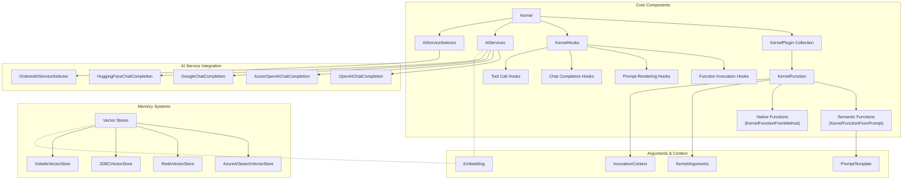
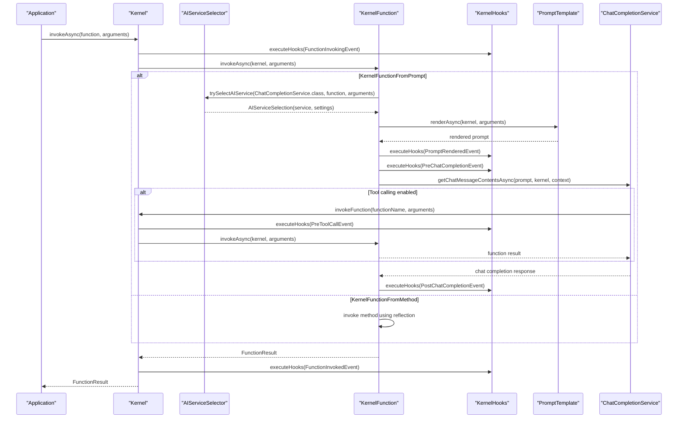
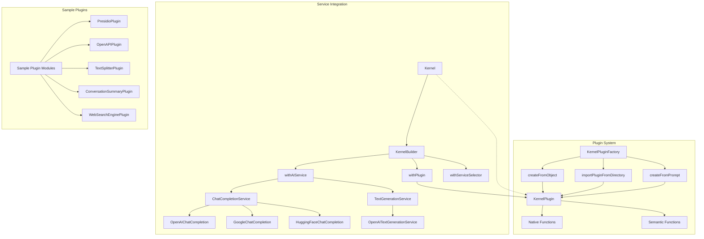
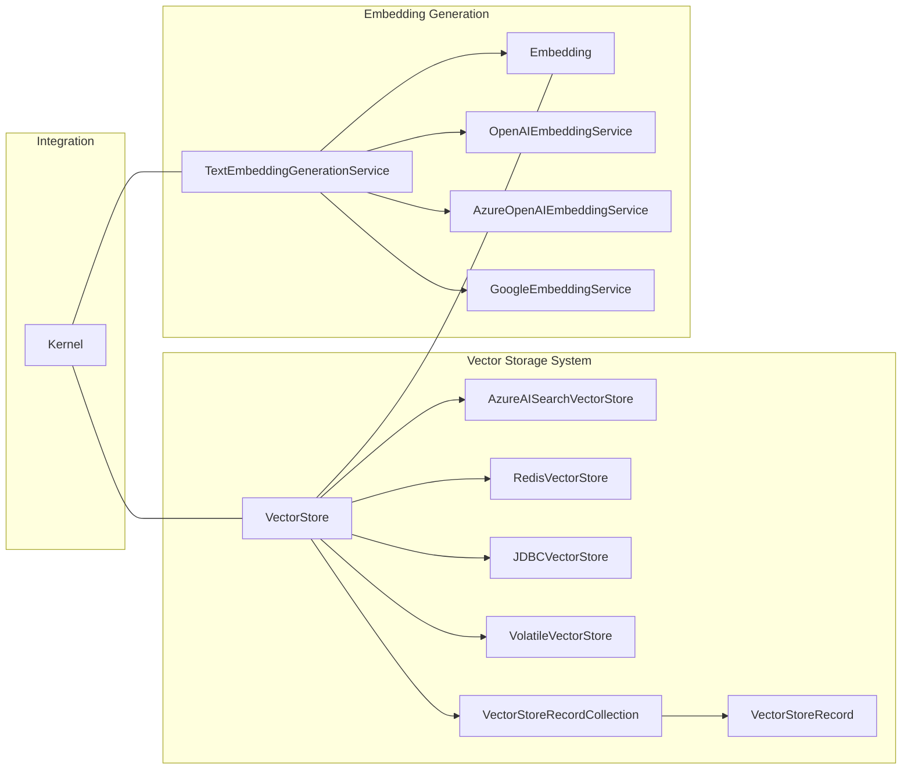

<!-- source: DeepWiki mcp.deepwiki.com · repo microsoft/semantic-kernel-java · page 1 Overview · fetched 2026-10-26 -->

# Overview

Relevant source files

The following files were used as context for generating this wiki page:

- [README.md](README.md)
- [api-test/integration-tests/pom.xml](api-test/integration-tests/pom.xml)
- [api-test/integration-tests/src/test/java/com/microsoft/semantickernel/tests/WiremockExamplesIT.java](api-test/integration-tests/src/test/java/com/microsoft/semantickernel/tests/WiremockExamplesIT.java)
- [pom.xml](pom.xml)
- [samples/semantickernel-concepts/semantickernel-syntax-examples/pom.xml](samples/semantickernel-concepts/semantickernel-syntax-examples/pom.xml)
- [samples/semantickernel-concepts/semantickernel-syntax-examples/src/main/java/com/microsoft/semantickernel/samples/syntaxexamples/RunAll.java](samples/semantickernel-concepts/semantickernel-syntax-examples/src/main/java/com/microsoft/semantickernel/samples/syntaxexamples/RunAll.java)
- [samples/semantickernel-concepts/semantickernel-syntax-examples/src/main/java/com/microsoft/semantickernel/samples/syntaxexamples/plugin/Example07_BingAndGooglePlugins.java](samples/semantickernel-concepts/semantickernel-syntax-examples/src/main/java/com/microsoft/semantickernel/samples/syntaxexamples/plugin/Example07_BingAndGooglePlugins.java)
- [samples/semantickernel-concepts/semantickernel-syntax-examples/src/main/java/com/microsoft/semantickernel/samples/syntaxexamples/plugin/Example10_DescribeAllPluginsAndFunctions.java](samples/semantickernel-concepts/semantickernel-syntax-examples/src/main/java/com/microsoft/semantickernel/samples/syntaxexamples/plugin/Example10_DescribeAllPluginsAndFunctions.java)
- [samples/semantickernel-concepts/semantickernel-syntax-examples/src/main/java/com/microsoft/semantickernel/samples/syntaxexamples/plugin/Example13_ConversationSummaryPlugin.java](samples/semantickernel-concepts/semantickernel-syntax-examples/src/main/java/com/microsoft/semantickernel/samples/syntaxexamples/plugin/Example13_ConversationSummaryPlugin.java)
- [samples/semantickernel-demos/booking-agent-m365/pom.xml](samples/semantickernel-demos/booking-agent-m365/pom.xml)
- [samples/semantickernel-demos/semantickernel-spring-starter/pom.xml](samples/semantickernel-demos/semantickernel-spring-starter/pom.xml)
- [samples/semantickernel-sample-plugins/semantickernel-openapi-plugin/pom.xml](samples/semantickernel-sample-plugins/semantickernel-openapi-plugin/pom.xml)
- [semantickernel-api/pom.xml](semantickernel-api/pom.xml)
- [semantickernel-bom/pom.xml](semantickernel-bom/pom.xml)
- [semantickernel-experimental/pom.xml](semantickernel-experimental/pom.xml)

Semantic Kernel Java is a Java implementation of Microsoft's Semantic Kernel framework, designed to integrate Large Language Models (LLMs) like OpenAI, Azure OpenAI, Google AI, and Hugging Face with conventional programming. It provides a cohesive framework for building AI-powered applications by connecting your code to AI services and orchestrating AI capabilities through a plugin architecture.

This document introduces the core concepts, architecture, and capabilities of the Semantic Kernel Java framework.

Sources: [README.md:1-76](), [semantickernel-bom/pom.xml:1-296](), [pom.xml:1-1000]()

## Key Features and Capabilities

- **AI Integration**: Connect to a variety of LLM providers through a unified interface
- **Plugin Architecture**: Extend functionality through plugins that can be chained together
- **Function System**: Create both native (code-based) and semantic (AI-powered) functions
- **Hooks and Interceptors**: Customize and extend the execution flow at various points
- **Memory and Vector Storage**: Store and retrieve embeddings from various vector stores
- **Tool Calling**: Enable LLMs to call back into your application's functions

Sources: [README.md:1-76](), [samples/semantickernel-concepts/semantickernel-syntax-examples/src/main/java/com/microsoft/semantickernel/samples/syntaxexamples/RunAll.java:1-95]()

## High-Level Architecture

### Core Components Diagram

The diagram illustrates the major components of Semantic Kernel Java and their relationships. The Kernel is the central orchestrator that manages plugins (containing functions), hooks (for interception), and AI services. Functions can be either semantic (AI-powered) or native (code-based) and are executed with arguments and context.

Sources: [semantickernel-api/pom.xml:1-109](), [semantickernel-experimental/pom.xml:1-136](), [samples/semantickernel-concepts/semantickernel-syntax-examples/pom.xml:1-189]()

## Function Execution Flow

This sequence diagram shows the flow of execution when a function is invoked through the Kernel. It demonstrates the hook interception points, prompt rendering process for semantic functions, and illustrates the tool calling capability where AI services can call back into the application's functions.

Sources: [samples/semantickernel-concepts/semantickernel-syntax-examples/src/main/java/com/microsoft/semantickernel/samples/syntaxexamples/functions/Example01_NativeFunctions.java](), [samples/semantickernel-concepts/semantickernel-syntax-examples/src/main/java/com/microsoft/semantickernel/samples/syntaxexamples/plugin/Example10_DescribeAllPluginsAndFunctions.java:1-151]()

## Plugin System and Service Integration

This diagram shows how plugins are created and integrated with the Kernel, as well as how AI services are configured. The plugin system allows for extensibility through different creation methods, while the builder pattern enables flexible configuration of AI services and plugins in the Kernel.

Sources: [samples/semantickernel-concepts/semantickernel-syntax-examples/src/main/java/com/microsoft/semantickernel/samples/syntaxexamples/plugin/Example07_BingAndGooglePlugins.java:1-232](), [samples/semantickernel-concepts/semantickernel-syntax-examples/src/main/java/com/microsoft/semantickernel/samples/syntaxexamples/plugin/Example13_ConversationSummaryPlugin.java:1-240]()

## Memory and Vector Storage

This diagram illustrates the memory and vector storage system, which is used for storing and retrieving embeddings. Various vector stores are available, including Azure AI Search, Redis, JDBC databases, and an in-memory volatile store. Embedding generation services are provided for different AI providers.

Sources: [semantickernel-bom/pom.xml:99-114](), [api-test/integration-tests/pom.xml:56-91]()

## Supported AI Service Providers

Semantic Kernel Java supports integration with multiple AI service providers:

| Provider | Service Types | Modules |
|----------|---------------|---------|
| OpenAI | Chat Completion, Text Generation, Embeddings | `semantickernel-aiservices-openai` |
| Azure OpenAI | Chat Completion, Text Generation, Embeddings | `aiservices-azureopenai` |
| Google | Chat Completion, Embeddings | `semantickernel-aiservices-google` |
| Hugging Face | Chat Completion | `semantickernel-aiservices-huggingface` |

Sources: [semantickernel-bom/pom.xml:79-98](), [semantickernel-bom/pom.xml:211-215]()

## Project Structure

The Semantic Kernel Java project is organized into several modules:

| Module | Description |
|--------|-------------|
| `semantickernel-api` | Core API and interfaces |
| `semantickernel-experimental` | Experimental features |
| `aiservices/openai` | OpenAI service integration |
| `aiservices/google` | Google AI service integration |
| `aiservices/huggingface` | HuggingFace service integration |
| `data/semantickernel-data-azureaisearch` | Azure AI Search vector store |
| `data/semantickernel-data-jdbc` | JDBC-based vector store |
| `data/semantickernel-data-redis` | Redis vector store |
| `samples` | Example code and demonstrations |

Sources: [pom.xml:70-80](), [samples/semantickernel-concepts/semantickernel-syntax-examples/pom.xml:1-189]()

## Getting Started

The quickest way to start using Semantic Kernel Java is to add the appropriate dependencies to your Maven or Gradle project. The core dependency is `semantickernel-api`, which provides the fundamental interfaces and classes. Additional dependencies can be added based on the AI services and vector stores you plan to use.

For detailed documentation and examples, visit the [Microsoft Learn Semantic Kernel documentation](https://learn.microsoft.com/en-us/semantic-kernel/overview/?tabs=Java&pivots=programming-language-java).

Sources: [README.md:20-26](), [README.md:27-39]()

## Example Usage

Here's a simple example of how to set up the Kernel with an OpenAI service and invoke a function:

1. Create an AI service
2. Build a Kernel with the service
3. Create and register functions
4. Invoke functions with arguments

Numerous examples can be found in the samples directory, particularly in the `semantickernel-syntax-examples` module.

Sources: [samples/semantickernel-concepts/semantickernel-syntax-examples/src/main/java/com/microsoft/semantickernel/samples/syntaxexamples/RunAll.java:39-95](), [api-test/integration-tests/src/test/java/com/microsoft/semantickernel/tests/WiremockExamplesIT.java:46-79]()

---

