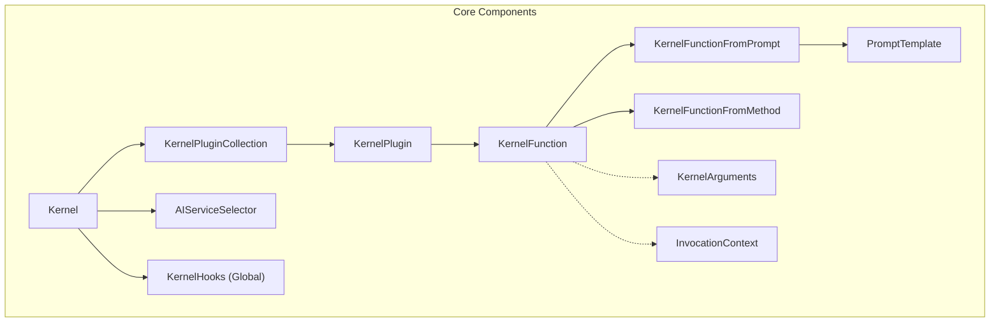
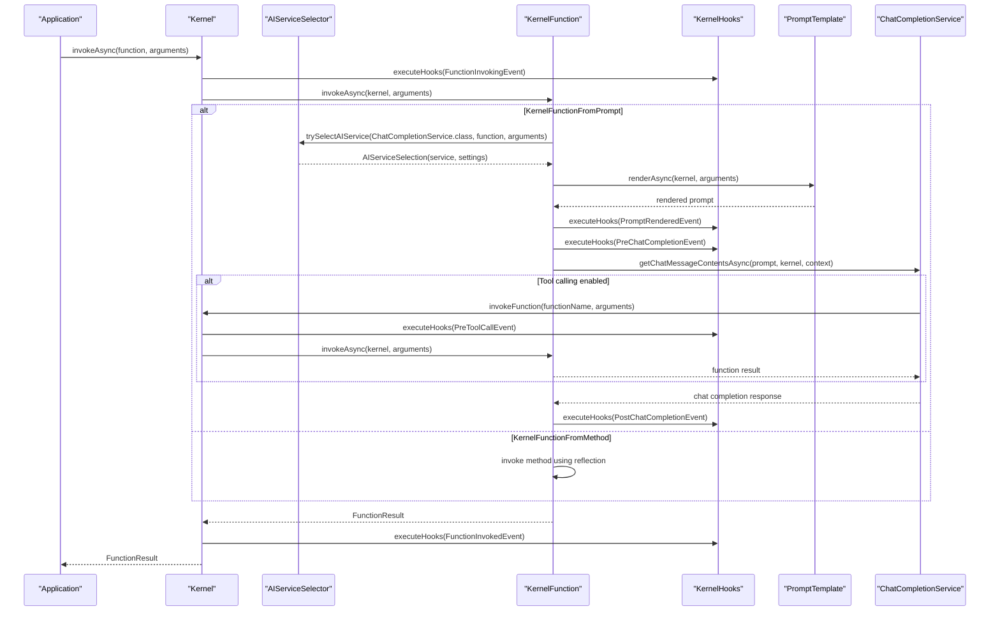
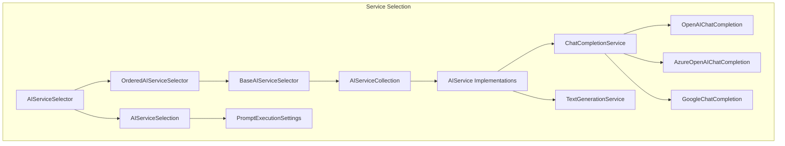
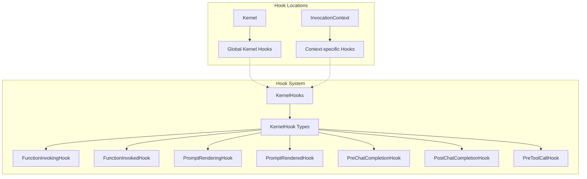
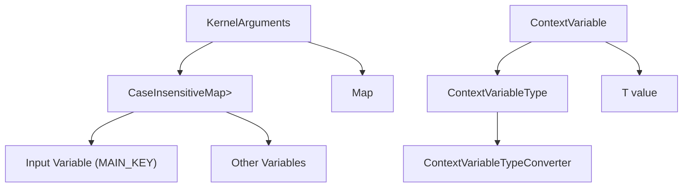
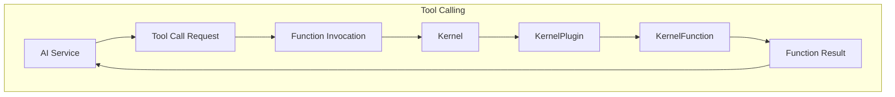
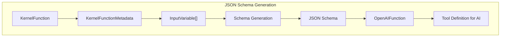

<!-- source: DeepWiki mcp.deepwiki.com · repo microsoft/semantic-kernel-java · page 2 Core Architecture · fetched 2026-10-26 -->

# Core Architecture

<details>
<summary>Relevant source files</summary>

The following files were used as context for generating this wiki page:

- [CHANGELOG.md](CHANGELOG.md)
- [aiservices/openai/src/main/java/com/microsoft/semantickernel/aiservices/openai/chatcompletion/OpenAIFunction.java](aiservices/openai/src/main/java/com/microsoft/semantickernel/aiservices/openai/chatcompletion/OpenAIFunction.java)
- [aiservices/openai/src/test/java/com/microsoft/semantickernel/aiservices/openai/chatcompletion/JsonSchemaTest.java](aiservices/openai/src/test/java/com/microsoft/semantickernel/aiservices/openai/chatcompletion/JsonSchemaTest.java)
- [api-test/integration-tests/src/test/java/com/microsoft/semantickernel/tests/ImportingMultiplePluginsTest.java](api-test/integration-tests/src/test/java/com/microsoft/semantickernel/tests/ImportingMultiplePluginsTest.java)
- [api-test/integration-tests/src/test/java/com/microsoft/semantickernel/tests/ResponseSchemaTest.java](api-test/integration-tests/src/test/java/com/microsoft/semantickernel/tests/ResponseSchemaTest.java)
- [samples/semantickernel-concepts/semantickernel-syntax-examples/src/main/java/com/microsoft/semantickernel/samples/demos/lights/App.java](samples/semantickernel-concepts/semantickernel-syntax-examples/src/main/java/com/microsoft/semantickernel/samples/demos/lights/App.java)
- [samples/semantickernel-concepts/semantickernel-syntax-examples/src/main/java/com/microsoft/semantickernel/samples/demos/lights/LightModel.java](samples/semantickernel-concepts/semantickernel-syntax-examples/src/main/java/com/microsoft/semantickernel/samples/demos/lights/LightModel.java)
- [samples/semantickernel-concepts/semantickernel-syntax-examples/src/main/java/com/microsoft/semantickernel/samples/demos/lights/LightModelTypeConverter.java](samples/semantickernel-concepts/semantickernel-syntax-examples/src/main/java/com/microsoft/semantickernel/samples/demos/lights/LightModelTypeConverter.java)
- [samples/semantickernel-concepts/semantickernel-syntax-examples/src/main/java/com/microsoft/semantickernel/samples/demos/lights/LightsPlugin.java](samples/semantickernel-concepts/semantickernel-syntax-examples/src/main/java/com/microsoft/semantickernel/samples/demos/lights/LightsPlugin.java)
- [samples/semantickernel-concepts/semantickernel-syntax-examples/src/main/java/com/microsoft/semantickernel/samples/syntaxexamples/Example61_MultipleLLMs.java](samples/semantickernel-concepts/semantickernel-syntax-examples/src/main/java/com/microsoft/semantickernel/samples/syntaxexamples/Example61_MultipleLLMs.java)
- [semantickernel-api/src/main/java/com/microsoft/semantickernel/Kernel.java](semantickernel-api/src/main/java/com/microsoft/semantickernel/Kernel.java)
- [semantickernel-api/src/main/java/com/microsoft/semantickernel/contextvariables/converters/StringVariableContextVariableTypeConverter.java](semantickernel-api/src/main/java/com/microsoft/semantickernel/contextvariables/converters/StringVariableContextVariableTypeConverter.java)
- [semantickernel-api/src/main/java/com/microsoft/semantickernel/hooks/KernelHook.java](semantickernel-api/src/main/java/com/microsoft/semantickernel/hooks/KernelHook.java)
- [semantickernel-api/src/main/java/com/microsoft/semantickernel/hooks/KernelHooks.java](semantickernel-api/src/main/java/com/microsoft/semantickernel/hooks/KernelHooks.java)
- [semantickernel-api/src/main/java/com/microsoft/semantickernel/semanticfunctions/KernelArguments.java](semantickernel-api/src/main/java/com/microsoft/semantickernel/semanticfunctions/KernelArguments.java)
- [semantickernel-api/src/main/java/com/microsoft/semantickernel/semanticfunctions/KernelFunctionFromPrompt.java](semantickernel-api/src/main/java/com/microsoft/semantickernel/semanticfunctions/KernelFunctionFromPrompt.java)
- [semantickernel-api/src/main/java/com/microsoft/semantickernel/services/AIServiceSelector.java](semantickernel-api/src/main/java/com/microsoft/semantickernel/services/AIServiceSelector.java)
- [semantickernel-api/src/main/java/com/microsoft/semantickernel/services/BaseAIServiceSelector.java](semantickernel-api/src/main/java/com/microsoft/semantickernel/services/BaseAIServiceSelector.java)
- [semantickernel-api/src/main/java/com/microsoft/semantickernel/services/OrderedAIServiceSelector.java](semantickernel-api/src/main/java/com/microsoft/semantickernel/services/OrderedAIServiceSelector.java)
- [semantickernel-api/src/test/java/com/microsoft/semantickernel/contextvariables/converters/ContextVariableTypeConverterTest.java](semantickernel-api/src/test/java/com/microsoft/semantickernel/contextvariables/converters/ContextVariableTypeConverterTest.java)

</details>


This page describes the core architecture of the Semantic Kernel Java framework, explaining its fundamental components and how they interact to enable AI-powered applications. It provides a technical overview of the central systems that power the framework's capabilities for working with large language models (LLMs).

For details about specific components like the Kernel itself, see [Kernel](#2.1), or for functions and plugins, see [Functions and Plugins](#2.2).

## Core Components Overview

The Semantic Kernel Java architecture is built around several key components that work together to provide a cohesive framework:



Sources:
- [semantickernel-api/src/main/java/com/microsoft/semantickernel/Kernel.java]()
- [semantickernel-api/src/main/java/com/microsoft/semantickernel/semanticfunctions/KernelFunctionFromPrompt.java]()

The architecture centers around the `Kernel` class, which serves as the orchestration layer connecting all other components:

- **Kernel**: The central component that manages plugins, provides access to AI services, and facilitates function execution
- **KernelPluginCollection**: Contains plugins registered with the kernel
- **AIServiceSelector**: Determines which AI service to use for function execution
- **KernelFunction**: The base class for all functions (both semantic and native)
- **KernelArguments**: Carries parameters between functions and services
- **InvocationContext**: Provides additional context for function execution

## Function Execution Flow

The execution flow in Semantic Kernel shows how components interact when a function is invoked:



Sources:
- [semantickernel-api/src/main/java/com/microsoft/semantickernel/semanticfunctions/KernelFunctionFromPrompt.java:98-298]()
- [semantickernel-api/src/main/java/com/microsoft/semantickernel/Kernel.java:128-226]()

This sequence diagram illustrates how:

1. The application invokes a function through the Kernel
2. The Kernel handles the invocation through hooks and the function itself
3. For semantic functions, the system:
   - Selects an appropriate AI service
   - Renders the prompt template
   - Sends the prompt to the AI service
   - Processes the response, including any tool calls
4. For native functions, the system invokes the method directly using reflection
5. The result flows back to the application through the Kernel

## Service Selection System

The service selection system determines which AI service to use for a given operation:



Sources:
- [semantickernel-api/src/main/java/com/microsoft/semantickernel/services/AIServiceSelector.java]()
- [semantickernel-api/src/main/java/com/microsoft/semantickernel/services/OrderedAIServiceSelector.java]()
- [semantickernel-api/src/main/java/com/microsoft/semantickernel/services/BaseAIServiceSelector.java]()

The service selection process in `OrderedAIServiceSelector` works by:

1. Looking for a service with the specific service ID in execution settings
2. Looking for a service that supports the specified model ID
3. Falling back to the default service ID
4. Returning any available service of the required type

This system allows applications to configure exactly which AI service should handle specific operations.

## Hook System

The hook system provides interception points throughout the function execution pipeline:



Sources:
- [semantickernel-api/src/main/java/com/microsoft/semantickernel/hooks/KernelHook.java]()
- [semantickernel-api/src/main/java/com/microsoft/semantickernel/hooks/KernelHooks.java:22-318]()

The hook system enables:

1. Monitoring and logging function execution
2. Modifying prompts before they are sent to AI services
3. Preprocessing and postprocessing of arguments and results
4. Intercepting tool calls from AI services

Hooks can be registered at two levels:
- Globally on the Kernel (affecting all function executions)
- On specific invocation contexts (affecting only that invocation)

```java
// Example of adding hooks to the kernel
KernelHooks hooks = new KernelHooks();
hooks.addPreChatCompletionHook(event -> {
    System.out.println("Pre-chat completion hook");
    return event;
});
kernel.getGlobalKernelHooks().addHooks(hooks);
```

## Arguments and Context

Two key structures carry data through the execution pipeline:

1. **KernelArguments**: Contains named parameters for function execution:



Sources:
- [semantickernel-api/src/main/java/com/microsoft/semantickernel/semanticfunctions/KernelArguments.java:29-425]()

2. **InvocationContext**: Provides additional execution context:
   - Type converters
   - Tool call behavior settings
   - Response formats
   - Context-specific hooks

## Tool Calling

Semantic Kernel supports tool calling, allowing AI models to invoke functions in your application:



Sources:
- [semantickernel-api/src/main/java/com/microsoft/semantickernel/semanticfunctions/KernelFunctionFromPrompt.java:159-174]()
- [aiservices/openai/src/main/java/com/microsoft/semantickernel/aiservices/openai/chatcompletion/OpenAIFunction.java:27-246]()

Tool calling works by:

1. Translating Java methods into AI tool definitions
2. Intercepting tool call requests from the AI
3. Invoking the requested function through the Kernel
4. Returning the result back to the AI

This enables powerful scenarios where the AI can:
- Query databases
- Control external systems
- Perform calculations
- Interact with APIs

For example, in the LightsPlugin sample, the AI can control virtual lights:

```java
@DefineKernelFunction(name = "change_state", description = "Changes the state of the light")
public LightModel changeState(
    @KernelFunctionParameter(name = "id", description = "The ID of the light to change", type = int.class) int id,
    @KernelFunctionParameter(name = "isOn", description = "The new state of the light", type = boolean.class) boolean isOn) {
    // Implementation
}
```

The function is exposed to the AI with its parameters and their types properly documented through JSON Schema.

Sources:
- [samples/semantickernel-concepts/semantickernel-syntax-examples/src/main/java/com/microsoft/semantickernel/samples/demos/lights/LightsPlugin.java:10-54]()
- [samples/semantickernel-concepts/semantickernel-syntax-examples/src/main/java/com/microsoft/semantickernel/samples/demos/lights/App.java:58-67]()

## JSON Schema Support

Semantic Kernel integrates with JSON Schema to provide structured type information:



Sources:
- [aiservices/openai/src/main/java/com/microsoft/semantickernel/aiservices/openai/chatcompletion/OpenAIFunction.java:87-119]()
- [aiservices/openai/src/test/java/com/microsoft/semantickernel/aiservices/openai/chatcompletion/JsonSchemaTest.java:19-114]()

The JSON Schema support enables:

1. Strongly-typed function parameters for tool calling
2. Structured response formats from AI services
3. Automatic conversion between JSON and Java objects

Jackson annotations can be used to provide additional schema information:

```java
public class LightModel {
    @JsonPropertyDescription("The unique identifier of the light")
    private int id;

    @JsonPropertyDescription("The name of the light")
    private String name;

    @JsonPropertyDescription("The state of the light")
    private Boolean isOn;
    
    // Getters and setters
}
```

Sources:
- [samples/semantickernel-concepts/semantickernel-syntax-examples/src/main/java/com/microsoft/semantickernel/samples/demos/lights/LightModel.java:1-46]()
- [api-test/integration-tests/src/test/java/com/microsoft/semantickernel/tests/ResponseSchemaTest.java:37-310]()

## Conclusion

The Core Architecture of Semantic Kernel Java provides a flexible and extensible framework for building AI-powered applications. The components work together to:

1. Execute functions (both semantic and native)
2. Integrate with various AI services
3. Allow for extensibility through plugins
4. Provide interception points through hooks
5. Enable structured data exchange through JSON Schema

Understanding these core components provides the foundation for building sophisticated AI applications with the Semantic Kernel Java framework.

---

