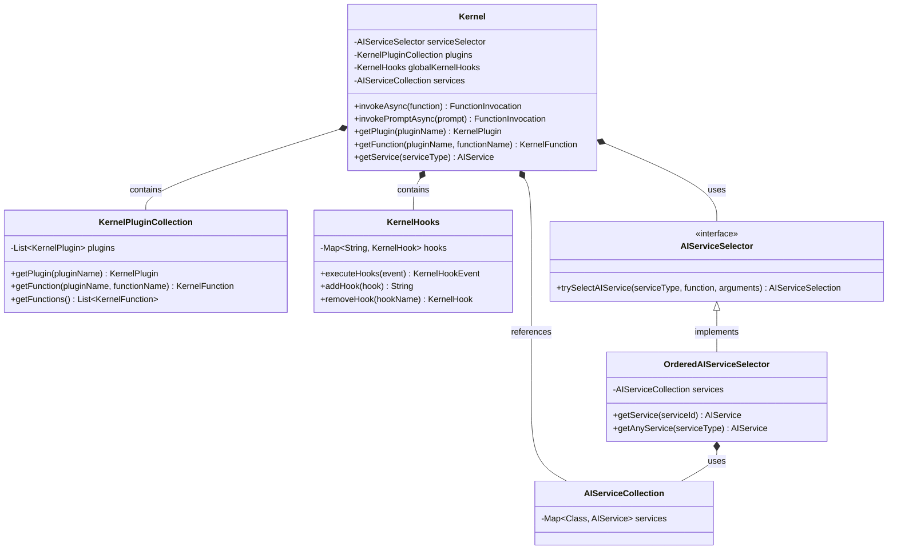
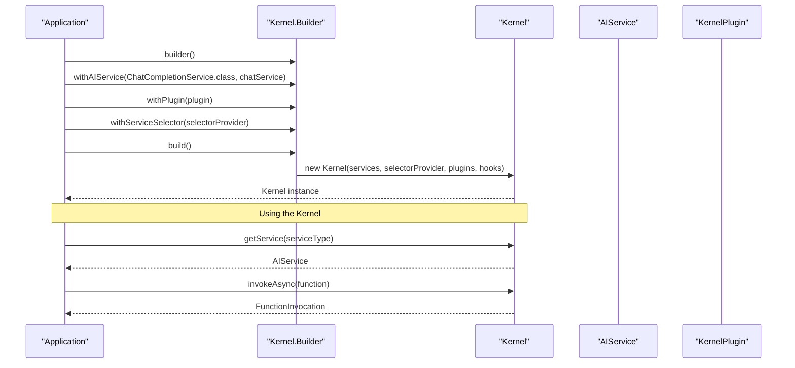
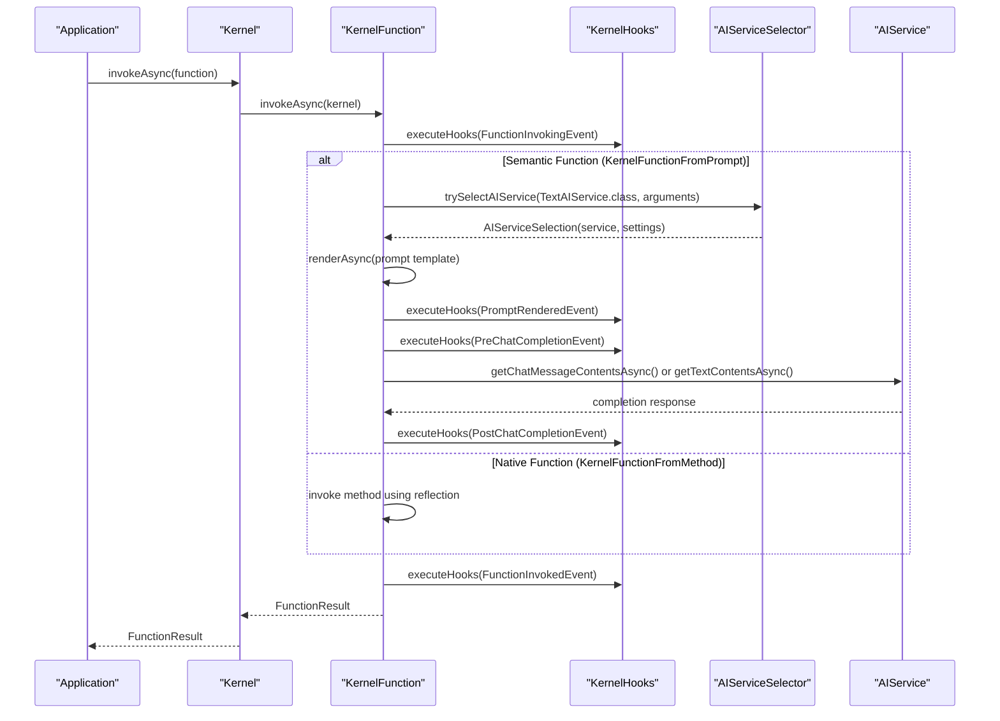
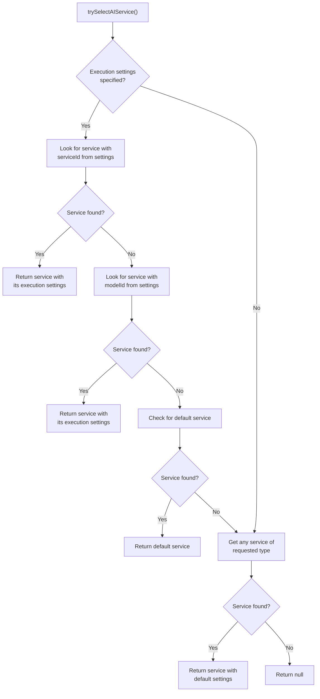
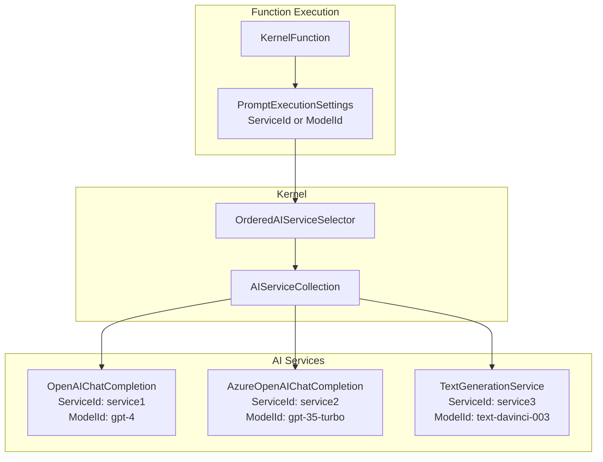
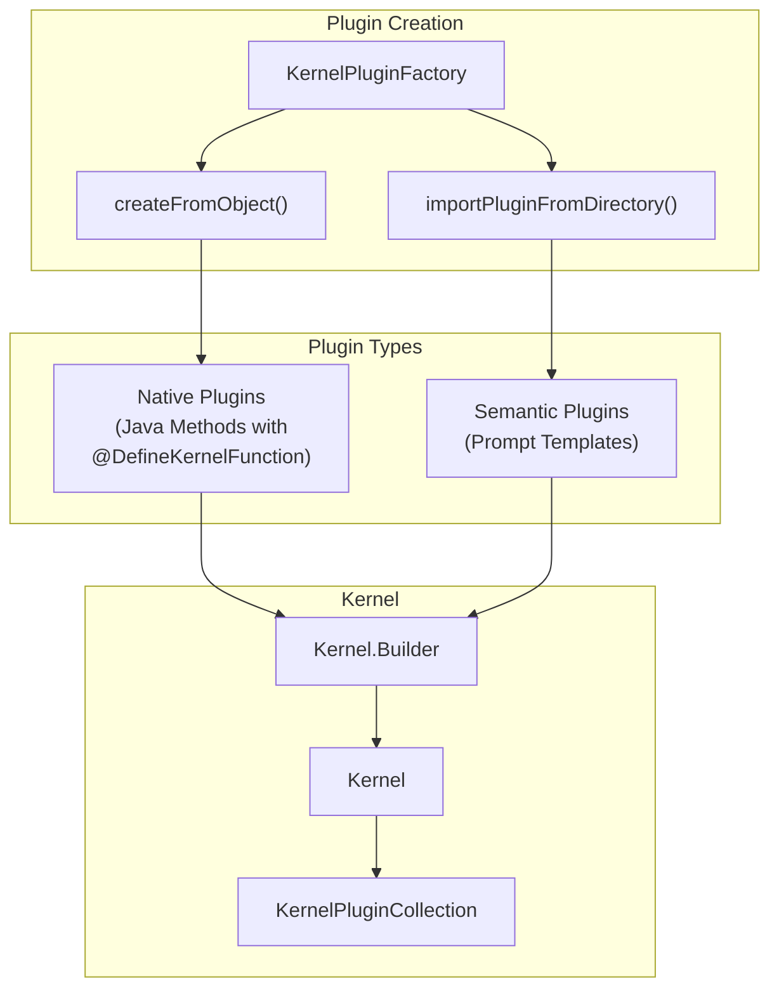
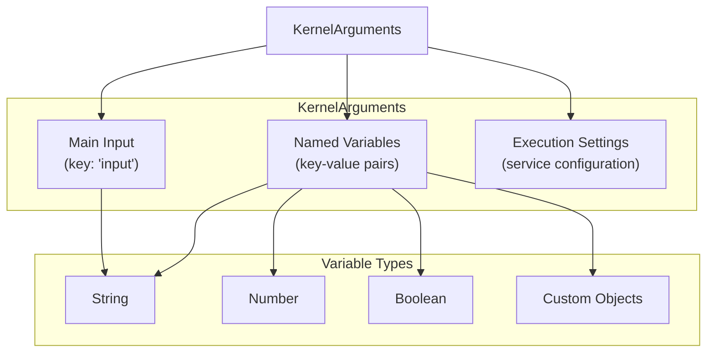

<!-- source: DeepWiki mcp.deepwiki.com · repo microsoft/semantic-kernel-java · page 2.1 Kernel · fetched 2026-10-26 -->

# Kernel

<details>
<summary>Relevant source files</summary>

The following files were used as context for generating this wiki page:

- [CHANGELOG.md](CHANGELOG.md)
- [aiservices/openai/src/main/java/com/microsoft/semantickernel/aiservices/openai/chatcompletion/OpenAIFunction.java](aiservices/openai/src/main/java/com/microsoft/semantickernel/aiservices/openai/chatcompletion/OpenAIFunction.java)
- [aiservices/openai/src/test/java/com/microsoft/semantickernel/aiservices/openai/chatcompletion/JsonSchemaTest.java](aiservices/openai/src/test/java/com/microsoft/semantickernel/aiservices/openai/chatcompletion/JsonSchemaTest.java)
- [api-test/integration-tests/src/test/java/com/microsoft/semantickernel/tests/ImportingMultiplePluginsTest.java](api-test/integration-tests/src/test/java/com/microsoft/semantickernel/tests/ImportingMultiplePluginsTest.java)
- [api-test/integration-tests/src/test/java/com/microsoft/semantickernel/tests/ResponseSchemaTest.java](api-test/integration-tests/src/test/java/com/microsoft/semantickernel/tests/ResponseSchemaTest.java)
- [samples/semantickernel-concepts/semantickernel-syntax-examples/src/main/java/com/microsoft/semantickernel/samples/demos/lights/App.java](samples/semantickernel-concepts/semantickernel-syntax-examples/src/main/java/com/microsoft/semantickernel/samples/demos/lights/App.java)
- [samples/semantickernel-concepts/semantickernel-syntax-examples/src/main/java/com/microsoft/semantickernel/samples/demos/lights/LightModel.java](samples/semantickernel-concepts/semantickernel-syntax-examples/src/main/java/com/microsoft/semantickernel/samples/demos/lights/LightModel.java)
- [samples/semantickernel-concepts/semantickernel-syntax-examples/src/main/java/com/microsoft/semantickernel/samples/demos/lights/LightModelTypeConverter.java](samples/semantickernel-concepts/semantickernel-syntax-examples/src/main/java/com/microsoft/semantickernel/samples/demos/lights/LightModelTypeConverter.java)
- [samples/semantickernel-concepts/semantickernel-syntax-examples/src/main/java/com/microsoft/semantickernel/samples/demos/lights/LightsPlugin.java](samples/semantickernel-concepts/semantickernel-syntax-examples/src/main/java/com/microsoft/semantickernel/samples/demos/lights/LightsPlugin.java)
- [samples/semantickernel-concepts/semantickernel-syntax-examples/src/main/java/com/microsoft/semantickernel/samples/syntaxexamples/Example61_MultipleLLMs.java](samples/semantickernel-concepts/semantickernel-syntax-examples/src/main/java/com/microsoft/semantickernel/samples/syntaxexamples/Example61_MultipleLLMs.java)
- [semantickernel-api/src/main/java/com/microsoft/semantickernel/Kernel.java](semantickernel-api/src/main/java/com/microsoft/semantickernel/Kernel.java)
- [semantickernel-api/src/main/java/com/microsoft/semantickernel/contextvariables/converters/StringVariableContextVariableTypeConverter.java](semantickernel-api/src/main/java/com/microsoft/semantickernel/contextvariables/converters/StringVariableContextVariableTypeConverter.java)
- [semantickernel-api/src/main/java/com/microsoft/semantickernel/hooks/KernelHook.java](semantickernel-api/src/main/java/com/microsoft/semantickernel/hooks/KernelHook.java)
- [semantickernel-api/src/main/java/com/microsoft/semantickernel/hooks/KernelHooks.java](semantickernel-api/src/main/java/com/microsoft/semantickernel/hooks/KernelHooks.java)
- [semantickernel-api/src/main/java/com/microsoft/semantickernel/semanticfunctions/KernelArguments.java](semantickernel-api/src/main/java/com/microsoft/semantickernel/semanticfunctions/KernelArguments.java)
- [semantickernel-api/src/main/java/com/microsoft/semantickernel/semanticfunctions/KernelFunctionFromPrompt.java](semantickernel-api/src/main/java/com/microsoft/semantickernel/semanticfunctions/KernelFunctionFromPrompt.java)
- [semantickernel-api/src/main/java/com/microsoft/semantickernel/services/AIServiceSelector.java](semantickernel-api/src/main/java/com/microsoft/semantickernel/services/AIServiceSelector.java)
- [semantickernel-api/src/main/java/com/microsoft/semantickernel/services/BaseAIServiceSelector.java](semantickernel-api/src/main/java/com/microsoft/semantickernel/services/BaseAIServiceSelector.java)
- [semantickernel-api/src/main/java/com/microsoft/semantickernel/services/OrderedAIServiceSelector.java](semantickernel-api/src/main/java/com/microsoft/semantickernel/services/OrderedAIServiceSelector.java)
- [semantickernel-api/src/test/java/com/microsoft/semantickernel/contextvariables/converters/ContextVariableTypeConverterTest.java](semantickernel-api/src/test/java/com/microsoft/semantickernel/contextvariables/converters/ContextVariableTypeConverterTest.java)

</details>


## Purpose and Scope

The Kernel is the central component of the Semantic Kernel Java framework. It orchestrates the interaction between functions, plugins, AI services, and hooks, providing a unified API for working with large language models (LLMs). The Kernel manages state throughout the execution of semantic kernel workloads and serves as the primary entry point for applications using the framework.

For information about the functions that can be executed by the Kernel, see [Functions and Plugins](#2.2). For details about the hook system used for modifying the execution flow, see [Hook System](#2.3).

## Kernel Architecture

The Kernel serves as a coordinating container for several key subsystems:

1. **Plugin Collection**: Manages a collection of plugins containing functions (both native and semantic)
2. **AI Services**: Provides access to language models and other AI services
3. **Service Selector**: Determines which AI service to use for a specific request
4. **Global Hooks**: System-wide hooks for intercepting and modifying operations

### Kernel Component Structure



Sources: [semantickernel-api/src/main/java/com/microsoft/semantickernel/Kernel.java:34-419](). [semantickernel-api/src/main/java/com/microsoft/semantickernel/services/OrderedAIServiceSelector.java:25-246]()

## Creating and Configuring a Kernel

The Kernel is created using a builder pattern, providing a fluent API for configuration. This approach allows for flexible setup of AI services, plugins, and service selectors.

### Kernel Builder Pattern



Basic example of creating a Kernel with an OpenAI service and a plugin:

```java
// Create your AI service client
ChatCompletionService chatService = OpenAIChatCompletion.builder()
    .withModelId("gpt-4o")
    .withOpenAIAsyncClient(client)
    .build();

// Create a plugin
KernelPlugin lightPlugin = KernelPluginFactory.createFromObject(new LightsPlugin(), "LightsPlugin");

// Create a kernel with OpenAI chat completion and plugin
Kernel kernel = Kernel.builder()
    .withAIService(ChatCompletionService.class, chatService)
    .withPlugin(lightPlugin)
    .build();
```

Sources: [semantickernel-api/src/main/java/com/microsoft/semantickernel/Kernel.java:346-417](). [samples/semantickernel-concepts/semantickernel-syntax-examples/src/main/java/com/microsoft/semantickernel/samples/demos/lights/App.java:54-67]()

## Function Execution

The Kernel provides several methods for invoking functions and prompt templates:

1. **invokeAsync**: Asynchronously invokes a function and returns a `FunctionInvocation` for further configuration
2. **invoke**: Synchronously invokes a function and returns the result directly
3. **invokePromptAsync**: Creates and invokes a function from a prompt string

The Kernel handles the complete execution flow including:
- Executing relevant hooks
- Selecting an appropriate AI service
- Passing arguments and context to the function
- Processing the function result

### Function Execution Flow



Examples of invoking functions:

```java
// Invoke a function by plugin and function name
FunctionResult<String> result = kernel.invoke("MyPlugin", "MyFunction");

// Get a function reference and invoke it
KernelFunction<String> function = kernel.getFunction("MyPlugin", "MyFunction");
FunctionResult<String> result = kernel.invoke(function);

// Invoke a prompt directly
FunctionResult<String> result = kernel.invokePromptAsync("Generate a story about dragons")
    .withResultType(String.class)
    .block();
```

Sources: [semantickernel-api/src/main/java/com/microsoft/semantickernel/Kernel.java:127-226](). [semantickernel-api/src/main/java/com/microsoft/semantickernel/semanticfunctions/KernelFunctionFromPrompt.java:99-274]()

## AI Service Selection

The Kernel uses the `AIServiceSelector` to determine which AI service to use for a given request. The default implementation is `OrderedAIServiceSelector`, which selects services based on a prioritized decision process:

1. Service ID in execution settings
2. Model ID in execution settings
3. Default service ID (using the `DEFAULT_SERVICE_ID` constant)
4. Any available service of the requested type

### AI Service Selection Process



Sources: [semantickernel-api/src/main/java/com/microsoft/semantickernel/services/OrderedAIServiceSelector.java:62-160](). [semantickernel-api/src/main/java/com/microsoft/semantickernel/services/AIServiceSelector.java:13-55]()

## Working with Multiple AI Services

The Kernel can manage multiple AI services and select the appropriate one based on execution settings. This allows for using different models for different tasks or implementing fallback strategies.

### Multiple AI Services Configuration



Example of configuring and using multiple AI services:

```java
// Create different AI services
var openAIChatCompletion = OpenAIChatCompletion.builder()
    .withOpenAIAsyncClient(client)
    .withServiceId("AzureOpenAIChat")
    .withModelId("gpt-35-turbo")
    .build();

var textGenerationService = TextGenerationService.builder()
    .withOpenAIAsyncClient(client)
    .withServiceId("AzureOpenAIText")
    .withModelId("text-davinci-003")
    .build();

// Create a kernel with multiple services
var kernel = Kernel.builder()
    .withAIService(ChatCompletionService.class, openAIChatCompletion)
    .withAIService(TextGenerationService.class, textGenerationService)
    .build();

// Create a function using a specific service ID
KernelFunction<?> func = KernelFunctionFromPrompt.builder()
    .withTemplate("Hello AI, what can you do for me?")
    .withDefaultExecutionSettings(
        PromptExecutionSettings.builder()
            .withServiceId("AzureOpenAIChat")
            .build())
    .build();

// Invoke the function
var result = kernel.invokeAsync(func).block();
```

Sources: [samples/semantickernel-concepts/semantickernel-syntax-examples/src/main/java/com/microsoft/semantickernel/samples/syntaxexamples/Example61_MultipleLLMs.java:46-143]()

## Using Plugins with Kernel

The Kernel manages plugins, which are collections of functions. The Kernel provides methods to access plugins and their functions:

- `getPlugin(pluginName)`: Gets a plugin by name
- `getPlugins()`: Gets all plugins
- `getFunction(pluginName, functionName)`: Gets a specific function
- `getFunctions()`: Gets all functions from all plugins

### Plugin Registration



Example of creating and using a plugin:

```java
// Define a plugin class with annotated methods
public class LightsPlugin {
    @DefineKernelFunction(name = "get_lights", description = "Gets a list of lights")
    public List<LightModel> getLights() {
        System.out.println("Getting lights");
        return lights;
    }
    
    @DefineKernelFunction(name = "change_state", description = "Changes light state")
    public LightModel changeState(
        @KernelFunctionParameter(name = "id", description = "Light ID", type = int.class) int id,
        @KernelFunctionParameter(name = "isOn", description = "State", type = boolean.class) boolean isOn) {
        // Implementation...
    }
}

// Create a plugin from the class
KernelPlugin lightPlugin = KernelPluginFactory.createFromObject(
    new LightsPlugin(), "LightsPlugin");

// Add the plugin to the kernel
Kernel kernel = Kernel.builder()
    .withPlugin(lightPlugin)
    .build();

// Use the plugin function
FunctionResult<List<LightModel>> result = kernel.invoke("LightsPlugin", "get_lights");
```

Sources: [samples/semantickernel-concepts/semantickernel-syntax-examples/src/main/java/com/microsoft/semantickernel/samples/demos/lights/LightsPlugin.java:10-53](). [samples/semantickernel-concepts/semantickernel-syntax-examples/src/main/java/com/microsoft/semantickernel/samples/demos/lights/App.java:59-66]()

## Function Arguments and Context

When invoking functions through the Kernel, arguments can be passed using the `KernelArguments` class. This class manages:

- Input variables for functions (with "input" as the default key)
- Execution settings for AI services
- Type conversion for various argument types

### KernelArguments Structure



Example of using `KernelArguments`:

```java
// Create arguments for a function
KernelArguments args = KernelArguments.builder()
    // Set the main input
    .withInput("Main content goes here")
    // Add named variables
    .withVariable("temperature", 0.7)
    .withVariable("maxTokens", 1000)
    .withVariable("light", new LightModel(1, "Table Lamp", false))
    // Add execution settings
    .withExecutionSettings(
        PromptExecutionSettings.builder()
            .withModelId("gpt-4")
            .build())
    .build();

// Invoke a function with arguments
FunctionResult<String> result = kernel.invokeAsync("MyPlugin", "MyFunction")
    .withArguments(args)
    .withResultType(String.class)
    .block();
```

Sources: [semantickernel-api/src/main/java/com/microsoft/semantickernel/semanticfunctions/KernelArguments.java:29-425]()

## Global Hooks

The Kernel contains a global hooks system that allows for interception and modification of the execution flow. Global hooks are applied to all function invocations processed by the Kernel.

See [Hook System](#2.3) for more details on the types of hooks and how to use them.

Example of adding global hooks to a Kernel:

```java
// Create a hook collection
KernelHooks hooks = new KernelHooks();

// Add a pre-tool call hook
hooks.addPreToolCallHook((context) -> {
    System.out.println("Pre-tool call hook");
    return context;
});

// Add a pre-chat completion hook
hooks.addPreChatCompletionHook((context) -> {
    System.out.println("Pre-chat completion hook");
    return context;
});

// Add hooks to the kernel's global hooks
kernel.getGlobalKernelHooks().addHooks(hooks);
```

Sources: [semantickernel-api/src/main/java/com/microsoft/semantickernel/hooks/KernelHooks.java:22-318](). [samples/semantickernel-concepts/semantickernel-syntax-examples/src/main/java/com/microsoft/semantickernel/samples/demos/lights/App.java:75-94]()

---

