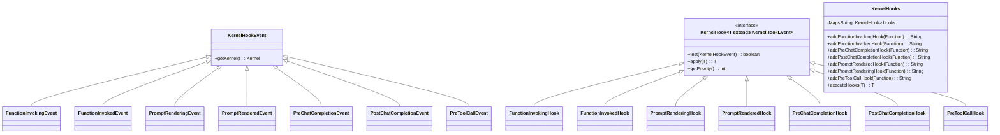
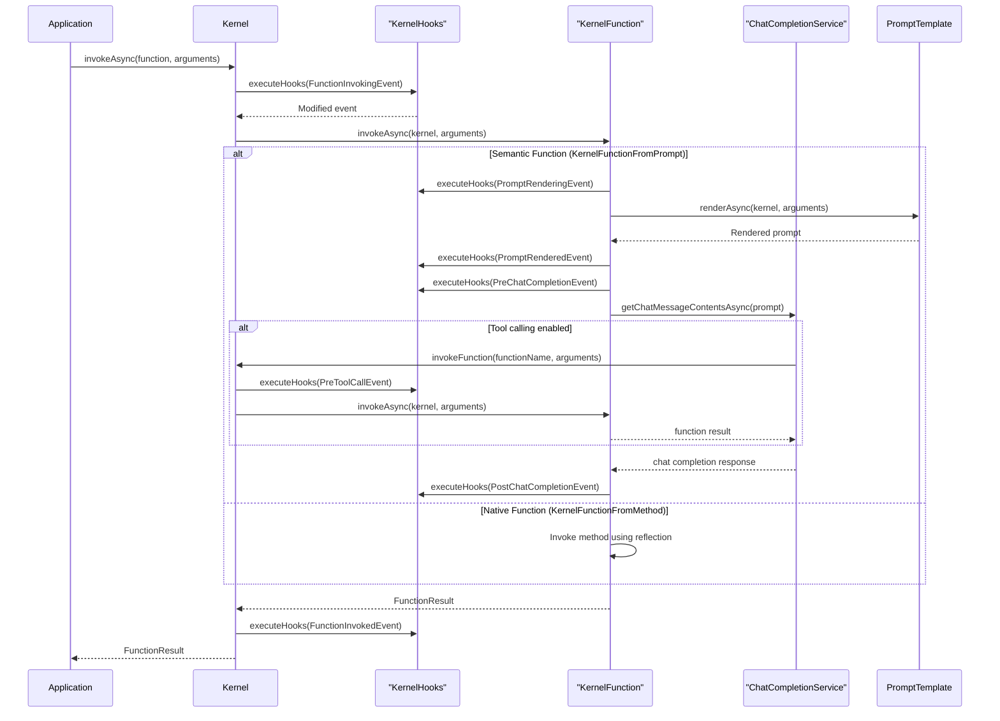

<!-- source: DeepWiki mcp.deepwiki.com · repo microsoft/semantic-kernel-java · page 2.3 Hook System · fetched 2026-10-26 -->

# Hook System

<details>
<summary>Relevant source files</summary>

The following files were used as context for generating this wiki page:

- [CHANGELOG.md](CHANGELOG.md)
- [aiservices/openai/src/main/java/com/microsoft/semantickernel/aiservices/openai/chatcompletion/BinaryDataUtils.java](aiservices/openai/src/main/java/com/microsoft/semantickernel/aiservices/openai/chatcompletion/BinaryDataUtils.java)
- [aiservices/openai/src/main/java/com/microsoft/semantickernel/aiservices/openai/chatcompletion/OpenAIFunction.java](aiservices/openai/src/main/java/com/microsoft/semantickernel/aiservices/openai/chatcompletion/OpenAIFunction.java)
- [aiservices/openai/src/main/java/com/microsoft/semantickernel/aiservices/openai/chatcompletion/OpenAiXMLPromptParser.java](aiservices/openai/src/main/java/com/microsoft/semantickernel/aiservices/openai/chatcompletion/OpenAiXMLPromptParser.java)
- [aiservices/openai/src/test/java/com/microsoft/semantickernel/aiservices/openai/chatcompletion/JsonSchemaTest.java](aiservices/openai/src/test/java/com/microsoft/semantickernel/aiservices/openai/chatcompletion/JsonSchemaTest.java)
- [api-test/integration-tests/src/test/java/com/microsoft/semantickernel/tests/RenderingTest.java](api-test/integration-tests/src/test/java/com/microsoft/semantickernel/tests/RenderingTest.java)
- [api-test/integration-tests/src/test/java/com/microsoft/semantickernel/tests/ToolCallBehaviourTest.java](api-test/integration-tests/src/test/java/com/microsoft/semantickernel/tests/ToolCallBehaviourTest.java)
- [api-test/integration-tests/src/test/resources/wiremock/mappings/deployments_gpt-35-turbo-2_chat_completions-12b6744e-443f-4fe7-82e2-55cc41195ff1.json](api-test/integration-tests/src/test/resources/wiremock/mappings/deployments_gpt-35-turbo-2_chat_completions-12b6744e-443f-4fe7-82e2-55cc41195ff1.json)
- [api-test/integration-tests/src/test/resources/wiremock/mappings/deployments_gpt-35-turbo-2_chat_completions-71b07779-49a8-44e5-a60b-ee5b0a3ad697.json](api-test/integration-tests/src/test/resources/wiremock/mappings/deployments_gpt-35-turbo-2_chat_completions-71b07779-49a8-44e5-a60b-ee5b0a3ad697.json)
- [api-test/integration-tests/src/test/resources/wiremock/mappings/deployments_gpt-35-turbo_chat_completions-0c8046c5-74ad-4836-8aa9-09da60f367a2.json](api-test/integration-tests/src/test/resources/wiremock/mappings/deployments_gpt-35-turbo_chat_completions-0c8046c5-74ad-4836-8aa9-09da60f367a2.json)
- [api-test/integration-tests/src/test/resources/wiremock/mappings/deployments_text-davinci-003_completions-0215b128-4822-4368-ac3d-2f580a221f00.json](api-test/integration-tests/src/test/resources/wiremock/mappings/deployments_text-davinci-003_completions-0215b128-4822-4368-ac3d-2f580a221f00.json)
- [samples/semantickernel-concepts/semantickernel-syntax-examples/src/main/java/com/microsoft/semantickernel/samples/demos/lights/App.java](samples/semantickernel-concepts/semantickernel-syntax-examples/src/main/java/com/microsoft/semantickernel/samples/demos/lights/App.java)
- [samples/semantickernel-concepts/semantickernel-syntax-examples/src/main/java/com/microsoft/semantickernel/samples/demos/lights/LightModel.java](samples/semantickernel-concepts/semantickernel-syntax-examples/src/main/java/com/microsoft/semantickernel/samples/demos/lights/LightModel.java)
- [samples/semantickernel-concepts/semantickernel-syntax-examples/src/main/java/com/microsoft/semantickernel/samples/demos/lights/LightModelTypeConverter.java](samples/semantickernel-concepts/semantickernel-syntax-examples/src/main/java/com/microsoft/semantickernel/samples/demos/lights/LightModelTypeConverter.java)
- [samples/semantickernel-concepts/semantickernel-syntax-examples/src/main/java/com/microsoft/semantickernel/samples/demos/lights/LightsPlugin.java](samples/semantickernel-concepts/semantickernel-syntax-examples/src/main/java/com/microsoft/semantickernel/samples/demos/lights/LightsPlugin.java)
- [semantickernel-api/src/main/java/com/microsoft/semantickernel/contextvariables/converters/StringVariableContextVariableTypeConverter.java](semantickernel-api/src/main/java/com/microsoft/semantickernel/contextvariables/converters/StringVariableContextVariableTypeConverter.java)
- [semantickernel-api/src/main/java/com/microsoft/semantickernel/hooks/KernelHook.java](semantickernel-api/src/main/java/com/microsoft/semantickernel/hooks/KernelHook.java)
- [semantickernel-api/src/main/java/com/microsoft/semantickernel/hooks/KernelHooks.java](semantickernel-api/src/main/java/com/microsoft/semantickernel/hooks/KernelHooks.java)
- [semantickernel-api/src/test/java/com/microsoft/semantickernel/contextvariables/converters/ContextVariableTypeConverterTest.java](semantickernel-api/src/test/java/com/microsoft/semantickernel/contextvariables/converters/ContextVariableTypeConverterTest.java)

</details>


The Hook System in Semantic Kernel Java provides a mechanism for intercepting and extending kernel operations at key points during execution. This enables monitoring, logging, modifying inputs/outputs, and implementing cross-cutting concerns without modifying core components. The Hook System is a fundamental extension point for the Semantic Kernel framework and integrates with function invocation, prompt rendering, AI service communication, and tool calling features.

## Core Components and Architecture

The Hook System consists of two main components: the events that get triggered at specific points during execution, and the hooks that receive and can modify these events.



Sources: [semantickernel-api/src/main/java/com/microsoft/semantickernel/hooks/KernelHook.java](), [semantickernel-api/src/main/java/com/microsoft/semantickernel/hooks/KernelHooks.java]()

The `KernelHook` interface is parameterized by the type of event it handles, extending both `Predicate<KernelHookEvent>` and `Function<T, T>`. This design allows hooks to determine if they're applicable to an event and transform that event.

## Hook Types and Execution Flow

The Hook System defines specialized hook types for different events in the execution flow:

| Hook Type | Event Type | Description |
| --- | --- | --- |
| `FunctionInvokingHook` | `FunctionInvokingEvent` | Triggered before a function is invoked |
| `FunctionInvokedHook` | `FunctionInvokedEvent` | Triggered after a function is invoked |
| `PromptRenderingHook` | `PromptRenderingEvent` | Triggered before a prompt is rendered |
| `PromptRenderedHook` | `PromptRenderedEvent` | Triggered after a prompt is rendered |
| `PreChatCompletionHook` | `PreChatCompletionEvent` | Triggered before a chat completion request is sent |
| `PostChatCompletionHook` | `PostChatCompletionEvent` | Triggered after a chat completion response is received |
| `PreToolCallHook` | `PreToolCallEvent` | Triggered before a tool call is executed |

The following sequence diagram illustrates the execution flow of hooks during function invocation:



Sources: [semantickernel-api/src/main/java/com/microsoft/semantickernel/hooks/KernelHook.java](), [api-test/integration-tests/src/test/java/com/microsoft/semantickernel/tests/ToolCallBehaviourTest.java]()

## Creating and Registering Hooks

Hooks can be created directly by implementing the `KernelHook` interface, but the `KernelHooks` class provides convenient methods to create hooks using simple lambda functions:

```java
KernelHooks hooks = new KernelHooks();

hooks.addFunctionInvokingHook(event -> {
    System.out.println("Function being invoked: " + event.getFunction().getName());
    return event;
});

hooks.addPreChatCompletionHook(event -> {
    System.out.println("Pre-chat completion hook");
    return event;
});
```

Hooks can be registered at three different levels:

1. **Global Hooks**: Applied to all functions invoked through the kernel
   ```java
   kernel.getGlobalKernelHooks().addHooks(hooks);
   ```

2. **Per-function Hooks**: Applied only to a specific function
   ```java
   function.setHooks(hooks);
   ```

3. **Per-invocation Hooks**: Applied only for a specific function invocation
   ```java
   kernel.invokeAsync(function, arguments, hooks);
   ```

Sources: [samples/semantickernel-concepts/semantickernel-syntax-examples/src/main/java/com/microsoft/semantickernel/samples/demos/lights/App.java:75-94]()

## Hook Execution and Priority

When multiple hooks are registered for the same event type, they are executed in order of priority, with lower priorities executed first. The default priority is 50:

```java
// Override default priority
KernelHook<FunctionInvokingEvent<?>> hook = new KernelHook.FunctionInvokingHook() {
    @Override
    public FunctionInvokingEvent<?> apply(FunctionInvokingEvent<?> event) {
        // Hook implementation
        return event;
    }
    
    @Override
    public int getPriority() {
        return 10; // Lower priority (executed earlier)
    }
};
```

The `KernelHooks.executeHooks` method sorts hooks by priority and applies them sequentially, with each hook potentially modifying the event before it's passed to the next hook:

```java
public <T extends KernelHookEvent> T executeHooks(T event) {
    return this.hooks.values()
        .stream()
        .filter(hook -> hook.test(event))
        .sorted(Comparator.comparingInt(KernelHook::getPriority))
        .reduce(event, (event2, hook) -> {
            return ((KernelHook<T>) hook).apply(event2);
        }, (a, b) -> {
            throw new UnsupportedOperationException("No merging for hooks");
        });
}
```

Sources: [semantickernel-api/src/main/java/com/microsoft/semantickernel/hooks/KernelHooks.java:158-169]()

## Common Use Cases

### Logging and Telemetry

Hooks are ideal for implementing logging and telemetry without modifying the core logic:

```java
KernelHooks hook = new KernelHooks();

hook.addFunctionInvokingHook(event -> {
    System.out.println("Function being invoked: " + event.getFunction().getName());
    return event;
});

hook.addFunctionInvokedHook(event -> {
    System.out.println("Function completed: " + event.getFunction().getName());
    System.out.println("Result: " + event.getResult());
    return event;
});
```

### Modifying Arguments or Results

Hooks can modify function arguments or results:

```java
// Modify arguments before function invocation
hook.addFunctionInvokingHook(event -> {
    KernelArguments arguments = event.getArguments();
    arguments.add("additionalParam", "value");
    return event.withArguments(arguments);
});

// Transform function results
hook.addFunctionInvokedHook(event -> {
    if (event.getResult() instanceof String) {
        String result = (String) event.getResult();
        return event.withResult(result.toUpperCase());
    }
    return event;
});
```

### Intercepting AI Service Requests

Hooks can modify AI service requests before they're sent:

```java
hook.addPreChatCompletionHook(event -> {
    // Access and modify options like temperature, max tokens, etc.
    ChatCompletionsOptions options = event.getOptions();
    options.setTemperature(0.7);
    return event.withOptions(options);
});
```

### Security and Tool Call Validation

PreToolCallHooks can implement security checks before tool calls are executed:

```java
hook.addPreToolCallHook(event -> {
    System.out.println("Tool being called: " + event.getFunctionName());
    
    // Implement security checks
    if (event.getFunctionName().equals("sensitiveOperation")) {
        throw new SecurityException("Operation not allowed");
    }
    
    return event;
});
```

Sources: [api-test/integration-tests/src/test/java/com/microsoft/semantickernel/tests/ToolCallBehaviourTest.java](), [samples/semantickernel-concepts/semantickernel-syntax-examples/src/main/java/com/microsoft/semantickernel/samples/demos/lights/App.java]()

## Integration with Tool Calling

The Hook System integrates with the tool calling feature, enabling interception of tool calls before execution. This is particularly useful for implementing validation or security checks.

```java
// Configure tool call behavior with automatic invocation
InvocationContext invocationContext = InvocationContext.builder()
    .withToolCallBehavior(ToolCallBehavior.allowAllKernelFunctions(true))
    .build();

// Add a hook to intercept tool calls
kernel.getGlobalKernelHooks().addPreToolCallHook(event -> {
    System.out.println("Pre-tool call hook for: " + event.getFunctionName());
    return event;
});
```

The `ToolCallBehavior` class determines which functions can be called by AI models and whether they're automatically invoked. Hooks provide an additional layer of control for monitoring and modifying these calls.

Sources: [api-test/integration-tests/src/test/java/com/microsoft/semantickernel/tests/ToolCallBehaviourTest.java:55-169](), [samples/semantickernel-concepts/semantickernel-syntax-examples/src/main/java/com/microsoft/semantickernel/samples/demos/lights/App.java:97-101]()

## Conclusion

The Hook System is a powerful extension mechanism in Semantic Kernel Java, enabling interception and modification of the execution flow at key points. By leveraging hooks, developers can implement cross-cutting concerns like logging, security, and validation without modifying core components. The system's flexibility allows for hooks to be applied globally, per-function, or per-invocation, providing fine-grained control over the behavior of the Semantic Kernel.

---

