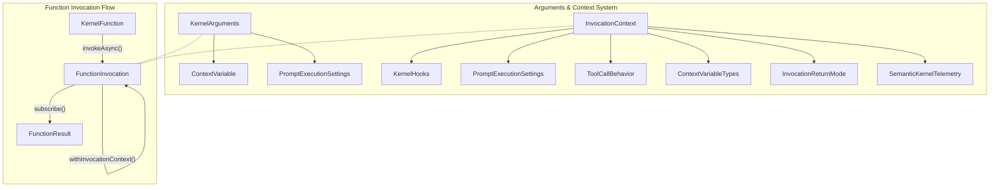
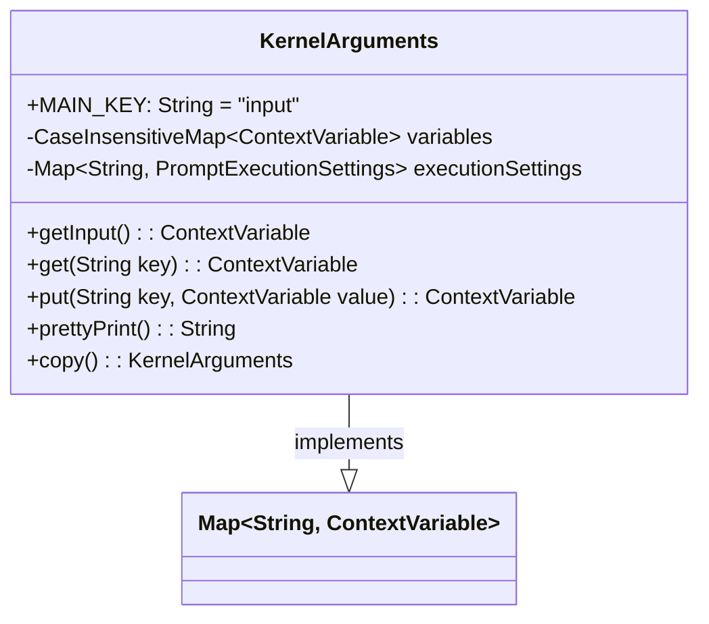
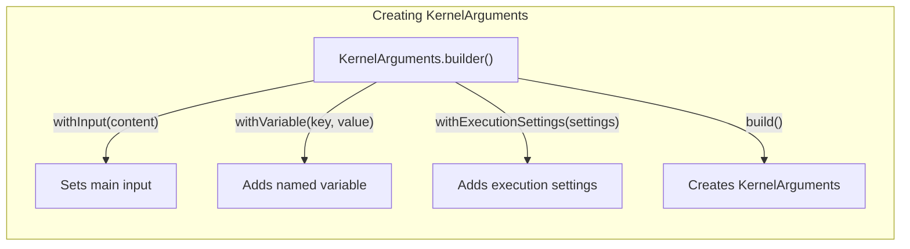
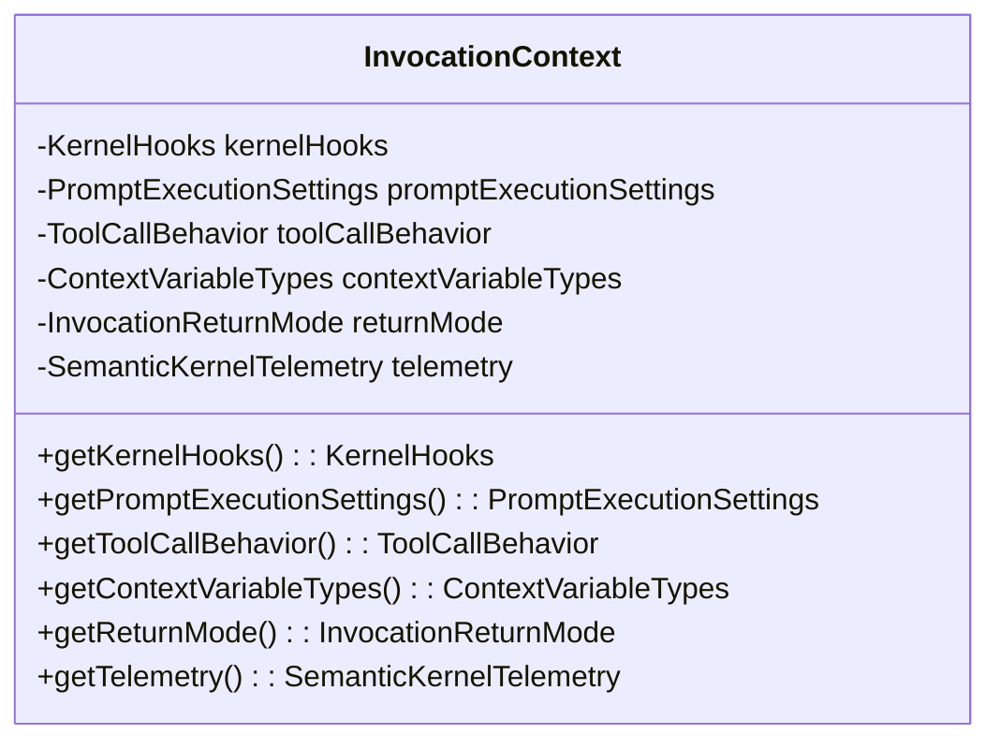
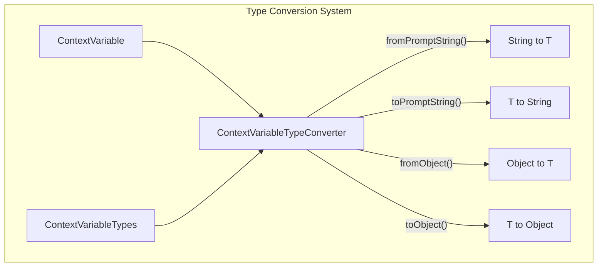
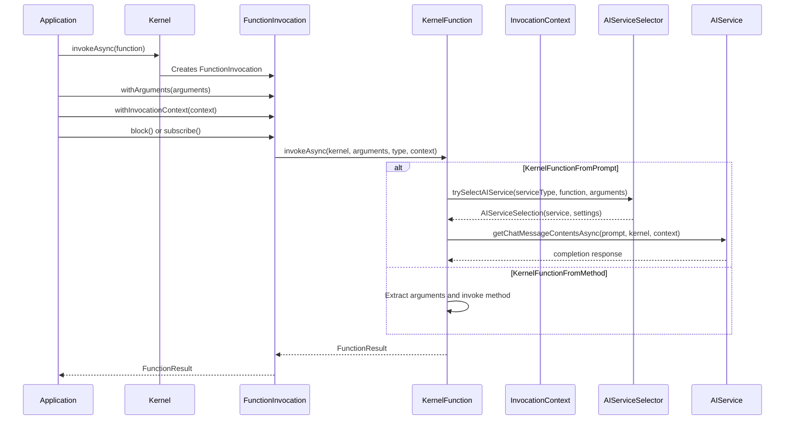
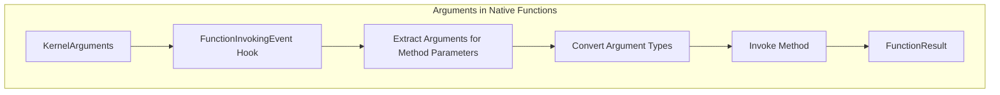
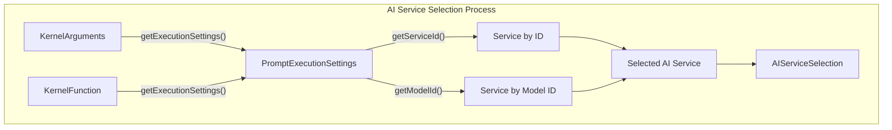

<!-- source: DeepWiki mcp.deepwiki.com · repo microsoft/semantic-kernel-java · page 2.4 Arguments and Context · fetched 2026-10-26 -->

# Arguments and Context

<details>
<summary>Relevant source files</summary>

The following files were used as context for generating this wiki page:

- [aiservices/openai/src/main/java/com/microsoft/semantickernel/aiservices/openai/chatcompletion/OpenAIChatCompletion.java](aiservices/openai/src/main/java/com/microsoft/semantickernel/aiservices/openai/chatcompletion/OpenAIChatCompletion.java)
- [aiservices/openai/src/main/java/com/microsoft/semantickernel/aiservices/openai/textcompletion/OpenAITextGenerationService.java](aiservices/openai/src/main/java/com/microsoft/semantickernel/aiservices/openai/textcompletion/OpenAITextGenerationService.java)
- [aiservices/openai/src/test/java/com/microsoft/semantickernel/aiservices/openai/OtelCaptureTest.java](aiservices/openai/src/test/java/com/microsoft/semantickernel/aiservices/openai/OtelCaptureTest.java)
- [api-test/integration-tests/src/test/java/com/microsoft/semantickernel/tests/ImportingMultiplePluginsTest.java](api-test/integration-tests/src/test/java/com/microsoft/semantickernel/tests/ImportingMultiplePluginsTest.java)
- [api-test/integration-tests/src/test/java/com/microsoft/semantickernel/tests/ResponseSchemaTest.java](api-test/integration-tests/src/test/java/com/microsoft/semantickernel/tests/ResponseSchemaTest.java)
- [samples/semantickernel-concepts/semantickernel-syntax-examples/src/main/java/com/microsoft/semantickernel/samples/syntaxexamples/Example61_MultipleLLMs.java](samples/semantickernel-concepts/semantickernel-syntax-examples/src/main/java/com/microsoft/semantickernel/samples/syntaxexamples/Example61_MultipleLLMs.java)
- [samples/semantickernel-concepts/semantickernel-syntax-examples/src/main/java/com/microsoft/semantickernel/samples/syntaxexamples/java/CustomTypes_Example.java](samples/semantickernel-concepts/semantickernel-syntax-examples/src/main/java/com/microsoft/semantickernel/samples/syntaxexamples/java/CustomTypes_Example.java)
- [samples/semantickernel-concepts/semantickernel-syntax-examples/src/main/java/com/microsoft/semantickernel/samples/syntaxexamples/java/FunctionTelemetry_Example.java](samples/semantickernel-concepts/semantickernel-syntax-examples/src/main/java/com/microsoft/semantickernel/samples/syntaxexamples/java/FunctionTelemetry_Example.java)
- [samples/semantickernel-concepts/semantickernel-syntax-examples/src/main/java/com/microsoft/semantickernel/samples/syntaxexamples/java/KernelFunctionYaml_Example.java](samples/semantickernel-concepts/semantickernel-syntax-examples/src/main/java/com/microsoft/semantickernel/samples/syntaxexamples/java/KernelFunctionYaml_Example.java)
- [samples/semantickernel-concepts/semantickernel-syntax-examples/src/main/resources/com/microsoft/semantickernel/samples/syntaxexamples/java/applicationinsights.json](samples/semantickernel-concepts/semantickernel-syntax-examples/src/main/resources/com/microsoft/semantickernel/samples/syntaxexamples/java/applicationinsights.json)
- [semantickernel-api/src/main/java/com/microsoft/semantickernel/Kernel.java](semantickernel-api/src/main/java/com/microsoft/semantickernel/Kernel.java)
- [semantickernel-api/src/main/java/com/microsoft/semantickernel/implementation/telemetry/ChatCompletionSpan.java](semantickernel-api/src/main/java/com/microsoft/semantickernel/implementation/telemetry/ChatCompletionSpan.java)
- [semantickernel-api/src/main/java/com/microsoft/semantickernel/implementation/telemetry/FunctionSpan.java](semantickernel-api/src/main/java/com/microsoft/semantickernel/implementation/telemetry/FunctionSpan.java)
- [semantickernel-api/src/main/java/com/microsoft/semantickernel/implementation/telemetry/SemanticKernelTelemetry.java](semantickernel-api/src/main/java/com/microsoft/semantickernel/implementation/telemetry/SemanticKernelTelemetry.java)
- [semantickernel-api/src/main/java/com/microsoft/semantickernel/orchestration/FunctionInvocation.java](semantickernel-api/src/main/java/com/microsoft/semantickernel/orchestration/FunctionInvocation.java)
- [semantickernel-api/src/main/java/com/microsoft/semantickernel/semanticfunctions/KernelArguments.java](semantickernel-api/src/main/java/com/microsoft/semantickernel/semanticfunctions/KernelArguments.java)
- [semantickernel-api/src/main/java/com/microsoft/semantickernel/semanticfunctions/KernelFunctionArguments.java](semantickernel-api/src/main/java/com/microsoft/semantickernel/semanticfunctions/KernelFunctionArguments.java)
- [semantickernel-api/src/main/java/com/microsoft/semantickernel/semanticfunctions/KernelFunctionFromMethod.java](semantickernel-api/src/main/java/com/microsoft/semantickernel/semanticfunctions/KernelFunctionFromMethod.java)
- [semantickernel-api/src/main/java/com/microsoft/semantickernel/semanticfunctions/KernelFunctionFromPrompt.java](semantickernel-api/src/main/java/com/microsoft/semantickernel/semanticfunctions/KernelFunctionFromPrompt.java)
- [semantickernel-api/src/main/java/com/microsoft/semantickernel/services/AIServiceSelector.java](semantickernel-api/src/main/java/com/microsoft/semantickernel/services/AIServiceSelector.java)
- [semantickernel-api/src/main/java/com/microsoft/semantickernel/services/BaseAIServiceSelector.java](semantickernel-api/src/main/java/com/microsoft/semantickernel/services/BaseAIServiceSelector.java)
- [semantickernel-api/src/main/java/com/microsoft/semantickernel/services/OrderedAIServiceSelector.java](semantickernel-api/src/main/java/com/microsoft/semantickernel/services/OrderedAIServiceSelector.java)
- [semantickernel-api/src/test/java/com/microsoft/semantickernel/semanticfunctions/KernelFunctionFromMethodTest.java](semantickernel-api/src/test/java/com/microsoft/semantickernel/semanticfunctions/KernelFunctionFromMethodTest.java)

</details>


This page provides a detailed technical overview of how arguments and context are managed and passed between functions and AI services in the Semantic Kernel Java framework. Arguments and context are fundamental components that enable data flow between different parts of the system, from kernel functions to AI service providers.

For information about function execution flow, see [Core Architecture](#2). For information about hooks, which can intercept and modify arguments, see [Hook System](#2.3).

## 1. Arguments and Context Overview

Semantic Kernel Java uses a consistent system for passing arguments between functions and managing execution context. The two key components in this system are:

1. **KernelArguments**: Container for data passed to and from kernel functions
2. **InvocationContext**: Execution context with settings, behavior controls, and type information



Sources:
- [semantickernel-api/src/main/java/com/microsoft/semantickernel/semanticfunctions/KernelArguments.java](semantickernel-api/src/main/java/com/microsoft/semantickernel/semanticfunctions/KernelArguments.java)
- [semantickernel-api/src/main/java/com/microsoft/semantickernel/orchestration/FunctionInvocation.java](semantickernel-api/src/main/java/com/microsoft/semantickernel/orchestration/FunctionInvocation.java)

## 2. KernelArguments

KernelArguments serves as the primary container for passing data to and from kernel functions. It implements the `Map<String, ContextVariable<?>>` interface and provides additional functionality specific to argument handling.

### 2.1 Structure and Implementation

KernelArguments contains:

1. A case-insensitive map of named variables (`variables`)
2. A map of execution settings (`executionSettings`)
3. Special handling for the "input" key, which is considered the main argument



Sources:
- [semantickernel-api/src/main/java/com/microsoft/semantickernel/semanticfunctions/KernelArguments.java:29-425](semantickernel-api/src/main/java/com/microsoft/semantickernel/semanticfunctions/KernelArguments.java:29-425)

### 2.2 Creating KernelArguments

KernelArguments provides a builder pattern for creating instances. Here are several ways to create KernelArguments:



Sources:
- [semantickernel-api/src/main/java/com/microsoft/semantickernel/semanticfunctions/KernelArguments.java:242-424](semantickernel-api/src/main/java/com/microsoft/semantickernel/semanticfunctions/KernelArguments.java:242-424)

The main methods for creating KernelArguments are:

1. **Basic constructor** (protected):
```java
protected KernelArguments(
    @Nullable Map<String, ContextVariable<?>> variables,
    @Nullable Map<String, PromptExecutionSettings> executionSettings)
```

2. **Builder pattern** (recommended approach):
```java
KernelArguments arguments = KernelArguments.builder()
    .withInput("main input")                 // Sets the main input value
    .withVariable("varName", "varValue")     // Adds a named variable
    .withExecutionSettings(executionSettings) // Adds prompt execution settings
    .build();
```

Sources:
- [semantickernel-api/src/main/java/com/microsoft/semantickernel/semanticfunctions/KernelArguments.java:44-57](semantickernel-api/src/main/java/com/microsoft/semantickernel/semanticfunctions/KernelArguments.java:44-57)
- [samples/semantickernel-concepts/semantickernel-syntax-examples/src/main/java/com/microsoft/semantickernel/samples/syntaxexamples/java/KernelFunctionYaml_Example.java:70-97](samples/semantickernel-concepts/semantickernel-syntax-examples/src/main/java/com/microsoft/semantickernel/samples/syntaxexamples/java/KernelFunctionYaml_Example.java:70-97)

### 2.3 Using KernelArguments

KernelArguments serves several important roles:

1. **Passing input data** to kernel functions
2. **Storing variable values** for template rendering
3. **Configuring execution settings** for AI services

The `MAIN_KEY` constant ("input") is used as the default key for the main function input.

```java
// Access the main input value
ContextVariable<?> input = arguments.getInput();

// Access a named variable
ContextVariable<?> value = arguments.get("myVariable");

// Check if a variable exists or is empty
boolean isEmpty = arguments.isNullOrEmpty("myVariable");

// Print all variables for debugging
String debugView = arguments.prettyPrint();
```

Sources:
- [semantickernel-api/src/main/java/com/microsoft/semantickernel/semanticfunctions/KernelArguments.java:103-165](semantickernel-api/src/main/java/com/microsoft/semantickernel/semanticfunctions/KernelArguments.java:103-165)

## 3. InvocationContext

InvocationContext provides essential context for function invocation. It aggregates multiple components that influence function execution behavior.

### 3.1 Structure and Components

InvocationContext contains:

1. **KernelHooks**: Hooks for intercepting and modifying function invocation
2. **PromptExecutionSettings**: Settings for AI service execution
3. **ToolCallBehavior**: Controls for function calling by AI
4. **ContextVariableTypes**: Type information for variable conversion
5. **InvocationReturnMode**: Controls what is returned from function calls
6. **SemanticKernelTelemetry**: Telemetry for function execution



### 3.2 Creating and Using InvocationContext

InvocationContext also uses a builder pattern for creating instances. It's typically created and passed to the function invocation method to configure execution behavior:

```java
InvocationContext context = InvocationContext.builder()
    .withKernelHooks(hooks)
    .withPromptExecutionSettings(settings)
    .withToolCallBehavior(ToolCallBehavior.allowAllKernelFunctions(true))
    .withReturnMode(InvocationReturnMode.FULL_HISTORY)
    .withTelemetry(telemetry)
    .build();

FunctionResult<String> result = function
    .invokeAsync(kernel)
    .withInvocationContext(context)
    .block();
```

Sources:
- [samples/semantickernel-concepts/semantickernel-syntax-examples/src/main/java/com/microsoft/semantickernel/samples/syntaxexamples/java/FunctionTelemetry_Example.java:143-156](samples/semantickernel-concepts/semantickernel-syntax-examples/src/main/java/com/microsoft/semantickernel/samples/syntaxexamples/java/FunctionTelemetry_Example.java:143-156)

## 4. Context Variables

Context variables (`ContextVariable<?>`) are the payload units stored in KernelArguments. They encapsulate a typed value and its associated metadata.

### 4.1 ContextVariable Structure

Each ContextVariable contains:
1. A typed value
2. A `ContextVariableType` defining how to convert the value
3. Methods for extracting and converting the value

Variables can be created with:
```java
// Basic value
ContextVariable<String> var1 = ContextVariable.of("Hello world");

// With custom type converter
ContextVariable<MyType> var2 = new ContextVariable<>(typeConverter, myValue);
```

### 4.2 Type Conversion System

Semantic Kernel provides a robust type conversion system through `ContextVariableTypes` and `ContextVariableTypeConverter`. This enables automatic conversion between different data types.



Sources:
- [semantickernel-api/src/main/java/com/microsoft/semantickernel/semanticfunctions/KernelArguments.java:290-361](semantickernel-api/src/main/java/com/microsoft/semantickernel/semanticfunctions/KernelArguments.java:290-361)
- [samples/semantickernel-concepts/semantickernel-syntax-examples/src/main/java/com/microsoft/semantickernel/samples/syntaxexamples/java/CustomTypes_Example.java:90-123](samples/semantickernel-concepts/semantickernel-syntax-examples/src/main/java/com/microsoft/semantickernel/samples/syntaxexamples/java/CustomTypes_Example.java:90-123)

### 4.3 Custom Type Conversions

The framework allows for custom type conversions by defining your own converters:

```java
// Custom converter for a Pet class
ContextVariableTypeConverter<Pet> typeConverter = ContextVariableTypeConverter.builder(Pet.class)
    .toPromptString(pet -> "name: " + pet.name() + "\n" +
                         "age: " + pet.age() + "\n" +
                         "species: " + pet.species() + "\n")
    .fromPromptString(prompt -> {
        Map<String, String> properties = Arrays.stream(prompt.split("\n"))
            .collect(Collectors.toMap(
                line -> line.split(":")[0].trim(),
                line -> line.split(":")[1].trim()));
        
        return new Pet(
            properties.get("name"),
            Integer.parseInt(properties.get("age")),
            properties.get("species"));
    })
    .build();

// Use the converter to store a Pet object in arguments
KernelArguments arguments = KernelArguments.builder()
    .withVariable("pet", myPet, typeConverter)
    .build();
```

Jackson-based conversion is also supported for JSON serializable objects:

```java
ContextVariableTypeConverter<Pet> typeConverter = ContextVariableJacksonConverter.create(Pet.class);
```

Sources:
- [samples/semantickernel-concepts/semantickernel-syntax-examples/src/main/java/com/microsoft/semantickernel/samples/syntaxexamples/java/CustomTypes_Example.java:90-177](samples/semantickernel-concepts/semantickernel-syntax-examples/src/main/java/com/microsoft/semantickernel/samples/syntaxexamples/java/CustomTypes_Example.java:90-177)

## 5. Function Execution Flow with Arguments

When a kernel function is invoked, arguments and context flow through a well-defined process:



Sources:
- [semantickernel-api/src/main/java/com/microsoft/semantickernel/orchestration/FunctionInvocation.java:90-156](semantickernel-api/src/main/java/com/microsoft/semantickernel/orchestration/FunctionInvocation.java:90-156)
- [semantickernel-api/src/main/java/com/microsoft/semantickernel/semanticfunctions/KernelFunctionFromPrompt.java:99-251](semantickernel-api/src/main/java/com/microsoft/semantickernel/semanticfunctions/KernelFunctionFromPrompt.java:99-251)
- [semantickernel-api/src/main/java/com/microsoft/semantickernel/semanticfunctions/KernelFunctionFromMethod.java:162-263](semantickernel-api/src/main/java/com/microsoft/semantickernel/semanticfunctions/KernelFunctionFromMethod.java:162-263)

### 5.1 Argument Processing in Semantic Functions

For semantic functions (those created from prompts), arguments are used to:

1. Render the prompt template
2. Select an appropriate AI service
3. Configure AI service execution settings

For example, in `KernelFunctionFromPrompt`, arguments flow like this:

```mermaid
graph TD
    subgraph "Arguments in Semantic Functions"
        Args["KernelArguments"]
        
        Args --> RenderHook["PromptRenderingEvent Hook"]
        RenderHook --> Template["PromptTemplate.renderAsync()"]
        Template --> RenderedPrompt["Rendered Prompt"]
        RenderedPrompt --> PromptHook["PromptRenderedEvent Hook"]
        PromptHook --> InvokeHook["FunctionInvokingEvent Hook"]
        InvokeHook --> ServiceSelection["AI Service Selection"]
        ServiceSelection --> AIService["Call AI Service"]
        AIService --> ProcessResponse["Process Response"]
        ProcessResponse --> Result["FunctionResult"]
    end
```



Sources:
- [semantickernel-api/src/main/java/com/microsoft/semantickernel/semanticfunctions/KernelFunctionFromPrompt.java:99-274](semantickernel-api/src/main/java/com/microsoft/semantickernel/semanticfunctions/KernelFunctionFromPrompt.java:99-274)

### 5.2 Argument Processing in Native Functions

For native functions (method-based), arguments are used to:

1. Map named arguments to method parameters
2. Convert argument types to parameter types
3. Handle default values and required parameters

For example, in `KernelFunctionFromMethod`, arguments flow like this:



Sources:
- [semantickernel-api/src/main/java/com/microsoft/semantickernel/semanticfunctions/KernelFunctionFromMethod.java:162-641](semantickernel-api/src/main/java/com/microsoft/semantickernel/semanticfunctions/KernelFunctionFromMethod.java:162-641)

## 6. AI Service Selection

The AI service selection mechanism uses arguments (specifically the execution settings) to select appropriate AI services.

### 6.1 Service Selection Process



Sources:
- [semantickernel-api/src/main/java/com/microsoft/semantickernel/services/OrderedAIServiceSelector.java:50-171](semantickernel-api/src/main/java/com/microsoft/semantickernel/services/OrderedAIServiceSelector.java:50-171)

### 6.2 Selection Methods

The `OrderedAIServiceSelector` attempts to select AI services in this order:

1. By `serviceId` from execution settings
2. By `modelId` from execution settings  
3. Default service (with ID "default")
4. Any service of the requested type

```java
public <T extends AIService> AIServiceSelection<T> trySelectAIService(
    Class<T> serviceType,
    @Nullable KernelFunction<?> function,
    @Nullable KernelArguments arguments) {

    if (function == null) {
        return selectAIService(serviceType, 
            arguments != null ? arguments.getExecutionSettings() : null);
    }

    return selectAIService(serviceType, function.getExecutionSettings());
}
```

Sources:
- [semantickernel-api/src/main/java/com/microsoft/semantickernel/services/OrderedAIServiceSelector.java:60-73](semantickernel-api/src/main/java/com/microsoft/semantickernel/services/OrderedAIServiceSelector.java:60-73)
- [semantickernel-api/src/main/java/com/microsoft/semantickernel/services/AIServiceSelector.java:29-54](semantickernel-api/src/main/java/com/microsoft/semantickernel/services/AIServiceSelector.java:29-54)

### 6.3 Configuring for Multiple AI Services

Multiple AI services can be configured and selected dynamically:

```java
// Create different AI services
ChatCompletionService gpt35 = OpenAIChatCompletion.builder()
    .withServiceId("gpt35")
    .withModelId("gpt-35-turbo")
    .withOpenAIAsyncClient(client)
    .build();

ChatCompletionService gpt4o = OpenAIChatCompletion.builder()
    .withServiceId("gpt4o")
    .withModelId("gpt-4o")
    .withOpenAIAsyncClient(client)
    .build();

// Configure execution settings
PromptExecutionSettings gpt35Settings = PromptExecutionSettings.builder()
    .withServiceId("gpt35")
    .build();

PromptExecutionSettings gpt4oSettings = PromptExecutionSettings.builder()
    .withServiceId("gpt4o")
    .build();

// Build the kernel with both services
Kernel kernel = Kernel.builder()
    .withAIService(ChatCompletionService.class, gpt35)
    .withAIService(ChatCompletionService.class, gpt4o)
    .build();

// Use gpt-35-turbo for this invocation
kernel.invokePromptAsync("Write a haiku about mountains")
    .withArguments(KernelArguments.builder()
        .withExecutionSettings(gpt35Settings)
        .build())
    .block();
```

Sources:
- [samples/semantickernel-concepts/semantickernel-syntax-examples/src/main/java/com/microsoft/semantickernel/samples/syntaxexamples/Example61_MultipleLLMs.java:47-142](samples/semantickernel-concepts/semantickernel-syntax-examples/src/main/java/com/microsoft/semantickernel/samples/syntaxexamples/Example61_MultipleLLMs.java:47-142)

## 7. Telemetry

Telemetry is a key component of the invocation context that provides insights into function execution, AI service calls, and performance.

### 7.1 Telemetry Structure

`SemanticKernelTelemetry` is used to:
1. Create spans for function invocation
2. Track AI service calls
3. Capture usage metrics (tokens)
4. Record errors

### 7.2 Using Telemetry

Telemetry can be passed through the invocation context:

```java
// Create a telemetry instance
SemanticKernelTelemetry telemetry = new SemanticKernelTelemetry();

// Use it in invocation
kernel.invokePromptAsync("Write a haiku about mountains")
    .withInvocationContext(InvocationContext.builder()
        .withTelemetry(telemetry)
        .build())
    .block();
```

Sources:
- [semantickernel-api/src/main/java/com/microsoft/semantickernel/implementation/telemetry/SemanticKernelTelemetry.java:11-54](semantickernel-api/src/main/java/com/microsoft/semantickernel/implementation/telemetry/SemanticKernelTelemetry.java:11-54)
- [semantickernel-api/src/main/java/com/microsoft/semantickernel/implementation/telemetry/FunctionSpan.java:25-65](semantickernel-api/src/main/java/com/microsoft/semantickernel/implementation/telemetry/FunctionSpan.java:25-65)
- [semantickernel-api/src/main/java/com/microsoft/semantickernel/implementation/telemetry/ChatCompletionSpan.java:25-116](semantickernel-api/src/main/java/com/microsoft/semantickernel/implementation/telemetry/ChatCompletionSpan.java:25-116)

## 8. Best Practices

### 8.1 Using Arguments Effectively

1. **Use the builder pattern** for creating arguments:
   ```java
   KernelArguments arguments = KernelArguments.builder()
       .withInput("Main input text")
       .withVariable("temperature", 0.7)
       .build();
   ```

2. **Leverage type converters** for complex objects:
   ```java
   // Custom type with Jackson converter
   arguments.withVariable("myObject", myObject, ContextVariableJacksonConverter.create(MyClass.class))
   ```

3. **Organize execution settings** by service ID to easily switch between AI services:
   ```java
   // Create execution settings for different models
   Map<String, PromptExecutionSettings> settings = new HashMap<>();
   settings.put("gpt35", PromptExecutionSettings.builder().withModelId("gpt-35-turbo").build());
   settings.put("gpt4", PromptExecutionSettings.builder().withModelId("gpt-4").build());
   
   // Use in arguments
   arguments.withExecutionSettings(settings);
   ```

### 8.2 Managing Invocation Context

1. **Reuse InvocationContext** for multiple function calls with the same settings:
   ```java
   InvocationContext context = InvocationContext.builder()
       .withToolCallBehavior(ToolCallBehavior.allowAllKernelFunctions(true))
       .build();
       
   // Use for multiple calls
   function1.invokeAsync(kernel).withInvocationContext(context).block();
   function2.invokeAsync(kernel).withInvocationContext(context).block();
   ```

2. **Configure return mode** based on whether you need chat history:
   ```java
   // Just get the last message
   context = InvocationContext.builder()
       .withReturnMode(InvocationReturnMode.LAST_MESSAGE_ONLY)
       .build();
       
   // Get full chat history
   context = InvocationContext.builder()
       .withReturnMode(InvocationReturnMode.FULL_HISTORY)
       .build();
   ```

3. **Add custom type converters** to the context for specialized type handling:
   ```java
   context = InvocationContext.builder()
       .withContextVariableConverter(myCustomConverter)
       .build();
   ```

## 9. Summary

Arguments and context in Semantic Kernel Java provide a flexible system for:

1. **Passing data** to and from kernel functions
2. **Configuring execution** of AI services
3. **Converting data types** between different representations
4. **Selecting appropriate AI services** based on requirements
5. **Collecting telemetry** for performance monitoring

This system allows for a clean separation between data (arguments) and behavior (context) while providing extensive flexibility for customization.

Sources:
- [semantickernel-api/src/main/java/com/microsoft/semantickernel/semanticfunctions/KernelArguments.java](semantickernel-api/src/main/java/com/microsoft/semantickernel/semanticfunctions/KernelArguments.java)
- [semantickernel-api/src/main/java/com/microsoft/semantickernel/orchestration/FunctionInvocation.java](semantickernel-api/src/main/java/com/microsoft/semantickernel/orchestration/FunctionInvocation.java)
- [semantickernel-api/src/main/java/com/microsoft/semantickernel/services/AIServiceSelector.java](semantickernel-api/src/main/java/com/microsoft/semantickernel/services/AIServiceSelector.java)

---

