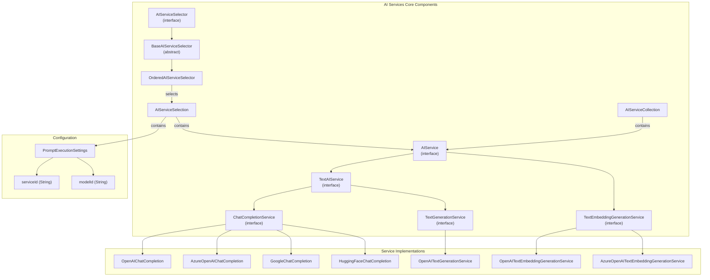
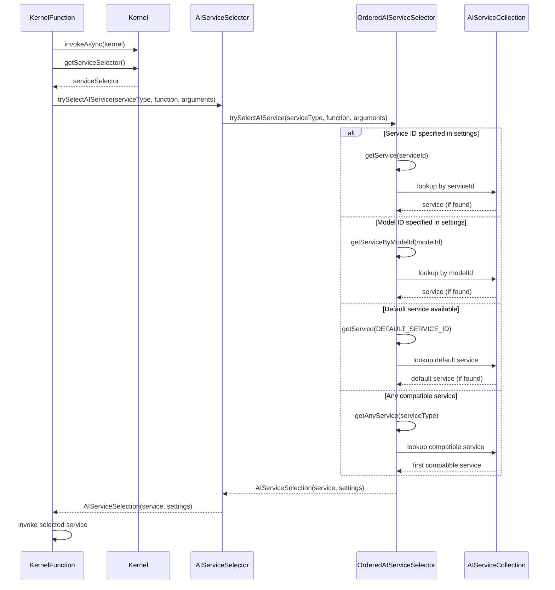
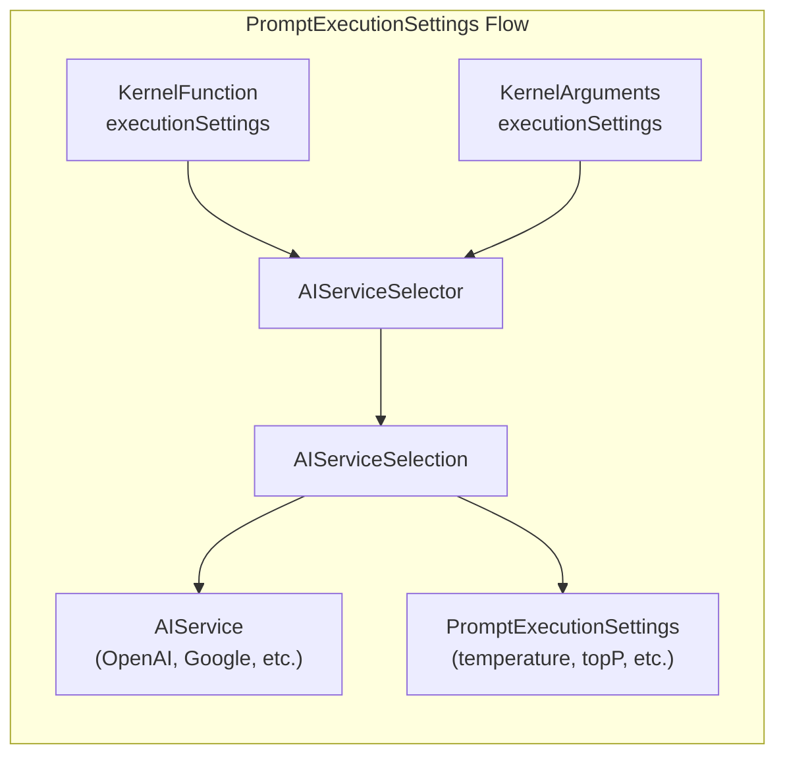
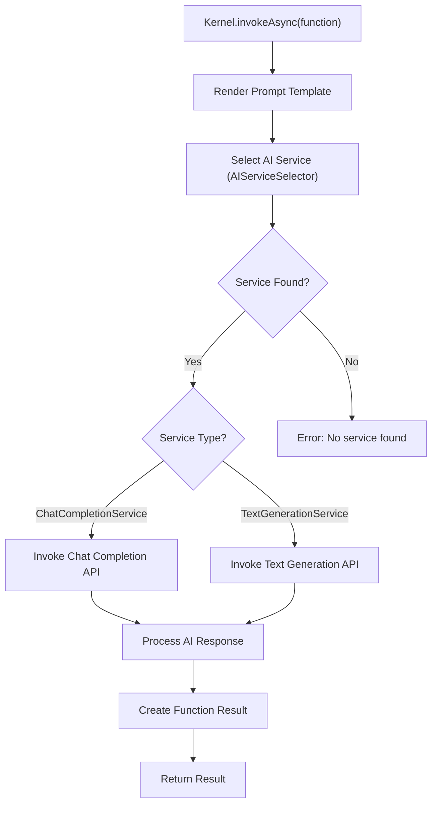

<!-- source: DeepWiki mcp.deepwiki.com · repo microsoft/semantic-kernel-java · page 3 AI Services · fetched 2026-10-26 -->

# AI Services

<details>
<summary>Relevant source files</summary>

The following files were used as context for generating this wiki page:

- [aiservices/google/pom.xml](aiservices/google/pom.xml)
- [aiservices/huggingface/pom.xml](aiservices/huggingface/pom.xml)
- [aiservices/openai/pom.xml](aiservices/openai/pom.xml)
- [api-test/integration-tests/src/test/java/com/microsoft/semantickernel/tests/ImportingMultiplePluginsTest.java](api-test/integration-tests/src/test/java/com/microsoft/semantickernel/tests/ImportingMultiplePluginsTest.java)
- [api-test/integration-tests/src/test/java/com/microsoft/semantickernel/tests/ResponseSchemaTest.java](api-test/integration-tests/src/test/java/com/microsoft/semantickernel/tests/ResponseSchemaTest.java)
- [api-test/pom.xml](api-test/pom.xml)
- [samples/pom.xml](samples/pom.xml)
- [samples/semantickernel-concepts/pom.xml](samples/semantickernel-concepts/pom.xml)
- [samples/semantickernel-concepts/semantickernel-syntax-examples/src/main/java/com/microsoft/semantickernel/samples/syntaxexamples/Example61_MultipleLLMs.java](samples/semantickernel-concepts/semantickernel-syntax-examples/src/main/java/com/microsoft/semantickernel/samples/syntaxexamples/Example61_MultipleLLMs.java)
- [samples/semantickernel-demos/pom.xml](samples/semantickernel-demos/pom.xml)
- [samples/semantickernel-demos/sk-presidio-sample/pom.xml](samples/semantickernel-demos/sk-presidio-sample/pom.xml)
- [samples/semantickernel-sample-plugins/pom.xml](samples/semantickernel-sample-plugins/pom.xml)
- [samples/semantickernel-sample-plugins/semantickernel-presidio-plugin/pom.xml](samples/semantickernel-sample-plugins/semantickernel-presidio-plugin/pom.xml)
- [semantickernel-api/src/main/java/com/microsoft/semantickernel/Kernel.java](semantickernel-api/src/main/java/com/microsoft/semantickernel/Kernel.java)
- [semantickernel-api/src/main/java/com/microsoft/semantickernel/semanticfunctions/KernelArguments.java](semantickernel-api/src/main/java/com/microsoft/semantickernel/semanticfunctions/KernelArguments.java)
- [semantickernel-api/src/main/java/com/microsoft/semantickernel/semanticfunctions/KernelFunctionFromPrompt.java](semantickernel-api/src/main/java/com/microsoft/semantickernel/semanticfunctions/KernelFunctionFromPrompt.java)
- [semantickernel-api/src/main/java/com/microsoft/semantickernel/services/AIServiceSelector.java](semantickernel-api/src/main/java/com/microsoft/semantickernel/services/AIServiceSelector.java)
- [semantickernel-api/src/main/java/com/microsoft/semantickernel/services/BaseAIServiceSelector.java](semantickernel-api/src/main/java/com/microsoft/semantickernel/services/BaseAIServiceSelector.java)
- [semantickernel-api/src/main/java/com/microsoft/semantickernel/services/OrderedAIServiceSelector.java](semantickernel-api/src/main/java/com/microsoft/semantickernel/services/OrderedAIServiceSelector.java)

</details>


## Purpose and Scope

AI Services in Semantic Kernel Java provide the integration layer between the kernel and various large language model (LLM) providers such as OpenAI, Azure OpenAI, Google, and Hugging Face. This component manages the registration, selection, and invocation of AI services throughout the framework, allowing applications to interact with different LLM providers through a unified interface.

This page explains the architecture of AI Services, how services are selected and used within the kernel, and how to configure different service providers. For information about specific service implementations, see [OpenAI Integration](#3.1) and [Other AI Service Providers](#3.2).

## AI Services Architecture

AI Services consists of several core components that work together to provide flexible integration with language models:



Sources:
- [semantickernel-api/src/main/java/com/microsoft/semantickernel/services/AIServiceSelector.java:1-55]()
- [semantickernel-api/src/main/java/com/microsoft/semantickernel/services/OrderedAIServiceSelector.java:1-246]()
- [semantickernel-api/src/main/java/com/microsoft/semantickernel/semanticfunctions/KernelFunctionFromPrompt.java:160-235]()

### Core Interfaces

- **`AIService`**: The base interface for all AI services
- **`TextAIService`**: Base interface for text-based AI services
  - **`ChatCompletionService`**: For chat-based completions (conversation)
  - **`TextGenerationService`**: For text-based completions
- **`TextEmbeddingGenerationService`**: For generating text embeddings

### Service Selection

The service selection mechanism is implemented through:

- **`AIServiceSelector`**: Interface defining service selection
- **`BaseAIServiceSelector`**: Abstract base implementation
- **`OrderedAIServiceSelector`**: Default implementation that selects services based on priority rules
- **`AIServiceSelection<T>`**: Contains the selected service and its execution settings

### Service Configuration

- **`PromptExecutionSettings`**: Configuration for how prompts should be executed
- **`AIServiceCollection`**: Collection of all registered AI services

Sources:
- [semantickernel-api/src/main/java/com/microsoft/semantickernel/Kernel.java:36-44]()
- [semantickernel-api/src/main/java/com/microsoft/semantickernel/services/BaseAIServiceSelector.java:1-87]()

## Service Selection Process

The service selection mechanism is a key component of the AI Services architecture. It determines which registered service should handle a particular request based on various criteria.



Sources:
- [semantickernel-api/src/main/java/com/microsoft/semantickernel/services/OrderedAIServiceSelector.java:60-187]()
- [semantickernel-api/src/main/java/com/microsoft/semantickernel/semanticfunctions/KernelFunctionFromPrompt.java:142-156]()

### Selection Criteria (in order of priority)

1. **By Service ID**: Matches the `serviceId` specified in execution settings
2. **By Model ID**: Matches the `modelId` specified in execution settings
3. **Default Service**: Uses the service with ID `DEFAULT_SERVICE_ID`
4. **Any Compatible Service**: Uses any service of the requested type

This prioritized selection allows for flexible configuration of service usage, from explicit selection to automatic fallback.

Sources:
- [semantickernel-api/src/main/java/com/microsoft/semantickernel/services/OrderedAIServiceSelector.java:76-156]()

## Prompt Execution Settings

`PromptExecutionSettings` play a crucial role in the AI Services system. They specify how a prompt should be executed and which service should be used.

Key properties of `PromptExecutionSettings`:

- **Service ID**: Identifies a specific service instance
- **Model ID**: Identifies a specific model to use
- **Temperature, Top P, etc.**: Configure the behavior of the AI model
- **Response Format**: Specifies the desired output format (e.g., JSON Schema)

These settings can be specified at different levels:

1. **Function level**: Applied to a specific function
2. **Arguments level**: Provided during function invocation
3. **Default level**: Used when no specific settings are provided



Sources:
- [semantickernel-api/src/main/java/com/microsoft/semantickernel/semanticfunctions/KernelArguments.java:92-96]()
- [semantickernel-api/src/main/java/com/microsoft/semantickernel/semanticfunctions/KernelFunctionFromPrompt.java:59-67]()

## Using AI Services

### Registering Services with the Kernel

AI Services are registered with the Kernel through the builder pattern:

```java
Kernel kernel = Kernel.builder()
    .withAIService(ChatCompletionService.class, openAIChatCompletion)
    .withAIService(TextGenerationService.class, textGenerationService)
    .build();
```

This registers each service with its corresponding interface type, allowing the service selector to find appropriate services for each request.

Sources:
- [samples/semantickernel-concepts/semantickernel-syntax-examples/src/main/java/com/microsoft/semantickernel/samples/syntaxexamples/Example61_MultipleLLMs.java:59-62]()
- [semantickernel-api/src/main/java/com/microsoft/semantickernel/Kernel.java:376-379]()

### Selecting Specific Services

Services can be selected explicitly through `PromptExecutionSettings`:

#### By Service ID
```java
PromptExecutionSettings settings = PromptExecutionSettings.builder()
    .withServiceId("AzureOpenAIChat")
    .build();
```

#### By Model ID
```java
PromptExecutionSettings settings = PromptExecutionSettings.builder()
    .withModelId("gpt-35-turbo-2")
    .build();
```

Sources:
- [samples/semantickernel-concepts/semantickernel-syntax-examples/src/main/java/com/microsoft/semantickernel/samples/syntaxexamples/Example61_MultipleLLMs.java:80-86]()
- [samples/semantickernel-concepts/semantickernel-syntax-examples/src/main/java/com/microsoft/semantickernel/samples/syntaxexamples/Example61_MultipleLLMs.java:102-106]()

### Using Multiple Services

Multiple services can be configured by providing multiple execution settings:

```java
// Create settings for multiple models
var modelSettings = new HashMap<String, PromptExecutionSettings>();
Arrays.stream(modelIds).forEach(modelId -> {
    modelSettings.put(
        modelId,
        PromptExecutionSettings.builder()
            .withModelId(modelId)
            .build());
});

// Configure function with multiple settings
var promptConfig = PromptTemplateConfig.defaultTemplateBuilder()
    .withTemplate(prompt)
    .withExecutionSettings(modelSettings)
    .build();
```

This allows for fallback behavior, where if one service/model is unavailable, another can be used.

Sources:
- [samples/semantickernel-concepts/semantickernel-syntax-examples/src/main/java/com/microsoft/semantickernel/samples/syntaxexamples/Example61_MultipleLLMs.java:119-134]()

## Service Integration Flow

When a semantic function is invoked, it goes through the following process to use AI services:



Sources:
- [semantickernel-api/src/main/java/com/microsoft/semantickernel/semanticfunctions/KernelFunctionFromPrompt.java:99-273]()

## AI Service Provider Support

Semantic Kernel Java supports integration with multiple AI service providers through dedicated implementation modules:

| Provider | Module Path | Implementation Classes |
|----------|-------------|------------------------|
| OpenAI and Azure OpenAI | `aiservices/openai` | `OpenAIChatCompletion`, `AzureOpenAIChatCompletion` |
| Google Vertex AI | `aiservices/google` | `GoogleChatCompletion` |
| Hugging Face | `aiservices/huggingface` | `HuggingFaceChatCompletion` |

Each provider implements the standard interfaces (`ChatCompletionService`, `TextGenerationService`, etc.) with provider-specific logic.

Sources:
- [aiservices/openai/pom.xml:1-80]()
- [aiservices/google/pom.xml:1-56]()
- [aiservices/huggingface/pom.xml:1-66]()

## Advanced Features

### Response Schema Formatting

AI Services support specifying response formats, including JSON Schema formatting for structured outputs:

```java
PromptExecutionSettings promptExecutionSettings = PromptExecutionSettings.builder()
    .withResponseFormat(
        JsonSchemaResponseFormat.builder()
            .setResponseFormat(TestClass.class)
            .setName("Test")
            .build()
    )
    .build();
```

This allows for strongly typed responses from AI services that can be automatically deserialized into Java objects.

Sources:
- [api-test/integration-tests/src/test/java/com/microsoft/semantickernel/tests/ResponseSchemaTest.java:112-119]()

## Summary

AI Services provide a flexible, extensible architecture for integrating different AI providers with Semantic Kernel. The system allows for:

1. **Unified Interface**: Common interfaces for different AI service types
2. **Dynamic Selection**: Selection of appropriate services based on various criteria
3. **Multiple Providers**: Support for OpenAI, Azure OpenAI, Google, and Hugging Face
4. **Configurable Behavior**: Fine-grained control through execution settings

This architecture enables applications to leverage multiple AI providers and models while maintaining a consistent programming model.

---

