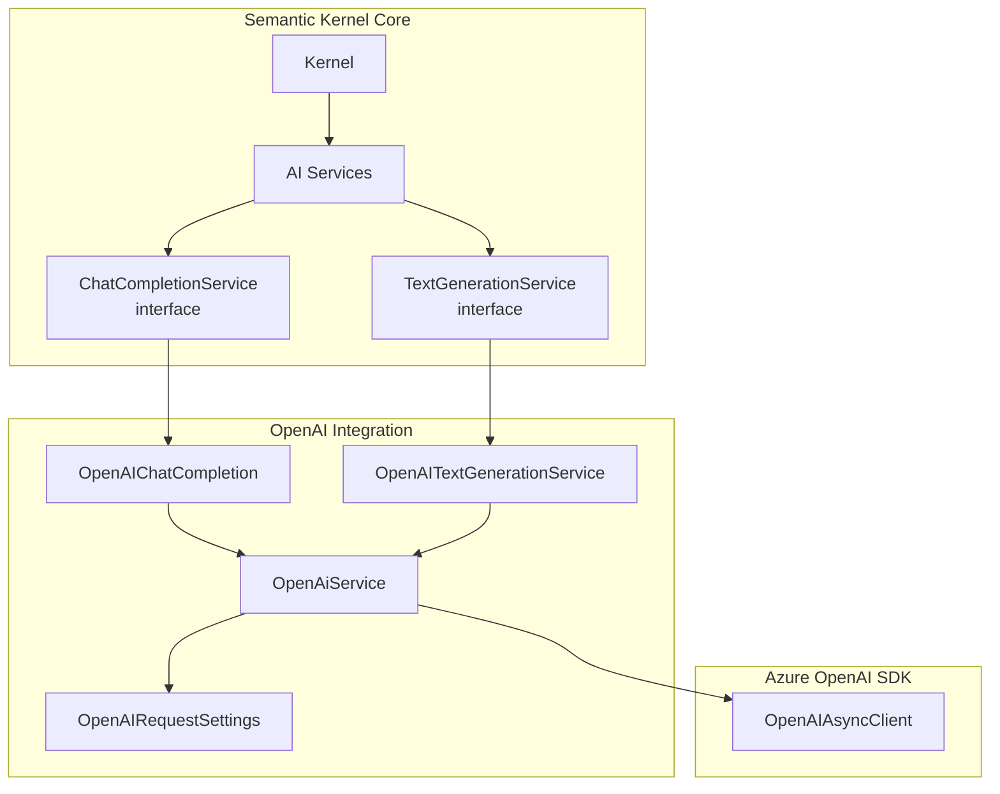
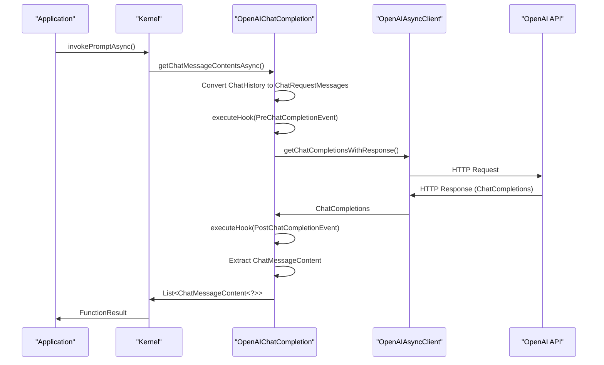
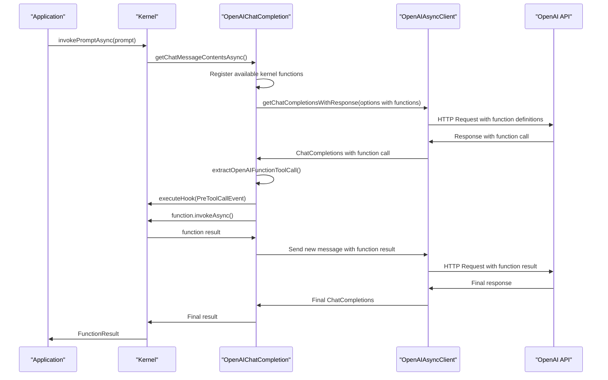

<!-- source: DeepWiki mcp.deepwiki.com · repo microsoft/semantic-kernel-java · page 3.1 OpenAI Integration · fetched 2026-10-26 -->

# OpenAI Integration

<details>
<summary>Relevant source files</summary>

The following files were used as context for generating this wiki page:

- [aiservices/openai/src/main/java/com/microsoft/semantickernel/aiservices/openai/chatcompletion/OpenAIChatCompletion.java](aiservices/openai/src/main/java/com/microsoft/semantickernel/aiservices/openai/chatcompletion/OpenAIChatCompletion.java)
- [aiservices/openai/src/main/java/com/microsoft/semantickernel/aiservices/openai/implementation/OpenAIRequestSettings.java](aiservices/openai/src/main/java/com/microsoft/semantickernel/aiservices/openai/implementation/OpenAIRequestSettings.java)
- [aiservices/openai/src/main/java/com/microsoft/semantickernel/aiservices/openai/textcompletion/OpenAITextGenerationService.java](aiservices/openai/src/main/java/com/microsoft/semantickernel/aiservices/openai/textcompletion/OpenAITextGenerationService.java)
- [aiservices/openai/src/test/java/com/microsoft/semantickernel/aiservices/openai/OtelCaptureTest.java](aiservices/openai/src/test/java/com/microsoft/semantickernel/aiservices/openai/OtelCaptureTest.java)
- [samples/semantickernel-concepts/semantickernel-syntax-examples/src/main/java/com/microsoft/semantickernel/samples/syntaxexamples/java/CustomTypes_Example.java](samples/semantickernel-concepts/semantickernel-syntax-examples/src/main/java/com/microsoft/semantickernel/samples/syntaxexamples/java/CustomTypes_Example.java)
- [samples/semantickernel-concepts/semantickernel-syntax-examples/src/main/java/com/microsoft/semantickernel/samples/syntaxexamples/java/FunctionTelemetry_Example.java](samples/semantickernel-concepts/semantickernel-syntax-examples/src/main/java/com/microsoft/semantickernel/samples/syntaxexamples/java/FunctionTelemetry_Example.java)
- [samples/semantickernel-concepts/semantickernel-syntax-examples/src/main/java/com/microsoft/semantickernel/samples/syntaxexamples/java/KernelFunctionYaml_Example.java](samples/semantickernel-concepts/semantickernel-syntax-examples/src/main/java/com/microsoft/semantickernel/samples/syntaxexamples/java/KernelFunctionYaml_Example.java)
- [samples/semantickernel-concepts/semantickernel-syntax-examples/src/main/resources/com/microsoft/semantickernel/samples/syntaxexamples/java/applicationinsights.json](samples/semantickernel-concepts/semantickernel-syntax-examples/src/main/resources/com/microsoft/semantickernel/samples/syntaxexamples/java/applicationinsights.json)
- [semantickernel-api/src/main/java/com/microsoft/semantickernel/implementation/telemetry/ChatCompletionSpan.java](semantickernel-api/src/main/java/com/microsoft/semantickernel/implementation/telemetry/ChatCompletionSpan.java)
- [semantickernel-api/src/main/java/com/microsoft/semantickernel/implementation/telemetry/FunctionSpan.java](semantickernel-api/src/main/java/com/microsoft/semantickernel/implementation/telemetry/FunctionSpan.java)
- [semantickernel-api/src/main/java/com/microsoft/semantickernel/implementation/telemetry/SemanticKernelTelemetry.java](semantickernel-api/src/main/java/com/microsoft/semantickernel/implementation/telemetry/SemanticKernelTelemetry.java)
- [semantickernel-api/src/main/java/com/microsoft/semantickernel/orchestration/FunctionInvocation.java](semantickernel-api/src/main/java/com/microsoft/semantickernel/orchestration/FunctionInvocation.java)
- [semantickernel-api/src/main/java/com/microsoft/semantickernel/semanticfunctions/KernelFunctionArguments.java](semantickernel-api/src/main/java/com/microsoft/semantickernel/semanticfunctions/KernelFunctionArguments.java)
- [semantickernel-api/src/main/java/com/microsoft/semantickernel/semanticfunctions/KernelFunctionFromMethod.java](semantickernel-api/src/main/java/com/microsoft/semantickernel/semanticfunctions/KernelFunctionFromMethod.java)
- [semantickernel-api/src/test/java/com/microsoft/semantickernel/semanticfunctions/KernelFunctionFromMethodTest.java](semantickernel-api/src/test/java/com/microsoft/semantickernel/semanticfunctions/KernelFunctionFromMethodTest.java)

</details>


This page details how Semantic Kernel Java integrates with OpenAI services. It covers configuring and using the OpenAI chat completion and text generation capabilities, including the underlying implementation details, request configurations, and telemetry features. For information about other AI service providers like Google and Hugging Face, see [Other AI Service Providers](#3.2).

## Architecture Overview

The OpenAI integration sits within the AI Services layer of Semantic Kernel, providing concrete implementations of the service interfaces defined in the core API. The implementation uses the Azure OpenAI SDK to communicate with OpenAI services.

### OpenAI Integration Components



Sources:
- [aiservices/openai/src/main/java/com/microsoft/semantickernel/aiservices/openai/chatcompletion/OpenAIChatCompletion.java]()
- [aiservices/openai/src/main/java/com/microsoft/semantickernel/aiservices/openai/textcompletion/OpenAITextGenerationService.java]()
- [aiservices/openai/src/main/java/com/microsoft/semantickernel/aiservices/openai/implementation/OpenAIRequestSettings.java]()

## Chat Completion with OpenAI

The `OpenAIChatCompletion` class implements the `ChatCompletionService` interface, providing chat completion capabilities using OpenAI's models. It supports both synchronous and streaming completions.

### Chat Completion Flow



Sources:
- [aiservices/openai/src/main/java/com/microsoft/semantickernel/aiservices/openai/chatcompletion/OpenAIChatCompletion.java:116-158]()
- [aiservices/openai/src/main/java/com/microsoft/semantickernel/aiservices/openai/chatcompletion/OpenAIChatCompletion.java:380-447]()

### Key Features

1. **Builder Pattern**: Configuration via builder pattern
2. **Chat History Support**: Conversion between Semantic Kernel's chat format and OpenAI's format
3. **Tool Calling**: Support for OpenAI's function calling capability
4. **Streaming**: Support for streaming responses
5. **Hook System Integration**: Pre/post completion hooks and tool call hooks
6. **Telemetry**: Detailed telemetry data for monitoring and debugging

### Configuration

```java
// Create an OpenAI client
OpenAIAsyncClient client = new OpenAIClientBuilder()
    .credential(new KeyCredential("your-api-key"))
    .buildAsyncClient();

// Create chat completion service
ChatCompletionService chatService = OpenAIChatCompletion.builder()
    .withOpenAIAsyncClient(client)
    .withModelId("gpt-4")
    .build();

// Add to kernel
Kernel kernel = Kernel.builder()
    .withAIService(ChatCompletionService.class, chatService)
    .build();
```

Sources:
- [aiservices/openai/src/main/java/com/microsoft/semantickernel/aiservices/openai/chatcompletion/OpenAIChatCompletion.java:94-114]()
- [samples/semantickernel-concepts/semantickernel-syntax-examples/src/main/java/com/microsoft/semantickernel/samples/syntaxexamples/java/KernelFunctionYaml_Example.java:37-58]()

## Text Generation with OpenAI

The `OpenAITextGenerationService` class implements the `TextGenerationService` interface, providing text generation capabilities using OpenAI's completion models.

### Key Features

1. **Text Generation**: Sends prompts to OpenAI and processes generated text responses
2. **Streaming**: Support for streaming text generation
3. **Configurable Parameters**: Control over max tokens, temperature, top-p, etc.

### Configuration

```java
TextGenerationService textService = OpenAITextGenerationService.builder()
    .withOpenAIClient(client)
    .withModelId("text-davinci-003")
    .withDeploymentName("deployment-name") // Optional, defaults to modelId
    .build();

Kernel kernel = Kernel.builder()
    .withAIService(TextGenerationService.class, textService)
    .build();
```

### Implementation Details

The `OpenAITextGenerationService` transforms the input text and execution settings into a `CompletionsOptions` object, which is sent to the OpenAI API. The response is processed into a list of `TextContent` objects that contain the generated text and associated metadata.

Sources:
- [aiservices/openai/src/main/java/com/microsoft/semantickernel/aiservices/openai/textcompletion/OpenAITextGenerationService.java:30-58]()
- [aiservices/openai/src/main/java/com/microsoft/semantickernel/aiservices/openai/textcompletion/OpenAITextGenerationService.java:60-77]()
- [aiservices/openai/src/main/java/com/microsoft/semantickernel/aiservices/openai/textcompletion/OpenAITextGenerationService.java:79-112]()

## Request Configuration

The `OpenAIRequestSettings` class manages HTTP request settings for OpenAI requests, adding appropriate headers and user agent information.

### Features

- **Semantic Kernel Version Header**: Adds a header identifying the request as coming from Semantic Kernel Java
- **User Agent**: Sets a user agent string with version information
- **Disabling Headers**: Option to disable the addition of these headers via a system property

The header is constructed during class initialization by reading the Semantic Kernel version from a properties file. This ensures that OpenAI can identify requests coming from Semantic Kernel.

Sources:
- [aiservices/openai/src/main/java/com/microsoft/semantickernel/aiservices/openai/implementation/OpenAIRequestSettings.java:16-81]()

## Telemetry and Monitoring

The OpenAI integration includes telemetry capabilities using OpenTelemetry for observability. This provides insights into AI service calls and function invocations.

### Chat Completion Telemetry

The `ChatCompletionSpan` class captures telemetry data for chat completion requests, including:

- Model name
- Operation name (`chat.completions`)
- Provider (OpenAI)
- Request parameters (max tokens, temperature, top-p) 
- Usage information (input tokens, output tokens)

These metrics are captured as OpenTelemetry spans and can be viewed in compatible observability platforms.

Sources:
- [semantickernel-api/src/main/java/com/microsoft/semantickernel/implementation/telemetry/ChatCompletionSpan.java:16-116]()
- [semantickernel-api/src/main/java/com/microsoft/semantickernel/implementation/telemetry/SemanticKernelTelemetry.java:11-54]()
- [aiservices/openai/src/test/java/com/microsoft/semantickernel/aiservices/openai/OtelCaptureTest.java:32-126]()

## Tool Calling

The OpenAI integration supports function calling capabilities, enabling the AI to call Kernel functions during a chat session. This feature is particularly useful for tasks requiring dynamic data retrieval or computation.

### Tool Calling Flow



The tool calling feature is implemented through the following key steps:

1. When initializing a chat completion request, the system collects all available kernel functions
2. These functions are sent to OpenAI as part of the request
3. If OpenAI decides to call a function, the function call is extracted and executed
4. The result is sent back to OpenAI to complete the conversation

The `ToolCallBehavior` class controls how tool calls are handled, including:
- Whether automatic function invocation is allowed
- Maximum auto-invoke attempts
- Fallback behavior if a function fails

Sources:
- [aiservices/openai/src/main/java/com/microsoft/semantickernel/aiservices/openai/chatcompletion/OpenAIChatCompletion.java:385-402]()
- [aiservices/openai/src/main/java/com/microsoft/semantickernel/aiservices/openai/chatcompletion/OpenAIChatCompletion.java:463-526]()
- [aiservices/openai/src/main/java/com/microsoft/semantickernel/aiservices/openai/chatcompletion/OpenAIChatCompletion.java:606-697]()

## Usage Examples

### Basic Chat Completion

```java
// Create chat history
ChatHistory chatHistory = new ChatHistory();
chatHistory.addUserMessage("What is Semantic Kernel?");

// Get chat completion
List<ChatMessageContent<?>> response = chatService.getChatMessageContentsAsync(
    chatHistory,
    kernel,
    null).block();

// Print response
System.out.println(response.get(0).getContent());
```

### Tool Calling Example

```java
// Create a plugin with functions
var plugin = KernelPluginFactory.createFromObject(new MyPlugin(), "MyPlugin");

// Create kernel with the plugin
var kernel = Kernel.builder()
    .withAIService(ChatCompletionService.class, chatService)
    .withPlugin(plugin)
    .build();

// Create chat history with a question that might require a function call
var chatHistory = new ChatHistory();
chatHistory.addUserMessage("What's the current weather in Seattle?");

// Invoke with tool calling enabled
var messages = chatService.getChatMessageContentsAsync(
    chatHistory,
    kernel,
    InvocationContext.builder()
        .withToolCallBehavior(ToolCallBehavior.allowAllKernelFunctions(true))
        .withReturnMode(InvocationReturnMode.FULL_HISTORY)
        .build())
    .block();
```

### Telemetry Example

```java
// Create a telemetry object (optionally with a span context to correlate with HTTP requests)
SemanticKernelTelemetry telemetry = new SemanticKernelTelemetry();

// Add telemetry to invocation context
InvocationContext context = InvocationContext.builder()
    .withTelemetry(telemetry)
    .build();

// Get chat completion with telemetry
List<ChatMessageContent<?>> response = chatService.getChatMessageContentsAsync(
    chatHistory,
    kernel,
    context).block();
```

Sources:
- [samples/semantickernel-concepts/semantickernel-syntax-examples/src/main/java/com/microsoft/semantickernel/samples/syntaxexamples/java/FunctionTelemetry_Example.java:66-162]()
- [samples/semantickernel-concepts/semantickernel-syntax-examples/src/main/java/com/microsoft/semantickernel/samples/syntaxexamples/java/CustomTypes_Example.java:34-58]()

---

