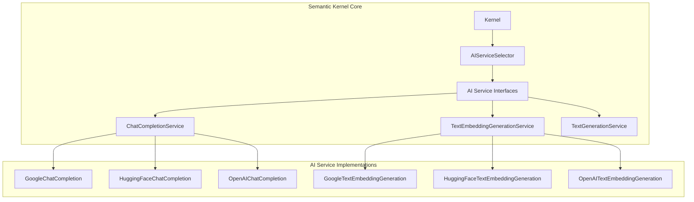
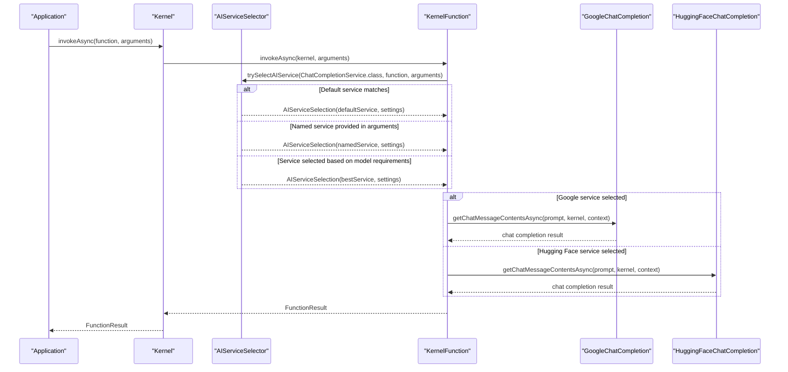
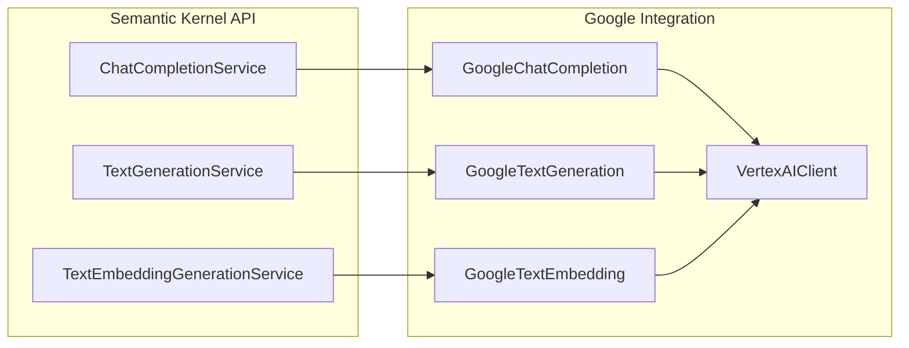
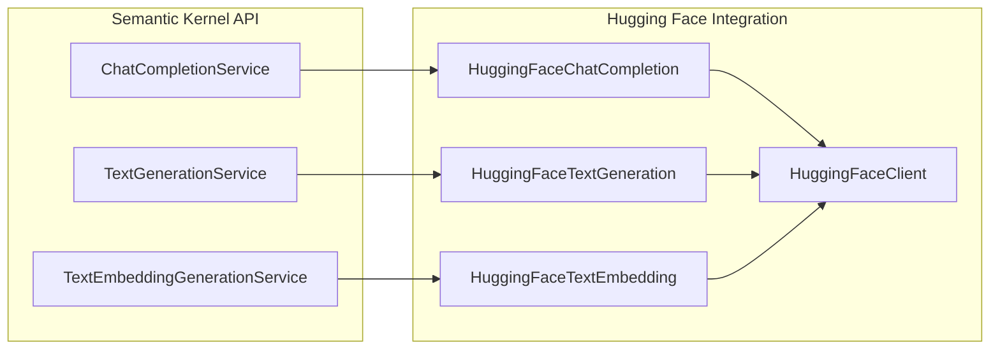
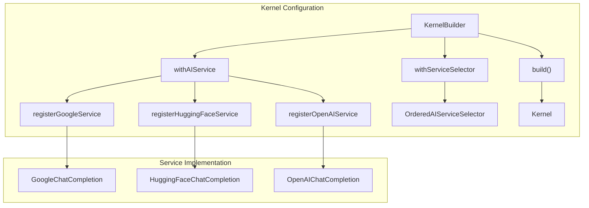

<!-- source: DeepWiki mcp.deepwiki.com · repo microsoft/semantic-kernel-java · page 3.2 Other AI Service Providers · fetched 2026-10-26 -->

# Other AI Service Providers

<details>
<summary>Relevant source files</summary>

The following files were used as context for generating this wiki page:

- [aiservices/google/pom.xml](aiservices/google/pom.xml)
- [aiservices/huggingface/pom.xml](aiservices/huggingface/pom.xml)
- [aiservices/openai/pom.xml](aiservices/openai/pom.xml)
- [api-test/integration-tests/pom.xml](api-test/integration-tests/pom.xml)
- [api-test/pom.xml](api-test/pom.xml)
- [pom.xml](pom.xml)
- [samples/pom.xml](samples/pom.xml)
- [samples/semantickernel-concepts/pom.xml](samples/semantickernel-concepts/pom.xml)
- [samples/semantickernel-concepts/semantickernel-syntax-examples/pom.xml](samples/semantickernel-concepts/semantickernel-syntax-examples/pom.xml)
- [samples/semantickernel-demos/booking-agent-m365/pom.xml](samples/semantickernel-demos/booking-agent-m365/pom.xml)
- [samples/semantickernel-demos/pom.xml](samples/semantickernel-demos/pom.xml)
- [samples/semantickernel-demos/semantickernel-spring-starter/pom.xml](samples/semantickernel-demos/semantickernel-spring-starter/pom.xml)
- [samples/semantickernel-demos/sk-presidio-sample/pom.xml](samples/semantickernel-demos/sk-presidio-sample/pom.xml)
- [samples/semantickernel-sample-plugins/pom.xml](samples/semantickernel-sample-plugins/pom.xml)
- [samples/semantickernel-sample-plugins/semantickernel-openapi-plugin/pom.xml](samples/semantickernel-sample-plugins/semantickernel-openapi-plugin/pom.xml)
- [samples/semantickernel-sample-plugins/semantickernel-presidio-plugin/pom.xml](samples/semantickernel-sample-plugins/semantickernel-presidio-plugin/pom.xml)
- [semantickernel-api/pom.xml](semantickernel-api/pom.xml)
- [semantickernel-bom/pom.xml](semantickernel-bom/pom.xml)
- [semantickernel-experimental/pom.xml](semantickernel-experimental/pom.xml)

</details>


This page documents the integration with AI service providers beyond OpenAI in the Semantic Kernel Java framework. While OpenAI is the primary integration (covered in [OpenAI Integration](#3.1)), Semantic Kernel Java also supports Google Vertex AI and Hugging Face as alternative AI providers.

## Supported Alternative AI Service Providers

Semantic Kernel Java currently supports the following alternative AI service providers:

1. **Google Vertex AI** - Google's machine learning platform that offers access to various foundation models
2. **Hugging Face** - An open-source provider hosting thousands of pre-trained models

Both providers implement the same core interfaces as OpenAI, allowing for a standardized approach to working with different AI models.

Sources: [aiservices/google/pom.xml:1-56](), [aiservices/huggingface/pom.xml:1-66]()

## Integration Architecture

The alternative AI service providers integrate with the Semantic Kernel architecture through a consistent service interface pattern. Each provider implements the same core service interfaces, enabling seamless switching between providers.

### Provider Integration Diagram



Sources: [semantickernel-bom/pom.xml:80-98](), [pom.xml:70-79]()

### Service Selection Flow



Sources: [semantickernel-bom/pom.xml:80-98](), [pom.xml:70-79]()

## Google Vertex AI Integration

The Google Vertex AI integration provides access to Google's foundation models through the Vertex AI platform. This integration is implemented in the `semantickernel-aiservices-google` module.

### Module Structure



### Configuration and Usage

To use Google Vertex AI with Semantic Kernel, you need to:

1. Add the dependency to your project
2. Configure the Google Vertex AI client
3. Register the service with the Kernel

The dependency can be added to your Maven project:

```xml
<dependency>
    <groupId>com.microsoft.semantic-kernel</groupId>
    <artifactId>semantickernel-aiservices-google</artifactId>
    <version>${semantickernel.version}</version>
</dependency>
```

The Google Cloud Vertex AI dependency is pulled in automatically:

```xml
<dependency>
    <groupId>com.google.cloud</groupId>
    <artifactId>google-cloud-vertexai</artifactId>
</dependency>
```

Sources: [aiservices/google/pom.xml:1-56](), [semantickernel-bom/pom.xml:211-215]()

## Hugging Face Integration

The Hugging Face integration provides access to thousands of open-source models hosted on the Hugging Face platform. This integration is implemented in the `semantickernel-aiservices-huggingface` module.

### Module Structure



### Configuration and Usage

To use Hugging Face with Semantic Kernel, you need to:

1. Add the dependency to your project
2. Configure the Hugging Face client with your API key
3. Register the service with the Kernel

The dependency can be added to your Maven project:

```xml
<dependency>
    <groupId>com.microsoft.semantic-kernel</groupId>
    <artifactId>semantickernel-aiservices-huggingface</artifactId>
    <version>${semantickernel.version}</version>
</dependency>
```

Sources: [aiservices/huggingface/pom.xml:1-66](), [semantickernel-bom/pom.xml:84-88]()

## Unified Service Registration and Selection

Semantic Kernel provides a unified approach to registering and selecting AI services regardless of the provider. This is handled through the `KernelBuilder` and `AIServiceSelector` mechanisms.

### Service Registration Architecture



The AI services can be registered in different ways:

1. **Default service**: Registered as the default for a service type
2. **Named service**: Registered with a specific name for explicit selection
3. **Multiple services**: Multiple services can be registered, with selection handled by the selector

Example:

```java
Kernel kernel = new KernelBuilder()
    .withAIService(ChatCompletionService.class, new GoogleChatCompletion(...), "google")
    .withAIService(ChatCompletionService.class, new HuggingFaceChatCompletion(...), "huggingface")
    .withServiceSelector(new OrderedAIServiceSelector())
    .build();
```

Sources: [pom.xml:70-79](), [semantickernel-bom/pom.xml:84-98]()

## Provider Comparison

Each AI service provider has different strengths and capabilities:

| Feature | Google Vertex AI | Hugging Face | OpenAI |
|---------|-----------------|--------------|--------|
| Hosting | Cloud-based     | Cloud or self-hosted | Cloud-based |
| Model Access | Google's proprietary models | Open-source models | Proprietary models |
| Pricing | Usage-based with Google Cloud | Free tiers available | Usage-based |
| Customization | Custom model training | Fine-tuning support | Fine-tuning support |
| Enterprise Features | Google Cloud integration | Varies by model | Enterprise tier available |

Sources: [aiservices/google/pom.xml:1-56](), [aiservices/huggingface/pom.xml:1-66](), [semantickernel-bom/pom.xml:80-98]()

## Sample Usage

You can find examples of using different AI service providers in the samples directory. The `semantickernel-syntax-examples` module includes examples of working with different providers:

```java
// Example with Google Vertex AI
GoogleChatCompletion googleService = new GoogleChatCompletion(
    "your-project", 
    "your-location", 
    "gemini-pro");

// Example with Hugging Face
HuggingFaceChatCompletion hfService = new HuggingFaceChatCompletion(
    "your-huggingface-api-key",
    "your-model-id");

// Register with Kernel
Kernel kernel = new KernelBuilder()
    .withAIService(ChatCompletionService.class, googleService, "google")
    .withAIService(ChatCompletionService.class, hfService, "huggingface")
    .build();

// Use a specific service by name
KernelArguments arguments = new KernelArguments();
arguments.setServiceId("google");
FunctionResult result = kernel.invokeAsync(someFunction, arguments).block();
```

Sources: [samples/semantickernel-concepts/semantickernel-syntax-examples/pom.xml:97-102](), [samples/semantickernel-concepts/semantickernel-syntax-examples/pom.xml:57-60]()

## Conclusion

Semantic Kernel Java provides a flexible architecture for integrating with multiple AI service providers beyond OpenAI. The unified interface design allows for seamless switching between providers, enabling developers to choose the AI service that best fits their specific requirements, whether it's Google Vertex AI, Hugging Face, or OpenAI.

---

