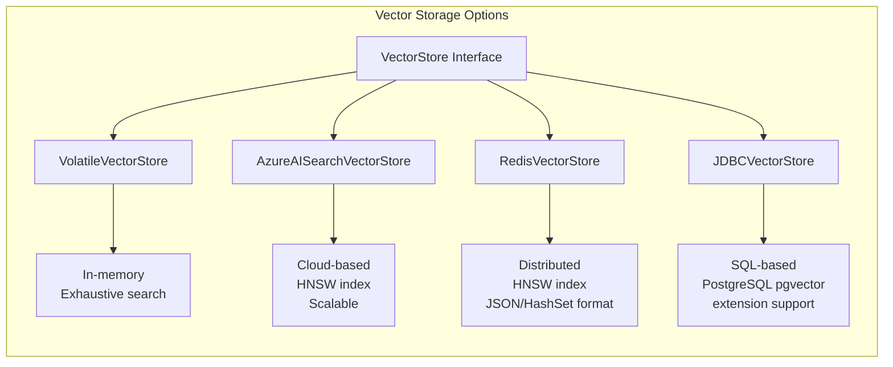
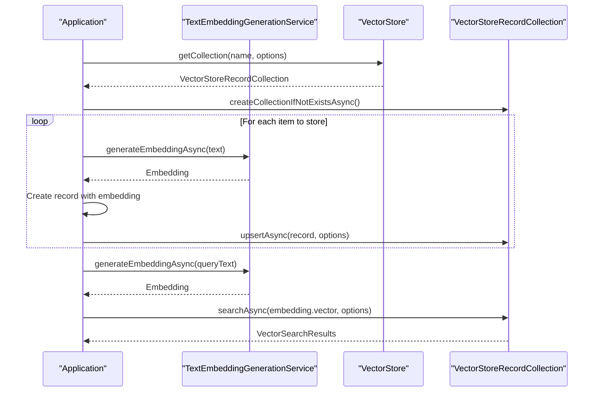
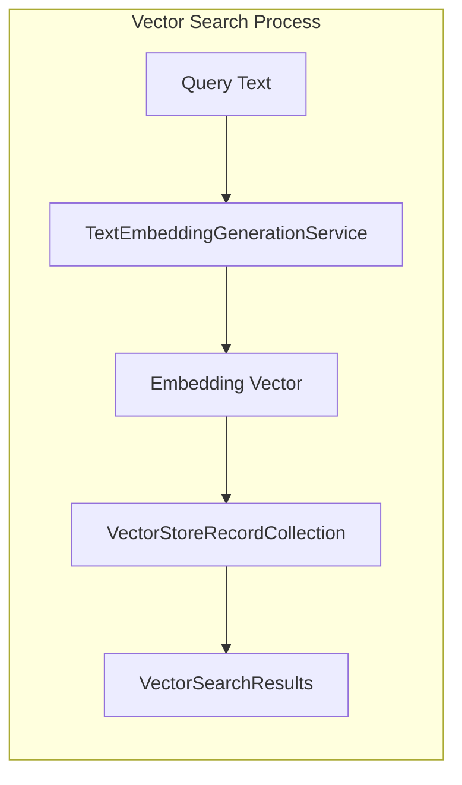
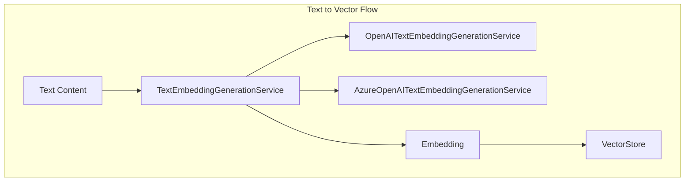

<!-- source: DeepWiki mcp.deepwiki.com · repo microsoft/semantic-kernel-java · page 4 Memory and Vector Storage · fetched 2026-10-26 -->

# Memory and Vector Storage

<details>
<summary>Relevant source files</summary>

The following files were used as context for generating this wiki page:

- [samples/semantickernel-concepts/semantickernel-syntax-examples/src/main/java/com/microsoft/semantickernel/samples/syntaxexamples/memory/InMemoryVolatileVectorStore.java](samples/semantickernel-concepts/semantickernel-syntax-examples/src/main/java/com/microsoft/semantickernel/samples/syntaxexamples/memory/InMemoryVolatileVectorStore.java)
- [samples/semantickernel-concepts/semantickernel-syntax-examples/src/main/java/com/microsoft/semantickernel/samples/syntaxexamples/memory/VectorStoreWithAzureAISearch.java](samples/semantickernel-concepts/semantickernel-syntax-examples/src/main/java/com/microsoft/semantickernel/samples/syntaxexamples/memory/VectorStoreWithAzureAISearch.java)
- [samples/semantickernel-concepts/semantickernel-syntax-examples/src/main/java/com/microsoft/semantickernel/samples/syntaxexamples/memory/VectorStoreWithJDBC.java](samples/semantickernel-concepts/semantickernel-syntax-examples/src/main/java/com/microsoft/semantickernel/samples/syntaxexamples/memory/VectorStoreWithJDBC.java)
- [samples/semantickernel-concepts/semantickernel-syntax-examples/src/main/java/com/microsoft/semantickernel/samples/syntaxexamples/memory/VectorStoreWithRedis.java](samples/semantickernel-concepts/semantickernel-syntax-examples/src/main/java/com/microsoft/semantickernel/samples/syntaxexamples/memory/VectorStoreWithRedis.java)
- [semantickernel-api/src/main/java/com/microsoft/semantickernel/services/textembedding/Embedding.java](semantickernel-api/src/main/java/com/microsoft/semantickernel/services/textembedding/Embedding.java)

</details>


## Purpose and Scope

This document provides a comprehensive overview of the Memory and Vector Storage system in Semantic Kernel Java. This system enables applications to store, retrieve, and search vector embeddings (numerical representations of text or other data), forming the foundation for semantic search and AI-powered memory capabilities. The document covers the core concepts, available vector storage implementations, and practical usage patterns.

## Core Concepts

Memory in Semantic Kernel is primarily based on vector embeddings that represent semantic information in high-dimensional spaces. The system consists of several key components that work together to provide flexible storage and retrieval of these vector representations.

### Embedding

The `Embedding` class represents a vector of numeric data, typically generated from text using embedding models. It serves as the fundamental unit for semantic representation in the system.

```mermaid
classDiagram
    class "Embedding" {
        -List~Float~ vector
        +empty() Embedding
        +Embedding()
        +Embedding(List~Float~ vector)
        +Embedding(float[] vector)
        +getVector() List~Float~
    }
    note for "Embedding" "Immutable representation\nof vector data"
```

Sources: [semantickernel-api/src/main/java/com/microsoft/semantickernel/services/textembedding/Embedding.java:11-67]()

### Vector Storage Architecture

Vector storage in Semantic Kernel follows a consistent architectural pattern across different implementations, with abstract interfaces that allow for pluggable storage backends.

```mermaid
classDiagram
    class "VectorStore" {
        +getCollection(String name, Options options) VectorStoreRecordCollection
    }
    
    class "VectorStoreRecordCollection~K,T~" {
        +createCollectionIfNotExistsAsync() Mono~Void~
        +upsertAsync(T record, Options options) Mono~String~
        +getAsync(K key, Options options) Mono~T~
        +deleteAsync(K key, Options options) Mono~Void~
        +searchAsync(List~Float~ vector, Options options) Mono~VectorSearchResults~
    }
    
    class "VectorStoreRecord" {
        +getKey() K
        +getVector() List~Float~
        +getMetadata() Map~String,String~
    }
    
    class "VectorSearchResults~T~" {
        +getResults() List~SearchResult~T~~
        +getTotalCount() int
    }
    
    class "Annotations" {
        @VectorStoreRecordKey
        @VectorStoreRecordData
        @VectorStoreRecordVector
    }
    
    "VectorStore" --> "VectorStoreRecordCollection~K,T~" : creates
    "VectorStoreRecordCollection~K,T~" --> "VectorStoreRecord" : manages
    "VectorStoreRecordCollection~K,T~" --> "VectorSearchResults~T~" : returns
    "Annotations" --> "VectorStoreRecord" : used to define
```

The Vector Storage system provides a unified interface for different storage backends while supporting reactive programming with Project Reactor's `Mono` and `Flux` types.

## Vector Store Implementations

Semantic Kernel Java offers several vector store implementations to accommodate different use cases and environments.

### Supported Vector Stores

| Vector Store | Description | Best For |
|--------------|-------------|----------|
| VolatileVectorStore | In-memory storage that keeps vectors in RAM | Development, testing, small datasets |
| AzureAISearchVectorStore | Azure AI Search integration for cloud-hosted vector storage | Production, scalable cloud deployments |
| RedisVectorStore | Redis-based storage with vector search capabilities | Distributed systems with Redis infrastructure |
| JDBCVectorStore | Database storage via JDBC (PostgreSQL support) | SQL database integration |

### Vector Store Implementation Comparison



Sources:
- [samples/semantickernel-concepts/semantickernel-syntax-examples/src/main/java/com/microsoft/semantickernel/samples/syntaxexamples/memory/InMemoryVolatileVectorStore.java:26-189]()
- [samples/semantickernel-concepts/semantickernel-syntax-examples/src/main/java/com/microsoft/semantickernel/samples/syntaxexamples/memory/VectorStoreWithAzureAISearch.java:35-211]()
- [samples/semantickernel-concepts/semantickernel-syntax-examples/src/main/java/com/microsoft/semantickernel/samples/syntaxexamples/memory/VectorStoreWithRedis.java:31-210]()
- [samples/semantickernel-concepts/semantickernel-syntax-examples/src/main/java/com/microsoft/semantickernel/samples/syntaxexamples/memory/VectorStoreWithJDBC.java:33-219]()

## Record Storage Model

Vector storage in Semantic Kernel uses an annotation-based model to define how records are structured and stored.

```mermaid
classDiagram
    class "GitHubFile" {
        @VectorStoreRecordKey
        -String id
        @VectorStoreRecordData
        -String description
        @VectorStoreRecordData
        -String link
        @VectorStoreRecordVector
        -List~Float~ embedding
    }
    
    class "Annotations" {
        @VectorStoreRecordKey
        @VectorStoreRecordData
        @VectorStoreRecordVector
    }
    
    "GitHubFile" ..> "Annotations" : uses
    
    note for "Annotations" "Define structure of\nvector store records"
    note for "GitHubFile" "Example record with\nkey, data, and vector fields"
```

The primary annotations used to define vector store records are:

| Annotation | Purpose | Required |
|------------|---------|----------|
| `@VectorStoreRecordKey` | Marks a field as the unique identifier for the record | Yes |
| `@VectorStoreRecordData` | Marks fields containing data to be stored with the vector | No |
| `@VectorStoreRecordVector` | Marks the field containing the vector embedding | Yes |

The `@VectorStoreRecordVector` annotation supports configuration options such as:
- `dimensions`: The dimensionality of the vector
- `indexKind`: The type of index to use (e.g., `HNSW` for approximate nearest neighbor search)
- `distanceFunction`: The function to measure vector similarity (e.g., `COSINE_SIMILARITY`, `COSINE_DISTANCE`)

Sources:
- [samples/semantickernel-concepts/semantickernel-syntax-examples/src/main/java/com/microsoft/semantickernel/samples/syntaxexamples/memory/VectorStoreWithAzureAISearch.java:52-81]()
- [samples/semantickernel-concepts/semantickernel-syntax-examples/src/main/java/com/microsoft/semantickernel/samples/syntaxexamples/memory/InMemoryVolatileVectorStore.java:39-79]()
- [samples/semantickernel-concepts/semantickernel-syntax-examples/src/main/java/com/microsoft/semantickernel/samples/syntaxexamples/memory/VectorStoreWithJDBC.java:44-89]()
- [samples/semantickernel-concepts/semantickernel-syntax-examples/src/main/java/com/microsoft/semantickernel/samples/syntaxexamples/memory/VectorStoreWithRedis.java:43-87]()

## Using Vector Stores

The memory system in Semantic Kernel follows a consistent usage pattern across different implementations.

### Common Usage Pattern



### Basic Implementation Example

Here's a simplified flow for using vector stores:

1. **Configure a vector store**:
   - Choose and initialize a vector store implementation
   - Create or get a collection for storing records

2. **Define a record class**:
   - Use annotations to mark key, data, and vector fields

3. **Store data**:
   - Generate embeddings for text using an embedding service
   - Create records with the generated embeddings
   - Store the records in the vector store

4. **Search for similar items**:
   - Generate an embedding for the search query
   - Search the vector store using the embedding
   - Process the search results

Sources:
- [samples/semantickernel-concepts/semantickernel-syntax-examples/src/main/java/com/microsoft/semantickernel/samples/syntaxexamples/memory/VectorStoreWithAzureAISearch.java:117-168]()
- [samples/semantickernel-concepts/semantickernel-syntax-examples/src/main/java/com/microsoft/semantickernel/samples/syntaxexamples/memory/InMemoryVolatileVectorStore.java:109-147]()
- [samples/semantickernel-concepts/semantickernel-syntax-examples/src/main/java/com/microsoft/semantickernel/samples/syntaxexamples/memory/VectorStoreWithJDBC.java:123-168]()
- [samples/semantickernel-concepts/semantickernel-syntax-examples/src/main/java/com/microsoft/semantickernel/samples/syntaxexamples/memory/VectorStoreWithRedis.java:121-159]()

## Vector Store Integration Details

### VolatileVectorStore

The `VolatileVectorStore` provides an in-memory implementation ideal for development, testing, and scenarios with small datasets.

```mermaid
graph TD
    subgraph "VolatileVectorStore System"
        VVS["VolatileVectorStore"]
        VVSRC["VolatileVectorStoreRecordCollection"]
        Options["VolatileVectorStoreRecordCollectionOptions"]
        
        VVS --> VVSRC : creates
        Options --> VVSRC : configures
        
        VVSRC --> InMemoryMap["In-memory Map"]
        InMemoryMap --> ExhaustiveSearch["Exhaustive Vector Search"]
    end
```

Key characteristics:
- In-memory storage using Java collections
- Performs exhaustive search for similar vectors
- Simple to use with no external dependencies
- Data is lost when the application shuts down

Usage example:
```java
var volatileVectorStore = new VolatileVectorStore();
var collection = volatileVectorStore.getCollection(collectionName,
    VolatileVectorStoreRecordCollectionOptions.<RecordType>builder()
        .withRecordClass(RecordType.class)
        .build());
```

Sources: [samples/semantickernel-concepts/semantickernel-syntax-examples/src/main/java/com/microsoft/semantickernel/samples/syntaxexamples/memory/InMemoryVolatileVectorStore.java:112-118]()

### AzureAISearchVectorStore

`AzureAISearchVectorStore` integrates with Azure AI Search for scalable, cloud-based vector storage and search.

```mermaid
graph TD
    subgraph "AzureAISearchVectorStore System"
        AAISV["AzureAISearchVectorStore"]
        AAISRC["AzureAISearchVectorStoreRecordCollection"]
        Options["AzureAISearchVectorStoreRecordCollectionOptions"]
        
        AAISV --> AAISRC : creates
        Options --> AAISRC : configures
        
        AAISRC --> SearchClient["SearchIndexAsyncClient"]
        SearchClient --> CloudIndex["Azure AI Search Index"]
        CloudIndex --> HNSW["HNSW Index"]
        HNSW --> ApproxSearch["Approximate Nearest Neighbor Search"]
    end
```

Key characteristics:
- Cloud-based storage with high scalability
- Uses HNSW (Hierarchical Navigable Small World) indexing for fast vector search
- Supports complex filtering during search
- Persistence across application restarts

Usage example:
```java
var azureAISearchVectorStore = AzureAISearchVectorStore.builder()
    .withSearchIndexAsyncClient(searchClient)
    .withOptions(new AzureAISearchVectorStoreOptions())
    .build();

var collection = azureAISearchVectorStore
    .getCollection(collectionName,
        AzureAISearchVectorStoreRecordCollectionOptions.<RecordType>builder()
            .withRecordClass(RecordType.class)
            .build());
```

Sources: [samples/semantickernel-concepts/semantickernel-syntax-examples/src/main/java/com/microsoft/semantickernel/samples/syntaxexamples/memory/VectorStoreWithAzureAISearch.java:122-133]()

### RedisVectorStore

`RedisVectorStore` uses Redis for distributed vector storage with search capabilities.

```mermaid
graph TD
    subgraph "RedisVectorStore System"
        RVS["RedisVectorStore"]
        RVSRC["RedisVectorStoreRecordCollection"]
        Options["RedisJsonVectorStoreRecordCollectionOptions"]
        
        RVS --> RVSRC : creates
        Options --> RVSRC : configures
        
        RVSRC --> JedisClient["JedisPooled Client"]
        JedisClient --> RedisServer["Redis Server"]
        RedisServer --> RedisModule["RediSearch Module"]
        RedisModule --> VectorIndex["Vector Index"]
        
        StorageType["Storage Type\n(JSON/HashSet)"] --> RVSRC
    end
```

Key characteristics:
- Distributed storage using Redis
- Supports both JSON and HashSet storage formats
- Uses Redis' vector search capabilities
- Good for systems already using Redis infrastructure

Usage example:
```java
var vectorStore = RedisVectorStore.builder()
    .withClient(jedis)
    .withOptions(
        RedisVectorStoreOptions.builder()
            .withStorageType(RedisStorageType.JSON)
            .build())
    .build();

var collection = vectorStore.getCollection(collectionName,
    RedisJsonVectorStoreRecordCollectionOptions.<RecordType>builder()
        .withRecordClass(RecordType.class)
        .build());
```

Sources: [samples/semantickernel-concepts/semantickernel-syntax-examples/src/main/java/com/microsoft/semantickernel/samples/syntaxexamples/memory/VectorStoreWithRedis.java:128-139]()

### JDBCVectorStore

`JDBCVectorStore` provides database-backed vector storage through JDBC, with specific support for PostgreSQL.

```mermaid
graph TD
    subgraph "JDBCVectorStore System"
        JDBC["JDBCVectorStore"]
        JDBCRC["JDBCVectorStoreRecordCollection"]
        Options["JDBCVectorStoreRecordCollectionOptions"]
        
        JDBC --> JDBCRC : creates
        Options --> JDBCRC : configures
        
        JDBCRC --> DataSource["DataSource"]
        DataSource --> Database["Database"]
        
        QueryProvider["VectorStoreQueryProvider"] --> JDBCRC
        PostgreSQL["PostgreSQLVectorStoreQueryProvider"] --> QueryProvider
        
        Database --> PgVector["pgvector Extension"]
        PgVector --> VectorOperations["Vector Distance Operations"]
    end
```

Key characteristics:
- SQL database storage through JDBC
- Specifically supports PostgreSQL with the pgvector extension
- Allows for complex SQL queries alongside vector search
- Persistence with relational database reliability

Usage example:
```java
var queryProvider = PostgreSQLVectorStoreQueryProvider.builder()
    .withDataSource(dataSource)
    .build();

var jdbcVectorStore = JDBCVectorStore.builder()
    .withDataSource(dataSource)
    .withOptions(JDBCVectorStoreOptions.builder()
        .withQueryProvider(queryProvider)
        .build())
    .build();

var collection = jdbcVectorStore.getCollection(collectionName,
    JDBCVectorStoreRecordCollectionOptions.<RecordType>builder()
        .withRecordClass(RecordType.class)
        .build());
```

Sources: [samples/semantickernel-concepts/semantickernel-syntax-examples/src/main/java/com/microsoft/semantickernel/samples/syntaxexamples/memory/VectorStoreWithJDBC.java:132-149]()

## Search Operations

Vector stores allow searching for semantically similar content through vector similarity measures.



The vector search process involves:

1. Converting the search query to a vector embedding
2. Searching the vector store using the embedding vector
3. Retrieving results ranked by similarity

```java
// Example search implementation
private static Mono<VectorSearchResults<RecordType>> search(
    String searchText,
    VectorStoreRecordCollection<String, RecordType> recordCollection,
    TextEmbeddingGenerationService embeddingGeneration) {
    
    return embeddingGeneration.generateEmbeddingAsync(searchText)
        .flatMap(r -> recordCollection.searchAsync(r.getVector(), null));
}
```

Distance functions used for similarity comparison:
- `COSINE_SIMILARITY`: Measures the cosine of the angle between vectors (higher is more similar)
- `COSINE_DISTANCE`: 1 - cosine similarity (lower is more similar)
- `EUCLIDEAN_DISTANCE`: Measures straight-line distance between vectors (lower is more similar)
- `DOT_PRODUCT`: Measures the dot product of vectors (higher is more similar)

Sources:
- [samples/semantickernel-concepts/semantickernel-syntax-examples/src/main/java/com/microsoft/semantickernel/samples/syntaxexamples/memory/VectorStoreWithAzureAISearch.java:155-162]()
- [samples/semantickernel-concepts/semantickernel-syntax-examples/src/main/java/com/microsoft/semantickernel/samples/syntaxexamples/memory/InMemoryVolatileVectorStore.java:140-147]()
- [samples/semantickernel-concepts/semantickernel-syntax-examples/src/main/java/com/microsoft/semantickernel/samples/syntaxexamples/memory/VectorStoreWithJDBC.java:170-177]()
- [samples/semantickernel-concepts/semantickernel-syntax-examples/src/main/java/com/microsoft/semantickernel/samples/syntaxexamples/memory/VectorStoreWithRedis.java:161-168]()

## Integration with Embedding Services

Vector storage systems rely on embedding services to convert text into vectors. The Semantic Kernel typically uses the `TextEmbeddingGenerationService` interface with implementations like `OpenAITextEmbeddingGenerationService`.



Example of configuring an embedding service:

```java
var embeddingGeneration = OpenAITextEmbeddingGenerationService.builder()
    .withOpenAIAsyncClient(client)
    .withModelId("text-embedding-3-large")
    .withDimensions(1536)
    .build();
```

Sources:
- [samples/semantickernel-concepts/semantickernel-syntax-examples/src/main/java/com/microsoft/semantickernel/samples/syntaxexamples/memory/VectorStoreWithAzureAISearch.java:102-106]()
- [samples/semantickernel-concepts/semantickernel-syntax-examples/src/main/java/com/microsoft/semantickernel/samples/syntaxexamples/memory/InMemoryVolatileVectorStore.java:100-104]()
- [samples/semantickernel-concepts/semantickernel-syntax-examples/src/main/java/com/microsoft/semantickernel/samples/syntaxexamples/memory/VectorStoreWithJDBC.java:112-117]()
- [samples/semantickernel-concepts/semantickernel-syntax-examples/src/main/java/com/microsoft/semantickernel/samples/syntaxexamples/memory/VectorStoreWithRedis.java:112-116]()

## Conclusion

The Memory and Vector Storage system in Semantic Kernel Java provides a flexible architecture for storing and retrieving vector embeddings, enabling semantic search capabilities across different storage backends. By separating the storage interface from specific implementations, the system allows applications to choose the appropriate storage solution based on their requirements while maintaining a consistent programming model.

---

