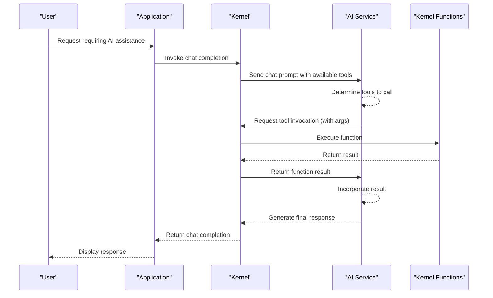
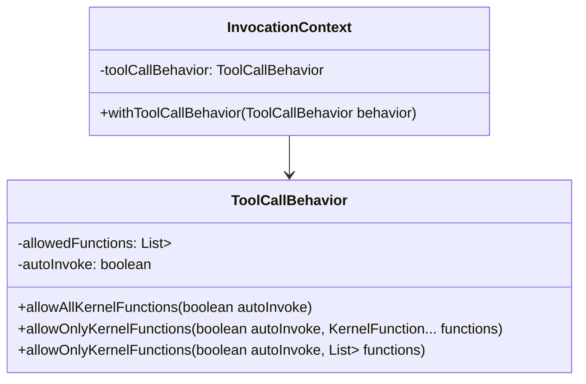
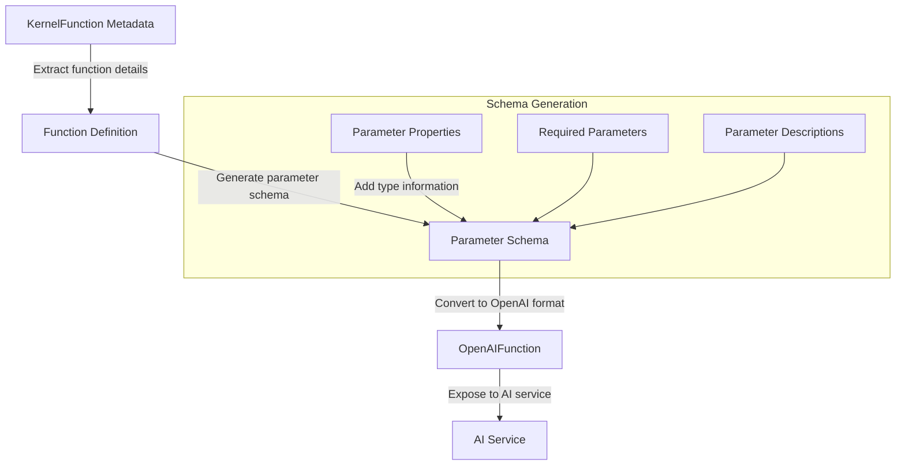
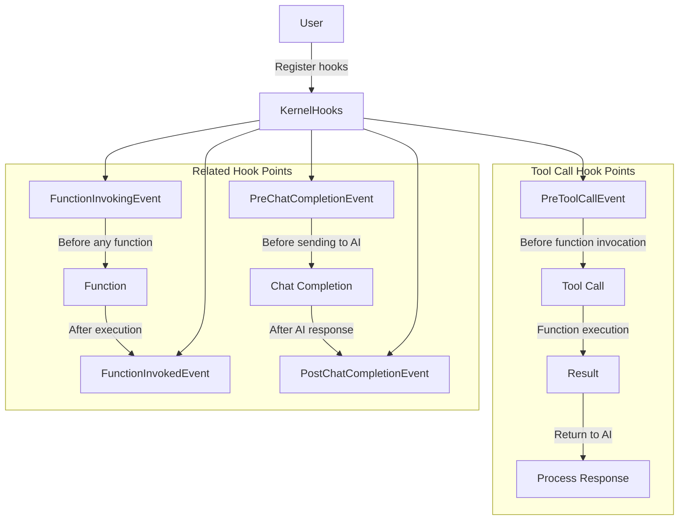
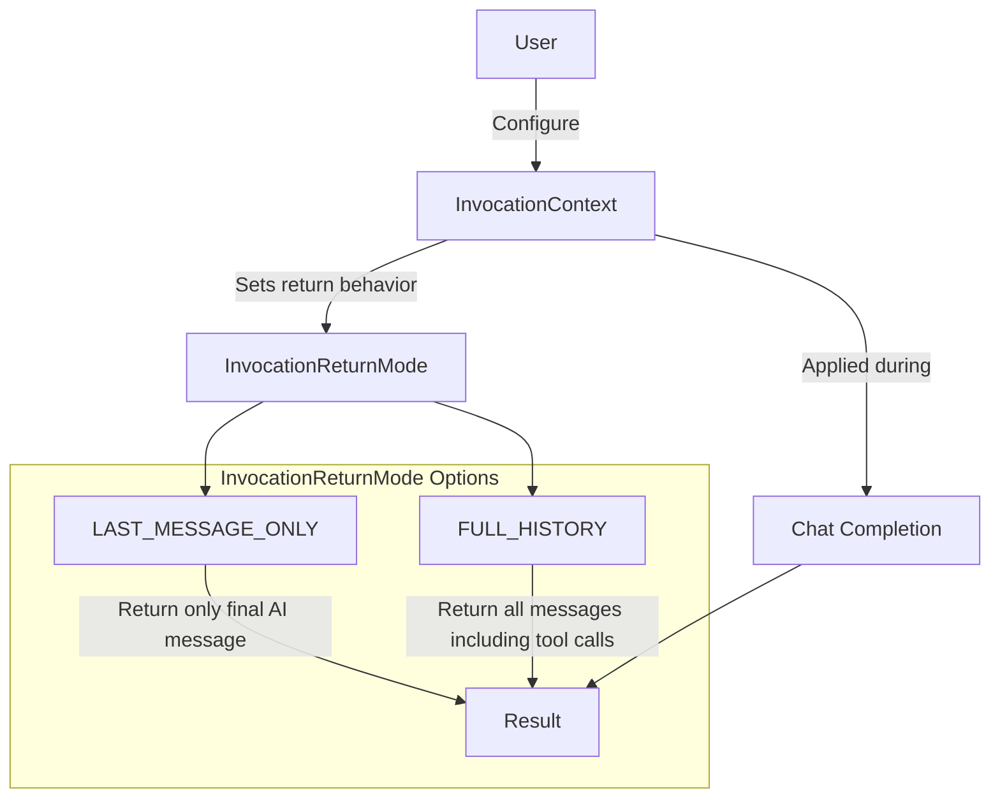

<!-- source: DeepWiki mcp.deepwiki.com · repo microsoft/semantic-kernel-java · page 5 Tool Calling · fetched 2026-10-26 -->

# Tool Calling

<details>
<summary>Relevant source files</summary>

The following files were used as context for generating this wiki page:

- [CHANGELOG.md](CHANGELOG.md)
- [aiservices/openai/src/main/java/com/microsoft/semantickernel/aiservices/openai/chatcompletion/BinaryDataUtils.java](aiservices/openai/src/main/java/com/microsoft/semantickernel/aiservices/openai/chatcompletion/BinaryDataUtils.java)
- [aiservices/openai/src/main/java/com/microsoft/semantickernel/aiservices/openai/chatcompletion/OpenAIFunction.java](aiservices/openai/src/main/java/com/microsoft/semantickernel/aiservices/openai/chatcompletion/OpenAIFunction.java)
- [aiservices/openai/src/main/java/com/microsoft/semantickernel/aiservices/openai/chatcompletion/OpenAiXMLPromptParser.java](aiservices/openai/src/main/java/com/microsoft/semantickernel/aiservices/openai/chatcompletion/OpenAiXMLPromptParser.java)
- [aiservices/openai/src/test/java/com/microsoft/semantickernel/aiservices/openai/chatcompletion/JsonSchemaTest.java](aiservices/openai/src/test/java/com/microsoft/semantickernel/aiservices/openai/chatcompletion/JsonSchemaTest.java)
- [api-test/integration-tests/src/test/java/com/microsoft/semantickernel/tests/RenderingTest.java](api-test/integration-tests/src/test/java/com/microsoft/semantickernel/tests/RenderingTest.java)
- [api-test/integration-tests/src/test/java/com/microsoft/semantickernel/tests/ToolCallBehaviourTest.java](api-test/integration-tests/src/test/java/com/microsoft/semantickernel/tests/ToolCallBehaviourTest.java)
- [api-test/integration-tests/src/test/resources/wiremock/mappings/deployments_gpt-35-turbo-2_chat_completions-12b6744e-443f-4fe7-82e2-55cc41195ff1.json](api-test/integration-tests/src/test/resources/wiremock/mappings/deployments_gpt-35-turbo-2_chat_completions-12b6744e-443f-4fe7-82e2-55cc41195ff1.json)
- [api-test/integration-tests/src/test/resources/wiremock/mappings/deployments_gpt-35-turbo-2_chat_completions-71b07779-49a8-44e5-a60b-ee5b0a3ad697.json](api-test/integration-tests/src/test/resources/wiremock/mappings/deployments_gpt-35-turbo-2_chat_completions-71b07779-49a8-44e5-a60b-ee5b0a3ad697.json)
- [api-test/integration-tests/src/test/resources/wiremock/mappings/deployments_gpt-35-turbo_chat_completions-0c8046c5-74ad-4836-8aa9-09da60f367a2.json](api-test/integration-tests/src/test/resources/wiremock/mappings/deployments_gpt-35-turbo_chat_completions-0c8046c5-74ad-4836-8aa9-09da60f367a2.json)
- [api-test/integration-tests/src/test/resources/wiremock/mappings/deployments_text-davinci-003_completions-0215b128-4822-4368-ac3d-2f580a221f00.json](api-test/integration-tests/src/test/resources/wiremock/mappings/deployments_text-davinci-003_completions-0215b128-4822-4368-ac3d-2f580a221f00.json)
- [samples/semantickernel-concepts/semantickernel-syntax-examples/src/main/java/com/microsoft/semantickernel/samples/demos/lights/App.java](samples/semantickernel-concepts/semantickernel-syntax-examples/src/main/java/com/microsoft/semantickernel/samples/demos/lights/App.java)
- [samples/semantickernel-concepts/semantickernel-syntax-examples/src/main/java/com/microsoft/semantickernel/samples/demos/lights/LightModel.java](samples/semantickernel-concepts/semantickernel-syntax-examples/src/main/java/com/microsoft/semantickernel/samples/demos/lights/LightModel.java)
- [samples/semantickernel-concepts/semantickernel-syntax-examples/src/main/java/com/microsoft/semantickernel/samples/demos/lights/LightModelTypeConverter.java](samples/semantickernel-concepts/semantickernel-syntax-examples/src/main/java/com/microsoft/semantickernel/samples/demos/lights/LightModelTypeConverter.java)
- [samples/semantickernel-concepts/semantickernel-syntax-examples/src/main/java/com/microsoft/semantickernel/samples/demos/lights/LightsPlugin.java](samples/semantickernel-concepts/semantickernel-syntax-examples/src/main/java/com/microsoft/semantickernel/samples/demos/lights/LightsPlugin.java)
- [semantickernel-api/src/main/java/com/microsoft/semantickernel/contextvariables/converters/StringVariableContextVariableTypeConverter.java](semantickernel-api/src/main/java/com/microsoft/semantickernel/contextvariables/converters/StringVariableContextVariableTypeConverter.java)
- [semantickernel-api/src/main/java/com/microsoft/semantickernel/hooks/KernelHook.java](semantickernel-api/src/main/java/com/microsoft/semantickernel/hooks/KernelHook.java)
- [semantickernel-api/src/main/java/com/microsoft/semantickernel/hooks/KernelHooks.java](semantickernel-api/src/main/java/com/microsoft/semantickernel/hooks/KernelHooks.java)
- [semantickernel-api/src/test/java/com/microsoft/semantickernel/contextvariables/converters/ContextVariableTypeConverterTest.java](semantickernel-api/src/test/java/com/microsoft/semantickernel/contextvariables/converters/ContextVariableTypeConverterTest.java)

</details>


## Overview

Tool Calling is a powerful capability in Semantic Kernel Java that allows Large Language Models (LLMs) to invoke Kernel functions during chat completions. This creates a bidirectional interaction pattern where the AI can dynamically call functions to gather information, modify application state, or execute operations when needed to generate a response.

This page covers the implementation, configuration, and usage of tool calling in Semantic Kernel Java, focusing on how to enable LLMs to access and execute functions defined in your application's plugins.

For information about general Kernel function invocation, see [Functions and Plugins](#2.2).

Sources:
- [api-test/integration-tests/src/test/java/com/microsoft/semantickernel/tests/ToolCallBehaviourTest.java:1-365]()
- [CHANGELOG.md:6-10]()

## Tool Calling Architecture

Tool calling in Semantic Kernel Java involves several key components that work together to enable AI models to identify and invoke functions. The system translates between the natural language space of the AI and the code execution space of your application.



The process involves:

1. An application initiates a chat completion through the Kernel
2. The Kernel provides available functions as tools to the AI service
3. When the AI determines it needs data or an action, it requests a tool call
4. The Kernel executes the requested function and returns results to the AI
5. The AI incorporates the function results into its final response

Sources:
- [api-test/integration-tests/src/test/java/com/microsoft/semantickernel/tests/ToolCallBehaviourTest.java:55-102]()
- [api-test/integration-tests/src/test/java/com/microsoft/semantickernel/tests/ToolCallBehaviourTest.java:103-170]()

## Tool Call Behavior Configuration

The `ToolCallBehavior` class configures how Semantic Kernel handles tool calls during AI interactions. It provides several control mechanisms:



The key configuration options include:

| Configuration Method | Description |
|----------------------|-------------|
| `allowAllKernelFunctions(boolean autoInvoke)` | Permits the AI to call any registered Kernel function |
| `allowOnlyKernelFunctions(boolean autoInvoke, KernelFunction<?>... functions)` | Restricts the AI to calling only the specified functions |
| `allowOnlyKernelFunctions(boolean autoInvoke, List<KernelFunction<?>> functions)` | Restricts the AI to calling only the specified functions (list variant) |

The `autoInvoke` parameter controls whether the functions should be automatically invoked when the AI requests them:
- When `true`: The function is executed and its result is provided back to the AI
- When `false`: The function details are returned but execution is deferred, letting application code decide on execution

Sources:
- [api-test/integration-tests/src/test/java/com/microsoft/semantickernel/tests/ToolCallBehaviourTest.java:55-102]()
- [api-test/integration-tests/src/test/java/com/microsoft/semantickernel/tests/ToolCallBehaviourTest.java:103-170]()

## Function Schema Generation

For LLMs to effectively call functions, they need detailed information about each function's interface. Semantic Kernel automatically generates function schemas in a format the AI can understand.



Key aspects of function schema generation include:

1. **Function Metadata Translation**: Converting Semantic Kernel function metadata to OpenAI's function definition format
2. **Parameter Type Mapping**: Translating Java types to JSON schema types (e.g., `Integer` → `integer`, `String` → `string`)
3. **Complex Type Handling**: Generating nested schemas for complex object types with proper property descriptions
4. **Function Naming Convention**: Creating fully qualified function names that include the plugin name (e.g., `pluginName-functionName`)

Example type mappings:

| Java Type | JSON Schema Type |
|-----------|-----------------|
| `boolean`, `Boolean` | `boolean` |
| `int`, `Integer`, `long`, `Long` | `integer` |
| `float`, `Float`, `double`, `Double` | `number` |
| `String` | `string` |
| Custom classes | `object` with properties |

Sources:
- [aiservices/openai/src/main/java/com/microsoft/semantickernel/aiservices/openai/chatcompletion/OpenAIFunction.java:27-106]()
- [aiservices/openai/src/main/java/com/microsoft/semantickernel/aiservices/openai/chatcompletion/OpenAIFunction.java:155-244]()
- [aiservices/openai/src/test/java/com/microsoft/semantickernel/aiservices/openai/chatcompletion/JsonSchemaTest.java:35-52]()

## Hook System Integration

Tool calling integrates with Semantic Kernel's hook system to allow intercepting and modifying tool call behavior at different points in the process.



Key hook points relevant to tool calling:

1. **PreToolCallHook**: Triggered before a tool (function) is called by the AI, allowing for validation or modification
2. **FunctionInvokingHook**: Triggered before any function is invoked, regardless of whether it's called via tool calling
3. **FunctionInvokedHook**: Triggered after function execution
4. **PreChatCompletionHook**: Triggered before sending a chat completion request
5. **PostChatCompletionHook**: Triggered after receiving a chat completion response

Example of registering tool call hooks:

```java
KernelHooks hooks = new KernelHooks();
hooks.addPreToolCallHook((context) -> {
    System.out.println("Tool being called: " + context.getFunctionName());
    return context;
});
kernel.getGlobalKernelHooks().addHooks(hooks);
```

Sources:
- [semantickernel-api/src/main/java/com/microsoft/semantickernel/hooks/KernelHook.java:64-73]()
- [semantickernel-api/src/main/java/com/microsoft/semantickernel/hooks/KernelHooks.java:107-115]()
- [samples/semantickernel-concepts/semantickernel-syntax-examples/src/main/java/com/microsoft/semantickernel/samples/demos/lights/App.java:75-94]()

## Using Tool Calling

To enable tool calling in Semantic Kernel Java:

1. Create plugins with well-defined functions
2. Register the plugins with the Kernel
3. Configure tool call behavior when invoking chat completions
4. Process the response appropriately

### Basic Example

```java
// 1. Create a plugin with functions
KernelPlugin lightPlugin = KernelPluginFactory.createFromObject(new LightsPlugin(), "LightsPlugin");

// 2. Register with the Kernel
Kernel kernel = Kernel.builder()
    .withAIService(ChatCompletionService.class, chatService)
    .withPlugin(lightPlugin)
    .build();

// 3. Configure tool call behavior
InvocationContext invocationContext = InvocationContext.builder()
    .withToolCallBehavior(ToolCallBehavior.allowAllKernelFunctions(true))
    .build();

// 4. Use in chat completion
ChatHistory history = new ChatHistory();
history.addUserMessage("Turn on the porch light");

List<ChatMessageContent<?>> results = chatCompletionService
    .getChatMessageContentsAsync(history, kernel, invocationContext)
    .block();
```

### Type Conversion for Complex Objects

When using complex objects as function parameters or return types, you need to register a type converter:

```java
// Register a type converter for custom objects
ContextVariableTypes.addGlobalConverter(new LightModelTypeConverter());

// Optionally add to invocation context for per-invocation conversion
InvocationContext invocationContext = InvocationContext.builder()
    .withContextVariableConverter(new LightModelTypeConverter())
    .withToolCallBehavior(ToolCallBehavior.allowAllKernelFunctions(true))
    .build();
```

Sources:
- [samples/semantickernel-concepts/semantickernel-syntax-examples/src/main/java/com/microsoft/semantickernel/samples/demos/lights/App.java:37-124]()
- [samples/semantickernel-concepts/semantickernel-syntax-examples/src/main/java/com/microsoft/semantickernel/samples/demos/lights/LightsPlugin.java:1-54]()
- [samples/semantickernel-concepts/semantickernel-syntax-examples/src/main/java/com/microsoft/semantickernel/samples/demos/lights/LightModelTypeConverter.java:1-23]()

## Tool Calling Response Handling

When the AI model invokes tools, the responses are captured in the chat history. You can control how these responses are managed in your application.



The `InvocationReturnMode` enum controls what's returned after tool calls:

| Mode | Description |
|------|-------------|
| `LAST_MESSAGE_ONLY` | Returns only the final AI message after all tool calls |
| `FULL_HISTORY` | Returns the complete conversation including all tool calls and their results |

This is particularly useful for:
1. Debugging tool call sequences
2. Building UIs that show the reasoning process
3. Maintaining context across multiple interactions

Example of using the full history mode:

```java
// Configure to return full history including tool calls
InvocationContext invocationContext = InvocationContext.builder()
    .withToolCallBehavior(ToolCallBehavior.allowAllKernelFunctions(true))
    .withReturnMode(InvocationReturnMode.FULL_HISTORY)
    .build();

// Process results including tool calls
List<ChatMessageContent<?>> fullHistory = chatCompletionService
    .getChatMessageContentsAsync(history, kernel, invocationContext)
    .block();

// Create a new chat history that includes the tool call exchange
ChatHistory newHistory = new ChatHistory(fullHistory);
```

Sources:
- [api-test/integration-tests/src/test/java/com/microsoft/semantickernel/tests/ToolCallBehaviourTest.java:173-225]()
- [samples/semantickernel-concepts/semantickernel-syntax-examples/src/main/java/com/microsoft/semantickernel/samples/demos/lights/App.java:96-101]()

## Best Practices and Limitations

When implementing tool calling in your applications, consider these best practices:

1. **Function Design**:
   - Use clear, descriptive function names
   - Provide detailed parameter descriptions
   - Use custom classes with `@JsonPropertyDescription` for complex parameters

2. **Error Handling**:
   - Implement error handling in functions that might be called by AI
   - Return meaningful error messages the AI can understand

3. **Type Conversion**:
   - Register custom type converters for complex objects
   - Use appropriate Java types that map well to JSON schema types

4. **Security Considerations**:
   - Limit which functions the AI can call using `allowOnlyKernelFunctions`
   - Add validation in `PreToolCallHook` for sensitive operations

5. **Performance**:
   - Be mindful of function execution time in AI conversation flows
   - Consider using `autoInvoke=false` for long-running operations

Limitations to be aware of:

1. Complex object parameter handling depends on proper JSON schema generation
2. Not all AI models support tool calling functionality
3. Some models have restrictions on the number or complexity of tools that can be exposed

Sources:
- [aiservices/openai/src/test/java/com/microsoft/semantickernel/aiservices/openai/chatcompletion/JsonSchemaTest.java:1-116]()
- [samples/semantickernel-concepts/semantickernel-syntax-examples/src/main/java/com/microsoft/semantickernel/samples/demos/lights/LightModel.java:1-46]()

## Conclusion

Tool calling provides a powerful mechanism for integrating AI capabilities with your application's functionality. It enables AI models to access data and perform actions dynamically based on user requests, creating more capable and interactive AI experiences.

By properly configuring function schemas, tool call behavior, and hook interactions, you can create sophisticated AI applications that seamlessly bridge the gap between natural language understanding and programmatic actions.

---

