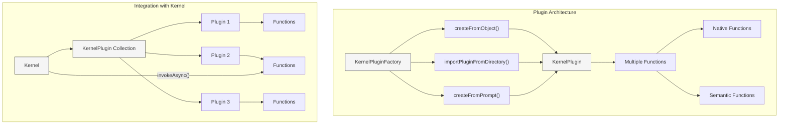
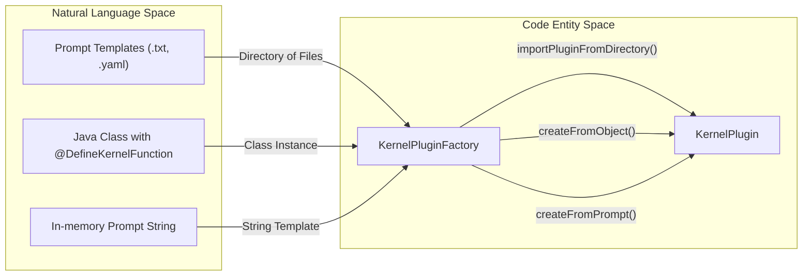
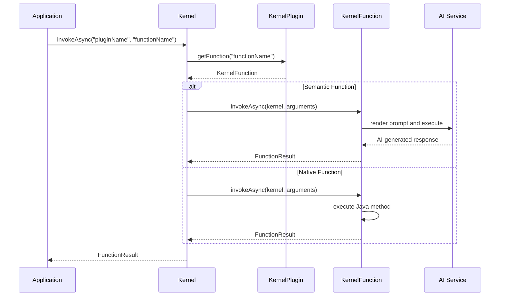

<!-- source: DeepWiki mcp.deepwiki.com · repo microsoft/semantic-kernel-java · page 6 Plugins · fetched 2026-10-26 -->

# Plugins

<details>
<summary>Relevant source files</summary>

The following files were used as context for generating this wiki page:

- [README.md](README.md)
- [aiservices/google/pom.xml](aiservices/google/pom.xml)
- [aiservices/huggingface/pom.xml](aiservices/huggingface/pom.xml)
- [aiservices/openai/pom.xml](aiservices/openai/pom.xml)
- [api-test/integration-tests/src/test/java/com/microsoft/semantickernel/tests/WiremockExamplesIT.java](api-test/integration-tests/src/test/java/com/microsoft/semantickernel/tests/WiremockExamplesIT.java)
- [api-test/pom.xml](api-test/pom.xml)
- [samples/pom.xml](samples/pom.xml)
- [samples/semantickernel-concepts/pom.xml](samples/semantickernel-concepts/pom.xml)
- [samples/semantickernel-concepts/semantickernel-syntax-examples/src/main/java/com/microsoft/semantickernel/samples/syntaxexamples/RunAll.java](samples/semantickernel-concepts/semantickernel-syntax-examples/src/main/java/com/microsoft/semantickernel/samples/syntaxexamples/RunAll.java)
- [samples/semantickernel-concepts/semantickernel-syntax-examples/src/main/java/com/microsoft/semantickernel/samples/syntaxexamples/plugin/Example07_BingAndGooglePlugins.java](samples/semantickernel-concepts/semantickernel-syntax-examples/src/main/java/com/microsoft/semantickernel/samples/syntaxexamples/plugin/Example07_BingAndGooglePlugins.java)
- [samples/semantickernel-concepts/semantickernel-syntax-examples/src/main/java/com/microsoft/semantickernel/samples/syntaxexamples/plugin/Example10_DescribeAllPluginsAndFunctions.java](samples/semantickernel-concepts/semantickernel-syntax-examples/src/main/java/com/microsoft/semantickernel/samples/syntaxexamples/plugin/Example10_DescribeAllPluginsAndFunctions.java)
- [samples/semantickernel-concepts/semantickernel-syntax-examples/src/main/java/com/microsoft/semantickernel/samples/syntaxexamples/plugin/Example13_ConversationSummaryPlugin.java](samples/semantickernel-concepts/semantickernel-syntax-examples/src/main/java/com/microsoft/semantickernel/samples/syntaxexamples/plugin/Example13_ConversationSummaryPlugin.java)
- [samples/semantickernel-demos/pom.xml](samples/semantickernel-demos/pom.xml)
- [samples/semantickernel-demos/sk-presidio-sample/pom.xml](samples/semantickernel-demos/sk-presidio-sample/pom.xml)
- [samples/semantickernel-sample-plugins/pom.xml](samples/semantickernel-sample-plugins/pom.xml)
- [samples/semantickernel-sample-plugins/semantickernel-presidio-plugin/pom.xml](samples/semantickernel-sample-plugins/semantickernel-presidio-plugin/pom.xml)

</details>


This page provides an overview of the plugin system in Semantic Kernel Java and the available plugins in the repository. Plugins are fundamental building blocks in Semantic Kernel that bundle related functionality together, making it easy to organize, discover, and execute both AI-powered semantic functions and traditional code-based native functions. For information about creating your own custom plugins, see [Creating Custom Plugins](#6.2).

## Plugin System Overview

In Semantic Kernel, plugins serve as containers for related functions. A plugin can contain both native functions (implemented in Java code) and semantic functions (powered by AI through prompts). Plugins provide a structured way to organize functionality and enable discovery of available capabilities.



**Plugin System and Integration with Kernel**

Sources:
- [samples/semantickernel-concepts/semantickernel-syntax-examples/src/main/java/com/microsoft/semantickernel/samples/syntaxexamples/plugin/Example10_DescribeAllPluginsAndFunctions.java:60-79]()
- [samples/semantickernel-concepts/semantickernel-syntax-examples/src/main/java/com/microsoft/semantickernel/samples/syntaxexamples/plugin/Example13_ConversationSummaryPlugin.java:155-237]()

## Plugin Creation Methods

The Semantic Kernel provides several ways to create plugins through the `KernelPluginFactory` class:

1. **Creating from Java objects**: Using `createFromObject()` to convert a Java class into a plugin
2. **Importing from directories**: Using `importPluginFromDirectory()` to create plugins from prompt template files
3. **Creating from prompts**: Using `createFromPrompt()` to create plugins directly from prompt templates



**Plugin Creation Pathways**

Sources:
- [samples/semantickernel-concepts/semantickernel-syntax-examples/src/main/java/com/microsoft/semantickernel/samples/syntaxexamples/plugin/Example10_DescribeAllPluginsAndFunctions.java:64-79]()
- [samples/semantickernel-concepts/semantickernel-syntax-examples/src/main/java/com/microsoft/semantickernel/samples/syntaxexamples/plugin/Example13_ConversationSummaryPlugin.java:160-161]()
- [samples/semantickernel-concepts/semantickernel-syntax-examples/src/main/java/com/microsoft/semantickernel/samples/syntaxexamples/plugin/Example07_BingAndGooglePlugins.java:59-61]()

## Available Plugins

Semantic Kernel Java includes and demonstrates several plugins:

| Plugin Name | Type | Description | Source |
|------------|------|-------------|--------|
| ConversationSummaryPlugin | Semantic | Provides conversation summarization capabilities, including generating summaries, action items, and topics | `/semantickernel-sample-plugins` |
| PresidioPlugin | Native | Integration with Microsoft Presidio for PII detection and anonymization | `/semantickernel-sample-plugins/semantickernel-presidio-plugin` |
| TextSplitterPlugin | Native | Utilities for splitting text into chunks | `/semantickernel-sample-plugins/semantickernel-text-splitter-plugin` |
| OpenAPIPlugin | Integration | Enables integration with OpenAPI-based services | `/semantickernel-sample-plugins/semantickernel-openapi-plugin` |
| WebSearchEnginePlugin | Integration | Provides web search capabilities through Bing or Google | Demonstrated in examples |

Sources:
- [samples/semantickernel-sample-plugins/pom.xml:15-19]()
- [samples/semantickernel-demos/sk-presidio-sample/pom.xml:35-38]()
- [samples/semantickernel-concepts/semantickernel-syntax-examples/src/main/java/com/microsoft/semantickernel/samples/syntaxexamples/plugin/Example13_ConversationSummaryPlugin.java:160-161]()
- [samples/semantickernel-concepts/semantickernel-syntax-examples/src/main/java/com/microsoft/semantickernel/samples/syntaxexamples/plugin/Example07_BingAndGooglePlugins.java:59-61]()

### ConversationSummaryPlugin

The ConversationSummaryPlugin provides capabilities for summarizing and extracting insights from conversation transcripts. It includes functions to generate overall summaries, extract action items, and identify conversation topics.

Example usage:
```java
KernelPlugin conversationSummaryPlugin = KernelPluginFactory.createFromObject(
    new ConversationSummaryPlugin(), null);

// Get a summary of a conversation
FunctionResult<?> summary = kernel
    .invokeAsync(conversationSummaryPlugin.getFunctions().get("SummarizeConversation"))
    .withArguments(KernelArguments.builder().withInput(chatTranscript).build())
    .block();

// Extract action items from a conversation
FunctionResult<String> actionItems = kernel
    .invokeAsync(conversationSummaryPlugin.<String>get("GetConversationActionItems"))
    .withArguments(KernelArguments.builder().withInput(chatTranscript).build())
    .block();
```

Sources:
- [samples/semantickernel-concepts/semantickernel-syntax-examples/src/main/java/com/microsoft/semantickernel/samples/syntaxexamples/plugin/Example13_ConversationSummaryPlugin.java:160-212]()

### WebSearchEnginePlugin

The WebSearchEnginePlugin provides search functionality using services like Bing or Google. It's useful for retrieving current information from the web that can be incorporated into AI-driven workflows.

Example usage:
```java
// Create a Bing search plugin
var bingConnector = new BingConnector(BING_API_KEY);
var bing = KernelPluginFactory.createFromObject(new WebSearchEnginePlugin(bingConnector), "bing");

// Register it with the kernel
var kernel = Kernel.builder()
    .withPlugin(bing)
    .withAIService(ChatCompletionService.class, chatCompletionService)
    .build();

// Use it to search
var question = "What's the largest building in the world?";
var kernelArguments = KernelArguments.builder()
    .withVariable("query", question)
    .build();

var function = kernel.getFunction("bing", "search");
var result = kernel.invokeAsync(function).withArguments(kernelArguments).block();
```

Sources:
- [samples/semantickernel-concepts/semantickernel-syntax-examples/src/main/java/com/microsoft/semantickernel/samples/syntaxexamples/plugin/Example07_BingAndGooglePlugins.java:58-73]()
- [samples/semantickernel-concepts/semantickernel-syntax-examples/src/main/java/com/microsoft/semantickernel/samples/syntaxexamples/plugin/Example07_BingAndGooglePlugins.java:82-97]()

## Working with Plugins

### Registering Plugins with the Kernel

Plugins must be registered with the Kernel before their functions can be used. This can be done at kernel creation time using the builder pattern:

```java
Kernel kernel = Kernel.builder()
    .withPlugin(KernelPluginFactory.createFromObject(new TextPlugin(), "text"))
    .withPlugin(KernelPluginFactory.importPluginFromDirectory(
        Path.of("resources/Plugins"), "summarize", null))
    .build();
```

You can also register plugins after creating the kernel using the `addPlugin` method.

Sources:
- [samples/semantickernel-concepts/semantickernel-syntax-examples/src/main/java/com/microsoft/semantickernel/samples/syntaxexamples/plugin/Example10_DescribeAllPluginsAndFunctions.java:61-79]()
- [samples/semantickernel-concepts/semantickernel-syntax-examples/src/main/java/com/microsoft/semantickernel/samples/syntaxexamples/plugin/Example07_BingAndGooglePlugins.java:68-71]()

### Invoking Plugin Functions

Once a plugin is registered, its functions can be invoked in several ways:

```java
// Method 1: Get the function by name and invoke it
var function = kernel.getFunction("pluginName", "functionName");
var result = kernel.invokeAsync(function).withArguments(arguments).block();

// Method 2: Get the plugin first, then the function
var plugin = kernel.getPlugin("pluginName");
var function = plugin.get("functionName");
var result = kernel.invokeAsync(function).withArguments(arguments).block();

// Method 3: Chain directly from invokeAsync
var result = kernel.invokeAsync("pluginName", "functionName")
    .withArguments(arguments).block();
```

Sources:
- [samples/semantickernel-concepts/semantickernel-syntax-examples/src/main/java/com/microsoft/semantickernel/samples/syntaxexamples/plugin/Example13_ConversationSummaryPlugin.java:200-209]()
- [samples/semantickernel-concepts/semantickernel-syntax-examples/src/main/java/com/microsoft/semantickernel/samples/syntaxexamples/plugin/Example07_BingAndGooglePlugins.java:91-92]()

### Discovering Plugin Capabilities

The Kernel provides ways to discover the plugins and functions that are available:

```java
// Iterate through all plugins and their functions
kernel.getPlugins().forEach(plugin -> {
    System.out.println("Plugin: " + plugin.getName());
    plugin.getFunctions().values().forEach(function -> {
        KernelFunctionMetadata<?> metadata = function.getMetadata();
        System.out.println("  Function: " + metadata.getName());
        System.out.println("  Description: " + metadata.getDescription());
        
        // List parameters
        metadata.getParameters().forEach(param -> {
            System.out.println("    Parameter: " + param.getName());
            System.out.println("    Description: " + param.getDescription());
        });
    });
});
```

Sources:
- [samples/semantickernel-concepts/semantickernel-syntax-examples/src/main/java/com/microsoft/semantickernel/samples/syntaxexamples/plugin/Example10_DescribeAllPluginsAndFunctions.java:107-116]()

## Integration with AI Services

Plugins integrate seamlessly with AI services in Semantic Kernel. For semantic functions within plugins, the Kernel uses the configured AI services to execute them.



**Plugin Function Execution Flow**

Sources:
- [samples/semantickernel-concepts/semantickernel-syntax-examples/src/main/java/com/microsoft/semantickernel/samples/syntaxexamples/plugin/Example13_ConversationSummaryPlugin.java:163-209]()
- [samples/semantickernel-concepts/semantickernel-syntax-examples/src/main/java/com/microsoft/semantickernel/samples/syntaxexamples/plugin/Example07_BingAndGooglePlugins.java:115-202]()

## Plugin Best Practices

When working with plugins in Semantic Kernel Java, consider these best practices:

1. **Organize related functions**: Group related functions into logical plugins
2. **Provide clear descriptions**: Add detailed descriptions to plugins and functions for better discoverability
3. **Parameter documentation**: Document parameters thoroughly, especially for semantic functions
4. **Function naming**: Use consistent, descriptive naming for functions
5. **Error handling**: Implement proper error handling in native functions
6. **Test plugins**: Test plugins thoroughly, especially semantic functions with different inputs

For more details on creating custom plugins, see [Creating Custom Plugins](#6.2).

Sources:
- [samples/semantickernel-concepts/semantickernel-syntax-examples/src/main/java/com/microsoft/semantickernel/samples/syntaxexamples/plugin/Example10_DescribeAllPluginsAndFunctions.java:135-148]()

## Summary

Plugins are a core architectural component in Semantic Kernel Java that organize related functionality into discoverable, reusable units. They can contain both native Java functions and AI-powered semantic functions, providing a consistent interface for function execution.

The Semantic Kernel Java repository includes several sample plugins that demonstrate different capabilities:
- **ConversationSummaryPlugin**: For summarizing conversations
- **PresidioPlugin**: For PII detection and anonymization
- **TextSplitterPlugin**: For text chunking operations
- **OpenAPIPlugin**: For integrating with OpenAPI-based services
- **WebSearchEnginePlugin**: For web search capabilities

Plugins can be created from Java objects, from directories containing prompt templates, or directly from prompt strings, providing flexibility in how you organize and implement your application's functionality.

Sources:
- [README.md:9-12]()
- [samples/semantickernel-sample-plugins/pom.xml:15-19]()

---

