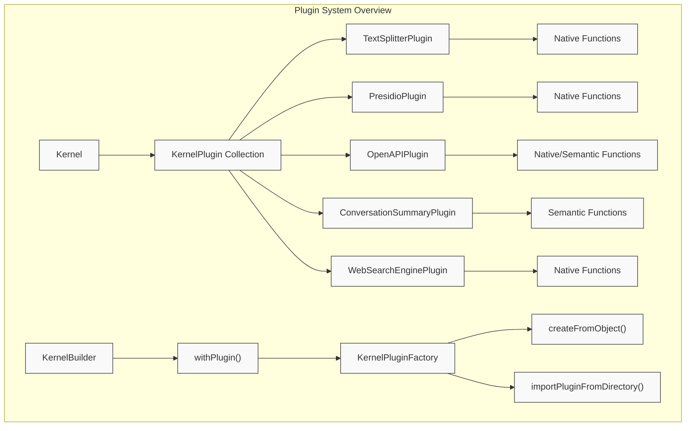
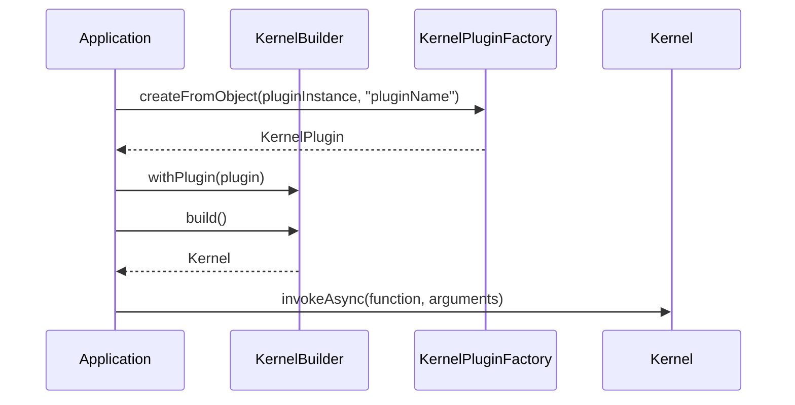
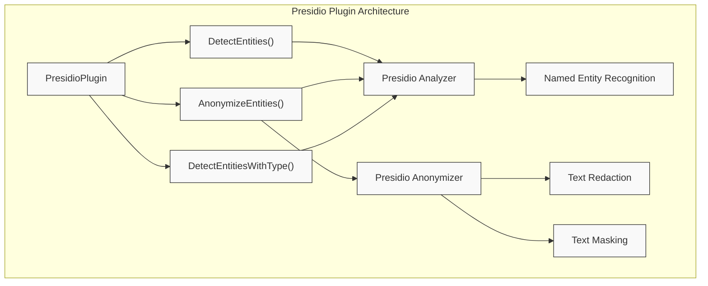
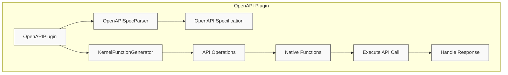
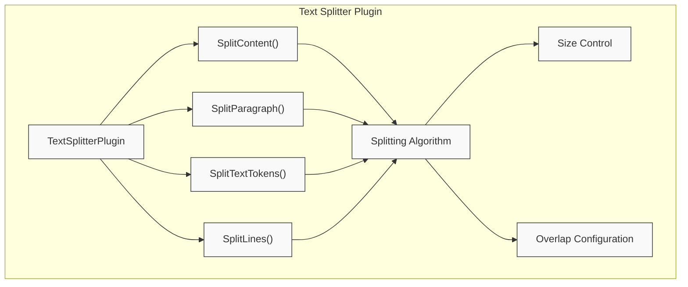
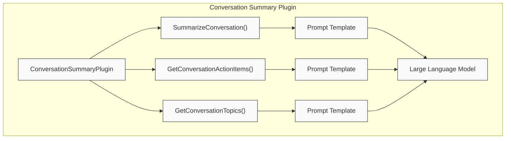
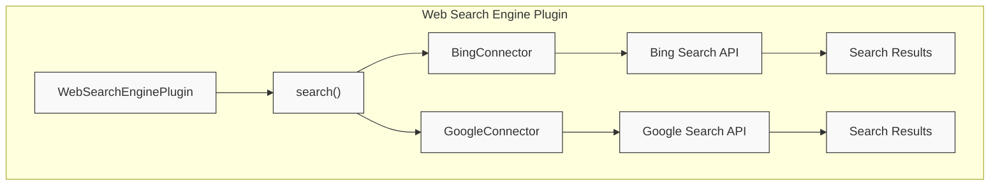
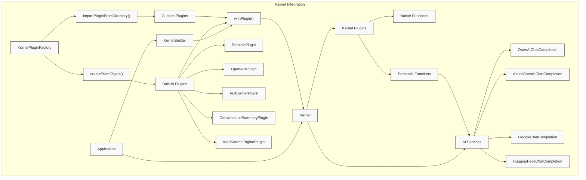

<!-- source: DeepWiki mcp.deepwiki.com · repo microsoft/semantic-kernel-java · page 6.1 Built-in Plugins · fetched 2026-10-26 -->

# Built-in Plugins

<details>
<summary>Relevant source files</summary>

The following files were used as context for generating this wiki page:

- [README.md](README.md)
- [aiservices/google/pom.xml](aiservices/google/pom.xml)
- [aiservices/huggingface/pom.xml](aiservices/huggingface/pom.xml)
- [aiservices/openai/pom.xml](aiservices/openai/pom.xml)
- [api-test/integration-tests/src/test/java/com/microsoft/semantickernel/tests/WiremockExamplesIT.java](api-test/integration-tests/src/test/java/com/microsoft/semantickernel/tests/WiremockExamplesIT.java)
- [api-test/pom.xml](api-test/pom.xml)
- [samples/pom.xml](samples/pom.xml)
- [samples/semantickernel-concepts/pom.xml](samples/semantickernel-concepts/pom.xml)
- [samples/semantickernel-concepts/semantickernel-syntax-examples/src/main/java/com/microsoft/semantickernel/samples/syntaxexamples/RunAll.java](samples/semantickernel-concepts/semantickernel-syntax-examples/src/main/java/com/microsoft/semantickernel/samples/syntaxexamples/RunAll.java)
- [samples/semantickernel-concepts/semantickernel-syntax-examples/src/main/java/com/microsoft/semantickernel/samples/syntaxexamples/plugin/Example07_BingAndGooglePlugins.java](samples/semantickernel-concepts/semantickernel-syntax-examples/src/main/java/com/microsoft/semantickernel/samples/syntaxexamples/plugin/Example07_BingAndGooglePlugins.java)
- [samples/semantickernel-concepts/semantickernel-syntax-examples/src/main/java/com/microsoft/semantickernel/samples/syntaxexamples/plugin/Example10_DescribeAllPluginsAndFunctions.java](samples/semantickernel-concepts/semantickernel-syntax-examples/src/main/java/com/microsoft/semantickernel/samples/syntaxexamples/plugin/Example10_DescribeAllPluginsAndFunctions.java)
- [samples/semantickernel-concepts/semantickernel-syntax-examples/src/main/java/com/microsoft/semantickernel/samples/syntaxexamples/plugin/Example13_ConversationSummaryPlugin.java](samples/semantickernel-concepts/semantickernel-syntax-examples/src/main/java/com/microsoft/semantickernel/samples/syntaxexamples/plugin/Example13_ConversationSummaryPlugin.java)
- [samples/semantickernel-demos/pom.xml](samples/semantickernel-demos/pom.xml)
- [samples/semantickernel-demos/sk-presidio-sample/pom.xml](samples/semantickernel-demos/sk-presidio-sample/pom.xml)
- [samples/semantickernel-sample-plugins/pom.xml](samples/semantickernel-sample-plugins/pom.xml)
- [samples/semantickernel-sample-plugins/semantickernel-presidio-plugin/pom.xml](samples/semantickernel-sample-plugins/semantickernel-presidio-plugin/pom.xml)

</details>


This document provides an overview of the built-in plugins available in Semantic Kernel Java. These plugins offer pre-packaged functionality that can be easily added to your Semantic Kernel applications. For information about creating your own custom plugins, see [Creating Custom Plugins](#6.2).

## Introduction to Plugins in Semantic Kernel

Plugins in Semantic Kernel are collections of functions that extend the kernel's capabilities. They can contain both semantic functions (AI-powered functions defined by prompts) and native functions (traditional code functions). Built-in plugins provide ready-to-use functionality for common tasks that complement AI operations.



Sources:
- [samples/semantickernel-sample-plugins/pom.xml:15-19]()
- [README.md:32-33]()

## Available Built-in Plugins

Semantic Kernel Java includes several built-in plugins that address common scenarios when building AI applications:

| Plugin | Purpose | Type | 
|--------|---------|------|
| Presidio Plugin | Detect and anonymize sensitive information (PII) | Native |
| OpenAPI Plugin | Connect to external APIs using OpenAPI specifications | Native/Semantic |
| Text Splitter Plugin | Split text into manageable chunks | Native |
| Conversation Summary Plugin | Generate summaries and extract information from conversations | Semantic |
| Web Search Engine Plugin | Integrate with search engines like Bing | Native |

Sources: 
- [samples/semantickernel-sample-plugins/pom.xml:15-19]()
- [samples/semantickernel-demos/pom.xml:15-19]()

### Plugin Registration Process



Sources:
- [samples/semantickernel-concepts/semantickernel-syntax-examples/src/main/java/com/microsoft/semantickernel/samples/syntaxexamples/plugin/Example10_DescribeAllPluginsAndFunctions.java:61-66]()
- [samples/semantickernel-concepts/semantickernel-syntax-examples/src/main/java/com/microsoft/semantickernel/samples/syntaxexamples/plugin/Example13_ConversationSummaryPlugin.java:160-161]()

## Presidio Plugin

The Presidio Plugin provides capabilities for detecting and anonymizing personally identifiable information (PII) and other sensitive data in text. It's built on Microsoft's Presidio framework and helps ensure compliance with data privacy regulations.



Sources:
- [samples/semantickernel-sample-plugins/semantickernel-presidio-plugin/pom.xml:1-120]()
- [samples/semantickernel-demos/sk-presidio-sample/pom.xml:11-12]()

### Use Case Example

The Presidio Plugin is particularly useful when:

1. Processing user inputs that might contain sensitive information
2. Preparing data for safe processing by LLMs
3. Ensuring compliance with privacy regulations
4. Anonymizing data before storage or transmission

Sources:
- [samples/semantickernel-demos/sk-presidio-sample/pom.xml:1-80]()

## OpenAPI Plugin

The OpenAPI Plugin allows Semantic Kernel to interact with external services defined by OpenAPI specifications (formerly known as Swagger). This enables AI applications to make API calls to external services.



Sources:
- [samples/semantickernel-sample-plugins/pom.xml:16]()

## Text Splitter Plugin

The Text Splitter Plugin provides functionality to split large text documents into smaller chunks for processing. This is essential when working with large language models that have token limits or when implementing efficient text processing pipelines.



Sources:
- [samples/semantickernel-sample-plugins/pom.xml:18]()
- [samples/semantickernel-concepts/semantickernel-syntax-examples/src/main/java/com/microsoft/semantickernel/samples/syntaxexamples/RunAll.java:61]()

## Conversation Summary Plugin

The Conversation Summary Plugin provides semantic functions to summarize conversations, extract action items, and identify topics from chat transcripts or dialogue. This plugin is helpful for processing meeting transcripts, customer service interactions, or any multi-turn conversations.



### Usage Example

The Conversation Summary Plugin is demonstrated in the sample code, showing how it can:
- Generate a concise summary of a lengthy conversation
- Extract specific action items from a conversation
- Identify the main topics discussed

Sources:
- [samples/semantickernel-concepts/semantickernel-syntax-examples/src/main/java/com/microsoft/semantickernel/samples/syntaxexamples/plugin/Example13_ConversationSummaryPlugin.java:24-39]()
- [samples/semantickernel-concepts/semantickernel-syntax-examples/src/main/java/com/microsoft/semantickernel/samples/syntaxexamples/plugin/Example13_ConversationSummaryPlugin.java:155-213]()

## Web Search Engine Plugin

The Web Search Engine Plugin integrates search engines like Bing and Google into Semantic Kernel applications, allowing them to retrieve up-to-date information from the internet. This is essential for applications that need current information beyond what LLMs know from their training data.



### Usage Example

The Web Search Engine Plugin can be used to:
1. Augment LLM knowledge with current information
2. Answer user questions requiring real-time data
3. Provide factual information in AI-generated responses

Sources:
- [samples/semantickernel-concepts/semantickernel-syntax-examples/src/main/java/com/microsoft/semantickernel/samples/syntaxexamples/plugin/Example07_BingAndGooglePlugins.java:58-62]()
- [samples/semantickernel-concepts/semantickernel-syntax-examples/src/main/java/com/microsoft/semantickernel/samples/syntaxexamples/plugin/Example07_BingAndGooglePlugins.java:82-97]()

## Plugin Integration in Semantic Kernel

The following diagram illustrates how built-in plugins integrate with the overall Semantic Kernel architecture:



Sources:
- [README.md:7-14]()
- [samples/semantickernel-concepts/semantickernel-syntax-examples/src/main/java/com/microsoft/semantickernel/samples/syntaxexamples/plugin/Example10_DescribeAllPluginsAndFunctions.java:61-79]()
- [samples/semantickernel-concepts/semantickernel-syntax-examples/src/main/java/com/microsoft/semantickernel/samples/syntaxexamples/plugin/Example13_ConversationSummaryPlugin.java:160-161]()

## Plugin Registration Methods

There are two primary ways to register plugins with Semantic Kernel:

### 1. Using KernelPluginFactory.createFromObject

```java
// Create plugin from an object instance
KernelPlugin textPlugin = KernelPluginFactory.createFromObject(
    new TextPlugin(), "textPlugin");

// Add plugin to kernel
Kernel kernel = Kernel.builder()
    .withPlugin(textPlugin)
    .build();
```

### 2. Importing Plugins from Directory

```java
// Import plugin from directory
KernelPlugin summarizePlugin = KernelPluginFactory
    .importPluginFromDirectory(
        Path.of("path/to/plugins"),
        "SummarizePlugin",
        null);

// Add plugin to kernel
Kernel kernel = Kernel.builder()
    .withPlugin(summarizePlugin)
    .build();
```

Sources:
- [samples/semantickernel-concepts/semantickernel-syntax-examples/src/main/java/com/microsoft/semantickernel/samples/syntaxexamples/plugin/Example10_DescribeAllPluginsAndFunctions.java:64-79]()
- [samples/semantickernel-concepts/semantickernel-syntax-examples/src/main/java/com/microsoft/semantickernel/samples/syntaxexamples/plugin/Example13_ConversationSummaryPlugin.java:160-161]()

## Summary

The built-in plugins in Semantic Kernel Java provide ready-to-use functionality for common AI application scenarios. They can be easily integrated into applications using the Kernel's plugin registration mechanisms. Each plugin addresses specific needs:

- **Presidio Plugin**: Sensitive data detection and anonymization
- **OpenAPI Plugin**: Integration with external web services
- **Text Splitter Plugin**: Processing large text documents
- **Conversation Summary Plugin**: Extracting insights from conversations
- **Web Search Engine Plugin**: Retrieving real-time information

These plugins demonstrate Semantic Kernel's extensibility model and provide templates for creating custom plugins for specialized needs.

Sources:
- [samples/semantickernel-sample-plugins/pom.xml:15-19]()
- [samples/semantickernel-concepts/semantickernel-syntax-examples/src/main/java/com/microsoft/semantickernel/samples/syntaxexamples/RunAll.java:41-73]()

---

