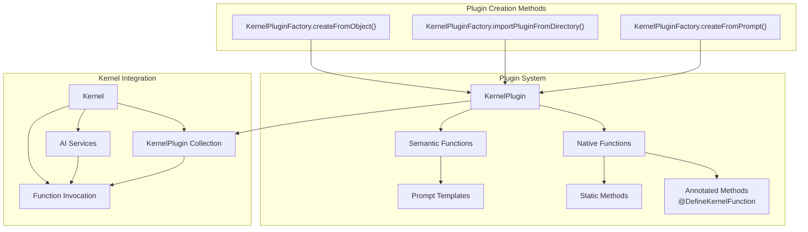
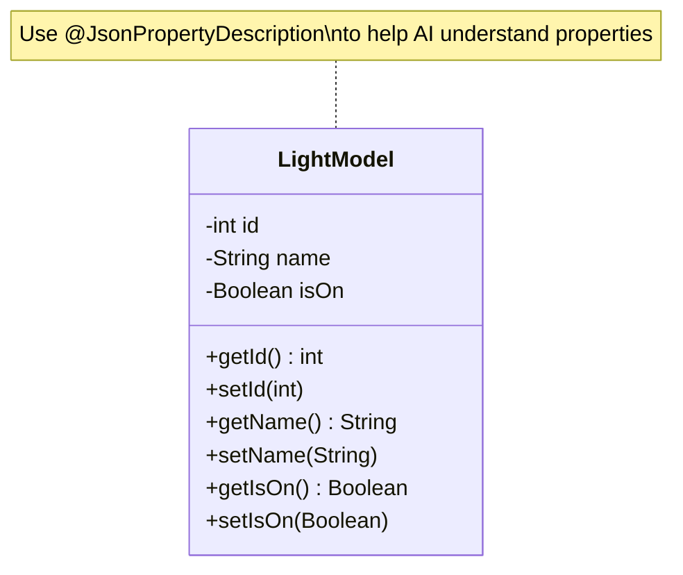
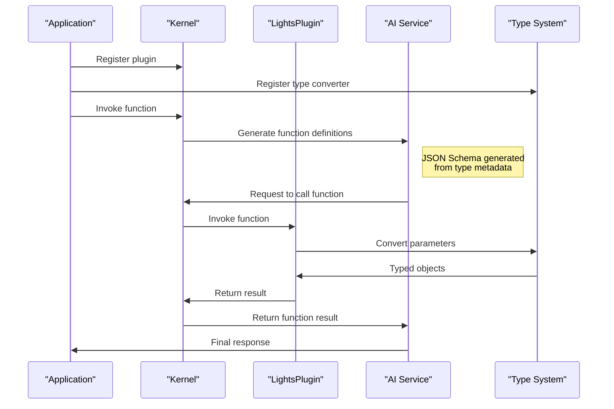
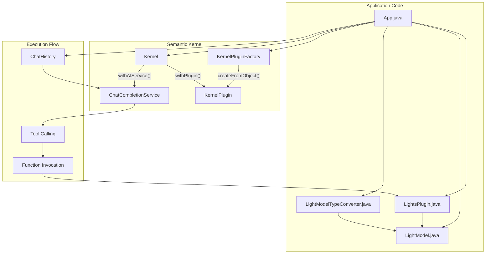

<!-- source: DeepWiki mcp.deepwiki.com · repo microsoft/semantic-kernel-java · page 6.2 Creating Custom Plugins · fetched 2026-10-26 -->

# Creating Custom Plugins

<details>
<summary>Relevant source files</summary>

The following files were used as context for generating this wiki page:

- [CHANGELOG.md](CHANGELOG.md)
- [README.md](README.md)
- [aiservices/openai/src/main/java/com/microsoft/semantickernel/aiservices/openai/chatcompletion/OpenAIFunction.java](aiservices/openai/src/main/java/com/microsoft/semantickernel/aiservices/openai/chatcompletion/OpenAIFunction.java)
- [aiservices/openai/src/test/java/com/microsoft/semantickernel/aiservices/openai/chatcompletion/JsonSchemaTest.java](aiservices/openai/src/test/java/com/microsoft/semantickernel/aiservices/openai/chatcompletion/JsonSchemaTest.java)
- [api-test/integration-tests/src/test/java/com/microsoft/semantickernel/tests/WiremockExamplesIT.java](api-test/integration-tests/src/test/java/com/microsoft/semantickernel/tests/WiremockExamplesIT.java)
- [samples/semantickernel-concepts/semantickernel-syntax-examples/src/main/java/com/microsoft/semantickernel/samples/demos/lights/App.java](samples/semantickernel-concepts/semantickernel-syntax-examples/src/main/java/com/microsoft/semantickernel/samples/demos/lights/App.java)
- [samples/semantickernel-concepts/semantickernel-syntax-examples/src/main/java/com/microsoft/semantickernel/samples/demos/lights/LightModel.java](samples/semantickernel-concepts/semantickernel-syntax-examples/src/main/java/com/microsoft/semantickernel/samples/demos/lights/LightModel.java)
- [samples/semantickernel-concepts/semantickernel-syntax-examples/src/main/java/com/microsoft/semantickernel/samples/demos/lights/LightModelTypeConverter.java](samples/semantickernel-concepts/semantickernel-syntax-examples/src/main/java/com/microsoft/semantickernel/samples/demos/lights/LightModelTypeConverter.java)
- [samples/semantickernel-concepts/semantickernel-syntax-examples/src/main/java/com/microsoft/semantickernel/samples/demos/lights/LightsPlugin.java](samples/semantickernel-concepts/semantickernel-syntax-examples/src/main/java/com/microsoft/semantickernel/samples/demos/lights/LightsPlugin.java)
- [samples/semantickernel-concepts/semantickernel-syntax-examples/src/main/java/com/microsoft/semantickernel/samples/syntaxexamples/RunAll.java](samples/semantickernel-concepts/semantickernel-syntax-examples/src/main/java/com/microsoft/semantickernel/samples/syntaxexamples/RunAll.java)
- [samples/semantickernel-concepts/semantickernel-syntax-examples/src/main/java/com/microsoft/semantickernel/samples/syntaxexamples/plugin/Example07_BingAndGooglePlugins.java](samples/semantickernel-concepts/semantickernel-syntax-examples/src/main/java/com/microsoft/semantickernel/samples/syntaxexamples/plugin/Example07_BingAndGooglePlugins.java)
- [samples/semantickernel-concepts/semantickernel-syntax-examples/src/main/java/com/microsoft/semantickernel/samples/syntaxexamples/plugin/Example10_DescribeAllPluginsAndFunctions.java](samples/semantickernel-concepts/semantickernel-syntax-examples/src/main/java/com/microsoft/semantickernel/samples/syntaxexamples/plugin/Example10_DescribeAllPluginsAndFunctions.java)
- [samples/semantickernel-concepts/semantickernel-syntax-examples/src/main/java/com/microsoft/semantickernel/samples/syntaxexamples/plugin/Example13_ConversationSummaryPlugin.java](samples/semantickernel-concepts/semantickernel-syntax-examples/src/main/java/com/microsoft/semantickernel/samples/syntaxexamples/plugin/Example13_ConversationSummaryPlugin.java)
- [semantickernel-api/src/main/java/com/microsoft/semantickernel/contextvariables/converters/StringVariableContextVariableTypeConverter.java](semantickernel-api/src/main/java/com/microsoft/semantickernel/contextvariables/converters/StringVariableContextVariableTypeConverter.java)
- [semantickernel-api/src/main/java/com/microsoft/semantickernel/hooks/KernelHook.java](semantickernel-api/src/main/java/com/microsoft/semantickernel/hooks/KernelHook.java)
- [semantickernel-api/src/main/java/com/microsoft/semantickernel/hooks/KernelHooks.java](semantickernel-api/src/main/java/com/microsoft/semantickernel/hooks/KernelHooks.java)
- [semantickernel-api/src/test/java/com/microsoft/semantickernel/contextvariables/converters/ContextVariableTypeConverterTest.java](semantickernel-api/src/test/java/com/microsoft/semantickernel/contextvariables/converters/ContextVariableTypeConverterTest.java)

</details>


This document explains how to create, register, and use custom plugins in the Semantic Kernel Java framework. Plugins are collections of related functions that extend Semantic Kernel capabilities, making your code accessible to AI orchestration and enabling integration with large language models (LLMs).

For information about built-in plugins that come with Semantic Kernel, see [Built-in Plugins](#6.1).

## Plugin System Overview

In Semantic Kernel Java, plugins serve as containers for organizing related functions. A plugin can contain two types of functions:

1. **Native Functions**: Java methods that execute code directly
2. **Semantic Functions**: AI-powered functions that use prompt templates with LLMs

When registered with the Kernel, these functions become available for invocation from your application code or through AI-driven orchestration.



Sources: [samples/semantickernel-concepts/semantickernel-syntax-examples/src/main/java/com/microsoft/semantickernel/samples/syntaxexamples/plugin/Example10_DescribeAllPluginsAndFunctions.java]()

## Creating Native Function Plugins

Native function plugins let you expose Java methods to the Semantic Kernel, making them available for AI orchestration.

### Using Annotations

The primary way to create native functions is by annotating methods with `@DefineKernelFunction`:

```java
public class MyPlugin {
    @DefineKernelFunction(name = "function_name", description = "Description of what this function does")
    public String myFunction(
        @KernelFunctionParameter(name = "param1", description = "Parameter description") String param1) {
        // Implementation
        return "Result";
    }
}
```

The key annotations are:

- `@DefineKernelFunction` - Marks a method as a Kernel function with metadata:
  - `name` - Function name (optional, defaults to method name)
  - `description` - Function description (used by AI and for documentation)
  - `returnType` - Optional type information for the return value

- `@KernelFunctionParameter` - Provides metadata about function parameters:
  - `name` - Parameter name (used when invoking the function)
  - `description` - Parameter description (helps AI understand usage)
  - `type` - Java type of the parameter (for type conversion)

Sources: [samples/semantickernel-concepts/semantickernel-syntax-examples/src/main/java/com/microsoft/semantickernel/samples/demos/lights/LightsPlugin.java:21-53]()

### Example: A Lights Control Plugin

Here's an example plugin for controlling smart lights:

```java
public class LightsPlugin {
    // Mock data for the lights
    private final List<LightModel> lights = new ArrayList<>();

    @DefineKernelFunction(name = "get_lights", description = "Gets a list of lights and their current state")
    public List<LightModel> getLights() {
        System.out.println("Getting lights");
        return lights;
    }

    @DefineKernelFunction(name = "add_light", description = "Adds a new light")
    public String addLight(
        @KernelFunctionParameter(name = "newLight", description = "new Light Details", 
                                type = LightModel.class) LightModel light) {
        if(light != null) {
            System.out.println("Adding light " + light.getName());
            lights.add(light);
            return "Light added";
        }
        return "Light failed to added";
    }

    @DefineKernelFunction(name = "change_state", description = "Changes the state of the light")
    public LightModel changeState(
        @KernelFunctionParameter(name = "id", description = "The ID of the light to change", 
                                type = int.class) int id,
        @KernelFunctionParameter(name = "isOn", description = "The new state of the light", 
                                type = boolean.class) boolean isOn) {
        // Implementation details
        // ...
        return light.get();
    }
}
```

Sources: [samples/semantickernel-concepts/semantickernel-syntax-examples/src/main/java/com/microsoft/semantickernel/samples/demos/lights/LightsPlugin.java]()

### Static Method Functions

You can also create plugins from classes with static methods:

```java
public static class StaticTextPlugin {
    @DefineKernelFunction(description = "Change all string chars to uppercase", name = "uppercase")
    public static String uppercase(
        @KernelFunctionParameter(description = "Text to uppercase", name = "input") String input) {
        return input.toUpperCase(Locale.ROOT);
    }

    @DefineKernelFunction(description = "Append the day variable", name = "appendDay")
    public String appendDay(
        @KernelFunctionParameter(description = "Append the day variable", name = "input") String input,
        @KernelFunctionParameter(description = "Value of the day to append", name = "day") String day) {
        return input + day;
    }
}
```

Sources: [samples/semantickernel-concepts/semantickernel-syntax-examples/src/main/java/com/microsoft/semantickernel/samples/syntaxexamples/plugin/Example10_DescribeAllPluginsAndFunctions.java:135-149]()

## Working with Custom Data Types

When creating plugins with custom data types, you need to:

1. Define your data model class
2. Implement a type converter
3. Register the type converter with the Kernel

### 1. Define Your Data Model



```java
public class LightModel {
    @JsonPropertyDescription("The unique identifier of the light")
    private int id;

    @JsonPropertyDescription("The name of the light")
    private String name;

    @JsonPropertyDescription("The state of the light")
    private Boolean isOn;

    // Constructor, getters and setters
}
```

The `@JsonPropertyDescription` annotations are important for generating proper schema information for AI services when working with custom types.

Sources: [samples/semantickernel-concepts/semantickernel-syntax-examples/src/main/java/com/microsoft/semantickernel/samples/demos/lights/LightModel.java](), [aiservices/openai/src/test/java/com/microsoft/semantickernel/aiservices/openai/chatcompletion/JsonSchemaTest.java:85-114]()

### 2. Create a Type Converter

To enable Semantic Kernel to work with your custom types, implement a `ContextVariableTypeConverter`:

```java
public class LightModelTypeConverter extends ContextVariableTypeConverter<LightModel> {
    private static final Gson gson = new Gson();

    public LightModelTypeConverter() {
        super(
            LightModel.class,
            obj -> {
                if(obj instanceof String) {
                    return gson.fromJson((String)obj, LightModel.class);
                } else {
                    return gson.fromJson(gson.toJson(obj), LightModel.class);
                }
            },
            (types, lightModel) -> gson.toJson(lightModel),
            json -> gson.fromJson(json, LightModel.class)
        );
    }
}
```

The type converter handles serialization and deserialization of your custom type, enabling:
- Conversion from different input formats to your object type
- Serialization for sending to AI services
- Deserialization when receiving data back from AI services

Sources: [samples/semantickernel-concepts/semantickernel-syntax-examples/src/main/java/com/microsoft/semantickernel/samples/demos/lights/LightModelTypeConverter.java]()

### 3. Register the Type Converter

You can register a type converter globally:

```java
ContextVariableTypes.addGlobalConverter(new LightModelTypeConverter());
```

Or for a specific invocation context:

```java
InvocationContext invocationContext = new Builder()
    .withContextVariableConverter(new LightModelTypeConverter())
    .build();
```

Sources: [samples/semantickernel-concepts/semantickernel-syntax-examples/src/main/java/com/microsoft/semantickernel/samples/demos/lights/App.java:72-73](), [samples/semantickernel-concepts/semantickernel-syntax-examples/src/main/java/com/microsoft/semantickernel/samples/demos/lights/App.java:97-101]()

## Schema Generation for AI Services

When you create functions with custom types, Semantic Kernel automatically generates JSON schemas that describe your objects to AI services. This helps the AI understand the structure and purpose of your custom types.



The schema generation process:

1. Examines class properties and their annotations
2. Generates appropriate JSON schema with property descriptions
3. Sends this schema to the AI service during function registration
4. Enables type conversion when the AI calls the function

This makes it possible for AI services to understand and correctly use your custom types.

Sources: [aiservices/openai/src/main/java/com/microsoft/semantickernel/aiservices/openai/chatcompletion/OpenAIFunction.java:87-119](), [aiservices/openai/src/main/java/com/microsoft/semantickernel/aiservices/openai/chatcompletion/OpenAIFunction.java:231-245]()

## Creating Semantic Function Plugins

In addition to native functions, you can create semantic functions that leverage AI with predefined prompt templates.

### Importing from a Directory

You can create a plugin from a directory containing semantic function definitions:

```java
KernelPlugin summarizePlugin = KernelPluginFactory
    .importPluginFromDirectory(
        Path.of("resources/Plugins"),
        "SummarizePlugin", 
        null);
```

The directory structure should organize prompt templates into subdirectories by plugin name.

Sources: [samples/semantickernel-concepts/semantickernel-syntax-examples/src/main/java/com/microsoft/semantickernel/samples/syntaxexamples/plugin/Example10_DescribeAllPluginsAndFunctions.java:73-79]()

### Creating From Prompt Templates

You can also create individual semantic functions from prompt templates:

```java
var jokeFunction = KernelFunctionFromPrompt.builder()
    .withTemplate("tell a joke about {{$input}}")
    .withDefaultExecutionSettings(
        PromptExecutionSettings.builder()
            .withMaxTokens(150)
            .build())
    .build();

// Create with more metadata
var writeNovel = KernelFunctionFromPrompt.builder()
    .withTemplate("write a novel about {{$input}} in {{$language}} language")
    .withName("Novel")
    .withDescription("Write a bedtime story")
    .withDefaultExecutionSettings(
        PromptExecutionSettings.builder()
            .withMaxTokens(150)
            .build())
    .build();
```

Sources: [samples/semantickernel-concepts/semantickernel-syntax-examples/src/main/java/com/microsoft/semantickernel/samples/syntaxexamples/plugin/Example10_DescribeAllPluginsAndFunctions.java:82-99]()

## Registering Plugins with the Kernel

To use your plugins, you need to register them with the Kernel:

### From a Java Object

```java
// Create a plugin from a Java object
KernelPlugin lightPlugin = KernelPluginFactory.createFromObject(
    new LightsPlugin(), "LightsPlugin");

// Add to kernel during build
Kernel kernel = Kernel.builder()
    .withPlugin(lightPlugin)
    .withAIService(ChatCompletionService.class, chatService)
    .build();
```

Sources: [samples/semantickernel-concepts/semantickernel-syntax-examples/src/main/java/com/microsoft/semantickernel/samples/demos/lights/App.java:59-65]()

## Using Plugins with AI Services

Plugins are particularly powerful when working with AI services that support function calling capabilities:

```java
// Enable tool calling for all kernel functions
InvocationContext invocationContext = new Builder()
    .withReturnMode(InvocationReturnMode.LAST_MESSAGE_ONLY)
    .withToolCallBehavior(ToolCallBehavior.allowAllKernelFunctions(true))
    .withContextVariableConverter(new LightModelTypeConverter())
    .build();

// Use the plugin with a chat service
List<ChatMessageContent<?>> results = chatCompletionService.getChatMessageContentsAsync(
    history, kernel, invocationContext).block();
```

This setup allows the AI to discover and call your plugin functions when needed to solve user requests.

Sources: [samples/semantickernel-concepts/semantickernel-syntax-examples/src/main/java/com/microsoft/semantickernel/samples/demos/lights/App.java:96-115]()

## Exploring and Describing Plugins

To inspect the plugins and functions registered with a Kernel:

```java
kernel.getPlugins()
    .forEach(plugin -> {
        System.out.println("Plugin: " + plugin.getName());
        plugin
            .getFunctions()
            .values()
            .stream()
            .map(KernelFunction::getMetadata)
            .forEach(metadata -> {
                System.out.println("   " + metadata.getName() + ": " + metadata.getDescription());
                // Print parameter information
            });
    });
```

This can be useful for debugging or generating documentation for your plugins.

Sources: [samples/semantickernel-concepts/semantickernel-syntax-examples/src/main/java/com/microsoft/semantickernel/samples/syntaxexamples/plugin/Example10_DescribeAllPluginsAndFunctions.java:107-116]()

## Best Practices for Plugin Development

When creating custom plugins, follow these best practices:

1. **Descriptive Names and Documentation**: Use clear function names and detailed descriptions to help both developers and AI understand your plugin's capabilities.

2. **Focused Functionality**: Each plugin should focus on a specific domain or capability set. Create separate plugins for unrelated functionality.

3. **Type Safety**: Use appropriate type converters for custom data types to ensure proper serialization/deserialization.

4. **Error Handling**: Implement robust error handling in your functions. Consider what happens when input parameters are invalid.

5. **JSON Property Descriptions**: Add `@JsonPropertyDescription` annotations to custom type properties to enhance AI understanding.

6. **Testing**: Test your plugins with different AI models and input variations to ensure consistent behavior.

## Complete Example: Lights Plugin Integration

The following diagram shows the complete flow of the Lights Plugin example:



The complete example combines all elements:

1. Creating a custom plugin with annotated methods
2. Defining a custom data model with property descriptions
3. Implementing a type converter for the custom model
4. Registering the plugin and type converter with the Kernel
5. Setting up invocation context with tool calling enabled
6. Using the plugin with a chat service

This workflow allows an AI to interact with your custom code, making it possible to build sophisticated AI applications that leverage your domain-specific functionality.

Sources: [samples/semantickernel-concepts/semantickernel-syntax-examples/src/main/java/com/microsoft/semantickernel/samples/demos/lights/App.java](), [samples/semantickernel-concepts/semantickernel-syntax-examples/src/main/java/com/microsoft/semantickernel/samples/demos/lights/LightsPlugin.java](), [samples/semantickernel-concepts/semantickernel-syntax-examples/src/main/java/com/microsoft/semantickernel/samples/demos/lights/LightModel.java](), [samples/semantickernel-concepts/semantickernel-syntax-examples/src/main/java/com/microsoft/semantickernel/samples/demos/lights/LightModelTypeConverter.java]()

---

