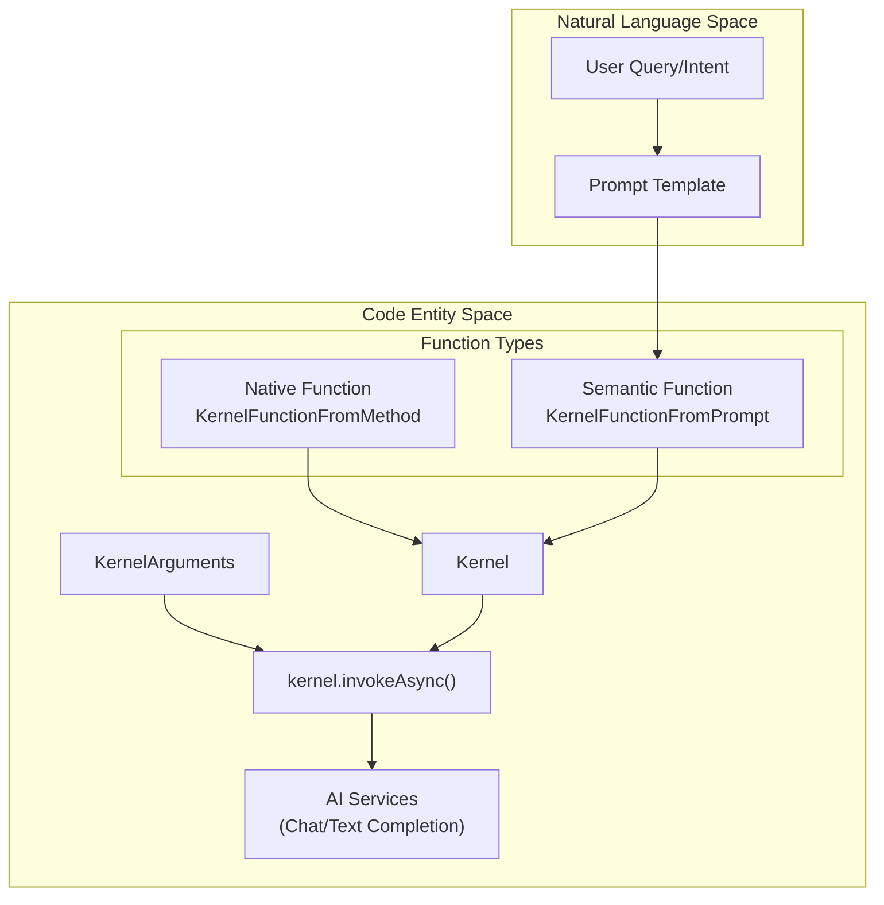
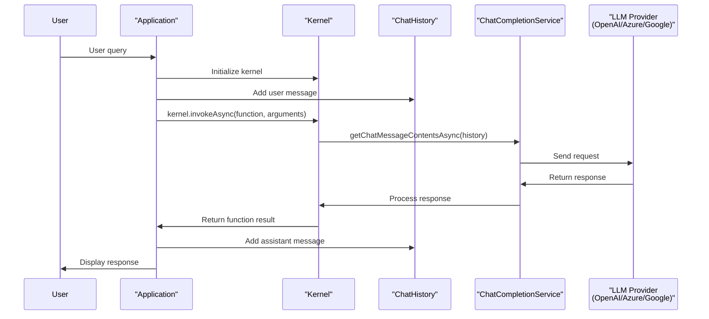
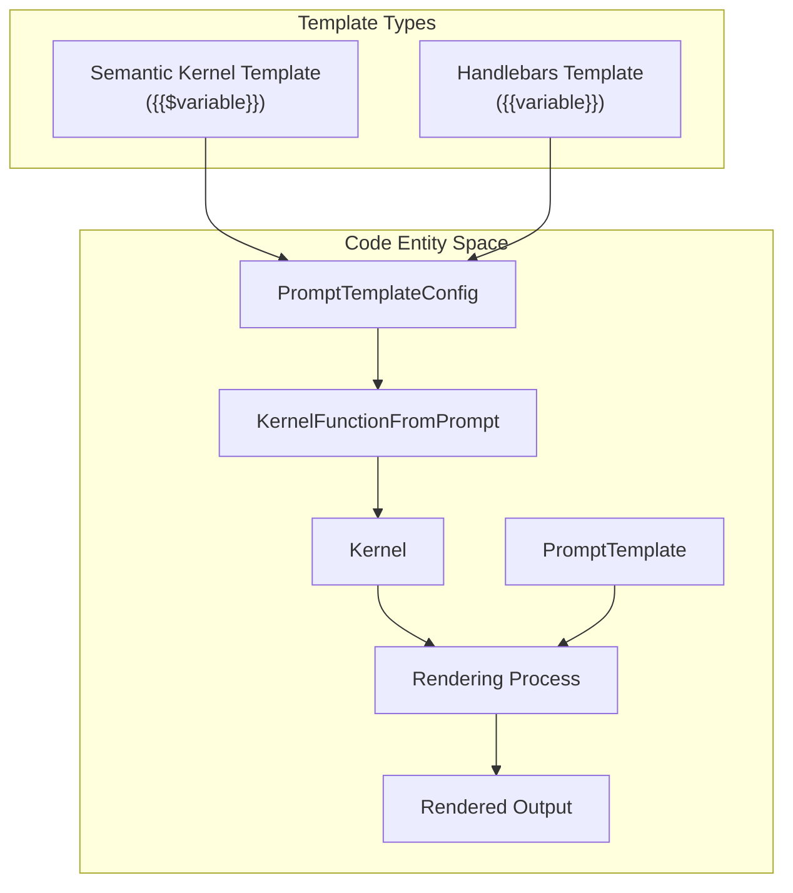
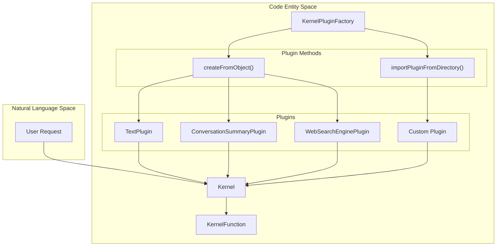
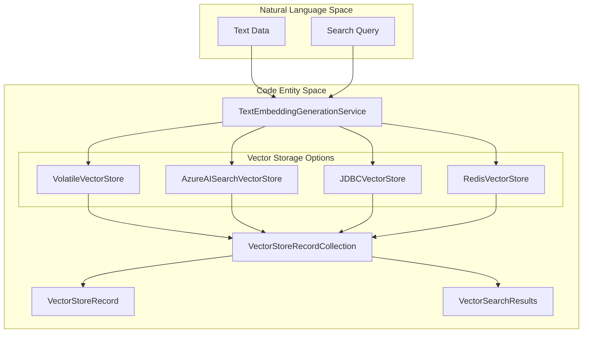
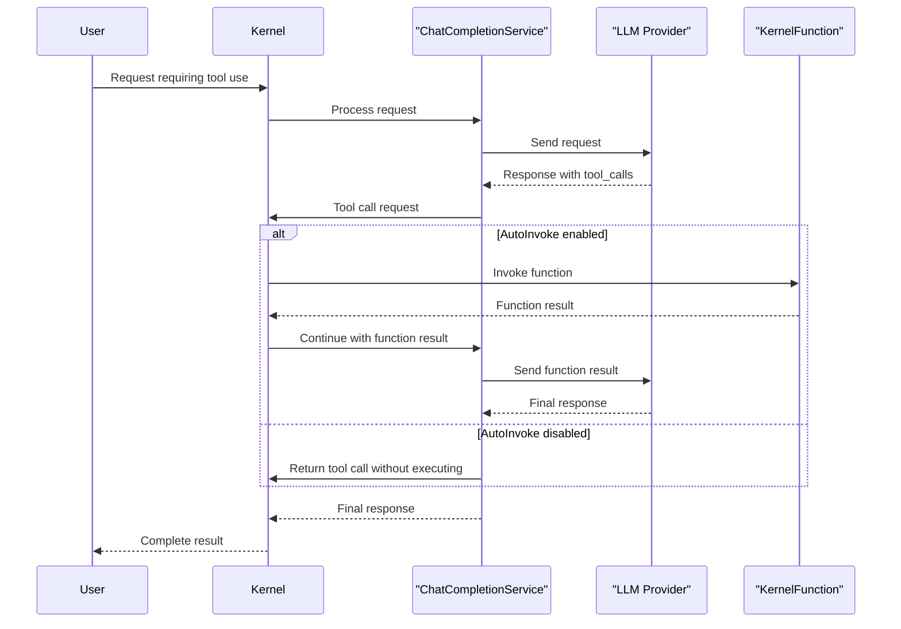

<!-- source: DeepWiki mcp.deepwiki.com · repo microsoft/semantic-kernel-java · page 7 Usage Examples · fetched 2026-10-26 -->

# Usage Examples

<details>
<summary>Relevant source files</summary>

The following files were used as context for generating this wiki page:

- [README.md](README.md)
- [aiservices/openai/src/main/java/com/microsoft/semantickernel/aiservices/openai/chatcompletion/BinaryDataUtils.java](aiservices/openai/src/main/java/com/microsoft/semantickernel/aiservices/openai/chatcompletion/BinaryDataUtils.java)
- [aiservices/openai/src/main/java/com/microsoft/semantickernel/aiservices/openai/chatcompletion/OpenAiXMLPromptParser.java](aiservices/openai/src/main/java/com/microsoft/semantickernel/aiservices/openai/chatcompletion/OpenAiXMLPromptParser.java)
- [api-test/integration-tests/src/test/java/com/microsoft/semantickernel/tests/RenderingTest.java](api-test/integration-tests/src/test/java/com/microsoft/semantickernel/tests/RenderingTest.java)
- [api-test/integration-tests/src/test/java/com/microsoft/semantickernel/tests/ToolCallBehaviourTest.java](api-test/integration-tests/src/test/java/com/microsoft/semantickernel/tests/ToolCallBehaviourTest.java)
- [api-test/integration-tests/src/test/java/com/microsoft/semantickernel/tests/WiremockExamplesIT.java](api-test/integration-tests/src/test/java/com/microsoft/semantickernel/tests/WiremockExamplesIT.java)
- [api-test/integration-tests/src/test/resources/wiremock/mappings/deployments_gpt-35-turbo-2_chat_completions-12b6744e-443f-4fe7-82e2-55cc41195ff1.json](api-test/integration-tests/src/test/resources/wiremock/mappings/deployments_gpt-35-turbo-2_chat_completions-12b6744e-443f-4fe7-82e2-55cc41195ff1.json)
- [api-test/integration-tests/src/test/resources/wiremock/mappings/deployments_gpt-35-turbo-2_chat_completions-71b07779-49a8-44e5-a60b-ee5b0a3ad697.json](api-test/integration-tests/src/test/resources/wiremock/mappings/deployments_gpt-35-turbo-2_chat_completions-71b07779-49a8-44e5-a60b-ee5b0a3ad697.json)
- [api-test/integration-tests/src/test/resources/wiremock/mappings/deployments_gpt-35-turbo_chat_completions-0c8046c5-74ad-4836-8aa9-09da60f367a2.json](api-test/integration-tests/src/test/resources/wiremock/mappings/deployments_gpt-35-turbo_chat_completions-0c8046c5-74ad-4836-8aa9-09da60f367a2.json)
- [api-test/integration-tests/src/test/resources/wiremock/mappings/deployments_text-davinci-003_completions-0215b128-4822-4368-ac3d-2f580a221f00.json](api-test/integration-tests/src/test/resources/wiremock/mappings/deployments_text-davinci-003_completions-0215b128-4822-4368-ac3d-2f580a221f00.json)
- [samples/semantickernel-concepts/semantickernel-syntax-examples/src/main/java/com/microsoft/semantickernel/samples/syntaxexamples/RunAll.java](samples/semantickernel-concepts/semantickernel-syntax-examples/src/main/java/com/microsoft/semantickernel/samples/syntaxexamples/RunAll.java)
- [samples/semantickernel-concepts/semantickernel-syntax-examples/src/main/java/com/microsoft/semantickernel/samples/syntaxexamples/memory/InMemoryVolatileVectorStore.java](samples/semantickernel-concepts/semantickernel-syntax-examples/src/main/java/com/microsoft/semantickernel/samples/syntaxexamples/memory/InMemoryVolatileVectorStore.java)
- [samples/semantickernel-concepts/semantickernel-syntax-examples/src/main/java/com/microsoft/semantickernel/samples/syntaxexamples/memory/VectorStoreWithAzureAISearch.java](samples/semantickernel-concepts/semantickernel-syntax-examples/src/main/java/com/microsoft/semantickernel/samples/syntaxexamples/memory/VectorStoreWithAzureAISearch.java)
- [samples/semantickernel-concepts/semantickernel-syntax-examples/src/main/java/com/microsoft/semantickernel/samples/syntaxexamples/memory/VectorStoreWithJDBC.java](samples/semantickernel-concepts/semantickernel-syntax-examples/src/main/java/com/microsoft/semantickernel/samples/syntaxexamples/memory/VectorStoreWithJDBC.java)
- [samples/semantickernel-concepts/semantickernel-syntax-examples/src/main/java/com/microsoft/semantickernel/samples/syntaxexamples/memory/VectorStoreWithRedis.java](samples/semantickernel-concepts/semantickernel-syntax-examples/src/main/java/com/microsoft/semantickernel/samples/syntaxexamples/memory/VectorStoreWithRedis.java)
- [samples/semantickernel-concepts/semantickernel-syntax-examples/src/main/java/com/microsoft/semantickernel/samples/syntaxexamples/plugin/Example07_BingAndGooglePlugins.java](samples/semantickernel-concepts/semantickernel-syntax-examples/src/main/java/com/microsoft/semantickernel/samples/syntaxexamples/plugin/Example07_BingAndGooglePlugins.java)
- [samples/semantickernel-concepts/semantickernel-syntax-examples/src/main/java/com/microsoft/semantickernel/samples/syntaxexamples/plugin/Example10_DescribeAllPluginsAndFunctions.java](samples/semantickernel-concepts/semantickernel-syntax-examples/src/main/java/com/microsoft/semantickernel/samples/syntaxexamples/plugin/Example10_DescribeAllPluginsAndFunctions.java)
- [samples/semantickernel-concepts/semantickernel-syntax-examples/src/main/java/com/microsoft/semantickernel/samples/syntaxexamples/plugin/Example13_ConversationSummaryPlugin.java](samples/semantickernel-concepts/semantickernel-syntax-examples/src/main/java/com/microsoft/semantickernel/samples/syntaxexamples/plugin/Example13_ConversationSummaryPlugin.java)

</details>


This page provides practical examples of how to use the Semantic Kernel Java SDK in various scenarios. It demonstrates core functionalities like working with functions, plugins, AI services, memory systems, and more through concrete examples.

For information about project setup and building, see [Project Setup and Building](#8). For details on creating custom plugins, see [Creating Custom Plugins](#6.2).

## Core Function Examples

The Semantic Kernel revolves around functions, which can be native (Java methods) or semantic (AI-powered prompts). Here are examples of working with different function types.



### Native Functions

Native functions are Java methods imported into the kernel:

```java
// Create a kernel with AI service
Kernel kernel = Kernel.builder()
    .withAIService(ChatCompletionService.class, chatCompletionService)
    .build();

// Import a native function
KernelPlugin plugin = KernelPluginFactory.createFromObject(new TextPlugin(), "text");
kernel = kernel.withPlugin(plugin);

// Invoke the function
kernel.invokeAsync(kernel.getFunction("text", "uppercase"))
    .withArguments(KernelArguments.builder().withInput("hello world").build())
    .block();
```

Sources: [samples/semantickernel-concepts/semantickernel-syntax-examples/src/main/java/com/microsoft/semantickernel/samples/syntaxexamples/functions/Example01_NativeFunctions.java](), [samples/semantickernel-concepts/semantickernel-syntax-examples/src/main/java/com/microsoft/semantickernel/samples/syntaxexamples/functions/Example09_FunctionTypes.java]()

### Semantic Functions

Semantic functions use prompt templates and AI to generate outputs:

```java
// Create a semantic function from a prompt
KernelFunction<String> function = KernelFunction
    .createFromPrompt("Generate a short story about {{$input}}")
    .build();

// Invoke the function
kernel.invokeAsync(function)
    .withArguments(KernelArguments.builder().withInput("a brave astronaut").build())
    .block();
```

Sources: [samples/semantickernel-concepts/semantickernel-syntax-examples/src/main/java/com/microsoft/semantickernel/samples/syntaxexamples/functions/Example05_InlineFunctionDefinition.java](), [samples/semantickernel-concepts/semantickernel-syntax-examples/src/main/java/com/microsoft/semantickernel/samples/syntaxexamples/functions/Example27_PromptFunctionsUsingChatGPT.java]()

### Working with Arguments

Functions can accept various arguments:

```java
// Create arguments with multiple variables
KernelArguments arguments = KernelArguments.builder()
    .withInput("primary input")
    .withVariable("name", "John")
    .withVariable("location", "Seattle")
    .build();

// Invoke function with arguments
kernel.invokeAsync(function).withArguments(arguments).block();
```

Sources: [samples/semantickernel-concepts/semantickernel-syntax-examples/src/main/java/com/microsoft/semantickernel/samples/syntaxexamples/functions/Example03_Arguments.java]()

## Chat Completion Examples

Semantic Kernel provides rich chat completion capabilities that enable interactive conversations with AI models.



### Basic Chat Completion

```java
// Initialize kernel with chat completion service
OpenAIChatCompletion chatCompletion = OpenAIChatCompletion.builder()
    .withOpenAIAsyncClient(client)
    .withModelId("gpt-3.5-turbo")
    .build();

Kernel kernel = Kernel.builder()
    .withAIService(ChatCompletionService.class, chatCompletion)
    .build();

// Create chat history
ChatHistory history = new ChatHistory();
history.addMessage(AuthorRole.USER, "Hello, how are you?");

// Get chat response
ChatMessageContent response = chatCompletion
    .getChatMessageContentsAsync(history, kernel, null)
    .block()
    .get(0);
```

Sources: [samples/semantickernel-concepts/semantickernel-syntax-examples/src/main/java/com/microsoft/semantickernel/samples/syntaxexamples/chatcompletion/Example17_ChatGPT.java](), [samples/semantickernel-concepts/semantickernel-syntax-examples/src/main/java/com/microsoft/semantickernel/samples/syntaxexamples/chatcompletion/Example33_Chat.java]()

### Multiple AI Services

Semantic Kernel supports multiple AI service providers:

```java
// Create multiple chat completion services
ChatCompletionService openAIService = OpenAIChatCompletion.builder()
    .withOpenAIAsyncClient(openaiClient)
    .withModelId("gpt-3.5-turbo")
    .build();

ChatCompletionService googleService = GoogleChatCompletion.builder()
    .withGoogleAIAsyncClient(googleClient)
    .withModelId("gemini-pro")
    .build();

// Configure kernel with multiple services
Kernel kernel = Kernel.builder()
    .withAIService("openai", ChatCompletionService.class, openAIService)
    .withAIService("google", ChatCompletionService.class, googleService)
    .build();
```

Sources: [samples/semantickernel-concepts/semantickernel-syntax-examples/src/main/java/com/microsoft/semantickernel/samples/syntaxexamples/chatcompletion/Example44_MultiChatCompletion.java]()

## Template System

Semantic Kernel uses a flexible template system for prompt creation and rendering.



### Template Formats

```java
// Semantic Kernel template format
KernelFunction skFunction = KernelFunction
    .createFromPrompt("Value: {{$value}}")
    .withTemplateFormat(PromptTemplateConfig.SEMANTIC_KERNEL_TEMPLATE_FORMAT)
    .build();

// Handlebars template format
KernelFunction handlebarsFunction = KernelFunction
    .createFromPrompt("Value: {{value}}")
    .withTemplateFormat("handlebars")
    .build();
```

Sources: [api-test/integration-tests/src/test/java/com/microsoft/semantickernel/tests/RenderingTest.java:65-108](), [samples/semantickernel-concepts/semantickernel-syntax-examples/src/main/java/com/microsoft/semantickernel/samples/syntaxexamples/template/Example06_TemplateLanguage.java]()

### Multiple Prompt Templates

You can use multiple prompt templates for different scenarios:

```java
// Define multiple prompt templates for the same function
Map<String, PromptTemplateConfig> templates = Map.of(
    "default", PromptTemplateConfig.builder().withTemplate("Default template: {{$input}}").build(),
    "creative", PromptTemplateConfig.builder().withTemplate("Creative template: {{$input}}").build(),
    "professional", PromptTemplateConfig.builder().withTemplate("Professional template: {{$input}}").build()
);

// Create function with multiple templates
KernelFunction function = KernelFunction
    .createFromPrompt(templates)
    .build();

// Select a specific template when invoking
kernel.invokeAsync(function)
    .withArguments(KernelArguments.builder()
        .withInput("Generate content")
        .withSelectedPromptTemplate("creative")
        .build())
    .block();
```

Sources: [samples/semantickernel-concepts/semantickernel-syntax-examples/src/main/java/com/microsoft/semantickernel/samples/syntaxexamples/template/Example64_MultiplePromptTemplates.java]()

## Plugin System

Plugins are collections of functions that can be registered with the kernel and invoked.



### Creating and Using Plugins

```java
// Create plugin from object
KernelPlugin textPlugin = KernelPluginFactory.createFromObject(
    new TextPlugin(), "text");

// Import plugin from directory
KernelPlugin customPlugin = KernelPluginFactory.importPluginFromDirectory(
    Path.of("path/to/plugins"), "PluginName", null);

// Add plugins to kernel
Kernel kernel = Kernel.builder()
    .withPlugin(textPlugin)
    .withPlugin(customPlugin)
    .build();

// Invoke plugin function
kernel.invokeAsync(kernel.getFunction("text", "uppercase"))
    .withArguments(KernelArguments.builder().withInput("hello").build())
    .block();
```

Sources: [samples/semantickernel-concepts/semantickernel-syntax-examples/src/main/java/com/microsoft/semantickernel/samples/syntaxexamples/plugin/Example10_DescribeAllPluginsAndFunctions.java]()

### Conversation Summary Plugin

The ConversationSummaryPlugin demonstrates a practical use of plugins:

```java
// Create conversation summary plugin
KernelPlugin conversationSummaryPlugin = KernelPluginFactory.createFromObject(
    new ConversationSummaryPlugin(), "conversation");

// Add to kernel
Kernel kernel = Kernel.builder()
    .withAIService(ChatCompletionService.class, chatCompletionService)
    .withPlugin(conversationSummaryPlugin)
    .build();

// Summarize a conversation
kernel.invokeAsync(conversationSummaryPlugin.getFunctions().get("SummarizeConversation"))
    .withArguments(KernelArguments.builder().withInput(chatTranscript).build())
    .block();
```

Sources: [samples/semantickernel-concepts/semantickernel-syntax-examples/src/main/java/com/microsoft/semantickernel/samples/syntaxexamples/plugin/Example13_ConversationSummaryPlugin.java]()

### Web Search Plugins

Integrate web search capabilities:

```java
// Create Bing search plugin
BingConnector bingConnector = new BingConnector(BING_API_KEY);
KernelPlugin bingPlugin = KernelPluginFactory.createFromObject(
    new WebSearchEnginePlugin(bingConnector), "bing");

// Add to kernel
Kernel kernel = Kernel.builder()
    .withPlugin(bingPlugin)
    .withAIService(ChatCompletionService.class, chatCompletionService)
    .build();

// Search using the plugin
kernel.invokeAsync(kernel.getFunction("bing", "search"))
    .withArguments(KernelArguments.builder()
        .withVariable("query", "What's the largest building in the world?")
        .build())
    .block();
```

Sources: [samples/semantickernel-concepts/semantickernel-syntax-examples/src/main/java/com/microsoft/semantickernel/samples/syntaxexamples/plugin/Example07_BingAndGooglePlugins.java]()

## Memory and Vector Storage

Semantic Kernel provides multiple vector storage options for semantic memory capabilities.



### Common Vector Storage Pattern

All vector storage implementations share a similar usage pattern:

1. Create an embedding service
2. Initialize the vector store
3. Get or create a collection
4. Store embeddings
5. Search for similar content

```java
// Create embedding service
OpenAITextEmbeddingGenerationService embeddingService = 
    OpenAITextEmbeddingGenerationService.builder()
        .withOpenAIAsyncClient(client)
        .withModelId("text-embedding-3-large")
        .withDimensions(1536)
        .build();

// Create vector store (implementation varies)
VectorStore vectorStore = /* implementation specific */;

// Get collection
VectorStoreRecordCollection<String, RecordType> collection = 
    vectorStore.getCollection("collectionName", options);

// Create collection if needed
collection.createCollectionIfNotExistsAsync().block();

// Store data with embeddings
embeddingService.generateEmbeddingAsync(text)
    .flatMap(embedding -> {
        Record record = new Record(id, text, embedding.getVector());
        return collection.upsertAsync(record, null);
    })
    .block();

// Search for similar content
embeddingService.generateEmbeddingAsync(searchQuery)
    .flatMap(embedding -> collection.searchAsync(embedding.getVector(), null))
    .block();
```

### In-Memory (Volatile) Vector Store

```java
// Create volatile vector store
VolatileVectorStore volatileStore = new VolatileVectorStore();

// Get collection
VectorStoreRecordCollection<String, RecordType> collection = 
    volatileStore.getCollection("collectionName", 
        VolatileVectorStoreRecordCollectionOptions.<RecordType>builder()
            .withRecordClass(RecordType.class)
            .build());
```

Sources: [samples/semantickernel-concepts/semantickernel-syntax-examples/src/main/java/com/microsoft/semantickernel/samples/syntaxexamples/memory/InMemoryVolatileVectorStore.java]()

### Azure AI Search Vector Store

```java
// Create Azure AI Search client
SearchIndexAsyncClient searchClient = new SearchIndexClientBuilder()
    .endpoint(AZURE_AI_SEARCH_ENDPOINT)
    .credential(new AzureKeyCredential(AZURE_AISEARCH_KEY))
    .buildAsyncClient();

// Create Azure AI Search vector store
AzureAISearchVectorStore vectorStore = AzureAISearchVectorStore.builder()
    .withSearchIndexAsyncClient(searchClient)
    .withOptions(new AzureAISearchVectorStoreOptions())
    .build();

// Get collection
VectorStoreRecordCollection<String, RecordType> collection = 
    vectorStore.getCollection("collectionName",
        AzureAISearchVectorStoreRecordCollectionOptions.<RecordType>builder()
            .withRecordClass(RecordType.class)
            .build());
```

Sources: [samples/semantickernel-concepts/semantickernel-syntax-examples/src/main/java/com/microsoft/semantickernel/samples/syntaxexamples/memory/VectorStoreWithAzureAISearch.java]()

### JDBC Vector Store

```java
// Configure data source
PGSimpleDataSource dataSource = new PGSimpleDataSource();
dataSource.setUrl("jdbc:postgresql://localhost:5432/db");
dataSource.setUser("user");
dataSource.setPassword("password");

// Create query provider for PostgreSQL
PostgreSQLVectorStoreQueryProvider queryProvider = 
    PostgreSQLVectorStoreQueryProvider.builder()
        .withDataSource(dataSource)
        .build();

// Create JDBC vector store
JDBCVectorStore jdbcStore = JDBCVectorStore.builder()
    .withDataSource(dataSource)
    .withOptions(JDBCVectorStoreOptions.builder()
        .withQueryProvider(queryProvider)
        .build())
    .build();

// Get collection
VectorStoreRecordCollection<String, RecordType> collection = 
    jdbcStore.getCollection("collectionName",
        JDBCVectorStoreRecordCollectionOptions.<RecordType>builder()
            .withRecordClass(RecordType.class)
            .build());
```

Sources: [samples/semantickernel-concepts/semantickernel-syntax-examples/src/main/java/com/microsoft/semantickernel/samples/syntaxexamples/memory/VectorStoreWithJDBC.java]()

### Redis Vector Store

```java
// Create Redis client
JedisPooled jedis = new JedisPooled("redis://127.0.0.1:6379");

// Create Redis vector store
RedisVectorStore redisStore = RedisVectorStore.builder()
    .withClient(jedis)
    .withOptions(RedisVectorStoreOptions.builder()
        .withStorageType(RedisStorageType.JSON)
        .build())
    .build();

// Get collection
VectorStoreRecordCollection<String, RecordType> collection = 
    redisStore.getCollection("collectionName",
        RedisJsonVectorStoreRecordCollectionOptions.<RecordType>builder()
            .withRecordClass(RecordType.class)
            .build());
```

Sources: [samples/semantickernel-concepts/semantickernel-syntax-examples/src/main/java/com/microsoft/semantickernel/samples/syntaxexamples/memory/VectorStoreWithRedis.java]()

## Advanced Features

### Tool Calling

Semantic Kernel supports tool calling, allowing AI models to call functions through the kernel:



```java
// Configure tool call behavior
ToolCallBehavior toolCallBehavior = ToolCallBehavior.allowAllKernelFunctions(true);

// Create invocation context with tool call behavior
InvocationContext context = InvocationContext.builder()
    .withToolCallBehavior(toolCallBehavior)
    .withReturnMode(InvocationReturnMode.FULL_HISTORY)
    .build();

// Get chat completion with tool calling enabled
List<ChatMessageContent<?>> result = chatCompletionService
    .getChatMessageContentsAsync(
        messages,
        kernel,
        context)
    .block();
```

Sources: [api-test/integration-tests/src/test/java/com/microsoft/semantickernel/tests/ToolCallBehaviourTest.java]()

### Kernel Hooks

Kernel hooks allow intercepting and modifying behavior at various points in the execution:

```java
// Create a hook handler
BiConsumer<FunctionInvokingEvent, EventHandler<FunctionInvokingEvent>> hookHandler = 
    (event, nextHandler) -> {
        System.out.println("Function being invoked: " + event.getFunction().getName());
        nextHandler.handle(event);
    };

// Register the hook
kernel.addFunctionInvokingHandler(hookHandler);

// Invoke a function (hook will be triggered)
kernel.invokeAsync(function).withArguments(arguments).block();
```

Sources: [samples/semantickernel-concepts/semantickernel-syntax-examples/src/main/java/com/microsoft/semantickernel/samples/syntaxexamples/Example57_KernelHooks.java]()

### Custom AI Service Selection

Create custom logic for selecting which AI service to use:

```java
// Create a custom service selector
AIServiceSelector serviceSelector = new AIServiceSelector() {
    @Override
    public <T extends AIService> AIServiceSelection<T> selectAIService(
        Class<T> serviceType, String functionName, KernelArguments arguments) {
        // Custom selection logic
        return new AIServiceSelection<>(chosenService, settings);
    }
};

// Configure kernel with custom selector
Kernel kernel = Kernel.builder()
    .withAIService(ChatCompletionService.class, chatService1)
    .withAIService("alternative", ChatCompletionService.class, chatService2)
    .withServiceSelector(serviceSelector)
    .build();
```

Sources: [samples/semantickernel-concepts/semantickernel-syntax-examples/src/main/java/com/microsoft/semantickernel/samples/syntaxexamples/Example62_CustomAIServiceSelector.java]()

### Execution Settings Configuration

Configure model settings for different execution scenarios:

```java
// Configure execution settings
PromptExecutionSettings settings = PromptExecutionSettings.builder()
    .withModelId("gpt-4")
    .withMaxTokens(1000)
    .withTemperature(0.7)
    .withTopP(0.8)
    .withPresencePenalty(0.5)
    .withFrequencyPenalty(0.5)
    .build();

// Create a function with custom settings
KernelFunction function = KernelFunction
    .createFromPrompt("Generate ideas about {{$input}}")
    .withDefaultExecutionSettings(settings)
    .build();

// Or provide settings during invocation
kernel.invokeAsync(function)
    .withArguments(KernelArguments.builder()
        .withInput("AI technologies")
        .withExecutionSettings(settings)
        .build())
    .block();
```

Sources: [samples/semantickernel-concepts/semantickernel-syntax-examples/src/main/java/com/microsoft/semantickernel/samples/syntaxexamples/configuration/Example58_ConfigureExecutionSettings.java]()

## Summary

This page covered the main usage examples of the Semantic Kernel Java SDK, including:

1. Working with different function types (native and semantic)
2. Chat completion capabilities
3. Template system for prompts
4. Plugin system for extending functionality
5. Memory and vector storage options
6. Advanced features like tool calling, hooks, and custom configuration

These examples demonstrate the versatility and power of the Semantic Kernel for building AI-powered applications in Java.

Sources: [README.md](), [samples/semantickernel-concepts/semantickernel-syntax-examples/src/main/java/com/microsoft/semantickernel/samples/syntaxexamples/RunAll.java]()

---

