# Page: Overview

# Overview

<details>
<summary>Relevant source files</summary>

The following files were used as context for generating this wiki page:

- [README.md](README.md)
- [api-test/integration-tests/pom.xml](api-test/integration-tests/pom.xml)
- [api-test/integration-tests/src/test/java/com/microsoft/semantickernel/tests/WiremockExamplesIT.java](api-test/integration-tests/src/test/java/com/microsoft/semantickernel/tests/WiremockExamplesIT.java)
- [pom.xml](pom.xml)
- [samples/semantickernel-concepts/semantickernel-syntax-examples/pom.xml](samples/semantickernel-concepts/semantickernel-syntax-examples/pom.xml)
- [samples/semantickernel-concepts/semantickernel-syntax-examples/src/main/java/com/microsoft/semantickernel/samples/syntaxexamples/RunAll.java](samples/semantickernel-concepts/semantickernel-syntax-examples/src/main/java/com/microsoft/semantickernel/samples/syntaxexamples/RunAll.java)
- [samples/semantickernel-concepts/semantickernel-syntax-examples/src/main/java/com/microsoft/semantickernel/samples/syntaxexamples/plugin/Example07_BingAndGooglePlugins.java](samples/semantickernel-concepts/semantickernel-syntax-examples/src/main/java/com/microsoft/semantickernel/samples/syntaxexamples/plugin/Example07_BingAndGooglePlugins.java)
- [samples/semantickernel-concepts/semantickernel-syntax-examples/src/main/java/com/microsoft/semantickernel/samples/syntaxexamples/plugin/Example10_DescribeAllPluginsAndFunctions.java](samples/semantickernel-concepts/semantickernel-syntax-examples/src/main/java/com/microsoft/semantickernel/samples/syntaxexamples/plugin/Example10_DescribeAllPluginsAndFunctions.java)
- [samples/semantickernel-concepts/semantickernel-syntax-examples/src/main/java/com/microsoft/semantickernel/samples/syntaxexamples/plugin/Example13_ConversationSummaryPlugin.java](samples/semantickernel-concepts/semantickernel-syntax-examples/src/main/java/com/microsoft/semantickernel/samples/syntaxexamples/plugin/Example13_ConversationSummaryPlugin.java)
- [samples/semantickernel-demos/booking-agent-m365/pom.xml](samples/semantickernel-demos/booking-agent-m365/pom.xml)
- [samples/semantickernel-demos/semantickernel-spring-starter/pom.xml](samples/semantickernel-demos/semantickernel-spring-starter/pom.xml)
- [samples/semantickernel-sample-plugins/semantickernel-openapi-plugin/pom.xml](samples/semantickernel-sample-plugins/semantickernel-openapi-plugin/pom.xml)
- [semantickernel-api/pom.xml](semantickernel-api/pom.xml)
- [semantickernel-bom/pom.xml](semantickernel-bom/pom.xml)
- [semantickernel-experimental/pom.xml](semantickernel-experimental/pom.xml)

</details>


Semantic Kernel Java is a Java implementation of Microsoft's Semantic Kernel framework, designed to integrate Large Language Models (LLMs) like OpenAI, Azure OpenAI, Google AI, and Hugging Face with conventional programming. It provides a cohesive framework for building AI-powered applications by connecting your code to AI services and orchestrating AI capabilities through a plugin architecture.

This document introduces the core concepts, architecture, and capabilities of the Semantic Kernel Java framework.

Sources: [README.md:1-76](), [semantickernel-bom/pom.xml:1-296](), [pom.xml:1-1000]()

## Key Features and Capabilities

- **AI Integration**: Connect to a variety of LLM providers through a unified interface
- **Plugin Architecture**: Extend functionality through plugins that can be chained together
- **Function System**: Create both native (code-based) and semantic (AI-powered) functions
- **Hooks and Interceptors**: Customize and extend the execution flow at various points
- **Memory and Vector Storage**: Store and retrieve embeddings from various vector stores
- **Tool Calling**: Enable LLMs to call back into your application's functions

Sources: [README.md:1-76](), [samples/semantickernel-concepts/semantickernel-syntax-examples/src/main/java/com/microsoft/semantickernel/samples/syntaxexamples/RunAll.java:1-95]()

## High-Level Architecture

### Core Components Diagram

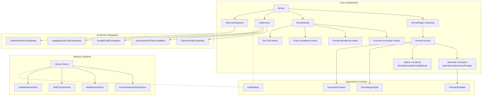

The diagram illustrates the major components of Semantic Kernel Java and their relationships. The Kernel is the central orchestrator that manages plugins (containing functions), hooks (for interception), and AI services. Functions can be either semantic (AI-powered) or native (code-based) and are executed with arguments and context.

Sources: [semantickernel-api/pom.xml:1-109](), [semantickernel-experimental/pom.xml:1-136](), [samples/semantickernel-concepts/semantickernel-syntax-examples/pom.xml:1-189]()

## Function Execution Flow

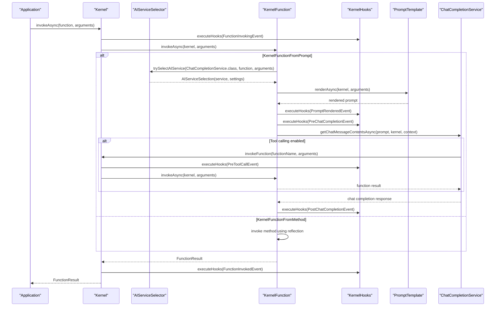

This sequence diagram shows the flow of execution when a function is invoked through the Kernel. It demonstrates the hook interception points, prompt rendering process for semantic functions, and illustrates the tool calling capability where AI services can call back into the application's functions.

Sources: [samples/semantickernel-concepts/semantickernel-syntax-examples/src/main/java/com/microsoft/semantickernel/samples/syntaxexamples/functions/Example01_NativeFunctions.java](), [samples/semantickernel-concepts/semantickernel-syntax-examples/src/main/java/com/microsoft/semantickernel/samples/syntaxexamples/plugin/Example10_DescribeAllPluginsAndFunctions.java:1-151]()

## Plugin System and Service Integration

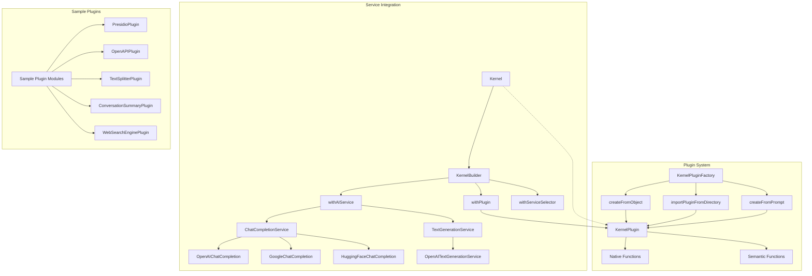

This diagram shows how plugins are created and integrated with the Kernel, as well as how AI services are configured. The plugin system allows for extensibility through different creation methods, while the builder pattern enables flexible configuration of AI services and plugins in the Kernel.

Sources: [samples/semantickernel-concepts/semantickernel-syntax-examples/src/main/java/com/microsoft/semantickernel/samples/syntaxexamples/plugin/Example07_BingAndGooglePlugins.java:1-232](), [samples/semantickernel-concepts/semantickernel-syntax-examples/src/main/java/com/microsoft/semantickernel/samples/syntaxexamples/plugin/Example13_ConversationSummaryPlugin.java:1-240]()

## Memory and Vector Storage

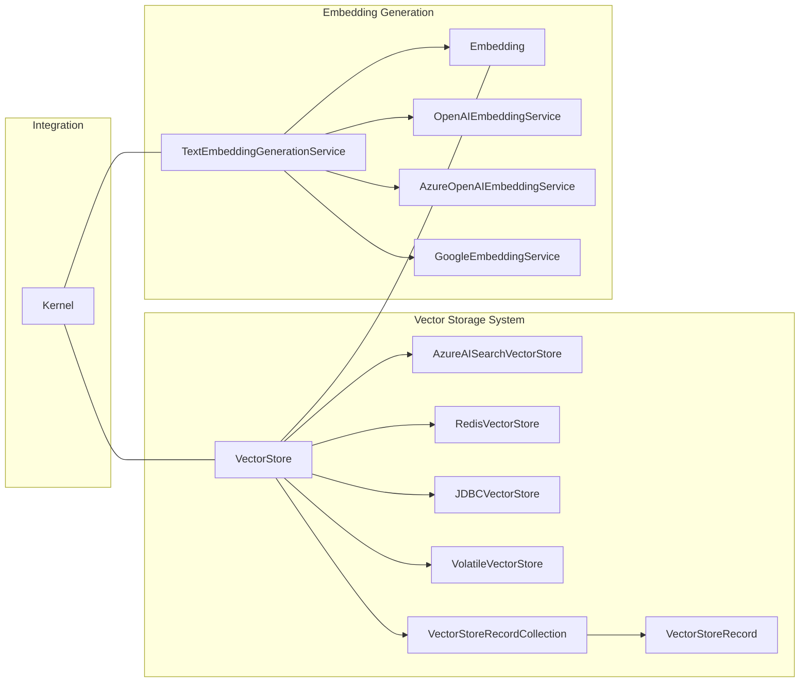

This diagram illustrates the memory and vector storage system, which is used for storing and retrieving embeddings. Various vector stores are available, including Azure AI Search, Redis, JDBC databases, and an in-memory volatile store. Embedding generation services are provided for different AI providers.

Sources: [semantickernel-bom/pom.xml:99-114](), [api-test/integration-tests/pom.xml:56-91]()

## Supported AI Service Providers

Semantic Kernel Java supports integration with multiple AI service providers:

| Provider | Service Types | Modules |
|----------|---------------|---------|
| OpenAI | Chat Completion, Text Generation, Embeddings | `semantickernel-aiservices-openai` |
| Azure OpenAI | Chat Completion, Text Generation, Embeddings | `aiservices-azureopenai` |
| Google | Chat Completion, Embeddings | `semantickernel-aiservices-google` |
| Hugging Face | Chat Completion | `semantickernel-aiservices-huggingface` |

Sources: [semantickernel-bom/pom.xml:79-98](), [semantickernel-bom/pom.xml:211-215]()

## Project Structure

The Semantic Kernel Java project is organized into several modules:

| Module | Description |
|--------|-------------|
| `semantickernel-api` | Core API and interfaces |
| `semantickernel-experimental` | Experimental features |
| `aiservices/openai` | OpenAI service integration |
| `aiservices/google` | Google AI service integration |
| `aiservices/huggingface` | HuggingFace service integration |
| `data/semantickernel-data-azureaisearch` | Azure AI Search vector store |
| `data/semantickernel-data-jdbc` | JDBC-based vector store |
| `data/semantickernel-data-redis` | Redis vector store |
| `samples` | Example code and demonstrations |

Sources: [pom.xml:70-80](), [samples/semantickernel-concepts/semantickernel-syntax-examples/pom.xml:1-189]()

## Getting Started

The quickest way to start using Semantic Kernel Java is to add the appropriate dependencies to your Maven or Gradle project. The core dependency is `semantickernel-api`, which provides the fundamental interfaces and classes. Additional dependencies can be added based on the AI services and vector stores you plan to use.

For detailed documentation and examples, visit the [Microsoft Learn Semantic Kernel documentation](https://learn.microsoft.com/en-us/semantic-kernel/overview/?tabs=Java&pivots=programming-language-java).

Sources: [README.md:20-26](), [README.md:27-39]()

## Example Usage

Here's a simple example of how to set up the Kernel with an OpenAI service and invoke a function:

1. Create an AI service
2. Build a Kernel with the service
3. Create and register functions
4. Invoke functions with arguments

Numerous examples can be found in the samples directory, particularly in the `semantickernel-syntax-examples` module.

Sources: [samples/semantickernel-concepts/semantickernel-syntax-examples/src/main/java/com/microsoft/semantickernel/samples/syntaxexamples/RunAll.java:39-95](), [api-test/integration-tests/src/test/java/com/microsoft/semantickernel/tests/WiremockExamplesIT.java:46-79]()

---

# Page: Core Architecture

# Core Architecture

<details>
<summary>Relevant source files</summary>

The following files were used as context for generating this wiki page:

- [CHANGELOG.md](CHANGELOG.md)
- [aiservices/openai/src/main/java/com/microsoft/semantickernel/aiservices/openai/chatcompletion/OpenAIFunction.java](aiservices/openai/src/main/java/com/microsoft/semantickernel/aiservices/openai/chatcompletion/OpenAIFunction.java)
- [aiservices/openai/src/test/java/com/microsoft/semantickernel/aiservices/openai/chatcompletion/JsonSchemaTest.java](aiservices/openai/src/test/java/com/microsoft/semantickernel/aiservices/openai/chatcompletion/JsonSchemaTest.java)
- [api-test/integration-tests/src/test/java/com/microsoft/semantickernel/tests/ImportingMultiplePluginsTest.java](api-test/integration-tests/src/test/java/com/microsoft/semantickernel/tests/ImportingMultiplePluginsTest.java)
- [api-test/integration-tests/src/test/java/com/microsoft/semantickernel/tests/ResponseSchemaTest.java](api-test/integration-tests/src/test/java/com/microsoft/semantickernel/tests/ResponseSchemaTest.java)
- [samples/semantickernel-concepts/semantickernel-syntax-examples/src/main/java/com/microsoft/semantickernel/samples/demos/lights/App.java](samples/semantickernel-concepts/semantickernel-syntax-examples/src/main/java/com/microsoft/semantickernel/samples/demos/lights/App.java)
- [samples/semantickernel-concepts/semantickernel-syntax-examples/src/main/java/com/microsoft/semantickernel/samples/demos/lights/LightModel.java](samples/semantickernel-concepts/semantickernel-syntax-examples/src/main/java/com/microsoft/semantickernel/samples/demos/lights/LightModel.java)
- [samples/semantickernel-concepts/semantickernel-syntax-examples/src/main/java/com/microsoft/semantickernel/samples/demos/lights/LightModelTypeConverter.java](samples/semantickernel-concepts/semantickernel-syntax-examples/src/main/java/com/microsoft/semantickernel/samples/demos/lights/LightModelTypeConverter.java)
- [samples/semantickernel-concepts/semantickernel-syntax-examples/src/main/java/com/microsoft/semantickernel/samples/demos/lights/LightsPlugin.java](samples/semantickernel-concepts/semantickernel-syntax-examples/src/main/java/com/microsoft/semantickernel/samples/demos/lights/LightsPlugin.java)
- [samples/semantickernel-concepts/semantickernel-syntax-examples/src/main/java/com/microsoft/semantickernel/samples/syntaxexamples/Example61_MultipleLLMs.java](samples/semantickernel-concepts/semantickernel-syntax-examples/src/main/java/com/microsoft/semantickernel/samples/syntaxexamples/Example61_MultipleLLMs.java)
- [semantickernel-api/src/main/java/com/microsoft/semantickernel/Kernel.java](semantickernel-api/src/main/java/com/microsoft/semantickernel/Kernel.java)
- [semantickernel-api/src/main/java/com/microsoft/semantickernel/contextvariables/converters/StringVariableContextVariableTypeConverter.java](semantickernel-api/src/main/java/com/microsoft/semantickernel/contextvariables/converters/StringVariableContextVariableTypeConverter.java)
- [semantickernel-api/src/main/java/com/microsoft/semantickernel/hooks/KernelHook.java](semantickernel-api/src/main/java/com/microsoft/semantickernel/hooks/KernelHook.java)
- [semantickernel-api/src/main/java/com/microsoft/semantickernel/hooks/KernelHooks.java](semantickernel-api/src/main/java/com/microsoft/semantickernel/hooks/KernelHooks.java)
- [semantickernel-api/src/main/java/com/microsoft/semantickernel/semanticfunctions/KernelArguments.java](semantickernel-api/src/main/java/com/microsoft/semantickernel/semanticfunctions/KernelArguments.java)
- [semantickernel-api/src/main/java/com/microsoft/semantickernel/semanticfunctions/KernelFunctionFromPrompt.java](semantickernel-api/src/main/java/com/microsoft/semantickernel/semanticfunctions/KernelFunctionFromPrompt.java)
- [semantickernel-api/src/main/java/com/microsoft/semantickernel/services/AIServiceSelector.java](semantickernel-api/src/main/java/com/microsoft/semantickernel/services/AIServiceSelector.java)
- [semantickernel-api/src/main/java/com/microsoft/semantickernel/services/BaseAIServiceSelector.java](semantickernel-api/src/main/java/com/microsoft/semantickernel/services/BaseAIServiceSelector.java)
- [semantickernel-api/src/main/java/com/microsoft/semantickernel/services/OrderedAIServiceSelector.java](semantickernel-api/src/main/java/com/microsoft/semantickernel/services/OrderedAIServiceSelector.java)
- [semantickernel-api/src/test/java/com/microsoft/semantickernel/contextvariables/converters/ContextVariableTypeConverterTest.java](semantickernel-api/src/test/java/com/microsoft/semantickernel/contextvariables/converters/ContextVariableTypeConverterTest.java)

</details>


This page describes the core architecture of the Semantic Kernel Java framework, explaining its fundamental components and how they interact to enable AI-powered applications. It provides a technical overview of the central systems that power the framework's capabilities for working with large language models (LLMs).

For details about specific components like the Kernel itself, see [Kernel](#2.1), or for functions and plugins, see [Functions and Plugins](#2.2).

## Core Components Overview

The Semantic Kernel Java architecture is built around several key components that work together to provide a cohesive framework:

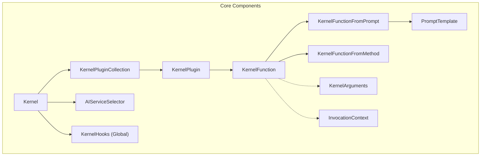

Sources:
- [semantickernel-api/src/main/java/com/microsoft/semantickernel/Kernel.java]()
- [semantickernel-api/src/main/java/com/microsoft/semantickernel/semanticfunctions/KernelFunctionFromPrompt.java]()

The architecture centers around the `Kernel` class, which serves as the orchestration layer connecting all other components:

- **Kernel**: The central component that manages plugins, provides access to AI services, and facilitates function execution
- **KernelPluginCollection**: Contains plugins registered with the kernel
- **AIServiceSelector**: Determines which AI service to use for function execution
- **KernelFunction**: The base class for all functions (both semantic and native)
- **KernelArguments**: Carries parameters between functions and services
- **InvocationContext**: Provides additional context for function execution

## Function Execution Flow

The execution flow in Semantic Kernel shows how components interact when a function is invoked:


Sources:
- [semantickernel-api/src/main/java/com/microsoft/semantickernel/semanticfunctions/KernelFunctionFromPrompt.java:98-298]()
- [semantickernel-api/src/main/java/com/microsoft/semantickernel/Kernel.java:128-226]()

This sequence diagram illustrates how:

1. The application invokes a function through the Kernel
2. The Kernel handles the invocation through hooks and the function itself
3. For semantic functions, the system:
   - Selects an appropriate AI service
   - Renders the prompt template
   - Sends the prompt to the AI service
   - Processes the response, including any tool calls
4. For native functions, the system invokes the method directly using reflection
5. The result flows back to the application through the Kernel

## Service Selection System

The service selection system determines which AI service to use for a given operation:

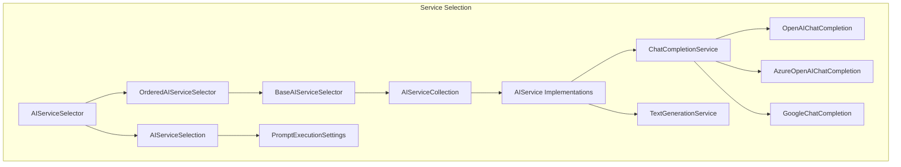

Sources:
- [semantickernel-api/src/main/java/com/microsoft/semantickernel/services/AIServiceSelector.java]()
- [semantickernel-api/src/main/java/com/microsoft/semantickernel/services/OrderedAIServiceSelector.java]()
- [semantickernel-api/src/main/java/com/microsoft/semantickernel/services/BaseAIServiceSelector.java]()

The service selection process in `OrderedAIServiceSelector` works by:

1. Looking for a service with the specific service ID in execution settings
2. Looking for a service that supports the specified model ID
3. Falling back to the default service ID
4. Returning any available service of the required type

This system allows applications to configure exactly which AI service should handle specific operations.

## Hook System

The hook system provides interception points throughout the function execution pipeline:

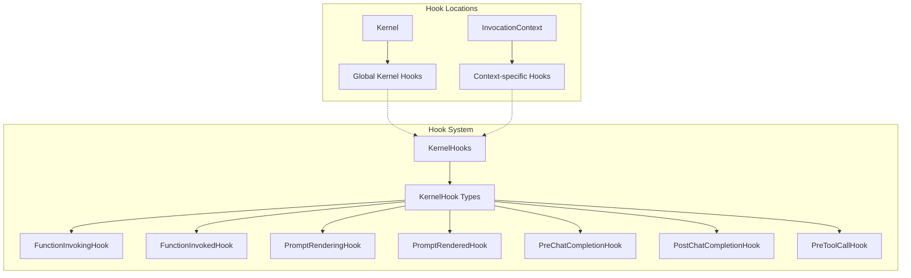

Sources:
- [semantickernel-api/src/main/java/com/microsoft/semantickernel/hooks/KernelHook.java]()
- [semantickernel-api/src/main/java/com/microsoft/semantickernel/hooks/KernelHooks.java:22-318]()

The hook system enables:

1. Monitoring and logging function execution
2. Modifying prompts before they are sent to AI services
3. Preprocessing and postprocessing of arguments and results
4. Intercepting tool calls from AI services

Hooks can be registered at two levels:
- Globally on the Kernel (affecting all function executions)
- On specific invocation contexts (affecting only that invocation)

```java
// Example of adding hooks to the kernel
KernelHooks hooks = new KernelHooks();
hooks.addPreChatCompletionHook(event -> {
    System.out.println("Pre-chat completion hook");
    return event;
});
kernel.getGlobalKernelHooks().addHooks(hooks);
```

## Arguments and Context

Two key structures carry data through the execution pipeline:

1. **KernelArguments**: Contains named parameters for function execution:

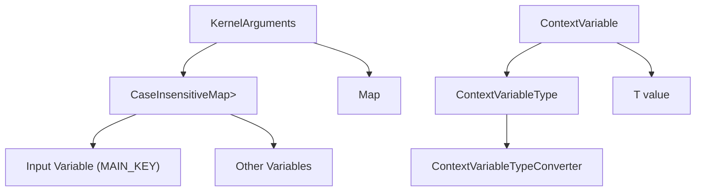

Sources:
- [semantickernel-api/src/main/java/com/microsoft/semantickernel/semanticfunctions/KernelArguments.java:29-425]()

2. **InvocationContext**: Provides additional execution context:
   - Type converters
   - Tool call behavior settings
   - Response formats
   - Context-specific hooks

## Tool Calling

Semantic Kernel supports tool calling, allowing AI models to invoke functions in your application:

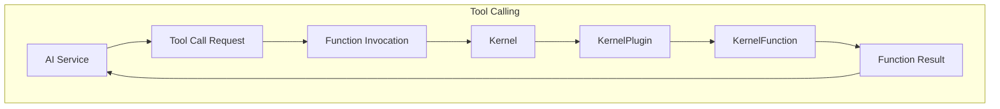

Sources:
- [semantickernel-api/src/main/java/com/microsoft/semantickernel/semanticfunctions/KernelFunctionFromPrompt.java:159-174]()
- [aiservices/openai/src/main/java/com/microsoft/semantickernel/aiservices/openai/chatcompletion/OpenAIFunction.java:27-246]()

Tool calling works by:

1. Translating Java methods into AI tool definitions
2. Intercepting tool call requests from the AI
3. Invoking the requested function through the Kernel
4. Returning the result back to the AI

This enables powerful scenarios where the AI can:
- Query databases
- Control external systems
- Perform calculations
- Interact with APIs

For example, in the LightsPlugin sample, the AI can control virtual lights:

```java
@DefineKernelFunction(name = "change_state", description = "Changes the state of the light")
public LightModel changeState(
    @KernelFunctionParameter(name = "id", description = "The ID of the light to change", type = int.class) int id,
    @KernelFunctionParameter(name = "isOn", description = "The new state of the light", type = boolean.class) boolean isOn) {
    // Implementation
}
```

The function is exposed to the AI with its parameters and their types properly documented through JSON Schema.

Sources:
- [samples/semantickernel-concepts/semantickernel-syntax-examples/src/main/java/com/microsoft/semantickernel/samples/demos/lights/LightsPlugin.java:10-54]()
- [samples/semantickernel-concepts/semantickernel-syntax-examples/src/main/java/com/microsoft/semantickernel/samples/demos/lights/App.java:58-67]()

## JSON Schema Support

Semantic Kernel integrates with JSON Schema to provide structured type information:

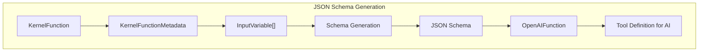

Sources:
- [aiservices/openai/src/main/java/com/microsoft/semantickernel/aiservices/openai/chatcompletion/OpenAIFunction.java:87-119]()
- [aiservices/openai/src/test/java/com/microsoft/semantickernel/aiservices/openai/chatcompletion/JsonSchemaTest.java:19-114]()

The JSON Schema support enables:

1. Strongly-typed function parameters for tool calling
2. Structured response formats from AI services
3. Automatic conversion between JSON and Java objects

Jackson annotations can be used to provide additional schema information:

```java
public class LightModel {
    @JsonPropertyDescription("The unique identifier of the light")
    private int id;

    @JsonPropertyDescription("The name of the light")
    private String name;

    @JsonPropertyDescription("The state of the light")
    private Boolean isOn;
    
    // Getters and setters
}
```

Sources:
- [samples/semantickernel-concepts/semantickernel-syntax-examples/src/main/java/com/microsoft/semantickernel/samples/demos/lights/LightModel.java:1-46]()
- [api-test/integration-tests/src/test/java/com/microsoft/semantickernel/tests/ResponseSchemaTest.java:37-310]()

## Conclusion

The Core Architecture of Semantic Kernel Java provides a flexible and extensible framework for building AI-powered applications. The components work together to:

1. Execute functions (both semantic and native)
2. Integrate with various AI services
3. Allow for extensibility through plugins
4. Provide interception points through hooks
5. Enable structured data exchange through JSON Schema

Understanding these core components provides the foundation for building sophisticated AI applications with the Semantic Kernel Java framework.

---

# Page: Kernel

# Kernel

<details>
<summary>Relevant source files</summary>

The following files were used as context for generating this wiki page:

- [CHANGELOG.md](CHANGELOG.md)
- [aiservices/openai/src/main/java/com/microsoft/semantickernel/aiservices/openai/chatcompletion/OpenAIFunction.java](aiservices/openai/src/main/java/com/microsoft/semantickernel/aiservices/openai/chatcompletion/OpenAIFunction.java)
- [aiservices/openai/src/test/java/com/microsoft/semantickernel/aiservices/openai/chatcompletion/JsonSchemaTest.java](aiservices/openai/src/test/java/com/microsoft/semantickernel/aiservices/openai/chatcompletion/JsonSchemaTest.java)
- [api-test/integration-tests/src/test/java/com/microsoft/semantickernel/tests/ImportingMultiplePluginsTest.java](api-test/integration-tests/src/test/java/com/microsoft/semantickernel/tests/ImportingMultiplePluginsTest.java)
- [api-test/integration-tests/src/test/java/com/microsoft/semantickernel/tests/ResponseSchemaTest.java](api-test/integration-tests/src/test/java/com/microsoft/semantickernel/tests/ResponseSchemaTest.java)
- [samples/semantickernel-concepts/semantickernel-syntax-examples/src/main/java/com/microsoft/semantickernel/samples/demos/lights/App.java](samples/semantickernel-concepts/semantickernel-syntax-examples/src/main/java/com/microsoft/semantickernel/samples/demos/lights/App.java)
- [samples/semantickernel-concepts/semantickernel-syntax-examples/src/main/java/com/microsoft/semantickernel/samples/demos/lights/LightModel.java](samples/semantickernel-concepts/semantickernel-syntax-examples/src/main/java/com/microsoft/semantickernel/samples/demos/lights/LightModel.java)
- [samples/semantickernel-concepts/semantickernel-syntax-examples/src/main/java/com/microsoft/semantickernel/samples/demos/lights/LightModelTypeConverter.java](samples/semantickernel-concepts/semantickernel-syntax-examples/src/main/java/com/microsoft/semantickernel/samples/demos/lights/LightModelTypeConverter.java)
- [samples/semantickernel-concepts/semantickernel-syntax-examples/src/main/java/com/microsoft/semantickernel/samples/demos/lights/LightsPlugin.java](samples/semantickernel-concepts/semantickernel-syntax-examples/src/main/java/com/microsoft/semantickernel/samples/demos/lights/LightsPlugin.java)
- [samples/semantickernel-concepts/semantickernel-syntax-examples/src/main/java/com/microsoft/semantickernel/samples/syntaxexamples/Example61_MultipleLLMs.java](samples/semantickernel-concepts/semantickernel-syntax-examples/src/main/java/com/microsoft/semantickernel/samples/syntaxexamples/Example61_MultipleLLMs.java)
- [semantickernel-api/src/main/java/com/microsoft/semantickernel/Kernel.java](semantickernel-api/src/main/java/com/microsoft/semantickernel/Kernel.java)
- [semantickernel-api/src/main/java/com/microsoft/semantickernel/contextvariables/converters/StringVariableContextVariableTypeConverter.java](semantickernel-api/src/main/java/com/microsoft/semantickernel/contextvariables/converters/StringVariableContextVariableTypeConverter.java)
- [semantickernel-api/src/main/java/com/microsoft/semantickernel/hooks/KernelHook.java](semantickernel-api/src/main/java/com/microsoft/semantickernel/hooks/KernelHook.java)
- [semantickernel-api/src/main/java/com/microsoft/semantickernel/hooks/KernelHooks.java](semantickernel-api/src/main/java/com/microsoft/semantickernel/hooks/KernelHooks.java)
- [semantickernel-api/src/main/java/com/microsoft/semantickernel/semanticfunctions/KernelArguments.java](semantickernel-api/src/main/java/com/microsoft/semantickernel/semanticfunctions/KernelArguments.java)
- [semantickernel-api/src/main/java/com/microsoft/semantickernel/semanticfunctions/KernelFunctionFromPrompt.java](semantickernel-api/src/main/java/com/microsoft/semantickernel/semanticfunctions/KernelFunctionFromPrompt.java)
- [semantickernel-api/src/main/java/com/microsoft/semantickernel/services/AIServiceSelector.java](semantickernel-api/src/main/java/com/microsoft/semantickernel/services/AIServiceSelector.java)
- [semantickernel-api/src/main/java/com/microsoft/semantickernel/services/BaseAIServiceSelector.java](semantickernel-api/src/main/java/com/microsoft/semantickernel/services/BaseAIServiceSelector.java)
- [semantickernel-api/src/main/java/com/microsoft/semantickernel/services/OrderedAIServiceSelector.java](semantickernel-api/src/main/java/com/microsoft/semantickernel/services/OrderedAIServiceSelector.java)
- [semantickernel-api/src/test/java/com/microsoft/semantickernel/contextvariables/converters/ContextVariableTypeConverterTest.java](semantickernel-api/src/test/java/com/microsoft/semantickernel/contextvariables/converters/ContextVariableTypeConverterTest.java)

</details>


## Purpose and Scope

The Kernel is the central component of the Semantic Kernel Java framework. It orchestrates the interaction between functions, plugins, AI services, and hooks, providing a unified API for working with large language models (LLMs). The Kernel manages state throughout the execution of semantic kernel workloads and serves as the primary entry point for applications using the framework.

For information about the functions that can be executed by the Kernel, see [Functions and Plugins](#2.2). For details about the hook system used for modifying the execution flow, see [Hook System](#2.3).

## Kernel Architecture

The Kernel serves as a coordinating container for several key subsystems:

1. **Plugin Collection**: Manages a collection of plugins containing functions (both native and semantic)
2. **AI Services**: Provides access to language models and other AI services
3. **Service Selector**: Determines which AI service to use for a specific request
4. **Global Hooks**: System-wide hooks for intercepting and modifying operations

### Kernel Component Structure

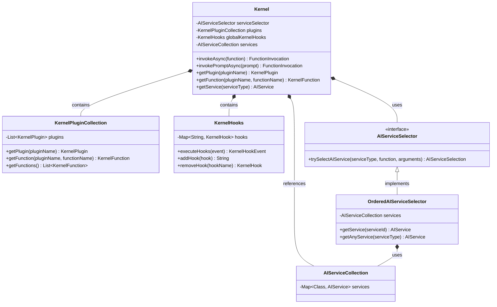

Sources: [semantickernel-api/src/main/java/com/microsoft/semantickernel/Kernel.java:34-419](). [semantickernel-api/src/main/java/com/microsoft/semantickernel/services/OrderedAIServiceSelector.java:25-246]()

## Creating and Configuring a Kernel

The Kernel is created using a builder pattern, providing a fluent API for configuration. This approach allows for flexible setup of AI services, plugins, and service selectors.

### Kernel Builder Pattern

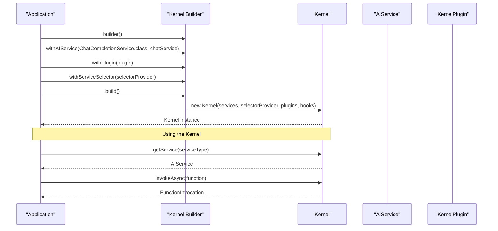

Basic example of creating a Kernel with an OpenAI service and a plugin:

```java
// Create your AI service client
ChatCompletionService chatService = OpenAIChatCompletion.builder()
    .withModelId("gpt-4o")
    .withOpenAIAsyncClient(client)
    .build();

// Create a plugin
KernelPlugin lightPlugin = KernelPluginFactory.createFromObject(new LightsPlugin(), "LightsPlugin");

// Create a kernel with OpenAI chat completion and plugin
Kernel kernel = Kernel.builder()
    .withAIService(ChatCompletionService.class, chatService)
    .withPlugin(lightPlugin)
    .build();
```

Sources: [semantickernel-api/src/main/java/com/microsoft/semantickernel/Kernel.java:346-417](). [samples/semantickernel-concepts/semantickernel-syntax-examples/src/main/java/com/microsoft/semantickernel/samples/demos/lights/App.java:54-67]()

## Function Execution

The Kernel provides several methods for invoking functions and prompt templates:

1. **invokeAsync**: Asynchronously invokes a function and returns a `FunctionInvocation` for further configuration
2. **invoke**: Synchronously invokes a function and returns the result directly
3. **invokePromptAsync**: Creates and invokes a function from a prompt string

The Kernel handles the complete execution flow including:
- Executing relevant hooks
- Selecting an appropriate AI service
- Passing arguments and context to the function
- Processing the function result

### Function Execution Flow

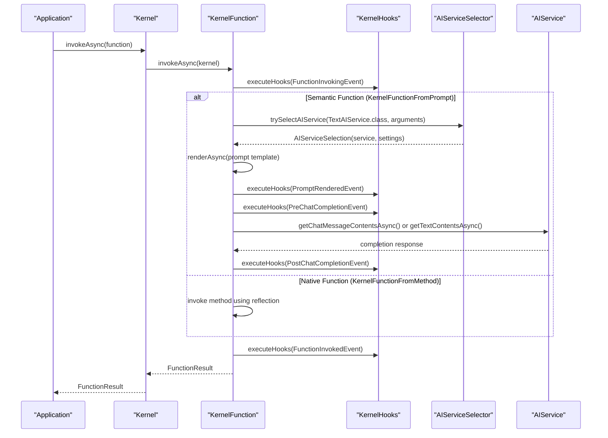

Examples of invoking functions:

```java
// Invoke a function by plugin and function name
FunctionResult<String> result = kernel.invoke("MyPlugin", "MyFunction");

// Get a function reference and invoke it
KernelFunction<String> function = kernel.getFunction("MyPlugin", "MyFunction");
FunctionResult<String> result = kernel.invoke(function);

// Invoke a prompt directly
FunctionResult<String> result = kernel.invokePromptAsync("Generate a story about dragons")
    .withResultType(String.class)
    .block();
```

Sources: [semantickernel-api/src/main/java/com/microsoft/semantickernel/Kernel.java:127-226](). [semantickernel-api/src/main/java/com/microsoft/semantickernel/semanticfunctions/KernelFunctionFromPrompt.java:99-274]()

## AI Service Selection

The Kernel uses the `AIServiceSelector` to determine which AI service to use for a given request. The default implementation is `OrderedAIServiceSelector`, which selects services based on a prioritized decision process:

1. Service ID in execution settings
2. Model ID in execution settings
3. Default service ID (using the `DEFAULT_SERVICE_ID` constant)
4. Any available service of the requested type

### AI Service Selection Process

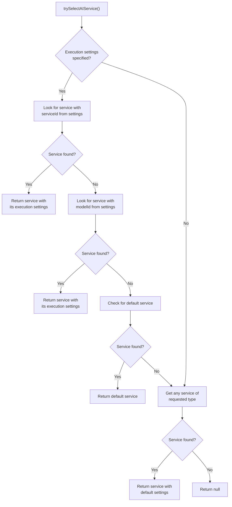

Sources: [semantickernel-api/src/main/java/com/microsoft/semantickernel/services/OrderedAIServiceSelector.java:62-160](). [semantickernel-api/src/main/java/com/microsoft/semantickernel/services/AIServiceSelector.java:13-55]()

## Working with Multiple AI Services

The Kernel can manage multiple AI services and select the appropriate one based on execution settings. This allows for using different models for different tasks or implementing fallback strategies.

### Multiple AI Services Configuration

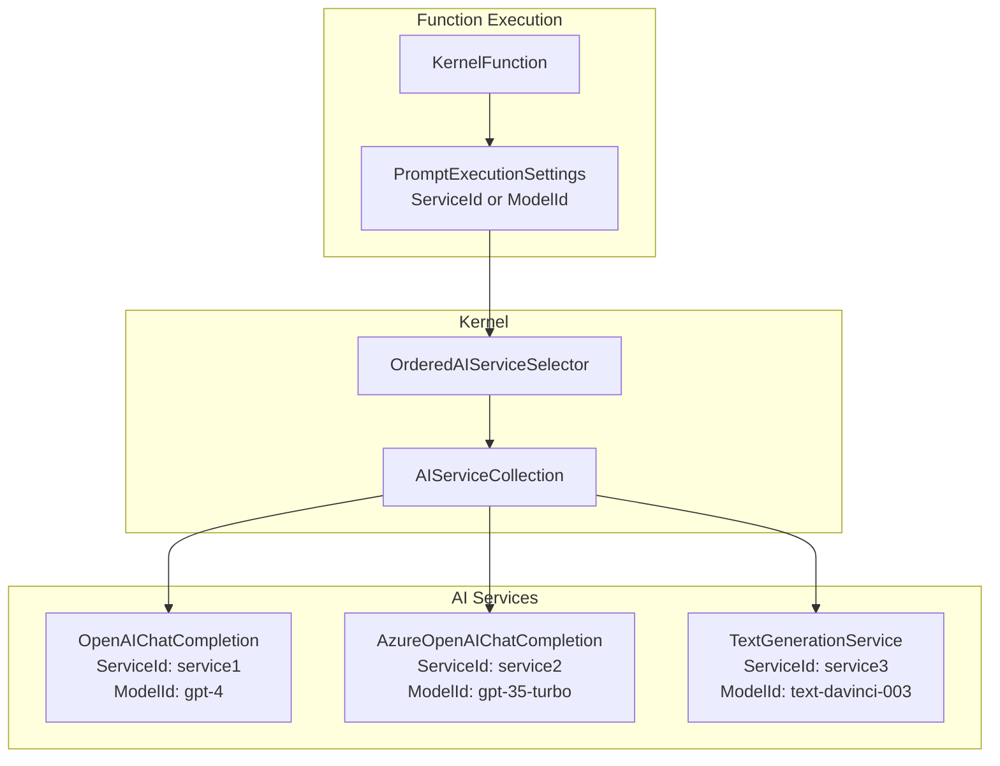

Example of configuring and using multiple AI services:

```java
// Create different AI services
var openAIChatCompletion = OpenAIChatCompletion.builder()
    .withOpenAIAsyncClient(client)
    .withServiceId("AzureOpenAIChat")
    .withModelId("gpt-35-turbo")
    .build();

var textGenerationService = TextGenerationService.builder()
    .withOpenAIAsyncClient(client)
    .withServiceId("AzureOpenAIText")
    .withModelId("text-davinci-003")
    .build();

// Create a kernel with multiple services
var kernel = Kernel.builder()
    .withAIService(ChatCompletionService.class, openAIChatCompletion)
    .withAIService(TextGenerationService.class, textGenerationService)
    .build();

// Create a function using a specific service ID
KernelFunction<?> func = KernelFunctionFromPrompt.builder()
    .withTemplate("Hello AI, what can you do for me?")
    .withDefaultExecutionSettings(
        PromptExecutionSettings.builder()
            .withServiceId("AzureOpenAIChat")
            .build())
    .build();

// Invoke the function
var result = kernel.invokeAsync(func).block();
```

Sources: [samples/semantickernel-concepts/semantickernel-syntax-examples/src/main/java/com/microsoft/semantickernel/samples/syntaxexamples/Example61_MultipleLLMs.java:46-143]()

## Using Plugins with Kernel

The Kernel manages plugins, which are collections of functions. The Kernel provides methods to access plugins and their functions:

- `getPlugin(pluginName)`: Gets a plugin by name
- `getPlugins()`: Gets all plugins
- `getFunction(pluginName, functionName)`: Gets a specific function
- `getFunctions()`: Gets all functions from all plugins

### Plugin Registration

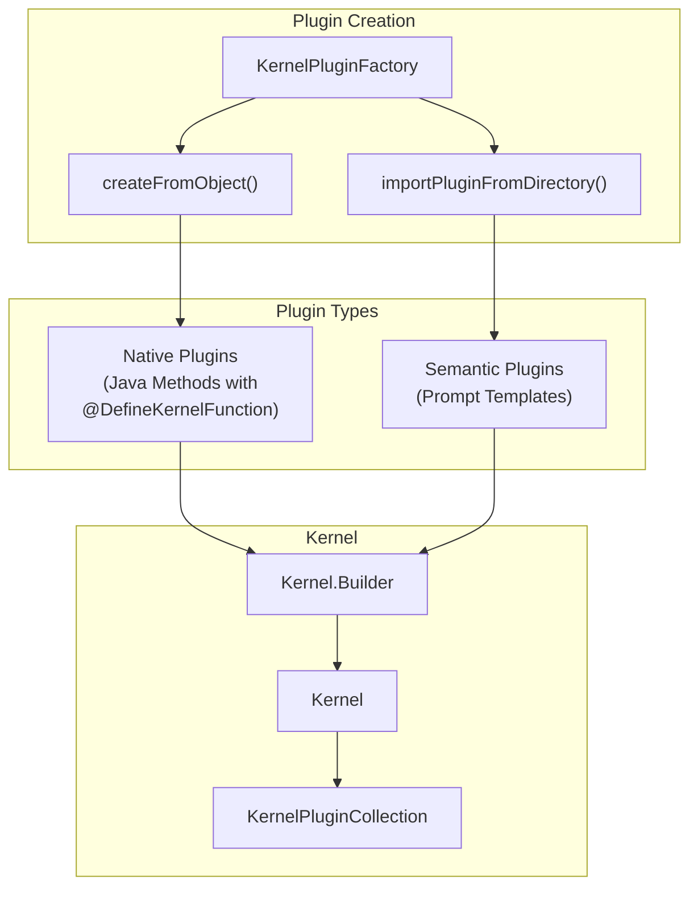

Example of creating and using a plugin:

```java
// Define a plugin class with annotated methods
public class LightsPlugin {
    @DefineKernelFunction(name = "get_lights", description = "Gets a list of lights")
    public List<LightModel> getLights() {
        System.out.println("Getting lights");
        return lights;
    }
    
    @DefineKernelFunction(name = "change_state", description = "Changes light state")
    public LightModel changeState(
        @KernelFunctionParameter(name = "id", description = "Light ID", type = int.class) int id,
        @KernelFunctionParameter(name = "isOn", description = "State", type = boolean.class) boolean isOn) {
        // Implementation...
    }
}

// Create a plugin from the class
KernelPlugin lightPlugin = KernelPluginFactory.createFromObject(
    new LightsPlugin(), "LightsPlugin");

// Add the plugin to the kernel
Kernel kernel = Kernel.builder()
    .withPlugin(lightPlugin)
    .build();

// Use the plugin function
FunctionResult<List<LightModel>> result = kernel.invoke("LightsPlugin", "get_lights");
```

Sources: [samples/semantickernel-concepts/semantickernel-syntax-examples/src/main/java/com/microsoft/semantickernel/samples/demos/lights/LightsPlugin.java:10-53](). [samples/semantickernel-concepts/semantickernel-syntax-examples/src/main/java/com/microsoft/semantickernel/samples/demos/lights/App.java:59-66]()

## Function Arguments and Context

When invoking functions through the Kernel, arguments can be passed using the `KernelArguments` class. This class manages:

- Input variables for functions (with "input" as the default key)
- Execution settings for AI services
- Type conversion for various argument types

### KernelArguments Structure

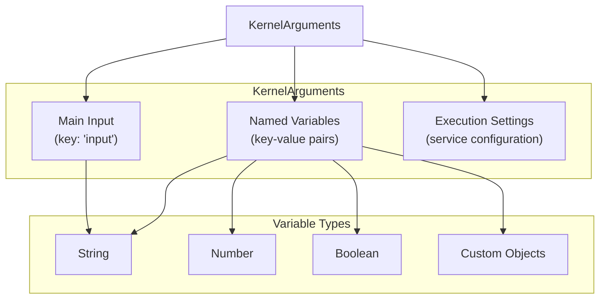

Example of using `KernelArguments`:

```java
// Create arguments for a function
KernelArguments args = KernelArguments.builder()
    // Set the main input
    .withInput("Main content goes here")
    // Add named variables
    .withVariable("temperature", 0.7)
    .withVariable("maxTokens", 1000)
    .withVariable("light", new LightModel(1, "Table Lamp", false))
    // Add execution settings
    .withExecutionSettings(
        PromptExecutionSettings.builder()
            .withModelId("gpt-4")
            .build())
    .build();

// Invoke a function with arguments
FunctionResult<String> result = kernel.invokeAsync("MyPlugin", "MyFunction")
    .withArguments(args)
    .withResultType(String.class)
    .block();
```

Sources: [semantickernel-api/src/main/java/com/microsoft/semantickernel/semanticfunctions/KernelArguments.java:29-425]()

## Global Hooks

The Kernel contains a global hooks system that allows for interception and modification of the execution flow. Global hooks are applied to all function invocations processed by the Kernel.

See [Hook System](#2.3) for more details on the types of hooks and how to use them.

Example of adding global hooks to a Kernel:

```java
// Create a hook collection
KernelHooks hooks = new KernelHooks();

// Add a pre-tool call hook
hooks.addPreToolCallHook((context) -> {
    System.out.println("Pre-tool call hook");
    return context;
});

// Add a pre-chat completion hook
hooks.addPreChatCompletionHook((context) -> {
    System.out.println("Pre-chat completion hook");
    return context;
});

// Add hooks to the kernel's global hooks
kernel.getGlobalKernelHooks().addHooks(hooks);
```

Sources: [semantickernel-api/src/main/java/com/microsoft/semantickernel/hooks/KernelHooks.java:22-318](). [samples/semantickernel-concepts/semantickernel-syntax-examples/src/main/java/com/microsoft/semantickernel/samples/demos/lights/App.java:75-94]()

---

# Page: Functions and Plugins

# Functions and Plugins

<details>
<summary>Relevant source files</summary>

The following files were used as context for generating this wiki page:

- [CHANGELOG.md](CHANGELOG.md)
- [README.md](README.md)
- [aiservices/openai/src/main/java/com/microsoft/semantickernel/aiservices/openai/chatcompletion/OpenAIChatCompletion.java](aiservices/openai/src/main/java/com/microsoft/semantickernel/aiservices/openai/chatcompletion/OpenAIChatCompletion.java)
- [aiservices/openai/src/main/java/com/microsoft/semantickernel/aiservices/openai/chatcompletion/OpenAIFunction.java](aiservices/openai/src/main/java/com/microsoft/semantickernel/aiservices/openai/chatcompletion/OpenAIFunction.java)
- [aiservices/openai/src/main/java/com/microsoft/semantickernel/aiservices/openai/textcompletion/OpenAITextGenerationService.java](aiservices/openai/src/main/java/com/microsoft/semantickernel/aiservices/openai/textcompletion/OpenAITextGenerationService.java)
- [aiservices/openai/src/test/java/com/microsoft/semantickernel/aiservices/openai/OtelCaptureTest.java](aiservices/openai/src/test/java/com/microsoft/semantickernel/aiservices/openai/OtelCaptureTest.java)
- [aiservices/openai/src/test/java/com/microsoft/semantickernel/aiservices/openai/chatcompletion/JsonSchemaTest.java](aiservices/openai/src/test/java/com/microsoft/semantickernel/aiservices/openai/chatcompletion/JsonSchemaTest.java)
- [api-test/integration-tests/src/test/java/com/microsoft/semantickernel/tests/WiremockExamplesIT.java](api-test/integration-tests/src/test/java/com/microsoft/semantickernel/tests/WiremockExamplesIT.java)
- [samples/semantickernel-concepts/semantickernel-syntax-examples/src/main/java/com/microsoft/semantickernel/samples/demos/lights/App.java](samples/semantickernel-concepts/semantickernel-syntax-examples/src/main/java/com/microsoft/semantickernel/samples/demos/lights/App.java)
- [samples/semantickernel-concepts/semantickernel-syntax-examples/src/main/java/com/microsoft/semantickernel/samples/demos/lights/LightModel.java](samples/semantickernel-concepts/semantickernel-syntax-examples/src/main/java/com/microsoft/semantickernel/samples/demos/lights/LightModel.java)
- [samples/semantickernel-concepts/semantickernel-syntax-examples/src/main/java/com/microsoft/semantickernel/samples/demos/lights/LightModelTypeConverter.java](samples/semantickernel-concepts/semantickernel-syntax-examples/src/main/java/com/microsoft/semantickernel/samples/demos/lights/LightModelTypeConverter.java)
- [samples/semantickernel-concepts/semantickernel-syntax-examples/src/main/java/com/microsoft/semantickernel/samples/demos/lights/LightsPlugin.java](samples/semantickernel-concepts/semantickernel-syntax-examples/src/main/java/com/microsoft/semantickernel/samples/demos/lights/LightsPlugin.java)
- [samples/semantickernel-concepts/semantickernel-syntax-examples/src/main/java/com/microsoft/semantickernel/samples/syntaxexamples/RunAll.java](samples/semantickernel-concepts/semantickernel-syntax-examples/src/main/java/com/microsoft/semantickernel/samples/syntaxexamples/RunAll.java)
- [samples/semantickernel-concepts/semantickernel-syntax-examples/src/main/java/com/microsoft/semantickernel/samples/syntaxexamples/java/CustomTypes_Example.java](samples/semantickernel-concepts/semantickernel-syntax-examples/src/main/java/com/microsoft/semantickernel/samples/syntaxexamples/java/CustomTypes_Example.java)
- [samples/semantickernel-concepts/semantickernel-syntax-examples/src/main/java/com/microsoft/semantickernel/samples/syntaxexamples/java/FunctionTelemetry_Example.java](samples/semantickernel-concepts/semantickernel-syntax-examples/src/main/java/com/microsoft/semantickernel/samples/syntaxexamples/java/FunctionTelemetry_Example.java)
- [samples/semantickernel-concepts/semantickernel-syntax-examples/src/main/java/com/microsoft/semantickernel/samples/syntaxexamples/java/KernelFunctionYaml_Example.java](samples/semantickernel-concepts/semantickernel-syntax-examples/src/main/java/com/microsoft/semantickernel/samples/syntaxexamples/java/KernelFunctionYaml_Example.java)
- [samples/semantickernel-concepts/semantickernel-syntax-examples/src/main/java/com/microsoft/semantickernel/samples/syntaxexamples/plugin/Example07_BingAndGooglePlugins.java](samples/semantickernel-concepts/semantickernel-syntax-examples/src/main/java/com/microsoft/semantickernel/samples/syntaxexamples/plugin/Example07_BingAndGooglePlugins.java)
- [samples/semantickernel-concepts/semantickernel-syntax-examples/src/main/java/com/microsoft/semantickernel/samples/syntaxexamples/plugin/Example10_DescribeAllPluginsAndFunctions.java](samples/semantickernel-concepts/semantickernel-syntax-examples/src/main/java/com/microsoft/semantickernel/samples/syntaxexamples/plugin/Example10_DescribeAllPluginsAndFunctions.java)
- [samples/semantickernel-concepts/semantickernel-syntax-examples/src/main/java/com/microsoft/semantickernel/samples/syntaxexamples/plugin/Example13_ConversationSummaryPlugin.java](samples/semantickernel-concepts/semantickernel-syntax-examples/src/main/java/com/microsoft/semantickernel/samples/syntaxexamples/plugin/Example13_ConversationSummaryPlugin.java)
- [samples/semantickernel-concepts/semantickernel-syntax-examples/src/main/resources/com/microsoft/semantickernel/samples/syntaxexamples/java/applicationinsights.json](samples/semantickernel-concepts/semantickernel-syntax-examples/src/main/resources/com/microsoft/semantickernel/samples/syntaxexamples/java/applicationinsights.json)
- [semantickernel-api/src/main/java/com/microsoft/semantickernel/contextvariables/converters/StringVariableContextVariableTypeConverter.java](semantickernel-api/src/main/java/com/microsoft/semantickernel/contextvariables/converters/StringVariableContextVariableTypeConverter.java)
- [semantickernel-api/src/main/java/com/microsoft/semantickernel/hooks/KernelHook.java](semantickernel-api/src/main/java/com/microsoft/semantickernel/hooks/KernelHook.java)
- [semantickernel-api/src/main/java/com/microsoft/semantickernel/hooks/KernelHooks.java](semantickernel-api/src/main/java/com/microsoft/semantickernel/hooks/KernelHooks.java)
- [semantickernel-api/src/main/java/com/microsoft/semantickernel/implementation/telemetry/ChatCompletionSpan.java](semantickernel-api/src/main/java/com/microsoft/semantickernel/implementation/telemetry/ChatCompletionSpan.java)
- [semantickernel-api/src/main/java/com/microsoft/semantickernel/implementation/telemetry/FunctionSpan.java](semantickernel-api/src/main/java/com/microsoft/semantickernel/implementation/telemetry/FunctionSpan.java)
- [semantickernel-api/src/main/java/com/microsoft/semantickernel/implementation/telemetry/SemanticKernelTelemetry.java](semantickernel-api/src/main/java/com/microsoft/semantickernel/implementation/telemetry/SemanticKernelTelemetry.java)
- [semantickernel-api/src/main/java/com/microsoft/semantickernel/orchestration/FunctionInvocation.java](semantickernel-api/src/main/java/com/microsoft/semantickernel/orchestration/FunctionInvocation.java)
- [semantickernel-api/src/main/java/com/microsoft/semantickernel/semanticfunctions/KernelFunctionArguments.java](semantickernel-api/src/main/java/com/microsoft/semantickernel/semanticfunctions/KernelFunctionArguments.java)
- [semantickernel-api/src/main/java/com/microsoft/semantickernel/semanticfunctions/KernelFunctionFromMethod.java](semantickernel-api/src/main/java/com/microsoft/semantickernel/semanticfunctions/KernelFunctionFromMethod.java)
- [semantickernel-api/src/test/java/com/microsoft/semantickernel/contextvariables/converters/ContextVariableTypeConverterTest.java](semantickernel-api/src/test/java/com/microsoft/semantickernel/contextvariables/converters/ContextVariableTypeConverterTest.java)
- [semantickernel-api/src/test/java/com/microsoft/semantickernel/semanticfunctions/KernelFunctionFromMethodTest.java](semantickernel-api/src/test/java/com/microsoft/semantickernel/semanticfunctions/KernelFunctionFromMethodTest.java)

</details>


This page provides a comprehensive overview of Functions and Plugins in the Java implementation of Semantic Kernel. Functions are the building blocks of functionality in the SDK, while Plugins are containers that organize related functions together. This page explains both concepts, their types, how to create them, and how they work together to provide AI capabilities in your applications.

For information about the Kernel itself, see [Kernel](#2.1). For information about creating custom plugins, see [Creating Custom Plugins](#6.2).

## Functions Overview

Functions in Semantic Kernel are executable units that can be invoked by the Kernel. There are two main types of functions:

1. **Native Functions** - Java methods that are exposed to the Kernel through annotations
2. **Semantic Functions** - AI-powered functions that use prompts to generate responses from an AI model

Functions, regardless of type, can be organized into plugins for better organization and reusability.

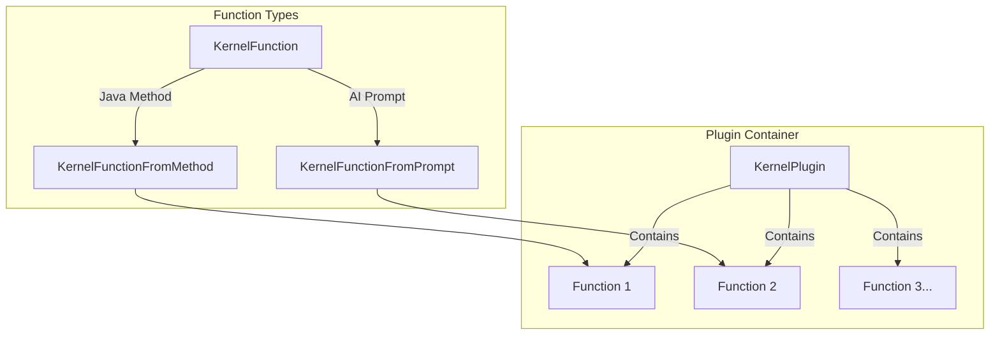

Sources:
- [semantickernel-api/src/main/java/com/microsoft/semantickernel/semanticfunctions/KernelFunctionFromMethod.java]()
- [aiservices/openai/src/main/java/com/microsoft/semantickernel/aiservices/openai/chatcompletion/OpenAIFunction.java]()

## Function Structure

All functions in Semantic Kernel share a common structure through the `KernelFunction<T>` abstract class. Each function has:

1. **Metadata** - Information about the function (name, description, parameters, return type)
2. **Invocation Logic** - Code that executes when the function is called
3. **Parameters** - Input values required by the function
4. **Return Value** - Output value of type `T` produced by the function

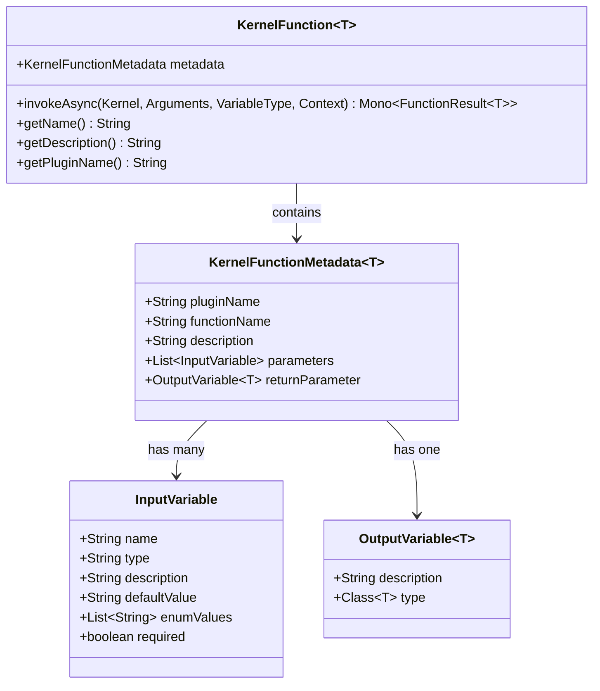

Sources:
- [semantickernel-api/src/main/java/com/microsoft/semantickernel/semanticfunctions/KernelFunctionFromMethod.java]()
- [semantickernel-api/src/main/java/com/microsoft/semantickernel/semanticfunctions/KernelFunctionArguments.java]()

## Native Functions

Native functions are Java methods that are exposed to the Semantic Kernel. They are created using the `KernelFunctionFromMethod` class, typically with annotations to provide metadata.

### Creating Native Functions

Native functions can be created in two ways:

1. **Using annotations** - Annotate Java methods with `@DefineKernelFunction` and `@KernelFunctionParameter`
2. **Programmatically** - Using `KernelFunctionFromMethod.create()` method

Here's an example of a native function definition using annotations:

```mermaid
graph TD
    subgraph "Java Class with Annotated Methods"
        JC["Java Class"]
        M1["@DefineKernelFunction\npublic String methodName(...)"]
        M2["@DefineKernelFunction\npublic double otherMethod(...)"]
        
        JC --> M1
        JC --> M2
    end
    
    subgraph "Kernel Functions"
        KP["KernelPlugin"]
        KF1["KernelFunction<String>"]
        KF2["KernelFunction<Double>"]
        
        KP --> KF1
        KP --> KF2
    end
    
    M1 --> |"Converted to"| KF1
    M2 --> |"Converted to"| KF2
    
    KPF["KernelPluginFactory.createFromObject()"]
    JC --> |"Created via"| KPF
    KPF --> KP
```

Native functions support various parameter types and provide automatic type conversion between different representations.

Sources:
- [semantickernel-api/src/main/java/com/microsoft/semantickernel/semanticfunctions/KernelFunctionFromMethod.java]()
- [samples/semantickernel-concepts/semantickernel-syntax-examples/src/main/java/com/microsoft/semantickernel/samples/demos/lights/LightsPlugin.java]()

### Example Native Function

Below is a simple example of a class with a native function:

```java
public class LightsPlugin {
    @DefineKernelFunction(name = "get_lights", description = "Gets a list of lights and their current state")
    public List<LightModel> getLights() {
        return lights;
    }
    
    @DefineKernelFunction(name = "change_state", description = "Changes the state of the light")
    public LightModel changeState(
        @KernelFunctionParameter(name = "id", description = "The ID of the light to change", type = int.class) int id,
        @KernelFunctionParameter(name = "isOn", description = "The new state of the light", type = boolean.class) boolean isOn) {
        // Implementation...
    }
}
```

The annotations provide:
- Function name and description
- Parameter names, types, and descriptions
- Parameter validation (optional/required)
- Return type information

Sources:
- [samples/semantickernel-concepts/semantickernel-syntax-examples/src/main/java/com/microsoft/semantickernel/samples/demos/lights/LightsPlugin.java]()
- [semantickernel-api/src/test/java/com/microsoft/semantickernel/semanticfunctions/KernelFunctionFromMethodTest.java]()

## Semantic Functions

Semantic functions use AI to generate responses based on prompts. They leverage Large Language Models (LLMs) through the Semantic Kernel's AI service integrations.

### Creating Semantic Functions

Semantic functions can be created in several ways:

1. **From inline prompts** - Using `KernelFunctionFromPrompt.builder()`
2. **From template files** - Loading prompt templates from YAML or text files
3. **From Handlebars templates** - Using more advanced templating with Handlebars

```mermaid
graph TD
    subgraph "Semantic Function Sources"
        IP["Inline Prompt\nString"]
        YF["YAML File\nwith Prompt Template"]
        HB["Handlebars\nTemplate"]
    end
    
    subgraph "Creation Methods"
        B["KernelFunctionFromPrompt.builder()"]
        YAML["KernelFunctionYaml.fromPromptYaml()"]
        PT["PromptTemplate"]
    end
    
    subgraph "Result"
        SF["KernelFunction<String>"]
    end
    
    IP --> B
    YF --> YAML
    HB --> PT
    
    B --> SF
    YAML --> SF
    PT --> SF
```

Sources:
- [samples/semantickernel-concepts/semantickernel-syntax-examples/src/main/java/com/microsoft/semantickernel/samples/syntaxexamples/java/KernelFunctionYaml_Example.java]()
- [samples/semantickernel-concepts/semantickernel-syntax-examples/src/main/java/com/microsoft/semantickernel/samples/syntaxexamples/functions/Example05_InlineFunctionDefinition.java]()

### Example Semantic Function

Here's an example of creating a semantic function with an inline prompt:

```java
KernelFunction<String> summarizeFunction = KernelFunctionFromPrompt.<String>builder()
    .withTemplate("Summarize the following text in 3 bullet points:\n{{$input}}")
    .withName("Summarize")
    .withDescription("Summarizes text into bullet points")
    .withDefaultExecutionSettings(
        PromptExecutionSettings.builder()
            .withMaxTokens(150)
            .build())
    .build();
```

Semantic functions have special functionality for:
- Variable substitution in templates
- Configuring AI model parameters
- Working with different response formats

Sources:
- [samples/semantickernel-concepts/semantickernel-syntax-examples/src/main/java/com/microsoft/semantickernel/samples/syntaxexamples/template/Example06_TemplateLanguage.java]()
- [samples/semantickernel-concepts/semantickernel-syntax-examples/src/main/java/com/microsoft/semantickernel/samples/syntaxexamples/template/Example64_MultiplePromptTemplates.java]()

## Plugins

Plugins are collections of related functions that can be registered with the Kernel for organization and discovery. A plugin serves as a namespace for functions.

### Creating Plugins

There are several ways to create plugins:

1. **From Java objects** - Using `KernelPluginFactory.createFromObject()`
2. **From directories** - Using `KernelPluginFactory.importPluginFromDirectory()`
3. **From prompt templates** - Creating semantic functions and grouping them
4. **Programmatically** - Creating and adding functions to a plugin instance

```mermaid
graph TD
    subgraph "Plugin Sources"
        JO["Java Object\nwith Annotated Methods"]
        DIR["Directory with\nPrompt Templates"]
        PF["Individual\nKernel Functions"]
    end
    
    subgraph "Creation Methods"
        CFO["KernelPluginFactory.createFromObject()"]
        IPD["KernelPluginFactory.importPluginFromDirectory()"]
        C["Manually Create\nand Add Functions"]
    end
    
    subgraph "Result"
        KP["KernelPlugin"]
    end
    
    JO --> CFO
    DIR --> IPD
    PF --> C
    
    CFO --> KP
    IPD --> KP
    C --> KP
    
    subgraph "Registration"
        K["Kernel"]
        REG["kernel.withPlugin(plugin)"]
    end
    
    KP --> REG
    REG --> K
```

Sources:
- [samples/semantickernel-concepts/semantickernel-syntax-examples/src/main/java/com/microsoft/semantickernel/samples/syntaxexamples/plugin/Example10_DescribeAllPluginsAndFunctions.java]()
- [samples/semantickernel-concepts/semantickernel-syntax-examples/src/main/java/com/microsoft/semantickernel/samples/demos/lights/App.java]()

### Example Plugin Registration

Here's an example of creating a plugin from a Java object and registering it with the Kernel:

```java
// Create a plugin from a Java object
KernelPlugin lightPlugin = KernelPluginFactory.createFromObject(new LightsPlugin(), "LightsPlugin");

// Create a kernel and register the plugin
Kernel kernel = Kernel.builder()
    .withAIService(ChatCompletionService.class, chatService)
    .withPlugin(lightPlugin)
    .build();
```

Sources:
- [samples/semantickernel-concepts/semantickernel-syntax-examples/src/main/java/com/microsoft/semantickernel/samples/demos/lights/App.java]()
- [samples/semantickernel-concepts/semantickernel-syntax-examples/src/main/java/com/microsoft/semantickernel/samples/syntaxexamples/plugin/Example13_ConversationSummaryPlugin.java]()

## Function Invocation

Functions in Semantic Kernel are invoked asynchronously, returning `Mono<FunctionResult<T>>` from Project Reactor. The invocation process supports chaining operations and specifying parameters.

### Invocation Flow

The invocation flow varies slightly between native and semantic functions:

```mermaid
sequenceDiagram
    participant App as Application
    participant K as Kernel
    participant P as Plugin
    participant F as KernelFunction<T>
    participant NF as KernelFunctionFromMethod<T>
    participant SF as KernelFunctionFromPrompt<T>
    participant AI as AIService
    
    App->>K: invokeAsync(function, arguments)
    K->>F: invokeAsync(kernel, arguments, context)
    alt Native Function
        F->>NF: invokeAsync(kernel, arguments, context)
        NF-->>F: FunctionResult<T>
    else Semantic Function
        F->>SF: invokeAsync(kernel, arguments, context)
        SF->>AI: getChatMessageContentsAsync(prompt)
        AI-->>SF: AIResponse
        SF-->>F: FunctionResult<T>
    end
    F-->>K: FunctionResult<T>
    K-->>App: FunctionResult<T>
```

Sources:
- [semantickernel-api/src/main/java/com/microsoft/semantickernel/semanticfunctions/KernelFunctionFromMethod.java:730-749]()
- [semantickernel-api/src/main/java/com/microsoft/semantickernel/orchestration/FunctionInvocation.java]()

### Function Arguments

When invoking functions, arguments are passed using the `KernelArguments` class, which is a map of string keys to `ContextVariable` values. The arguments can include:

1. **Main input** - The primary input to the function (key: `"input"`)
2. **Named parameters** - Additional parameters by name
3. **Configuration options** - Execution settings for the function

```mermaid
classDiagram
    class KernelArguments {
        +Map~String, ContextVariable~ variables
        +withInput(Object input)
        +withVariable(String key, Object value)
        +get(String key)
        +put(String key, ContextVariable value)
    }
    
    class ContextVariable~T~ {
        +T value
        +ContextVariableType~T~ type
        +toPromptString()
    }
    
    class ContextVariableType~T~ {
        +Class~T~ clazz
        +ContextVariableTypeConverter~T~ converter
    }
    
    KernelArguments --> ContextVariable~T~ : contains
    ContextVariable~T~ --> ContextVariableType~T~ : has
```

Sources:
- [semantickernel-api/src/main/java/com/microsoft/semantickernel/semanticfunctions/KernelFunctionArguments.java]()
- [samples/semantickernel-concepts/semantickernel-syntax-examples/src/main/java/com/microsoft/semantickernel/samples/syntaxexamples/functions/Example03_Arguments.java]()

### Fluent Invocation API

The Semantic Kernel provides a fluent API for function invocation through the `FunctionInvocation<T>` class:

```java
// Example of the fluent invocation API
FunctionResult<String> result = kernel.invokeAsync(summarizeFunction)
    .withArguments(
        KernelArguments.builder()
            .withInput("This is a long text that needs summarizing...")
            .withVariable("maxPoints", 3)
            .build())
    .withResultType(String.class)
    .block();
```

This API allows for:
- Specifying arguments
- Setting the expected return type
- Adding hooks for interception
- Configuring execution settings
- Type conversion for results

Sources:
- [semantickernel-api/src/main/java/com/microsoft/semantickernel/orchestration/FunctionInvocation.java]()
- [samples/semantickernel-concepts/semantickernel-syntax-examples/src/main/java/com/microsoft/semantickernel/samples/syntaxexamples/java/CustomTypes_Example.java]()

## Tool Calling

One of the powerful features of Semantic Kernel is the ability for AI services to call functions as tools. This allows the AI to invoke your registered functions when needed to accomplish tasks.

### Tool Calling Flow

```mermaid
sequenceDiagram
    participant User
    participant K as Kernel
    participant AI as AIService
    participant P as Plugin
    participant F as KernelFunction
    
    User->>K: Request with tools enabled
    K->>AI: Send prompt with available functions
    AI->>K: Request tool call
    K->>P: Find function
    P->>F: Invoke function
    F-->>P: Return result
    P-->>K: Return result
    K->>AI: Send function result
    AI->>K: Continue with task using function result
    K-->>User: Final response
```

Tool calling enables complex interactions where the AI can:
1. Recognize when a function/tool is needed
2. Select the appropriate function
3. Provide the required parameters
4. Receive and incorporate the function's output

Sources:
- [aiservices/openai/src/main/java/com/microsoft/semantickernel/aiservices/openai/chatcompletion/OpenAIChatCompletion.java:396-526]()
- [aiservices/openai/src/main/java/com/microsoft/semantickernel/aiservices/openai/chatcompletion/OpenAIFunction.java]()

### Enabling Tool Calling

To enable tool calling, you need to:

1. Register plugins with functions
2. Configure an `InvocationContext` with tool calling behavior
3. Pass this context when invoking AI services

```java
// Enable tool calling
InvocationContext invocationContext = InvocationContext.builder()
    .withToolCallBehavior(ToolCallBehavior.allowAllKernelFunctions(true))
    .build();

// Use in chat completion
List<ChatMessageContent<?>> results = chatCompletionService.getChatMessageContentsAsync(
    history, kernel, invocationContext).block();
```

Sources:
- [samples/semantickernel-concepts/semantickernel-syntax-examples/src/main/java/com/microsoft/semantickernel/samples/demos/lights/App.java:93-101]()
- [samples/semantickernel-concepts/semantickernel-syntax-examples/src/main/java/com/microsoft/semantickernel/samples/syntaxexamples/functions/Example59_OpenAIFunctionCalling.java]()

## Extended Features

### Custom Type Conversion

Semantic Kernel provides a type conversion system that allows you to work with complex custom types:

```java
// Create a custom type converter
ContextVariableTypeConverter<Pet> typeConverter = ContextVariableTypeConverter.builder(
    Pet.class)
    .toPromptString(pet -> "name: " + pet.name() + "\nage: " + pet.age() + "\n...")
    .fromPromptString(prompt -> /* parsing logic */)
    .build();

// Use with function invocation
kernel.invokePromptAsync(prompt, arguments)
    .withTypeConverter(typeConverter)
    .withResultType(Pet.class)
    .block();
```

Alternatively, you can use Jackson for automatic JSON-based conversion:

```java
ContextVariableTypeConverter<Pet> typeConverter = ContextVariableJacksonConverter.create(Pet.class);
```

Sources:
- [samples/semantickernel-concepts/semantickernel-syntax-examples/src/main/java/com/microsoft/semantickernel/samples/syntaxexamples/java/CustomTypes_Example.java]()
- [samples/semantickernel-concepts/semantickernel-syntax-examples/src/main/java/com/microsoft/semantickernel/samples/demos/lights/LightModelTypeConverter.java]()

### Function Telemetry

Semantic Kernel includes telemetry capabilities for monitoring function invocations:

```mermaid
graph TD
    subgraph "Telemetry System"
        SK["SemanticKernelTelemetry"]
        FS["FunctionSpan"]
        CCS["ChatCompletionSpan"]
    end
    
    subgraph "Function Invocation"
        FI["FunctionInvocation"]
        IC["InvocationContext"]
    end
    
    FI --> |"withTelemetry()"| SK
    IC --> |"contains"| SK
    
    SK --> |"creates"| FS
    SK --> |"creates"| CCS
    
    FS --> |"tracks"| NF["Native Function Invocation"]
    CCS --> |"tracks"| SF["Semantic Function Invocation"]
    
    subgraph "Integration Points"
        OTEL["OpenTelemetry"]
    end
    
    FS --> OTEL
    CCS --> OTEL
```

Telemetry provides visibility into:
- Function execution time
- Success/failure status
- Token usage for AI calls
- Tracing of execution paths

Sources:
- [semantickernel-api/src/main/java/com/microsoft/semantickernel/implementation/telemetry/FunctionSpan.java]()
- [semantickernel-api/src/main/java/com/microsoft/semantickernel/implementation/telemetry/ChatCompletionSpan.java]()
- [samples/semantickernel-concepts/semantickernel-syntax-examples/src/main/java/com/microsoft/semantickernel/samples/syntaxexamples/java/FunctionTelemetry_Example.java]()

## Summary

Functions and Plugins are fundamental building blocks in Semantic Kernel:

- **Functions** provide the executable units of code, either as native Java methods or AI-powered prompts
- **Plugins** organize related functions into logical groups for better organization and discoverability
- The invocation system provides a flexible, fluent API for function execution
- Tool calling enables AI services to use your functions as needed to accomplish tasks
- Type conversion facilitates working with complex data structures
- Telemetry provides visibility into function execution

By combining these components, you can build AI-powered applications that seamlessly integrate code execution with AI capabilities.

---

# Page: Hook System

# Hook System

<details>
<summary>Relevant source files</summary>

The following files were used as context for generating this wiki page:

- [CHANGELOG.md](CHANGELOG.md)
- [aiservices/openai/src/main/java/com/microsoft/semantickernel/aiservices/openai/chatcompletion/BinaryDataUtils.java](aiservices/openai/src/main/java/com/microsoft/semantickernel/aiservices/openai/chatcompletion/BinaryDataUtils.java)
- [aiservices/openai/src/main/java/com/microsoft/semantickernel/aiservices/openai/chatcompletion/OpenAIFunction.java](aiservices/openai/src/main/java/com/microsoft/semantickernel/aiservices/openai/chatcompletion/OpenAIFunction.java)
- [aiservices/openai/src/main/java/com/microsoft/semantickernel/aiservices/openai/chatcompletion/OpenAiXMLPromptParser.java](aiservices/openai/src/main/java/com/microsoft/semantickernel/aiservices/openai/chatcompletion/OpenAiXMLPromptParser.java)
- [aiservices/openai/src/test/java/com/microsoft/semantickernel/aiservices/openai/chatcompletion/JsonSchemaTest.java](aiservices/openai/src/test/java/com/microsoft/semantickernel/aiservices/openai/chatcompletion/JsonSchemaTest.java)
- [api-test/integration-tests/src/test/java/com/microsoft/semantickernel/tests/RenderingTest.java](api-test/integration-tests/src/test/java/com/microsoft/semantickernel/tests/RenderingTest.java)
- [api-test/integration-tests/src/test/java/com/microsoft/semantickernel/tests/ToolCallBehaviourTest.java](api-test/integration-tests/src/test/java/com/microsoft/semantickernel/tests/ToolCallBehaviourTest.java)
- [api-test/integration-tests/src/test/resources/wiremock/mappings/deployments_gpt-35-turbo-2_chat_completions-12b6744e-443f-4fe7-82e2-55cc41195ff1.json](api-test/integration-tests/src/test/resources/wiremock/mappings/deployments_gpt-35-turbo-2_chat_completions-12b6744e-443f-4fe7-82e2-55cc41195ff1.json)
- [api-test/integration-tests/src/test/resources/wiremock/mappings/deployments_gpt-35-turbo-2_chat_completions-71b07779-49a8-44e5-a60b-ee5b0a3ad697.json](api-test/integration-tests/src/test/resources/wiremock/mappings/deployments_gpt-35-turbo-2_chat_completions-71b07779-49a8-44e5-a60b-ee5b0a3ad697.json)
- [api-test/integration-tests/src/test/resources/wiremock/mappings/deployments_gpt-35-turbo_chat_completions-0c8046c5-74ad-4836-8aa9-09da60f367a2.json](api-test/integration-tests/src/test/resources/wiremock/mappings/deployments_gpt-35-turbo_chat_completions-0c8046c5-74ad-4836-8aa9-09da60f367a2.json)
- [api-test/integration-tests/src/test/resources/wiremock/mappings/deployments_text-davinci-003_completions-0215b128-4822-4368-ac3d-2f580a221f00.json](api-test/integration-tests/src/test/resources/wiremock/mappings/deployments_text-davinci-003_completions-0215b128-4822-4368-ac3d-2f580a221f00.json)
- [samples/semantickernel-concepts/semantickernel-syntax-examples/src/main/java/com/microsoft/semantickernel/samples/demos/lights/App.java](samples/semantickernel-concepts/semantickernel-syntax-examples/src/main/java/com/microsoft/semantickernel/samples/demos/lights/App.java)
- [samples/semantickernel-concepts/semantickernel-syntax-examples/src/main/java/com/microsoft/semantickernel/samples/demos/lights/LightModel.java](samples/semantickernel-concepts/semantickernel-syntax-examples/src/main/java/com/microsoft/semantickernel/samples/demos/lights/LightModel.java)
- [samples/semantickernel-concepts/semantickernel-syntax-examples/src/main/java/com/microsoft/semantickernel/samples/demos/lights/LightModelTypeConverter.java](samples/semantickernel-concepts/semantickernel-syntax-examples/src/main/java/com/microsoft/semantickernel/samples/demos/lights/LightModelTypeConverter.java)
- [samples/semantickernel-concepts/semantickernel-syntax-examples/src/main/java/com/microsoft/semantickernel/samples/demos/lights/LightsPlugin.java](samples/semantickernel-concepts/semantickernel-syntax-examples/src/main/java/com/microsoft/semantickernel/samples/demos/lights/LightsPlugin.java)
- [semantickernel-api/src/main/java/com/microsoft/semantickernel/contextvariables/converters/StringVariableContextVariableTypeConverter.java](semantickernel-api/src/main/java/com/microsoft/semantickernel/contextvariables/converters/StringVariableContextVariableTypeConverter.java)
- [semantickernel-api/src/main/java/com/microsoft/semantickernel/hooks/KernelHook.java](semantickernel-api/src/main/java/com/microsoft/semantickernel/hooks/KernelHook.java)
- [semantickernel-api/src/main/java/com/microsoft/semantickernel/hooks/KernelHooks.java](semantickernel-api/src/main/java/com/microsoft/semantickernel/hooks/KernelHooks.java)
- [semantickernel-api/src/test/java/com/microsoft/semantickernel/contextvariables/converters/ContextVariableTypeConverterTest.java](semantickernel-api/src/test/java/com/microsoft/semantickernel/contextvariables/converters/ContextVariableTypeConverterTest.java)

</details>


The Hook System in Semantic Kernel Java provides a mechanism for intercepting and extending kernel operations at key points during execution. This enables monitoring, logging, modifying inputs/outputs, and implementing cross-cutting concerns without modifying core components. The Hook System is a fundamental extension point for the Semantic Kernel framework and integrates with function invocation, prompt rendering, AI service communication, and tool calling features.

## Core Components and Architecture

The Hook System consists of two main components: the events that get triggered at specific points during execution, and the hooks that receive and can modify these events.

```mermaid
classDiagram
    class KernelHookEvent {
        +getKernel(): Kernel
    }
    
    class KernelHook~T extends KernelHookEvent~ {
        <<interface>>
        +test(KernelHookEvent): boolean
        +apply(T): T
        +getPriority(): int
    }
    
    KernelHook <|-- FunctionInvokingHook
    KernelHook <|-- FunctionInvokedHook
    KernelHook <|-- PromptRenderingHook
    KernelHook <|-- PromptRenderedHook
    KernelHook <|-- PreChatCompletionHook
    KernelHook <|-- PostChatCompletionHook
    KernelHook <|-- PreToolCallHook
    
    KernelHookEvent <|-- FunctionInvokingEvent
    KernelHookEvent <|-- FunctionInvokedEvent
    KernelHookEvent <|-- PromptRenderingEvent
    KernelHookEvent <|-- PromptRenderedEvent
    KernelHookEvent <|-- PreChatCompletionEvent
    KernelHookEvent <|-- PostChatCompletionEvent
    KernelHookEvent <|-- PreToolCallEvent
    
    class KernelHooks {
        -Map~String, KernelHook~ hooks
        +addFunctionInvokingHook(Function): String
        +addFunctionInvokedHook(Function): String
        +addPreChatCompletionHook(Function): String
        +addPostChatCompletionHook(Function): String
        +addPromptRenderedHook(Function): String
        +addPromptRenderingHook(Function): String
        +addPreToolCallHook(Function): String
        +executeHooks(T): T
    }
```

Sources: [semantickernel-api/src/main/java/com/microsoft/semantickernel/hooks/KernelHook.java](), [semantickernel-api/src/main/java/com/microsoft/semantickernel/hooks/KernelHooks.java]()

The `KernelHook` interface is parameterized by the type of event it handles, extending both `Predicate<KernelHookEvent>` and `Function<T, T>`. This design allows hooks to determine if they're applicable to an event and transform that event.

## Hook Types and Execution Flow

The Hook System defines specialized hook types for different events in the execution flow:

| Hook Type | Event Type | Description |
| --- | --- | --- |
| `FunctionInvokingHook` | `FunctionInvokingEvent` | Triggered before a function is invoked |
| `FunctionInvokedHook` | `FunctionInvokedEvent` | Triggered after a function is invoked |
| `PromptRenderingHook` | `PromptRenderingEvent` | Triggered before a prompt is rendered |
| `PromptRenderedHook` | `PromptRenderedEvent` | Triggered after a prompt is rendered |
| `PreChatCompletionHook` | `PreChatCompletionEvent` | Triggered before a chat completion request is sent |
| `PostChatCompletionHook` | `PostChatCompletionEvent` | Triggered after a chat completion response is received |
| `PreToolCallHook` | `PreToolCallEvent` | Triggered before a tool call is executed |

The following sequence diagram illustrates the execution flow of hooks during function invocation:

```mermaid
sequenceDiagram
    participant Application
    participant Kernel
    participant KernelHooks as "KernelHooks"
    participant KernelFunction as "KernelFunction"
    participant AIService as "ChatCompletionService"
    
    Application->>Kernel: invokeAsync(function, arguments)
    Kernel->>KernelHooks: executeHooks(FunctionInvokingEvent)
    KernelHooks-->>Kernel: Modified event
    Kernel->>KernelFunction: invokeAsync(kernel, arguments)
    
    alt Semantic Function (KernelFunctionFromPrompt)
        KernelFunction->>KernelHooks: executeHooks(PromptRenderingEvent)
        KernelFunction->>PromptTemplate: renderAsync(kernel, arguments)
        PromptTemplate-->>KernelFunction: Rendered prompt
        KernelFunction->>KernelHooks: executeHooks(PromptRenderedEvent)
        KernelFunction->>KernelHooks: executeHooks(PreChatCompletionEvent)
        KernelFunction->>AIService: getChatMessageContentsAsync(prompt)
        
        alt Tool calling enabled
            AIService->>Kernel: invokeFunction(functionName, arguments)
            Kernel->>KernelHooks: executeHooks(PreToolCallEvent)
            Kernel->>KernelFunction: invokeAsync(kernel, arguments)
            KernelFunction-->>AIService: function result
        end
        
        AIService-->>KernelFunction: chat completion response
        KernelFunction->>KernelHooks: executeHooks(PostChatCompletionEvent)
    else Native Function (KernelFunctionFromMethod)
        KernelFunction->>KernelFunction: Invoke method using reflection
    end
    
    KernelFunction-->>Kernel: FunctionResult
    Kernel->>KernelHooks: executeHooks(FunctionInvokedEvent)
    Kernel-->>Application: FunctionResult
```

Sources: [semantickernel-api/src/main/java/com/microsoft/semantickernel/hooks/KernelHook.java](), [api-test/integration-tests/src/test/java/com/microsoft/semantickernel/tests/ToolCallBehaviourTest.java]()

## Creating and Registering Hooks

Hooks can be created directly by implementing the `KernelHook` interface, but the `KernelHooks` class provides convenient methods to create hooks using simple lambda functions:

```java
KernelHooks hooks = new KernelHooks();

hooks.addFunctionInvokingHook(event -> {
    System.out.println("Function being invoked: " + event.getFunction().getName());
    return event;
});

hooks.addPreChatCompletionHook(event -> {
    System.out.println("Pre-chat completion hook");
    return event;
});
```

Hooks can be registered at three different levels:

1. **Global Hooks**: Applied to all functions invoked through the kernel
   ```java
   kernel.getGlobalKernelHooks().addHooks(hooks);
   ```

2. **Per-function Hooks**: Applied only to a specific function
   ```java
   function.setHooks(hooks);
   ```

3. **Per-invocation Hooks**: Applied only for a specific function invocation
   ```java
   kernel.invokeAsync(function, arguments, hooks);
   ```

Sources: [samples/semantickernel-concepts/semantickernel-syntax-examples/src/main/java/com/microsoft/semantickernel/samples/demos/lights/App.java:75-94]()

## Hook Execution and Priority

When multiple hooks are registered for the same event type, they are executed in order of priority, with lower priorities executed first. The default priority is 50:

```java
// Override default priority
KernelHook<FunctionInvokingEvent<?>> hook = new KernelHook.FunctionInvokingHook() {
    @Override
    public FunctionInvokingEvent<?> apply(FunctionInvokingEvent<?> event) {
        // Hook implementation
        return event;
    }
    
    @Override
    public int getPriority() {
        return 10; // Lower priority (executed earlier)
    }
};
```

The `KernelHooks.executeHooks` method sorts hooks by priority and applies them sequentially, with each hook potentially modifying the event before it's passed to the next hook:

```java
public <T extends KernelHookEvent> T executeHooks(T event) {
    return this.hooks.values()
        .stream()
        .filter(hook -> hook.test(event))
        .sorted(Comparator.comparingInt(KernelHook::getPriority))
        .reduce(event, (event2, hook) -> {
            return ((KernelHook<T>) hook).apply(event2);
        }, (a, b) -> {
            throw new UnsupportedOperationException("No merging for hooks");
        });
}
```

Sources: [semantickernel-api/src/main/java/com/microsoft/semantickernel/hooks/KernelHooks.java:158-169]()

## Common Use Cases

### Logging and Telemetry

Hooks are ideal for implementing logging and telemetry without modifying the core logic:

```java
KernelHooks hook = new KernelHooks();

hook.addFunctionInvokingHook(event -> {
    System.out.println("Function being invoked: " + event.getFunction().getName());
    return event;
});

hook.addFunctionInvokedHook(event -> {
    System.out.println("Function completed: " + event.getFunction().getName());
    System.out.println("Result: " + event.getResult());
    return event;
});
```

### Modifying Arguments or Results

Hooks can modify function arguments or results:

```java
// Modify arguments before function invocation
hook.addFunctionInvokingHook(event -> {
    KernelArguments arguments = event.getArguments();
    arguments.add("additionalParam", "value");
    return event.withArguments(arguments);
});

// Transform function results
hook.addFunctionInvokedHook(event -> {
    if (event.getResult() instanceof String) {
        String result = (String) event.getResult();
        return event.withResult(result.toUpperCase());
    }
    return event;
});
```

### Intercepting AI Service Requests

Hooks can modify AI service requests before they're sent:

```java
hook.addPreChatCompletionHook(event -> {
    // Access and modify options like temperature, max tokens, etc.
    ChatCompletionsOptions options = event.getOptions();
    options.setTemperature(0.7);
    return event.withOptions(options);
});
```

### Security and Tool Call Validation

PreToolCallHooks can implement security checks before tool calls are executed:

```java
hook.addPreToolCallHook(event -> {
    System.out.println("Tool being called: " + event.getFunctionName());
    
    // Implement security checks
    if (event.getFunctionName().equals("sensitiveOperation")) {
        throw new SecurityException("Operation not allowed");
    }
    
    return event;
});
```

Sources: [api-test/integration-tests/src/test/java/com/microsoft/semantickernel/tests/ToolCallBehaviourTest.java](), [samples/semantickernel-concepts/semantickernel-syntax-examples/src/main/java/com/microsoft/semantickernel/samples/demos/lights/App.java]()

## Integration with Tool Calling

The Hook System integrates with the tool calling feature, enabling interception of tool calls before execution. This is particularly useful for implementing validation or security checks.

```java
// Configure tool call behavior with automatic invocation
InvocationContext invocationContext = InvocationContext.builder()
    .withToolCallBehavior(ToolCallBehavior.allowAllKernelFunctions(true))
    .build();

// Add a hook to intercept tool calls
kernel.getGlobalKernelHooks().addPreToolCallHook(event -> {
    System.out.println("Pre-tool call hook for: " + event.getFunctionName());
    return event;
});
```

The `ToolCallBehavior` class determines which functions can be called by AI models and whether they're automatically invoked. Hooks provide an additional layer of control for monitoring and modifying these calls.

Sources: [api-test/integration-tests/src/test/java/com/microsoft/semantickernel/tests/ToolCallBehaviourTest.java:55-169](), [samples/semantickernel-concepts/semantickernel-syntax-examples/src/main/java/com/microsoft/semantickernel/samples/demos/lights/App.java:97-101]()

## Conclusion

The Hook System is a powerful extension mechanism in Semantic Kernel Java, enabling interception and modification of the execution flow at key points. By leveraging hooks, developers can implement cross-cutting concerns like logging, security, and validation without modifying core components. The system's flexibility allows for hooks to be applied globally, per-function, or per-invocation, providing fine-grained control over the behavior of the Semantic Kernel.

---

# Page: Arguments and Context

# Arguments and Context

<details>
<summary>Relevant source files</summary>

The following files were used as context for generating this wiki page:

- [aiservices/openai/src/main/java/com/microsoft/semantickernel/aiservices/openai/chatcompletion/OpenAIChatCompletion.java](aiservices/openai/src/main/java/com/microsoft/semantickernel/aiservices/openai/chatcompletion/OpenAIChatCompletion.java)
- [aiservices/openai/src/main/java/com/microsoft/semantickernel/aiservices/openai/textcompletion/OpenAITextGenerationService.java](aiservices/openai/src/main/java/com/microsoft/semantickernel/aiservices/openai/textcompletion/OpenAITextGenerationService.java)
- [aiservices/openai/src/test/java/com/microsoft/semantickernel/aiservices/openai/OtelCaptureTest.java](aiservices/openai/src/test/java/com/microsoft/semantickernel/aiservices/openai/OtelCaptureTest.java)
- [api-test/integration-tests/src/test/java/com/microsoft/semantickernel/tests/ImportingMultiplePluginsTest.java](api-test/integration-tests/src/test/java/com/microsoft/semantickernel/tests/ImportingMultiplePluginsTest.java)
- [api-test/integration-tests/src/test/java/com/microsoft/semantickernel/tests/ResponseSchemaTest.java](api-test/integration-tests/src/test/java/com/microsoft/semantickernel/tests/ResponseSchemaTest.java)
- [samples/semantickernel-concepts/semantickernel-syntax-examples/src/main/java/com/microsoft/semantickernel/samples/syntaxexamples/Example61_MultipleLLMs.java](samples/semantickernel-concepts/semantickernel-syntax-examples/src/main/java/com/microsoft/semantickernel/samples/syntaxexamples/Example61_MultipleLLMs.java)
- [samples/semantickernel-concepts/semantickernel-syntax-examples/src/main/java/com/microsoft/semantickernel/samples/syntaxexamples/java/CustomTypes_Example.java](samples/semantickernel-concepts/semantickernel-syntax-examples/src/main/java/com/microsoft/semantickernel/samples/syntaxexamples/java/CustomTypes_Example.java)
- [samples/semantickernel-concepts/semantickernel-syntax-examples/src/main/java/com/microsoft/semantickernel/samples/syntaxexamples/java/FunctionTelemetry_Example.java](samples/semantickernel-concepts/semantickernel-syntax-examples/src/main/java/com/microsoft/semantickernel/samples/syntaxexamples/java/FunctionTelemetry_Example.java)
- [samples/semantickernel-concepts/semantickernel-syntax-examples/src/main/java/com/microsoft/semantickernel/samples/syntaxexamples/java/KernelFunctionYaml_Example.java](samples/semantickernel-concepts/semantickernel-syntax-examples/src/main/java/com/microsoft/semantickernel/samples/syntaxexamples/java/KernelFunctionYaml_Example.java)
- [samples/semantickernel-concepts/semantickernel-syntax-examples/src/main/resources/com/microsoft/semantickernel/samples/syntaxexamples/java/applicationinsights.json](samples/semantickernel-concepts/semantickernel-syntax-examples/src/main/resources/com/microsoft/semantickernel/samples/syntaxexamples/java/applicationinsights.json)
- [semantickernel-api/src/main/java/com/microsoft/semantickernel/Kernel.java](semantickernel-api/src/main/java/com/microsoft/semantickernel/Kernel.java)
- [semantickernel-api/src/main/java/com/microsoft/semantickernel/implementation/telemetry/ChatCompletionSpan.java](semantickernel-api/src/main/java/com/microsoft/semantickernel/implementation/telemetry/ChatCompletionSpan.java)
- [semantickernel-api/src/main/java/com/microsoft/semantickernel/implementation/telemetry/FunctionSpan.java](semantickernel-api/src/main/java/com/microsoft/semantickernel/implementation/telemetry/FunctionSpan.java)
- [semantickernel-api/src/main/java/com/microsoft/semantickernel/implementation/telemetry/SemanticKernelTelemetry.java](semantickernel-api/src/main/java/com/microsoft/semantickernel/implementation/telemetry/SemanticKernelTelemetry.java)
- [semantickernel-api/src/main/java/com/microsoft/semantickernel/orchestration/FunctionInvocation.java](semantickernel-api/src/main/java/com/microsoft/semantickernel/orchestration/FunctionInvocation.java)
- [semantickernel-api/src/main/java/com/microsoft/semantickernel/semanticfunctions/KernelArguments.java](semantickernel-api/src/main/java/com/microsoft/semantickernel/semanticfunctions/KernelArguments.java)
- [semantickernel-api/src/main/java/com/microsoft/semantickernel/semanticfunctions/KernelFunctionArguments.java](semantickernel-api/src/main/java/com/microsoft/semantickernel/semanticfunctions/KernelFunctionArguments.java)
- [semantickernel-api/src/main/java/com/microsoft/semantickernel/semanticfunctions/KernelFunctionFromMethod.java](semantickernel-api/src/main/java/com/microsoft/semantickernel/semanticfunctions/KernelFunctionFromMethod.java)
- [semantickernel-api/src/main/java/com/microsoft/semantickernel/semanticfunctions/KernelFunctionFromPrompt.java](semantickernel-api/src/main/java/com/microsoft/semantickernel/semanticfunctions/KernelFunctionFromPrompt.java)
- [semantickernel-api/src/main/java/com/microsoft/semantickernel/services/AIServiceSelector.java](semantickernel-api/src/main/java/com/microsoft/semantickernel/services/AIServiceSelector.java)
- [semantickernel-api/src/main/java/com/microsoft/semantickernel/services/BaseAIServiceSelector.java](semantickernel-api/src/main/java/com/microsoft/semantickernel/services/BaseAIServiceSelector.java)
- [semantickernel-api/src/main/java/com/microsoft/semantickernel/services/OrderedAIServiceSelector.java](semantickernel-api/src/main/java/com/microsoft/semantickernel/services/OrderedAIServiceSelector.java)
- [semantickernel-api/src/test/java/com/microsoft/semantickernel/semanticfunctions/KernelFunctionFromMethodTest.java](semantickernel-api/src/test/java/com/microsoft/semantickernel/semanticfunctions/KernelFunctionFromMethodTest.java)

</details>


This page provides a detailed technical overview of how arguments and context are managed and passed between functions and AI services in the Semantic Kernel Java framework. Arguments and context are fundamental components that enable data flow between different parts of the system, from kernel functions to AI service providers.

For information about function execution flow, see [Core Architecture](#2). For information about hooks, which can intercept and modify arguments, see [Hook System](#2.3).

## 1. Arguments and Context Overview

Semantic Kernel Java uses a consistent system for passing arguments between functions and managing execution context. The two key components in this system are:

1. **KernelArguments**: Container for data passed to and from kernel functions
2. **InvocationContext**: Execution context with settings, behavior controls, and type information

```mermaid
graph TD
    subgraph "Arguments & Context System"
        Arguments["KernelArguments"]
        Context["InvocationContext"]
        
        Arguments --> Variables["ContextVariable<?>"]
        Arguments --> ExecSettings["PromptExecutionSettings"]
        
        Context --> Hooks["KernelHooks"]
        Context --> Settings["PromptExecutionSettings"]
        Context --> Tools["ToolCallBehavior"]
        Context --> Types["ContextVariableTypes"]
        Context --> Mode["InvocationReturnMode"]
        Context --> Telemetry["SemanticKernelTelemetry"]
    end
    
    subgraph "Function Invocation Flow"
        Function["KernelFunction"]
        Function --> |"invokeAsync()"| Invocation["FunctionInvocation"]
        Invocation --> |"withArguments()"| Invocation
        Invocation --> |"withInvocationContext()"| Invocation
        Invocation --> |"subscribe()"| Result["FunctionResult"]
    end
    
    Arguments -.- Invocation
    Context -.- Invocation
```

Sources:
- [semantickernel-api/src/main/java/com/microsoft/semantickernel/semanticfunctions/KernelArguments.java](semantickernel-api/src/main/java/com/microsoft/semantickernel/semanticfunctions/KernelArguments.java)
- [semantickernel-api/src/main/java/com/microsoft/semantickernel/orchestration/FunctionInvocation.java](semantickernel-api/src/main/java/com/microsoft/semantickernel/orchestration/FunctionInvocation.java)

## 2. KernelArguments

KernelArguments serves as the primary container for passing data to and from kernel functions. It implements the `Map<String, ContextVariable<?>>` interface and provides additional functionality specific to argument handling.

### 2.1 Structure and Implementation

KernelArguments contains:

1. A case-insensitive map of named variables (`variables`)
2. A map of execution settings (`executionSettings`)
3. Special handling for the "input" key, which is considered the main argument

```mermaid
classDiagram
    class KernelArguments {
        +MAIN_KEY: String = "input"
        -CaseInsensitiveMap~ContextVariable~ variables
        -Map~String, PromptExecutionSettings~ executionSettings
        +getInput(): ContextVariable
        +get(String key): ContextVariable
        +put(String key, ContextVariable value): ContextVariable
        +prettyPrint(): String
        +copy(): KernelArguments
    }
    
    class Map~String, ContextVariable~ {
    }
    
    KernelArguments --|> Map~String, ContextVariable~ : implements
```

Sources:
- [semantickernel-api/src/main/java/com/microsoft/semantickernel/semanticfunctions/KernelArguments.java:29-425](semantickernel-api/src/main/java/com/microsoft/semantickernel/semanticfunctions/KernelArguments.java:29-425)

### 2.2 Creating KernelArguments

KernelArguments provides a builder pattern for creating instances. Here are several ways to create KernelArguments:

```mermaid
graph LR
    subgraph "Creating KernelArguments"
        Builder["KernelArguments.builder()"]
        
        Builder --> |"withInput(content)"| WithInput["Sets main input"]
        Builder --> |"withVariable(key, value)"| WithVar["Adds named variable"]
        Builder --> |"withExecutionSettings(settings)"| WithSettings["Adds execution settings"]
        Builder --> |"build()"| Build["Creates KernelArguments"]
    end
```

Sources:
- [semantickernel-api/src/main/java/com/microsoft/semantickernel/semanticfunctions/KernelArguments.java:242-424](semantickernel-api/src/main/java/com/microsoft/semantickernel/semanticfunctions/KernelArguments.java:242-424)

The main methods for creating KernelArguments are:

1. **Basic constructor** (protected):
```java
protected KernelArguments(
    @Nullable Map<String, ContextVariable<?>> variables,
    @Nullable Map<String, PromptExecutionSettings> executionSettings)
```

2. **Builder pattern** (recommended approach):
```java
KernelArguments arguments = KernelArguments.builder()
    .withInput("main input")                 // Sets the main input value
    .withVariable("varName", "varValue")     // Adds a named variable
    .withExecutionSettings(executionSettings) // Adds prompt execution settings
    .build();
```

Sources:
- [semantickernel-api/src/main/java/com/microsoft/semantickernel/semanticfunctions/KernelArguments.java:44-57](semantickernel-api/src/main/java/com/microsoft/semantickernel/semanticfunctions/KernelArguments.java:44-57)
- [samples/semantickernel-concepts/semantickernel-syntax-examples/src/main/java/com/microsoft/semantickernel/samples/syntaxexamples/java/KernelFunctionYaml_Example.java:70-97](samples/semantickernel-concepts/semantickernel-syntax-examples/src/main/java/com/microsoft/semantickernel/samples/syntaxexamples/java/KernelFunctionYaml_Example.java:70-97)

### 2.3 Using KernelArguments

KernelArguments serves several important roles:

1. **Passing input data** to kernel functions
2. **Storing variable values** for template rendering
3. **Configuring execution settings** for AI services

The `MAIN_KEY` constant ("input") is used as the default key for the main function input.

```java
// Access the main input value
ContextVariable<?> input = arguments.getInput();

// Access a named variable
ContextVariable<?> value = arguments.get("myVariable");

// Check if a variable exists or is empty
boolean isEmpty = arguments.isNullOrEmpty("myVariable");

// Print all variables for debugging
String debugView = arguments.prettyPrint();
```

Sources:
- [semantickernel-api/src/main/java/com/microsoft/semantickernel/semanticfunctions/KernelArguments.java:103-165](semantickernel-api/src/main/java/com/microsoft/semantickernel/semanticfunctions/KernelArguments.java:103-165)

## 3. InvocationContext

InvocationContext provides essential context for function invocation. It aggregates multiple components that influence function execution behavior.

### 3.1 Structure and Components

InvocationContext contains:

1. **KernelHooks**: Hooks for intercepting and modifying function invocation
2. **PromptExecutionSettings**: Settings for AI service execution
3. **ToolCallBehavior**: Controls for function calling by AI
4. **ContextVariableTypes**: Type information for variable conversion
5. **InvocationReturnMode**: Controls what is returned from function calls
6. **SemanticKernelTelemetry**: Telemetry for function execution

```mermaid
classDiagram
    class InvocationContext {
        -KernelHooks kernelHooks
        -PromptExecutionSettings promptExecutionSettings
        -ToolCallBehavior toolCallBehavior
        -ContextVariableTypes contextVariableTypes
        -InvocationReturnMode returnMode
        -SemanticKernelTelemetry telemetry
        +getKernelHooks(): KernelHooks
        +getPromptExecutionSettings(): PromptExecutionSettings
        +getToolCallBehavior(): ToolCallBehavior
        +getContextVariableTypes(): ContextVariableTypes
        +getReturnMode(): InvocationReturnMode
        +getTelemetry(): SemanticKernelTelemetry
    }
```

### 3.2 Creating and Using InvocationContext

InvocationContext also uses a builder pattern for creating instances. It's typically created and passed to the function invocation method to configure execution behavior:

```java
InvocationContext context = InvocationContext.builder()
    .withKernelHooks(hooks)
    .withPromptExecutionSettings(settings)
    .withToolCallBehavior(ToolCallBehavior.allowAllKernelFunctions(true))
    .withReturnMode(InvocationReturnMode.FULL_HISTORY)
    .withTelemetry(telemetry)
    .build();

FunctionResult<String> result = function
    .invokeAsync(kernel)
    .withInvocationContext(context)
    .block();
```

Sources:
- [samples/semantickernel-concepts/semantickernel-syntax-examples/src/main/java/com/microsoft/semantickernel/samples/syntaxexamples/java/FunctionTelemetry_Example.java:143-156](samples/semantickernel-concepts/semantickernel-syntax-examples/src/main/java/com/microsoft/semantickernel/samples/syntaxexamples/java/FunctionTelemetry_Example.java:143-156)

## 4. Context Variables

Context variables (`ContextVariable<?>`) are the payload units stored in KernelArguments. They encapsulate a typed value and its associated metadata.

### 4.1 ContextVariable Structure

Each ContextVariable contains:
1. A typed value
2. A `ContextVariableType` defining how to convert the value
3. Methods for extracting and converting the value

Variables can be created with:
```java
// Basic value
ContextVariable<String> var1 = ContextVariable.of("Hello world");

// With custom type converter
ContextVariable<MyType> var2 = new ContextVariable<>(typeConverter, myValue);
```

### 4.2 Type Conversion System

Semantic Kernel provides a robust type conversion system through `ContextVariableTypes` and `ContextVariableTypeConverter`. This enables automatic conversion between different data types.

```mermaid
graph TD
    subgraph "Type Conversion System"
        ContextVar["ContextVariable<T>"]
        TypeConverter["ContextVariableTypeConverter<T>"]
        TypeSystem["ContextVariableTypes"]
        
        ContextVar --> TypeConverter
        TypeSystem --> TypeConverter
        
        TypeConverter --> |"fromPromptString()"| String2T["String to T"]
        TypeConverter --> |"toPromptString()"| T2String["T to String"]
        TypeConverter --> |"fromObject()"| Obj2T["Object to T"]
        TypeConverter --> |"toObject()"| T2Obj["T to Object"]
    end
```

Sources:
- [semantickernel-api/src/main/java/com/microsoft/semantickernel/semanticfunctions/KernelArguments.java:290-361](semantickernel-api/src/main/java/com/microsoft/semantickernel/semanticfunctions/KernelArguments.java:290-361)
- [samples/semantickernel-concepts/semantickernel-syntax-examples/src/main/java/com/microsoft/semantickernel/samples/syntaxexamples/java/CustomTypes_Example.java:90-123](samples/semantickernel-concepts/semantickernel-syntax-examples/src/main/java/com/microsoft/semantickernel/samples/syntaxexamples/java/CustomTypes_Example.java:90-123)

### 4.3 Custom Type Conversions

The framework allows for custom type conversions by defining your own converters:

```java
// Custom converter for a Pet class
ContextVariableTypeConverter<Pet> typeConverter = ContextVariableTypeConverter.builder(Pet.class)
    .toPromptString(pet -> "name: " + pet.name() + "\n" +
                         "age: " + pet.age() + "\n" +
                         "species: " + pet.species() + "\n")
    .fromPromptString(prompt -> {
        Map<String, String> properties = Arrays.stream(prompt.split("\n"))
            .collect(Collectors.toMap(
                line -> line.split(":")[0].trim(),
                line -> line.split(":")[1].trim()));
        
        return new Pet(
            properties.get("name"),
            Integer.parseInt(properties.get("age")),
            properties.get("species"));
    })
    .build();

// Use the converter to store a Pet object in arguments
KernelArguments arguments = KernelArguments.builder()
    .withVariable("pet", myPet, typeConverter)
    .build();
```

Jackson-based conversion is also supported for JSON serializable objects:

```java
ContextVariableTypeConverter<Pet> typeConverter = ContextVariableJacksonConverter.create(Pet.class);
```

Sources:
- [samples/semantickernel-concepts/semantickernel-syntax-examples/src/main/java/com/microsoft/semantickernel/samples/syntaxexamples/java/CustomTypes_Example.java:90-177](samples/semantickernel-concepts/semantickernel-syntax-examples/src/main/java/com/microsoft/semantickernel/samples/syntaxexamples/java/CustomTypes_Example.java:90-177)

## 5. Function Execution Flow with Arguments

When a kernel function is invoked, arguments and context flow through a well-defined process:

```mermaid
sequenceDiagram
    participant App as Application
    participant K as Kernel
    participant FI as FunctionInvocation
    participant KF as KernelFunction
    participant KC as InvocationContext
    participant SS as AIServiceSelector
    participant AI as AIService
    
    App->>K: invokeAsync(function)
    K->>FI: Creates FunctionInvocation
    App->>FI: withArguments(arguments)
    App->>FI: withInvocationContext(context)
    App->>FI: block() or subscribe()
    
    FI->>KF: invokeAsync(kernel, arguments, type, context)
    
    alt KernelFunctionFromPrompt
        KF->>SS: trySelectAIService(serviceType, function, arguments)
        SS-->>KF: AIServiceSelection(service, settings)
        KF->>AI: getChatMessageContentsAsync(prompt, kernel, context)
        AI-->>KF: completion response
    else KernelFunctionFromMethod
        KF->>KF: Extract arguments and invoke method
    end
    
    KF-->>FI: FunctionResult
    FI-->>App: FunctionResult
```

Sources:
- [semantickernel-api/src/main/java/com/microsoft/semantickernel/orchestration/FunctionInvocation.java:90-156](semantickernel-api/src/main/java/com/microsoft/semantickernel/orchestration/FunctionInvocation.java:90-156)
- [semantickernel-api/src/main/java/com/microsoft/semantickernel/semanticfunctions/KernelFunctionFromPrompt.java:99-251](semantickernel-api/src/main/java/com/microsoft/semantickernel/semanticfunctions/KernelFunctionFromPrompt.java:99-251)
- [semantickernel-api/src/main/java/com/microsoft/semantickernel/semanticfunctions/KernelFunctionFromMethod.java:162-263](semantickernel-api/src/main/java/com/microsoft/semantickernel/semanticfunctions/KernelFunctionFromMethod.java:162-263)

### 5.1 Argument Processing in Semantic Functions

For semantic functions (those created from prompts), arguments are used to:

1. Render the prompt template
2. Select an appropriate AI service
3. Configure AI service execution settings

For example, in `KernelFunctionFromPrompt`, arguments flow like this:

```mermaid
graph TD
    subgraph "Arguments in Semantic Functions"
        Args["KernelArguments"]
        
        Args --> RenderHook["PromptRenderingEvent Hook"]
        RenderHook --> Template["PromptTemplate.renderAsync()"]
        Template --> RenderedPrompt["Rendered Prompt"]
        RenderedPrompt --> PromptHook["PromptRenderedEvent Hook"]
        PromptHook --> InvokeHook["FunctionInvokingEvent Hook"]
        InvokeHook --> ServiceSelection["AI Service Selection"]
        ServiceSelection --> AIService["Call AI Service"]
        AIService --> ProcessResponse["Process Response"]
        ProcessResponse --> Result["FunctionResult"]
    end
```

Sources:
- [semantickernel-api/src/main/java/com/microsoft/semantickernel/semanticfunctions/KernelFunctionFromPrompt.java:99-274](semantickernel-api/src/main/java/com/microsoft/semantickernel/semanticfunctions/KernelFunctionFromPrompt.java:99-274)

### 5.2 Argument Processing in Native Functions

For native functions (method-based), arguments are used to:

1. Map named arguments to method parameters
2. Convert argument types to parameter types
3. Handle default values and required parameters

For example, in `KernelFunctionFromMethod`, arguments flow like this:

```mermaid
graph TD
    subgraph "Arguments in Native Functions"
        Args["KernelArguments"]
        
        Args --> InvokeHook["FunctionInvokingEvent Hook"]
        InvokeHook --> ExtractArgs["Extract Arguments for Method Parameters"]
        ExtractArgs --> ConvertTypes["Convert Argument Types"]
        ConvertTypes --> MethodCall["Invoke Method"]
        MethodCall --> Result["FunctionResult"]
    end
```

Sources:
- [semantickernel-api/src/main/java/com/microsoft/semantickernel/semanticfunctions/KernelFunctionFromMethod.java:162-641](semantickernel-api/src/main/java/com/microsoft/semantickernel/semanticfunctions/KernelFunctionFromMethod.java:162-641)

## 6. AI Service Selection

The AI service selection mechanism uses arguments (specifically the execution settings) to select appropriate AI services.

### 6.1 Service Selection Process

```mermaid
graph TD
    subgraph "AI Service Selection Process"
        Args["KernelArguments"]
        Func["KernelFunction"]
        
        Args --> |"getExecutionSettings()"| Settings["PromptExecutionSettings"]
        Func --> |"getExecutionSettings()"| Settings
        
        Settings --> |"getServiceId()"| ServiceId["Service by ID"]
        Settings --> |"getModelId()"| ModelId["Service by Model ID"]
        
        ServiceId --> Service["Selected AI Service"]
        ModelId --> Service
        
        Service --> ServiceSelection["AIServiceSelection"]
    end
```

Sources:
- [semantickernel-api/src/main/java/com/microsoft/semantickernel/services/OrderedAIServiceSelector.java:50-171](semantickernel-api/src/main/java/com/microsoft/semantickernel/services/OrderedAIServiceSelector.java:50-171)

### 6.2 Selection Methods

The `OrderedAIServiceSelector` attempts to select AI services in this order:

1. By `serviceId` from execution settings
2. By `modelId` from execution settings  
3. Default service (with ID "default")
4. Any service of the requested type

```java
public <T extends AIService> AIServiceSelection<T> trySelectAIService(
    Class<T> serviceType,
    @Nullable KernelFunction<?> function,
    @Nullable KernelArguments arguments) {

    if (function == null) {
        return selectAIService(serviceType, 
            arguments != null ? arguments.getExecutionSettings() : null);
    }

    return selectAIService(serviceType, function.getExecutionSettings());
}
```

Sources:
- [semantickernel-api/src/main/java/com/microsoft/semantickernel/services/OrderedAIServiceSelector.java:60-73](semantickernel-api/src/main/java/com/microsoft/semantickernel/services/OrderedAIServiceSelector.java:60-73)
- [semantickernel-api/src/main/java/com/microsoft/semantickernel/services/AIServiceSelector.java:29-54](semantickernel-api/src/main/java/com/microsoft/semantickernel/services/AIServiceSelector.java:29-54)

### 6.3 Configuring for Multiple AI Services

Multiple AI services can be configured and selected dynamically:

```java
// Create different AI services
ChatCompletionService gpt35 = OpenAIChatCompletion.builder()
    .withServiceId("gpt35")
    .withModelId("gpt-35-turbo")
    .withOpenAIAsyncClient(client)
    .build();

ChatCompletionService gpt4o = OpenAIChatCompletion.builder()
    .withServiceId("gpt4o")
    .withModelId("gpt-4o")
    .withOpenAIAsyncClient(client)
    .build();

// Configure execution settings
PromptExecutionSettings gpt35Settings = PromptExecutionSettings.builder()
    .withServiceId("gpt35")
    .build();

PromptExecutionSettings gpt4oSettings = PromptExecutionSettings.builder()
    .withServiceId("gpt4o")
    .build();

// Build the kernel with both services
Kernel kernel = Kernel.builder()
    .withAIService(ChatCompletionService.class, gpt35)
    .withAIService(ChatCompletionService.class, gpt4o)
    .build();

// Use gpt-35-turbo for this invocation
kernel.invokePromptAsync("Write a haiku about mountains")
    .withArguments(KernelArguments.builder()
        .withExecutionSettings(gpt35Settings)
        .build())
    .block();
```

Sources:
- [samples/semantickernel-concepts/semantickernel-syntax-examples/src/main/java/com/microsoft/semantickernel/samples/syntaxexamples/Example61_MultipleLLMs.java:47-142](samples/semantickernel-concepts/semantickernel-syntax-examples/src/main/java/com/microsoft/semantickernel/samples/syntaxexamples/Example61_MultipleLLMs.java:47-142)

## 7. Telemetry

Telemetry is a key component of the invocation context that provides insights into function execution, AI service calls, and performance.

### 7.1 Telemetry Structure

`SemanticKernelTelemetry` is used to:
1. Create spans for function invocation
2. Track AI service calls
3. Capture usage metrics (tokens)
4. Record errors

### 7.2 Using Telemetry

Telemetry can be passed through the invocation context:

```java
// Create a telemetry instance
SemanticKernelTelemetry telemetry = new SemanticKernelTelemetry();

// Use it in invocation
kernel.invokePromptAsync("Write a haiku about mountains")
    .withInvocationContext(InvocationContext.builder()
        .withTelemetry(telemetry)
        .build())
    .block();
```

Sources:
- [semantickernel-api/src/main/java/com/microsoft/semantickernel/implementation/telemetry/SemanticKernelTelemetry.java:11-54](semantickernel-api/src/main/java/com/microsoft/semantickernel/implementation/telemetry/SemanticKernelTelemetry.java:11-54)
- [semantickernel-api/src/main/java/com/microsoft/semantickernel/implementation/telemetry/FunctionSpan.java:25-65](semantickernel-api/src/main/java/com/microsoft/semantickernel/implementation/telemetry/FunctionSpan.java:25-65)
- [semantickernel-api/src/main/java/com/microsoft/semantickernel/implementation/telemetry/ChatCompletionSpan.java:25-116](semantickernel-api/src/main/java/com/microsoft/semantickernel/implementation/telemetry/ChatCompletionSpan.java:25-116)

## 8. Best Practices

### 8.1 Using Arguments Effectively

1. **Use the builder pattern** for creating arguments:
   ```java
   KernelArguments arguments = KernelArguments.builder()
       .withInput("Main input text")
       .withVariable("temperature", 0.7)
       .build();
   ```

2. **Leverage type converters** for complex objects:
   ```java
   // Custom type with Jackson converter
   arguments.withVariable("myObject", myObject, ContextVariableJacksonConverter.create(MyClass.class))
   ```

3. **Organize execution settings** by service ID to easily switch between AI services:
   ```java
   // Create execution settings for different models
   Map<String, PromptExecutionSettings> settings = new HashMap<>();
   settings.put("gpt35", PromptExecutionSettings.builder().withModelId("gpt-35-turbo").build());
   settings.put("gpt4", PromptExecutionSettings.builder().withModelId("gpt-4").build());
   
   // Use in arguments
   arguments.withExecutionSettings(settings);
   ```

### 8.2 Managing Invocation Context

1. **Reuse InvocationContext** for multiple function calls with the same settings:
   ```java
   InvocationContext context = InvocationContext.builder()
       .withToolCallBehavior(ToolCallBehavior.allowAllKernelFunctions(true))
       .build();
       
   // Use for multiple calls
   function1.invokeAsync(kernel).withInvocationContext(context).block();
   function2.invokeAsync(kernel).withInvocationContext(context).block();
   ```

2. **Configure return mode** based on whether you need chat history:
   ```java
   // Just get the last message
   context = InvocationContext.builder()
       .withReturnMode(InvocationReturnMode.LAST_MESSAGE_ONLY)
       .build();
       
   // Get full chat history
   context = InvocationContext.builder()
       .withReturnMode(InvocationReturnMode.FULL_HISTORY)
       .build();
   ```

3. **Add custom type converters** to the context for specialized type handling:
   ```java
   context = InvocationContext.builder()
       .withContextVariableConverter(myCustomConverter)
       .build();
   ```

## 9. Summary

Arguments and context in Semantic Kernel Java provide a flexible system for:

1. **Passing data** to and from kernel functions
2. **Configuring execution** of AI services
3. **Converting data types** between different representations
4. **Selecting appropriate AI services** based on requirements
5. **Collecting telemetry** for performance monitoring

This system allows for a clean separation between data (arguments) and behavior (context) while providing extensive flexibility for customization.

Sources:
- [semantickernel-api/src/main/java/com/microsoft/semantickernel/semanticfunctions/KernelArguments.java](semantickernel-api/src/main/java/com/microsoft/semantickernel/semanticfunctions/KernelArguments.java)
- [semantickernel-api/src/main/java/com/microsoft/semantickernel/orchestration/FunctionInvocation.java](semantickernel-api/src/main/java/com/microsoft/semantickernel/orchestration/FunctionInvocation.java)
- [semantickernel-api/src/main/java/com/microsoft/semantickernel/services/AIServiceSelector.java](semantickernel-api/src/main/java/com/microsoft/semantickernel/services/AIServiceSelector.java)

---

# Page: AI Services

# AI Services

<details>
<summary>Relevant source files</summary>

The following files were used as context for generating this wiki page:

- [aiservices/google/pom.xml](aiservices/google/pom.xml)
- [aiservices/huggingface/pom.xml](aiservices/huggingface/pom.xml)
- [aiservices/openai/pom.xml](aiservices/openai/pom.xml)
- [api-test/integration-tests/src/test/java/com/microsoft/semantickernel/tests/ImportingMultiplePluginsTest.java](api-test/integration-tests/src/test/java/com/microsoft/semantickernel/tests/ImportingMultiplePluginsTest.java)
- [api-test/integration-tests/src/test/java/com/microsoft/semantickernel/tests/ResponseSchemaTest.java](api-test/integration-tests/src/test/java/com/microsoft/semantickernel/tests/ResponseSchemaTest.java)
- [api-test/pom.xml](api-test/pom.xml)
- [samples/pom.xml](samples/pom.xml)
- [samples/semantickernel-concepts/pom.xml](samples/semantickernel-concepts/pom.xml)
- [samples/semantickernel-concepts/semantickernel-syntax-examples/src/main/java/com/microsoft/semantickernel/samples/syntaxexamples/Example61_MultipleLLMs.java](samples/semantickernel-concepts/semantickernel-syntax-examples/src/main/java/com/microsoft/semantickernel/samples/syntaxexamples/Example61_MultipleLLMs.java)
- [samples/semantickernel-demos/pom.xml](samples/semantickernel-demos/pom.xml)
- [samples/semantickernel-demos/sk-presidio-sample/pom.xml](samples/semantickernel-demos/sk-presidio-sample/pom.xml)
- [samples/semantickernel-sample-plugins/pom.xml](samples/semantickernel-sample-plugins/pom.xml)
- [samples/semantickernel-sample-plugins/semantickernel-presidio-plugin/pom.xml](samples/semantickernel-sample-plugins/semantickernel-presidio-plugin/pom.xml)
- [semantickernel-api/src/main/java/com/microsoft/semantickernel/Kernel.java](semantickernel-api/src/main/java/com/microsoft/semantickernel/Kernel.java)
- [semantickernel-api/src/main/java/com/microsoft/semantickernel/semanticfunctions/KernelArguments.java](semantickernel-api/src/main/java/com/microsoft/semantickernel/semanticfunctions/KernelArguments.java)
- [semantickernel-api/src/main/java/com/microsoft/semantickernel/semanticfunctions/KernelFunctionFromPrompt.java](semantickernel-api/src/main/java/com/microsoft/semantickernel/semanticfunctions/KernelFunctionFromPrompt.java)
- [semantickernel-api/src/main/java/com/microsoft/semantickernel/services/AIServiceSelector.java](semantickernel-api/src/main/java/com/microsoft/semantickernel/services/AIServiceSelector.java)
- [semantickernel-api/src/main/java/com/microsoft/semantickernel/services/BaseAIServiceSelector.java](semantickernel-api/src/main/java/com/microsoft/semantickernel/services/BaseAIServiceSelector.java)
- [semantickernel-api/src/main/java/com/microsoft/semantickernel/services/OrderedAIServiceSelector.java](semantickernel-api/src/main/java/com/microsoft/semantickernel/services/OrderedAIServiceSelector.java)

</details>


## Purpose and Scope

AI Services in Semantic Kernel Java provide the integration layer between the kernel and various large language model (LLM) providers such as OpenAI, Azure OpenAI, Google, and Hugging Face. This component manages the registration, selection, and invocation of AI services throughout the framework, allowing applications to interact with different LLM providers through a unified interface.

This page explains the architecture of AI Services, how services are selected and used within the kernel, and how to configure different service providers. For information about specific service implementations, see [OpenAI Integration](#3.1) and [Other AI Service Providers](#3.2).

## AI Services Architecture

AI Services consists of several core components that work together to provide flexible integration with language models:

```mermaid
graph TD
    subgraph "AI Services Core Components"
        AIService["AIService<br/>(interface)"] --> TextAIService["TextAIService<br/>(interface)"]
        TextAIService --> ChatCompletionService["ChatCompletionService<br/>(interface)"]
        TextAIService --> TextGenerationService["TextGenerationService<br/>(interface)"]
        
        AIService --> EmbeddingService["TextEmbeddingGenerationService<br/>(interface)"]
        
        AIServiceSelector["AIServiceSelector<br/>(interface)"] --> BaseAIServiceSelector["BaseAIServiceSelector<br/>(abstract)"]
        BaseAIServiceSelector --> OrderedAIServiceSelector["OrderedAIServiceSelector"]
        
        AIServiceCollection["AIServiceCollection"]
        AIServiceSelection["AIServiceSelection<T>"]
    end
    
    subgraph "Service Implementations"
        ChatCompletionService --> OpenAIChat["OpenAIChatCompletion"]
        ChatCompletionService --> AzureOpenAIChat["AzureOpenAIChatCompletion"]
        ChatCompletionService --> GoogleChat["GoogleChatCompletion"]
        ChatCompletionService --> HuggingFaceChat["HuggingFaceChatCompletion"]
        
        TextGenerationService --> OpenAIText["OpenAITextGenerationService"]
        
        EmbeddingService --> OpenAIEmbedding["OpenAITextEmbeddingGenerationService"]
        EmbeddingService --> AzureOpenAIEmbedding["AzureOpenAITextEmbeddingGenerationService"]
    end
    
    subgraph "Configuration"
        PromptExecutionSettings["PromptExecutionSettings"]
        ServiceID["serviceId (String)"]
        ModelID["modelId (String)"]
        
        PromptExecutionSettings --> ServiceID
        PromptExecutionSettings --> ModelID
    end
    
    OrderedAIServiceSelector -- "selects" --> AIServiceSelection
    AIServiceCollection -- "contains" --> AIService
    AIServiceSelection -- "contains" --> AIService
    AIServiceSelection -- "contains" --> PromptExecutionSettings
```

Sources:
- [semantickernel-api/src/main/java/com/microsoft/semantickernel/services/AIServiceSelector.java:1-55]()
- [semantickernel-api/src/main/java/com/microsoft/semantickernel/services/OrderedAIServiceSelector.java:1-246]()
- [semantickernel-api/src/main/java/com/microsoft/semantickernel/semanticfunctions/KernelFunctionFromPrompt.java:160-235]()

### Core Interfaces

- **`AIService`**: The base interface for all AI services
- **`TextAIService`**: Base interface for text-based AI services
  - **`ChatCompletionService`**: For chat-based completions (conversation)
  - **`TextGenerationService`**: For text-based completions
- **`TextEmbeddingGenerationService`**: For generating text embeddings

### Service Selection

The service selection mechanism is implemented through:

- **`AIServiceSelector`**: Interface defining service selection
- **`BaseAIServiceSelector`**: Abstract base implementation
- **`OrderedAIServiceSelector`**: Default implementation that selects services based on priority rules
- **`AIServiceSelection<T>`**: Contains the selected service and its execution settings

### Service Configuration

- **`PromptExecutionSettings`**: Configuration for how prompts should be executed
- **`AIServiceCollection`**: Collection of all registered AI services

Sources:
- [semantickernel-api/src/main/java/com/microsoft/semantickernel/Kernel.java:36-44]()
- [semantickernel-api/src/main/java/com/microsoft/semantickernel/services/BaseAIServiceSelector.java:1-87]()

## Service Selection Process

The service selection mechanism is a key component of the AI Services architecture. It determines which registered service should handle a particular request based on various criteria.

```mermaid
sequenceDiagram
    participant KF as KernelFunction
    participant K as Kernel
    participant SS as AIServiceSelector
    participant OS as OrderedAIServiceSelector
    participant ASC as AIServiceCollection
    
    KF->>K: invokeAsync(kernel)
    KF->>K: getServiceSelector()
    K-->>KF: serviceSelector
    KF->>SS: trySelectAIService(serviceType, function, arguments)
    SS->>OS: trySelectAIService(serviceType, function, arguments)
    
    alt Service ID specified in settings
        OS->>OS: getService(serviceId)
        OS->>ASC: lookup by serviceId
        ASC-->>OS: service (if found)
    else Model ID specified in settings
        OS->>OS: getServiceByModelId(modelId)
        OS->>ASC: lookup by modelId
        ASC-->>OS: service (if found)
    else Default service available
        OS->>OS: getService(DEFAULT_SERVICE_ID)
        OS->>ASC: lookup default service
        ASC-->>OS: default service (if found)
    else Any compatible service
        OS->>OS: getAnyService(serviceType)
        OS->>ASC: lookup compatible service
        ASC-->>OS: first compatible service
    end
    
    OS-->>SS: AIServiceSelection(service, settings)
    SS-->>KF: AIServiceSelection(service, settings)
    
    KF->>KF: invoke selected service
```

Sources:
- [semantickernel-api/src/main/java/com/microsoft/semantickernel/services/OrderedAIServiceSelector.java:60-187]()
- [semantickernel-api/src/main/java/com/microsoft/semantickernel/semanticfunctions/KernelFunctionFromPrompt.java:142-156]()

### Selection Criteria (in order of priority)

1. **By Service ID**: Matches the `serviceId` specified in execution settings
2. **By Model ID**: Matches the `modelId` specified in execution settings
3. **Default Service**: Uses the service with ID `DEFAULT_SERVICE_ID`
4. **Any Compatible Service**: Uses any service of the requested type

This prioritized selection allows for flexible configuration of service usage, from explicit selection to automatic fallback.

Sources:
- [semantickernel-api/src/main/java/com/microsoft/semantickernel/services/OrderedAIServiceSelector.java:76-156]()

## Prompt Execution Settings

`PromptExecutionSettings` play a crucial role in the AI Services system. They specify how a prompt should be executed and which service should be used.

Key properties of `PromptExecutionSettings`:

- **Service ID**: Identifies a specific service instance
- **Model ID**: Identifies a specific model to use
- **Temperature, Top P, etc.**: Configure the behavior of the AI model
- **Response Format**: Specifies the desired output format (e.g., JSON Schema)

These settings can be specified at different levels:

1. **Function level**: Applied to a specific function
2. **Arguments level**: Provided during function invocation
3. **Default level**: Used when no specific settings are provided

```mermaid
graph LR
    subgraph "PromptExecutionSettings Flow"
        Function["KernelFunction<br/>executionSettings"] --> ServiceSelector["AIServiceSelector"]
        Arguments["KernelArguments<br/>executionSettings"] --> ServiceSelector
        
        ServiceSelector --> AIServiceSelection
        
        AIServiceSelection --> Service["AIService<br/>(OpenAI, Google, etc.)"]
        AIServiceSelection --> SettingsForService["PromptExecutionSettings<br/>(temperature, topP, etc.)"]
    end
```

Sources:
- [semantickernel-api/src/main/java/com/microsoft/semantickernel/semanticfunctions/KernelArguments.java:92-96]()
- [semantickernel-api/src/main/java/com/microsoft/semantickernel/semanticfunctions/KernelFunctionFromPrompt.java:59-67]()

## Using AI Services

### Registering Services with the Kernel

AI Services are registered with the Kernel through the builder pattern:

```java
Kernel kernel = Kernel.builder()
    .withAIService(ChatCompletionService.class, openAIChatCompletion)
    .withAIService(TextGenerationService.class, textGenerationService)
    .build();
```

This registers each service with its corresponding interface type, allowing the service selector to find appropriate services for each request.

Sources:
- [samples/semantickernel-concepts/semantickernel-syntax-examples/src/main/java/com/microsoft/semantickernel/samples/syntaxexamples/Example61_MultipleLLMs.java:59-62]()
- [semantickernel-api/src/main/java/com/microsoft/semantickernel/Kernel.java:376-379]()

### Selecting Specific Services

Services can be selected explicitly through `PromptExecutionSettings`:

#### By Service ID
```java
PromptExecutionSettings settings = PromptExecutionSettings.builder()
    .withServiceId("AzureOpenAIChat")
    .build();
```

#### By Model ID
```java
PromptExecutionSettings settings = PromptExecutionSettings.builder()
    .withModelId("gpt-35-turbo-2")
    .build();
```

Sources:
- [samples/semantickernel-concepts/semantickernel-syntax-examples/src/main/java/com/microsoft/semantickernel/samples/syntaxexamples/Example61_MultipleLLMs.java:80-86]()
- [samples/semantickernel-concepts/semantickernel-syntax-examples/src/main/java/com/microsoft/semantickernel/samples/syntaxexamples/Example61_MultipleLLMs.java:102-106]()

### Using Multiple Services

Multiple services can be configured by providing multiple execution settings:

```java
// Create settings for multiple models
var modelSettings = new HashMap<String, PromptExecutionSettings>();
Arrays.stream(modelIds).forEach(modelId -> {
    modelSettings.put(
        modelId,
        PromptExecutionSettings.builder()
            .withModelId(modelId)
            .build());
});

// Configure function with multiple settings
var promptConfig = PromptTemplateConfig.defaultTemplateBuilder()
    .withTemplate(prompt)
    .withExecutionSettings(modelSettings)
    .build();
```

This allows for fallback behavior, where if one service/model is unavailable, another can be used.

Sources:
- [samples/semantickernel-concepts/semantickernel-syntax-examples/src/main/java/com/microsoft/semantickernel/samples/syntaxexamples/Example61_MultipleLLMs.java:119-134]()

## Service Integration Flow

When a semantic function is invoked, it goes through the following process to use AI services:

```mermaid
flowchart TD
    Start["Kernel.invokeAsync(function)"] --> RenderPrompt["Render Prompt Template"]
    RenderPrompt --> SelectService["Select AI Service (AIServiceSelector)"]
    SelectService --> ServiceFound{"Service Found?"}
    
    ServiceFound -->|Yes| ServiceType{"Service Type?"}
    ServiceFound -->|No| Error["Error: No service found"]
    
    ServiceType -->|ChatCompletionService| InvokeChat["Invoke Chat Completion API"]
    ServiceType -->|TextGenerationService| InvokeText["Invoke Text Generation API"]
    
    InvokeChat --> ProcessResponse["Process AI Response"]
    InvokeText --> ProcessResponse
    
    ProcessResponse --> CreateResult["Create Function Result"]
    CreateResult --> End["Return Result"]
```

Sources:
- [semantickernel-api/src/main/java/com/microsoft/semantickernel/semanticfunctions/KernelFunctionFromPrompt.java:99-273]()

## AI Service Provider Support

Semantic Kernel Java supports integration with multiple AI service providers through dedicated implementation modules:

| Provider | Module Path | Implementation Classes |
|----------|-------------|------------------------|
| OpenAI and Azure OpenAI | `aiservices/openai` | `OpenAIChatCompletion`, `AzureOpenAIChatCompletion` |
| Google Vertex AI | `aiservices/google` | `GoogleChatCompletion` |
| Hugging Face | `aiservices/huggingface` | `HuggingFaceChatCompletion` |

Each provider implements the standard interfaces (`ChatCompletionService`, `TextGenerationService`, etc.) with provider-specific logic.

Sources:
- [aiservices/openai/pom.xml:1-80]()
- [aiservices/google/pom.xml:1-56]()
- [aiservices/huggingface/pom.xml:1-66]()

## Advanced Features

### Response Schema Formatting

AI Services support specifying response formats, including JSON Schema formatting for structured outputs:

```java
PromptExecutionSettings promptExecutionSettings = PromptExecutionSettings.builder()
    .withResponseFormat(
        JsonSchemaResponseFormat.builder()
            .setResponseFormat(TestClass.class)
            .setName("Test")
            .build()
    )
    .build();
```

This allows for strongly typed responses from AI services that can be automatically deserialized into Java objects.

Sources:
- [api-test/integration-tests/src/test/java/com/microsoft/semantickernel/tests/ResponseSchemaTest.java:112-119]()

## Summary

AI Services provide a flexible, extensible architecture for integrating different AI providers with Semantic Kernel. The system allows for:

1. **Unified Interface**: Common interfaces for different AI service types
2. **Dynamic Selection**: Selection of appropriate services based on various criteria
3. **Multiple Providers**: Support for OpenAI, Azure OpenAI, Google, and Hugging Face
4. **Configurable Behavior**: Fine-grained control through execution settings

This architecture enables applications to leverage multiple AI providers and models while maintaining a consistent programming model.

---

# Page: OpenAI Integration

# OpenAI Integration

<details>
<summary>Relevant source files</summary>

The following files were used as context for generating this wiki page:

- [aiservices/openai/src/main/java/com/microsoft/semantickernel/aiservices/openai/chatcompletion/OpenAIChatCompletion.java](aiservices/openai/src/main/java/com/microsoft/semantickernel/aiservices/openai/chatcompletion/OpenAIChatCompletion.java)
- [aiservices/openai/src/main/java/com/microsoft/semantickernel/aiservices/openai/implementation/OpenAIRequestSettings.java](aiservices/openai/src/main/java/com/microsoft/semantickernel/aiservices/openai/implementation/OpenAIRequestSettings.java)
- [aiservices/openai/src/main/java/com/microsoft/semantickernel/aiservices/openai/textcompletion/OpenAITextGenerationService.java](aiservices/openai/src/main/java/com/microsoft/semantickernel/aiservices/openai/textcompletion/OpenAITextGenerationService.java)
- [aiservices/openai/src/test/java/com/microsoft/semantickernel/aiservices/openai/OtelCaptureTest.java](aiservices/openai/src/test/java/com/microsoft/semantickernel/aiservices/openai/OtelCaptureTest.java)
- [samples/semantickernel-concepts/semantickernel-syntax-examples/src/main/java/com/microsoft/semantickernel/samples/syntaxexamples/java/CustomTypes_Example.java](samples/semantickernel-concepts/semantickernel-syntax-examples/src/main/java/com/microsoft/semantickernel/samples/syntaxexamples/java/CustomTypes_Example.java)
- [samples/semantickernel-concepts/semantickernel-syntax-examples/src/main/java/com/microsoft/semantickernel/samples/syntaxexamples/java/FunctionTelemetry_Example.java](samples/semantickernel-concepts/semantickernel-syntax-examples/src/main/java/com/microsoft/semantickernel/samples/syntaxexamples/java/FunctionTelemetry_Example.java)
- [samples/semantickernel-concepts/semantickernel-syntax-examples/src/main/java/com/microsoft/semantickernel/samples/syntaxexamples/java/KernelFunctionYaml_Example.java](samples/semantickernel-concepts/semantickernel-syntax-examples/src/main/java/com/microsoft/semantickernel/samples/syntaxexamples/java/KernelFunctionYaml_Example.java)
- [samples/semantickernel-concepts/semantickernel-syntax-examples/src/main/resources/com/microsoft/semantickernel/samples/syntaxexamples/java/applicationinsights.json](samples/semantickernel-concepts/semantickernel-syntax-examples/src/main/resources/com/microsoft/semantickernel/samples/syntaxexamples/java/applicationinsights.json)
- [semantickernel-api/src/main/java/com/microsoft/semantickernel/implementation/telemetry/ChatCompletionSpan.java](semantickernel-api/src/main/java/com/microsoft/semantickernel/implementation/telemetry/ChatCompletionSpan.java)
- [semantickernel-api/src/main/java/com/microsoft/semantickernel/implementation/telemetry/FunctionSpan.java](semantickernel-api/src/main/java/com/microsoft/semantickernel/implementation/telemetry/FunctionSpan.java)
- [semantickernel-api/src/main/java/com/microsoft/semantickernel/implementation/telemetry/SemanticKernelTelemetry.java](semantickernel-api/src/main/java/com/microsoft/semantickernel/implementation/telemetry/SemanticKernelTelemetry.java)
- [semantickernel-api/src/main/java/com/microsoft/semantickernel/orchestration/FunctionInvocation.java](semantickernel-api/src/main/java/com/microsoft/semantickernel/orchestration/FunctionInvocation.java)
- [semantickernel-api/src/main/java/com/microsoft/semantickernel/semanticfunctions/KernelFunctionArguments.java](semantickernel-api/src/main/java/com/microsoft/semantickernel/semanticfunctions/KernelFunctionArguments.java)
- [semantickernel-api/src/main/java/com/microsoft/semantickernel/semanticfunctions/KernelFunctionFromMethod.java](semantickernel-api/src/main/java/com/microsoft/semantickernel/semanticfunctions/KernelFunctionFromMethod.java)
- [semantickernel-api/src/test/java/com/microsoft/semantickernel/semanticfunctions/KernelFunctionFromMethodTest.java](semantickernel-api/src/test/java/com/microsoft/semantickernel/semanticfunctions/KernelFunctionFromMethodTest.java)

</details>


This page details how Semantic Kernel Java integrates with OpenAI services. It covers configuring and using the OpenAI chat completion and text generation capabilities, including the underlying implementation details, request configurations, and telemetry features. For information about other AI service providers like Google and Hugging Face, see [Other AI Service Providers](#3.2).

## Architecture Overview

The OpenAI integration sits within the AI Services layer of Semantic Kernel, providing concrete implementations of the service interfaces defined in the core API. The implementation uses the Azure OpenAI SDK to communicate with OpenAI services.

### OpenAI Integration Components

```mermaid
graph TD
    subgraph "Semantic Kernel Core"
        Kernel["Kernel"]
        AIServices["AI Services"]
        ChatCompletionService["ChatCompletionService<br>interface"]
        TextGenerationService["TextGenerationService<br>interface"]
    end
    
    subgraph "OpenAI Integration"
        OpenAIChat["OpenAIChatCompletion"]
        OpenAIText["OpenAITextGenerationService"]
        OpenAIService["OpenAiService<T>"]
        OpenAIRequestSettings["OpenAIRequestSettings"]
    end
    
    subgraph "Azure OpenAI SDK"
        OpenAIClient["OpenAIAsyncClient"]
    end
    
    Kernel --> AIServices
    AIServices --> ChatCompletionService
    AIServices --> TextGenerationService
    
    ChatCompletionService --> OpenAIChat
    TextGenerationService --> OpenAIText
    
    OpenAIChat --> OpenAIService
    OpenAIText --> OpenAIService
    
    OpenAIService --> OpenAIClient
    OpenAIService --> OpenAIRequestSettings
```

Sources:
- [aiservices/openai/src/main/java/com/microsoft/semantickernel/aiservices/openai/chatcompletion/OpenAIChatCompletion.java]()
- [aiservices/openai/src/main/java/com/microsoft/semantickernel/aiservices/openai/textcompletion/OpenAITextGenerationService.java]()
- [aiservices/openai/src/main/java/com/microsoft/semantickernel/aiservices/openai/implementation/OpenAIRequestSettings.java]()

## Chat Completion with OpenAI

The `OpenAIChatCompletion` class implements the `ChatCompletionService` interface, providing chat completion capabilities using OpenAI's models. It supports both synchronous and streaming completions.

### Chat Completion Flow

```mermaid
sequenceDiagram
    participant App as "Application"
    participant Kernel as "Kernel"
    participant OpenAIChat as "OpenAIChatCompletion"
    participant OpenAIClient as "OpenAIAsyncClient"
    participant API as "OpenAI API"

    App->>Kernel: invokePromptAsync()
    Kernel->>OpenAIChat: getChatMessageContentsAsync()
    OpenAIChat->>OpenAIChat: Convert ChatHistory to ChatRequestMessages
    OpenAIChat->>OpenAIChat: executeHook(PreChatCompletionEvent)
    OpenAIChat->>OpenAIClient: getChatCompletionsWithResponse()
    OpenAIClient->>API: HTTP Request
    API->>OpenAIClient: HTTP Response (ChatCompletions)
    OpenAIClient->>OpenAIChat: ChatCompletions
    OpenAIChat->>OpenAIChat: executeHook(PostChatCompletionEvent)
    OpenAIChat->>OpenAIChat: Extract ChatMessageContent
    OpenAIChat->>Kernel: List<ChatMessageContent<?>>
    Kernel->>App: FunctionResult
```

Sources:
- [aiservices/openai/src/main/java/com/microsoft/semantickernel/aiservices/openai/chatcompletion/OpenAIChatCompletion.java:116-158]()
- [aiservices/openai/src/main/java/com/microsoft/semantickernel/aiservices/openai/chatcompletion/OpenAIChatCompletion.java:380-447]()

### Key Features

1. **Builder Pattern**: Configuration via builder pattern
2. **Chat History Support**: Conversion between Semantic Kernel's chat format and OpenAI's format
3. **Tool Calling**: Support for OpenAI's function calling capability
4. **Streaming**: Support for streaming responses
5. **Hook System Integration**: Pre/post completion hooks and tool call hooks
6. **Telemetry**: Detailed telemetry data for monitoring and debugging

### Configuration

```java
// Create an OpenAI client
OpenAIAsyncClient client = new OpenAIClientBuilder()
    .credential(new KeyCredential("your-api-key"))
    .buildAsyncClient();

// Create chat completion service
ChatCompletionService chatService = OpenAIChatCompletion.builder()
    .withOpenAIAsyncClient(client)
    .withModelId("gpt-4")
    .build();

// Add to kernel
Kernel kernel = Kernel.builder()
    .withAIService(ChatCompletionService.class, chatService)
    .build();
```

Sources:
- [aiservices/openai/src/main/java/com/microsoft/semantickernel/aiservices/openai/chatcompletion/OpenAIChatCompletion.java:94-114]()
- [samples/semantickernel-concepts/semantickernel-syntax-examples/src/main/java/com/microsoft/semantickernel/samples/syntaxexamples/java/KernelFunctionYaml_Example.java:37-58]()

## Text Generation with OpenAI

The `OpenAITextGenerationService` class implements the `TextGenerationService` interface, providing text generation capabilities using OpenAI's completion models.

### Key Features

1. **Text Generation**: Sends prompts to OpenAI and processes generated text responses
2. **Streaming**: Support for streaming text generation
3. **Configurable Parameters**: Control over max tokens, temperature, top-p, etc.

### Configuration

```java
TextGenerationService textService = OpenAITextGenerationService.builder()
    .withOpenAIClient(client)
    .withModelId("text-davinci-003")
    .withDeploymentName("deployment-name") // Optional, defaults to modelId
    .build();

Kernel kernel = Kernel.builder()
    .withAIService(TextGenerationService.class, textService)
    .build();
```

### Implementation Details

The `OpenAITextGenerationService` transforms the input text and execution settings into a `CompletionsOptions` object, which is sent to the OpenAI API. The response is processed into a list of `TextContent` objects that contain the generated text and associated metadata.

Sources:
- [aiservices/openai/src/main/java/com/microsoft/semantickernel/aiservices/openai/textcompletion/OpenAITextGenerationService.java:30-58]()
- [aiservices/openai/src/main/java/com/microsoft/semantickernel/aiservices/openai/textcompletion/OpenAITextGenerationService.java:60-77]()
- [aiservices/openai/src/main/java/com/microsoft/semantickernel/aiservices/openai/textcompletion/OpenAITextGenerationService.java:79-112]()

## Request Configuration

The `OpenAIRequestSettings` class manages HTTP request settings for OpenAI requests, adding appropriate headers and user agent information.

### Features

- **Semantic Kernel Version Header**: Adds a header identifying the request as coming from Semantic Kernel Java
- **User Agent**: Sets a user agent string with version information
- **Disabling Headers**: Option to disable the addition of these headers via a system property

The header is constructed during class initialization by reading the Semantic Kernel version from a properties file. This ensures that OpenAI can identify requests coming from Semantic Kernel.

Sources:
- [aiservices/openai/src/main/java/com/microsoft/semantickernel/aiservices/openai/implementation/OpenAIRequestSettings.java:16-81]()

## Telemetry and Monitoring

The OpenAI integration includes telemetry capabilities using OpenTelemetry for observability. This provides insights into AI service calls and function invocations.

### Chat Completion Telemetry

The `ChatCompletionSpan` class captures telemetry data for chat completion requests, including:

- Model name
- Operation name (`chat.completions`)
- Provider (OpenAI)
- Request parameters (max tokens, temperature, top-p) 
- Usage information (input tokens, output tokens)

These metrics are captured as OpenTelemetry spans and can be viewed in compatible observability platforms.

Sources:
- [semantickernel-api/src/main/java/com/microsoft/semantickernel/implementation/telemetry/ChatCompletionSpan.java:16-116]()
- [semantickernel-api/src/main/java/com/microsoft/semantickernel/implementation/telemetry/SemanticKernelTelemetry.java:11-54]()
- [aiservices/openai/src/test/java/com/microsoft/semantickernel/aiservices/openai/OtelCaptureTest.java:32-126]()

## Tool Calling

The OpenAI integration supports function calling capabilities, enabling the AI to call Kernel functions during a chat session. This feature is particularly useful for tasks requiring dynamic data retrieval or computation.

### Tool Calling Flow

```mermaid
sequenceDiagram
    participant App as "Application"
    participant Kernel as "Kernel"
    participant OpenAIChat as "OpenAIChatCompletion"
    participant OpenAIClient as "OpenAIAsyncClient"
    participant API as "OpenAI API"

    App->>Kernel: invokePromptAsync(prompt)
    Kernel->>OpenAIChat: getChatMessageContentsAsync()
    
    OpenAIChat->>OpenAIChat: Register available kernel functions
    OpenAIChat->>OpenAIClient: getChatCompletionsWithResponse(options with functions)
    OpenAIClient->>API: HTTP Request with function definitions
    API->>OpenAIClient: Response with function call
    
    OpenAIClient->>OpenAIChat: ChatCompletions with function call
    OpenAIChat->>OpenAIChat: extractOpenAIFunctionToolCall()
    OpenAIChat->>Kernel: executeHook(PreToolCallEvent)
    OpenAIChat->>Kernel: function.invokeAsync()
    Kernel->>OpenAIChat: function result
    
    OpenAIChat->>OpenAIClient: Send new message with function result
    OpenAIClient->>API: HTTP Request with function result
    API->>OpenAIClient: Final response
    OpenAIClient->>OpenAIChat: Final ChatCompletions
    OpenAIChat->>Kernel: Final result
    Kernel->>App: FunctionResult
```

The tool calling feature is implemented through the following key steps:

1. When initializing a chat completion request, the system collects all available kernel functions
2. These functions are sent to OpenAI as part of the request
3. If OpenAI decides to call a function, the function call is extracted and executed
4. The result is sent back to OpenAI to complete the conversation

The `ToolCallBehavior` class controls how tool calls are handled, including:
- Whether automatic function invocation is allowed
- Maximum auto-invoke attempts
- Fallback behavior if a function fails

Sources:
- [aiservices/openai/src/main/java/com/microsoft/semantickernel/aiservices/openai/chatcompletion/OpenAIChatCompletion.java:385-402]()
- [aiservices/openai/src/main/java/com/microsoft/semantickernel/aiservices/openai/chatcompletion/OpenAIChatCompletion.java:463-526]()
- [aiservices/openai/src/main/java/com/microsoft/semantickernel/aiservices/openai/chatcompletion/OpenAIChatCompletion.java:606-697]()

## Usage Examples

### Basic Chat Completion

```java
// Create chat history
ChatHistory chatHistory = new ChatHistory();
chatHistory.addUserMessage("What is Semantic Kernel?");

// Get chat completion
List<ChatMessageContent<?>> response = chatService.getChatMessageContentsAsync(
    chatHistory,
    kernel,
    null).block();

// Print response
System.out.println(response.get(0).getContent());
```

### Tool Calling Example

```java
// Create a plugin with functions
var plugin = KernelPluginFactory.createFromObject(new MyPlugin(), "MyPlugin");

// Create kernel with the plugin
var kernel = Kernel.builder()
    .withAIService(ChatCompletionService.class, chatService)
    .withPlugin(plugin)
    .build();

// Create chat history with a question that might require a function call
var chatHistory = new ChatHistory();
chatHistory.addUserMessage("What's the current weather in Seattle?");

// Invoke with tool calling enabled
var messages = chatService.getChatMessageContentsAsync(
    chatHistory,
    kernel,
    InvocationContext.builder()
        .withToolCallBehavior(ToolCallBehavior.allowAllKernelFunctions(true))
        .withReturnMode(InvocationReturnMode.FULL_HISTORY)
        .build())
    .block();
```

### Telemetry Example

```java
// Create a telemetry object (optionally with a span context to correlate with HTTP requests)
SemanticKernelTelemetry telemetry = new SemanticKernelTelemetry();

// Add telemetry to invocation context
InvocationContext context = InvocationContext.builder()
    .withTelemetry(telemetry)
    .build();

// Get chat completion with telemetry
List<ChatMessageContent<?>> response = chatService.getChatMessageContentsAsync(
    chatHistory,
    kernel,
    context).block();
```

Sources:
- [samples/semantickernel-concepts/semantickernel-syntax-examples/src/main/java/com/microsoft/semantickernel/samples/syntaxexamples/java/FunctionTelemetry_Example.java:66-162]()
- [samples/semantickernel-concepts/semantickernel-syntax-examples/src/main/java/com/microsoft/semantickernel/samples/syntaxexamples/java/CustomTypes_Example.java:34-58]()

---

# Page: Other AI Service Providers

# Other AI Service Providers

<details>
<summary>Relevant source files</summary>

The following files were used as context for generating this wiki page:

- [aiservices/google/pom.xml](aiservices/google/pom.xml)
- [aiservices/huggingface/pom.xml](aiservices/huggingface/pom.xml)
- [aiservices/openai/pom.xml](aiservices/openai/pom.xml)
- [api-test/integration-tests/pom.xml](api-test/integration-tests/pom.xml)
- [api-test/pom.xml](api-test/pom.xml)
- [pom.xml](pom.xml)
- [samples/pom.xml](samples/pom.xml)
- [samples/semantickernel-concepts/pom.xml](samples/semantickernel-concepts/pom.xml)
- [samples/semantickernel-concepts/semantickernel-syntax-examples/pom.xml](samples/semantickernel-concepts/semantickernel-syntax-examples/pom.xml)
- [samples/semantickernel-demos/booking-agent-m365/pom.xml](samples/semantickernel-demos/booking-agent-m365/pom.xml)
- [samples/semantickernel-demos/pom.xml](samples/semantickernel-demos/pom.xml)
- [samples/semantickernel-demos/semantickernel-spring-starter/pom.xml](samples/semantickernel-demos/semantickernel-spring-starter/pom.xml)
- [samples/semantickernel-demos/sk-presidio-sample/pom.xml](samples/semantickernel-demos/sk-presidio-sample/pom.xml)
- [samples/semantickernel-sample-plugins/pom.xml](samples/semantickernel-sample-plugins/pom.xml)
- [samples/semantickernel-sample-plugins/semantickernel-openapi-plugin/pom.xml](samples/semantickernel-sample-plugins/semantickernel-openapi-plugin/pom.xml)
- [samples/semantickernel-sample-plugins/semantickernel-presidio-plugin/pom.xml](samples/semantickernel-sample-plugins/semantickernel-presidio-plugin/pom.xml)
- [semantickernel-api/pom.xml](semantickernel-api/pom.xml)
- [semantickernel-bom/pom.xml](semantickernel-bom/pom.xml)
- [semantickernel-experimental/pom.xml](semantickernel-experimental/pom.xml)

</details>


This page documents the integration with AI service providers beyond OpenAI in the Semantic Kernel Java framework. While OpenAI is the primary integration (covered in [OpenAI Integration](#3.1)), Semantic Kernel Java also supports Google Vertex AI and Hugging Face as alternative AI providers.

## Supported Alternative AI Service Providers

Semantic Kernel Java currently supports the following alternative AI service providers:

1. **Google Vertex AI** - Google's machine learning platform that offers access to various foundation models
2. **Hugging Face** - An open-source provider hosting thousands of pre-trained models

Both providers implement the same core interfaces as OpenAI, allowing for a standardized approach to working with different AI models.

Sources: [aiservices/google/pom.xml:1-56](), [aiservices/huggingface/pom.xml:1-66]()

## Integration Architecture

The alternative AI service providers integrate with the Semantic Kernel architecture through a consistent service interface pattern. Each provider implements the same core service interfaces, enabling seamless switching between providers.

### Provider Integration Diagram

```mermaid
graph TD
    subgraph "Semantic Kernel Core"
        Kernel["Kernel"]
        ServiceSelector["AIServiceSelector"]
        AIServices["AI Service Interfaces"]
        
        AIServices --> ChatCompletionService["ChatCompletionService"]
        AIServices --> TextEmbeddingService["TextEmbeddingGenerationService"]
        AIServices --> TextGenerationService["TextGenerationService"]
        
        Kernel --> ServiceSelector
        ServiceSelector --> AIServices
    end
    
    subgraph "AI Service Implementations"
        ChatCompletionService --> GoogleChat["GoogleChatCompletion"]
        ChatCompletionService --> HFChat["HuggingFaceChatCompletion"]
        ChatCompletionService --> OpenAIChat["OpenAIChatCompletion"]
        
        TextEmbeddingService --> GoogleEmbedding["GoogleTextEmbeddingGeneration"]
        TextEmbeddingService --> HFEmbedding["HuggingFaceTextEmbeddingGeneration"]
        TextEmbeddingService --> OpenAIEmbedding["OpenAITextEmbeddingGeneration"]
    end
```

Sources: [semantickernel-bom/pom.xml:80-98](), [pom.xml:70-79]()

### Service Selection Flow

```mermaid
sequenceDiagram
    participant App as "Application"
    participant Kernel as "Kernel"
    participant Selector as "AIServiceSelector"
    participant Function as "KernelFunction"
    participant Google as "GoogleChatCompletion"
    participant HF as "HuggingFaceChatCompletion"
    
    App->>Kernel: invokeAsync(function, arguments)
    Kernel->>Function: invokeAsync(kernel, arguments)
    Function->>Selector: trySelectAIService(ChatCompletionService.class, function, arguments)
    
    alt Default service matches
        Selector-->>Function: AIServiceSelection(defaultService, settings)
    else Named service provided in arguments
        Selector-->>Function: AIServiceSelection(namedService, settings)
    else Service selected based on model requirements
        Selector-->>Function: AIServiceSelection(bestService, settings)
    end
    
    alt Google service selected
        Function->>Google: getChatMessageContentsAsync(prompt, kernel, context)
        Google-->>Function: chat completion result
    else Hugging Face service selected
        Function->>HF: getChatMessageContentsAsync(prompt, kernel, context)
        HF-->>Function: chat completion result
    end
    
    Function-->>Kernel: FunctionResult
    Kernel-->>App: FunctionResult
```

Sources: [semantickernel-bom/pom.xml:80-98](), [pom.xml:70-79]()

## Google Vertex AI Integration

The Google Vertex AI integration provides access to Google's foundation models through the Vertex AI platform. This integration is implemented in the `semantickernel-aiservices-google` module.

### Module Structure

```mermaid
graph LR
    subgraph "Google Integration"
        GoogleChatCompletion["GoogleChatCompletion"]
        GoogleTextGeneration["GoogleTextGeneration"]
        GoogleTextEmbedding["GoogleTextEmbedding"]
        
        VertexAIClient["VertexAIClient"]
        
        GoogleChatCompletion --> VertexAIClient
        GoogleTextGeneration --> VertexAIClient
        GoogleTextEmbedding --> VertexAIClient
    end
    
    subgraph "Semantic Kernel API"
        ChatCompletionService["ChatCompletionService"]
        TextGenerationService["TextGenerationService"]
        TextEmbeddingService["TextEmbeddingGenerationService"]
    end
    
    ChatCompletionService --> GoogleChatCompletion
    TextGenerationService --> GoogleTextGeneration
    TextEmbeddingService --> GoogleTextEmbedding
```

### Configuration and Usage

To use Google Vertex AI with Semantic Kernel, you need to:

1. Add the dependency to your project
2. Configure the Google Vertex AI client
3. Register the service with the Kernel

The dependency can be added to your Maven project:

```xml
<dependency>
    <groupId>com.microsoft.semantic-kernel</groupId>
    <artifactId>semantickernel-aiservices-google</artifactId>
    <version>${semantickernel.version}</version>
</dependency>
```

The Google Cloud Vertex AI dependency is pulled in automatically:

```xml
<dependency>
    <groupId>com.google.cloud</groupId>
    <artifactId>google-cloud-vertexai</artifactId>
</dependency>
```

Sources: [aiservices/google/pom.xml:1-56](), [semantickernel-bom/pom.xml:211-215]()

## Hugging Face Integration

The Hugging Face integration provides access to thousands of open-source models hosted on the Hugging Face platform. This integration is implemented in the `semantickernel-aiservices-huggingface` module.

### Module Structure

```mermaid
graph LR
    subgraph "Hugging Face Integration"
        HFChatCompletion["HuggingFaceChatCompletion"]
        HFTextGeneration["HuggingFaceTextGeneration"]
        HFTextEmbedding["HuggingFaceTextEmbedding"]
        
        HFClient["HuggingFaceClient"]
        
        HFChatCompletion --> HFClient
        HFTextGeneration --> HFClient
        HFTextEmbedding --> HFClient
    end
    
    subgraph "Semantic Kernel API"
        ChatCompletionService["ChatCompletionService"]
        TextGenerationService["TextGenerationService"]
        TextEmbeddingService["TextEmbeddingGenerationService"]
    end
    
    ChatCompletionService --> HFChatCompletion
    TextGenerationService --> HFTextGeneration
    TextEmbeddingService --> HFTextEmbedding
```

### Configuration and Usage

To use Hugging Face with Semantic Kernel, you need to:

1. Add the dependency to your project
2. Configure the Hugging Face client with your API key
3. Register the service with the Kernel

The dependency can be added to your Maven project:

```xml
<dependency>
    <groupId>com.microsoft.semantic-kernel</groupId>
    <artifactId>semantickernel-aiservices-huggingface</artifactId>
    <version>${semantickernel.version}</version>
</dependency>
```

Sources: [aiservices/huggingface/pom.xml:1-66](), [semantickernel-bom/pom.xml:84-88]()

## Unified Service Registration and Selection

Semantic Kernel provides a unified approach to registering and selecting AI services regardless of the provider. This is handled through the `KernelBuilder` and `AIServiceSelector` mechanisms.

### Service Registration Architecture

```mermaid
graph TD
    subgraph "Kernel Configuration"
        KBuilder["KernelBuilder"]
        
        KBuilder --> WithAIService["withAIService"]
        KBuilder --> WithServiceSelector["withServiceSelector"]
        
        WithAIService --> RegisterGoogleService["registerGoogleService"]
        WithAIService --> RegisterHFService["registerHuggingFaceService"]
        WithAIService --> RegisterOpenAIService["registerOpenAIService"]
        
        WithServiceSelector --> OrderedSelector["OrderedAIServiceSelector"]
        
        KBuilder --> BuildKernel["build()"]
        BuildKernel --> Kernel["Kernel"]
    end
    
    subgraph "Service Implementation"
        RegisterGoogleService --> GoogleChat["GoogleChatCompletion"]
        RegisterHFService --> HFChat["HuggingFaceChatCompletion"]
        RegisterOpenAIService --> OpenAIChat["OpenAIChatCompletion"]
    end
```

The AI services can be registered in different ways:

1. **Default service**: Registered as the default for a service type
2. **Named service**: Registered with a specific name for explicit selection
3. **Multiple services**: Multiple services can be registered, with selection handled by the selector

Example:

```java
Kernel kernel = new KernelBuilder()
    .withAIService(ChatCompletionService.class, new GoogleChatCompletion(...), "google")
    .withAIService(ChatCompletionService.class, new HuggingFaceChatCompletion(...), "huggingface")
    .withServiceSelector(new OrderedAIServiceSelector())
    .build();
```

Sources: [pom.xml:70-79](), [semantickernel-bom/pom.xml:84-98]()

## Provider Comparison

Each AI service provider has different strengths and capabilities:

| Feature | Google Vertex AI | Hugging Face | OpenAI |
|---------|-----------------|--------------|--------|
| Hosting | Cloud-based     | Cloud or self-hosted | Cloud-based |
| Model Access | Google's proprietary models | Open-source models | Proprietary models |
| Pricing | Usage-based with Google Cloud | Free tiers available | Usage-based |
| Customization | Custom model training | Fine-tuning support | Fine-tuning support |
| Enterprise Features | Google Cloud integration | Varies by model | Enterprise tier available |

Sources: [aiservices/google/pom.xml:1-56](), [aiservices/huggingface/pom.xml:1-66](), [semantickernel-bom/pom.xml:80-98]()

## Sample Usage

You can find examples of using different AI service providers in the samples directory. The `semantickernel-syntax-examples` module includes examples of working with different providers:

```java
// Example with Google Vertex AI
GoogleChatCompletion googleService = new GoogleChatCompletion(
    "your-project", 
    "your-location", 
    "gemini-pro");

// Example with Hugging Face
HuggingFaceChatCompletion hfService = new HuggingFaceChatCompletion(
    "your-huggingface-api-key",
    "your-model-id");

// Register with Kernel
Kernel kernel = new KernelBuilder()
    .withAIService(ChatCompletionService.class, googleService, "google")
    .withAIService(ChatCompletionService.class, hfService, "huggingface")
    .build();

// Use a specific service by name
KernelArguments arguments = new KernelArguments();
arguments.setServiceId("google");
FunctionResult result = kernel.invokeAsync(someFunction, arguments).block();
```

Sources: [samples/semantickernel-concepts/semantickernel-syntax-examples/pom.xml:97-102](), [samples/semantickernel-concepts/semantickernel-syntax-examples/pom.xml:57-60]()

## Conclusion

Semantic Kernel Java provides a flexible architecture for integrating with multiple AI service providers beyond OpenAI. The unified interface design allows for seamless switching between providers, enabling developers to choose the AI service that best fits their specific requirements, whether it's Google Vertex AI, Hugging Face, or OpenAI.

---

# Page: Memory and Vector Storage

# Memory and Vector Storage

<details>
<summary>Relevant source files</summary>

The following files were used as context for generating this wiki page:

- [samples/semantickernel-concepts/semantickernel-syntax-examples/src/main/java/com/microsoft/semantickernel/samples/syntaxexamples/memory/InMemoryVolatileVectorStore.java](samples/semantickernel-concepts/semantickernel-syntax-examples/src/main/java/com/microsoft/semantickernel/samples/syntaxexamples/memory/InMemoryVolatileVectorStore.java)
- [samples/semantickernel-concepts/semantickernel-syntax-examples/src/main/java/com/microsoft/semantickernel/samples/syntaxexamples/memory/VectorStoreWithAzureAISearch.java](samples/semantickernel-concepts/semantickernel-syntax-examples/src/main/java/com/microsoft/semantickernel/samples/syntaxexamples/memory/VectorStoreWithAzureAISearch.java)
- [samples/semantickernel-concepts/semantickernel-syntax-examples/src/main/java/com/microsoft/semantickernel/samples/syntaxexamples/memory/VectorStoreWithJDBC.java](samples/semantickernel-concepts/semantickernel-syntax-examples/src/main/java/com/microsoft/semantickernel/samples/syntaxexamples/memory/VectorStoreWithJDBC.java)
- [samples/semantickernel-concepts/semantickernel-syntax-examples/src/main/java/com/microsoft/semantickernel/samples/syntaxexamples/memory/VectorStoreWithRedis.java](samples/semantickernel-concepts/semantickernel-syntax-examples/src/main/java/com/microsoft/semantickernel/samples/syntaxexamples/memory/VectorStoreWithRedis.java)
- [semantickernel-api/src/main/java/com/microsoft/semantickernel/services/textembedding/Embedding.java](semantickernel-api/src/main/java/com/microsoft/semantickernel/services/textembedding/Embedding.java)

</details>


## Purpose and Scope

This document provides a comprehensive overview of the Memory and Vector Storage system in Semantic Kernel Java. This system enables applications to store, retrieve, and search vector embeddings (numerical representations of text or other data), forming the foundation for semantic search and AI-powered memory capabilities. The document covers the core concepts, available vector storage implementations, and practical usage patterns.

## Core Concepts

Memory in Semantic Kernel is primarily based on vector embeddings that represent semantic information in high-dimensional spaces. The system consists of several key components that work together to provide flexible storage and retrieval of these vector representations.

### Embedding

The `Embedding` class represents a vector of numeric data, typically generated from text using embedding models. It serves as the fundamental unit for semantic representation in the system.

```mermaid
classDiagram
    class "Embedding" {
        -List~Float~ vector
        +empty() Embedding
        +Embedding()
        +Embedding(List~Float~ vector)
        +Embedding(float[] vector)
        +getVector() List~Float~
    }
    note for "Embedding" "Immutable representation\nof vector data"
```

Sources: [semantickernel-api/src/main/java/com/microsoft/semantickernel/services/textembedding/Embedding.java:11-67]()

### Vector Storage Architecture

Vector storage in Semantic Kernel follows a consistent architectural pattern across different implementations, with abstract interfaces that allow for pluggable storage backends.

```mermaid
classDiagram
    class "VectorStore" {
        +getCollection(String name, Options options) VectorStoreRecordCollection
    }
    
    class "VectorStoreRecordCollection~K,T~" {
        +createCollectionIfNotExistsAsync() Mono~Void~
        +upsertAsync(T record, Options options) Mono~String~
        +getAsync(K key, Options options) Mono~T~
        +deleteAsync(K key, Options options) Mono~Void~
        +searchAsync(List~Float~ vector, Options options) Mono~VectorSearchResults~
    }
    
    class "VectorStoreRecord" {
        +getKey() K
        +getVector() List~Float~
        +getMetadata() Map~String,String~
    }
    
    class "VectorSearchResults~T~" {
        +getResults() List~SearchResult~T~~
        +getTotalCount() int
    }
    
    class "Annotations" {
        @VectorStoreRecordKey
        @VectorStoreRecordData
        @VectorStoreRecordVector
    }
    
    "VectorStore" --> "VectorStoreRecordCollection~K,T~" : creates
    "VectorStoreRecordCollection~K,T~" --> "VectorStoreRecord" : manages
    "VectorStoreRecordCollection~K,T~" --> "VectorSearchResults~T~" : returns
    "Annotations" --> "VectorStoreRecord" : used to define
```

The Vector Storage system provides a unified interface for different storage backends while supporting reactive programming with Project Reactor's `Mono` and `Flux` types.

## Vector Store Implementations

Semantic Kernel Java offers several vector store implementations to accommodate different use cases and environments.

### Supported Vector Stores

| Vector Store | Description | Best For |
|--------------|-------------|----------|
| VolatileVectorStore | In-memory storage that keeps vectors in RAM | Development, testing, small datasets |
| AzureAISearchVectorStore | Azure AI Search integration for cloud-hosted vector storage | Production, scalable cloud deployments |
| RedisVectorStore | Redis-based storage with vector search capabilities | Distributed systems with Redis infrastructure |
| JDBCVectorStore | Database storage via JDBC (PostgreSQL support) | SQL database integration |

### Vector Store Implementation Comparison

```mermaid
graph LR
    subgraph "Vector Storage Options"
        VS["VectorStore Interface"]
        
        VS --> Volatile["VolatileVectorStore"]
        VS --> AzureAI["AzureAISearchVectorStore"]
        VS --> Redis["RedisVectorStore"]
        VS --> JDBC["JDBCVectorStore"]
        
        Volatile --> VolatileFeatures["In-memory\nExhaustive search"]
        AzureAI --> AzureFeatures["Cloud-based\nHNSW index\nScalable"]
        Redis --> RedisFeatures["Distributed\nHNSW index\nJSON/HashSet format"]
        JDBC --> JDBCFeatures["SQL-based\nPostgreSQL pgvector\nextension support"]
    end
```

Sources:
- [samples/semantickernel-concepts/semantickernel-syntax-examples/src/main/java/com/microsoft/semantickernel/samples/syntaxexamples/memory/InMemoryVolatileVectorStore.java:26-189]()
- [samples/semantickernel-concepts/semantickernel-syntax-examples/src/main/java/com/microsoft/semantickernel/samples/syntaxexamples/memory/VectorStoreWithAzureAISearch.java:35-211]()
- [samples/semantickernel-concepts/semantickernel-syntax-examples/src/main/java/com/microsoft/semantickernel/samples/syntaxexamples/memory/VectorStoreWithRedis.java:31-210]()
- [samples/semantickernel-concepts/semantickernel-syntax-examples/src/main/java/com/microsoft/semantickernel/samples/syntaxexamples/memory/VectorStoreWithJDBC.java:33-219]()

## Record Storage Model

Vector storage in Semantic Kernel uses an annotation-based model to define how records are structured and stored.

```mermaid
classDiagram
    class "GitHubFile" {
        @VectorStoreRecordKey
        -String id
        @VectorStoreRecordData
        -String description
        @VectorStoreRecordData
        -String link
        @VectorStoreRecordVector
        -List~Float~ embedding
    }
    
    class "Annotations" {
        @VectorStoreRecordKey
        @VectorStoreRecordData
        @VectorStoreRecordVector
    }
    
    "GitHubFile" ..> "Annotations" : uses
    
    note for "Annotations" "Define structure of\nvector store records"
    note for "GitHubFile" "Example record with\nkey, data, and vector fields"
```

The primary annotations used to define vector store records are:

| Annotation | Purpose | Required |
|------------|---------|----------|
| `@VectorStoreRecordKey` | Marks a field as the unique identifier for the record | Yes |
| `@VectorStoreRecordData` | Marks fields containing data to be stored with the vector | No |
| `@VectorStoreRecordVector` | Marks the field containing the vector embedding | Yes |

The `@VectorStoreRecordVector` annotation supports configuration options such as:
- `dimensions`: The dimensionality of the vector
- `indexKind`: The type of index to use (e.g., `HNSW` for approximate nearest neighbor search)
- `distanceFunction`: The function to measure vector similarity (e.g., `COSINE_SIMILARITY`, `COSINE_DISTANCE`)

Sources:
- [samples/semantickernel-concepts/semantickernel-syntax-examples/src/main/java/com/microsoft/semantickernel/samples/syntaxexamples/memory/VectorStoreWithAzureAISearch.java:52-81]()
- [samples/semantickernel-concepts/semantickernel-syntax-examples/src/main/java/com/microsoft/semantickernel/samples/syntaxexamples/memory/InMemoryVolatileVectorStore.java:39-79]()
- [samples/semantickernel-concepts/semantickernel-syntax-examples/src/main/java/com/microsoft/semantickernel/samples/syntaxexamples/memory/VectorStoreWithJDBC.java:44-89]()
- [samples/semantickernel-concepts/semantickernel-syntax-examples/src/main/java/com/microsoft/semantickernel/samples/syntaxexamples/memory/VectorStoreWithRedis.java:43-87]()

## Using Vector Stores

The memory system in Semantic Kernel follows a consistent usage pattern across different implementations.

### Common Usage Pattern

```mermaid
sequenceDiagram
    participant App as "Application"
    participant EmbGen as "TextEmbeddingGenerationService"
    participant VStore as "VectorStore"
    participant VColl as "VectorStoreRecordCollection"
    
    App->>VStore: getCollection(name, options)
    VStore-->>App: VectorStoreRecordCollection
    App->>VColl: createCollectionIfNotExistsAsync()
    
    loop For each item to store
        App->>EmbGen: generateEmbeddingAsync(text)
        EmbGen-->>App: Embedding
        App->>App: Create record with embedding
        App->>VColl: upsertAsync(record, options)
    end
    
    App->>EmbGen: generateEmbeddingAsync(queryText)
    EmbGen-->>App: Embedding
    App->>VColl: searchAsync(embedding.vector, options)
    VColl-->>App: VectorSearchResults
```

### Basic Implementation Example

Here's a simplified flow for using vector stores:

1. **Configure a vector store**:
   - Choose and initialize a vector store implementation
   - Create or get a collection for storing records

2. **Define a record class**:
   - Use annotations to mark key, data, and vector fields

3. **Store data**:
   - Generate embeddings for text using an embedding service
   - Create records with the generated embeddings
   - Store the records in the vector store

4. **Search for similar items**:
   - Generate an embedding for the search query
   - Search the vector store using the embedding
   - Process the search results

Sources:
- [samples/semantickernel-concepts/semantickernel-syntax-examples/src/main/java/com/microsoft/semantickernel/samples/syntaxexamples/memory/VectorStoreWithAzureAISearch.java:117-168]()
- [samples/semantickernel-concepts/semantickernel-syntax-examples/src/main/java/com/microsoft/semantickernel/samples/syntaxexamples/memory/InMemoryVolatileVectorStore.java:109-147]()
- [samples/semantickernel-concepts/semantickernel-syntax-examples/src/main/java/com/microsoft/semantickernel/samples/syntaxexamples/memory/VectorStoreWithJDBC.java:123-168]()
- [samples/semantickernel-concepts/semantickernel-syntax-examples/src/main/java/com/microsoft/semantickernel/samples/syntaxexamples/memory/VectorStoreWithRedis.java:121-159]()

## Vector Store Integration Details

### VolatileVectorStore

The `VolatileVectorStore` provides an in-memory implementation ideal for development, testing, and scenarios with small datasets.

```mermaid
graph TD
    subgraph "VolatileVectorStore System"
        VVS["VolatileVectorStore"]
        VVSRC["VolatileVectorStoreRecordCollection"]
        Options["VolatileVectorStoreRecordCollectionOptions"]
        
        VVS --> VVSRC : creates
        Options --> VVSRC : configures
        
        VVSRC --> InMemoryMap["In-memory Map"]
        InMemoryMap --> ExhaustiveSearch["Exhaustive Vector Search"]
    end
```

Key characteristics:
- In-memory storage using Java collections
- Performs exhaustive search for similar vectors
- Simple to use with no external dependencies
- Data is lost when the application shuts down

Usage example:
```java
var volatileVectorStore = new VolatileVectorStore();
var collection = volatileVectorStore.getCollection(collectionName,
    VolatileVectorStoreRecordCollectionOptions.<RecordType>builder()
        .withRecordClass(RecordType.class)
        .build());
```

Sources: [samples/semantickernel-concepts/semantickernel-syntax-examples/src/main/java/com/microsoft/semantickernel/samples/syntaxexamples/memory/InMemoryVolatileVectorStore.java:112-118]()

### AzureAISearchVectorStore

`AzureAISearchVectorStore` integrates with Azure AI Search for scalable, cloud-based vector storage and search.

```mermaid
graph TD
    subgraph "AzureAISearchVectorStore System"
        AAISV["AzureAISearchVectorStore"]
        AAISRC["AzureAISearchVectorStoreRecordCollection"]
        Options["AzureAISearchVectorStoreRecordCollectionOptions"]
        
        AAISV --> AAISRC : creates
        Options --> AAISRC : configures
        
        AAISRC --> SearchClient["SearchIndexAsyncClient"]
        SearchClient --> CloudIndex["Azure AI Search Index"]
        CloudIndex --> HNSW["HNSW Index"]
        HNSW --> ApproxSearch["Approximate Nearest Neighbor Search"]
    end
```

Key characteristics:
- Cloud-based storage with high scalability
- Uses HNSW (Hierarchical Navigable Small World) indexing for fast vector search
- Supports complex filtering during search
- Persistence across application restarts

Usage example:
```java
var azureAISearchVectorStore = AzureAISearchVectorStore.builder()
    .withSearchIndexAsyncClient(searchClient)
    .withOptions(new AzureAISearchVectorStoreOptions())
    .build();

var collection = azureAISearchVectorStore
    .getCollection(collectionName,
        AzureAISearchVectorStoreRecordCollectionOptions.<RecordType>builder()
            .withRecordClass(RecordType.class)
            .build());
```

Sources: [samples/semantickernel-concepts/semantickernel-syntax-examples/src/main/java/com/microsoft/semantickernel/samples/syntaxexamples/memory/VectorStoreWithAzureAISearch.java:122-133]()

### RedisVectorStore

`RedisVectorStore` uses Redis for distributed vector storage with search capabilities.

```mermaid
graph TD
    subgraph "RedisVectorStore System"
        RVS["RedisVectorStore"]
        RVSRC["RedisVectorStoreRecordCollection"]
        Options["RedisJsonVectorStoreRecordCollectionOptions"]
        
        RVS --> RVSRC : creates
        Options --> RVSRC : configures
        
        RVSRC --> JedisClient["JedisPooled Client"]
        JedisClient --> RedisServer["Redis Server"]
        RedisServer --> RedisModule["RediSearch Module"]
        RedisModule --> VectorIndex["Vector Index"]
        
        StorageType["Storage Type\n(JSON/HashSet)"] --> RVSRC
    end
```

Key characteristics:
- Distributed storage using Redis
- Supports both JSON and HashSet storage formats
- Uses Redis' vector search capabilities
- Good for systems already using Redis infrastructure

Usage example:
```java
var vectorStore = RedisVectorStore.builder()
    .withClient(jedis)
    .withOptions(
        RedisVectorStoreOptions.builder()
            .withStorageType(RedisStorageType.JSON)
            .build())
    .build();

var collection = vectorStore.getCollection(collectionName,
    RedisJsonVectorStoreRecordCollectionOptions.<RecordType>builder()
        .withRecordClass(RecordType.class)
        .build());
```

Sources: [samples/semantickernel-concepts/semantickernel-syntax-examples/src/main/java/com/microsoft/semantickernel/samples/syntaxexamples/memory/VectorStoreWithRedis.java:128-139]()

### JDBCVectorStore

`JDBCVectorStore` provides database-backed vector storage through JDBC, with specific support for PostgreSQL.

```mermaid
graph TD
    subgraph "JDBCVectorStore System"
        JDBC["JDBCVectorStore"]
        JDBCRC["JDBCVectorStoreRecordCollection"]
        Options["JDBCVectorStoreRecordCollectionOptions"]
        
        JDBC --> JDBCRC : creates
        Options --> JDBCRC : configures
        
        JDBCRC --> DataSource["DataSource"]
        DataSource --> Database["Database"]
        
        QueryProvider["VectorStoreQueryProvider"] --> JDBCRC
        PostgreSQL["PostgreSQLVectorStoreQueryProvider"] --> QueryProvider
        
        Database --> PgVector["pgvector Extension"]
        PgVector --> VectorOperations["Vector Distance Operations"]
    end
```

Key characteristics:
- SQL database storage through JDBC
- Specifically supports PostgreSQL with the pgvector extension
- Allows for complex SQL queries alongside vector search
- Persistence with relational database reliability

Usage example:
```java
var queryProvider = PostgreSQLVectorStoreQueryProvider.builder()
    .withDataSource(dataSource)
    .build();

var jdbcVectorStore = JDBCVectorStore.builder()
    .withDataSource(dataSource)
    .withOptions(JDBCVectorStoreOptions.builder()
        .withQueryProvider(queryProvider)
        .build())
    .build();

var collection = jdbcVectorStore.getCollection(collectionName,
    JDBCVectorStoreRecordCollectionOptions.<RecordType>builder()
        .withRecordClass(RecordType.class)
        .build());
```

Sources: [samples/semantickernel-concepts/semantickernel-syntax-examples/src/main/java/com/microsoft/semantickernel/samples/syntaxexamples/memory/VectorStoreWithJDBC.java:132-149]()

## Search Operations

Vector stores allow searching for semantically similar content through vector similarity measures.

```mermaid
graph LR
    subgraph "Vector Search Process"
        Query["Query Text"]
        EmbeddingService["TextEmbeddingGenerationService"]
        EmbeddingVector["Embedding Vector"]
        VectorStore["VectorStoreRecordCollection"]
        Results["VectorSearchResults"]
        
        Query --> EmbeddingService
        EmbeddingService --> EmbeddingVector
        EmbeddingVector --> VectorStore
        VectorStore --> Results
    end
```

The vector search process involves:

1. Converting the search query to a vector embedding
2. Searching the vector store using the embedding vector
3. Retrieving results ranked by similarity

```java
// Example search implementation
private static Mono<VectorSearchResults<RecordType>> search(
    String searchText,
    VectorStoreRecordCollection<String, RecordType> recordCollection,
    TextEmbeddingGenerationService embeddingGeneration) {
    
    return embeddingGeneration.generateEmbeddingAsync(searchText)
        .flatMap(r -> recordCollection.searchAsync(r.getVector(), null));
}
```

Distance functions used for similarity comparison:
- `COSINE_SIMILARITY`: Measures the cosine of the angle between vectors (higher is more similar)
- `COSINE_DISTANCE`: 1 - cosine similarity (lower is more similar)
- `EUCLIDEAN_DISTANCE`: Measures straight-line distance between vectors (lower is more similar)
- `DOT_PRODUCT`: Measures the dot product of vectors (higher is more similar)

Sources:
- [samples/semantickernel-concepts/semantickernel-syntax-examples/src/main/java/com/microsoft/semantickernel/samples/syntaxexamples/memory/VectorStoreWithAzureAISearch.java:155-162]()
- [samples/semantickernel-concepts/semantickernel-syntax-examples/src/main/java/com/microsoft/semantickernel/samples/syntaxexamples/memory/InMemoryVolatileVectorStore.java:140-147]()
- [samples/semantickernel-concepts/semantickernel-syntax-examples/src/main/java/com/microsoft/semantickernel/samples/syntaxexamples/memory/VectorStoreWithJDBC.java:170-177]()
- [samples/semantickernel-concepts/semantickernel-syntax-examples/src/main/java/com/microsoft/semantickernel/samples/syntaxexamples/memory/VectorStoreWithRedis.java:161-168]()

## Integration with Embedding Services

Vector storage systems rely on embedding services to convert text into vectors. The Semantic Kernel typically uses the `TextEmbeddingGenerationService` interface with implementations like `OpenAITextEmbeddingGenerationService`.

```mermaid
graph TD
    subgraph "Text to Vector Flow"
        Text["Text Content"]
        EmbeddingService["TextEmbeddingGenerationService"]
        OpenAIEmbed["OpenAITextEmbeddingGenerationService"]
        AzureEmbed["AzureOpenAITextEmbeddingGenerationService"]
        
        EmbeddingService --> OpenAIEmbed
        EmbeddingService --> AzureEmbed
        
        Text --> EmbeddingService
        EmbeddingService --> Embedding["Embedding"]
        Embedding --> VectorStore["VectorStore"]
    end
```

Example of configuring an embedding service:

```java
var embeddingGeneration = OpenAITextEmbeddingGenerationService.builder()
    .withOpenAIAsyncClient(client)
    .withModelId("text-embedding-3-large")
    .withDimensions(1536)
    .build();
```

Sources:
- [samples/semantickernel-concepts/semantickernel-syntax-examples/src/main/java/com/microsoft/semantickernel/samples/syntaxexamples/memory/VectorStoreWithAzureAISearch.java:102-106]()
- [samples/semantickernel-concepts/semantickernel-syntax-examples/src/main/java/com/microsoft/semantickernel/samples/syntaxexamples/memory/InMemoryVolatileVectorStore.java:100-104]()
- [samples/semantickernel-concepts/semantickernel-syntax-examples/src/main/java/com/microsoft/semantickernel/samples/syntaxexamples/memory/VectorStoreWithJDBC.java:112-117]()
- [samples/semantickernel-concepts/semantickernel-syntax-examples/src/main/java/com/microsoft/semantickernel/samples/syntaxexamples/memory/VectorStoreWithRedis.java:112-116]()

## Conclusion

The Memory and Vector Storage system in Semantic Kernel Java provides a flexible architecture for storing and retrieving vector embeddings, enabling semantic search capabilities across different storage backends. By separating the storage interface from specific implementations, the system allows applications to choose the appropriate storage solution based on their requirements while maintaining a consistent programming model.

---

# Page: Tool Calling

# Tool Calling

<details>
<summary>Relevant source files</summary>

The following files were used as context for generating this wiki page:

- [CHANGELOG.md](CHANGELOG.md)
- [aiservices/openai/src/main/java/com/microsoft/semantickernel/aiservices/openai/chatcompletion/BinaryDataUtils.java](aiservices/openai/src/main/java/com/microsoft/semantickernel/aiservices/openai/chatcompletion/BinaryDataUtils.java)
- [aiservices/openai/src/main/java/com/microsoft/semantickernel/aiservices/openai/chatcompletion/OpenAIFunction.java](aiservices/openai/src/main/java/com/microsoft/semantickernel/aiservices/openai/chatcompletion/OpenAIFunction.java)
- [aiservices/openai/src/main/java/com/microsoft/semantickernel/aiservices/openai/chatcompletion/OpenAiXMLPromptParser.java](aiservices/openai/src/main/java/com/microsoft/semantickernel/aiservices/openai/chatcompletion/OpenAiXMLPromptParser.java)
- [aiservices/openai/src/test/java/com/microsoft/semantickernel/aiservices/openai/chatcompletion/JsonSchemaTest.java](aiservices/openai/src/test/java/com/microsoft/semantickernel/aiservices/openai/chatcompletion/JsonSchemaTest.java)
- [api-test/integration-tests/src/test/java/com/microsoft/semantickernel/tests/RenderingTest.java](api-test/integration-tests/src/test/java/com/microsoft/semantickernel/tests/RenderingTest.java)
- [api-test/integration-tests/src/test/java/com/microsoft/semantickernel/tests/ToolCallBehaviourTest.java](api-test/integration-tests/src/test/java/com/microsoft/semantickernel/tests/ToolCallBehaviourTest.java)
- [api-test/integration-tests/src/test/resources/wiremock/mappings/deployments_gpt-35-turbo-2_chat_completions-12b6744e-443f-4fe7-82e2-55cc41195ff1.json](api-test/integration-tests/src/test/resources/wiremock/mappings/deployments_gpt-35-turbo-2_chat_completions-12b6744e-443f-4fe7-82e2-55cc41195ff1.json)
- [api-test/integration-tests/src/test/resources/wiremock/mappings/deployments_gpt-35-turbo-2_chat_completions-71b07779-49a8-44e5-a60b-ee5b0a3ad697.json](api-test/integration-tests/src/test/resources/wiremock/mappings/deployments_gpt-35-turbo-2_chat_completions-71b07779-49a8-44e5-a60b-ee5b0a3ad697.json)
- [api-test/integration-tests/src/test/resources/wiremock/mappings/deployments_gpt-35-turbo_chat_completions-0c8046c5-74ad-4836-8aa9-09da60f367a2.json](api-test/integration-tests/src/test/resources/wiremock/mappings/deployments_gpt-35-turbo_chat_completions-0c8046c5-74ad-4836-8aa9-09da60f367a2.json)
- [api-test/integration-tests/src/test/resources/wiremock/mappings/deployments_text-davinci-003_completions-0215b128-4822-4368-ac3d-2f580a221f00.json](api-test/integration-tests/src/test/resources/wiremock/mappings/deployments_text-davinci-003_completions-0215b128-4822-4368-ac3d-2f580a221f00.json)
- [samples/semantickernel-concepts/semantickernel-syntax-examples/src/main/java/com/microsoft/semantickernel/samples/demos/lights/App.java](samples/semantickernel-concepts/semantickernel-syntax-examples/src/main/java/com/microsoft/semantickernel/samples/demos/lights/App.java)
- [samples/semantickernel-concepts/semantickernel-syntax-examples/src/main/java/com/microsoft/semantickernel/samples/demos/lights/LightModel.java](samples/semantickernel-concepts/semantickernel-syntax-examples/src/main/java/com/microsoft/semantickernel/samples/demos/lights/LightModel.java)
- [samples/semantickernel-concepts/semantickernel-syntax-examples/src/main/java/com/microsoft/semantickernel/samples/demos/lights/LightModelTypeConverter.java](samples/semantickernel-concepts/semantickernel-syntax-examples/src/main/java/com/microsoft/semantickernel/samples/demos/lights/LightModelTypeConverter.java)
- [samples/semantickernel-concepts/semantickernel-syntax-examples/src/main/java/com/microsoft/semantickernel/samples/demos/lights/LightsPlugin.java](samples/semantickernel-concepts/semantickernel-syntax-examples/src/main/java/com/microsoft/semantickernel/samples/demos/lights/LightsPlugin.java)
- [semantickernel-api/src/main/java/com/microsoft/semantickernel/contextvariables/converters/StringVariableContextVariableTypeConverter.java](semantickernel-api/src/main/java/com/microsoft/semantickernel/contextvariables/converters/StringVariableContextVariableTypeConverter.java)
- [semantickernel-api/src/main/java/com/microsoft/semantickernel/hooks/KernelHook.java](semantickernel-api/src/main/java/com/microsoft/semantickernel/hooks/KernelHook.java)
- [semantickernel-api/src/main/java/com/microsoft/semantickernel/hooks/KernelHooks.java](semantickernel-api/src/main/java/com/microsoft/semantickernel/hooks/KernelHooks.java)
- [semantickernel-api/src/test/java/com/microsoft/semantickernel/contextvariables/converters/ContextVariableTypeConverterTest.java](semantickernel-api/src/test/java/com/microsoft/semantickernel/contextvariables/converters/ContextVariableTypeConverterTest.java)

</details>


## Overview

Tool Calling is a powerful capability in Semantic Kernel Java that allows Large Language Models (LLMs) to invoke Kernel functions during chat completions. This creates a bidirectional interaction pattern where the AI can dynamically call functions to gather information, modify application state, or execute operations when needed to generate a response.

This page covers the implementation, configuration, and usage of tool calling in Semantic Kernel Java, focusing on how to enable LLMs to access and execute functions defined in your application's plugins.

For information about general Kernel function invocation, see [Functions and Plugins](#2.2).

Sources:
- [api-test/integration-tests/src/test/java/com/microsoft/semantickernel/tests/ToolCallBehaviourTest.java:1-365]()
- [CHANGELOG.md:6-10]()

## Tool Calling Architecture

Tool calling in Semantic Kernel Java involves several key components that work together to enable AI models to identify and invoke functions. The system translates between the natural language space of the AI and the code execution space of your application.

```mermaid
sequenceDiagram
    participant User as "User"
    participant App as "Application"
    participant K as "Kernel"
    participant AIS as "AI Service"
    participant Func as "Kernel Functions"
    
    User->>App: Request requiring AI assistance
    App->>K: Invoke chat completion
    K->>AIS: Send chat prompt with available tools
    AIS-->>AIS: Determine tools to call
    AIS->>K: Request tool invocation (with args)
    K->>Func: Execute function
    Func-->>K: Return result
    K->>AIS: Return function result
    AIS-->>AIS: Incorporate result
    AIS-->>K: Generate final response
    K-->>App: Return chat completion
    App-->>User: Display response
```

The process involves:

1. An application initiates a chat completion through the Kernel
2. The Kernel provides available functions as tools to the AI service
3. When the AI determines it needs data or an action, it requests a tool call
4. The Kernel executes the requested function and returns results to the AI
5. The AI incorporates the function results into its final response

Sources:
- [api-test/integration-tests/src/test/java/com/microsoft/semantickernel/tests/ToolCallBehaviourTest.java:55-102]()
- [api-test/integration-tests/src/test/java/com/microsoft/semantickernel/tests/ToolCallBehaviourTest.java:103-170]()

## Tool Call Behavior Configuration

The `ToolCallBehavior` class configures how Semantic Kernel handles tool calls during AI interactions. It provides several control mechanisms:

```mermaid
classDiagram
    class ToolCallBehavior {
        +allowAllKernelFunctions(boolean autoInvoke)
        +allowOnlyKernelFunctions(boolean autoInvoke, KernelFunction<?>... functions)
        +allowOnlyKernelFunctions(boolean autoInvoke, List<KernelFunction<?>> functions)
        -allowedFunctions: List<KernelFunction<?>>
        -autoInvoke: boolean
    }

    class InvocationContext {
        +withToolCallBehavior(ToolCallBehavior behavior)
        -toolCallBehavior: ToolCallBehavior
    }

    InvocationContext --> ToolCallBehavior
```

The key configuration options include:

| Configuration Method | Description |
|----------------------|-------------|
| `allowAllKernelFunctions(boolean autoInvoke)` | Permits the AI to call any registered Kernel function |
| `allowOnlyKernelFunctions(boolean autoInvoke, KernelFunction<?>... functions)` | Restricts the AI to calling only the specified functions |
| `allowOnlyKernelFunctions(boolean autoInvoke, List<KernelFunction<?>> functions)` | Restricts the AI to calling only the specified functions (list variant) |

The `autoInvoke` parameter controls whether the functions should be automatically invoked when the AI requests them:
- When `true`: The function is executed and its result is provided back to the AI
- When `false`: The function details are returned but execution is deferred, letting application code decide on execution

Sources:
- [api-test/integration-tests/src/test/java/com/microsoft/semantickernel/tests/ToolCallBehaviourTest.java:55-102]()
- [api-test/integration-tests/src/test/java/com/microsoft/semantickernel/tests/ToolCallBehaviourTest.java:103-170]()

## Function Schema Generation

For LLMs to effectively call functions, they need detailed information about each function's interface. Semantic Kernel automatically generates function schemas in a format the AI can understand.

```mermaid
flowchart TD
    KF["KernelFunction Metadata"] --> |"Extract function details"| FD["Function Definition"]
    FD --> |"Generate parameter schema"| PS["Parameter Schema"]
    PS --> |"Convert to OpenAI format"| OAF["OpenAIFunction"]
    
    subgraph "Schema Generation"
        PP["Parameter Properties"] --> |"Add type information"| PS
        PR["Required Parameters"] --> PS
        PD["Parameter Descriptions"] --> PS
    end
    
    OAF --> |"Expose to AI service"| AI["AI Service"]
```

Key aspects of function schema generation include:

1. **Function Metadata Translation**: Converting Semantic Kernel function metadata to OpenAI's function definition format
2. **Parameter Type Mapping**: Translating Java types to JSON schema types (e.g., `Integer` → `integer`, `String` → `string`)
3. **Complex Type Handling**: Generating nested schemas for complex object types with proper property descriptions
4. **Function Naming Convention**: Creating fully qualified function names that include the plugin name (e.g., `pluginName-functionName`)

Example type mappings:

| Java Type | JSON Schema Type |
|-----------|-----------------|
| `boolean`, `Boolean` | `boolean` |
| `int`, `Integer`, `long`, `Long` | `integer` |
| `float`, `Float`, `double`, `Double` | `number` |
| `String` | `string` |
| Custom classes | `object` with properties |

Sources:
- [aiservices/openai/src/main/java/com/microsoft/semantickernel/aiservices/openai/chatcompletion/OpenAIFunction.java:27-106]()
- [aiservices/openai/src/main/java/com/microsoft/semantickernel/aiservices/openai/chatcompletion/OpenAIFunction.java:155-244]()
- [aiservices/openai/src/test/java/com/microsoft/semantickernel/aiservices/openai/chatcompletion/JsonSchemaTest.java:35-52]()

## Hook System Integration

Tool calling integrates with Semantic Kernel's hook system to allow intercepting and modifying tool call behavior at different points in the process.

```mermaid
flowchart TD
    subgraph "Tool Call Hook Points"
        PT["PreToolCallEvent"] -->|"Before function invocation"| TC["Tool Call"]
        TC -->|"Function execution"| RE["Result"]
        RE -->|"Return to AI"| PR["Process Response"]
    end
    
    subgraph "Related Hook Points"
        FI["FunctionInvokingEvent"] -->|"Before any function"| F["Function"]
        F -->|"After execution"| FD["FunctionInvokedEvent"]
        PC["PreChatCompletionEvent"] -->|"Before sending to AI"| CC["Chat Completion"]
        CC -->|"After AI response"| PCC["PostChatCompletionEvent"]
    end
    
    User -->|"Register hooks"| KH["KernelHooks"]
    KH --> PT
    KH --> FI
    KH --> FD
    KH --> PC
    KH --> PCC
```

Key hook points relevant to tool calling:

1. **PreToolCallHook**: Triggered before a tool (function) is called by the AI, allowing for validation or modification
2. **FunctionInvokingHook**: Triggered before any function is invoked, regardless of whether it's called via tool calling
3. **FunctionInvokedHook**: Triggered after function execution
4. **PreChatCompletionHook**: Triggered before sending a chat completion request
5. **PostChatCompletionHook**: Triggered after receiving a chat completion response

Example of registering tool call hooks:

```java
KernelHooks hooks = new KernelHooks();
hooks.addPreToolCallHook((context) -> {
    System.out.println("Tool being called: " + context.getFunctionName());
    return context;
});
kernel.getGlobalKernelHooks().addHooks(hooks);
```

Sources:
- [semantickernel-api/src/main/java/com/microsoft/semantickernel/hooks/KernelHook.java:64-73]()
- [semantickernel-api/src/main/java/com/microsoft/semantickernel/hooks/KernelHooks.java:107-115]()
- [samples/semantickernel-concepts/semantickernel-syntax-examples/src/main/java/com/microsoft/semantickernel/samples/demos/lights/App.java:75-94]()

## Using Tool Calling

To enable tool calling in Semantic Kernel Java:

1. Create plugins with well-defined functions
2. Register the plugins with the Kernel
3. Configure tool call behavior when invoking chat completions
4. Process the response appropriately

### Basic Example

```java
// 1. Create a plugin with functions
KernelPlugin lightPlugin = KernelPluginFactory.createFromObject(new LightsPlugin(), "LightsPlugin");

// 2. Register with the Kernel
Kernel kernel = Kernel.builder()
    .withAIService(ChatCompletionService.class, chatService)
    .withPlugin(lightPlugin)
    .build();

// 3. Configure tool call behavior
InvocationContext invocationContext = InvocationContext.builder()
    .withToolCallBehavior(ToolCallBehavior.allowAllKernelFunctions(true))
    .build();

// 4. Use in chat completion
ChatHistory history = new ChatHistory();
history.addUserMessage("Turn on the porch light");

List<ChatMessageContent<?>> results = chatCompletionService
    .getChatMessageContentsAsync(history, kernel, invocationContext)
    .block();
```

### Type Conversion for Complex Objects

When using complex objects as function parameters or return types, you need to register a type converter:

```java
// Register a type converter for custom objects
ContextVariableTypes.addGlobalConverter(new LightModelTypeConverter());

// Optionally add to invocation context for per-invocation conversion
InvocationContext invocationContext = InvocationContext.builder()
    .withContextVariableConverter(new LightModelTypeConverter())
    .withToolCallBehavior(ToolCallBehavior.allowAllKernelFunctions(true))
    .build();
```

Sources:
- [samples/semantickernel-concepts/semantickernel-syntax-examples/src/main/java/com/microsoft/semantickernel/samples/demos/lights/App.java:37-124]()
- [samples/semantickernel-concepts/semantickernel-syntax-examples/src/main/java/com/microsoft/semantickernel/samples/demos/lights/LightsPlugin.java:1-54]()
- [samples/semantickernel-concepts/semantickernel-syntax-examples/src/main/java/com/microsoft/semantickernel/samples/demos/lights/LightModelTypeConverter.java:1-23]()

## Tool Calling Response Handling

When the AI model invokes tools, the responses are captured in the chat history. You can control how these responses are managed in your application.

```mermaid
flowchart TD
    subgraph "InvocationReturnMode Options"
        LM["LAST_MESSAGE_ONLY"] -->|"Return only final AI message"| R["Result"]
        FH["FULL_HISTORY"] -->|"Return all messages including tool calls"| R
    end
    
    User -->|"Configure"| IC["InvocationContext"]
    IC -->|"Sets return behavior"| IRM["InvocationReturnMode"]
    IRM --> LM
    IRM --> FH
    IC -->|"Applied during"| CC["Chat Completion"]
    CC --> R
```

The `InvocationReturnMode` enum controls what's returned after tool calls:

| Mode | Description |
|------|-------------|
| `LAST_MESSAGE_ONLY` | Returns only the final AI message after all tool calls |
| `FULL_HISTORY` | Returns the complete conversation including all tool calls and their results |

This is particularly useful for:
1. Debugging tool call sequences
2. Building UIs that show the reasoning process
3. Maintaining context across multiple interactions

Example of using the full history mode:

```java
// Configure to return full history including tool calls
InvocationContext invocationContext = InvocationContext.builder()
    .withToolCallBehavior(ToolCallBehavior.allowAllKernelFunctions(true))
    .withReturnMode(InvocationReturnMode.FULL_HISTORY)
    .build();

// Process results including tool calls
List<ChatMessageContent<?>> fullHistory = chatCompletionService
    .getChatMessageContentsAsync(history, kernel, invocationContext)
    .block();

// Create a new chat history that includes the tool call exchange
ChatHistory newHistory = new ChatHistory(fullHistory);
```

Sources:
- [api-test/integration-tests/src/test/java/com/microsoft/semantickernel/tests/ToolCallBehaviourTest.java:173-225]()
- [samples/semantickernel-concepts/semantickernel-syntax-examples/src/main/java/com/microsoft/semantickernel/samples/demos/lights/App.java:96-101]()

## Best Practices and Limitations

When implementing tool calling in your applications, consider these best practices:

1. **Function Design**:
   - Use clear, descriptive function names
   - Provide detailed parameter descriptions
   - Use custom classes with `@JsonPropertyDescription` for complex parameters

2. **Error Handling**:
   - Implement error handling in functions that might be called by AI
   - Return meaningful error messages the AI can understand

3. **Type Conversion**:
   - Register custom type converters for complex objects
   - Use appropriate Java types that map well to JSON schema types

4. **Security Considerations**:
   - Limit which functions the AI can call using `allowOnlyKernelFunctions`
   - Add validation in `PreToolCallHook` for sensitive operations

5. **Performance**:
   - Be mindful of function execution time in AI conversation flows
   - Consider using `autoInvoke=false` for long-running operations

Limitations to be aware of:

1. Complex object parameter handling depends on proper JSON schema generation
2. Not all AI models support tool calling functionality
3. Some models have restrictions on the number or complexity of tools that can be exposed

Sources:
- [aiservices/openai/src/test/java/com/microsoft/semantickernel/aiservices/openai/chatcompletion/JsonSchemaTest.java:1-116]()
- [samples/semantickernel-concepts/semantickernel-syntax-examples/src/main/java/com/microsoft/semantickernel/samples/demos/lights/LightModel.java:1-46]()

## Conclusion

Tool calling provides a powerful mechanism for integrating AI capabilities with your application's functionality. It enables AI models to access data and perform actions dynamically based on user requests, creating more capable and interactive AI experiences.

By properly configuring function schemas, tool call behavior, and hook interactions, you can create sophisticated AI applications that seamlessly bridge the gap between natural language understanding and programmatic actions.

---

# Page: Plugins

# Plugins

<details>
<summary>Relevant source files</summary>

The following files were used as context for generating this wiki page:

- [README.md](README.md)
- [aiservices/google/pom.xml](aiservices/google/pom.xml)
- [aiservices/huggingface/pom.xml](aiservices/huggingface/pom.xml)
- [aiservices/openai/pom.xml](aiservices/openai/pom.xml)
- [api-test/integration-tests/src/test/java/com/microsoft/semantickernel/tests/WiremockExamplesIT.java](api-test/integration-tests/src/test/java/com/microsoft/semantickernel/tests/WiremockExamplesIT.java)
- [api-test/pom.xml](api-test/pom.xml)
- [samples/pom.xml](samples/pom.xml)
- [samples/semantickernel-concepts/pom.xml](samples/semantickernel-concepts/pom.xml)
- [samples/semantickernel-concepts/semantickernel-syntax-examples/src/main/java/com/microsoft/semantickernel/samples/syntaxexamples/RunAll.java](samples/semantickernel-concepts/semantickernel-syntax-examples/src/main/java/com/microsoft/semantickernel/samples/syntaxexamples/RunAll.java)
- [samples/semantickernel-concepts/semantickernel-syntax-examples/src/main/java/com/microsoft/semantickernel/samples/syntaxexamples/plugin/Example07_BingAndGooglePlugins.java](samples/semantickernel-concepts/semantickernel-syntax-examples/src/main/java/com/microsoft/semantickernel/samples/syntaxexamples/plugin/Example07_BingAndGooglePlugins.java)
- [samples/semantickernel-concepts/semantickernel-syntax-examples/src/main/java/com/microsoft/semantickernel/samples/syntaxexamples/plugin/Example10_DescribeAllPluginsAndFunctions.java](samples/semantickernel-concepts/semantickernel-syntax-examples/src/main/java/com/microsoft/semantickernel/samples/syntaxexamples/plugin/Example10_DescribeAllPluginsAndFunctions.java)
- [samples/semantickernel-concepts/semantickernel-syntax-examples/src/main/java/com/microsoft/semantickernel/samples/syntaxexamples/plugin/Example13_ConversationSummaryPlugin.java](samples/semantickernel-concepts/semantickernel-syntax-examples/src/main/java/com/microsoft/semantickernel/samples/syntaxexamples/plugin/Example13_ConversationSummaryPlugin.java)
- [samples/semantickernel-demos/pom.xml](samples/semantickernel-demos/pom.xml)
- [samples/semantickernel-demos/sk-presidio-sample/pom.xml](samples/semantickernel-demos/sk-presidio-sample/pom.xml)
- [samples/semantickernel-sample-plugins/pom.xml](samples/semantickernel-sample-plugins/pom.xml)
- [samples/semantickernel-sample-plugins/semantickernel-presidio-plugin/pom.xml](samples/semantickernel-sample-plugins/semantickernel-presidio-plugin/pom.xml)

</details>


This page provides an overview of the plugin system in Semantic Kernel Java and the available plugins in the repository. Plugins are fundamental building blocks in Semantic Kernel that bundle related functionality together, making it easy to organize, discover, and execute both AI-powered semantic functions and traditional code-based native functions. For information about creating your own custom plugins, see [Creating Custom Plugins](#6.2).

## Plugin System Overview

In Semantic Kernel, plugins serve as containers for related functions. A plugin can contain both native functions (implemented in Java code) and semantic functions (powered by AI through prompts). Plugins provide a structured way to organize functionality and enable discovery of available capabilities.

```mermaid
graph TD
    subgraph "Plugin Architecture"
        KP["KernelPlugin"] --> MF["Multiple Functions"]
        MF --> NF["Native Functions"]
        MF --> SF["Semantic Functions"]
        
        KPF["KernelPluginFactory"] --> CO["createFromObject()"]
        KPF --> IPD["importPluginFromDirectory()"]
        KPF --> CFP["createFromPrompt()"]
        
        CO --> KP
        IPD --> KP
        CFP --> KP
    end
    
    subgraph "Integration with Kernel"
        Kernel --> PLUGINS["KernelPlugin Collection"]
        PLUGINS --> P1["Plugin 1"]
        PLUGINS --> P2["Plugin 2"]
        PLUGINS --> P3["Plugin 3"]
        
        P1 --> F1["Functions"]
        P2 --> F2["Functions"]
        P3 --> F3["Functions"]
        
        Kernel -- "invokeAsync()" --> F2
    end
    
    style KP fill:#f5f5f5,stroke:#333
    style KPF fill:#f5f5f5,stroke:#333
    style Kernel fill:#f5f5f5,stroke:#333
    style PLUGINS fill:#f5f5f5,stroke:#333
```

**Plugin System and Integration with Kernel**

Sources:
- [samples/semantickernel-concepts/semantickernel-syntax-examples/src/main/java/com/microsoft/semantickernel/samples/syntaxexamples/plugin/Example10_DescribeAllPluginsAndFunctions.java:60-79]()
- [samples/semantickernel-concepts/semantickernel-syntax-examples/src/main/java/com/microsoft/semantickernel/samples/syntaxexamples/plugin/Example13_ConversationSummaryPlugin.java:155-237]()

## Plugin Creation Methods

The Semantic Kernel provides several ways to create plugins through the `KernelPluginFactory` class:

1. **Creating from Java objects**: Using `createFromObject()` to convert a Java class into a plugin
2. **Importing from directories**: Using `importPluginFromDirectory()` to create plugins from prompt template files
3. **Creating from prompts**: Using `createFromPrompt()` to create plugins directly from prompt templates

```mermaid
flowchart LR
    subgraph "Natural Language Space"
        PromptTemplates["Prompt Templates (.txt, .yaml)"]
        JavaAnnotatedClass["Java Class with @DefineKernelFunction"]
        PromptString["In-memory Prompt String"]
    end

    subgraph "Code Entity Space"
        KernelPluginFactory["KernelPluginFactory"]
        KPlugin["KernelPlugin"]
        
        KernelPluginFactory -->|"importPluginFromDirectory()"| KPlugin
        KernelPluginFactory -->|"createFromObject()"| KPlugin
        KernelPluginFactory -->|"createFromPrompt()"| KPlugin
    end

    PromptTemplates -->|"Directory of Files"| KernelPluginFactory
    JavaAnnotatedClass -->|"Class Instance"| KernelPluginFactory
    PromptString -->|"String Template"| KernelPluginFactory
```

**Plugin Creation Pathways**

Sources:
- [samples/semantickernel-concepts/semantickernel-syntax-examples/src/main/java/com/microsoft/semantickernel/samples/syntaxexamples/plugin/Example10_DescribeAllPluginsAndFunctions.java:64-79]()
- [samples/semantickernel-concepts/semantickernel-syntax-examples/src/main/java/com/microsoft/semantickernel/samples/syntaxexamples/plugin/Example13_ConversationSummaryPlugin.java:160-161]()
- [samples/semantickernel-concepts/semantickernel-syntax-examples/src/main/java/com/microsoft/semantickernel/samples/syntaxexamples/plugin/Example07_BingAndGooglePlugins.java:59-61]()

## Available Plugins

Semantic Kernel Java includes and demonstrates several plugins:

| Plugin Name | Type | Description | Source |
|------------|------|-------------|--------|
| ConversationSummaryPlugin | Semantic | Provides conversation summarization capabilities, including generating summaries, action items, and topics | `/semantickernel-sample-plugins` |
| PresidioPlugin | Native | Integration with Microsoft Presidio for PII detection and anonymization | `/semantickernel-sample-plugins/semantickernel-presidio-plugin` |
| TextSplitterPlugin | Native | Utilities for splitting text into chunks | `/semantickernel-sample-plugins/semantickernel-text-splitter-plugin` |
| OpenAPIPlugin | Integration | Enables integration with OpenAPI-based services | `/semantickernel-sample-plugins/semantickernel-openapi-plugin` |
| WebSearchEnginePlugin | Integration | Provides web search capabilities through Bing or Google | Demonstrated in examples |

Sources:
- [samples/semantickernel-sample-plugins/pom.xml:15-19]()
- [samples/semantickernel-demos/sk-presidio-sample/pom.xml:35-38]()
- [samples/semantickernel-concepts/semantickernel-syntax-examples/src/main/java/com/microsoft/semantickernel/samples/syntaxexamples/plugin/Example13_ConversationSummaryPlugin.java:160-161]()
- [samples/semantickernel-concepts/semantickernel-syntax-examples/src/main/java/com/microsoft/semantickernel/samples/syntaxexamples/plugin/Example07_BingAndGooglePlugins.java:59-61]()

### ConversationSummaryPlugin

The ConversationSummaryPlugin provides capabilities for summarizing and extracting insights from conversation transcripts. It includes functions to generate overall summaries, extract action items, and identify conversation topics.

Example usage:
```java
KernelPlugin conversationSummaryPlugin = KernelPluginFactory.createFromObject(
    new ConversationSummaryPlugin(), null);

// Get a summary of a conversation
FunctionResult<?> summary = kernel
    .invokeAsync(conversationSummaryPlugin.getFunctions().get("SummarizeConversation"))
    .withArguments(KernelArguments.builder().withInput(chatTranscript).build())
    .block();

// Extract action items from a conversation
FunctionResult<String> actionItems = kernel
    .invokeAsync(conversationSummaryPlugin.<String>get("GetConversationActionItems"))
    .withArguments(KernelArguments.builder().withInput(chatTranscript).build())
    .block();
```

Sources:
- [samples/semantickernel-concepts/semantickernel-syntax-examples/src/main/java/com/microsoft/semantickernel/samples/syntaxexamples/plugin/Example13_ConversationSummaryPlugin.java:160-212]()

### WebSearchEnginePlugin

The WebSearchEnginePlugin provides search functionality using services like Bing or Google. It's useful for retrieving current information from the web that can be incorporated into AI-driven workflows.

Example usage:
```java
// Create a Bing search plugin
var bingConnector = new BingConnector(BING_API_KEY);
var bing = KernelPluginFactory.createFromObject(new WebSearchEnginePlugin(bingConnector), "bing");

// Register it with the kernel
var kernel = Kernel.builder()
    .withPlugin(bing)
    .withAIService(ChatCompletionService.class, chatCompletionService)
    .build();

// Use it to search
var question = "What's the largest building in the world?";
var kernelArguments = KernelArguments.builder()
    .withVariable("query", question)
    .build();

var function = kernel.getFunction("bing", "search");
var result = kernel.invokeAsync(function).withArguments(kernelArguments).block();
```

Sources:
- [samples/semantickernel-concepts/semantickernel-syntax-examples/src/main/java/com/microsoft/semantickernel/samples/syntaxexamples/plugin/Example07_BingAndGooglePlugins.java:58-73]()
- [samples/semantickernel-concepts/semantickernel-syntax-examples/src/main/java/com/microsoft/semantickernel/samples/syntaxexamples/plugin/Example07_BingAndGooglePlugins.java:82-97]()

## Working with Plugins

### Registering Plugins with the Kernel

Plugins must be registered with the Kernel before their functions can be used. This can be done at kernel creation time using the builder pattern:

```java
Kernel kernel = Kernel.builder()
    .withPlugin(KernelPluginFactory.createFromObject(new TextPlugin(), "text"))
    .withPlugin(KernelPluginFactory.importPluginFromDirectory(
        Path.of("resources/Plugins"), "summarize", null))
    .build();
```

You can also register plugins after creating the kernel using the `addPlugin` method.

Sources:
- [samples/semantickernel-concepts/semantickernel-syntax-examples/src/main/java/com/microsoft/semantickernel/samples/syntaxexamples/plugin/Example10_DescribeAllPluginsAndFunctions.java:61-79]()
- [samples/semantickernel-concepts/semantickernel-syntax-examples/src/main/java/com/microsoft/semantickernel/samples/syntaxexamples/plugin/Example07_BingAndGooglePlugins.java:68-71]()

### Invoking Plugin Functions

Once a plugin is registered, its functions can be invoked in several ways:

```java
// Method 1: Get the function by name and invoke it
var function = kernel.getFunction("pluginName", "functionName");
var result = kernel.invokeAsync(function).withArguments(arguments).block();

// Method 2: Get the plugin first, then the function
var plugin = kernel.getPlugin("pluginName");
var function = plugin.get("functionName");
var result = kernel.invokeAsync(function).withArguments(arguments).block();

// Method 3: Chain directly from invokeAsync
var result = kernel.invokeAsync("pluginName", "functionName")
    .withArguments(arguments).block();
```

Sources:
- [samples/semantickernel-concepts/semantickernel-syntax-examples/src/main/java/com/microsoft/semantickernel/samples/syntaxexamples/plugin/Example13_ConversationSummaryPlugin.java:200-209]()
- [samples/semantickernel-concepts/semantickernel-syntax-examples/src/main/java/com/microsoft/semantickernel/samples/syntaxexamples/plugin/Example07_BingAndGooglePlugins.java:91-92]()

### Discovering Plugin Capabilities

The Kernel provides ways to discover the plugins and functions that are available:

```java
// Iterate through all plugins and their functions
kernel.getPlugins().forEach(plugin -> {
    System.out.println("Plugin: " + plugin.getName());
    plugin.getFunctions().values().forEach(function -> {
        KernelFunctionMetadata<?> metadata = function.getMetadata();
        System.out.println("  Function: " + metadata.getName());
        System.out.println("  Description: " + metadata.getDescription());
        
        // List parameters
        metadata.getParameters().forEach(param -> {
            System.out.println("    Parameter: " + param.getName());
            System.out.println("    Description: " + param.getDescription());
        });
    });
});
```

Sources:
- [samples/semantickernel-concepts/semantickernel-syntax-examples/src/main/java/com/microsoft/semantickernel/samples/syntaxexamples/plugin/Example10_DescribeAllPluginsAndFunctions.java:107-116]()

## Integration with AI Services

Plugins integrate seamlessly with AI services in Semantic Kernel. For semantic functions within plugins, the Kernel uses the configured AI services to execute them.

```mermaid
sequenceDiagram
    participant App as Application
    participant Kernel as Kernel
    participant Plugin as KernelPlugin
    participant Function as KernelFunction
    participant AIService as AI Service
    
    App->>Kernel: invokeAsync("pluginName", "functionName")
    Kernel->>Plugin: getFunction("functionName")
    Plugin-->>Kernel: KernelFunction
    
    alt Semantic Function
        Kernel->>Function: invokeAsync(kernel, arguments)
        Function->>AIService: render prompt and execute
        AIService-->>Function: AI-generated response
        Function-->>Kernel: FunctionResult
    else Native Function
        Kernel->>Function: invokeAsync(kernel, arguments)
        Function->>Function: execute Java method
        Function-->>Kernel: FunctionResult
    end
    
    Kernel-->>App: FunctionResult
```

**Plugin Function Execution Flow**

Sources:
- [samples/semantickernel-concepts/semantickernel-syntax-examples/src/main/java/com/microsoft/semantickernel/samples/syntaxexamples/plugin/Example13_ConversationSummaryPlugin.java:163-209]()
- [samples/semantickernel-concepts/semantickernel-syntax-examples/src/main/java/com/microsoft/semantickernel/samples/syntaxexamples/plugin/Example07_BingAndGooglePlugins.java:115-202]()

## Plugin Best Practices

When working with plugins in Semantic Kernel Java, consider these best practices:

1. **Organize related functions**: Group related functions into logical plugins
2. **Provide clear descriptions**: Add detailed descriptions to plugins and functions for better discoverability
3. **Parameter documentation**: Document parameters thoroughly, especially for semantic functions
4. **Function naming**: Use consistent, descriptive naming for functions
5. **Error handling**: Implement proper error handling in native functions
6. **Test plugins**: Test plugins thoroughly, especially semantic functions with different inputs

For more details on creating custom plugins, see [Creating Custom Plugins](#6.2).

Sources:
- [samples/semantickernel-concepts/semantickernel-syntax-examples/src/main/java/com/microsoft/semantickernel/samples/syntaxexamples/plugin/Example10_DescribeAllPluginsAndFunctions.java:135-148]()

## Summary

Plugins are a core architectural component in Semantic Kernel Java that organize related functionality into discoverable, reusable units. They can contain both native Java functions and AI-powered semantic functions, providing a consistent interface for function execution.

The Semantic Kernel Java repository includes several sample plugins that demonstrate different capabilities:
- **ConversationSummaryPlugin**: For summarizing conversations
- **PresidioPlugin**: For PII detection and anonymization
- **TextSplitterPlugin**: For text chunking operations
- **OpenAPIPlugin**: For integrating with OpenAPI-based services
- **WebSearchEnginePlugin**: For web search capabilities

Plugins can be created from Java objects, from directories containing prompt templates, or directly from prompt strings, providing flexibility in how you organize and implement your application's functionality.

Sources:
- [README.md:9-12]()
- [samples/semantickernel-sample-plugins/pom.xml:15-19]()

---

# Page: Built-in Plugins

# Built-in Plugins

<details>
<summary>Relevant source files</summary>

The following files were used as context for generating this wiki page:

- [README.md](README.md)
- [aiservices/google/pom.xml](aiservices/google/pom.xml)
- [aiservices/huggingface/pom.xml](aiservices/huggingface/pom.xml)
- [aiservices/openai/pom.xml](aiservices/openai/pom.xml)
- [api-test/integration-tests/src/test/java/com/microsoft/semantickernel/tests/WiremockExamplesIT.java](api-test/integration-tests/src/test/java/com/microsoft/semantickernel/tests/WiremockExamplesIT.java)
- [api-test/pom.xml](api-test/pom.xml)
- [samples/pom.xml](samples/pom.xml)
- [samples/semantickernel-concepts/pom.xml](samples/semantickernel-concepts/pom.xml)
- [samples/semantickernel-concepts/semantickernel-syntax-examples/src/main/java/com/microsoft/semantickernel/samples/syntaxexamples/RunAll.java](samples/semantickernel-concepts/semantickernel-syntax-examples/src/main/java/com/microsoft/semantickernel/samples/syntaxexamples/RunAll.java)
- [samples/semantickernel-concepts/semantickernel-syntax-examples/src/main/java/com/microsoft/semantickernel/samples/syntaxexamples/plugin/Example07_BingAndGooglePlugins.java](samples/semantickernel-concepts/semantickernel-syntax-examples/src/main/java/com/microsoft/semantickernel/samples/syntaxexamples/plugin/Example07_BingAndGooglePlugins.java)
- [samples/semantickernel-concepts/semantickernel-syntax-examples/src/main/java/com/microsoft/semantickernel/samples/syntaxexamples/plugin/Example10_DescribeAllPluginsAndFunctions.java](samples/semantickernel-concepts/semantickernel-syntax-examples/src/main/java/com/microsoft/semantickernel/samples/syntaxexamples/plugin/Example10_DescribeAllPluginsAndFunctions.java)
- [samples/semantickernel-concepts/semantickernel-syntax-examples/src/main/java/com/microsoft/semantickernel/samples/syntaxexamples/plugin/Example13_ConversationSummaryPlugin.java](samples/semantickernel-concepts/semantickernel-syntax-examples/src/main/java/com/microsoft/semantickernel/samples/syntaxexamples/plugin/Example13_ConversationSummaryPlugin.java)
- [samples/semantickernel-demos/pom.xml](samples/semantickernel-demos/pom.xml)
- [samples/semantickernel-demos/sk-presidio-sample/pom.xml](samples/semantickernel-demos/sk-presidio-sample/pom.xml)
- [samples/semantickernel-sample-plugins/pom.xml](samples/semantickernel-sample-plugins/pom.xml)
- [samples/semantickernel-sample-plugins/semantickernel-presidio-plugin/pom.xml](samples/semantickernel-sample-plugins/semantickernel-presidio-plugin/pom.xml)

</details>


This document provides an overview of the built-in plugins available in Semantic Kernel Java. These plugins offer pre-packaged functionality that can be easily added to your Semantic Kernel applications. For information about creating your own custom plugins, see [Creating Custom Plugins](#6.2).

## Introduction to Plugins in Semantic Kernel

Plugins in Semantic Kernel are collections of functions that extend the kernel's capabilities. They can contain both semantic functions (AI-powered functions defined by prompts) and native functions (traditional code functions). Built-in plugins provide ready-to-use functionality for common tasks that complement AI operations.

```mermaid
graph TD
    subgraph "Plugin System Overview"
        Kernel["Kernel"] --> KernelPlugins["KernelPlugin Collection"]
        KernelPlugins --> Plugin1["TextSplitterPlugin"]
        KernelPlugins --> Plugin2["PresidioPlugin"]
        KernelPlugins --> Plugin3["OpenAPIPlugin"]
        KernelPlugins --> Plugin4["ConversationSummaryPlugin"]
        KernelPlugins --> Plugin5["WebSearchEnginePlugin"]
        
        Plugin1 --> Functions1["Native Functions"]
        Plugin2 --> Functions2["Native Functions"]
        Plugin3 --> Functions3["Native/Semantic Functions"]
        Plugin4 --> Functions4["Semantic Functions"]
        Plugin5 --> Functions5["Native Functions"]
        
        KernelBuilder["KernelBuilder"] --> WithPlugin["withPlugin()"]
        WithPlugin --> KernelPluginFactory["KernelPluginFactory"]
        KernelPluginFactory --> CreateFromObject["createFromObject()"]
        KernelPluginFactory --> ImportFromDir["importPluginFromDirectory()"]
    end
    
    classDef default fill:#f9f9f9,stroke:#333,stroke-width:1px;
```

Sources:
- [samples/semantickernel-sample-plugins/pom.xml:15-19]()
- [README.md:32-33]()

## Available Built-in Plugins

Semantic Kernel Java includes several built-in plugins that address common scenarios when building AI applications:

| Plugin | Purpose | Type | 
|--------|---------|------|
| Presidio Plugin | Detect and anonymize sensitive information (PII) | Native |
| OpenAPI Plugin | Connect to external APIs using OpenAPI specifications | Native/Semantic |
| Text Splitter Plugin | Split text into manageable chunks | Native |
| Conversation Summary Plugin | Generate summaries and extract information from conversations | Semantic |
| Web Search Engine Plugin | Integrate with search engines like Bing | Native |

Sources: 
- [samples/semantickernel-sample-plugins/pom.xml:15-19]()
- [samples/semantickernel-demos/pom.xml:15-19]()

### Plugin Registration Process

```mermaid
sequenceDiagram
    participant App as Application
    participant KB as KernelBuilder
    participant KPF as KernelPluginFactory
    participant K as Kernel
    
    App->>KPF: createFromObject(pluginInstance, "pluginName")
    KPF-->>App: KernelPlugin
    App->>KB: withPlugin(plugin)
    App->>KB: build()
    KB-->>App: Kernel
    App->>K: invokeAsync(function, arguments)
```

Sources:
- [samples/semantickernel-concepts/semantickernel-syntax-examples/src/main/java/com/microsoft/semantickernel/samples/syntaxexamples/plugin/Example10_DescribeAllPluginsAndFunctions.java:61-66]()
- [samples/semantickernel-concepts/semantickernel-syntax-examples/src/main/java/com/microsoft/semantickernel/samples/syntaxexamples/plugin/Example13_ConversationSummaryPlugin.java:160-161]()

## Presidio Plugin

The Presidio Plugin provides capabilities for detecting and anonymizing personally identifiable information (PII) and other sensitive data in text. It's built on Microsoft's Presidio framework and helps ensure compliance with data privacy regulations.

```mermaid
graph TD
    subgraph "Presidio Plugin Architecture"
        PP["PresidioPlugin"] --> DI["DetectEntities()"]
        PP --> AI["AnonymizeEntities()"]
        PP --> DT["DetectEntitiesWithType()"]
        
        DI --> PR["Presidio Analyzer"]
        AI --> PR
        AI --> PA["Presidio Anonymizer"]
        DT --> PR
        
        PR --> NER["Named Entity Recognition"]
        PA --> Redaction["Text Redaction"]
        PA --> Masking["Text Masking"]
    end
    
    classDef default fill:#f9f9f9,stroke:#333,stroke-width:1px;
```

Sources:
- [samples/semantickernel-sample-plugins/semantickernel-presidio-plugin/pom.xml:1-120]()
- [samples/semantickernel-demos/sk-presidio-sample/pom.xml:11-12]()

### Use Case Example

The Presidio Plugin is particularly useful when:

1. Processing user inputs that might contain sensitive information
2. Preparing data for safe processing by LLMs
3. Ensuring compliance with privacy regulations
4. Anonymizing data before storage or transmission

Sources:
- [samples/semantickernel-demos/sk-presidio-sample/pom.xml:1-80]()

## OpenAPI Plugin

The OpenAPI Plugin allows Semantic Kernel to interact with external services defined by OpenAPI specifications (formerly known as Swagger). This enables AI applications to make API calls to external services.

```mermaid
graph TD
    subgraph "OpenAPI Plugin"
        OAPI["OpenAPIPlugin"] --> Parser["OpenAPISpecParser"]
        OAPI --> Generator["KernelFunctionGenerator"]
        
        Parser --> Spec["OpenAPI Specification"]
        Generator --> Operations["API Operations"]
        Operations --> NF["Native Functions"]
        
        NF --> Execute["Execute API Call"]
        Execute --> Results["Handle Response"]
    end
    
    classDef default fill:#f9f9f9,stroke:#333,stroke-width:1px;
```

Sources:
- [samples/semantickernel-sample-plugins/pom.xml:16]()

## Text Splitter Plugin

The Text Splitter Plugin provides functionality to split large text documents into smaller chunks for processing. This is essential when working with large language models that have token limits or when implementing efficient text processing pipelines.

```mermaid
graph TD
    subgraph "Text Splitter Plugin"
        TSP["TextSplitterPlugin"] --> SC["SplitContent()"]
        TSP --> SP["SplitParagraph()"]
        TSP --> ST["SplitTextTokens()"]
        TSP --> SL["SplitLines()"]
        
        SC --> Alg["Splitting Algorithm"]
        SP --> Alg
        ST --> Alg
        SL --> Alg
        
        Alg --> Size["Size Control"]
        Alg --> Overlap["Overlap Configuration"]
    end
    
    classDef default fill:#f9f9f9,stroke:#333,stroke-width:1px;
```

Sources:
- [samples/semantickernel-sample-plugins/pom.xml:18]()
- [samples/semantickernel-concepts/semantickernel-syntax-examples/src/main/java/com/microsoft/semantickernel/samples/syntaxexamples/RunAll.java:61]()

## Conversation Summary Plugin

The Conversation Summary Plugin provides semantic functions to summarize conversations, extract action items, and identify topics from chat transcripts or dialogue. This plugin is helpful for processing meeting transcripts, customer service interactions, or any multi-turn conversations.

```mermaid
graph TD
    subgraph "Conversation Summary Plugin"
        CSP["ConversationSummaryPlugin"] --> SC["SummarizeConversation()"]
        CSP --> GAI["GetConversationActionItems()"]
        CSP --> GT["GetConversationTopics()"]
        
        SC --> PT1["Prompt Template"]
        GAI --> PT2["Prompt Template"]
        GT --> PT3["Prompt Template"]
        
        PT1 --> LLM["Large Language Model"]
        PT2 --> LLM
        PT3 --> LLM
    end
    
    classDef default fill:#f9f9f9,stroke:#333,stroke-width:1px;
```

### Usage Example

The Conversation Summary Plugin is demonstrated in the sample code, showing how it can:
- Generate a concise summary of a lengthy conversation
- Extract specific action items from a conversation
- Identify the main topics discussed

Sources:
- [samples/semantickernel-concepts/semantickernel-syntax-examples/src/main/java/com/microsoft/semantickernel/samples/syntaxexamples/plugin/Example13_ConversationSummaryPlugin.java:24-39]()
- [samples/semantickernel-concepts/semantickernel-syntax-examples/src/main/java/com/microsoft/semantickernel/samples/syntaxexamples/plugin/Example13_ConversationSummaryPlugin.java:155-213]()

## Web Search Engine Plugin

The Web Search Engine Plugin integrates search engines like Bing and Google into Semantic Kernel applications, allowing them to retrieve up-to-date information from the internet. This is essential for applications that need current information beyond what LLMs know from their training data.

```mermaid
graph TD
    subgraph "Web Search Engine Plugin"
        WSEP["WebSearchEnginePlugin"] --> Search["search()"]
        
        Search --> BingC["BingConnector"]
        Search --> GoogleC["GoogleConnector"]
        
        BingC --> BingAPI["Bing Search API"]
        GoogleC --> GoogleAPI["Google Search API"]
        
        BingAPI --> Results1["Search Results"]
        GoogleAPI --> Results2["Search Results"]
    end
    
    classDef default fill:#f9f9f9,stroke:#333,stroke-width:1px;
```

### Usage Example

The Web Search Engine Plugin can be used to:
1. Augment LLM knowledge with current information
2. Answer user questions requiring real-time data
3. Provide factual information in AI-generated responses

Sources:
- [samples/semantickernel-concepts/semantickernel-syntax-examples/src/main/java/com/microsoft/semantickernel/samples/syntaxexamples/plugin/Example07_BingAndGooglePlugins.java:58-62]()
- [samples/semantickernel-concepts/semantickernel-syntax-examples/src/main/java/com/microsoft/semantickernel/samples/syntaxexamples/plugin/Example07_BingAndGooglePlugins.java:82-97]()

## Plugin Integration in Semantic Kernel

The following diagram illustrates how built-in plugins integrate with the overall Semantic Kernel architecture:

```mermaid
graph TD
    subgraph "Kernel Integration"
        K["Kernel"] --> KP["Kernel Plugins"]
        
        KP --> NF["Native Functions"]
        KP --> SF["Semantic Functions"]
        
        K --> AI["AI Services"]
        AI --> OpenAI["OpenAIChatCompletion"]
        AI --> Azure["AzureOpenAIChatCompletion"]
        AI --> Google["GoogleChatCompletion"]
        AI --> HF["HuggingFaceChatCompletion"]
        
        SF --> AI
        
        App["Application"] --> K
        App --> KernelBuilder["KernelBuilder"]
        KernelBuilder --> withPlugin["withPlugin()"]
        withPlugin --> K
        
        KPF["KernelPluginFactory"] --> createFromObj["createFromObject()"]
        KPF --> importFromDir["importPluginFromDirectory()"]
        createFromObj --> BIP["Built-in Plugins"]
        importFromDir --> CP["Custom Plugins"]
        
        BIP --> withPlugin
        CP --> withPlugin
        
        BIP --> Presidio["PresidioPlugin"]
        BIP --> OpenAPI["OpenAPIPlugin"]
        BIP --> TextSplitter["TextSplitterPlugin"]
        BIP --> ConvSummary["ConversationSummaryPlugin"]
        BIP --> WebSearch["WebSearchEnginePlugin"]
    end
    
    classDef default fill:#f9f9f9,stroke:#333,stroke-width:1px;
```

Sources:
- [README.md:7-14]()
- [samples/semantickernel-concepts/semantickernel-syntax-examples/src/main/java/com/microsoft/semantickernel/samples/syntaxexamples/plugin/Example10_DescribeAllPluginsAndFunctions.java:61-79]()
- [samples/semantickernel-concepts/semantickernel-syntax-examples/src/main/java/com/microsoft/semantickernel/samples/syntaxexamples/plugin/Example13_ConversationSummaryPlugin.java:160-161]()

## Plugin Registration Methods

There are two primary ways to register plugins with Semantic Kernel:

### 1. Using KernelPluginFactory.createFromObject

```java
// Create plugin from an object instance
KernelPlugin textPlugin = KernelPluginFactory.createFromObject(
    new TextPlugin(), "textPlugin");

// Add plugin to kernel
Kernel kernel = Kernel.builder()
    .withPlugin(textPlugin)
    .build();
```

### 2. Importing Plugins from Directory

```java
// Import plugin from directory
KernelPlugin summarizePlugin = KernelPluginFactory
    .importPluginFromDirectory(
        Path.of("path/to/plugins"),
        "SummarizePlugin",
        null);

// Add plugin to kernel
Kernel kernel = Kernel.builder()
    .withPlugin(summarizePlugin)
    .build();
```

Sources:
- [samples/semantickernel-concepts/semantickernel-syntax-examples/src/main/java/com/microsoft/semantickernel/samples/syntaxexamples/plugin/Example10_DescribeAllPluginsAndFunctions.java:64-79]()
- [samples/semantickernel-concepts/semantickernel-syntax-examples/src/main/java/com/microsoft/semantickernel/samples/syntaxexamples/plugin/Example13_ConversationSummaryPlugin.java:160-161]()

## Summary

The built-in plugins in Semantic Kernel Java provide ready-to-use functionality for common AI application scenarios. They can be easily integrated into applications using the Kernel's plugin registration mechanisms. Each plugin addresses specific needs:

- **Presidio Plugin**: Sensitive data detection and anonymization
- **OpenAPI Plugin**: Integration with external web services
- **Text Splitter Plugin**: Processing large text documents
- **Conversation Summary Plugin**: Extracting insights from conversations
- **Web Search Engine Plugin**: Retrieving real-time information

These plugins demonstrate Semantic Kernel's extensibility model and provide templates for creating custom plugins for specialized needs.

Sources:
- [samples/semantickernel-sample-plugins/pom.xml:15-19]()
- [samples/semantickernel-concepts/semantickernel-syntax-examples/src/main/java/com/microsoft/semantickernel/samples/syntaxexamples/RunAll.java:41-73]()

---

# Page: Creating Custom Plugins

# Creating Custom Plugins

<details>
<summary>Relevant source files</summary>

The following files were used as context for generating this wiki page:

- [CHANGELOG.md](CHANGELOG.md)
- [README.md](README.md)
- [aiservices/openai/src/main/java/com/microsoft/semantickernel/aiservices/openai/chatcompletion/OpenAIFunction.java](aiservices/openai/src/main/java/com/microsoft/semantickernel/aiservices/openai/chatcompletion/OpenAIFunction.java)
- [aiservices/openai/src/test/java/com/microsoft/semantickernel/aiservices/openai/chatcompletion/JsonSchemaTest.java](aiservices/openai/src/test/java/com/microsoft/semantickernel/aiservices/openai/chatcompletion/JsonSchemaTest.java)
- [api-test/integration-tests/src/test/java/com/microsoft/semantickernel/tests/WiremockExamplesIT.java](api-test/integration-tests/src/test/java/com/microsoft/semantickernel/tests/WiremockExamplesIT.java)
- [samples/semantickernel-concepts/semantickernel-syntax-examples/src/main/java/com/microsoft/semantickernel/samples/demos/lights/App.java](samples/semantickernel-concepts/semantickernel-syntax-examples/src/main/java/com/microsoft/semantickernel/samples/demos/lights/App.java)
- [samples/semantickernel-concepts/semantickernel-syntax-examples/src/main/java/com/microsoft/semantickernel/samples/demos/lights/LightModel.java](samples/semantickernel-concepts/semantickernel-syntax-examples/src/main/java/com/microsoft/semantickernel/samples/demos/lights/LightModel.java)
- [samples/semantickernel-concepts/semantickernel-syntax-examples/src/main/java/com/microsoft/semantickernel/samples/demos/lights/LightModelTypeConverter.java](samples/semantickernel-concepts/semantickernel-syntax-examples/src/main/java/com/microsoft/semantickernel/samples/demos/lights/LightModelTypeConverter.java)
- [samples/semantickernel-concepts/semantickernel-syntax-examples/src/main/java/com/microsoft/semantickernel/samples/demos/lights/LightsPlugin.java](samples/semantickernel-concepts/semantickernel-syntax-examples/src/main/java/com/microsoft/semantickernel/samples/demos/lights/LightsPlugin.java)
- [samples/semantickernel-concepts/semantickernel-syntax-examples/src/main/java/com/microsoft/semantickernel/samples/syntaxexamples/RunAll.java](samples/semantickernel-concepts/semantickernel-syntax-examples/src/main/java/com/microsoft/semantickernel/samples/syntaxexamples/RunAll.java)
- [samples/semantickernel-concepts/semantickernel-syntax-examples/src/main/java/com/microsoft/semantickernel/samples/syntaxexamples/plugin/Example07_BingAndGooglePlugins.java](samples/semantickernel-concepts/semantickernel-syntax-examples/src/main/java/com/microsoft/semantickernel/samples/syntaxexamples/plugin/Example07_BingAndGooglePlugins.java)
- [samples/semantickernel-concepts/semantickernel-syntax-examples/src/main/java/com/microsoft/semantickernel/samples/syntaxexamples/plugin/Example10_DescribeAllPluginsAndFunctions.java](samples/semantickernel-concepts/semantickernel-syntax-examples/src/main/java/com/microsoft/semantickernel/samples/syntaxexamples/plugin/Example10_DescribeAllPluginsAndFunctions.java)
- [samples/semantickernel-concepts/semantickernel-syntax-examples/src/main/java/com/microsoft/semantickernel/samples/syntaxexamples/plugin/Example13_ConversationSummaryPlugin.java](samples/semantickernel-concepts/semantickernel-syntax-examples/src/main/java/com/microsoft/semantickernel/samples/syntaxexamples/plugin/Example13_ConversationSummaryPlugin.java)
- [semantickernel-api/src/main/java/com/microsoft/semantickernel/contextvariables/converters/StringVariableContextVariableTypeConverter.java](semantickernel-api/src/main/java/com/microsoft/semantickernel/contextvariables/converters/StringVariableContextVariableTypeConverter.java)
- [semantickernel-api/src/main/java/com/microsoft/semantickernel/hooks/KernelHook.java](semantickernel-api/src/main/java/com/microsoft/semantickernel/hooks/KernelHook.java)
- [semantickernel-api/src/main/java/com/microsoft/semantickernel/hooks/KernelHooks.java](semantickernel-api/src/main/java/com/microsoft/semantickernel/hooks/KernelHooks.java)
- [semantickernel-api/src/test/java/com/microsoft/semantickernel/contextvariables/converters/ContextVariableTypeConverterTest.java](semantickernel-api/src/test/java/com/microsoft/semantickernel/contextvariables/converters/ContextVariableTypeConverterTest.java)

</details>


This document explains how to create, register, and use custom plugins in the Semantic Kernel Java framework. Plugins are collections of related functions that extend Semantic Kernel capabilities, making your code accessible to AI orchestration and enabling integration with large language models (LLMs).

For information about built-in plugins that come with Semantic Kernel, see [Built-in Plugins](#6.1).

## Plugin System Overview

In Semantic Kernel Java, plugins serve as containers for organizing related functions. A plugin can contain two types of functions:

1. **Native Functions**: Java methods that execute code directly
2. **Semantic Functions**: AI-powered functions that use prompt templates with LLMs

When registered with the Kernel, these functions become available for invocation from your application code or through AI-driven orchestration.

```mermaid
graph TD
    subgraph "Plugin Creation Methods"
        CreateFromObject["KernelPluginFactory.createFromObject()"]
        ImportFromDir["KernelPluginFactory.importPluginFromDirectory()"]
        CreateFromPrompt["KernelPluginFactory.createFromPrompt()"]
    end

    subgraph "Plugin System"
        Plugin["KernelPlugin"] --> NativeFunc["Native Functions"]
        Plugin --> SemanticFunc["Semantic Functions"]
        
        NativeFunc --> AnnotatedMethods["Annotated Methods\n@DefineKernelFunction"]
        NativeFunc --> StaticMethods["Static Methods"]
        
        SemanticFunc --> PromptTemplates["Prompt Templates"]
    end
    
    subgraph "Kernel Integration"
        Kernel["Kernel"] --> KPlugins["KernelPlugin Collection"]
        AIServices["AI Services"]
        Kernel --> AIServices
        Kernel --> FunctionInvocation["Function Invocation"]
    end
    
    CreateFromObject --> Plugin
    ImportFromDir --> Plugin
    CreateFromPrompt --> Plugin
    
    Plugin --> KPlugins
    KPlugins --> FunctionInvocation
    AIServices --> FunctionInvocation
```

Sources: [samples/semantickernel-concepts/semantickernel-syntax-examples/src/main/java/com/microsoft/semantickernel/samples/syntaxexamples/plugin/Example10_DescribeAllPluginsAndFunctions.java]()

## Creating Native Function Plugins

Native function plugins let you expose Java methods to the Semantic Kernel, making them available for AI orchestration.

### Using Annotations

The primary way to create native functions is by annotating methods with `@DefineKernelFunction`:

```java
public class MyPlugin {
    @DefineKernelFunction(name = "function_name", description = "Description of what this function does")
    public String myFunction(
        @KernelFunctionParameter(name = "param1", description = "Parameter description") String param1) {
        // Implementation
        return "Result";
    }
}
```

The key annotations are:

- `@DefineKernelFunction` - Marks a method as a Kernel function with metadata:
  - `name` - Function name (optional, defaults to method name)
  - `description` - Function description (used by AI and for documentation)
  - `returnType` - Optional type information for the return value

- `@KernelFunctionParameter` - Provides metadata about function parameters:
  - `name` - Parameter name (used when invoking the function)
  - `description` - Parameter description (helps AI understand usage)
  - `type` - Java type of the parameter (for type conversion)

Sources: [samples/semantickernel-concepts/semantickernel-syntax-examples/src/main/java/com/microsoft/semantickernel/samples/demos/lights/LightsPlugin.java:21-53]()

### Example: A Lights Control Plugin

Here's an example plugin for controlling smart lights:

```java
public class LightsPlugin {
    // Mock data for the lights
    private final List<LightModel> lights = new ArrayList<>();

    @DefineKernelFunction(name = "get_lights", description = "Gets a list of lights and their current state")
    public List<LightModel> getLights() {
        System.out.println("Getting lights");
        return lights;
    }

    @DefineKernelFunction(name = "add_light", description = "Adds a new light")
    public String addLight(
        @KernelFunctionParameter(name = "newLight", description = "new Light Details", 
                                type = LightModel.class) LightModel light) {
        if(light != null) {
            System.out.println("Adding light " + light.getName());
            lights.add(light);
            return "Light added";
        }
        return "Light failed to added";
    }

    @DefineKernelFunction(name = "change_state", description = "Changes the state of the light")
    public LightModel changeState(
        @KernelFunctionParameter(name = "id", description = "The ID of the light to change", 
                                type = int.class) int id,
        @KernelFunctionParameter(name = "isOn", description = "The new state of the light", 
                                type = boolean.class) boolean isOn) {
        // Implementation details
        // ...
        return light.get();
    }
}
```

Sources: [samples/semantickernel-concepts/semantickernel-syntax-examples/src/main/java/com/microsoft/semantickernel/samples/demos/lights/LightsPlugin.java]()

### Static Method Functions

You can also create plugins from classes with static methods:

```java
public static class StaticTextPlugin {
    @DefineKernelFunction(description = "Change all string chars to uppercase", name = "uppercase")
    public static String uppercase(
        @KernelFunctionParameter(description = "Text to uppercase", name = "input") String input) {
        return input.toUpperCase(Locale.ROOT);
    }

    @DefineKernelFunction(description = "Append the day variable", name = "appendDay")
    public String appendDay(
        @KernelFunctionParameter(description = "Append the day variable", name = "input") String input,
        @KernelFunctionParameter(description = "Value of the day to append", name = "day") String day) {
        return input + day;
    }
}
```

Sources: [samples/semantickernel-concepts/semantickernel-syntax-examples/src/main/java/com/microsoft/semantickernel/samples/syntaxexamples/plugin/Example10_DescribeAllPluginsAndFunctions.java:135-149]()

## Working with Custom Data Types

When creating plugins with custom data types, you need to:

1. Define your data model class
2. Implement a type converter
3. Register the type converter with the Kernel

### 1. Define Your Data Model

```mermaid
classDiagram
    class LightModel {
        -int id
        -String name
        -Boolean isOn
        +getId() int
        +setId(int)
        +getName() String
        +setName(String)
        +getIsOn() Boolean
        +setIsOn(Boolean)
    }
    
    note for LightModel "Use @JsonPropertyDescription\nto help AI understand properties"
```

```java
public class LightModel {
    @JsonPropertyDescription("The unique identifier of the light")
    private int id;

    @JsonPropertyDescription("The name of the light")
    private String name;

    @JsonPropertyDescription("The state of the light")
    private Boolean isOn;

    // Constructor, getters and setters
}
```

The `@JsonPropertyDescription` annotations are important for generating proper schema information for AI services when working with custom types.

Sources: [samples/semantickernel-concepts/semantickernel-syntax-examples/src/main/java/com/microsoft/semantickernel/samples/demos/lights/LightModel.java](), [aiservices/openai/src/test/java/com/microsoft/semantickernel/aiservices/openai/chatcompletion/JsonSchemaTest.java:85-114]()

### 2. Create a Type Converter

To enable Semantic Kernel to work with your custom types, implement a `ContextVariableTypeConverter`:

```java
public class LightModelTypeConverter extends ContextVariableTypeConverter<LightModel> {
    private static final Gson gson = new Gson();

    public LightModelTypeConverter() {
        super(
            LightModel.class,
            obj -> {
                if(obj instanceof String) {
                    return gson.fromJson((String)obj, LightModel.class);
                } else {
                    return gson.fromJson(gson.toJson(obj), LightModel.class);
                }
            },
            (types, lightModel) -> gson.toJson(lightModel),
            json -> gson.fromJson(json, LightModel.class)
        );
    }
}
```

The type converter handles serialization and deserialization of your custom type, enabling:
- Conversion from different input formats to your object type
- Serialization for sending to AI services
- Deserialization when receiving data back from AI services

Sources: [samples/semantickernel-concepts/semantickernel-syntax-examples/src/main/java/com/microsoft/semantickernel/samples/demos/lights/LightModelTypeConverter.java]()

### 3. Register the Type Converter

You can register a type converter globally:

```java
ContextVariableTypes.addGlobalConverter(new LightModelTypeConverter());
```

Or for a specific invocation context:

```java
InvocationContext invocationContext = new Builder()
    .withContextVariableConverter(new LightModelTypeConverter())
    .build();
```

Sources: [samples/semantickernel-concepts/semantickernel-syntax-examples/src/main/java/com/microsoft/semantickernel/samples/demos/lights/App.java:72-73](), [samples/semantickernel-concepts/semantickernel-syntax-examples/src/main/java/com/microsoft/semantickernel/samples/demos/lights/App.java:97-101]()

## Schema Generation for AI Services

When you create functions with custom types, Semantic Kernel automatically generates JSON schemas that describe your objects to AI services. This helps the AI understand the structure and purpose of your custom types.

```mermaid
sequenceDiagram
    participant App as "Application"
    participant Kernel as "Kernel"
    participant Plugin as "LightsPlugin"
    participant AI as "AI Service"
    participant Types as "Type System"
    
    App->>Kernel: Register plugin
    App->>Types: Register type converter
    App->>Kernel: Invoke function
    Kernel->>AI: Generate function definitions
    Note right of AI: JSON Schema generated<br>from type metadata
    AI->>Kernel: Request to call function
    Kernel->>Plugin: Invoke function
    Plugin->>Types: Convert parameters
    Types->>Plugin: Typed objects
    Plugin->>Kernel: Return result
    Kernel->>AI: Return function result
    AI->>App: Final response
```

The schema generation process:

1. Examines class properties and their annotations
2. Generates appropriate JSON schema with property descriptions
3. Sends this schema to the AI service during function registration
4. Enables type conversion when the AI calls the function

This makes it possible for AI services to understand and correctly use your custom types.

Sources: [aiservices/openai/src/main/java/com/microsoft/semantickernel/aiservices/openai/chatcompletion/OpenAIFunction.java:87-119](), [aiservices/openai/src/main/java/com/microsoft/semantickernel/aiservices/openai/chatcompletion/OpenAIFunction.java:231-245]()

## Creating Semantic Function Plugins

In addition to native functions, you can create semantic functions that leverage AI with predefined prompt templates.

### Importing from a Directory

You can create a plugin from a directory containing semantic function definitions:

```java
KernelPlugin summarizePlugin = KernelPluginFactory
    .importPluginFromDirectory(
        Path.of("resources/Plugins"),
        "SummarizePlugin", 
        null);
```

The directory structure should organize prompt templates into subdirectories by plugin name.

Sources: [samples/semantickernel-concepts/semantickernel-syntax-examples/src/main/java/com/microsoft/semantickernel/samples/syntaxexamples/plugin/Example10_DescribeAllPluginsAndFunctions.java:73-79]()

### Creating From Prompt Templates

You can also create individual semantic functions from prompt templates:

```java
var jokeFunction = KernelFunctionFromPrompt.builder()
    .withTemplate("tell a joke about {{$input}}")
    .withDefaultExecutionSettings(
        PromptExecutionSettings.builder()
            .withMaxTokens(150)
            .build())
    .build();

// Create with more metadata
var writeNovel = KernelFunctionFromPrompt.builder()
    .withTemplate("write a novel about {{$input}} in {{$language}} language")
    .withName("Novel")
    .withDescription("Write a bedtime story")
    .withDefaultExecutionSettings(
        PromptExecutionSettings.builder()
            .withMaxTokens(150)
            .build())
    .build();
```

Sources: [samples/semantickernel-concepts/semantickernel-syntax-examples/src/main/java/com/microsoft/semantickernel/samples/syntaxexamples/plugin/Example10_DescribeAllPluginsAndFunctions.java:82-99]()

## Registering Plugins with the Kernel

To use your plugins, you need to register them with the Kernel:

### From a Java Object

```java
// Create a plugin from a Java object
KernelPlugin lightPlugin = KernelPluginFactory.createFromObject(
    new LightsPlugin(), "LightsPlugin");

// Add to kernel during build
Kernel kernel = Kernel.builder()
    .withPlugin(lightPlugin)
    .withAIService(ChatCompletionService.class, chatService)
    .build();
```

Sources: [samples/semantickernel-concepts/semantickernel-syntax-examples/src/main/java/com/microsoft/semantickernel/samples/demos/lights/App.java:59-65]()

## Using Plugins with AI Services

Plugins are particularly powerful when working with AI services that support function calling capabilities:

```java
// Enable tool calling for all kernel functions
InvocationContext invocationContext = new Builder()
    .withReturnMode(InvocationReturnMode.LAST_MESSAGE_ONLY)
    .withToolCallBehavior(ToolCallBehavior.allowAllKernelFunctions(true))
    .withContextVariableConverter(new LightModelTypeConverter())
    .build();

// Use the plugin with a chat service
List<ChatMessageContent<?>> results = chatCompletionService.getChatMessageContentsAsync(
    history, kernel, invocationContext).block();
```

This setup allows the AI to discover and call your plugin functions when needed to solve user requests.

Sources: [samples/semantickernel-concepts/semantickernel-syntax-examples/src/main/java/com/microsoft/semantickernel/samples/demos/lights/App.java:96-115]()

## Exploring and Describing Plugins

To inspect the plugins and functions registered with a Kernel:

```java
kernel.getPlugins()
    .forEach(plugin -> {
        System.out.println("Plugin: " + plugin.getName());
        plugin
            .getFunctions()
            .values()
            .stream()
            .map(KernelFunction::getMetadata)
            .forEach(metadata -> {
                System.out.println("   " + metadata.getName() + ": " + metadata.getDescription());
                // Print parameter information
            });
    });
```

This can be useful for debugging or generating documentation for your plugins.

Sources: [samples/semantickernel-concepts/semantickernel-syntax-examples/src/main/java/com/microsoft/semantickernel/samples/syntaxexamples/plugin/Example10_DescribeAllPluginsAndFunctions.java:107-116]()

## Best Practices for Plugin Development

When creating custom plugins, follow these best practices:

1. **Descriptive Names and Documentation**: Use clear function names and detailed descriptions to help both developers and AI understand your plugin's capabilities.

2. **Focused Functionality**: Each plugin should focus on a specific domain or capability set. Create separate plugins for unrelated functionality.

3. **Type Safety**: Use appropriate type converters for custom data types to ensure proper serialization/deserialization.

4. **Error Handling**: Implement robust error handling in your functions. Consider what happens when input parameters are invalid.

5. **JSON Property Descriptions**: Add `@JsonPropertyDescription` annotations to custom type properties to enhance AI understanding.

6. **Testing**: Test your plugins with different AI models and input variations to ensure consistent behavior.

## Complete Example: Lights Plugin Integration

The following diagram shows the complete flow of the Lights Plugin example:

```mermaid
graph TD
    subgraph "Application Code"
        App["App.java"]
        LightsPlugin["LightsPlugin.java"]
        LightModel["LightModel.java"]
        TypeConverter["LightModelTypeConverter.java"]
    end
    
    subgraph "Semantic Kernel"
        Kernel["Kernel"]
        PluginFactory["KernelPluginFactory"]
        KPlugin["KernelPlugin"]
        AIService["ChatCompletionService"]
    end
    
    subgraph "Execution Flow"
        ChatHistory["ChatHistory"]
        ToolCalling["Tool Calling"]
        FunctionInvocation["Function Invocation"]
    end
    
    App --> LightsPlugin
    App --> LightModel
    App --> TypeConverter
    
    App --> PluginFactory
    PluginFactory --"createFromObject()"--> KPlugin
    App --> Kernel
    Kernel --"withPlugin()"--> KPlugin
    Kernel --"withAIService()"--> AIService
    
    App --> ChatHistory
    ChatHistory --> AIService
    AIService --> ToolCalling
    ToolCalling --> FunctionInvocation
    FunctionInvocation --> LightsPlugin
    LightsPlugin --> LightModel
    TypeConverter --> LightModel
```

The complete example combines all elements:

1. Creating a custom plugin with annotated methods
2. Defining a custom data model with property descriptions
3. Implementing a type converter for the custom model
4. Registering the plugin and type converter with the Kernel
5. Setting up invocation context with tool calling enabled
6. Using the plugin with a chat service

This workflow allows an AI to interact with your custom code, making it possible to build sophisticated AI applications that leverage your domain-specific functionality.

Sources: [samples/semantickernel-concepts/semantickernel-syntax-examples/src/main/java/com/microsoft/semantickernel/samples/demos/lights/App.java](), [samples/semantickernel-concepts/semantickernel-syntax-examples/src/main/java/com/microsoft/semantickernel/samples/demos/lights/LightsPlugin.java](), [samples/semantickernel-concepts/semantickernel-syntax-examples/src/main/java/com/microsoft/semantickernel/samples/demos/lights/LightModel.java](), [samples/semantickernel-concepts/semantickernel-syntax-examples/src/main/java/com/microsoft/semantickernel/samples/demos/lights/LightModelTypeConverter.java]()

---

# Page: Usage Examples

# Usage Examples

<details>
<summary>Relevant source files</summary>

The following files were used as context for generating this wiki page:

- [README.md](README.md)
- [aiservices/openai/src/main/java/com/microsoft/semantickernel/aiservices/openai/chatcompletion/BinaryDataUtils.java](aiservices/openai/src/main/java/com/microsoft/semantickernel/aiservices/openai/chatcompletion/BinaryDataUtils.java)
- [aiservices/openai/src/main/java/com/microsoft/semantickernel/aiservices/openai/chatcompletion/OpenAiXMLPromptParser.java](aiservices/openai/src/main/java/com/microsoft/semantickernel/aiservices/openai/chatcompletion/OpenAiXMLPromptParser.java)
- [api-test/integration-tests/src/test/java/com/microsoft/semantickernel/tests/RenderingTest.java](api-test/integration-tests/src/test/java/com/microsoft/semantickernel/tests/RenderingTest.java)
- [api-test/integration-tests/src/test/java/com/microsoft/semantickernel/tests/ToolCallBehaviourTest.java](api-test/integration-tests/src/test/java/com/microsoft/semantickernel/tests/ToolCallBehaviourTest.java)
- [api-test/integration-tests/src/test/java/com/microsoft/semantickernel/tests/WiremockExamplesIT.java](api-test/integration-tests/src/test/java/com/microsoft/semantickernel/tests/WiremockExamplesIT.java)
- [api-test/integration-tests/src/test/resources/wiremock/mappings/deployments_gpt-35-turbo-2_chat_completions-12b6744e-443f-4fe7-82e2-55cc41195ff1.json](api-test/integration-tests/src/test/resources/wiremock/mappings/deployments_gpt-35-turbo-2_chat_completions-12b6744e-443f-4fe7-82e2-55cc41195ff1.json)
- [api-test/integration-tests/src/test/resources/wiremock/mappings/deployments_gpt-35-turbo-2_chat_completions-71b07779-49a8-44e5-a60b-ee5b0a3ad697.json](api-test/integration-tests/src/test/resources/wiremock/mappings/deployments_gpt-35-turbo-2_chat_completions-71b07779-49a8-44e5-a60b-ee5b0a3ad697.json)
- [api-test/integration-tests/src/test/resources/wiremock/mappings/deployments_gpt-35-turbo_chat_completions-0c8046c5-74ad-4836-8aa9-09da60f367a2.json](api-test/integration-tests/src/test/resources/wiremock/mappings/deployments_gpt-35-turbo_chat_completions-0c8046c5-74ad-4836-8aa9-09da60f367a2.json)
- [api-test/integration-tests/src/test/resources/wiremock/mappings/deployments_text-davinci-003_completions-0215b128-4822-4368-ac3d-2f580a221f00.json](api-test/integration-tests/src/test/resources/wiremock/mappings/deployments_text-davinci-003_completions-0215b128-4822-4368-ac3d-2f580a221f00.json)
- [samples/semantickernel-concepts/semantickernel-syntax-examples/src/main/java/com/microsoft/semantickernel/samples/syntaxexamples/RunAll.java](samples/semantickernel-concepts/semantickernel-syntax-examples/src/main/java/com/microsoft/semantickernel/samples/syntaxexamples/RunAll.java)
- [samples/semantickernel-concepts/semantickernel-syntax-examples/src/main/java/com/microsoft/semantickernel/samples/syntaxexamples/memory/InMemoryVolatileVectorStore.java](samples/semantickernel-concepts/semantickernel-syntax-examples/src/main/java/com/microsoft/semantickernel/samples/syntaxexamples/memory/InMemoryVolatileVectorStore.java)
- [samples/semantickernel-concepts/semantickernel-syntax-examples/src/main/java/com/microsoft/semantickernel/samples/syntaxexamples/memory/VectorStoreWithAzureAISearch.java](samples/semantickernel-concepts/semantickernel-syntax-examples/src/main/java/com/microsoft/semantickernel/samples/syntaxexamples/memory/VectorStoreWithAzureAISearch.java)
- [samples/semantickernel-concepts/semantickernel-syntax-examples/src/main/java/com/microsoft/semantickernel/samples/syntaxexamples/memory/VectorStoreWithJDBC.java](samples/semantickernel-concepts/semantickernel-syntax-examples/src/main/java/com/microsoft/semantickernel/samples/syntaxexamples/memory/VectorStoreWithJDBC.java)
- [samples/semantickernel-concepts/semantickernel-syntax-examples/src/main/java/com/microsoft/semantickernel/samples/syntaxexamples/memory/VectorStoreWithRedis.java](samples/semantickernel-concepts/semantickernel-syntax-examples/src/main/java/com/microsoft/semantickernel/samples/syntaxexamples/memory/VectorStoreWithRedis.java)
- [samples/semantickernel-concepts/semantickernel-syntax-examples/src/main/java/com/microsoft/semantickernel/samples/syntaxexamples/plugin/Example07_BingAndGooglePlugins.java](samples/semantickernel-concepts/semantickernel-syntax-examples/src/main/java/com/microsoft/semantickernel/samples/syntaxexamples/plugin/Example07_BingAndGooglePlugins.java)
- [samples/semantickernel-concepts/semantickernel-syntax-examples/src/main/java/com/microsoft/semantickernel/samples/syntaxexamples/plugin/Example10_DescribeAllPluginsAndFunctions.java](samples/semantickernel-concepts/semantickernel-syntax-examples/src/main/java/com/microsoft/semantickernel/samples/syntaxexamples/plugin/Example10_DescribeAllPluginsAndFunctions.java)
- [samples/semantickernel-concepts/semantickernel-syntax-examples/src/main/java/com/microsoft/semantickernel/samples/syntaxexamples/plugin/Example13_ConversationSummaryPlugin.java](samples/semantickernel-concepts/semantickernel-syntax-examples/src/main/java/com/microsoft/semantickernel/samples/syntaxexamples/plugin/Example13_ConversationSummaryPlugin.java)

</details>


This page provides practical examples of how to use the Semantic Kernel Java SDK in various scenarios. It demonstrates core functionalities like working with functions, plugins, AI services, memory systems, and more through concrete examples.

For information about project setup and building, see [Project Setup and Building](#8). For details on creating custom plugins, see [Creating Custom Plugins](#6.2).

## Core Function Examples

The Semantic Kernel revolves around functions, which can be native (Java methods) or semantic (AI-powered prompts). Here are examples of working with different function types.

```mermaid
graph TD
    subgraph "Natural Language Space"
        UserQuery["User Query/Intent"]
        PromptTemplate["Prompt Template"]
    end
    
    subgraph "Code Entity Space"
        Kernel["Kernel"]
        
        subgraph "Function Types"
            NativeFunction["Native Function<br>KernelFunctionFromMethod"]
            SemanticFunction["Semantic Function<br>KernelFunctionFromPrompt"]
        end
        
        KernelArguments["KernelArguments"]
        InvokeAsync["kernel.invokeAsync()"]
        AIServices["AI Services<br>(Chat/Text Completion)"]
    end
    
    UserQuery --> PromptTemplate
    PromptTemplate --> SemanticFunction
    NativeFunction --> Kernel
    SemanticFunction --> Kernel
    KernelArguments --> InvokeAsync
    Kernel --> InvokeAsync
    InvokeAsync --> AIServices
```

### Native Functions

Native functions are Java methods imported into the kernel:

```java
// Create a kernel with AI service
Kernel kernel = Kernel.builder()
    .withAIService(ChatCompletionService.class, chatCompletionService)
    .build();

// Import a native function
KernelPlugin plugin = KernelPluginFactory.createFromObject(new TextPlugin(), "text");
kernel = kernel.withPlugin(plugin);

// Invoke the function
kernel.invokeAsync(kernel.getFunction("text", "uppercase"))
    .withArguments(KernelArguments.builder().withInput("hello world").build())
    .block();
```

Sources: [samples/semantickernel-concepts/semantickernel-syntax-examples/src/main/java/com/microsoft/semantickernel/samples/syntaxexamples/functions/Example01_NativeFunctions.java](), [samples/semantickernel-concepts/semantickernel-syntax-examples/src/main/java/com/microsoft/semantickernel/samples/syntaxexamples/functions/Example09_FunctionTypes.java]()

### Semantic Functions

Semantic functions use prompt templates and AI to generate outputs:

```java
// Create a semantic function from a prompt
KernelFunction<String> function = KernelFunction
    .createFromPrompt("Generate a short story about {{$input}}")
    .build();

// Invoke the function
kernel.invokeAsync(function)
    .withArguments(KernelArguments.builder().withInput("a brave astronaut").build())
    .block();
```

Sources: [samples/semantickernel-concepts/semantickernel-syntax-examples/src/main/java/com/microsoft/semantickernel/samples/syntaxexamples/functions/Example05_InlineFunctionDefinition.java](), [samples/semantickernel-concepts/semantickernel-syntax-examples/src/main/java/com/microsoft/semantickernel/samples/syntaxexamples/functions/Example27_PromptFunctionsUsingChatGPT.java]()

### Working with Arguments

Functions can accept various arguments:

```java
// Create arguments with multiple variables
KernelArguments arguments = KernelArguments.builder()
    .withInput("primary input")
    .withVariable("name", "John")
    .withVariable("location", "Seattle")
    .build();

// Invoke function with arguments
kernel.invokeAsync(function).withArguments(arguments).block();
```

Sources: [samples/semantickernel-concepts/semantickernel-syntax-examples/src/main/java/com/microsoft/semantickernel/samples/syntaxexamples/functions/Example03_Arguments.java]()

## Chat Completion Examples

Semantic Kernel provides rich chat completion capabilities that enable interactive conversations with AI models.

```mermaid
sequenceDiagram
    participant User
    participant App as "Application"
    participant Kernel as "Kernel"
    participant ChatHistory as "ChatHistory"
    participant ChatService as "ChatCompletionService"
    participant LLM as "LLM Provider<br>(OpenAI/Azure/Google)"
    
    User->>App: User query
    App->>Kernel: Initialize kernel
    App->>ChatHistory: Add user message
    App->>Kernel: kernel.invokeAsync(function, arguments)
    Kernel->>ChatService: getChatMessageContentsAsync(history)
    ChatService->>LLM: Send request
    LLM->>ChatService: Return response
    ChatService->>Kernel: Process response
    Kernel->>App: Return function result
    App->>ChatHistory: Add assistant message
    App->>User: Display response
```

### Basic Chat Completion

```java
// Initialize kernel with chat completion service
OpenAIChatCompletion chatCompletion = OpenAIChatCompletion.builder()
    .withOpenAIAsyncClient(client)
    .withModelId("gpt-3.5-turbo")
    .build();

Kernel kernel = Kernel.builder()
    .withAIService(ChatCompletionService.class, chatCompletion)
    .build();

// Create chat history
ChatHistory history = new ChatHistory();
history.addMessage(AuthorRole.USER, "Hello, how are you?");

// Get chat response
ChatMessageContent response = chatCompletion
    .getChatMessageContentsAsync(history, kernel, null)
    .block()
    .get(0);
```

Sources: [samples/semantickernel-concepts/semantickernel-syntax-examples/src/main/java/com/microsoft/semantickernel/samples/syntaxexamples/chatcompletion/Example17_ChatGPT.java](), [samples/semantickernel-concepts/semantickernel-syntax-examples/src/main/java/com/microsoft/semantickernel/samples/syntaxexamples/chatcompletion/Example33_Chat.java]()

### Multiple AI Services

Semantic Kernel supports multiple AI service providers:

```java
// Create multiple chat completion services
ChatCompletionService openAIService = OpenAIChatCompletion.builder()
    .withOpenAIAsyncClient(openaiClient)
    .withModelId("gpt-3.5-turbo")
    .build();

ChatCompletionService googleService = GoogleChatCompletion.builder()
    .withGoogleAIAsyncClient(googleClient)
    .withModelId("gemini-pro")
    .build();

// Configure kernel with multiple services
Kernel kernel = Kernel.builder()
    .withAIService("openai", ChatCompletionService.class, openAIService)
    .withAIService("google", ChatCompletionService.class, googleService)
    .build();
```

Sources: [samples/semantickernel-concepts/semantickernel-syntax-examples/src/main/java/com/microsoft/semantickernel/samples/syntaxexamples/chatcompletion/Example44_MultiChatCompletion.java]()

## Template System

Semantic Kernel uses a flexible template system for prompt creation and rendering.

```mermaid
graph TD
    subgraph "Template Types"
        SKTemplate["Semantic Kernel Template<br>({{$variable}})"]
        HandlebarsTemplate["Handlebars Template<br>({{variable}})"]
    end
    
    subgraph "Code Entity Space"
        PromptTemplateConfig["PromptTemplateConfig"]
        KernelFunction["KernelFunctionFromPrompt"]
        PromptTemplate["PromptTemplate"]
        Kernel["Kernel"]
        Rendering["Rendering Process"]
        Output["Rendered Output"]
    end
    
    SKTemplate --> PromptTemplateConfig
    HandlebarsTemplate --> PromptTemplateConfig
    PromptTemplateConfig --> KernelFunction
    KernelFunction --> Kernel
    Kernel --> Rendering
    PromptTemplate --> Rendering
    Rendering --> Output
```

### Template Formats

```java
// Semantic Kernel template format
KernelFunction skFunction = KernelFunction
    .createFromPrompt("Value: {{$value}}")
    .withTemplateFormat(PromptTemplateConfig.SEMANTIC_KERNEL_TEMPLATE_FORMAT)
    .build();

// Handlebars template format
KernelFunction handlebarsFunction = KernelFunction
    .createFromPrompt("Value: {{value}}")
    .withTemplateFormat("handlebars")
    .build();
```

Sources: [api-test/integration-tests/src/test/java/com/microsoft/semantickernel/tests/RenderingTest.java:65-108](), [samples/semantickernel-concepts/semantickernel-syntax-examples/src/main/java/com/microsoft/semantickernel/samples/syntaxexamples/template/Example06_TemplateLanguage.java]()

### Multiple Prompt Templates

You can use multiple prompt templates for different scenarios:

```java
// Define multiple prompt templates for the same function
Map<String, PromptTemplateConfig> templates = Map.of(
    "default", PromptTemplateConfig.builder().withTemplate("Default template: {{$input}}").build(),
    "creative", PromptTemplateConfig.builder().withTemplate("Creative template: {{$input}}").build(),
    "professional", PromptTemplateConfig.builder().withTemplate("Professional template: {{$input}}").build()
);

// Create function with multiple templates
KernelFunction function = KernelFunction
    .createFromPrompt(templates)
    .build();

// Select a specific template when invoking
kernel.invokeAsync(function)
    .withArguments(KernelArguments.builder()
        .withInput("Generate content")
        .withSelectedPromptTemplate("creative")
        .build())
    .block();
```

Sources: [samples/semantickernel-concepts/semantickernel-syntax-examples/src/main/java/com/microsoft/semantickernel/samples/syntaxexamples/template/Example64_MultiplePromptTemplates.java]()

## Plugin System

Plugins are collections of functions that can be registered with the kernel and invoked.

```mermaid
graph TD
    subgraph "Natural Language Space"
        UserRequest["User Request"]
    end
    
    subgraph "Code Entity Space"
        Kernel["Kernel"]
        PluginFactory["KernelPluginFactory"]
        
        subgraph "Plugin Methods"
            CreateObject["createFromObject()"]
            ImportDir["importPluginFromDirectory()"]
        end
        
        subgraph "Plugins"
            TextPlugin["TextPlugin"]
            ConvSummary["ConversationSummaryPlugin"]
            WebSearch["WebSearchEnginePlugin"]
            CustomPlugin["Custom Plugin"]
        end
        
        Function["KernelFunction"]
    end
    
    UserRequest --> Kernel
    PluginFactory --> CreateObject
    PluginFactory --> ImportDir
    CreateObject --> TextPlugin
    CreateObject --> ConvSummary
    CreateObject --> WebSearch
    ImportDir --> CustomPlugin
    
    TextPlugin --> Kernel
    ConvSummary --> Kernel
    WebSearch --> Kernel
    CustomPlugin --> Kernel
    
    Kernel --> Function
```

### Creating and Using Plugins

```java
// Create plugin from object
KernelPlugin textPlugin = KernelPluginFactory.createFromObject(
    new TextPlugin(), "text");

// Import plugin from directory
KernelPlugin customPlugin = KernelPluginFactory.importPluginFromDirectory(
    Path.of("path/to/plugins"), "PluginName", null);

// Add plugins to kernel
Kernel kernel = Kernel.builder()
    .withPlugin(textPlugin)
    .withPlugin(customPlugin)
    .build();

// Invoke plugin function
kernel.invokeAsync(kernel.getFunction("text", "uppercase"))
    .withArguments(KernelArguments.builder().withInput("hello").build())
    .block();
```

Sources: [samples/semantickernel-concepts/semantickernel-syntax-examples/src/main/java/com/microsoft/semantickernel/samples/syntaxexamples/plugin/Example10_DescribeAllPluginsAndFunctions.java]()

### Conversation Summary Plugin

The ConversationSummaryPlugin demonstrates a practical use of plugins:

```java
// Create conversation summary plugin
KernelPlugin conversationSummaryPlugin = KernelPluginFactory.createFromObject(
    new ConversationSummaryPlugin(), "conversation");

// Add to kernel
Kernel kernel = Kernel.builder()
    .withAIService(ChatCompletionService.class, chatCompletionService)
    .withPlugin(conversationSummaryPlugin)
    .build();

// Summarize a conversation
kernel.invokeAsync(conversationSummaryPlugin.getFunctions().get("SummarizeConversation"))
    .withArguments(KernelArguments.builder().withInput(chatTranscript).build())
    .block();
```

Sources: [samples/semantickernel-concepts/semantickernel-syntax-examples/src/main/java/com/microsoft/semantickernel/samples/syntaxexamples/plugin/Example13_ConversationSummaryPlugin.java]()

### Web Search Plugins

Integrate web search capabilities:

```java
// Create Bing search plugin
BingConnector bingConnector = new BingConnector(BING_API_KEY);
KernelPlugin bingPlugin = KernelPluginFactory.createFromObject(
    new WebSearchEnginePlugin(bingConnector), "bing");

// Add to kernel
Kernel kernel = Kernel.builder()
    .withPlugin(bingPlugin)
    .withAIService(ChatCompletionService.class, chatCompletionService)
    .build();

// Search using the plugin
kernel.invokeAsync(kernel.getFunction("bing", "search"))
    .withArguments(KernelArguments.builder()
        .withVariable("query", "What's the largest building in the world?")
        .build())
    .block();
```

Sources: [samples/semantickernel-concepts/semantickernel-syntax-examples/src/main/java/com/microsoft/semantickernel/samples/syntaxexamples/plugin/Example07_BingAndGooglePlugins.java]()

## Memory and Vector Storage

Semantic Kernel provides multiple vector storage options for semantic memory capabilities.

```mermaid
graph TD
    subgraph "Natural Language Space"
        TextData["Text Data"]
        SearchQuery["Search Query"]
    end
    
    subgraph "Code Entity Space"
        EmbeddingService["TextEmbeddingGenerationService"]
        
        subgraph "Vector Storage Options"
            VolatileStore["VolatileVectorStore"]
            AzureAISearch["AzureAISearchVectorStore"]
            JDBCStore["JDBCVectorStore"]
            RedisStore["RedisVectorStore"]
        end
        
        StoreRecord["VectorStoreRecord"]
        StoreCollection["VectorStoreRecordCollection"]
        SearchResults["VectorSearchResults"]
    end
    
    TextData --> EmbeddingService
    SearchQuery --> EmbeddingService
    EmbeddingService --> VolatileStore
    EmbeddingService --> AzureAISearch
    EmbeddingService --> JDBCStore
    EmbeddingService --> RedisStore
    
    VolatileStore --> StoreCollection
    AzureAISearch --> StoreCollection
    JDBCStore --> StoreCollection
    RedisStore --> StoreCollection
    
    StoreCollection --> StoreRecord
    StoreCollection --> SearchResults
```

### Common Vector Storage Pattern

All vector storage implementations share a similar usage pattern:

1. Create an embedding service
2. Initialize the vector store
3. Get or create a collection
4. Store embeddings
5. Search for similar content

```java
// Create embedding service
OpenAITextEmbeddingGenerationService embeddingService = 
    OpenAITextEmbeddingGenerationService.builder()
        .withOpenAIAsyncClient(client)
        .withModelId("text-embedding-3-large")
        .withDimensions(1536)
        .build();

// Create vector store (implementation varies)
VectorStore vectorStore = /* implementation specific */;

// Get collection
VectorStoreRecordCollection<String, RecordType> collection = 
    vectorStore.getCollection("collectionName", options);

// Create collection if needed
collection.createCollectionIfNotExistsAsync().block();

// Store data with embeddings
embeddingService.generateEmbeddingAsync(text)
    .flatMap(embedding -> {
        Record record = new Record(id, text, embedding.getVector());
        return collection.upsertAsync(record, null);
    })
    .block();

// Search for similar content
embeddingService.generateEmbeddingAsync(searchQuery)
    .flatMap(embedding -> collection.searchAsync(embedding.getVector(), null))
    .block();
```

### In-Memory (Volatile) Vector Store

```java
// Create volatile vector store
VolatileVectorStore volatileStore = new VolatileVectorStore();

// Get collection
VectorStoreRecordCollection<String, RecordType> collection = 
    volatileStore.getCollection("collectionName", 
        VolatileVectorStoreRecordCollectionOptions.<RecordType>builder()
            .withRecordClass(RecordType.class)
            .build());
```

Sources: [samples/semantickernel-concepts/semantickernel-syntax-examples/src/main/java/com/microsoft/semantickernel/samples/syntaxexamples/memory/InMemoryVolatileVectorStore.java]()

### Azure AI Search Vector Store

```java
// Create Azure AI Search client
SearchIndexAsyncClient searchClient = new SearchIndexClientBuilder()
    .endpoint(AZURE_AI_SEARCH_ENDPOINT)
    .credential(new AzureKeyCredential(AZURE_AISEARCH_KEY))
    .buildAsyncClient();

// Create Azure AI Search vector store
AzureAISearchVectorStore vectorStore = AzureAISearchVectorStore.builder()
    .withSearchIndexAsyncClient(searchClient)
    .withOptions(new AzureAISearchVectorStoreOptions())
    .build();

// Get collection
VectorStoreRecordCollection<String, RecordType> collection = 
    vectorStore.getCollection("collectionName",
        AzureAISearchVectorStoreRecordCollectionOptions.<RecordType>builder()
            .withRecordClass(RecordType.class)
            .build());
```

Sources: [samples/semantickernel-concepts/semantickernel-syntax-examples/src/main/java/com/microsoft/semantickernel/samples/syntaxexamples/memory/VectorStoreWithAzureAISearch.java]()

### JDBC Vector Store

```java
// Configure data source
PGSimpleDataSource dataSource = new PGSimpleDataSource();
dataSource.setUrl("jdbc:postgresql://localhost:5432/db");
dataSource.setUser("user");
dataSource.setPassword("password");

// Create query provider for PostgreSQL
PostgreSQLVectorStoreQueryProvider queryProvider = 
    PostgreSQLVectorStoreQueryProvider.builder()
        .withDataSource(dataSource)
        .build();

// Create JDBC vector store
JDBCVectorStore jdbcStore = JDBCVectorStore.builder()
    .withDataSource(dataSource)
    .withOptions(JDBCVectorStoreOptions.builder()
        .withQueryProvider(queryProvider)
        .build())
    .build();

// Get collection
VectorStoreRecordCollection<String, RecordType> collection = 
    jdbcStore.getCollection("collectionName",
        JDBCVectorStoreRecordCollectionOptions.<RecordType>builder()
            .withRecordClass(RecordType.class)
            .build());
```

Sources: [samples/semantickernel-concepts/semantickernel-syntax-examples/src/main/java/com/microsoft/semantickernel/samples/syntaxexamples/memory/VectorStoreWithJDBC.java]()

### Redis Vector Store

```java
// Create Redis client
JedisPooled jedis = new JedisPooled("redis://127.0.0.1:6379");

// Create Redis vector store
RedisVectorStore redisStore = RedisVectorStore.builder()
    .withClient(jedis)
    .withOptions(RedisVectorStoreOptions.builder()
        .withStorageType(RedisStorageType.JSON)
        .build())
    .build();

// Get collection
VectorStoreRecordCollection<String, RecordType> collection = 
    redisStore.getCollection("collectionName",
        RedisJsonVectorStoreRecordCollectionOptions.<RecordType>builder()
            .withRecordClass(RecordType.class)
            .build());
```

Sources: [samples/semantickernel-concepts/semantickernel-syntax-examples/src/main/java/com/microsoft/semantickernel/samples/syntaxexamples/memory/VectorStoreWithRedis.java]()

## Advanced Features

### Tool Calling

Semantic Kernel supports tool calling, allowing AI models to call functions through the kernel:

```mermaid
sequenceDiagram
    participant User
    participant Kernel
    participant ChatService as "ChatCompletionService"
    participant LLM as "LLM Provider"
    participant Function as "KernelFunction"
    
    User->>Kernel: Request requiring tool use
    Kernel->>ChatService: Process request
    ChatService->>LLM: Send request
    LLM-->>ChatService: Response with tool_calls
    ChatService->>Kernel: Tool call request
    
    alt AutoInvoke enabled
        Kernel->>Function: Invoke function
        Function-->>Kernel: Function result
        Kernel->>ChatService: Continue with function result
        ChatService->>LLM: Send function result
        LLM-->>ChatService: Final response
    else AutoInvoke disabled
        ChatService->>Kernel: Return tool call without executing
    end
    
    ChatService-->>Kernel: Final response
    Kernel-->>User: Complete result
```

```java
// Configure tool call behavior
ToolCallBehavior toolCallBehavior = ToolCallBehavior.allowAllKernelFunctions(true);

// Create invocation context with tool call behavior
InvocationContext context = InvocationContext.builder()
    .withToolCallBehavior(toolCallBehavior)
    .withReturnMode(InvocationReturnMode.FULL_HISTORY)
    .build();

// Get chat completion with tool calling enabled
List<ChatMessageContent<?>> result = chatCompletionService
    .getChatMessageContentsAsync(
        messages,
        kernel,
        context)
    .block();
```

Sources: [api-test/integration-tests/src/test/java/com/microsoft/semantickernel/tests/ToolCallBehaviourTest.java]()

### Kernel Hooks

Kernel hooks allow intercepting and modifying behavior at various points in the execution:

```java
// Create a hook handler
BiConsumer<FunctionInvokingEvent, EventHandler<FunctionInvokingEvent>> hookHandler = 
    (event, nextHandler) -> {
        System.out.println("Function being invoked: " + event.getFunction().getName());
        nextHandler.handle(event);
    };

// Register the hook
kernel.addFunctionInvokingHandler(hookHandler);

// Invoke a function (hook will be triggered)
kernel.invokeAsync(function).withArguments(arguments).block();
```

Sources: [samples/semantickernel-concepts/semantickernel-syntax-examples/src/main/java/com/microsoft/semantickernel/samples/syntaxexamples/Example57_KernelHooks.java]()

### Custom AI Service Selection

Create custom logic for selecting which AI service to use:

```java
// Create a custom service selector
AIServiceSelector serviceSelector = new AIServiceSelector() {
    @Override
    public <T extends AIService> AIServiceSelection<T> selectAIService(
        Class<T> serviceType, String functionName, KernelArguments arguments) {
        // Custom selection logic
        return new AIServiceSelection<>(chosenService, settings);
    }
};

// Configure kernel with custom selector
Kernel kernel = Kernel.builder()
    .withAIService(ChatCompletionService.class, chatService1)
    .withAIService("alternative", ChatCompletionService.class, chatService2)
    .withServiceSelector(serviceSelector)
    .build();
```

Sources: [samples/semantickernel-concepts/semantickernel-syntax-examples/src/main/java/com/microsoft/semantickernel/samples/syntaxexamples/Example62_CustomAIServiceSelector.java]()

### Execution Settings Configuration

Configure model settings for different execution scenarios:

```java
// Configure execution settings
PromptExecutionSettings settings = PromptExecutionSettings.builder()
    .withModelId("gpt-4")
    .withMaxTokens(1000)
    .withTemperature(0.7)
    .withTopP(0.8)
    .withPresencePenalty(0.5)
    .withFrequencyPenalty(0.5)
    .build();

// Create a function with custom settings
KernelFunction function = KernelFunction
    .createFromPrompt("Generate ideas about {{$input}}")
    .withDefaultExecutionSettings(settings)
    .build();

// Or provide settings during invocation
kernel.invokeAsync(function)
    .withArguments(KernelArguments.builder()
        .withInput("AI technologies")
        .withExecutionSettings(settings)
        .build())
    .block();
```

Sources: [samples/semantickernel-concepts/semantickernel-syntax-examples/src/main/java/com/microsoft/semantickernel/samples/syntaxexamples/configuration/Example58_ConfigureExecutionSettings.java]()

## Summary

This page covered the main usage examples of the Semantic Kernel Java SDK, including:

1. Working with different function types (native and semantic)
2. Chat completion capabilities
3. Template system for prompts
4. Plugin system for extending functionality
5. Memory and vector storage options
6. Advanced features like tool calling, hooks, and custom configuration

These examples demonstrate the versatility and power of the Semantic Kernel for building AI-powered applications in Java.

Sources: [README.md](), [samples/semantickernel-concepts/semantickernel-syntax-examples/src/main/java/com/microsoft/semantickernel/samples/syntaxexamples/RunAll.java]()

---

# Page: Project Setup and Building

# Project Setup and Building

<details>
<summary>Relevant source files</summary>

The following files were used as context for generating this wiki page:

- [.github/_typos.toml](.github/_typos.toml)
- [.github/workflows/codeql-analysis.yml](.github/workflows/codeql-analysis.yml)
- [.github/workflows/java-build.yml](.github/workflows/java-build.yml)
- [.github/workflows/java-integration-tests.yml](.github/workflows/java-integration-tests.yml)
- [.github/workflows/java-publish-package.yml](.github/workflows/java-publish-package.yml)
- [.github/workflows/markdown-link-check.yml](.github/workflows/markdown-link-check.yml)
- [.github/workflows/typos.yaml](.github/workflows/typos.yaml)
- [api-test/integration-tests/pom.xml](api-test/integration-tests/pom.xml)
- [pom.xml](pom.xml)
- [samples/semantickernel-concepts/README.md](samples/semantickernel-concepts/README.md)
- [samples/semantickernel-concepts/semantickernel-syntax-examples/README.md](samples/semantickernel-concepts/semantickernel-syntax-examples/README.md)
- [samples/semantickernel-concepts/semantickernel-syntax-examples/pom.xml](samples/semantickernel-concepts/semantickernel-syntax-examples/pom.xml)
- [samples/semantickernel-demos/booking-agent-m365/pom.xml](samples/semantickernel-demos/booking-agent-m365/pom.xml)
- [samples/semantickernel-demos/semantickernel-spring-starter/pom.xml](samples/semantickernel-demos/semantickernel-spring-starter/pom.xml)
- [samples/semantickernel-sample-plugins/semantickernel-openapi-plugin/pom.xml](samples/semantickernel-sample-plugins/semantickernel-openapi-plugin/pom.xml)
- [semantickernel-api/pom.xml](semantickernel-api/pom.xml)
- [semantickernel-bom/pom.xml](semantickernel-bom/pom.xml)
- [semantickernel-experimental/pom.xml](semantickernel-experimental/pom.xml)

</details>


This document provides comprehensive instructions for setting up, building, and contributing to the Semantic Kernel Java project. It covers environment configuration, build commands, testing procedures, and working with samples.

## Prerequisites

Before working with the Semantic Kernel Java codebase, ensure you have the following prerequisites installed:

| Requirement | Minimum Version | Notes |
|-------------|----------------|-------|
| JDK | 8 | JDK 17 recommended for development |
| Maven | 3.9.9 | Maven wrapper included in repo |
| Git | Any recent version | For source control |

The project enforces Maven version requirements through the Maven Enforcer Plugin configured in the POM files.

Sources: [semantickernel-bom/pom.xml:23-40](), [pom.xml:58]()

## Project Structure

The Semantic Kernel Java project is organized as a multi-module Maven project. Understanding this structure helps navigate the codebase.

```mermaid
graph TD
    subgraph "Core Modules"
        A["semantickernel-parent<br>(root)"] --> B["semantickernel-bom<br>(Bill of Materials)"]
        A --> C["semantickernel-api<br>(Core API)"]
        A --> D["semantickernel-experimental<br>(Experimental Features)"]
    end
    
    subgraph "AI Service Integrations"
        A --> E["aiservices"]
        E --> F["openai"]
        E --> G["google"]
        E --> H["huggingface"]
    end
    
    subgraph "Data Integrations"
        A --> I["data"]
        I --> J["semantickernel-data-azureaisearch"]
        I --> K["semantickernel-data-jdbc"]
        I --> L["semantickernel-data-redis"]
    end
    
    subgraph "Additional Components"
        A -.-> M["samples"]
        A -.-> N["api-test"]
        M --> O["semantickernel-concepts"]
        M --> P["semantickernel-sample-plugins"]
        M --> Q["semantickernel-demos"]
    end
```

Sources: [pom.xml:70-80]()

## Building the Project

The repository includes a Maven wrapper script (`mvnw` or `mvnw.cmd` for Windows), allowing you to build without installing Maven locally.

### Basic Build Commands

```bash
# Basic build
./mvnw clean install

# Skip tests for faster build
./mvnw clean install -DskipTests

# Build with samples included
./mvnw -Pwith-samples clean install
```

### Java Version Specific Builds

The project supports building against different JDK versions using Maven profiles:

```bash
# Build with JDK 8 compatibility
./mvnw -Pcompile-jdk8 clean install

# Build with JDK 17 features (default)
./mvnw -Pcompile-jdk17 clean install
```

Sources: [pom.xml:593-611](), [.github/workflows/java-build.yml:52]()

## Build Profiles

Maven profiles enable different build configurations:

```mermaid
graph TD
    subgraph "Maven Profiles"
        A["compile-jdk8"] --> B["Targets Java 8<br>Compatibility"]
        C["compile-jdk17"] --> D["Enables Java 17<br>Features (Default)"]
        E["bug-check"] --> F["Enables Code Quality Checks<br>SpotBugs, Checkstyle, etc."]
        G["with-samples"] --> H["Includes Sample Projects<br>and API Tests"]
        I["release"] --> J["Prepares for Maven<br>Central Release"]
        K["github-packages"] --> L["Configures Deployment<br>to GitHub Packages"]
    end
```

Sources: [pom.xml:592-727](), [pom.xml:232-271]()

### Quality Checks and Linting

The `bug-check` profile enables additional code quality tools:

```bash
# Build with code quality checks
./mvnw -Pbug-check clean install
```

This profile activates:
- SpotBugs for bug detection
- Checkstyle for style enforcement
- Error Prone for static analysis
- Spotless for code formatting

Sources: [pom.xml:612-721]()

## Running Tests

The project includes unit tests and integration tests:

```bash
# Run unit tests
./mvnw test

# Run integration tests (requires Java 17+)
./mvnw -Pwith-samples clean install
cd api-test
../mvnw clean install
```

Integration tests can be configured with environment variables for API keys and endpoints.

Sources: [.github/workflows/java-integration-tests.yml:50-58](), [api-test/integration-tests/pom.xml:152-177]()

## Working with Samples

The repository includes several sample projects demonstrating Semantic Kernel features:

```bash
# Build and run a specific sample
cd samples/semantickernel-concepts/semantickernel-syntax-examples
../../mvnw clean package exec:java -Dsample=Example04_CombineLLMPromptsAndNativeCode
```

Samples can be configured in various ways:

1. With environment variables:
```bash
OPENAI_CLIENT_TYPE=OPEN_AI \
OPEN_AI_KEY="my-key" \
OPEN_AI_ORGANIZATION_ID="organisation id" \
../../mvnw clean package exec:java -Dsample=Example04_CombineLLMPromptsAndNativeCode
```

2. With system properties:
```bash
../../mvnw exec:java \
-DOPENAI_CLIENT_TYPE=OPEN_AI \
-Dclient.openai.key="my-key" \
-Dclient.openai.organizationid="my-org-id" \
-Dsample=Example04_CombineLLMPromptsAndNativeCode
```

3. Using a properties file:
```bash
../../mvnw exec:java \
-DCONF_PROPERTIES=my.properties \
-Dsample=Example04_CombineLLMPromptsAndNativeCode
```

Sources: [samples/semantickernel-concepts/semantickernel-syntax-examples/README.md:1-141](), [samples/semantickernel-concepts/semantickernel-syntax-examples/pom.xml:159-187]()

## Development Tools and IDEs

The project uses several Maven plugins that integrate well with modern IDEs:

- **IntelliJ IDEA**: Automatically recognizes the Maven project structure
- **Eclipse**: Import as Maven project
- **VS Code**: Use with Java and Maven extensions

Key IDE configurations:
- Set JDK 8 (minimum) or JDK 17 (recommended)
- Enable Maven auto-import
- Respect the code style configured in Spotless (`eclipse-formatter.xml`)

## Multi-Platform Support

The project ensures compatibility across different platforms:

```mermaid
graph LR
    subgraph "Platform Compatibility"
        A["JVM Platforms"] --> B["Standard Java<br>(JDK 8+)"]
        A --> C["Android<br>(API level 26+)"]
        
        D["Build Environments"] --> E["Linux/macOS<br>(mvnw)"]
        D --> F["Windows<br>(mvnw.cmd)"]
        
        G["CI Environments"] --> H["GitHub Actions"]
    end
```

Android compatibility is verified through the `animal-sniffer-maven-plugin`.

Sources: [pom.xml:393-419]()

## Contributing and Deployment

For contributors who need to deploy artifacts:

### GitHub Packages Deployment

The repository includes a workflow for publishing to GitHub Packages:

```bash
# Deploy to GitHub Packages
./mvnw -Pgithub-packages clean deploy
```

This requires appropriate GitHub authentication to be configured.

Sources: [.github/workflows/java-publish-package.yml:29-39](), [pom.xml:246-271]()

### Release Process

The project uses Maven Release Plugin for managing releases:

```bash
# Prepare a release
./mvnw -Prelease release:prepare

# Perform a release
./mvnw -Prelease release:perform
```

Sources: [pom.xml:232-245](), [pom.xml:730-776]()

## Troubleshooting Common Issues

| Issue | Solution |
|-------|----------|
| Maven version mismatch | Ensure Maven 3.9.9+ is used or rely on the Maven wrapper (`./mvnw`) |
| JDK compatibility errors | Verify you're using JDK 8+, or use the appropriate profile for your JDK version |
| Test failures | Check required environment variables for API keys and endpoints |
| SpotBugs errors | Run with `-Pbug-check` to identify issues or skip with `-Dspotbugs.skip=true` while developing |

## References

- Maven Central Repository: [https://repo1.maven.org/maven2/](https://repo1.maven.org/maven2/)
- GitHub Packages Repository: [https://maven.pkg.github.com/microsoft/semantic-kernel-java](https://maven.pkg.github.com/microsoft/semantic-kernel-java)