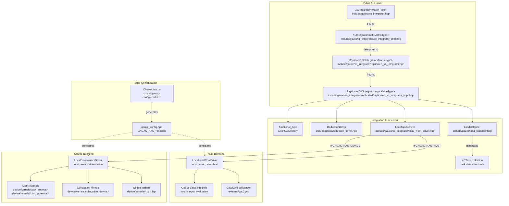
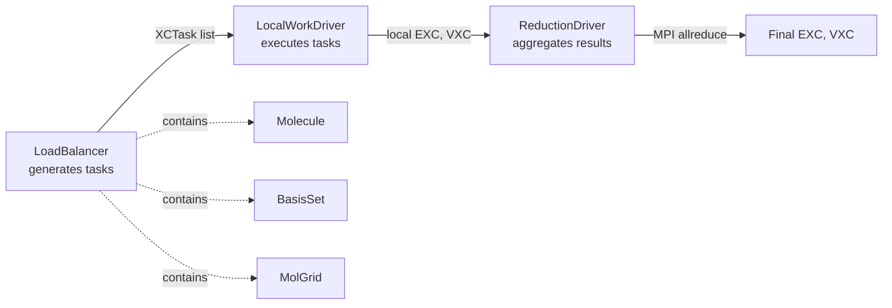
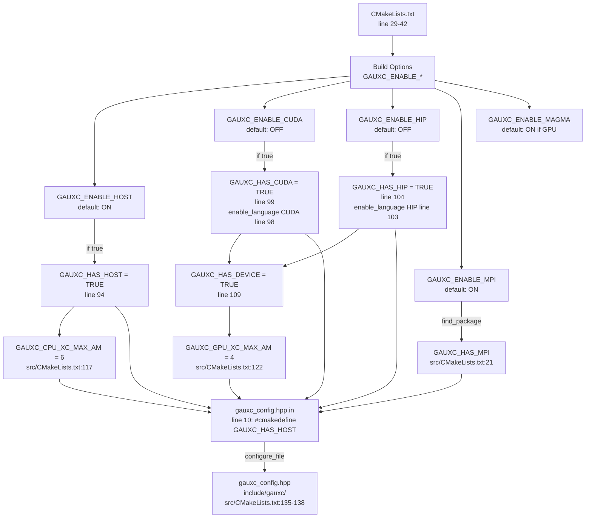
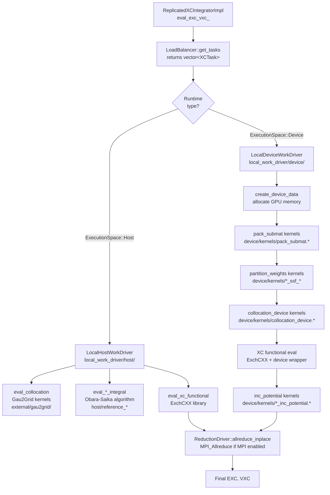
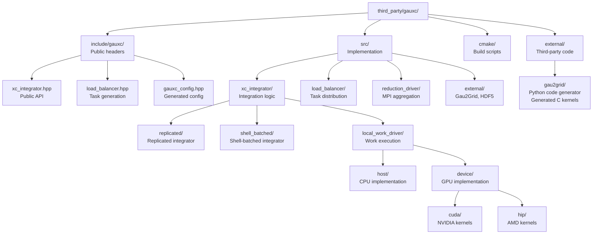

<!-- source: DeepWiki mcp.deepwiki.com · repo microsoft/skala · page 1 Overview · fetched 2026-10-26 -->

# Overview

Relevant source files

The following files were used as context for generating this wiki page:

- [third_party/gauxc/CMakeLists.txt](third_party/gauxc/CMakeLists.txt)
- [third_party/gauxc/attic/include/gauxc/new_xc_integrator/impl.hpp](third_party/gauxc/attic/include/gauxc/new_xc_integrator/impl.hpp)
- [third_party/gauxc/attic/include/gauxc/new_xc_integrator/replicated/impl.hpp](third_party/gauxc/attic/include/gauxc/new_xc_integrator/replicated/impl.hpp)
- [third_party/gauxc/attic/include/gauxc/new_xc_integrator/replicated/replicated_xc_integrator_impl.hpp](third_party/gauxc/attic/include/gauxc/new_xc_integrator/replicated/replicated_xc_integrator_impl.hpp)
- [third_party/gauxc/attic/include/gauxc/new_xc_integrator/replicated_xc_integrator.hpp](third_party/gauxc/attic/include/gauxc/new_xc_integrator/replicated_xc_integrator.hpp)
- [third_party/gauxc/attic/include/gauxc/new_xc_integrator/xc_integrator_impl.hpp](third_party/gauxc/attic/include/gauxc/new_xc_integrator/xc_integrator_impl.hpp)
- [third_party/gauxc/attic/include/gauxc/xc_integrator/impl.hpp](third_party/gauxc/attic/include/gauxc/xc_integrator/impl.hpp)
- [third_party/gauxc/attic/include/gauxc/xc_integrator/xc_integrator_impl.hpp](third_party/gauxc/attic/include/gauxc/xc_integrator/xc_integrator_impl.hpp)
- [third_party/gauxc/attic/src/integrator/cuda/gauxc-cuda_integrator.cmake](third_party/gauxc/attic/src/integrator/cuda/gauxc-cuda_integrator.cmake)
- [third_party/gauxc/attic/src/new_integrator/device/cuda/gauxc-cuda.cmake](third_party/gauxc/attic/src/new_integrator/device/cuda/gauxc-cuda.cmake)
- [third_party/gauxc/attic/src/new_integrator/device/hip/gauxc-hip.cmake](third_party/gauxc/attic/src/new_integrator/device/hip/gauxc-hip.cmake)
- [third_party/gauxc/attic/src/new_integrator/replicated_xc_integrator_impl.cxx](third_party/gauxc/attic/src/new_integrator/replicated_xc_integrator_impl.cxx)
- [third_party/gauxc/cmake/gauxc-config.cmake.in](third_party/gauxc/cmake/gauxc-config.cmake.in)
- [third_party/gauxc/cmake/gauxc-cub.cmake](third_party/gauxc/cmake/gauxc-cub.cmake)
- [third_party/gauxc/cmake/gauxc-cutlass.cmake](third_party/gauxc/cmake/gauxc-cutlass.cmake)
- [third_party/gauxc/include/gauxc/gauxc_config.hpp.in](third_party/gauxc/include/gauxc/gauxc_config.hpp.in)
- [third_party/gauxc/include/gauxc/util/environment.hpp](third_party/gauxc/include/gauxc/util/environment.hpp)
- [third_party/gauxc/include/gauxc/xc_integrator.hpp](third_party/gauxc/include/gauxc/xc_integrator.hpp)
- [third_party/gauxc/include/gauxc/xc_integrator/impl.hpp](third_party/gauxc/include/gauxc/xc_integrator/impl.hpp)
- [third_party/gauxc/include/gauxc/xc_integrator/replicated/impl.hpp](third_party/gauxc/include/gauxc/xc_integrator/replicated/impl.hpp)
- [third_party/gauxc/include/gauxc/xc_integrator/replicated/replicated_xc_integrator_impl.hpp](third_party/gauxc/include/gauxc/xc_integrator/replicated/replicated_xc_integrator_impl.hpp)
- [third_party/gauxc/include/gauxc/xc_integrator/replicated_xc_integrator.hpp](third_party/gauxc/include/gauxc/xc_integrator/replicated_xc_integrator.hpp)
- [third_party/gauxc/src/CMakeLists.txt](third_party/gauxc/src/CMakeLists.txt)
- [third_party/gauxc/src/external/CMakeLists.txt](third_party/gauxc/src/external/CMakeLists.txt)
- [third_party/gauxc/src/xc_integrator/local_work_driver/device/CMakeLists.txt](third_party/gauxc/src/xc_integrator/local_work_driver/device/CMakeLists.txt)
- [third_party/gauxc/src/xc_integrator/local_work_driver/device/cuda/CMakeLists.txt](third_party/gauxc/src/xc_integrator/local_work_driver/device/cuda/CMakeLists.txt)
- [third_party/gauxc/src/xc_integrator/local_work_driver/device/hip/CMakeLists.txt](third_party/gauxc/src/xc_integrator/local_work_driver/device/hip/CMakeLists.txt)
- [third_party/gauxc/src/xc_integrator/replicated/device/incore_replicated_xc_device_integrator_dd.hpp](third_party/gauxc/src/xc_integrator/replicated/device/incore_replicated_xc_device_integrator_dd.hpp)
- [third_party/gauxc/src/xc_integrator/replicated/host/reference_replicated_xc_host_integrator_dd_psi_potential.hpp](third_party/gauxc/src/xc_integrator/replicated/host/reference_replicated_xc_host_integrator_dd_psi_potential.hpp)
- [third_party/gauxc/src/xc_integrator/replicated/replicated_xc_integrator_impl.cxx](third_party/gauxc/src/xc_integrator/replicated/replicated_xc_integrator_impl.cxx)
- [third_party/gauxc/src/xc_integrator/shell_batched/shell_batched_replicated_xc_integrator_dd_psi.hpp](third_party/gauxc/src/xc_integrator/shell_batched/shell_batched_replicated_xc_integrator_dd_psi.hpp)
- [third_party/gauxc/src/xc_integrator/shell_batched/shell_batched_replicated_xc_integrator_dd_psi_potential.hpp](third_party/gauxc/src/xc_integrator/shell_batched/shell_batched_replicated_xc_integrator_dd_psi_potential.hpp)
- [third_party/gauxc/src/xc_integrator/shell_batched/shell_batched_replicated_xc_integrator_exc.hpp](third_party/gauxc/src/xc_integrator/shell_batched/shell_batched_replicated_xc_integrator_exc.hpp)
- [third_party/gauxc/src/xc_integrator/shell_batched/shell_batched_replicated_xc_integrator_exc_grad.hpp](third_party/gauxc/src/xc_integrator/shell_batched/shell_batched_replicated_xc_integrator_exc_grad.hpp)
- [third_party/gauxc/src/xc_integrator/shell_batched/shell_batched_replicated_xc_integrator_exc_vxc.hpp](third_party/gauxc/src/xc_integrator/shell_batched/shell_batched_replicated_xc_integrator_exc_vxc.hpp)
- [third_party/gauxc/src/xc_integrator/shell_batched/shell_batched_replicated_xc_integrator_exx.hpp](third_party/gauxc/src/xc_integrator/shell_batched/shell_batched_replicated_xc_integrator_exx.hpp)
- [third_party/gauxc/src/xc_integrator/shell_batched/shell_batched_replicated_xc_integrator_fxc_contraction.hpp](third_party/gauxc/src/xc_integrator/shell_batched/shell_batched_replicated_xc_integrator_fxc_contraction.hpp)
- [third_party/gauxc/src/xc_integrator/shell_batched/shell_batched_replicated_xc_integrator_integrate_den.hpp](third_party/gauxc/src/xc_integrator/shell_batched/shell_batched_replicated_xc_integrator_integrate_den.hpp)
- [third_party/gauxc/tests/environment.cxx](third_party/gauxc/tests/environment.cxx)

## Purpose and Scope

GauXC is a library for evaluating exchange-correlation (XC) integrals in density functional theory (DFT) calculations. It provides a high-performance implementation that supports both CPU and GPU execution, with parallelization via OpenMP and MPI. The library integrates numerical quadrature, basis function collocation, and XC functional evaluation to compute energies, potentials, and gradients required for Kohn-Sham DFT.

This page provides a high-level overview of the GauXC architecture, its major components, and how they interact. For specific subsystems:
- Build configuration and dependencies: see [Build System and Configuration](#2)
- Public API usage patterns: see [XCIntegrator API](#3)
- Host CPU implementation details: see [Host Computation](#6)
- GPU kernel implementation: see [Device Computation](#7)
- Task-based execution model: see [System Architecture](#4)

**Sources:** [third_party/gauxc/CMakeLists.txt:1-133](), [third_party/gauxc/include/gauxc/xc_integrator.hpp:1-96]()

---

## Library Architecture

GauXC employs a layered architecture separating public API, integration framework, and platform-specific computation backends.

**Sources:** [third_party/gauxc/include/gauxc/xc_integrator/replicated/replicated_xc_integrator_impl.hpp:20-204](), [third_party/gauxc/src/xc_integrator/replicated/replicated_xc_integrator_impl.cxx:13-20](), [third_party/gauxc/src/CMakeLists.txt:39-111]()

---

## Major Subsystems

### Public API: `XCIntegrator`

The `XCIntegrator<MatrixType>` template class provides the user-facing interface. It uses the PIMPL (Pointer to Implementation) pattern to hide implementation details and support multiple backend integrators.

| Method Signature | Purpose | Return Type |
|-----------------|---------|-------------|
| `eval_exc(P, settings)` | Compute XC energy only | `value_type` |
| `eval_exc_vxc(P, settings)` | Compute XC energy and potential (RKS) | `tuple<value_type, matrix_type>` |
| `eval_exc_vxc(Ps, Pz, settings)` | Compute XC energy and potential (UKS) | `tuple<value_type, matrix_type, matrix_type>` |
| `eval_exc_grad(P)` | Compute XC energy gradient | `vector<value_type>` |
| `eval_exx(P, settings)` | Compute exact exchange matrix | `matrix_type` |

The implementation delegates through `XCIntegratorImpl` → `ReplicatedXCIntegrator` → `ReplicatedXCIntegratorImpl`, where the final implementation contains the integration logic.

**Sources:** [third_party/gauxc/include/gauxc/xc_integrator.hpp:25-92](), [third_party/gauxc/include/gauxc/xc_integrator/impl.hpp:16-154](), [third_party/gauxc/include/gauxc/xc_integrator/replicated/impl.hpp:19-279]()

---

### Integration Framework Components

**LoadBalancer**: Distributes integration work across computational resources by partitioning the molecular grid and generating `XCTask` objects. Each task contains integration points, weights, basis function screening data, and shell lists.

**LocalWorkDriver**: Executes integration tasks on the local compute resource. Has two primary implementations:
- `LocalHostWorkDriver`: CPU execution using OpenMP
- `LocalDeviceWorkDriver`: GPU execution using CUDA or HIP

**ReductionDriver**: Aggregates integration results across MPI ranks using collective operations (`allreduce_inplace`).

**Sources:** [third_party/gauxc/include/gauxc/xc_integrator/replicated/replicated_xc_integrator_impl.hpp:29-36](), [third_party/gauxc/src/xc_integrator/replicated/replicated_xc_integrator_impl.cxx:13-20]()

---

## Build System and Configuration

GauXC uses CMake with extensive compile-time feature detection. The build process generates `gauxc_config.hpp` with macros controlling which code paths are compiled.

### CMake Configuration Flow

**Key Configuration Macros:**

| Macro | Purpose | Set When |
|-------|---------|----------|
| `GAUXC_HAS_HOST` | Enable CPU backend | `GAUXC_ENABLE_HOST=ON` |
| `GAUXC_HAS_CUDA` | Enable NVIDIA GPU backend | `GAUXC_ENABLE_CUDA=ON` |
| `GAUXC_HAS_HIP` | Enable AMD GPU backend | `GAUXC_ENABLE_HIP=ON` |
| `GAUXC_HAS_DEVICE` | Either CUDA or HIP enabled | Derived from above |
| `GAUXC_HAS_MPI` | Enable MPI parallelization | `GAUXC_ENABLE_MPI=ON` |
| `GAUXC_HAS_MAGMA` | Enable MAGMA linear algebra | `GAUXC_ENABLE_MAGMA=ON` (GPU only) |
| `GAUXC_CPU_XC_MAX_AM` | Max angular momentum for CPU | Set to 6 |
| `GAUXC_GPU_XC_MAX_AM` | Max angular momentum for GPU | Set to 4 |

**Sources:** [third_party/gauxc/CMakeLists.txt:29-112](), [third_party/gauxc/include/gauxc/gauxc_config.hpp.in:10-36](), [third_party/gauxc/src/CMakeLists.txt:116-138]()

---

## Execution Model

GauXC supports two execution paths selected at compile-time based on available hardware and build configuration.

**Host Path**: Tasks are processed using CPU-based collocation (Gau2Grid generated kernels) and Obara-Saika integral evaluation. OpenMP parallelization distributes tasks across CPU threads.

**Device Path**: Tasks are processed on GPU using specialized CUDA or HIP kernels. Data movement between host and device is managed by matrix pack/increment operations. GPU kernels exploit warp-level parallelism and shared memory.

**Sources:** [third_party/gauxc/src/xc_integrator/shell_batched/shell_batched_replicated_xc_integrator_exc_vxc.hpp:31-121](), [third_party/gauxc/include/gauxc/xc_integrator/local_work_driver.hpp:1-50]()

---

## Dependencies and External Libraries

GauXC relies on several external libraries, managed through CMake's dependency system:

**Always Required:**
- **ExchCXX**: XC functional library (evaluation of ε_xc, v_xc from density)
- **IntegratorXX**: Quadrature rule generation (atomic grid construction)

**Backend-Specific:**
- **BLAS/LAPACK**: Dense linear algebra for host computations
- **CUDAToolkit**: CUDA runtime, cuBLAS (if `GAUXC_HAS_CUDA`)
- **HIP/hipBLAS**: HIP runtime, hipBLAS (if `GAUXC_HAS_HIP`)
- **OpenMP or Threads**: CPU parallelization

**Optional:**
- **MPI**: Multi-node parallelization (enabled by `GAUXC_ENABLE_MPI`)
- **MAGMA**: GPU linear algebra (enabled by `GAUXC_ENABLE_MAGMA`, requires CUDA or HIP)
- **NCCL**: Multi-GPU communication (enabled by `GAUXC_ENABLE_NCCL`, requires CUDA)
- **CUTLASS**: Tensor operations (enabled by `GAUXC_ENABLE_CUTLASS`, requires CUDA CC ≥ 8.0)
- **HDF5**: I/O serialization (enabled by `GAUXC_ENABLE_HDF5`)
- **PyTorch**: OneDFT functional support (enabled by `GAUXC_ENABLE_ONEDFT`)

Dependencies are discovered via `find_package` and linked through exported CMake targets (`gauxc::gauxc`). The package configuration file exports all feature flags for downstream consumption.

**Sources:** [third_party/gauxc/cmake/gauxc-config.cmake.in:9-75](), [third_party/gauxc/src/CMakeLists.txt:10-103]()

---

## Code Organization

**Key Directories:**

- `include/gauxc/`: Public header files defining the user-facing API
- `src/xc_integrator/`: Core integration implementation
  - `replicated/`: Standard replicated-data integrator
  - `shell_batched/`: Shell-batched integrator with asynchronous execution
  - `local_work_driver/`: Platform-specific work execution
    - `host/`: CPU implementation with Gau2Grid and Obara-Saika
    - `device/`: GPU implementation with CUDA/HIP kernels
- `src/load_balancer/`: Task generation and grid partitioning
- `src/reduction_driver/`: MPI reduction operations
- `external/gau2grid/`: Python-based code generator for collocation kernels
- `cmake/`: Build system modules, dependency management, package config

**Sources:** [third_party/gauxc/src/CMakeLists.txt:1-248](), [third_party/gauxc/src/xc_integrator/local_work_driver/device/CMakeLists.txt:1-34](), [third_party/gauxc/src/xc_integrator/local_work_driver/device/cuda/CMakeLists.txt:1-54]()

---

## Next Steps

To understand specific aspects of GauXC:

1. **Building and configuring GauXC**: See [Build System and Configuration](#2) for CMake options, dependency management, and installation
2. **Using the public API**: See [XCIntegrator API](#3) for method signatures, usage patterns, and integration settings
3. **Understanding the integration pipeline**: See [System Architecture](#4) for load balancing, task execution, and data flow
4. **CPU implementation details**: See [Host Computation](#6) for Gau2Grid code generation and Obara-Saika integrals
5. **GPU implementation details**: See [Device Computation](#7) for kernel architecture, memory optimization, and CUDA/HIP support

**Sources:** [third_party/gauxc/CMakeLists.txt:1-133](), [third_party/gauxc/include/gauxc/xc_integrator.hpp:1-96](), [third_party/gauxc/src/xc_integrator/replicated/replicated_xc_integrator_impl.cxx:1-230]()

---

