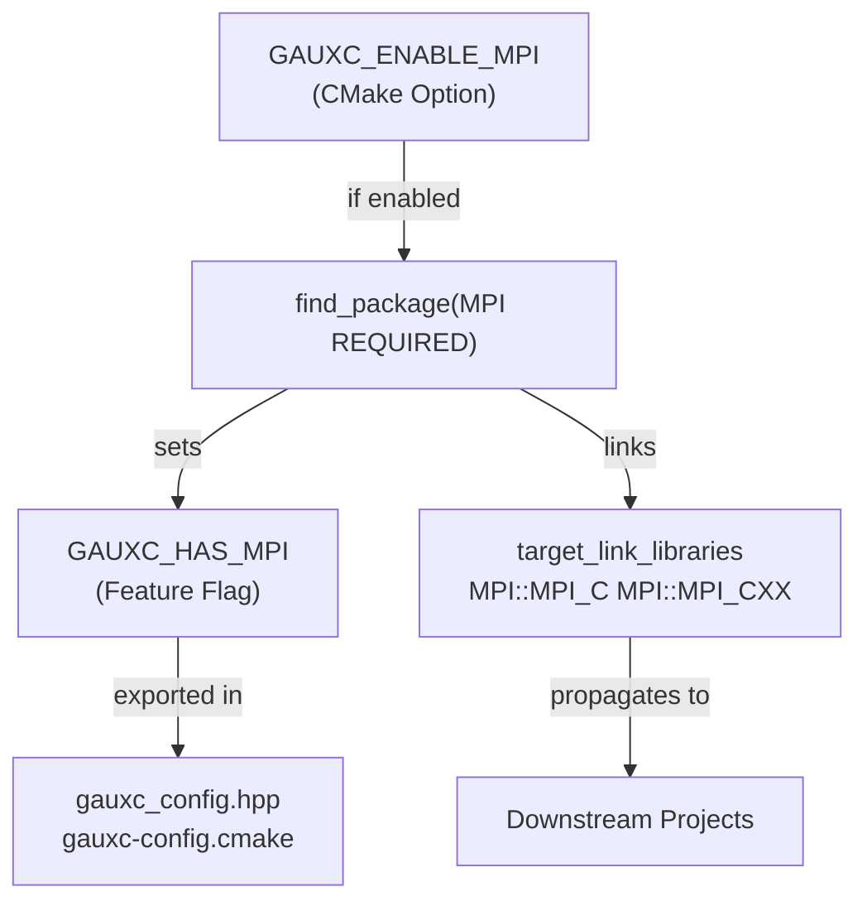
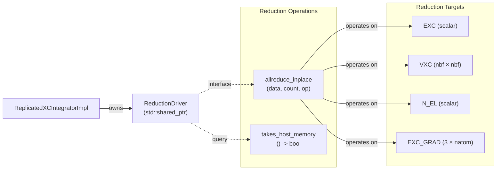
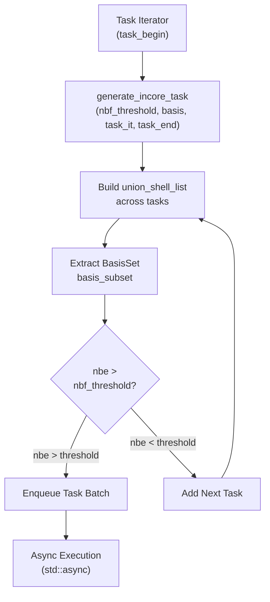
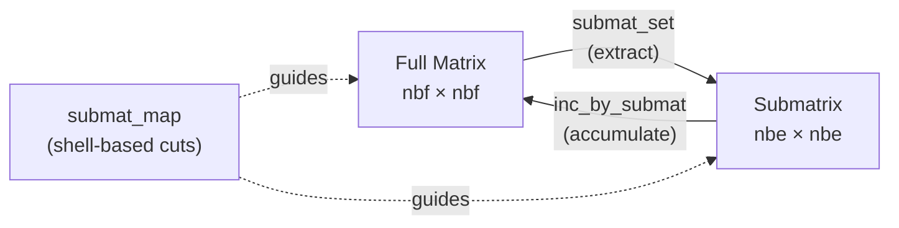
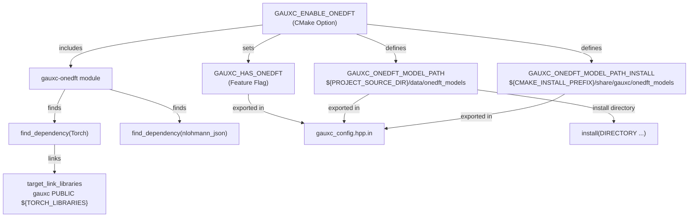
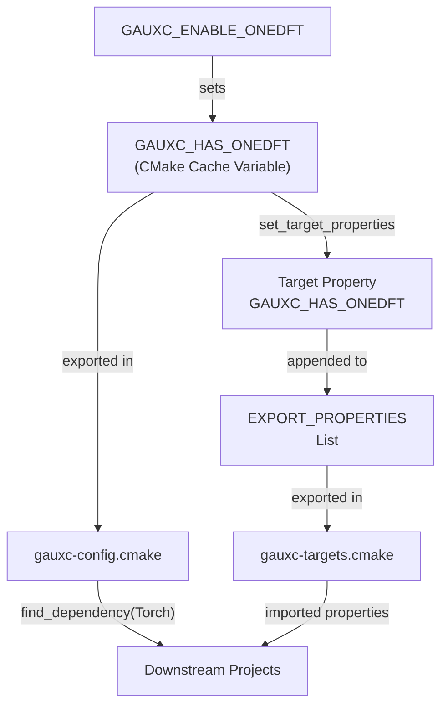

<!-- source: DeepWiki mcp.deepwiki.com · repo microsoft/skala · page 10 Advanced Topics · fetched 2026-10-26 -->

# Advanced Topics

<details>
<summary>Relevant source files</summary>

The following files were used as context for generating this wiki page:

- [third_party/gauxc/CMakeLists.txt](third_party/gauxc/CMakeLists.txt)
- [third_party/gauxc/attic/src/integrator/cuda/gauxc-cuda_integrator.cmake](third_party/gauxc/attic/src/integrator/cuda/gauxc-cuda_integrator.cmake)
- [third_party/gauxc/attic/src/new_integrator/device/cuda/gauxc-cuda.cmake](third_party/gauxc/attic/src/new_integrator/device/cuda/gauxc-cuda.cmake)
- [third_party/gauxc/attic/src/new_integrator/device/hip/gauxc-hip.cmake](third_party/gauxc/attic/src/new_integrator/device/hip/gauxc-hip.cmake)
- [third_party/gauxc/cmake/gauxc-config.cmake.in](third_party/gauxc/cmake/gauxc-config.cmake.in)
- [third_party/gauxc/cmake/gauxc-cub.cmake](third_party/gauxc/cmake/gauxc-cub.cmake)
- [third_party/gauxc/cmake/gauxc-cutlass.cmake](third_party/gauxc/cmake/gauxc-cutlass.cmake)
- [third_party/gauxc/include/gauxc/gauxc_config.hpp.in](third_party/gauxc/include/gauxc/gauxc_config.hpp.in)
- [third_party/gauxc/include/gauxc/util/environment.hpp](third_party/gauxc/include/gauxc/util/environment.hpp)
- [third_party/gauxc/include/gauxc/xc_integrator/replicated/impl.hpp](third_party/gauxc/include/gauxc/xc_integrator/replicated/impl.hpp)
- [third_party/gauxc/src/CMakeLists.txt](third_party/gauxc/src/CMakeLists.txt)
- [third_party/gauxc/src/external/CMakeLists.txt](third_party/gauxc/src/external/CMakeLists.txt)
- [third_party/gauxc/src/xc_integrator/local_work_driver/device/CMakeLists.txt](third_party/gauxc/src/xc_integrator/local_work_driver/device/CMakeLists.txt)
- [third_party/gauxc/src/xc_integrator/local_work_driver/device/cuda/CMakeLists.txt](third_party/gauxc/src/xc_integrator/local_work_driver/device/cuda/CMakeLists.txt)
- [third_party/gauxc/src/xc_integrator/local_work_driver/device/hip/CMakeLists.txt](third_party/gauxc/src/xc_integrator/local_work_driver/device/hip/CMakeLists.txt)
- [third_party/gauxc/src/xc_integrator/replicated/device/incore_replicated_xc_device_integrator_dd.hpp](third_party/gauxc/src/xc_integrator/replicated/device/incore_replicated_xc_device_integrator_dd.hpp)
- [third_party/gauxc/src/xc_integrator/replicated/host/reference_replicated_xc_host_integrator_dd_psi_potential.hpp](third_party/gauxc/src/xc_integrator/replicated/host/reference_replicated_xc_host_integrator_dd_psi_potential.hpp)
- [third_party/gauxc/src/xc_integrator/replicated/replicated_xc_integrator_impl.cxx](third_party/gauxc/src/xc_integrator/replicated/replicated_xc_integrator_impl.cxx)
- [third_party/gauxc/src/xc_integrator/shell_batched/shell_batched_replicated_xc_integrator_dd_psi.hpp](third_party/gauxc/src/xc_integrator/shell_batched/shell_batched_replicated_xc_integrator_dd_psi.hpp)
- [third_party/gauxc/src/xc_integrator/shell_batched/shell_batched_replicated_xc_integrator_dd_psi_potential.hpp](third_party/gauxc/src/xc_integrator/shell_batched/shell_batched_replicated_xc_integrator_dd_psi_potential.hpp)
- [third_party/gauxc/src/xc_integrator/shell_batched/shell_batched_replicated_xc_integrator_exc.hpp](third_party/gauxc/src/xc_integrator/shell_batched/shell_batched_replicated_xc_integrator_exc.hpp)
- [third_party/gauxc/src/xc_integrator/shell_batched/shell_batched_replicated_xc_integrator_exc_grad.hpp](third_party/gauxc/src/xc_integrator/shell_batched/shell_batched_replicated_xc_integrator_exc_grad.hpp)
- [third_party/gauxc/src/xc_integrator/shell_batched/shell_batched_replicated_xc_integrator_exc_vxc.hpp](third_party/gauxc/src/xc_integrator/shell_batched/shell_batched_replicated_xc_integrator_exc_vxc.hpp)
- [third_party/gauxc/src/xc_integrator/shell_batched/shell_batched_replicated_xc_integrator_exx.hpp](third_party/gauxc/src/xc_integrator/shell_batched/shell_batched_replicated_xc_integrator_exx.hpp)
- [third_party/gauxc/src/xc_integrator/shell_batched/shell_batched_replicated_xc_integrator_fxc_contraction.hpp](third_party/gauxc/src/xc_integrator/shell_batched/shell_batched_replicated_xc_integrator_fxc_contraction.hpp)
- [third_party/gauxc/src/xc_integrator/shell_batched/shell_batched_replicated_xc_integrator_integrate_den.hpp](third_party/gauxc/src/xc_integrator/shell_batched/shell_batched_replicated_xc_integrator_integrate_den.hpp)
- [third_party/gauxc/tests/environment.cxx](third_party/gauxc/tests/environment.cxx)

</details>


This page covers specialized features, performance optimization techniques, and advanced usage patterns in GauXC. It documents MPI-based distributed computing, performance tuning parameters and strategies, and the integration of machine learning-based functionals through OneDFT. For information about the core integration methodology, see [System Architecture](#4). For GPU-specific optimization techniques, see [GPU Kernel Optimization Techniques](#8).

---

## MPI Parallelization

GauXC supports distributed-memory parallelism through MPI, enabling computations to be distributed across multiple nodes. The implementation uses a replicated data model where each MPI rank performs local work on the same molecular system but different quadrature tasks, followed by collective reduction operations to aggregate results.

### Configuration and Build-Time Setup

MPI support is controlled by the `GAUXC_ENABLE_MPI` CMake option, which when enabled, triggers dependency discovery and sets the `GAUXC_HAS_MPI` feature flag.

**Configuration Flow:**



**Sources:** [third_party/gauxc/CMakeLists.txt:33](), [third_party/gauxc/src/CMakeLists.txt:18-24](), [third_party/gauxc/cmake/gauxc-config.cmake.in:19,55-57]()

### ReductionDriver Architecture

The `ReductionDriver` class provides the abstraction layer for MPI collective operations. All reduction operations in GauXC are routed through this interface, which handles both in-place and out-of-place reductions.

**ReductionDriver Integration:**



**Sources:** [third_party/gauxc/src/xc_integrator/replicated/replicated_xc_integrator_impl.cxx:18-20](), [third_party/gauxc/src/xc_integrator/shell_batched/shell_batched_replicated_xc_integrator_exc_vxc.hpp:105-115]()

### Replicated Data Model and Reduction Pattern

Each MPI rank maintains a full copy of the molecular basis set, density matrices, and molecular geometry. Work is distributed by partitioning the quadrature grid tasks across ranks. Local results are accumulated independently, then combined via MPI_Allreduce operations.

**Typical Reduction Sequence in `eval_exc_vxc`:**

| Quantity | Data Type | Size | Operation | Purpose |
|----------|-----------|------|-----------|---------|
| `VXCs` | `value_type*` | `nbf × nbf` | `ReductionOp::Sum` | Aggregate scalar potential matrix |
| `VXCz` | `value_type*` | `nbf × nbf` | `ReductionOp::Sum` | Aggregate z-spin potential (UKS/GKS) |
| `VXCy` | `value_type*` | `nbf × nbf` | `ReductionOp::Sum` | Aggregate y-spin potential (GKS) |
| `VXCx` | `value_type*` | `nbf × nbf` | `ReductionOp::Sum` | Aggregate x-spin potential (GKS) |
| `EXC` | `value_type*` | 1 | `ReductionOp::Sum` | Aggregate exchange-correlation energy |
| `N_EL` | `value_type*` | 1 | `ReductionOp::Sum` | Aggregate electron count (diagnostic) |

**Code Example from Shell-Batched Integrator:**

The reduction phase occurs after all local work is complete:

[third_party/gauxc/src/xc_integrator/shell_batched/shell_batched_replicated_xc_integrator_exc_vxc.hpp:105-115]()

```cpp
this->timer_.time_op("XCIntegrator.Allreduce", [&](){
  if( not this->reduction_driver_->takes_host_memory() )
    GAUXC_GENERIC_EXCEPTION("This Module Only Works With Host Reductions");

  this->reduction_driver_->allreduce_inplace( VXCs, nbf*nbf, ReductionOp::Sum );
  if(VXCz) this->reduction_driver_->allreduce_inplace( VXCz, nbf*nbf, ReductionOp::Sum );
  if(VXCy) this->reduction_driver_->allreduce_inplace( VXCy, nbf*nbf, ReductionOp::Sum ); 
  if(VXCx) this->reduction_driver_->allreduce_inplace( VXCx, nbf*nbf, ReductionOp::Sum );
  this->reduction_driver_->allreduce_inplace( EXC,   1    , ReductionOp::Sum );
  this->reduction_driver_->allreduce_inplace( &N_EL, 1    , ReductionOp::Sum );
});
```

**Sources:** [third_party/gauxc/src/xc_integrator/shell_batched/shell_batched_replicated_xc_integrator_exc_vxc.hpp:105-115]()

### Memory Requirements

The replicated model requires each MPI rank to allocate memory for:
- Full density matrices: `nbf × nbf × sizeof(value_type)` per spin component
- Full potential matrices: `nbf × nbf × sizeof(value_type)` per spin component  
- Full basis set metadata
- Local task data structures

For device execution, the `takes_host_memory()` query ensures the `ReductionDriver` operates on host-accessible memory. Device-computed results must be transferred to host before reduction.

**Sources:** [third_party/gauxc/src/xc_integrator/shell_batched/shell_batched_replicated_xc_integrator_exc_vxc.hpp:106-107]()

---

## Performance Tuning Guide

GauXC provides several tunable parameters that significantly impact performance. This section documents the key parameters, their default values, and guidelines for adjustment.

### Shell Batching Threshold

The `nbf_threshold` parameter controls task batching in the shell-batched integrator. Tasks are grouped into batches until the union of their shell lists produces a subbasis with `nbe` (number of basis functions in extracted basis) exceeding this threshold.

**Default Value and Location:**

[third_party/gauxc/src/xc_integrator/shell_batched/shell_batched_replicated_xc_integrator_exc_vxc.hpp:172]()

```cpp
const uint32_t nbf_threshold = 8000;
```

**Impact:**
- **Lower values** (1000-4000): More frequent submatrix extraction, higher overhead, better memory locality
- **Higher values** (8000-16000): Fewer batches, larger working sets, better amortization of fixed costs
- **Optimal range**: Depends on system size and available memory (CPU vs GPU)

**Task Batching Algorithm:**



**Sources:** [third_party/gauxc/src/xc_integrator/shell_batched/shell_batched_replicated_xc_integrator_exc_vxc.hpp:172,238-240]()

### Asynchronous Execution Pipeline

The shell-batched integrator uses a producer-consumer pattern with asynchronous execution to overlap task generation with task execution.

**Pipeline Structure:**

| Phase | Operation | Synchronization |
|-------|-----------|-----------------|
| Producer | Generate next task batch via `generate_incore_task` | Lock-free (separate iterator) |
| Queue | Enqueue task in `std::queue<incore_task_data>` | Mutex-protected |
| Consumer | Execute batch via `std::async(std::launch::async, ...)` | Future-based |
| Wait Strategy | Poll `task_future.wait_for(5ms)` | Non-blocking check |

**Code Pattern:**

[third_party/gauxc/src/xc_integrator/shell_batched/shell_batched_replicated_xc_integrator_exc_vxc.hpp:234-258]()

The pattern allows overlapping:
1. Submatrix extraction for next batch
2. GPU kernel execution for current batch  
3. Data transfers between batches

**Tuning Parameters:**
- Poll interval: 5ms default at line 250
- Queue depth: Unbounded (limited by memory)
- Thread pool: Single async thread per iteration

**Sources:** [third_party/gauxc/src/xc_integrator/shell_batched/shell_batched_replicated_xc_integrator_exc_vxc.hpp:230-258]()

### Memory Allocation Strategy

**Host Memory Allocation:**

Temporary buffers are allocated on-demand in the task execution path:

| Buffer | Purpose | Size | Frequency |
|--------|---------|------|-----------|
| `Ps_submat_host` | Extracted density (scalar) | `nbe × nbe` | Per batch |
| `VXCs_submat_host` | Local potential (scalar) | `nbe × nbe` | Per batch |
| `Pz_submat_host` | Extracted density (z-spin) | `nbe × nbe` | Per batch (UKS/GKS) |
| `VXCz_submat_host` | Local potential (z-spin) | `nbe × nbe` | Per batch (UKS/GKS) |

[third_party/gauxc/src/xc_integrator/shell_batched/shell_batched_replicated_xc_integrator_exc_vxc.hpp:328-363]()

**Device Memory Allocation:**

Device memory is allocated once and reused across all batches:

[third_party/gauxc/src/xc_integrator/shell_batched/shell_batched_replicated_xc_integrator_exc_vxc.hpp:76-83]()

```cpp
#ifdef GAUXC_HAS_DEVICE
auto* lwd = dynamic_cast<LocalDeviceWorkDriver*>(this->local_work_driver_.get() );
auto rt  = detail::as_device_runtime(this->load_balancer_->runtime());
if constexpr (IncoreIntegratorType::is_device) {
  device_data_ptr_ = 
    this->timer_.time_op("XCIntegrator.DeviceAlloc",
      [&](){ return lwd->create_device_data(rt); });
}
#endif
```

The device data is released after all batches complete at line 118.

**Sources:** [third_party/gauxc/src/xc_integrator/shell_batched/shell_batched_replicated_xc_integrator_exc_vxc.hpp:76-83,118,328-363]()

### Submatrix Extraction Performance

Submatrix operations (`submat_set` and `inc_by_submat`) are performance-critical. The `gen_compressed_submat_map` function creates a map of non-zero blocks to minimize data movement.

**Extraction Pattern:**



**Timing Breakdown:**

The code explicitly times these operations:

[third_party/gauxc/src/xc_integrator/shell_batched/shell_batched_replicated_xc_integrator_exc_vxc.hpp:297-301,313-323,373-387,412-428]()

```cpp
this->timer_.time_op_accumulate("XCIntegrator.CopySubBasis", ...);
this->timer_.time_op_accumulate("XCIntegrator.RecalcShellList", ...);
this->timer_.time_op_accumulate("XCIntegrator.ExtractSubDensity", ...);
this->timer_.time_op_accumulate("XCIntegrator.IncrementSubPotential", ...);
```

**Performance Consideration:** For systems with `nbf > 2000`, submatrix operations can dominate wall time. Increasing `nbf_threshold` reduces the frequency of these operations at the cost of larger working sets.

**Sources:** [third_party/gauxc/src/xc_integrator/shell_batched/shell_batched_replicated_xc_integrator_exc_vxc.hpp:297-301,313-323,373-387,412-428]()

### Angular Momentum Limits

GauXC uses compile-time constants to limit the maximum angular momentum (`L`) supported on different execution backends:

| Platform | XC Integration | SNLINK | Configuration Location |
|----------|----------------|--------|------------------------|
| CPU | `L = 6` | `L = 6` | [src/CMakeLists.txt:117-118]() |
| GPU | `L = 4` | `L = 2` | [src/CMakeLists.txt:122-123]() |

These limits are exported as CMake properties and accessible at runtime via `gauxc_max_am(ExecutionSpace, SupportedAlg)`:

[third_party/gauxc/include/gauxc/util/environment.hpp:14-40]()

**Rationale:**
- GPU kernels for `L > 4` would require excessive register pressure
- CPU kernels for high `L` are generated at compile-time by Gau2Grid
- SNLINK (shell-pair linking) has lower limits due to algorithmic complexity

**Sources:** [third_party/gauxc/src/CMakeLists.txt:117-124](), [third_party/gauxc/include/gauxc/util/environment.hpp:14-40](), [third_party/gauxc/tests/environment.cxx:12-46]()

---

## OneDFT Functional Integration

OneDFT is a machine learning-based density functional that uses PyTorch neural network models to predict exchange-correlation energies and potentials. GauXC provides optional support for OneDFT evaluation alongside traditional functionals.

### Build Configuration

OneDFT support is controlled by `GAUXC_ENABLE_ONEDFT`, which triggers PyTorch dependency discovery and model path configuration.

**Configuration Workflow:**



**Sources:** [third_party/gauxc/CMakeLists.txt:38](), [third_party/gauxc/src/CMakeLists.txt:26-32,101-103,126-132](), [third_party/gauxc/include/gauxc/gauxc_config.hpp.in:19,22-25]()

### PyTorch Integration

The OneDFT module links against PyTorch and requires special handling of CUDA architectures because PyTorch's CMake configuration can override `CMAKE_CUDA_ARCHITECTURES`.

**CUDA Architecture Restoration:**

[third_party/gauxc/cmake/gauxc-config.cmake.in:67-75]()

```cmake
if ( GAUXC_HAS_ONEDFT )
  set(_PREV_CUDA_ARCHS "${CMAKE_CUDA_ARCHITECTURES}")
  find_dependency ( Torch )
  if(CMAKE_CUDA_ARCHITECTURES STREQUAL "OFF")
    set(CMAKE_CUDA_ARCHITECTURES "${_PREV_CUDA_ARCHS}" CACHE STRING "Restore CUDA archs after Torch override" FORCE)
    message(WARNING "Torch set CMAKE_CUDA_ARCHITECTURES to OFF. Restored previous value: ${CMAKE_CUDA_ARCHITECTURES}")
  endif()
  find_dependency ( nlohmann_json )
endif()
```

This pattern preserves the user's CUDA architecture settings after PyTorch linkage.

**Sources:** [third_party/gauxc/cmake/gauxc-config.cmake.in:67-75]()

### Model Path Configuration

OneDFT models are stored in a designated directory and installed alongside the library. The paths are configurable at build and install time.

**Model Path Hierarchy:**

| Context | Variable | Default Value | Definition Location |
|---------|----------|---------------|---------------------|
| Build | `GAUXC_ONEDFT_MODEL_PATH` | `${PROJECT_SOURCE_DIR}/data/onedft_models` | [src/CMakeLists.txt:30]() |
| Install | `GAUXC_ONEDFT_MODEL_PATH_INSTALL` | `${CMAKE_INSTALL_PREFIX}/share/gauxc/onedft_models` | [src/CMakeLists.txt:127]() |
| Runtime | `GAUXC_ONEDFT_MODEL_PATH` | Preprocessor macro | [gauxc_config.hpp.in:23]() |
| Runtime | `GAUXC_ONEDFT_MODEL_PATH_INSTALL` | Preprocessor macro | [gauxc_config.hpp.in:24]() |

**Installation Directive:**

[third_party/gauxc/src/CMakeLists.txt:128-131]()

```cmake
install( 
  DIRECTORY  ${GAUXC_ONEDFT_MODEL_PATH}
  DESTINATION "${CMAKE_INSTALL_PREFIX}/share/gauxc"
)
```

This ensures model files are distributed with the installed library.

**Sources:** [third_party/gauxc/src/CMakeLists.txt:26-32,126-132](), [third_party/gauxc/include/gauxc/gauxc_config.hpp.in:22-25]()

### Evaluation Interface

OneDFT functionals are accessed through a dedicated evaluation method `eval_exc_vxc_onedft` that bypasses the standard ExchCXX functional evaluation.

**API Entry Point:**

[third_party/gauxc/include/gauxc/xc_integrator/replicated/impl.hpp:161-174]()

```cpp
template <typename MatrixType>
typename ReplicatedXCIntegrator<MatrixType>::exc_vxc_type_uks
  ReplicatedXCIntegrator<MatrixType>::eval_exc_vxc_onedft_(
    const MatrixType& Ps, const MatrixType& Pz, 
    const IntegratorSettingsXC& ks_settings) {
  
  if( not pimpl_ ) GAUXC_PIMPL_NOT_INITIALIZED();
  matrix_type VXCs( Ps.rows(), Ps.cols() );
  matrix_type VXCz( Pz.rows(), Pz.cols() );
  value_type  EXC;

  pimpl_->eval_exc_vxc_onedft( ... );
  return std::make_tuple( EXC, VXCs, VXCz );
}
```

**Implementation Delegation:**

[third_party/gauxc/src/xc_integrator/replicated/replicated_xc_integrator_impl.cxx:94-108]()

The base implementation delegates to `eval_exc_vxc_onedft_`, which is implemented in concrete integrator types (e.g., `ReferenceReplicatedXCHostIntegrator`).

**Unsupported in Shell-Batched Integrator:**

The shell-batched integrator currently throws an exception for OneDFT:

[third_party/gauxc/src/xc_integrator/shell_batched/shell_batched_replicated_xc_integrator_dd_psi.hpp:27-36]()

```cpp
template <typename BaseIntegratorType, typename IncoreIntegratorType>
void ShellBatchedReplicatedXCIntegrator<...>::
  eval_exc_vxc_onedft_(...) {
    GAUXC_GENERIC_EXCEPTION("ShellBatched 1DFT NYI");
    ...
  }
```

**Sources:** [third_party/gauxc/include/gauxc/xc_integrator/replicated/impl.hpp:161-174](), [third_party/gauxc/src/xc_integrator/replicated/replicated_xc_integrator_impl.cxx:94-108](), [third_party/gauxc/src/xc_integrator/shell_batched/shell_batched_replicated_xc_integrator_dd_psi.hpp:27-36]()

### Feature Flag Propagation

The `GAUXC_HAS_ONEDFT` flag is propagated through the build system to downstream consumers:

**Export Mechanism:**



**Property Export:**

[third_party/gauxc/src/CMakeLists.txt:152-191]()

The `GAUXC_HAS_ONEDFT` property is included in the export list and propagated to downstream projects via `gauxc-targets.cmake`.

**Sources:** [third_party/gauxc/src/CMakeLists.txt:152-191](), [third_party/gauxc/cmake/gauxc-config.cmake.in:24,67-75]()

---

