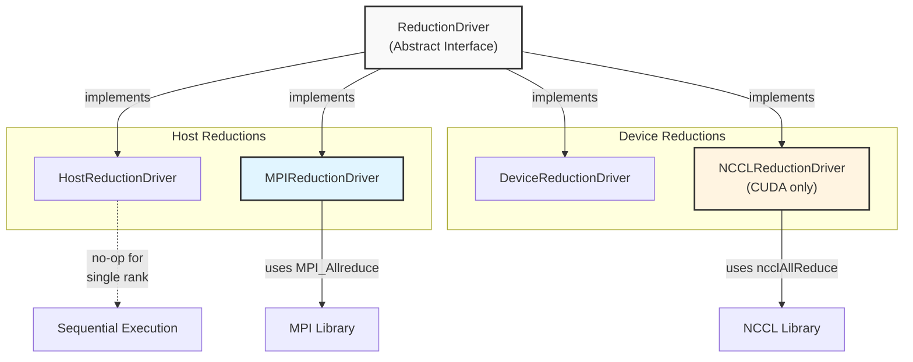
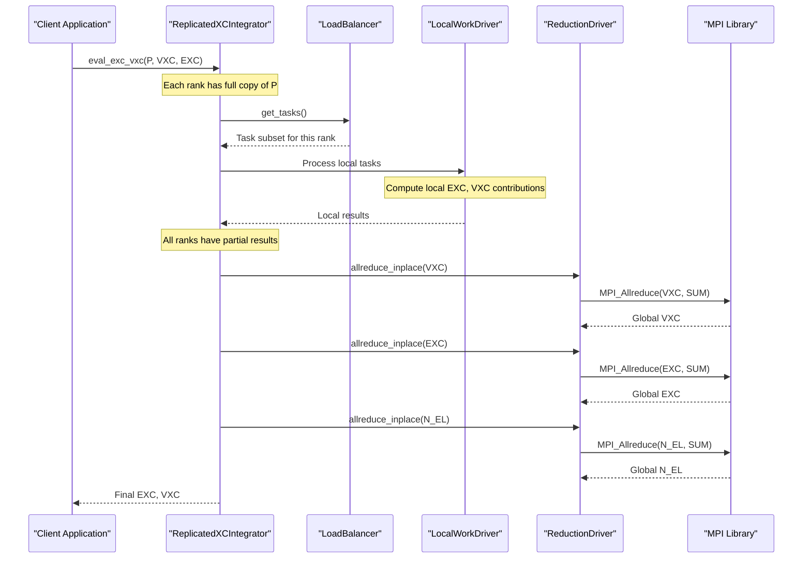
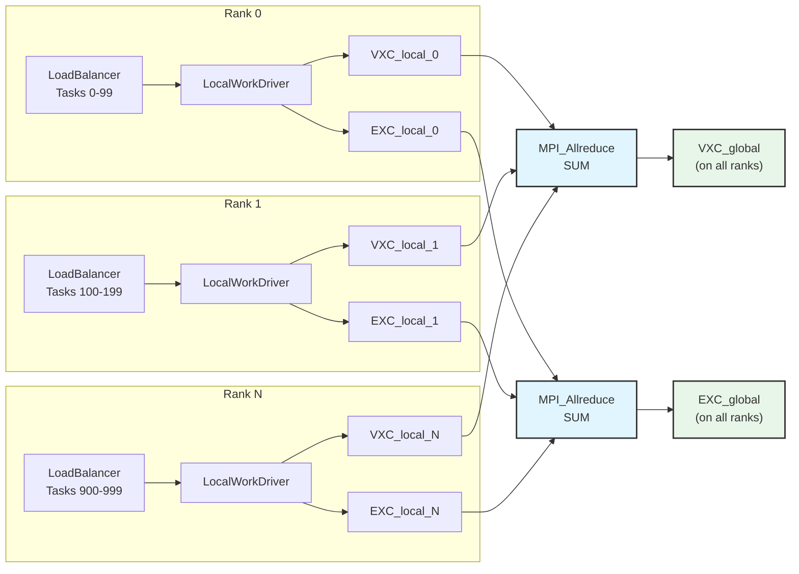
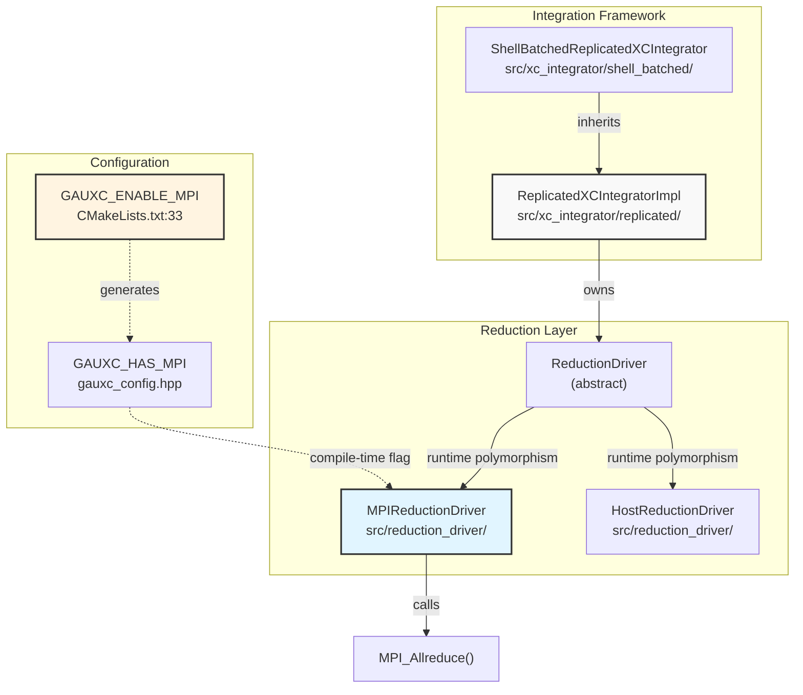

<!-- source: DeepWiki mcp.deepwiki.com · repo microsoft/skala · page 10.1 MPI Parallelization · fetched 2026-10-26 -->

# MPI Parallelization

<details>
<summary>Relevant source files</summary>

The following files were used as context for generating this wiki page:

- [third_party/gauxc/CMakeLists.txt](third_party/gauxc/CMakeLists.txt)
- [third_party/gauxc/attic/src/integrator/cuda/gauxc-cuda_integrator.cmake](third_party/gauxc/attic/src/integrator/cuda/gauxc-cuda_integrator.cmake)
- [third_party/gauxc/attic/src/new_integrator/device/cuda/gauxc-cuda.cmake](third_party/gauxc/attic/src/new_integrator/device/cuda/gauxc-cuda.cmake)
- [third_party/gauxc/attic/src/new_integrator/device/hip/gauxc-hip.cmake](third_party/gauxc/attic/src/new_integrator/device/hip/gauxc-hip.cmake)
- [third_party/gauxc/cmake/gauxc-config.cmake.in](third_party/gauxc/cmake/gauxc-config.cmake.in)
- [third_party/gauxc/cmake/gauxc-cub.cmake](third_party/gauxc/cmake/gauxc-cub.cmake)
- [third_party/gauxc/cmake/gauxc-cutlass.cmake](third_party/gauxc/cmake/gauxc-cutlass.cmake)
- [third_party/gauxc/include/gauxc/gauxc_config.hpp.in](third_party/gauxc/include/gauxc/gauxc_config.hpp.in)
- [third_party/gauxc/include/gauxc/util/environment.hpp](third_party/gauxc/include/gauxc/util/environment.hpp)
- [third_party/gauxc/include/gauxc/xc_integrator/replicated/impl.hpp](third_party/gauxc/include/gauxc/xc_integrator/replicated/impl.hpp)
- [third_party/gauxc/src/CMakeLists.txt](third_party/gauxc/src/CMakeLists.txt)
- [third_party/gauxc/src/external/CMakeLists.txt](third_party/gauxc/src/external/CMakeLists.txt)
- [third_party/gauxc/src/xc_integrator/local_work_driver/device/CMakeLists.txt](third_party/gauxc/src/xc_integrator/local_work_driver/device/CMakeLists.txt)
- [third_party/gauxc/src/xc_integrator/local_work_driver/device/cuda/CMakeLists.txt](third_party/gauxc/src/xc_integrator/local_work_driver/device/cuda/CMakeLists.txt)
- [third_party/gauxc/src/xc_integrator/local_work_driver/device/hip/CMakeLists.txt](third_party/gauxc/src/xc_integrator/local_work_driver/device/hip/CMakeLists.txt)
- [third_party/gauxc/src/xc_integrator/replicated/device/incore_replicated_xc_device_integrator_dd.hpp](third_party/gauxc/src/xc_integrator/replicated/device/incore_replicated_xc_device_integrator_dd.hpp)
- [third_party/gauxc/src/xc_integrator/replicated/host/reference_replicated_xc_host_integrator_dd_psi_potential.hpp](third_party/gauxc/src/xc_integrator/replicated/host/reference_replicated_xc_host_integrator_dd_psi_potential.hpp)
- [third_party/gauxc/src/xc_integrator/replicated/replicated_xc_integrator_impl.cxx](third_party/gauxc/src/xc_integrator/replicated/replicated_xc_integrator_impl.cxx)
- [third_party/gauxc/src/xc_integrator/shell_batched/shell_batched_replicated_xc_integrator_dd_psi.hpp](third_party/gauxc/src/xc_integrator/shell_batched/shell_batched_replicated_xc_integrator_dd_psi.hpp)
- [third_party/gauxc/src/xc_integrator/shell_batched/shell_batched_replicated_xc_integrator_dd_psi_potential.hpp](third_party/gauxc/src/xc_integrator/shell_batched/shell_batched_replicated_xc_integrator_dd_psi_potential.hpp)
- [third_party/gauxc/src/xc_integrator/shell_batched/shell_batched_replicated_xc_integrator_exc.hpp](third_party/gauxc/src/xc_integrator/shell_batched/shell_batched_replicated_xc_integrator_exc.hpp)
- [third_party/gauxc/src/xc_integrator/shell_batched/shell_batched_replicated_xc_integrator_exc_grad.hpp](third_party/gauxc/src/xc_integrator/shell_batched/shell_batched_replicated_xc_integrator_exc_grad.hpp)
- [third_party/gauxc/src/xc_integrator/shell_batched/shell_batched_replicated_xc_integrator_exc_vxc.hpp](third_party/gauxc/src/xc_integrator/shell_batched/shell_batched_replicated_xc_integrator_exc_vxc.hpp)
- [third_party/gauxc/src/xc_integrator/shell_batched/shell_batched_replicated_xc_integrator_exx.hpp](third_party/gauxc/src/xc_integrator/shell_batched/shell_batched_replicated_xc_integrator_exx.hpp)
- [third_party/gauxc/src/xc_integrator/shell_batched/shell_batched_replicated_xc_integrator_fxc_contraction.hpp](third_party/gauxc/src/xc_integrator/shell_batched/shell_batched_replicated_xc_integrator_fxc_contraction.hpp)
- [third_party/gauxc/src/xc_integrator/shell_batched/shell_batched_replicated_xc_integrator_integrate_den.hpp](third_party/gauxc/src/xc_integrator/shell_batched/shell_batched_replicated_xc_integrator_integrate_den.hpp)
- [third_party/gauxc/tests/environment.cxx](third_party/gauxc/tests/environment.cxx)

</details>


## Purpose and Scope

This page documents GauXC's MPI parallelization strategy, including the replicated data model, reduction operations, and build-time configuration for distributed computing. MPI support enables multi-node execution of exchange-correlation integration tasks with efficient data aggregation across ranks.

For information about task distribution within a single rank, see [Task System and Data Structures](#4.3). For GPU-specific multi-device parallelization using NCCL, see [Dependency Management](#2.2).

**Sources:** [third_party/gauxc/src/xc_integrator/shell_batched/shell_batched_replicated_xc_integrator_exc_vxc.hpp:1-122](), [third_party/gauxc/src/xc_integrator/replicated/replicated_xc_integrator_impl.cxx:1-230]()

---

## Replicated Data Model

GauXC implements a **replicated data model** for MPI parallelization, where each MPI rank maintains a complete copy of all input data (basis set, molecular geometry, density matrices) and computational infrastructure. Work distribution occurs at the task level, not the data level.

### Key Characteristics

| Aspect | Strategy |
|--------|----------|
| **Data Distribution** | Fully replicated across all ranks |
| **Work Distribution** | Task-level partitioning via `LoadBalancer` |
| **Communication Pattern** | Allreduce for result aggregation |
| **Memory Model** | Each rank allocates independent local buffers |
| **Consistency** | Input data identical across all ranks |

This design simplifies implementation by avoiding complex data redistribution while maintaining efficient parallel scaling through computation-heavy task execution with minimal communication.

**Sources:** [third_party/gauxc/src/xc_integrator/replicated/replicated_xc_integrator_impl.cxx:13-24](), Diagram 6 from system architecture

---

## Build Configuration

### CMake Options

MPI support is controlled by the `GAUXC_ENABLE_MPI` CMake option, which defaults to `ON`:

```cmake
option( GAUXC_ENABLE_MPI "Enable MPI Bindings" ON )
```

When enabled, the build system:
1. Discovers MPI via `find_package(MPI REQUIRED)`
2. Sets `GAUXC_HAS_MPI` cache variable to `TRUE`
3. Links `MPI::MPI_C` and `MPI::MPI_CXX` targets to `gauxc`
4. Defines `GAUXC_HAS_MPI` preprocessor macro in `gauxc_config.hpp`

**Sources:** [third_party/gauxc/CMakeLists.txt:33](), [third_party/gauxc/src/CMakeLists.txt:18-24](), [third_party/gauxc/src/CMakeLists.txt:97-99]()

### Dependency Discovery

The MPI dependency is discovered in `src/CMakeLists.txt`:

```cmake
if( GAUXC_ENABLE_MPI )
  message( STATUS "GauXC Enabling MPI" )
  find_package( MPI REQUIRED )
  set(GAUXC_HAS_MPI TRUE CACHE BOOL "GauXC Has MPI" FORCE)
else()
  message( STATUS "GauXC Disabling MPI" )
endif()
```

And linked to the library:

```cmake
if( GAUXC_HAS_MPI )
  target_link_libraries( gauxc PUBLIC MPI::MPI_C MPI::MPI_CXX )
endif()
```

**Sources:** [third_party/gauxc/src/CMakeLists.txt:18-24](), [third_party/gauxc/src/CMakeLists.txt:97-99]()

### Package Configuration Export

MPI status is exported to downstream projects via `gauxc-config.cmake.in`:

```cmake
set( GAUXC_HAS_MPI @GAUXC_HAS_MPI@ )

if( GAUXC_HAS_MPI )
  find_dependency( MPI )
endif()
```

This ensures that projects consuming GauXC automatically discover and link MPI if the library was built with MPI support.

**Sources:** [third_party/gauxc/cmake/gauxc-config.cmake.in:19](), [third_party/gauxc/cmake/gauxc-config.cmake.in:55-57]()

---

## ReductionDriver Architecture

### Class Hierarchy



**Sources:** [third_party/gauxc/src/reduction_driver]() directory structure, inferred from usage patterns

### Key Interface Methods

The `ReductionDriver` abstract class defines the aggregation interface:

| Method | Purpose |
|--------|---------|
| `allreduce_inplace` | Reduce data in-place across all ranks |
| `allreduce` | Reduce source data to separate destination buffer |
| `takes_host_memory` | Query whether driver operates on host or device pointers |

All reduction operations use the `ReductionOp` enum to specify the operation type (typically `ReductionOp::Sum` for integration).

**Sources:** Inferred from [third_party/gauxc/src/xc_integrator/shell_batched/shell_batched_replicated_xc_integrator_exc_vxc.hpp:109-114]()

---

## Integration Workflow with MPI

### EXC/VXC Computation Pipeline



**Sources:** [third_party/gauxc/src/xc_integrator/shell_batched/shell_batched_replicated_xc_integrator_exc_vxc.hpp:94-120]()

### Shell-Batched Integration Pattern

The shell-batched integrator performs local work followed by global reduction:

```cpp
// Compute local contributions to EXC/VXC
this->timer_.time_op("XCIntegrator.LocalWork", [&](){
  exc_vxc_local_work_( basis, Ps, ldps, Pz, ldpz, Py, ldpy, Px, ldpx,
    VXCs, ldvxcs, VXCz, ldvxcz, VXCy, ldvxcy, VXCx, ldvxcx, EXC, 
    &N_EL, tasks.begin(), tasks.end(), incore_integrator );
});

// Reduce Results
this->timer_.time_op("XCIntegrator.Allreduce", [&](){
  if( not this->reduction_driver_->takes_host_memory() )
    GAUXC_GENERIC_EXCEPTION("This Module Only Works With Host Reductions");

  this->reduction_driver_->allreduce_inplace( VXCs, nbf*nbf, ReductionOp::Sum );
  if(VXCz) this->reduction_driver_->allreduce_inplace( VXCz, nbf*nbf, ReductionOp::Sum );
  if(VXCy) this->reduction_driver_->allreduce_inplace( VXCy, nbf*nbf, ReductionOp::Sum ); 
  if(VXCx) this->reduction_driver_->allreduce_inplace( VXCx, nbf*nbf, ReductionOp::Sum );
  this->reduction_driver_->allreduce_inplace( EXC,   1    , ReductionOp::Sum );
  this->reduction_driver_->allreduce_inplace( &N_EL, 1    , ReductionOp::Sum );
});
```

**Sources:** [third_party/gauxc/src/xc_integrator/shell_batched/shell_batched_replicated_xc_integrator_exc_vxc.hpp:94-115]()

---

## Data Flow Across MPI Ranks

### Distributed Task Execution



**Sources:** Inferred from [third_party/gauxc/src/xc_integrator/shell_batched/shell_batched_replicated_xc_integrator_exc_vxc.hpp:94-115]()

### Memory Layout and Reduction

For RKS (restricted Kohn-Sham) calculations, the following data is reduced:

| Quantity | Size | Operation | Description |
|----------|------|-----------|-------------|
| `VXC` | `nbf × nbf` | Sum | Exchange-correlation potential matrix |
| `EXC` | Scalar | Sum | Exchange-correlation energy |
| `N_EL` | Scalar | Sum | Electron count (for validation) |

For UKS (unrestricted) calculations:

| Quantity | Size | Operation | Description |
|----------|------|-----------|-------------|
| `VXCs` | `nbf × nbf` | Sum | Spin-averaged potential |
| `VXCz` | `nbf × nbf` | Sum | Spin-difference potential |
| `EXC` | Scalar | Sum | Total exchange-correlation energy |
| `N_EL` | Scalar | Sum | Total electron count |

For GKS (generalized) calculations, additional `VXCy` and `VXCx` components are reduced.

**Sources:** [third_party/gauxc/src/xc_integrator/shell_batched/shell_batched_replicated_xc_integrator_exc_vxc.hpp:109-114]()

---

## Code Entities and Roles

### Core Classes



**Sources:** [third_party/gauxc/src/xc_integrator/replicated/replicated_xc_integrator_impl.cxx:1-230](), [third_party/gauxc/CMakeLists.txt:33]()

### Key Implementation Details

**ReplicatedXCIntegratorImpl Constructor**

The integrator accepts a `ReductionDriver` shared pointer during construction:

```cpp
ReplicatedXCIntegratorImpl<ValueType>::
  ReplicatedXCIntegratorImpl( std::shared_ptr< functional_type >   func,
                              std::shared_ptr< LoadBalancer >      lb, 
                              std::unique_ptr< LocalWorkDriver >&& lwd,
                              std::shared_ptr< ReductionDriver >   rd) :
    func_(func), load_balancer_(lb), local_work_driver_(std::move(lwd)),
    reduction_driver_(rd){ }
```

The `reduction_driver_` member is used throughout the integration methods to aggregate results.

**Sources:** [third_party/gauxc/src/xc_integrator/replicated/replicated_xc_integrator_impl.cxx:13-20]()

**Allreduce Operation Pattern**

All integration methods follow this pattern:
1. Zero output buffers
2. Compute local contributions via `LocalWorkDriver`
3. Call `reduction_driver_->allreduce_inplace()` for each output quantity

Example from the shell-batched integrator:

```cpp
this->reduction_driver_->allreduce_inplace( VXCs, nbf*nbf, ReductionOp::Sum );
if(VXCz) this->reduction_driver_->allreduce_inplace( VXCz, nbf*nbf, ReductionOp::Sum );
if(VXCy) this->reduction_driver_->allreduce_inplace( VXCy, nbf*nbf, ReductionOp::Sum ); 
if(VXCx) this->reduction_driver_->allreduce_inplace( VXCx, nbf*nbf, ReductionOp::Sum );
this->reduction_driver_->allreduce_inplace( EXC,   1    , ReductionOp::Sum );
this->reduction_driver_->allreduce_inplace( &N_EL, 1    , ReductionOp::Sum );
```

**Sources:** [third_party/gauxc/src/xc_integrator/shell_batched/shell_batched_replicated_xc_integrator_exc_vxc.hpp:109-114]()

---

## Host vs. Device Memory Considerations

### Memory Location Query

The `ReductionDriver::takes_host_memory()` method indicates whether the driver operates on host or device pointers:

```cpp
if( not this->reduction_driver_->takes_host_memory() )
  GAUXC_GENERIC_EXCEPTION("This Module Only Works With Host Reductions");
```

This check ensures that the shell-batched integrator, which operates on host buffers, is paired with a compatible reduction driver (e.g., `MPIReductionDriver` or `HostReductionDriver`).

**Sources:** [third_party/gauxc/src/xc_integrator/shell_batched/shell_batched_replicated_xc_integrator_exc_vxc.hpp:106-107](), [third_party/gauxc/src/xc_integrator/shell_batched/shell_batched_replicated_xc_integrator_exc.hpp:92-93]()

### GPU Integration with MPI

For GPU-accelerated calculations with MPI:
- Device data must be transferred to host before MPI reduction (when using `MPIReductionDriver`)
- Alternatively, `NCCLReductionDriver` can perform reduction directly on device memory
- The matrix increment operations handle device-to-host transfer automatically

**Sources:** Inferred from system architecture and [third_party/gauxc/src/xc_integrator/shell_batched/shell_batched_replicated_xc_integrator_exc_vxc.hpp:106-107]()

---

## Timing and Performance

### Instrumented Sections

The integrator times MPI operations separately from local work:

```cpp
this->timer_.time_op("XCIntegrator.LocalWork", [&](){ /* ... */ });
this->timer_.time_op("XCIntegrator.Allreduce", [&](){ /* ... */ });
```

This separation allows profiling the communication overhead versus computation time.

**Sources:** [third_party/gauxc/src/xc_integrator/shell_batched/shell_batched_replicated_xc_integrator_exc_vxc.hpp:94](), [third_party/gauxc/src/xc_integrator/shell_batched/shell_batched_replicated_xc_integrator_exc_vxc.hpp:105]()

### Reduction Volume

For a basis with `nbf` functions:
- RKS: `nbf² + 2` doubles reduced (VXC matrix + EXC + N_EL)
- UKS: `2·nbf² + 2` doubles reduced (VXCs, VXCz matrices + EXC + N_EL)
- GKS: `4·nbf² + 2` doubles reduced (four spin components + EXC + N_EL)

Large basis sets can result in significant communication volume, making efficient MPI implementations critical.

**Sources:** [third_party/gauxc/src/xc_integrator/shell_batched/shell_batched_replicated_xc_integrator_exc_vxc.hpp:109-114]()

---

## Other Integration Methods

### EXC-only Evaluation

The `eval_exc_()` method reduces only energy and electron count:

```cpp
this->reduction_driver_->allreduce_inplace( EXC,   1    , ReductionOp::Sum );
this->reduction_driver_->allreduce_inplace( &N_EL, 1    , ReductionOp::Sum );
```

**Sources:** [third_party/gauxc/src/xc_integrator/shell_batched/shell_batched_replicated_xc_integrator_exc.hpp:95-96]()

### Not-Yet-Implemented Methods

Several integrator methods are not implemented for the shell-batched path and will throw exceptions:
- `eval_exx_`: Exact exchange integration
- `eval_exc_grad_`: Exchange-correlation gradient (for geometry optimization)
- `eval_dd_psi_`: Density-dependent psi evaluation
- `integrate_den_`: Standalone density integration

These methods are only available in the reference host integrator.

**Sources:** [third_party/gauxc/src/xc_integrator/shell_batched/shell_batched_replicated_xc_integrator_exx.hpp:21](), [third_party/gauxc/src/xc_integrator/shell_batched/shell_batched_replicated_xc_integrator_exc_grad.hpp:20](), [third_party/gauxc/src/xc_integrator/shell_batched/shell_batched_replicated_xc_integrator_dd_psi.hpp:21]()

---

## Summary

GauXC's MPI parallelization strategy:

1. **Replicated Data**: All ranks maintain complete copies of input data
2. **Task Distribution**: `LoadBalancer` assigns disjoint task subsets to each rank
3. **Local Computation**: Each rank independently computes local contributions
4. **Global Reduction**: `ReductionDriver` aggregates results via `MPI_Allreduce`
5. **Build Flexibility**: MPI support is optional and controlled by `GAUXC_ENABLE_MPI`

This design balances implementation simplicity with parallel efficiency, leveraging the computation-intensive nature of DFT integration to hide communication overhead.

**Sources:** [third_party/gauxc/src/xc_integrator/shell_batched/shell_batched_replicated_xc_integrator_exc_vxc.hpp:1-444](), [third_party/gauxc/src/xc_integrator/replicated/replicated_xc_integrator_impl.cxx:1-230](), [third_party/gauxc/CMakeLists.txt:33]()

---

