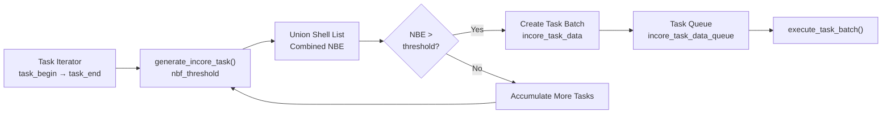
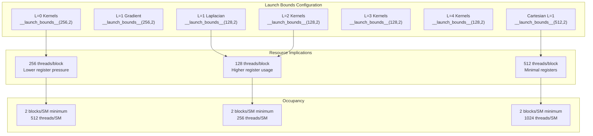
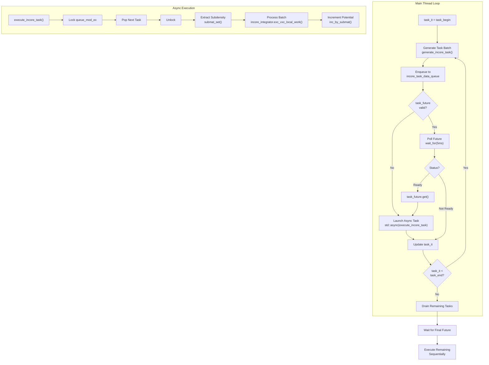
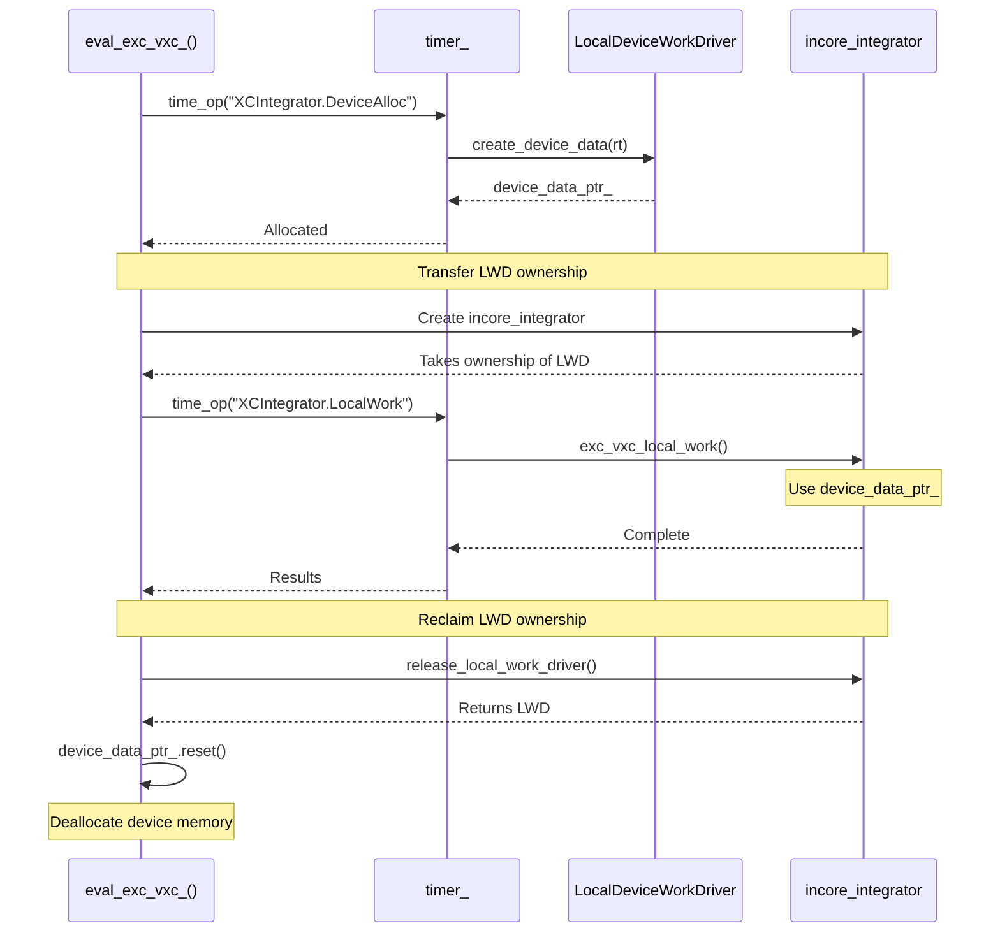
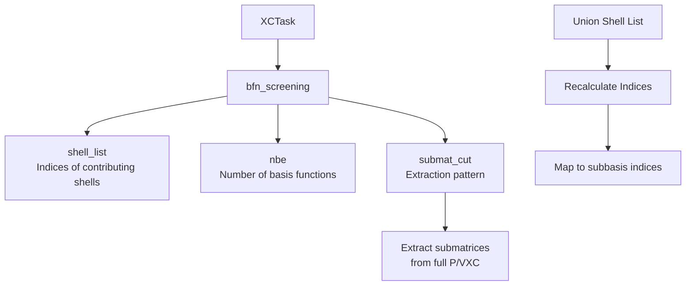
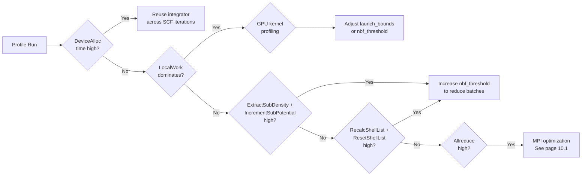

<!-- source: DeepWiki mcp.deepwiki.com · repo microsoft/skala · page 10.2 Performance Tuning Guide · fetched 2026-10-26 -->

# Performance Tuning Guide

<details>
<summary>Relevant source files</summary>

The following files were used as context for generating this wiki page:

- [third_party/gauxc/include/gauxc/xc_integrator/replicated/impl.hpp](third_party/gauxc/include/gauxc/xc_integrator/replicated/impl.hpp)
- [third_party/gauxc/src/xc_integrator/local_work_driver/device/cuda/kernels/collocation/collocation_shell_to_task_kernels_cartesian_l1.hpp](third_party/gauxc/src/xc_integrator/local_work_driver/device/cuda/kernels/collocation/collocation_shell_to_task_kernels_cartesian_l1.hpp)
- [third_party/gauxc/src/xc_integrator/local_work_driver/device/cuda/kernels/collocation/collocation_shell_to_task_kernels_cartesian_l1_laplacian.hpp](third_party/gauxc/src/xc_integrator/local_work_driver/device/cuda/kernels/collocation/collocation_shell_to_task_kernels_cartesian_l1_laplacian.hpp)
- [third_party/gauxc/src/xc_integrator/local_work_driver/device/cuda/kernels/collocation/collocation_shell_to_task_kernels_cartesian_l2_laplacian.hpp](third_party/gauxc/src/xc_integrator/local_work_driver/device/cuda/kernels/collocation/collocation_shell_to_task_kernels_cartesian_l2_laplacian.hpp)
- [third_party/gauxc/src/xc_integrator/local_work_driver/device/cuda/kernels/collocation/collocation_shell_to_task_kernels_spherical_l0_laplacian.hpp](third_party/gauxc/src/xc_integrator/local_work_driver/device/cuda/kernels/collocation/collocation_shell_to_task_kernels_spherical_l0_laplacian.hpp)
- [third_party/gauxc/src/xc_integrator/local_work_driver/device/cuda/kernels/collocation/collocation_shell_to_task_kernels_spherical_l1_gradient.hpp](third_party/gauxc/src/xc_integrator/local_work_driver/device/cuda/kernels/collocation/collocation_shell_to_task_kernels_spherical_l1_gradient.hpp)
- [third_party/gauxc/src/xc_integrator/local_work_driver/device/cuda/kernels/collocation/collocation_shell_to_task_kernels_spherical_l1_laplacian.hpp](third_party/gauxc/src/xc_integrator/local_work_driver/device/cuda/kernels/collocation/collocation_shell_to_task_kernels_spherical_l1_laplacian.hpp)
- [third_party/gauxc/src/xc_integrator/local_work_driver/device/cuda/kernels/collocation/collocation_shell_to_task_kernels_spherical_l2_laplacian.hpp](third_party/gauxc/src/xc_integrator/local_work_driver/device/cuda/kernels/collocation/collocation_shell_to_task_kernels_spherical_l2_laplacian.hpp)
- [third_party/gauxc/src/xc_integrator/local_work_driver/device/cuda/kernels/collocation/collocation_shell_to_task_kernels_spherical_l3_lapgrad.hpp](third_party/gauxc/src/xc_integrator/local_work_driver/device/cuda/kernels/collocation/collocation_shell_to_task_kernels_spherical_l3_lapgrad.hpp)
- [third_party/gauxc/src/xc_integrator/local_work_driver/device/cuda/kernels/collocation/collocation_shell_to_task_kernels_spherical_l4_laplacian.hpp](third_party/gauxc/src/xc_integrator/local_work_driver/device/cuda/kernels/collocation/collocation_shell_to_task_kernels_spherical_l4_laplacian.hpp)
- [third_party/gauxc/src/xc_integrator/replicated/device/incore_replicated_xc_device_integrator_dd.hpp](third_party/gauxc/src/xc_integrator/replicated/device/incore_replicated_xc_device_integrator_dd.hpp)
- [third_party/gauxc/src/xc_integrator/replicated/host/reference_replicated_xc_host_integrator_dd_psi_potential.hpp](third_party/gauxc/src/xc_integrator/replicated/host/reference_replicated_xc_host_integrator_dd_psi_potential.hpp)
- [third_party/gauxc/src/xc_integrator/replicated/replicated_xc_integrator_impl.cxx](third_party/gauxc/src/xc_integrator/replicated/replicated_xc_integrator_impl.cxx)
- [third_party/gauxc/src/xc_integrator/shell_batched/shell_batched_replicated_xc_integrator_dd_psi.hpp](third_party/gauxc/src/xc_integrator/shell_batched/shell_batched_replicated_xc_integrator_dd_psi.hpp)
- [third_party/gauxc/src/xc_integrator/shell_batched/shell_batched_replicated_xc_integrator_dd_psi_potential.hpp](third_party/gauxc/src/xc_integrator/shell_batched/shell_batched_replicated_xc_integrator_dd_psi_potential.hpp)
- [third_party/gauxc/src/xc_integrator/shell_batched/shell_batched_replicated_xc_integrator_exc.hpp](third_party/gauxc/src/xc_integrator/shell_batched/shell_batched_replicated_xc_integrator_exc.hpp)
- [third_party/gauxc/src/xc_integrator/shell_batched/shell_batched_replicated_xc_integrator_exc_grad.hpp](third_party/gauxc/src/xc_integrator/shell_batched/shell_batched_replicated_xc_integrator_exc_grad.hpp)
- [third_party/gauxc/src/xc_integrator/shell_batched/shell_batched_replicated_xc_integrator_exc_vxc.hpp](third_party/gauxc/src/xc_integrator/shell_batched/shell_batched_replicated_xc_integrator_exc_vxc.hpp)
- [third_party/gauxc/src/xc_integrator/shell_batched/shell_batched_replicated_xc_integrator_exx.hpp](third_party/gauxc/src/xc_integrator/shell_batched/shell_batched_replicated_xc_integrator_exx.hpp)
- [third_party/gauxc/src/xc_integrator/shell_batched/shell_batched_replicated_xc_integrator_fxc_contraction.hpp](third_party/gauxc/src/xc_integrator/shell_batched/shell_batched_replicated_xc_integrator_fxc_contraction.hpp)
- [third_party/gauxc/src/xc_integrator/shell_batched/shell_batched_replicated_xc_integrator_integrate_den.hpp](third_party/gauxc/src/xc_integrator/shell_batched/shell_batched_replicated_xc_integrator_integrate_den.hpp)

</details>


This page provides guidance on performance tuning for GauXC exchange-correlation integrations. It covers tunable parameters, GPU kernel configurations, memory management strategies, and profiling approaches. For general system architecture, see [System Architecture](#4). For GPU kernel implementation details, see [Device Computation](#7).

## Overview

GauXC performance depends on several interacting factors: task batching strategy, GPU kernel launch configurations, memory allocation patterns, shell screening thresholds, and asynchronous execution. This guide identifies key tuning parameters and their trade-offs.

**Performance-Critical Code Paths:**
- Task generation and batching: [shell_batched_replicated_xc_integrator_exc_vxc.hpp:236-270]()
- Device memory allocation: [shell_batched_replicated_xc_integrator_exc_vxc.hpp:76-83]()
- Kernel execution: collocation kernels in `src/xc_integrator/local_work_driver/device/cuda/kernels/collocation/`

---

## Task Batching Strategy

### NBF Threshold Parameter

The `nbf_threshold` parameter controls when tasks are batched together based on their total basis function count (NBE). This is the primary tuning knob for balancing parallelism and overhead.

```cpp
// Default threshold
const uint32_t nbf_threshold = 8000;
```

**Parameter Location:** [shell_batched_replicated_xc_integrator_exc_vxc.hpp:172]()

**Impact:**
- **Lower values (1000-4000)**: More frequent task launches, better load balancing, higher overhead
- **Higher values (8000-16000)**: Fewer task launches, reduced overhead, potential load imbalance
- **Optimal range**: 6000-10000 for most systems

### Task Generation Pipeline



**Key Decision Point:** The `generate_incore_task` function [shell_batched_replicated_xc_integrator_exc_vxc.hpp:239]() accumulates tasks until their combined `nbe` (number of basis functions in extracted subbasis) exceeds `nbf_threshold`.

**Trade-offs Table:**

| NBF Threshold | Task Count | Submatrix Size | Overhead | Load Balance | Best For |
|---------------|------------|----------------|----------|--------------|----------|
| 1000-2000 | High | Small | High | Excellent | Heterogeneous systems |
| 4000-6000 | Medium | Medium | Medium | Good | Balanced workloads |
| 8000-12000 | Low | Large | Low | Fair | Homogeneous, large basis |
| 16000+ | Very Low | Very Large | Very Low | Poor | Single large calculation |

Sources: [shell_batched_replicated_xc_integrator_exc_vxc.hpp:172](), [shell_batched_replicated_xc_integrator_exc_vxc.hpp:236-270]()

---

## GPU Kernel Launch Bounds

### Launch Configuration Matrix

GPU kernels use `__launch_bounds__(threads_per_block, min_blocks_per_sm)` to guide register allocation and occupancy.



### Kernel-Specific Configurations

| Kernel Type | Launch Bounds | Register Pressure | Shared Memory | Occupancy Target |
|-------------|---------------|-------------------|---------------|------------------|
| `collocation_device_shell_to_task_kernel_spherical_laplacian_0` | `(256,2)` | Low | 8×33 doubles | High |
| `collocation_device_shell_to_task_kernel_spherical_gradient_1` | `(256,2)` | Low-Medium | 8×33 doubles | High |
| `collocation_device_shell_to_task_kernel_spherical_laplacian_1` | `(128,2)` | Medium | 4×33 doubles | Medium |
| `collocation_device_shell_to_task_kernel_spherical_laplacian_2` | `(128,2)` | High | 4×33 doubles | Medium |
| `collocation_device_shell_to_task_kernel_spherical_lapgrad_3` | `(128,2)` | Very High | 4×33 doubles | Medium-Low |
| `collocation_device_shell_to_task_kernel_spherical_laplacian_4` | `(128,2)` | Extreme | 4×33 doubles | Low |
| `collocation_device_shell_to_task_kernel_cartesian_1` | `(512,2)` | Very Low | 16×33 doubles | Very High |

**Tuning Strategy:**
1. **L=0,1 kernels**: Use 256 threads/block for better occupancy
2. **L=2+ kernels**: Use 128 threads/block due to register constraints from common subexpressions
3. **Cartesian kernels**: Can use 512 threads/block (simpler expressions)
4. **min_blocks_per_sm=2**: Ensures at least 2 blocks resident for latency hiding

### Shared Memory Usage Pattern

All kernels use the same shared memory layout:

```cpp
__shared__ double alpha[N_WARPS][detail::shell_nprim_max + 1]; 
__shared__ double coeff[N_WARPS][detail::shell_nprim_max + 1];
```

Where `N_WARPS = threads_per_block / 32`:
- 256 threads → 8 warps → 8×33 = 264 doubles = 2112 bytes
- 128 threads → 4 warps → 4×33 = 132 doubles = 1056 bytes
- 512 threads → 16 warps → 16×33 = 528 doubles = 4224 bytes

Sources: [collocation_shell_to_task_kernels_spherical_l0_laplacian.hpp:18-29](), [collocation_shell_to_task_kernels_spherical_l1_gradient.hpp:18-28](), [collocation_shell_to_task_kernels_spherical_l2_laplacian.hpp:18-29](), [collocation_shell_to_task_kernels_spherical_l3_lapgrad.hpp:18-29](), [collocation_shell_to_task_kernels_spherical_l4_laplacian.hpp:18-29](), [collocation_shell_to_task_kernels_cartesian_l1.hpp:18-29]()

---

## Asynchronous Execution Pipeline

### Producer-Consumer Pattern

The shell-batched integrator uses a queue-based asynchronous execution model to overlap task generation with computation.



### Tuning Parameters

**Polling Interval:** [shell_batched_replicated_xc_integrator_exc_vxc.hpp:250]()
```cpp
auto status = task_future.wait_for( std::chrono::milliseconds(5) );
```
- **Default: 5ms** - Good balance for most systems
- **Faster (1-2ms)**: More responsive, higher CPU usage
- **Slower (10-20ms)**: Lower overhead, potential stalls

**Queue Management:** Thread-safe queue with mutex [shell_batched_replicated_xc_integrator_exc_vxc.hpp:204-205]()
- Single mutex protects queue modifications
- Lock held only during push/pop, not during computation
- No lock contention if queue has work

Sources: [shell_batched_replicated_xc_integrator_exc_vxc.hpp:201-270]()

---

## Memory Management

### Device Memory Allocation Timing



**Allocation Strategy:**
1. **Allocate once per integration call** [shell_batched_replicated_xc_integrator_exc_vxc.hpp:76-83]()
2. **Reuse across all task batches** - Single allocation serves entire task list
3. **Deallocate at end** [shell_batched_replicated_xc_integrator_exc_vxc.hpp:118]()

**Benefits:**
- Amortizes allocation cost over many tasks
- Avoids fragmentation from repeated alloc/free
- Predictable memory footprint

### Submatrix Extraction

Submatrix operations reduce computational cost by working only with relevant basis functions:

```cpp
// Extract subdensity: NBF×NBF → NBE×NBE
detail::submat_set( basis.nbf(), basis.nbf(), nbe, nbe, Ps, ldps, 
                    Ps_submat, nbe, union_submat_cut );

// Compute on smaller matrix

// Increment full potential
detail::inc_by_submat( basis.nbf(), basis.nbf(), nbe, nbe, VXCs, ldvxcs, 
                       VXCs_submat, nbe, union_submat_cut );
```

**Memory Savings Example:**
- Full basis: `nbf=1000` → 1M elements (8 MB)
- Subbasis: `nbe=200` → 40k elements (320 KB)
- **Reduction: 25× less memory**, faster cache utilization

Sources: [shell_batched_replicated_xc_integrator_exc_vxc.hpp:373-387](), [shell_batched_replicated_xc_integrator_exc_vxc.hpp:412-428]()

---

## Shell Screening

### Screening Data Structures

Each task contains screening information that determines which shells contribute:



**Shell List Recalculation:** [shell_batched_replicated_xc_integrator_exc_vxc.hpp:313-323]()

When tasks are batched, shell indices must be remapped to the combined subbasis:
1. Original shell_list contains indices into full basis
2. Union shell_list created from all tasks in batch
3. Shell indices recalculated relative to union list
4. Restored to full basis indices after computation [shell_batched_replicated_xc_integrator_exc_vxc.hpp:432-437]()

**Performance Impact:**
- Smaller shell lists → less collocation work
- Screening threshold affects nbe → affects batch size
- Trade-off: accuracy vs. performance

Sources: [shell_batched_replicated_xc_integrator_exc_vxc.hpp:295-323](), [shell_batched_replicated_xc_integrator_exc_vxc.hpp:432-437]()

---

## Profiling and Timing

### Built-in Timer Categories

GauXC includes hierarchical timing via `timer_` object:

| Timer Label | Scope | What It Measures |
|-------------|-------|------------------|
| `XCIntegrator.DeviceAlloc` | Per-call | GPU memory allocation |
| `XCIntegrator.LocalWork` | Per-call | All task computation |
| `XCIntegrator.ZeroHost` | Per-call | Host array initialization |
| `XCIntegrator.CopySubBasis` | Accumulated | Subbasis extraction |
| `XCIntegrator.RecalcShellList` | Accumulated | Shell index remapping |
| `XCIntegrator.ExtractSubDensity` | Accumulated | Density matrix extraction |
| `XCIntegrator.IncrementSubPotential` | Accumulated | Potential matrix increment |
| `XCIntegrator.ResetShellList` | Accumulated | Shell index restoration |
| `XCIntegrator.Allreduce` | Per-call | MPI reduction (if enabled) |

**Access Timing Data:**
```cpp
const util::Timer& timings = integrator.get_timings();
```

**Timing Locations:**
- [shell_batched_replicated_xc_integrator_exc_vxc.hpp:81]() - DeviceAlloc
- [shell_batched_replicated_xc_integrator_exc_vxc.hpp:94]() - LocalWork
- [shell_batched_replicated_xc_integrator_exc_vxc.hpp:175]() - ZeroHost
- [shell_batched_replicated_xc_integrator_exc_vxc.hpp:297]() - CopySubBasis
- [shell_batched_replicated_xc_integrator_exc_vxc.hpp:313]() - RecalcShellList
- [shell_batched_replicated_xc_integrator_exc_vxc.hpp:373]() - ExtractSubDensity
- [shell_batched_replicated_xc_integrator_exc_vxc.hpp:412]() - IncrementSubPotential
- [shell_batched_replicated_xc_integrator_exc_vxc.hpp:432]() - ResetShellList
- [shell_batched_replicated_xc_integrator_exc_vxc.hpp:105]() - Allreduce

### Performance Bottleneck Identification



**Common Issues:**

1. **DeviceAlloc dominates** (>10% of total time)
   - **Cause:** Creating new integrator each call
   - **Solution:** Reuse integrator object across SCF iterations

2. **Extract/Increment high** (>20% of LocalWork)
   - **Cause:** Too many small batches
   - **Solution:** Increase `nbf_threshold` to 10000-12000

3. **RecalcShellList high** (>10% of LocalWork)
   - **Cause:** Complex shell list manipulations
   - **Solution:** Increase batch size to amortize overhead

4. **Kernel time low despite long LocalWork**
   - **Cause:** CPU-side overhead or memory transfer bottleneck
   - **Solution:** Profile device kernels separately with `nvprof`/`nsight-compute`

Sources: [shell_batched_replicated_xc_integrator_exc_vxc.hpp:81](), [shell_batched_replicated_xc_integrator_exc_vxc.hpp:94](), [shell_batched_replicated_xc_integrator_exc_vxc.hpp:105](), [shell_batched_replicated_xc_integrator_exc_vxc.hpp:297](), [shell_batched_replicated_xc_integrator_exc_vxc.hpp:313](), [shell_batched_replicated_xc_integrator_exc_vxc.hpp:373](), [shell_batched_replicated_xc_integrator_exc_vxc.hpp:412](), [shell_batched_replicated_xc_integrator_exc_vxc.hpp:432]()

---

## Recommended Tuning Workflow

### Step-by-Step Tuning Process

1. **Baseline Measurement**
   - Run with default settings (`nbf_threshold=8000`)
   - Collect timing data via `get_timings()`
   - Identify dominant time consumers

2. **Adjust Task Batching**
   - If `Extract/Increment` > 20% of `LocalWork`: increase threshold to 10000-12000
   - If load imbalance suspected: decrease threshold to 4000-6000
   - Monitor `LocalWork` time for improvements

3. **GPU Kernel Tuning** (Advanced)
   - Profile with `nvprof` or `nsight-compute`
   - Check occupancy and register usage
   - Modify `__launch_bounds__` if occupancy < 50%
     - Increase threads/block if registers allow
     - Decrease if register spilling occurs

4. **Memory Optimization**
   - Reuse integrator objects across multiple calls
   - Consider batching multiple density matrices if memory allows

5. **Validate Accuracy**
   - Compare results with reference implementation
   - Check electron count conservation
   - Verify energy convergence

### Example Parameter Sets

| System Type | nbf | Recommended nbf_threshold | Expected Batches | Notes |
|-------------|-----|---------------------------|------------------|-------|
| Small molecules | <500 | 4000 | 1-5 | Emphasize low overhead |
| Medium systems | 500-1500 | 8000 | 5-20 | Default balanced |
| Large systems | 1500-3000 | 10000-12000 | 10-40 | Amortize overhead |
| Very large | >3000 | 12000-16000 | 20-100 | Maximize batch size |
| Heterogeneous | Any | 4000-6000 | Variable | Better load balance |

**Platform-Specific Notes:**
- **NVIDIA A100/H100:** Can handle larger batches (12000-16000) due to larger shared memory
- **NVIDIA V100:** Default settings (8000) work well
- **AMD MI250X:** May benefit from smaller batches (6000-8000) for better occupancy

Sources: [shell_batched_replicated_xc_integrator_exc_vxc.hpp:172]()

---

