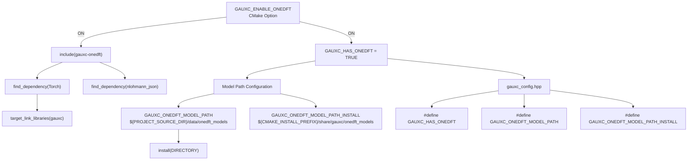
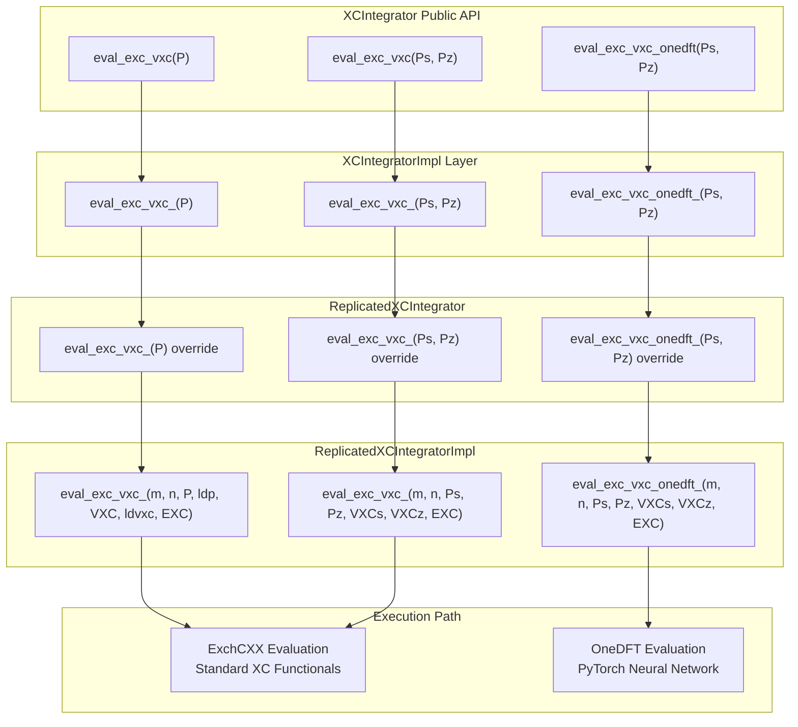
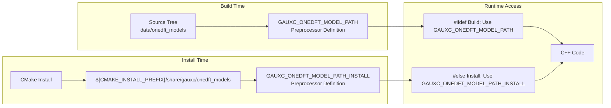
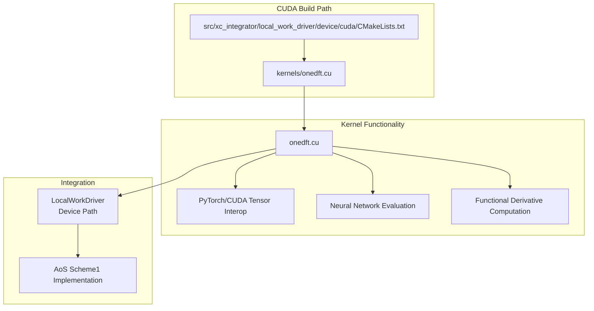

<!-- source: DeepWiki mcp.deepwiki.com · repo microsoft/skala · page 10.3 OneDFT Functional Integration · fetched 2026-10-26 -->

# OneDFT Functional Integration

<details>
<summary>Relevant source files</summary>

The following files were used as context for generating this wiki page:

- [third_party/gauxc/CMakeLists.txt](third_party/gauxc/CMakeLists.txt)
- [third_party/gauxc/attic/include/gauxc/new_xc_integrator/impl.hpp](third_party/gauxc/attic/include/gauxc/new_xc_integrator/impl.hpp)
- [third_party/gauxc/attic/include/gauxc/new_xc_integrator/replicated/impl.hpp](third_party/gauxc/attic/include/gauxc/new_xc_integrator/replicated/impl.hpp)
- [third_party/gauxc/attic/include/gauxc/new_xc_integrator/replicated/replicated_xc_integrator_impl.hpp](third_party/gauxc/attic/include/gauxc/new_xc_integrator/replicated/replicated_xc_integrator_impl.hpp)
- [third_party/gauxc/attic/include/gauxc/new_xc_integrator/replicated_xc_integrator.hpp](third_party/gauxc/attic/include/gauxc/new_xc_integrator/replicated_xc_integrator.hpp)
- [third_party/gauxc/attic/include/gauxc/new_xc_integrator/xc_integrator_impl.hpp](third_party/gauxc/attic/include/gauxc/new_xc_integrator/xc_integrator_impl.hpp)
- [third_party/gauxc/attic/include/gauxc/xc_integrator/impl.hpp](third_party/gauxc/attic/include/gauxc/xc_integrator/impl.hpp)
- [third_party/gauxc/attic/include/gauxc/xc_integrator/xc_integrator_impl.hpp](third_party/gauxc/attic/include/gauxc/xc_integrator/xc_integrator_impl.hpp)
- [third_party/gauxc/attic/src/integrator/cuda/gauxc-cuda_integrator.cmake](third_party/gauxc/attic/src/integrator/cuda/gauxc-cuda_integrator.cmake)
- [third_party/gauxc/attic/src/new_integrator/device/cuda/gauxc-cuda.cmake](third_party/gauxc/attic/src/new_integrator/device/cuda/gauxc-cuda.cmake)
- [third_party/gauxc/attic/src/new_integrator/device/hip/gauxc-hip.cmake](third_party/gauxc/attic/src/new_integrator/device/hip/gauxc-hip.cmake)
- [third_party/gauxc/attic/src/new_integrator/replicated_xc_integrator_impl.cxx](third_party/gauxc/attic/src/new_integrator/replicated_xc_integrator_impl.cxx)
- [third_party/gauxc/cmake/gauxc-config.cmake.in](third_party/gauxc/cmake/gauxc-config.cmake.in)
- [third_party/gauxc/cmake/gauxc-cub.cmake](third_party/gauxc/cmake/gauxc-cub.cmake)
- [third_party/gauxc/cmake/gauxc-cutlass.cmake](third_party/gauxc/cmake/gauxc-cutlass.cmake)
- [third_party/gauxc/include/gauxc/gauxc_config.hpp.in](third_party/gauxc/include/gauxc/gauxc_config.hpp.in)
- [third_party/gauxc/include/gauxc/util/environment.hpp](third_party/gauxc/include/gauxc/util/environment.hpp)
- [third_party/gauxc/include/gauxc/xc_integrator.hpp](third_party/gauxc/include/gauxc/xc_integrator.hpp)
- [third_party/gauxc/include/gauxc/xc_integrator/impl.hpp](third_party/gauxc/include/gauxc/xc_integrator/impl.hpp)
- [third_party/gauxc/include/gauxc/xc_integrator/replicated/replicated_xc_integrator_impl.hpp](third_party/gauxc/include/gauxc/xc_integrator/replicated/replicated_xc_integrator_impl.hpp)
- [third_party/gauxc/include/gauxc/xc_integrator/replicated_xc_integrator.hpp](third_party/gauxc/include/gauxc/xc_integrator/replicated_xc_integrator.hpp)
- [third_party/gauxc/src/CMakeLists.txt](third_party/gauxc/src/CMakeLists.txt)
- [third_party/gauxc/src/external/CMakeLists.txt](third_party/gauxc/src/external/CMakeLists.txt)
- [third_party/gauxc/src/xc_integrator/local_work_driver/device/CMakeLists.txt](third_party/gauxc/src/xc_integrator/local_work_driver/device/CMakeLists.txt)
- [third_party/gauxc/src/xc_integrator/local_work_driver/device/cuda/CMakeLists.txt](third_party/gauxc/src/xc_integrator/local_work_driver/device/cuda/CMakeLists.txt)
- [third_party/gauxc/src/xc_integrator/local_work_driver/device/hip/CMakeLists.txt](third_party/gauxc/src/xc_integrator/local_work_driver/device/hip/CMakeLists.txt)
- [third_party/gauxc/tests/environment.cxx](third_party/gauxc/tests/environment.cxx)

</details>


## Purpose and Scope

This document describes the OneDFT functional integration feature in GauXC, which provides an alternative XC functional evaluation path using machine learning models implemented in PyTorch. OneDFT enables neural network-based density functional approximations as an alternative to traditional semi-local functionals.

For general XC functional evaluation using ExchCXX, see [XC Integration Methods](#3.1). For the overall integration pipeline, see [System Architecture](#4).

**Sources:** [third_party/gauxc/CMakeLists.txt:38](), [third_party/gauxc/src/CMakeLists.txt:26-33]()

---

## Build Configuration

### CMake Options

OneDFT support is controlled by the `GAUXC_ENABLE_ONEDFT` CMake option, which defaults to `ON`. When enabled, the build system:

1. Sets `GAUXC_HAS_ONEDFT` to `TRUE`
2. Includes the `gauxc-onedft` CMake module
3. Sets `GAUXC_ONEDFT_MODEL_PATH` to point to model data files
4. Configures the install path for model files



**Diagram: OneDFT Build Configuration Flow**

**Sources:** [third_party/gauxc/CMakeLists.txt:38](), [third_party/gauxc/src/CMakeLists.txt:26-33](), [third_party/gauxc/include/gauxc/gauxc_config.hpp.in:19-25]()

### Dependency Handling

The OneDFT feature introduces two key dependencies:

| Dependency | Purpose | Discovery Method |
|------------|---------|------------------|
| `Torch` | PyTorch C++ API for neural network inference | `find_dependency(Torch)` |
| `nlohmann_json` | JSON parsing for model metadata | `find_dependency(nlohmann_json)` |

**CUDA Architecture Handling:** The Torch package may override `CMAKE_CUDA_ARCHITECTURES` to `OFF`. The configuration script detects this and restores the previous value to prevent breaking GPU builds.

**Sources:** [third_party/gauxc/cmake/gauxc-config.cmake.in:67-75]()

---

## Architecture Overview

### Integration Points

OneDFT integrates with GauXC through a parallel evaluation path alongside standard XC functionals:



**Diagram: OneDFT API Integration Architecture**

**Sources:** [third_party/gauxc/include/gauxc/xc_integrator.hpp:72-73](), [third_party/gauxc/include/gauxc/xc_integrator/impl.hpp:77-82](), [third_party/gauxc/include/gauxc/xc_integrator/replicated_xc_integrator.hpp:53](), [third_party/gauxc/include/gauxc/xc_integrator/replicated/replicated_xc_integrator_impl.hpp:76-82,156-162]()

### Method Signatures

The OneDFT evaluation path provides a dedicated method distinct from standard XC evaluation:

**Public API (`XCIntegrator<MatrixType>`):**
```cpp
exc_vxc_type_uks eval_exc_vxc_onedft(
    const MatrixType& Ps, 
    const MatrixType& Pz,
    const IntegratorSettingsXC& = IntegratorSettingsXC{}
);
```

**Implementation (`ReplicatedXCIntegratorImpl<ValueType>`):**
```cpp
void eval_exc_vxc_onedft_(
    int64_t m, int64_t n, 
    const value_type* Ps, int64_t ldps,
    const value_type* Pz, int64_t ldpz,
    value_type* VXCs, int64_t ldvxcs,
    value_type* VXCz, int64_t ldvxcz,
    value_type* EXC, 
    const IntegratorSettingsXC& ks_settings
);
```

**Key Characteristics:**
- OneDFT evaluation is **spin-polarized only** (requires `Ps` and `Pz`)
- No RKS variant exists
- No GKS variant exists
- Returns `exc_vxc_type_uks` = `std::tuple<value_type, matrix_type, matrix_type>`

**Sources:** [third_party/gauxc/include/gauxc/xc_integrator.hpp:72-73](), [third_party/gauxc/include/gauxc/xc_integrator/replicated/replicated_xc_integrator_impl.hpp:76-82]()

---

## Model Management

### Model Path Resolution

OneDFT models are stored in a dedicated directory and accessed via compile-time and install-time paths:



**Diagram: OneDFT Model Path Configuration**

**Configuration Details:**

| Path Variable | Value (Build) | Value (Install) |
|---------------|---------------|-----------------|
| `GAUXC_ONEDFT_MODEL_PATH` | `${PROJECT_SOURCE_DIR}/data/onedft_models` | N/A |
| `GAUXC_ONEDFT_MODEL_PATH_INSTALL` | N/A | `${CMAKE_INSTALL_PREFIX}/share/gauxc/onedft_models` |

The `install(DIRECTORY)` command copies model files from the source tree to the installation directory during `make install`.

**Sources:** [third_party/gauxc/src/CMakeLists.txt:30,126-132](), [third_party/gauxc/include/gauxc/gauxc_config.hpp.in:22-25]()

---

## Device Implementation

### CUDA Kernel Support

OneDFT includes device-specific kernels for GPU acceleration:



**Diagram: OneDFT CUDA Kernel Integration**

The OneDFT kernel is added to the build via `target_sources(gauxc PRIVATE kernels/onedft.cu)` when CUDA support is enabled. This kernel likely handles:

1. **Tensor Conversion:** Mapping GauXC density data to PyTorch CUDA tensors
2. **Model Inference:** Invoking the PyTorch neural network on GPU
3. **Derivative Computation:** Computing XC potential from model output
4. **Data Return:** Converting PyTorch output back to GauXC format

**Sources:** [third_party/gauxc/src/xc_integrator/local_work_driver/device/cuda/CMakeLists.txt:28]()

### HIP Support

No explicit OneDFT kernel is listed in the HIP CMakeLists.txt, suggesting either:
- OneDFT is CUDA-only
- HIP support uses a different implementation path
- The feature is not yet ported to HIP

**Sources:** [third_party/gauxc/src/xc_integrator/local_work_driver/device/hip/CMakeLists.txt:1-33]()

---

## Dependency Linking

### PyTorch Integration

The Torch libraries are linked as public dependencies to the `gauxc` target:


**Diagram: PyTorch Dependency Linkage**

The `PUBLIC` linkage ensures that any project linking against `gauxc::gauxc` automatically receives the necessary Torch headers and libraries.

**Torch Library Components:**
- `libtorch.so` / `torch.dll` - Main PyTorch library
- `libc10.so` - Core tensor library
- CUDA-specific components (if built with CUDA)

**Sources:** [third_party/gauxc/src/CMakeLists.txt:101-103]()

### JSON Dependency

The `nlohmann_json` library is required for parsing model metadata (e.g., architecture specifications, hyperparameters). This is likely a header-only dependency.

**Sources:** [third_party/gauxc/cmake/gauxc-config.cmake.in:74]()

---

## Export Properties

OneDFT availability is exported as a target property for downstream consumption:

| Property | Type | Value |
|----------|------|-------|
| `GAUXC_HAS_ONEDFT` | `BOOL` | `TRUE` or `FALSE` |

This property appears in:
1. **Build Tree:** `gauxc-targets.cmake`
2. **Install Tree:** `gauxc-config.cmake`

Downstream projects can query this property to determine if OneDFT support is available:

```cmake
get_target_property(HAS_ONEDFT gauxc::gauxc GAUXC_HAS_ONEDFT)
if(HAS_ONEDFT)
    # Use OneDFT functionality
endif()
```

**Sources:** [third_party/gauxc/src/CMakeLists.txt:164,185](), [third_party/gauxc/cmake/gauxc-config.cmake.in:24]()

---

## Summary Table

| Aspect | Details |
|--------|---------|
| **CMake Option** | `GAUXC_ENABLE_ONEDFT` (default: `ON`) |
| **Preprocessor Flag** | `GAUXC_HAS_ONEDFT` |
| **Dependencies** | PyTorch (Torch), nlohmann_json |
| **Model Storage (Build)** | `${PROJECT_SOURCE_DIR}/data/onedft_models` |
| **Model Storage (Install)** | `${CMAKE_INSTALL_PREFIX}/share/gauxc/onedft_models` |
| **API Method** | `eval_exc_vxc_onedft(Ps, Pz, settings)` |
| **Spin Support** | UKS only (spin-polarized) |
| **Device Kernels** | `kernels/onedft.cu` (CUDA) |
| **Linkage** | Public (propagates to downstream) |

**Sources:** [third_party/gauxc/CMakeLists.txt:38](), [third_party/gauxc/src/CMakeLists.txt:26-33,101-103,126-132,164,185](), [third_party/gauxc/include/gauxc/xc_integrator.hpp:72-73](), [third_party/gauxc/src/xc_integrator/local_work_driver/device/cuda/CMakeLists.txt:28]()