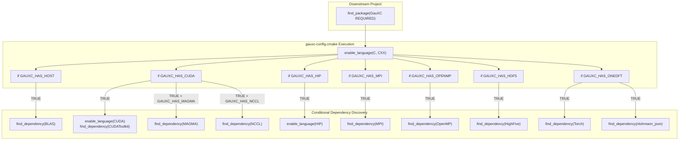

<!-- source: DeepWiki mcp.deepwiki.com · repo microsoft/skala · page 2.1 CMake Options and Feature Flags · fetched 2026-10-26 -->

# CMake Options and Feature Flags

<details>
<summary>Relevant source files</summary>

The following files were used as context for generating this wiki page:

- [third_party/gauxc/CMakeLists.txt](third_party/gauxc/CMakeLists.txt)
- [third_party/gauxc/attic/src/integrator/cuda/gauxc-cuda_integrator.cmake](third_party/gauxc/attic/src/integrator/cuda/gauxc-cuda_integrator.cmake)
- [third_party/gauxc/attic/src/new_integrator/device/cuda/gauxc-cuda.cmake](third_party/gauxc/attic/src/new_integrator/device/cuda/gauxc-cuda.cmake)
- [third_party/gauxc/attic/src/new_integrator/device/hip/gauxc-hip.cmake](third_party/gauxc/attic/src/new_integrator/device/hip/gauxc-hip.cmake)
- [third_party/gauxc/cmake/gauxc-config.cmake.in](third_party/gauxc/cmake/gauxc-config.cmake.in)
- [third_party/gauxc/cmake/gauxc-cub.cmake](third_party/gauxc/cmake/gauxc-cub.cmake)
- [third_party/gauxc/cmake/gauxc-cutlass.cmake](third_party/gauxc/cmake/gauxc-cutlass.cmake)
- [third_party/gauxc/include/gauxc/gauxc_config.hpp.in](third_party/gauxc/include/gauxc/gauxc_config.hpp.in)
- [third_party/gauxc/include/gauxc/util/environment.hpp](third_party/gauxc/include/gauxc/util/environment.hpp)
- [third_party/gauxc/src/CMakeLists.txt](third_party/gauxc/src/CMakeLists.txt)
- [third_party/gauxc/src/external/CMakeLists.txt](third_party/gauxc/src/external/CMakeLists.txt)
- [third_party/gauxc/src/xc_integrator/local_work_driver/device/CMakeLists.txt](third_party/gauxc/src/xc_integrator/local_work_driver/device/CMakeLists.txt)
- [third_party/gauxc/src/xc_integrator/local_work_driver/device/cuda/CMakeLists.txt](third_party/gauxc/src/xc_integrator/local_work_driver/device/cuda/CMakeLists.txt)
- [third_party/gauxc/src/xc_integrator/local_work_driver/device/hip/CMakeLists.txt](third_party/gauxc/src/xc_integrator/local_work_driver/device/hip/CMakeLists.txt)
- [third_party/gauxc/tests/environment.cxx](third_party/gauxc/tests/environment.cxx)

</details>


## Purpose and Scope

This page documents all CMake configuration options (`GAUXC_ENABLE_*`) that control GauXC's build-time features, how they map to compile-time feature flags (`GAUXC_HAS_*`), and the generated configuration artifacts. This includes backend selection (Host, CUDA, HIP), optional dependencies (MAGMA, NCCL, CUTLASS), parallelization (MPI, OpenMP), and specialized features (OneDFT, HDF5).

For information about how dependencies are discovered and linked, see [Dependency Management](#2.2). For installation and package configuration details, see [Installation and Package Configuration](#2.3).

---

## Option-to-Flag Mapping Overview

GauXC uses a two-tier configuration system: user-facing **enable options** control what features should be built, while internal **has flags** reflect what was actually configured successfully. This separation allows robust handling of optional dependencies.

**Mapping Flow Diagram**

```mermaid
graph TB
    subgraph "User Configuration (CMake Options)"
        OPT_HOST["GAUXC_ENABLE_HOST<br/>Default: ON"]
        OPT_CUDA["GAUXC_ENABLE_CUDA<br/>Default: OFF"]
        OPT_HIP["GAUXC_ENABLE_HIP<br/>Default: OFF"]
        OPT_MPI["GAUXC_ENABLE_MPI<br/>Default: ON"]
        OPT_OPENMP["GAUXC_ENABLE_OPENMP<br/>Default: ON"]
        OPT_MAGMA["GAUXC_ENABLE_MAGMA<br/>Dependent Option"]
        OPT_NCCL["GAUXC_ENABLE_NCCL<br/>Dependent Option"]
        OPT_CUTLASS["GAUXC_ENABLE_CUTLASS<br/>Dependent Option"]
        OPT_GAU2GRID["GAUXC_ENABLE_GAU2GRID<br/>Default: ON"]
        OPT_HDF5["GAUXC_ENABLE_HDF5<br/>Default: ON"]
        OPT_ONEDFT["GAUXC_ENABLE_ONEDFT<br/>Default: ON"]
    end
    
    subgraph "Dependency Discovery"
        FIND_BLAS["find_package(BLAS)"]
        FIND_CUDA["enable_language(CUDA)<br/>find_package(CUDAToolkit)"]
        FIND_HIP["enable_language(HIP)"]
        FIND_MPI["find_package(MPI)"]
        FIND_OPENMP["find_package(OpenMP)"]
        FIND_MAGMA["find_package(MAGMA)"]
        FIND_NCCL["find_package(NCCL)"]
        FIND_HDF5["find_package(HDF5)"]
        FIND_TORCH["find_package(Torch)"]
    end
    
    subgraph "Internal Feature Flags (Cache Variables)"
        FLAG_HOST["GAUXC_HAS_HOST"]
        FLAG_CUDA["GAUXC_HAS_CUDA"]
        FLAG_HIP["GAUXC_HAS_HIP"]
        FLAG_DEVICE["GAUXC_HAS_DEVICE"]
        FLAG_MPI["GAUXC_HAS_MPI"]
        FLAG_OPENMP["GAUXC_HAS_OPENMP"]
        FLAG_MAGMA["GAUXC_HAS_MAGMA"]
        FLAG_NCCL["GAUXC_HAS_NCCL"]
        FLAG_CUTLASS["GAUXC_HAS_CUTLASS"]
        FLAG_GAU2GRID["GAUXC_HAS_GAU2GRID"]
        FLAG_HDF5["GAUXC_HAS_HDF5"]
        FLAG_ONEDFT["GAUXC_HAS_ONEDFT"]
    end
    
    subgraph "Generated Artifacts"
        CONFIG_HPP["gauxc_config.hpp<br/>Compile-time macros"]
        CONFIG_CMAKE["gauxc-config.cmake<br/>Downstream consumption"]
    end
    
    OPT_HOST -->|if ON| FLAG_HOST
    OPT_CUDA -->|if ON| FIND_CUDA
    FIND_CUDA -->|success| FLAG_CUDA
    OPT_HIP -->|if ON| FIND_HIP
    FIND_HIP -->|success| FLAG_HIP
    FLAG_CUDA -->|OR| FLAG_DEVICE
    FLAG_HIP -->|OR| FLAG_DEVICE
    
    OPT_MPI -->|if ON| FIND_MPI
    FIND_MPI -->|success| FLAG_MPI
    
    OPT_OPENMP -->|if ON| FIND_OPENMP
    FIND_OPENMP -->|success| FLAG_OPENMP
    
    OPT_MAGMA -->|if ON| FIND_MAGMA
    FIND_MAGMA -->|success| FLAG_MAGMA
    
    OPT_NCCL -->|if ON| FIND_NCCL
    FIND_NCCL -->|success| FLAG_NCCL
    
    OPT_CUTLASS -->|if ON| FLAG_CUTLASS
    
    OPT_GAU2GRID -->|required| FLAG_GAU2GRID
    
    OPT_HDF5 -->|if ON| FIND_HDF5
    FIND_HDF5 -->|success| FLAG_HDF5
    
    OPT_ONEDFT -->|if ON| FIND_TORCH
    FIND_TORCH -->|success| FLAG_ONEDFT
    
    FLAG_HOST -.->|configure| CONFIG_HPP
    FLAG_CUDA -.->|configure| CONFIG_HPP
    FLAG_HIP -.->|configure| CONFIG_HPP
    FLAG_DEVICE -.->|configure| CONFIG_HPP
    FLAG_MPI -.->|configure| CONFIG_HPP
    FLAG_OPENMP -.->|configure| CONFIG_HPP
    FLAG_MAGMA -.->|configure| CONFIG_HPP
    FLAG_NCCL -.->|configure| CONFIG_HPP
    FLAG_CUTLASS -.->|configure| CONFIG_HPP
    FLAG_GAU2GRID -.->|configure| CONFIG_HPP
    FLAG_HDF5 -.->|configure| CONFIG_HPP
    FLAG_ONEDFT -.->|configure| CONFIG_HPP
    
    FLAG_HOST -.->|export| CONFIG_CMAKE
    FLAG_CUDA -.->|export| CONFIG_CMAKE
    FLAG_HIP -.->|export| CONFIG_CMAKE
    FLAG_MPI -.->|export| CONFIG_CMAKE
    FLAG_OPENMP -.->|export| CONFIG_CMAKE
    FLAG_MAGMA -.->|export| CONFIG_CMAKE
    FLAG_NCCL -.->|export| CONFIG_CMAKE
    FLAG_CUTLASS -.->|export| CONFIG_CMAKE
    FLAG_GAU2GRID -.->|export| CONFIG_CMAKE
    FLAG_HDF5 -.->|export| CONFIG_CMAKE
    FLAG_ONEDFT -.->|export| CONFIG_CMAKE
```



**Sources:** [third_party/gauxc/CMakeLists.txt:29-112](), [third_party/gauxc/src/CMakeLists.txt:10-133]()

---

## Core Build Options

### Backend Selection Options

| Option | Default | Purpose | Dependencies |
|--------|---------|---------|--------------|
| `GAUXC_ENABLE_HOST` | `ON` | Enable CPU-based integration using BLAS/LAPACK and Gau2Grid | BLAS, LAPACK |
| `GAUXC_ENABLE_CUDA` | `OFF` | Enable NVIDIA GPU support via CUDA | CUDAToolkit, compute capability ≥ 6.0 |
| `GAUXC_ENABLE_HIP` | `OFF` | Enable AMD GPU support via HIP | HIP runtime, hipBLAS |

**Mutual Exclusivity and Validation:**

The build system enforces that at least one backend must be enabled. If both `GAUXC_ENABLE_CUDA` and `GAUXC_ENABLE_HIP` are disabled, and `GAUXC_ENABLE_HOST` is also disabled, the configuration fails with:

> "Neither Host nor Device Integrators have been enabled!"

**Derived Flag:**

`GAUXC_HAS_DEVICE` is automatically set to `TRUE` if either `GAUXC_HAS_CUDA` or `GAUXC_HAS_HIP` is true [third_party/gauxc/CMakeLists.txt:108-112]().

**CUDA-Specific Requirements:**

When `GAUXC_ENABLE_CUDA` is enabled:
- `CMAKE_CUDA_ARCHITECTURES` must be defined [third_party/gauxc/src/xc_integrator/local_work_driver/device/cuda/CMakeLists.txt:31-34]()
- All specified architectures must be ≥ 60 (compute capability 6.0) to support FP64 atomic operations [third_party/gauxc/src/xc_integrator/local_work_driver/device/cuda/CMakeLists.txt:37-41]()
- The CUDA language is enabled via `enable_language(CUDA)` [third_party/gauxc/CMakeLists.txt:98-100]()

**Sources:** [third_party/gauxc/CMakeLists.txt:30-119](), [third_party/gauxc/src/xc_integrator/local_work_driver/device/cuda/CMakeLists.txt:31-41]()

### Parallelization Options

| Option | Default | Purpose | Impact |
|--------|---------|---------|--------|
| `GAUXC_ENABLE_MPI` | `ON` | Enable distributed-memory parallelism | Links MPI::MPI_C and MPI::MPI_CXX, enables `ReductionDriver` |
| `GAUXC_ENABLE_OPENMP` | `ON` | Enable shared-memory parallelism | Links OpenMP::OpenMP_CXX or falls back to Threads::Threads |

**OpenMP Fallback Behavior:**

If `GAUXC_ENABLE_OPENMP` is enabled but OpenMP is not found, the build system automatically falls back to C++ threads:

```cmake
if( TARGET OpenMP::OpenMP_CXX )
  target_link_libraries( gauxc PUBLIC OpenMP::OpenMP_CXX )
else()
  find_package(Threads REQUIRED)
  target_link_libraries( gauxc PUBLIC Threads::Threads )
endif()
```

**Sources:** [third_party/gauxc/src/CMakeLists.txt:10-99]()

---

## Optional Feature Options

### GPU Linear Algebra: MAGMA

**Option:** `GAUXC_ENABLE_MAGMA`  
**Default:** `ON` (when CUDA or HIP is enabled)  
**Dependency Type:** `cmake_dependent_option`

MAGMA provides optimized GPU linear algebra routines. This option is only available when either CUDA or HIP is enabled:

```cmake
cmake_dependent_option( GAUXC_ENABLE_MAGMA    
  "Enable MAGMA Linear Algebra"           ON
  "GAUXC_ENABLE_CUDA OR GAUXC_ENABLE_HIP" OFF  
)
```

When enabled:
- Requires `find_package(MAGMA REQUIRED)` [third_party/gauxc/src/xc_integrator/local_work_driver/device/CMakeLists.txt:17-19]()
- Compiles additional source files: `scheme1_magma_base.cxx`, `scheme1_magma_data_base.cxx` [third_party/gauxc/src/xc_integrator/local_work_driver/device/CMakeLists.txt:21-24]()
- On HIP platforms, also requires linkage to hipSPARSE [third_party/gauxc/src/xc_integrator/local_work_driver/device/hip/CMakeLists.txt:28-32]()

**Sources:** [third_party/gauxc/CMakeLists.txt:44-47](), [third_party/gauxc/src/xc_integrator/local_work_driver/device/CMakeLists.txt:16-25]()

### Multi-GPU Communication: NCCL

**Option:** `GAUXC_ENABLE_NCCL`  
**Default:** `OFF` (when CUDA is enabled)  
**Dependency Type:** `cmake_dependent_option`

NCCL (NVIDIA Collective Communications Library) enables multi-GPU communication. Only available with CUDA:

```cmake
cmake_dependent_option( GAUXC_ENABLE_NCCL 
  "Enable NCCL Collectives" OFF  
  "GAUXC_ENABLE_CUDA"       OFF 
)
```

**Sources:** [third_party/gauxc/CMakeLists.txt:48-51]()

### Tensor Core Acceleration: CUTLASS

**Option:** `GAUXC_ENABLE_CUTLASS`  
**Default:** `OFF` (when CUDA is enabled)  
**Dependency Type:** `cmake_dependent_option`

CUTLASS provides optimized GEMM operations for tensor cores. Requires CUDA compute capability ≥ 8.0:

```cmake
cmake_dependent_option( GAUXC_ENABLE_CUTLASS  
  "Enable CUTLASS Linear Algebra" OFF  
  "GAUXC_ENABLE_CUDA"             OFF 
)
```

**Version and Architecture Validation:**

When enabled, the build system validates all target architectures:

```cmake
foreach( cuda_arch ${CMAKE_CUDA_ARCHITECTURES} )
  if( NOT cuda_arch GREATER_EQUAL 80 )
    message(FATAL_ERROR "GauXC Requires CUDA CC >= 8.0 For CUTLASS")
  endif()
endforeach()
```

CUTLASS is fetched from the specified repository and revision via `FetchContent` [third_party/gauxc/cmake/gauxc-cutlass.cmake:14-23]().

**Sources:** [third_party/gauxc/CMakeLists.txt:52-55](), [third_party/gauxc/cmake/gauxc-cutlass.cmake:1-34](), [third_party/gauxc/src/xc_integrator/local_work_driver/device/cuda/CMakeLists.txt:44-53]()

### Data Persistence: HDF5

**Option:** `GAUXC_ENABLE_HDF5`  
**Default:** `ON`

Enables HDF5-based I/O for data persistence. When enabled:
- Attempts `find_package(HDF5)` 
- If found, fetches HighFive C++ wrapper library via `FetchContent`
- If HDF5 is not found but option is enabled, issues a warning and disables HDF5 bindings [third_party/gauxc/src/external/CMakeLists.txt:31]()

**Generated Source Files:**

When successfully configured, adds `hdf5_write.cxx` and `hdf5_read.cxx` to the build [third_party/gauxc/src/external/CMakeLists.txt:28]().

**Sources:** [third_party/gauxc/CMakeLists.txt:37](), [third_party/gauxc/src/external/CMakeLists.txt:8-35]()

### Machine-Learned Functional: OneDFT

**Option:** `GAUXC_ENABLE_ONEDFT`  
**Default:** `ON`

Enables integration with OneDFT, a machine-learned density functional. When enabled:
- Requires PyTorch via `find_package(Torch REQUIRED)` [third_party/gauxc/cmake/gauxc-config.cmake.in:69]()
- Requires `nlohmann_json` library [third_party/gauxc/cmake/gauxc-config.cmake.in:74]()
- Sets `GAUXC_ONEDFT_MODEL_PATH` to model data directory [third_party/gauxc/src/CMakeLists.txt:30]()
- Compiles `onedft.cu` kernel [third_party/gauxc/src/xc_integrator/local_work_driver/device/cuda/CMakeLists.txt:28]()

**PyTorch CUDA Architecture Handling:**

PyTorch may override `CMAKE_CUDA_ARCHITECTURES` to `OFF`. GauXC's configuration detects and reverses this:

```cmake
set(_PREV_CUDA_ARCHS "${CMAKE_CUDA_ARCHITECTURES}")
find_dependency ( Torch )
if(CMAKE_CUDA_ARCHITECTURES STREQUAL "OFF")
  set(CMAKE_CUDA_ARCHITECTURES "${_PREV_CUDA_ARCHS}" CACHE STRING "Restore CUDA archs after Torch override" FORCE)
  message(WARNING "Torch set CMAKE_CUDA_ARCHITECTURES to OFF. Restored previous value: ${CMAKE_CUDA_ARCHITECTURES}")
endif()
```

**Installation:**

Model data is installed to `${CMAKE_INSTALL_PREFIX}/share/gauxc/onedft_models` [third_party/gauxc/src/CMakeLists.txt:127-132]().

**Sources:** [third_party/gauxc/CMakeLists.txt:38](), [third_party/gauxc/src/CMakeLists.txt:26-32,126-132](), [third_party/gauxc/cmake/gauxc-config.cmake.in:67-75]()

### Basis Function Collocation: Gau2Grid

**Option:** `GAUXC_ENABLE_GAU2GRID`  
**Default:** `ON`  
**Status:** Currently **required**

Gau2Grid provides generated C kernels for evaluating Gaussian basis functions. While exposed as an option, disabling it causes a fatal error:

```cmake
if( NOT GAUXC_ENABLE_GAU2GRID )
  message( FATAL_ERROR "Gau2Grid is currently a required dependency which 
                        will be made optional in a future release of GauXC [WIP]" ) 
endif()
```

This option is reserved for future work when alternative collocation backends are implemented.

**Sources:** [third_party/gauxc/CMakeLists.txt:36,87-90]()

---

## Utility and Optimization Options

### BLAS Integer Interface Selection

**Option:** `GAUXC_BLAS_PREFER_ILP64`  
**Default:** `OFF`

Controls whether to prefer ILP64 (64-bit integers) or LP64 (32-bit integers) BLAS interface. This affects how BLAS is discovered:

```cmake
if(GAUXC_BLAS_IS_LP64)
  set( _blas_components lp64 )
else()
  set( _blas_components ilp64 )
endif()
find_dependency( BLAS COMPONENTS "${_blas_components}")
```

The derived flag `GAUXC_BLAS_IS_LP64` is set based on actual discovery results and exported to downstream projects.

**Sources:** [third_party/gauxc/CMakeLists.txt:40](), [third_party/gauxc/cmake/gauxc-config.cmake.in:23,35-41]()

### CUDA Static Linking

**Option:** `GAUXC_LINK_CUDA_STATIC`  
**Default:** `OFF`

Controls whether to link against static or dynamic CUDA libraries:

```cmake
if(NOT GAUXC_LINK_CUDA_STATIC)
  target_link_libraries( gauxc PUBLIC CUDA::cublas )
else()
  target_link_libraries( gauxc PUBLIC CUDA::cublas_static )
endif()
```

Static linking can be useful for deployment scenarios where CUDA runtime libraries may not be available on target systems.

**Sources:** [third_party/gauxc/CMakeLists.txt:41](), [third_party/gauxc/attic/src/integrator/cuda/gauxc-cuda_integrator.cmake:67-71]()

### Fast Reciprocal Square Root

**Option:** `GAUXC_USE_FAST_RSQRT`  
**Default:** `OFF`

Enables fast approximation for reciprocal square root operations. When enabled, defines the `GAUXC_USE_FAST_RSQRT` preprocessor macro in `gauxc_config.hpp`.

**Sources:** [third_party/gauxc/CMakeLists.txt:39](), [third_party/gauxc/include/gauxc/gauxc_config.hpp.in:20]()

### Unit Testing

**Option:** `GAUXC_ENABLE_TESTS`  
**Default:** `ON`

Controls whether to build unit tests. Only effective when GauXC is the top-level project and `BUILD_TESTING` is enabled:

```cmake
if( CMAKE_PROJECT_NAME STREQUAL PROJECT_NAME AND GAUXC_ENABLE_TESTS AND BUILD_TESTING )
  add_subdirectory( tests )
endif()
```

**Sources:** [third_party/gauxc/CMakeLists.txt:35,123-125]()

---

## Feature Flags Reference

Feature flags (`GAUXC_HAS_*`) are internal cache variables set based on successful configuration. They are used in three contexts:

1. **Compile-time:** Via `#ifdef` guards in `gauxc_config.hpp`
2. **Build-time:** To conditionally compile source files
3. **Install-time:** Exported in `gauxc-config.cmake` for downstream projects

### Feature Flag Initialization

All feature flags are initialized to `FALSE` and marked as advanced (hidden from CMake GUI):

```cmake
set( GAUXC_HAS_HOST       FALSE CACHE BOOL "" FORCE )
set( GAUXC_HAS_CUDA       FALSE CACHE BOOL "" FORCE )
set( GAUXC_HAS_HIP        FALSE CACHE BOOL "" FORCE )
# ... etc ...

mark_as_advanced( FORCE 
  GAUXC_HAS_HOST     
  GAUXC_HAS_CUDA     
  GAUXC_HAS_HIP      
  # ... etc ...
)
```

**Sources:** [third_party/gauxc/CMakeLists.txt:58-84]()

### Complete Feature Flag List

| Flag | Meaning | Set When |
|------|---------|----------|
| `GAUXC_HAS_HOST` | Host backend available | `GAUXC_ENABLE_HOST` is ON |
| `GAUXC_HAS_CUDA` | CUDA backend available | CUDA language enabled successfully |
| `GAUXC_HAS_HIP` | HIP backend available | HIP language enabled successfully |
| `GAUXC_HAS_DEVICE` | Any GPU backend available | `GAUXC_HAS_CUDA` OR `GAUXC_HAS_HIP` |
| `GAUXC_HAS_MPI` | MPI available | MPI found successfully |
| `GAUXC_HAS_OPENMP` | OpenMP available | OpenMP found successfully |
| `GAUXC_HAS_MAGMA` | MAGMA available | MAGMA found successfully |
| `GAUXC_HAS_NCCL` | NCCL available | NCCL found successfully |
| `GAUXC_HAS_CUTLASS` | CUTLASS available | CUTLASS configured successfully |
| `GAUXC_HAS_GAU2GRID` | Gau2Grid available | Always (currently required) |
| `GAUXC_HAS_HDF5` | HDF5 available | HDF5 and HighFive found |
| `GAUXC_HAS_ONEDFT` | OneDFT available | PyTorch and nlohmann_json found |
| `GAUXC_BLAS_IS_LP64` | BLAS uses LP64 interface | LP64 BLAS discovered |

### Usage in Code: Compile-Time Guards

The `gauxc_config.hpp` header uses `#cmakedefine` directives that are replaced during configuration:

```cpp
#cmakedefine GAUXC_HAS_HOST
#cmakedefine GAUXC_HAS_CUDA
#cmakedefine GAUXC_HAS_HIP
#cmakedefine GAUXC_HAS_MPI
#cmakedefine GAUXC_HAS_MAGMA
#cmakedefine GAUXC_HAS_NCCL
#cmakedefine GAUXC_HAS_CUTLASS
#cmakedefine GAUXC_HAS_GAU2GRID
#cmakedefine GAUXC_HAS_HDF5
#cmakedefine GAUXC_HAS_ONEDFT
#cmakedefine GAUXC_USE_FAST_RSQRT
```

Example usage in runtime code [third_party/gauxc/include/gauxc/util/environment.hpp:14-40]():

```cpp
inline int gauxc_max_am(ExecutionSpace ex, SupportedAlg alg) {
  switch(ex) {
    #ifdef GAUXC_HAS_HOST
    case ExecutionSpace::Host:
      switch(alg) {
        case SupportedAlg::XC: 
          return GAUXC_CPU_XC_MAX_AM;
        // ...
      }
    #endif
    #ifdef GAUXC_HAS_DEVICE
    case ExecutionSpace::Device:
      switch(alg) {
        case SupportedAlg::XC: 
          return GAUXC_GPU_XC_MAX_AM;
        // ...
      }
    #endif
    default: return -1;
  }
}
```

**Sources:** [third_party/gauxc/include/gauxc/gauxc_config.hpp.in:10-20](), [third_party/gauxc/include/gauxc/util/environment.hpp:14-40]()

---

## Angular Momentum Constants

GauXC defines maximum angular momentum (L) values separately for CPU and GPU backends, and separately for different algorithms. These constants are set during configuration and exported as both preprocessor macros and CMake target properties.

### Constant Definitions

| Constant | Value | Scope | Purpose |
|----------|-------|-------|---------|
| `GAUXC_CPU_XC_MAX_AM` | 6 | Host backend | Maximum L for XC integration on CPU |
| `GAUXC_CPU_SNLINK_MAX_AM` | 6 | Host backend | Maximum L for seminumerical exchange on CPU |
| `GAUXC_GPU_XC_MAX_AM` | 4 | Device backend | Maximum L for XC integration on GPU |
| `GAUXC_GPU_SNLINK_MAX_AM` | 2 | Device backend | Maximum L for seminumerical exchange on GPU |

**Configuration in CMakeLists.txt:**

```cmake
if(GAUXC_HAS_HOST)
  set(GAUXC_CPU_XC_MAX_AM     6) 
  set(GAUXC_CPU_SNLINK_MAX_AM 6)
endif()

if(GAUXC_HAS_DEVICE)
  set(GAUXC_GPU_XC_MAX_AM     4) 
  set(GAUXC_GPU_SNLINK_MAX_AM 2)
endif()
```

These constants control code generation for Gau2Grid (CPU) and template instantiation for GPU kernels. The lower GPU limits reflect the exponential growth of register pressure and kernel complexity with increasing angular momentum.

**Sources:** [third_party/gauxc/src/CMakeLists.txt:116-124](), [third_party/gauxc/include/gauxc/gauxc_config.hpp.in:27-36]()

### Export as Target Properties

The angular momentum constants are exported as CMake target properties for downstream consumption:

```cmake
set_target_properties(gauxc
  PROPERTIES
    "GAUXC_CPU_XC_MAX_AM"     ${GAUXC_CPU_XC_MAX_AM}     
    "GAUXC_CPU_SNLINK_MAX_AM" ${GAUXC_CPU_SNLINK_MAX_AM}
    "GAUXC_GPU_XC_MAX_AM"     ${GAUXC_GPU_XC_MAX_AM}     
    "GAUXC_GPU_SNLINK_MAX_AM" ${GAUXC_GPU_SNLINK_MAX_AM}
)
set_property(TARGET gauxc APPEND PROPERTY EXPORT_PROPERTIES "${export_properties}")
```

This allows downstream projects to query the maximum supported angular momentum via CMake's `get_target_property()`.

**Sources:** [third_party/gauxc/src/CMakeLists.txt:173-191]()

---

## Configuration Generation Flow

The configuration process transforms user options into usable compile-time and install-time artifacts through a multi-stage pipeline.

**Configuration Pipeline Diagram**

```mermaid
graph TB
    subgraph "Stage 1: CMake Configuration"
        USER["User sets GAUXC_ENABLE_* options"]
        CMAKE["CMakeLists.txt execution"]
        FIND["Dependency discovery<br/>find_package calls"]
        CACHE["Set GAUXC_HAS_* cache variables"]
    end
    
    subgraph "Stage 2: Header Generation"
        TEMPLATE["gauxc_config.hpp.in<br/>Template file"]
        CONFIGURE["configure_file CMake command"]
        HEADER["gauxc_config.hpp<br/>Generated header"]
    end
    
    subgraph "Stage 3: Build"
        COMPILE["Compile source files"]
        LINK["Link dependencies"]
        LIB["libgauxc.a/so"]
    end
    
    subgraph "Stage 4: Installation"
        PKG_TEMPLATE["gauxc-config.cmake.in<br/>Package config template"]
        PKG_CONFIGURE["configure_package_config_file"]
        PKG_FILE["gauxc-config.cmake<br/>Installed package config"]
        TARGETS["gauxc-targets.cmake<br/>Exported target"]
    end
    
    USER --> CMAKE
    CMAKE --> FIND
    FIND --> CACHE
    
    CACHE --> CONFIGURE
    TEMPLATE --> CONFIGURE
    CONFIGURE --> HEADER
    
    HEADER --> COMPILE
    CACHE --> COMPILE
    COMPILE --> LINK
    LINK --> LIB
    
    CACHE --> PKG_CONFIGURE
    PKG_TEMPLATE --> PKG_CONFIGURE
    PKG_CONFIGURE --> PKG_FILE
    LIB --> TARGETS
    
    HEADER -.->|#include<br/>gauxc/gauxc_config.hpp| COMPILE
    PKG_FILE -.->|find_package(GauXC)| DOWNSTREAM["Downstream Projects"]
    TARGETS -.->|target_link_libraries<br/>gauxc::gauxc| DOWNSTREAM
```

**Sources:** [third_party/gauxc/src/CMakeLists.txt:134-243]()

### Stage 1: Option Processing and Dependency Discovery

During CMake configuration, the top-level `CMakeLists.txt` processes user options:

1. Initialize all `GAUXC_HAS_*` flags to `FALSE` [third_party/gauxc/CMakeLists.txt:58-69]()
2. Process each `GAUXC_ENABLE_*` option
3. Enable languages (C, CXX, CUDA, HIP) as needed [third_party/gauxc/CMakeLists.txt:98-105]()
4. Call `find_package()` for dependencies
5. Set corresponding `GAUXC_HAS_*` flags to `TRUE` on success

### Stage 2: Header Generation

The `configure_file()` command processes `gauxc_config.hpp.in`:

```cmake
configure_file( 
  ${PROJECT_SOURCE_DIR}/include/gauxc/gauxc_config.hpp.in
  ${PROJECT_BINARY_DIR}/include/gauxc/gauxc_config.hpp
)
```

This transforms `#cmakedefine` directives:
- `#cmakedefine GAUXC_HAS_CUDA` → `#define GAUXC_HAS_CUDA` (if flag is TRUE)
- `#cmakedefine GAUXC_HAS_CUDA` → `/* #undef GAUXC_HAS_CUDA */` (if flag is FALSE)
- `@GAUXC_CPU_XC_MAX_AM@` → `6` (variable substitution)

**Sources:** [third_party/gauxc/src/CMakeLists.txt:135-138]()

### Stage 3: Conditional Compilation

Source files use the generated header to conditionally compile code paths:

```cmake
target_sources( gauxc PRIVATE 
  # Always compiled
  scheme1_base.cxx
  scheme1_data_base.cxx
)

if( GAUXC_ENABLE_MAGMA )
  target_sources( gauxc PRIVATE 
    # Conditionally compiled
    scheme1_magma_base.cxx
    scheme1_magma_data_base.cxx
  )
endif()
```

**Sources:** [third_party/gauxc/src/xc_integrator/local_work_driver/device/CMakeLists.txt:8-25]()

### Stage 4: Package Configuration Generation

The `configure_package_config_file()` command generates the install-time package configuration:

```cmake
configure_package_config_file(
  ${PROJECT_SOURCE_DIR}/cmake/gauxc-config.cmake.in
  ${CMAKE_CURRENT_BINARY_DIR}/gauxc-config.cmake
  INSTALL_DESTINATION ${INSTALL_CONFIGDIR}
)
```

The generated `gauxc-config.cmake` exports all `GAUXC_HAS_*` flags:

```cmake
set( GAUXC_HAS_HOST       @GAUXC_HAS_HOST@      )
set( GAUXC_HAS_CUDA       @GAUXC_HAS_CUDA@      )
set( GAUXC_HAS_HIP        @GAUXC_HAS_HIP@       )
# ... etc ...
```

Downstream projects can query these variables after `find_package(GauXC)` to determine available features.

**Sources:** [third_party/gauxc/src/CMakeLists.txt:229-234](), [third_party/gauxc/cmake/gauxc-config.cmake.in:13-24]()

---

## Exported Target Properties

All feature flags and constants are exported as CMake target properties on `gauxc::gauxc`. This allows downstream projects to programmatically query the configuration.

### Property Export List

The complete set of exported properties:

```cmake
set(export_properties
  # currently configurable properties 
  "GAUXC_HAS_HOST"
  "GAUXC_HAS_DEVICE"
  "GAUXC_HAS_CUDA"
  "GAUXC_HAS_HIP"
  "GAUXC_HAS_MAGMA"
  "GAUXC_HAS_CUTLASS"
  "GAUXC_HAS_NCCL"
  "GAUXC_HAS_MPI"
  "GAUXC_HAS_OPENMP"
  "GAUXC_HAS_HDF5"
  "GAUXC_HAS_ONEDFT"
  
  # may become configurable in the future
  "GAUXC_CPU_XC_MAX_AM"
  "GAUXC_CPU_SNLINK_MAX_AM"
  "GAUXC_GPU_XC_MAX_AM"
  "GAUXC_GPU_SNLINK_MAX_AM"
)
```

### Downstream Usage Example

A downstream CMake project can query these properties:

```cmake
find_package(GauXC REQUIRED)

get_target_property(HAS_CUDA gauxc::gauxc GAUXC_HAS_CUDA)
if(HAS_CUDA)
  message(STATUS "GauXC built with CUDA support")
  get_target_property(GPU_MAX_AM gauxc::gauxc GAUXC_GPU_XC_MAX_AM)
  message(STATUS "GPU maximum angular momentum: ${GPU_MAX_AM}")
endif()
```

**Sources:** [third_party/gauxc/src/CMakeLists.txt:152-191]()

---

## Dependency Re-Discovery in Downstream Projects

The installed `gauxc-config.cmake` re-discovers all dependencies that were enabled during GauXC's build. This ensures that downstream projects have access to transitive dependencies.

**Dependency Discovery Logic:**



**Key Points:**

1. **Always Required:** ExchCXX and IntegratorXX are always discovered [third_party/gauxc/cmake/gauxc-config.cmake.in:10-11]()
2. **Language Enablement:** C and CXX are always enabled; CUDA/HIP are enabled conditionally [third_party/gauxc/cmake/gauxc-config.cmake.in:27-28,45,55]()
3. **BLAS Component Selection:** LP64 vs ILP64 based on `GAUXC_BLAS_IS_LP64` flag [third_party/gauxc/cmake/gauxc-config.cmake.in:35-41]()
4. **Version Constraints:** CUDAToolkit version is matched exactly via `EXACT` keyword [third_party/gauxc/cmake/gauxc-config.cmake.in:46]()
5. **PyTorch Architecture Protection:** Restores `CMAKE_CUDA_ARCHITECTURES` if PyTorch overrides it [third_party/gauxc/cmake/gauxc-config.cmake.in:68-73]()

**Sources:** [third_party/gauxc/cmake/gauxc-config.cmake.in:1-85]()

---

## Summary Table: Complete Option Reference

| CMake Option | Type | Default | Derived Flag | Key Impact |
|--------------|------|---------|--------------|------------|
| `GAUXC_ENABLE_HOST` | Standard | `ON` | `GAUXC_HAS_HOST` | Enables CPU backend with BLAS/LAPACK |
| `GAUXC_ENABLE_CUDA` | Standard | `OFF` | `GAUXC_HAS_CUDA` | Enables NVIDIA GPU backend, requires CC ≥ 6.0 |
| `GAUXC_ENABLE_HIP` | Standard | `OFF` | `GAUXC_HAS_HIP` | Enables AMD GPU backend |
| `GAUXC_ENABLE_MPI` | Standard | `ON` | `GAUXC_HAS_MPI` | Enables distributed-memory parallelism |
| `GAUXC_ENABLE_OPENMP` | Standard | `ON` | `GAUXC_HAS_OPENMP` | Enables shared-memory parallelism |
| `GAUXC_ENABLE_MAGMA` | Dependent | `ON`* | `GAUXC_HAS_MAGMA` | Enables GPU linear algebra library |
| `GAUXC_ENABLE_NCCL` | Dependent | `OFF`* | `GAUXC_HAS_NCCL` | Enables multi-GPU communication |
| `GAUXC_ENABLE_CUTLASS` | Dependent | `OFF`* | `GAUXC_HAS_CUTLASS` | Enables tensor core GEMM, requires CC ≥ 8.0 |
| `GAUXC_ENABLE_GAU2GRID` | Standard | `ON` | `GAUXC_HAS_GAU2GRID` | Enables Gau2Grid collocation (currently required) |
| `GAUXC_ENABLE_HDF5` | Standard | `ON` | `GAUXC_HAS_HDF5` | Enables HDF5-based I/O |
| `GAUXC_ENABLE_ONEDFT` | Standard | `ON` | `GAUXC_HAS_ONEDFT` | Enables OneDFT ML functional |
| `GAUXC_ENABLE_TESTS` | Standard | `ON` | N/A | Builds unit tests if top-level project |
| `GAUXC_USE_FAST_RSQRT` | Standard | `OFF` | Macro | Uses fast RSQRT approximation |
| `GAUXC_BLAS_PREFER_ILP64` | Standard | `OFF` | `GAUXC_BLAS_IS_LP64` | Controls BLAS integer interface preference |
| `GAUXC_LINK_CUDA_STATIC` | Standard | `OFF` | N/A | Links static vs dynamic CUDA libraries |

*Dependent options are only available when prerequisite conditions are met (see individual sections).

**Sources:** [third_party/gauxc/CMakeLists.txt:29-55]()

---

