<!-- source: DeepWiki mcp.deepwiki.com · repo microsoft/skala · page 2.2 Dependency Management · fetched 2026-10-26 -->

# Dependency Management

<details>
<summary>Relevant source files</summary>

The following files were used as context for generating this wiki page:

- [third_party/gauxc/CMakeLists.txt](third_party/gauxc/CMakeLists.txt)
- [third_party/gauxc/attic/src/integrator/cuda/gauxc-cuda_integrator.cmake](third_party/gauxc/attic/src/integrator/cuda/gauxc-cuda_integrator.cmake)
- [third_party/gauxc/attic/src/new_integrator/device/cuda/gauxc-cuda.cmake](third_party/gauxc/attic/src/new_integrator/device/cuda/gauxc-cuda.cmake)
- [third_party/gauxc/attic/src/new_integrator/device/hip/gauxc-hip.cmake](third_party/gauxc/attic/src/new_integrator/device/hip/gauxc-hip.cmake)
- [third_party/gauxc/cmake/gauxc-config.cmake.in](third_party/gauxc/cmake/gauxc-config.cmake.in)
- [third_party/gauxc/cmake/gauxc-cub.cmake](third_party/gauxc/cmake/gauxc-cub.cmake)
- [third_party/gauxc/cmake/gauxc-cutlass.cmake](third_party/gauxc/cmake/gauxc-cutlass.cmake)
- [third_party/gauxc/include/gauxc/gauxc_config.hpp.in](third_party/gauxc/include/gauxc/gauxc_config.hpp.in)
- [third_party/gauxc/include/gauxc/util/environment.hpp](third_party/gauxc/include/gauxc/util/environment.hpp)
- [third_party/gauxc/src/CMakeLists.txt](third_party/gauxc/src/CMakeLists.txt)
- [third_party/gauxc/src/external/CMakeLists.txt](third_party/gauxc/src/external/CMakeLists.txt)
- [third_party/gauxc/src/xc_integrator/local_work_driver/device/CMakeLists.txt](third_party/gauxc/src/xc_integrator/local_work_driver/device/CMakeLists.txt)
- [third_party/gauxc/src/xc_integrator/local_work_driver/device/cuda/CMakeLists.txt](third_party/gauxc/src/xc_integrator/local_work_driver/device/cuda/CMakeLists.txt)
- [third_party/gauxc/src/xc_integrator/local_work_driver/device/hip/CMakeLists.txt](third_party/gauxc/src/xc_integrator/local_work_driver/device/hip/CMakeLists.txt)
- [third_party/gauxc/tests/environment.cxx](third_party/gauxc/tests/environment.cxx)

</details>


This page documents GauXC's dependency management system, including required and optional dependencies, version requirements, discovery mechanisms, and how dependencies are exported to downstream consumers. For information about CMake build options that control which dependencies are enabled, see [CMake Options and Feature Flags](#2.1). For details on installation and package configuration, see [Installation and Package Configuration](#2.3).

## Overview

GauXC employs a tiered dependency model with three categories:

| Category | Description | Examples |
|----------|-------------|----------|
| **Core Dependencies** | Always required, discovered via `find_dependency()` | ExchCXX, IntegratorXX |
| **Platform Dependencies** | Required when platform support is enabled | CUDA toolkit, HIP runtime, BLAS/LAPACK |
| **Optional Feature Dependencies** | Required only when specific features are enabled | MAGMA, NCCL, CUTLASS, HDF5/HighFive |

The dependency management is split across two phases:
1. **Build-time discovery** ([CMakeLists.txt]() and [src/CMakeLists.txt]()): Uses `find_package()` to locate dependencies during library build
2. **Install-time re-discovery** ([gauxc-config.cmake.in]()): Uses `find_dependency()` to ensure downstream consumers can find the same dependencies

Sources: [third_party/gauxc/cmake/gauxc-config.cmake.in:1-85](), [third_party/gauxc/CMakeLists.txt:1-133](), [third_party/gauxc/src/CMakeLists.txt:1-248]()

## Core Dependencies

### Always Required

Two dependencies are always required regardless of build configuration:

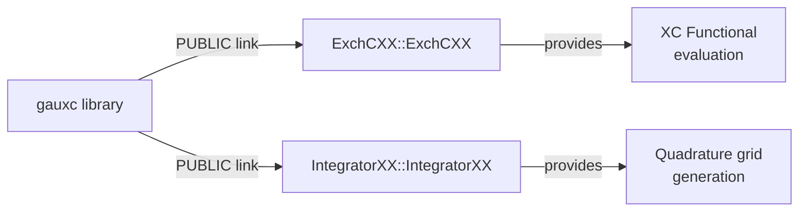

**ExchCXX** provides exchange-correlation functional evaluation. The library is linked publicly and discovered via `find_dependency(ExchCXX)` in the config file.

**IntegratorXX** provides quadrature grid generation capabilities. Also linked publicly and discovered via `find_dependency(IntegratorXX)`.

Both dependencies are discovered at build time via `include(gauxc-exchcxx)` and `include(gauxc-integratorxx)` helper scripts, then re-discovered at install time for downstream consumers.

Sources: [third_party/gauxc/cmake/gauxc-config.cmake.in:10-11](), [third_party/gauxc/src/CMakeLists.txt:36-37](), [third_party/gauxc/src/CMakeLists.txt:85-88]()

### Threading Support

GauXC requires either OpenMP or standard threading support:

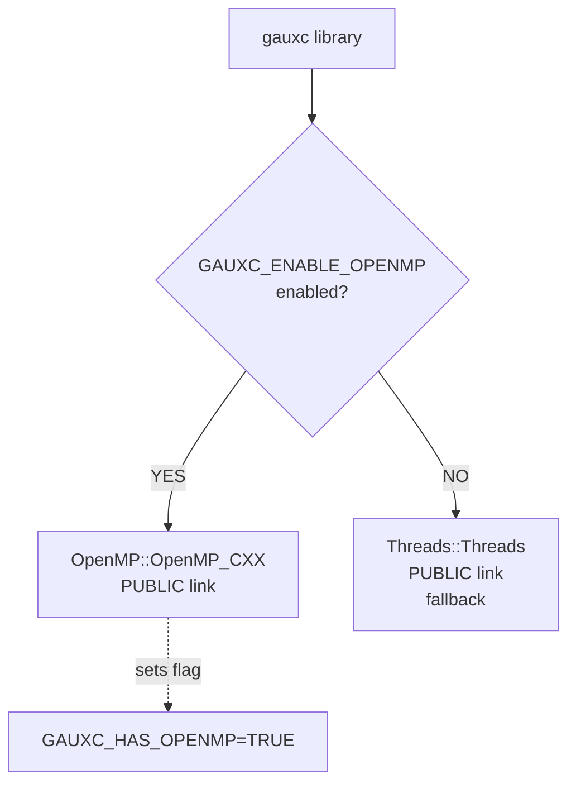

If `GAUXC_ENABLE_OPENMP` is enabled, the build system searches for OpenMP via `find_package(OpenMP REQUIRED)` and links `OpenMP::OpenMP_CXX`. If OpenMP is unavailable or disabled, the system falls back to `Threads::Threads`.

Sources: [third_party/gauxc/src/CMakeLists.txt:10-16](), [third_party/gauxc/src/CMakeLists.txt:89-94](), [third_party/gauxc/cmake/gauxc-config.cmake.in:30-32]()

## Platform-Specific Dependencies

### BLAS/LAPACK for Host Execution

When host execution is enabled (`GAUXC_HAS_HOST`), GauXC requires BLAS/LAPACK libraries with specific integer width support:

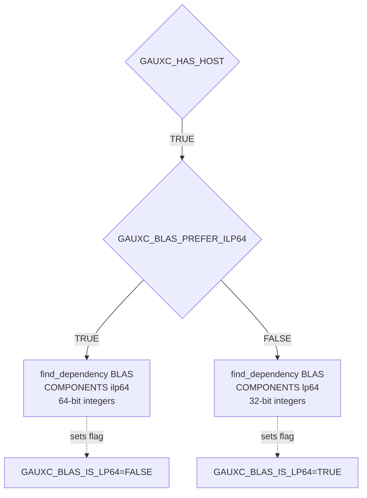

The `GAUXC_BLAS_PREFER_ILP64` option controls whether the build system searches for ILP64 (64-bit integers) or LP64 (32-bit integers) BLAS implementations. This choice is exported via the `GAUXC_BLAS_IS_LP64` flag to inform downstream consumers.

Sources: [third_party/gauxc/cmake/gauxc-config.cmake.in:34-42](), [third_party/gauxc/CMakeLists.txt:40]()

### CUDA Platform Dependencies

When CUDA support is enabled (`GAUXC_ENABLE_CUDA`), several dependencies are discovered and conditionally fetched:

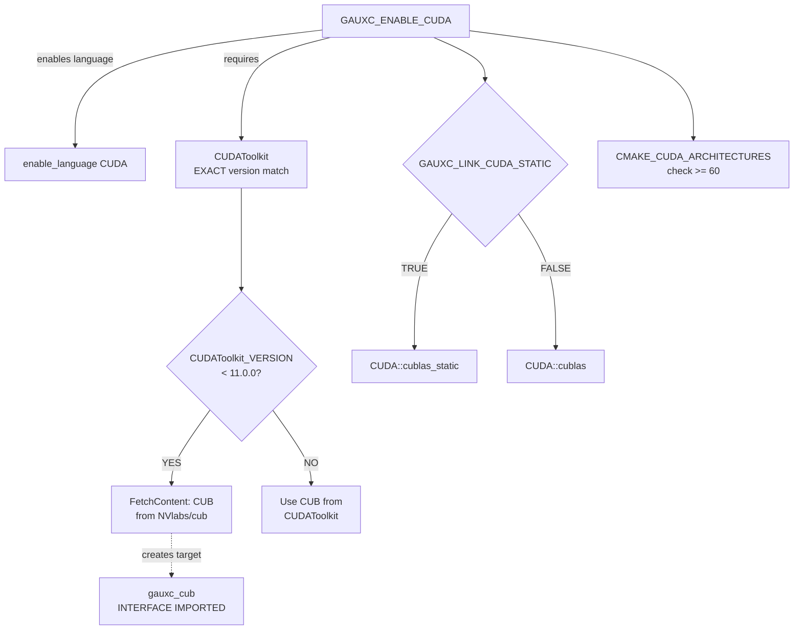

**CUDAToolkit**: Required with exact version matching. The version is captured during build and enforced during downstream consumption via `find_dependency(CUDAToolkit @CUDAToolkit_VERSION@ EXACT)`.

**CUB**: For CUDA toolkit versions < 11.0, CUB is fetched via `FetchContent` from the NVlabs repository. For CUDA 11.0+, the built-in CUB is used.

**cuBLAS**: Users can choose between static (`CUDA::cublas_static`) or dynamic (`CUDA::cublas`) linking via the `GAUXC_LINK_CUDA_STATIC` option.

**Compute Capability**: GauXC requires CUDA compute capability 6.0+ for FP64 atomic operations. The build system validates `CMAKE_CUDA_ARCHITECTURES` to ensure all specified architectures meet this requirement.

Sources: [third_party/gauxc/CMakeLists.txt:97-100](), [third_party/gauxc/src/xc_integrator/local_work_driver/device/cuda/CMakeLists.txt:31-41](), [third_party/gauxc/cmake/gauxc-cub.cmake:1-32](), [third_party/gauxc/cmake/gauxc-config.cmake.in:44-53]()

### HIP Platform Dependencies

When HIP support is enabled (`GAUXC_ENABLE_HIP`), the build system enables the HIP language and links to ROCm libraries:

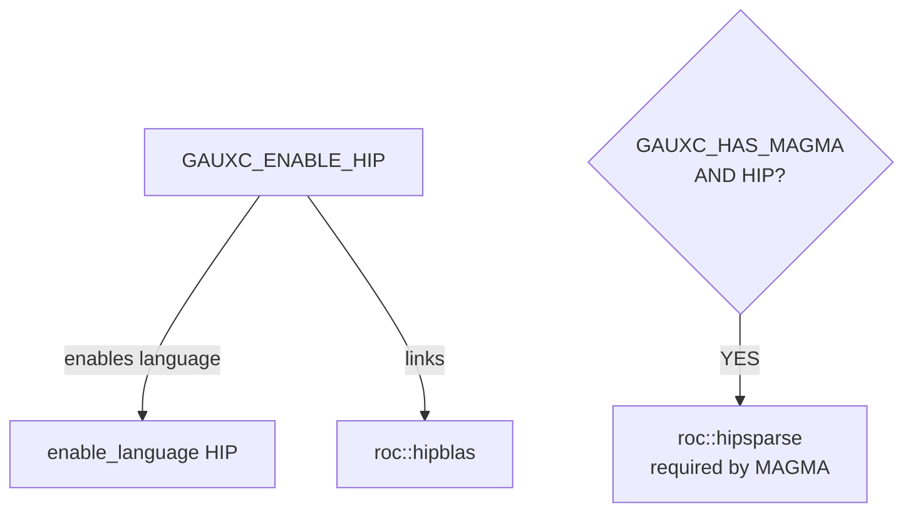

**hipBLAS**: Always required for HIP builds, discovered via `find_package(hipblas REQUIRED)` and linked as `roc::hipblas`.

**hipSPARSE**: Required only when MAGMA is enabled with HIP, as MAGMA has an internal dependency on hipSPARSE.

Sources: [third_party/gauxc/CMakeLists.txt:102-105](), [third_party/gauxc/src/xc_integrator/local_work_driver/device/hip/CMakeLists.txt:28-32]()

## Optional Feature Dependencies

### MAGMA: GPU Linear Algebra

MAGMA provides GPU-accelerated linear algebra operations. It is enabled via `GAUXC_ENABLE_MAGMA` and requires either CUDA or HIP:

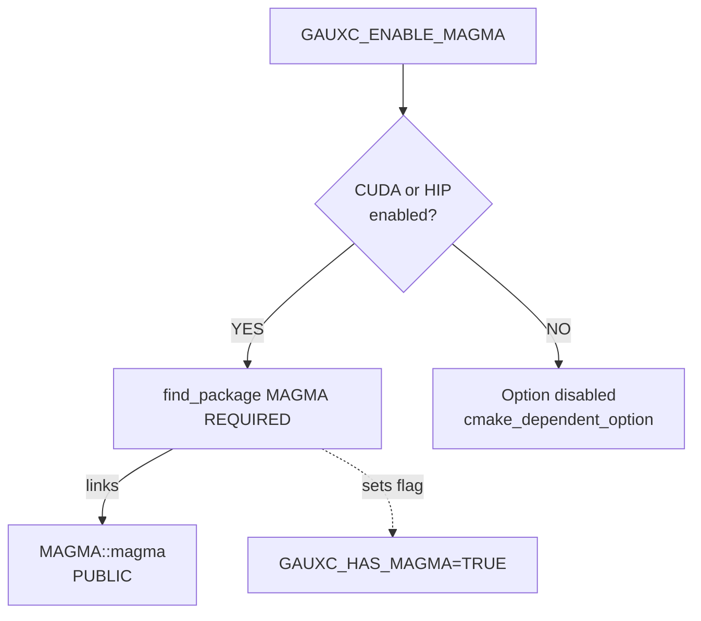

MAGMA is a `cmake_dependent_option` that automatically disables if neither CUDA nor HIP is enabled. When enabled, it is discovered via `find_package(MAGMA REQUIRED)` and linked publicly.

Sources: [third_party/gauxc/CMakeLists.txt:44-47](), [third_party/gauxc/src/xc_integrator/local_work_driver/device/CMakeLists.txt:16-25](), [third_party/gauxc/cmake/gauxc-config.cmake.in:47-49]()

### NCCL: Multi-GPU Communication

NCCL provides collective communication primitives for multi-GPU setups. It is CUDA-specific:

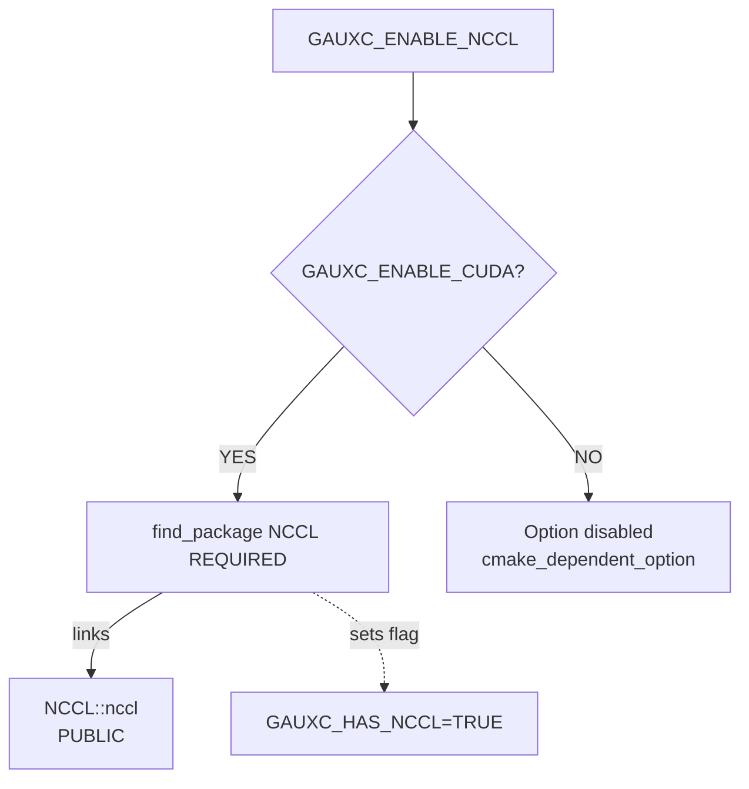

NCCL is a `cmake_dependent_option` that requires CUDA to be enabled. A custom `FindNCCL.cmake` module is provided and installed for downstream use.

Sources: [third_party/gauxc/CMakeLists.txt:48-51](), [third_party/gauxc/cmake/gauxc-config.cmake.in:50-52](), [third_party/gauxc/src/CMakeLists.txt:237-239]()

### CUTLASS: Tensor Core Operations

CUTLASS provides highly optimized tensor core operations for NVIDIA GPUs with compute capability 8.0+:

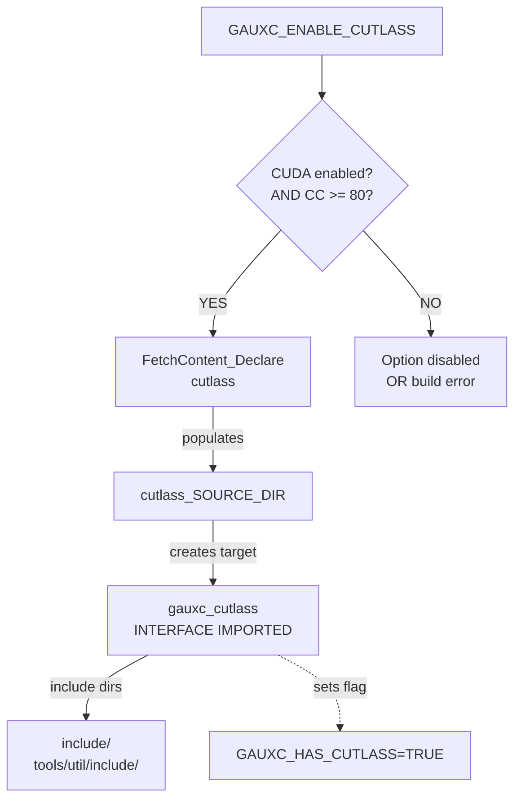

CUTLASS is fetched via `FetchContent` from the NVIDIA repository. The build system enforces that all CUDA architectures are 8.0+ via an architecture validation loop. An interface target `gauxc_cutlass` is created to expose CUTLASS headers.

Sources: [third_party/gauxc/CMakeLists.txt:52-55](), [third_party/gauxc/cmake/gauxc-cutlass.cmake:1-34](), [third_party/gauxc/src/xc_integrator/local_work_driver/device/cuda/CMakeLists.txt:44-53]()

### MPI: Distributed Parallelism

MPI enables distributed-memory parallelism:

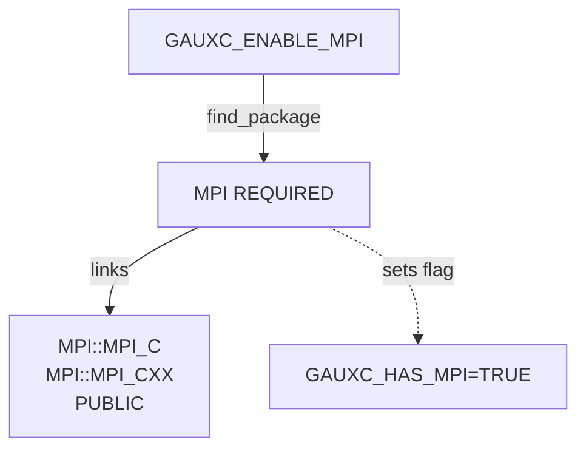

MPI is discovered via `find_package(MPI REQUIRED)` and both C and CXX components are linked publicly.

Sources: [third_party/gauxc/src/CMakeLists.txt:18-24](), [third_party/gauxc/src/CMakeLists.txt:97-99](), [third_party/gauxc/cmake/gauxc-config.cmake.in:55-57]()

### HDF5 and HighFive

HDF5 support for data serialization is provided via the HighFive C++ wrapper:

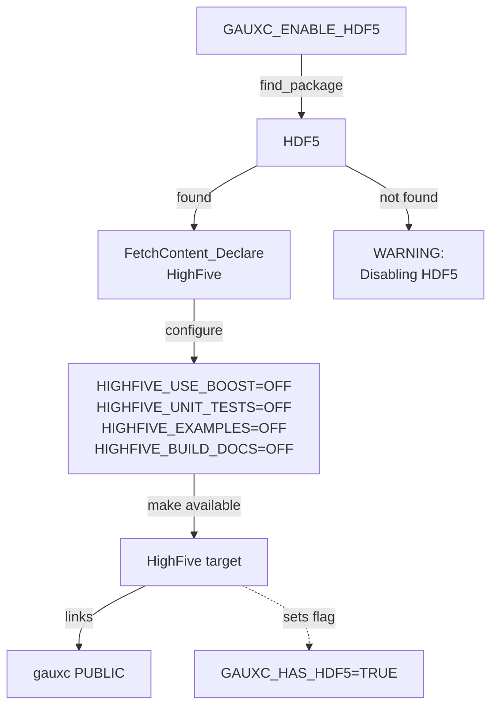

HDF5 is first discovered via `find_package(HDF5)`. If found, HighFive is fetched via `FetchContent` with Boost support disabled. The library is only enabled if HDF5 is actually found; otherwise, a warning is emitted.

Sources: [third_party/gauxc/src/external/CMakeLists.txt:8-35](), [third_party/gauxc/cmake/gauxc-config.cmake.in:63-65]()

### OneDFT: Machine Learning Functionals

OneDFT provides machine-learning-based exchange-correlation functionals via PyTorch:

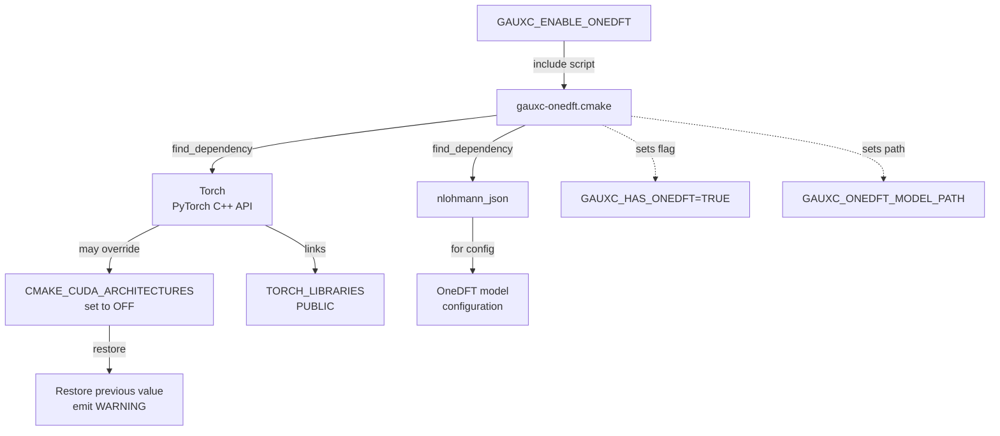

OneDFT requires both PyTorch (Torch) and nlohmann_json. A special case handles PyTorch's tendency to override `CMAKE_CUDA_ARCHITECTURES` to `OFF`, which is detected and reverted with a warning. Model data is installed to a shared directory.

Sources: [third_party/gauxc/src/CMakeLists.txt:26-33](), [third_party/gauxc/src/CMakeLists.txt:101-103](), [third_party/gauxc/cmake/gauxc-config.cmake.in:67-75](), [third_party/gauxc/src/CMakeLists.txt:126-132]()

## Dependency Discovery Mechanisms

### Build-Time Discovery

At build time, dependencies are discovered through a combination of `find_package()` calls and helper CMake scripts:

| Dependency Type | Discovery Mechanism | Location |
|----------------|---------------------|----------|
| ExchCXX, IntegratorXX | `include(gauxc-*)` helper scripts | [src/CMakeLists.txt:36-37]() |
| OpenMP, MPI, Threads | `find_package()` with REQUIRED | [src/CMakeLists.txt:10-24]() |
| CUDA toolkit, BLAS | `find_package()` conditional | Platform-specific CMake files |
| CUB, CUTLASS, HighFive | `FetchContent_Declare()` and populate | [cmake/gauxc-cub.cmake](), [cmake/gauxc-cutlass.cmake]() |
| MAGMA, NCCL | Custom FindModules | [cmake/modules/FindMAGMA.cmake](), [cmake/modules/FindNCCL.cmake]() |

### Install-Time Re-Discovery

For downstream consumers, dependencies are re-discovered via the installed `gauxc-config.cmake`:

```cmake
# gauxc-config.cmake.in structure
list(PREPEND CMAKE_MODULE_PATH ${GauXC_CMAKE_DIR})
list(PREPEND CMAKE_MODULE_PATH ${GauXC_CMAKE_DIR}/linalg-cmake-modules)

# Core dependencies - always required
find_dependency( ExchCXX )
find_dependency( IntegratorXX )

# Conditional re-discovery based on GAUXC_HAS_* flags
if( GAUXC_HAS_CUDA )
  enable_language( CUDA )
  find_dependency( CUDAToolkit @CUDAToolkit_VERSION@ EXACT )
  if( GAUXC_HAS_MAGMA )
    find_dependency( MAGMA )
  endif()
endif()
```

The config file uses `find_dependency()` (a wrapper around `find_package()`) and guards optional dependencies with `if(GAUXC_HAS_*)` checks based on how the library was built.

Sources: [third_party/gauxc/cmake/gauxc-config.cmake.in:1-85]()

## Version Requirements and Constraints

### CUDA Version Constraints

The CUDA toolkit version is captured during build and enforced exactly during consumption:

```cmake
# In gauxc-config.cmake.in
if( GAUXC_HAS_CUDA )
  enable_language( CUDA )
  find_dependency( CUDAToolkit @CUDAToolkit_VERSION@ EXACT )
endif()
```

The `@CUDAToolkit_VERSION@` variable is substituted at configure time with the exact version found during the build (e.g., `11.5.0`), ensuring binary compatibility.

**Compute Capability Requirements:**
- Minimum CC 6.0 for all CUDA kernels (FP64 atomics)
- Minimum CC 8.0 for CUTLASS features (tensor cores)

Sources: [third_party/gauxc/cmake/gauxc-config.cmake.in:46](), [third_party/gauxc/src/xc_integrator/local_work_driver/device/cuda/CMakeLists.txt:36-41](), [third_party/gauxc/cmake/gauxc-cutlass.cmake:1-6]()

### Dependency Version Tracking

Version information for fetched dependencies is centralized in a version management script:

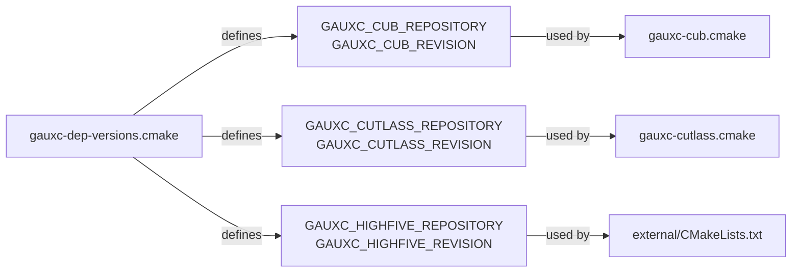

Sources: [third_party/gauxc/cmake/gauxc-cub.cmake:5-9](), [third_party/gauxc/cmake/gauxc-cutlass.cmake:8-12](), [third_party/gauxc/src/external/CMakeLists.txt:14-15]()

## Exported Properties and Downstream Consumption

### Target Property Export

GauXC exports extensive target properties to inform downstream consumers about its configuration:

```cmake
# Property list exported via EXPORT_PROPERTIES
set(export_properties
  # Platform and feature flags
  "GAUXC_HAS_HOST"
  "GAUXC_HAS_DEVICE"
  "GAUXC_HAS_CUDA"
  "GAUXC_HAS_HIP"
  "GAUXC_HAS_MAGMA"
  "GAUXC_HAS_CUTLASS"
  "GAUXC_HAS_NCCL"
  "GAUXC_HAS_MPI"
  "GAUXC_HAS_OPENMP"
  "GAUXC_HAS_HDF5"
  "GAUXC_HAS_ONEDFT"
  
  # Angular momentum limits
  "GAUXC_CPU_XC_MAX_AM"
  "GAUXC_CPU_SNLINK_MAX_AM"
  "GAUXC_GPU_XC_MAX_AM"
  "GAUXC_GPU_SNLINK_MAX_AM"
)
```

These properties are:
1. Set on the `gauxc` target during build ([src/CMakeLists.txt:173-190]())
2. Marked for export via `EXPORT_PROPERTIES` ([src/CMakeLists.txt:191]())
3. Written to `gauxc-targets.cmake` during export ([src/CMakeLists.txt:194-196]())
4. Available to downstream via `get_target_property()`

Sources: [third_party/gauxc/src/CMakeLists.txt:152-191]()

### Custom Find Modules Installation

Custom find modules are installed for dependencies without native CMake support:

```cmake
# Install Custom Find Modules
install( FILES
  ${PROJECT_SOURCE_DIR}/cmake/modules/FindMAGMA.cmake
  ${PROJECT_SOURCE_DIR}/cmake/modules/FindNCCL.cmake
  DESTINATION ${INSTALL_CONFIGDIR}
)

# Install linalg-cmake-modules for BLAS/LAPACK discovery
include( ${linalg-cmake-modules_SOURCE_DIR}/LinAlgModulesMacros.cmake )
install_linalg_modules( INSTALL_CONFIGDIR )
```

These modules are placed in `CMAKE_MODULE_PATH` by `gauxc-config.cmake` to ensure downstream projects can rediscover the same dependencies.

Sources: [third_party/gauxc/src/CMakeLists.txt:237-247](), [third_party/gauxc/cmake/gauxc-config.cmake.in:5-6]()

## Dependency Graph Summary

The complete dependency graph showing all possible dependencies:

```mermaid
graph TB
    subgraph "Core: Always Required"
        gauxc["gauxc::gauxc"]
        exchcxx["ExchCXX::ExchCXX"]
        integratorxx["IntegratorXX::IntegratorXX"]
        threading["OpenMP::OpenMP_CXX<br/>OR<br/>Threads::Threads"]
    end
    
    subgraph "Platform: Host"
        blas["BLAS/LAPACK<br/>lp64 OR ilp64"]
    end
    
    subgraph "Platform: CUDA"
        cudatoolkit["CUDAToolkit<br/>exact version"]
        cublas["CUDA::cublas<br/>OR cublas_static"]
        cub["CUB<br/>FetchContent if < 11.0"]
    end
    
    subgraph "Platform: HIP"
        hipblas["roc::hipblas"]
        hipsparse["roc::hipsparse<br/>if MAGMA enabled"]
    end
    
    subgraph "Optional Features"
        mpi["MPI::MPI_C<br/>MPI::MPI_CXX"]
        magma["MAGMA::magma"]
        nccl["NCCL::nccl"]
        cutlass["CUTLASS<br/>FetchContent"]
        hdf5_lib["HDF5"]
        highfive["HighFive<br/>FetchContent"]
        torch["Torch"]
        json["nlohmann_json"]
    end
    
    gauxc -->|"PUBLIC"| exchcxx
    gauxc -->|"PUBLIC"| integratorxx
    gauxc -->|"PUBLIC"| threading
    
    gauxc -.->|"if HOST"| blas
    
    gauxc -.->|"if CUDA"| cudatoolkit
    cudatoolkit --> cublas
    cudatoolkit -.-> cub
    
    gauxc -.->|"if HIP"| hipblas
    gauxc -.->|"if HIP+MAGMA"| hipsparse
    
    gauxc -.->|"if MPI"| mpi
    gauxc -.->|"if MAGMA"| magma
    gauxc -.->|"if NCCL"| nccl
    gauxc -.->|"if CUTLASS"| cutlass
    gauxc -.->|"if HDF5"| highfive
    highfive --> hdf5_lib
    gauxc -.->|"if ONEDFT"| torch
    gauxc -.->|"if ONEDFT"| json
```

Sources: [third_party/gauxc/cmake/gauxc-config.cmake.in:1-85](), [third_party/gauxc/src/CMakeLists.txt:85-103]()

---

