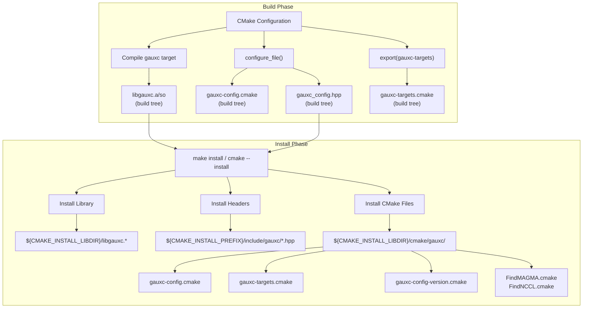
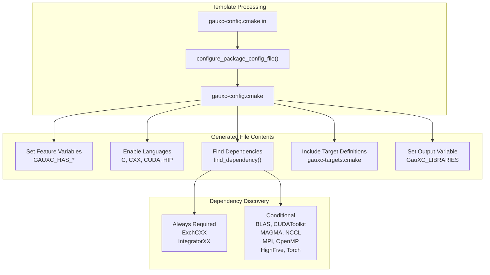
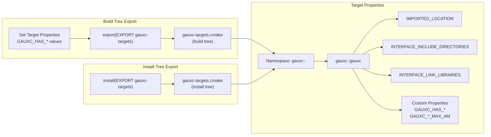
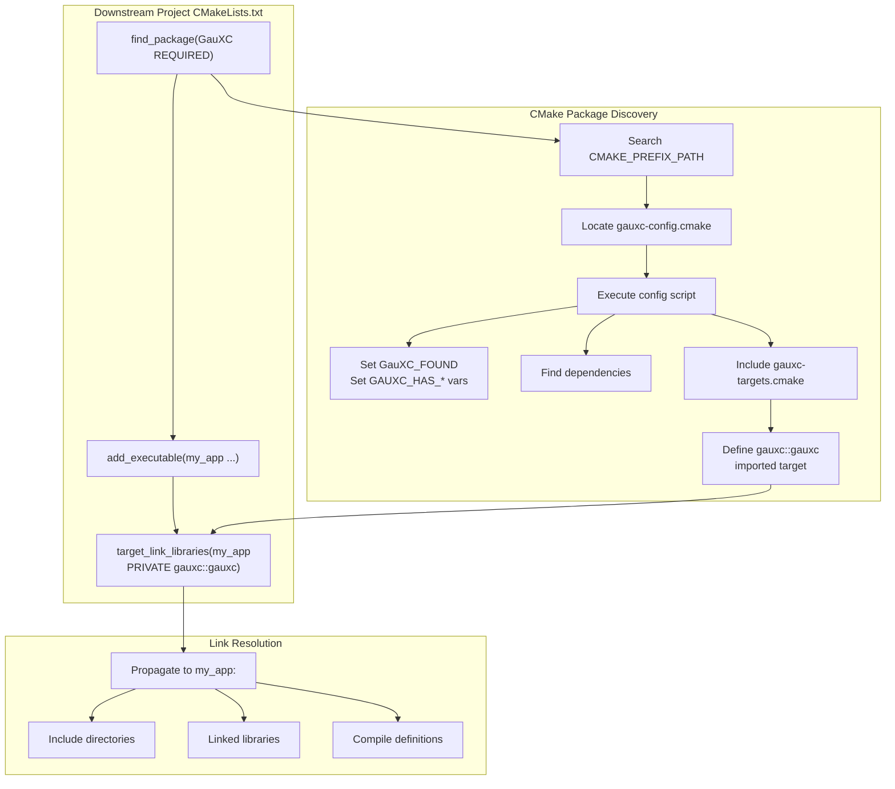

<!-- source: DeepWiki mcp.deepwiki.com · repo microsoft/skala · page 2.3 Installation and Package Configuration · fetched 2026-10-26 -->

# Installation and Package Configuration

<details>
<summary>Relevant source files</summary>

The following files were used as context for generating this wiki page:

- [third_party/gauxc/CMakeLists.txt](third_party/gauxc/CMakeLists.txt)
- [third_party/gauxc/attic/src/integrator/cuda/gauxc-cuda_integrator.cmake](third_party/gauxc/attic/src/integrator/cuda/gauxc-cuda_integrator.cmake)
- [third_party/gauxc/attic/src/new_integrator/device/cuda/gauxc-cuda.cmake](third_party/gauxc/attic/src/new_integrator/device/cuda/gauxc-cuda.cmake)
- [third_party/gauxc/attic/src/new_integrator/device/hip/gauxc-hip.cmake](third_party/gauxc/attic/src/new_integrator/device/hip/gauxc-hip.cmake)
- [third_party/gauxc/cmake/gauxc-config.cmake.in](third_party/gauxc/cmake/gauxc-config.cmake.in)
- [third_party/gauxc/cmake/gauxc-cub.cmake](third_party/gauxc/cmake/gauxc-cub.cmake)
- [third_party/gauxc/cmake/gauxc-cutlass.cmake](third_party/gauxc/cmake/gauxc-cutlass.cmake)
- [third_party/gauxc/include/gauxc/gauxc_config.hpp.in](third_party/gauxc/include/gauxc/gauxc_config.hpp.in)
- [third_party/gauxc/include/gauxc/util/environment.hpp](third_party/gauxc/include/gauxc/util/environment.hpp)
- [third_party/gauxc/src/CMakeLists.txt](third_party/gauxc/src/CMakeLists.txt)
- [third_party/gauxc/src/external/CMakeLists.txt](third_party/gauxc/src/external/CMakeLists.txt)
- [third_party/gauxc/src/xc_integrator/local_work_driver/device/CMakeLists.txt](third_party/gauxc/src/xc_integrator/local_work_driver/device/CMakeLists.txt)
- [third_party/gauxc/src/xc_integrator/local_work_driver/device/cuda/CMakeLists.txt](third_party/gauxc/src/xc_integrator/local_work_driver/device/cuda/CMakeLists.txt)
- [third_party/gauxc/src/xc_integrator/local_work_driver/device/hip/CMakeLists.txt](third_party/gauxc/src/xc_integrator/local_work_driver/device/hip/CMakeLists.txt)
- [third_party/gauxc/tests/environment.cxx](third_party/gauxc/tests/environment.cxx)

</details>


## Purpose and Scope

This page describes the installation process for GauXC, the artifacts generated during installation, and how downstream CMake projects consume the installed library. For information about build options and feature flags that control what gets compiled, see [CMake Options and Feature Flags](#2.1). For information about finding and configuring dependencies, see [Dependency Management](#2.2).

The installation system generates three categories of artifacts:
1. **Compiled library**: `libgauxc.a` or `libgauxc.so`
2. **Header files**: Public API headers and generated configuration headers
3. **CMake package files**: Configuration scripts for downstream consumption

## Installation Process Overview

The installation process is controlled by standard CMake installation commands in [third_party/gauxc/src/CMakeLists.txt:142-248]().



**Installation Directory Structure**

The installed files are organized according to GNU standard directories:

| Category | Destination | Contents |
|----------|-------------|----------|
| Library | `${CMAKE_INSTALL_LIBDIR}` | `libgauxc.a` or `libgauxc.so` |
| Headers | `${CMAKE_INSTALL_PREFIX}/include/gauxc/` | All `.hpp` files from source and generated config |
| CMake Config | `${CMAKE_INSTALL_LIBDIR}/cmake/gauxc/` | Package configuration and target export files |
| OneDFT Models | `${CMAKE_INSTALL_PREFIX}/share/gauxc/onedft_models/` | Model data files (if enabled) |

Sources: [third_party/gauxc/src/CMakeLists.txt:140-248]()

## Generated Artifacts

### Runtime Configuration Header: gauxc_config.hpp

The header `gauxc_config.hpp` is generated from a template during CMake configuration and provides compile-time feature detection.

**Generation Process**

[third_party/gauxc/src/CMakeLists.txt:134-138]() shows the configuration:

```cmake
configure_file( 
  ${PROJECT_SOURCE_DIR}/include/gauxc/gauxc_config.hpp.in
  ${PROJECT_BINARY_DIR}/include/gauxc/gauxc_config.hpp
)
```

**Template Structure**

The template [third_party/gauxc/include/gauxc/gauxc_config.hpp.in:1-43]() defines preprocessor macros for all enabled features:

| Macro | Meaning |
|-------|---------|
| `GAUXC_HAS_HOST` | Host (CPU) integrator enabled |
| `GAUXC_HAS_CUDA` | CUDA GPU backend enabled |
| `GAUXC_HAS_HIP` | HIP GPU backend enabled |
| `GAUXC_HAS_MPI` | MPI parallelization enabled |
| `GAUXC_HAS_MAGMA` | MAGMA linear algebra enabled |
| `GAUXC_HAS_NCCL` | NCCL collective communications enabled |
| `GAUXC_HAS_CUTLASS` | CUTLASS linear algebra enabled |
| `GAUXC_HAS_GAU2GRID` | Gau2Grid collocation enabled |
| `GAUXC_HAS_HDF5` | HDF5 I/O enabled |
| `GAUXC_HAS_ONEDFT` | OneDFT functional enabled |

**Angular Momentum Limits**

The header also defines maximum angular momentum values:

| Macro | Default Value | Condition |
|-------|---------------|-----------|
| `GAUXC_CPU_XC_MAX_AM` | 6 | `#ifdef GAUXC_HAS_HOST` |
| `GAUXC_CPU_SNLINK_MAX_AM` | 6 | `#ifdef GAUXC_HAS_HOST` |
| `GAUXC_GPU_XC_MAX_AM` | 4 | `#ifdef GAUXC_HAS_DEVICE` |
| `GAUXC_GPU_SNLINK_MAX_AM` | 2 | `#ifdef GAUXC_HAS_DEVICE` |

These values are set in [third_party/gauxc/src/CMakeLists.txt:116-124]() and control kernel generation.

**OneDFT Model Paths**

When OneDFT is enabled, the header contains absolute paths to model data:

- `GAUXC_ONEDFT_MODEL_PATH`: Build-tree path (for testing)
- `GAUXC_ONEDFT_MODEL_PATH_INSTALL`: Install-tree path (for deployment)

Sources: [third_party/gauxc/include/gauxc/gauxc_config.hpp.in:1-43](), [third_party/gauxc/src/CMakeLists.txt:116-138]()

### Package Configuration: gauxc-config.cmake

The package configuration file enables downstream projects to locate and link GauXC using `find_package(GauXC)`.

**Configuration File Architecture**



**Feature Variable Export**

The template [third_party/gauxc/cmake/gauxc-config.cmake.in:13-24]() exports all feature flags:

```cmake
set( GAUXC_HAS_HOST       @GAUXC_HAS_HOST@      )
set( GAUXC_HAS_CUDA       @GAUXC_HAS_CUDA@      )
set( GAUXC_HAS_HIP        @GAUXC_HAS_HIP@       )
set( GAUXC_HAS_MAGMA      @GAUXC_HAS_MAGMA@     )
set( GAUXC_HAS_NCCL       @GAUXC_HAS_NCCL@      )
set( GAUXC_HAS_CUTLASS    @GAUXC_HAS_CUTLASS@   )
set( GAUXC_HAS_MPI        @GAUXC_HAS_MPI@       )
set( GAUXC_HAS_OPENMP     @GAUXC_HAS_OPENMP@    )
set( GAUXC_HAS_GAU2GRID   @GAUXC_HAS_GAU2GRID@  )
set( GAUXC_HAS_HDF5       @GAUXC_HAS_HDF5@      )
set( GAUXC_BLAS_IS_LP64   @GAUXC_BLAS_IS_LP64@  )
set( GAUXC_HAS_ONEDFT     @GAUXC_HAS_ONEDFT@    )
```

**Dependency Discovery Logic**

The config file conditionally finds dependencies based on the feature flags:

| Feature Flag | Dependency Found | Notes |
|--------------|------------------|-------|
| Always | `ExchCXX`, `IntegratorXX` | Required for all builds |
| `GAUXC_HAS_HOST` | `BLAS` | With LP64/ILP64 component selection |
| `GAUXC_HAS_CUDA` | `CUDAToolkit` | Exact version match required |
| `GAUXC_HAS_CUDA` && `GAUXC_HAS_MAGMA` | `MAGMA` | GPU linear algebra |
| `GAUXC_HAS_CUDA` && `GAUXC_HAS_NCCL` | `NCCL` | Multi-GPU collectives |
| `GAUXC_HAS_MPI` | `MPI` | Distributed computing |
| `GAUXC_HAS_OPENMP` | `OpenMP` | Thread parallelism |
| `GAUXC_HAS_HDF5` | `HighFive` | HDF5 C++ wrapper |
| `GAUXC_HAS_ONEDFT` | `Torch`, `nlohmann_json` | PyTorch and JSON |

The dependency logic is implemented in [third_party/gauxc/cmake/gauxc-config.cmake.in:26-75]().

**Language Enablement**

The config file ensures necessary languages are enabled in the consuming project:

```cmake
enable_language(C)    # Required for BLAS discovery
enable_language(CXX)  # Required for GauXC
```

If CUDA support was enabled during build, [third_party/gauxc/cmake/gauxc-config.cmake.in:44-46]() also enables CUDA:

```cmake
if( GAUXC_HAS_CUDA )
  enable_language( CUDA )
  find_dependency( CUDAToolkit @CUDAToolkit_VERSION@ EXACT )
```

**Special Case: PyTorch and CUDA Architectures**

When OneDFT is enabled, the config file works around a PyTorch quirk that resets `CMAKE_CUDA_ARCHITECTURES`. [third_party/gauxc/cmake/gauxc-config.cmake.in:67-75]() preserves the original setting:

```cmake
if ( GAUXC_HAS_ONEDFT )
  set(_PREV_CUDA_ARCHS "${CMAKE_CUDA_ARCHITECTURES}")
  find_dependency ( Torch )
  if(CMAKE_CUDA_ARCHITECTURES STREQUAL "OFF")
    set(CMAKE_CUDA_ARCHITECTURES "${_PREV_CUDA_ARCHS}" ...)
  endif()
```

Sources: [third_party/gauxc/cmake/gauxc-config.cmake.in:1-85](), [third_party/gauxc/src/CMakeLists.txt:229-234]()

### Target Export: gauxc-targets.cmake

The targets file defines the `gauxc::gauxc` imported target with all necessary properties, dependencies, and compile flags.

**Export Process**



**Exported Properties**

The exported target includes custom properties that downstream projects can query. [third_party/gauxc/src/CMakeLists.txt:152-191]() defines the export list:

| Property Category | Properties |
|-------------------|------------|
| Feature Flags | `GAUXC_HAS_HOST`, `GAUXC_HAS_DEVICE`, `GAUXC_HAS_CUDA`, `GAUXC_HAS_HIP`, `GAUXC_HAS_MAGMA`, `GAUXC_HAS_CUTLASS`, `GAUXC_HAS_NCCL`, `GAUXC_HAS_MPI`, `GAUXC_HAS_OPENMP`, `GAUXC_HAS_HDF5`, `GAUXC_HAS_ONEDFT` |
| Angular Momentum | `GAUXC_CPU_XC_MAX_AM`, `GAUXC_CPU_SNLINK_MAX_AM`, `GAUXC_GPU_XC_MAX_AM`, `GAUXC_GPU_SNLINK_MAX_AM` |

The properties are marked for export with:

```cmake
set_property(TARGET gauxc APPEND PROPERTY EXPORT_PROPERTIES "${export_properties}")
```

**Build Tree vs Install Tree**

GauXC exports targets for both build tree and install tree usage:

- **Build tree**: [third_party/gauxc/src/CMakeLists.txt:193-196]() exports to `${PROJECT_BINARY_DIR}/gauxc-targets.cmake`
- **Install tree**: [third_party/gauxc/src/CMakeLists.txt:214-218]() installs to `${CMAKE_INSTALL_LIBDIR}/cmake/gauxc/gauxc-targets.cmake`

This enables downstream projects to link against either an installed GauXC or one in a build tree via `CMAKE_PREFIX_PATH`.

Sources: [third_party/gauxc/src/CMakeLists.txt:142-218]()

### Version Compatibility: gauxc-config-version.cmake

The version file enables `find_package()` to perform version checking and compatibility validation.

[third_party/gauxc/src/CMakeLists.txt:220-226]() generates the version file using CMake's built-in helper:

```cmake
write_basic_package_version_file(
  ${CMAKE_CURRENT_BINARY_DIR}/gauxc-config-version.cmake
  VERSION ${PROJECT_VERSION}
  COMPATIBILITY AnyNewerVersion
)
```

**Compatibility Policy**

The `AnyNewerVersion` compatibility mode means:
- Requested version ≤ installed version → compatible
- Requested version > installed version → incompatible

This allows downstream projects to specify minimum version requirements:

```cmake
find_package(GauXC 0.0.1 REQUIRED)  # Requires at least v0.0.1
```

Sources: [third_party/gauxc/src/CMakeLists.txt:220-226]()

## Consuming GauXC from Downstream Projects

### Basic Usage Pattern

A downstream CMake project uses GauXC by calling `find_package()` and linking to the `gauxc::gauxc` target.



**Minimal Example**

```cmake
cmake_minimum_required(VERSION 3.18)
project(MyProject)

# Tell CMake where to find GauXC
list(APPEND CMAKE_PREFIX_PATH "/path/to/gauxc/install")

# Find GauXC package
find_package(GauXC REQUIRED)

# Create executable
add_executable(my_app main.cpp)

# Link to GauXC
target_link_libraries(my_app PRIVATE gauxc::gauxc)
```

Sources: [third_party/gauxc/cmake/gauxc-config.cmake.in:80-84]()

### Feature Detection in Downstream Projects

Downstream projects can query GauXC's capabilities using the exported variables and target properties.

**Method 1: CMake Variables**

After `find_package(GauXC)`, boolean variables are available:

```cmake
find_package(GauXC REQUIRED)

if(GAUXC_HAS_CUDA)
  message(STATUS "GauXC built with CUDA support")
  # Enable CUDA in my project
  enable_language(CUDA)
endif()

if(GAUXC_HAS_MPI)
  message(STATUS "GauXC built with MPI support")
  find_package(MPI REQUIRED)
  target_link_libraries(my_app PRIVATE MPI::MPI_CXX)
endif()
```

**Method 2: Target Properties**

Alternatively, query the target properties directly:

```cmake
get_target_property(HAS_CUDA gauxc::gauxc GAUXC_HAS_CUDA)
get_target_property(MAX_AM gauxc::gauxc GAUXC_GPU_XC_MAX_AM)

if(HAS_CUDA)
  message(STATUS "GauXC GPU max angular momentum: ${MAX_AM}")
endif()
```

**Available Feature Variables**

| Variable | Type | Description |
|----------|------|-------------|
| `GauXC_FOUND` | Boolean | Package was found |
| `GauXC_LIBRARIES` | Target | Always set to `gauxc::gauxc` |
| `GAUXC_HAS_HOST` | Boolean | Host execution available |
| `GAUXC_HAS_CUDA` | Boolean | CUDA backend available |
| `GAUXC_HAS_HIP` | Boolean | HIP backend available |
| `GAUXC_HAS_MPI` | Boolean | MPI parallelization available |
| `GAUXC_HAS_MAGMA` | Boolean | MAGMA linear algebra available |
| `GAUXC_HAS_NCCL` | Boolean | NCCL collectives available |
| `GAUXC_HAS_CUTLASS` | Boolean | CUTLASS available |
| `GAUXC_HAS_OPENMP` | Boolean | OpenMP available |
| `GAUXC_HAS_GAU2GRID` | Boolean | Gau2Grid collocation available |
| `GAUXC_HAS_HDF5` | Boolean | HDF5 I/O available |
| `GAUXC_HAS_ONEDFT` | Boolean | OneDFT functional available |
| `GAUXC_BLAS_IS_LP64` | Boolean | BLAS uses LP64 (vs ILP64) |

Sources: [third_party/gauxc/cmake/gauxc-config.cmake.in:13-24,84]()

### Dependency Transitivity

When a downstream project links to `gauxc::gauxc`, CMake automatically handles transitive dependencies based on the PUBLIC/PRIVATE linkage used when building GauXC.

**Public Dependencies (Automatically Propagated)**

These are always linked to the consuming target:

- `ExchCXX::ExchCXX` - XC functional library
- `IntegratorXX::IntegratorXX` - Quadrature library
- `OpenMP::OpenMP_CXX` - Threading (if enabled)
- `MPI::MPI_C`, `MPI::MPI_CXX` - MPI libraries (if enabled)
- `MAGMA::magma` - GPU linear algebra (if enabled)
- `NCCL::nccl` - Multi-GPU collectives (if enabled)
- `Torch` libraries - PyTorch (if OneDFT enabled)

The public linkage is established in [third_party/gauxc/src/CMakeLists.txt:85-103]().

**Private Dependencies (Not Propagated)**

These are used internally but not exposed:

- `gauxc_cub` - CUB library for old CUDA versions
- `gauxc_cutlass` - CUTLASS templates (if enabled)

Sources: [third_party/gauxc/src/CMakeLists.txt:85-103]()

### Custom Find Modules

GauXC installs custom `Find*.cmake` modules for dependencies that lack standard CMake support.

[third_party/gauxc/src/CMakeLists.txt:237-247]() installs:

| Find Module | Purpose |
|-------------|---------|
| `FindMAGMA.cmake` | Locate MAGMA GPU linear algebra library |
| `FindNCCL.cmake` | Locate NCCL multi-GPU communication library |
| LinAlg modules | BLAS/LAPACK with LP64/ILP64 support |

These are installed to `${CMAKE_INSTALL_LIBDIR}/cmake/gauxc/` and automatically added to the module path by `gauxc-config.cmake` via:

```cmake
list(PREPEND CMAKE_MODULE_PATH ${GauXC_CMAKE_DIR})
list(PREPEND CMAKE_MODULE_PATH ${GauXC_CMAKE_DIR}/linalg-cmake-modules)
```

This allows the config file's `find_dependency()` calls to succeed, and also makes these modules available to downstream projects.

Sources: [third_party/gauxc/src/CMakeLists.txt:237-247](), [third_party/gauxc/cmake/gauxc-config.cmake.in:3-8]()

## Installation Command Reference

### Standard Installation

```bash
# Configure
cmake -S /path/to/gauxc -B build \
  -DCMAKE_INSTALL_PREFIX=/opt/gauxc \
  -DGAUXC_ENABLE_CUDA=ON \
  -DCMAKE_CUDA_ARCHITECTURES="70;80"

# Build
cmake --build build

# Install
cmake --install build
```

### Custom Installation Locations

CMake standard variables control installation paths:

| Variable | Default | Controls |
|----------|---------|----------|
| `CMAKE_INSTALL_PREFIX` | `/usr/local` | Root install directory |
| `CMAKE_INSTALL_LIBDIR` | `lib` (relative) | Library directory |
| `CMAKE_INSTALL_INCLUDEDIR` | `include` (relative) | Header directory |

Example with custom locations:

```bash
cmake -S . -B build \
  -DCMAKE_INSTALL_PREFIX=$HOME/.local \
  -DCMAKE_INSTALL_LIBDIR=lib64
```

This installs:
- Libraries to `$HOME/.local/lib64/libgauxc.*`
- Headers to `$HOME/.local/include/gauxc/*.hpp`
- CMake files to `$HOME/.local/lib64/cmake/gauxc/`

### Component Installation

CMake's component installation is not currently used by GauXC - all files are installed as a single unit.

Sources: [third_party/gauxc/src/CMakeLists.txt:140-248]()

## Build Tree Usage

GauXC supports usage directly from its build tree without installation, useful for development workflows.

**Build Tree Export**

[third_party/gauxc/src/CMakeLists.txt:193-196]() exports targets to the build tree:

```cmake
export(EXPORT gauxc-targets
       NAMESPACE gauxc::
       FILE "${PROJECT_BINARY_DIR}/gauxc-targets.cmake")
```

**Consuming from Build Tree**

A downstream project can use GauXC from its build tree by pointing `CMAKE_PREFIX_PATH` to the build directory:

```bash
# Build GauXC (not installed)
cd /path/to/gauxc
cmake -S . -B build -DGAUXC_ENABLE_CUDA=ON
cmake --build build

# Build downstream project
cd /path/to/my_project
cmake -S . -B build \
  -DCMAKE_PREFIX_PATH=/path/to/gauxc/build

cmake --build build
```

The build tree `gauxc-config.cmake` uses `$<BUILD_INTERFACE:...>` generator expressions to reference header and library paths in the build tree rather than install tree.

Sources: [third_party/gauxc/src/CMakeLists.txt:50-56,193-196]()

---

