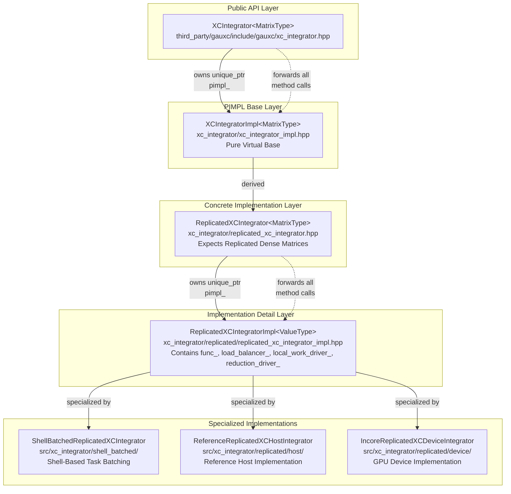
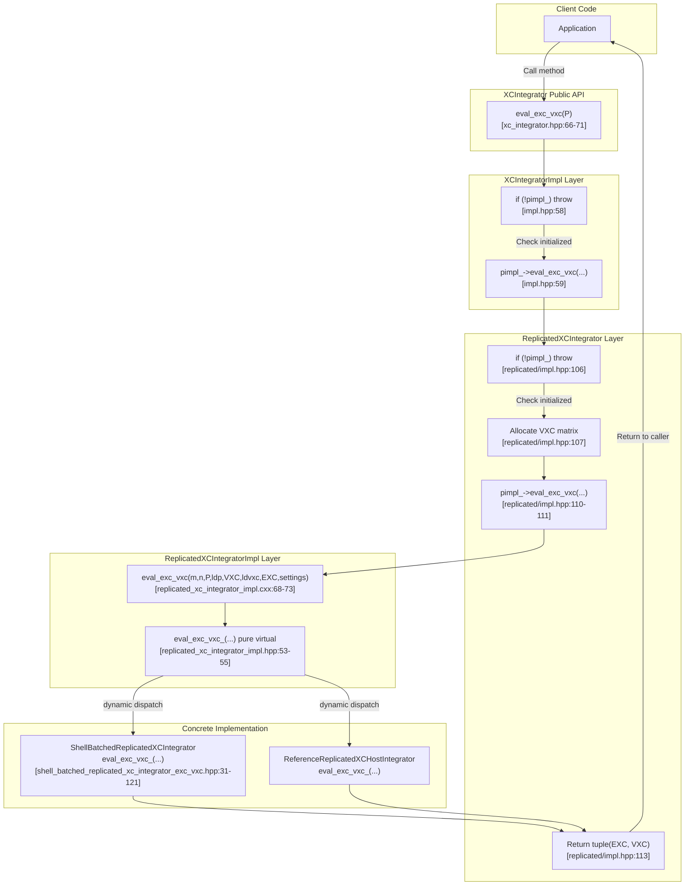
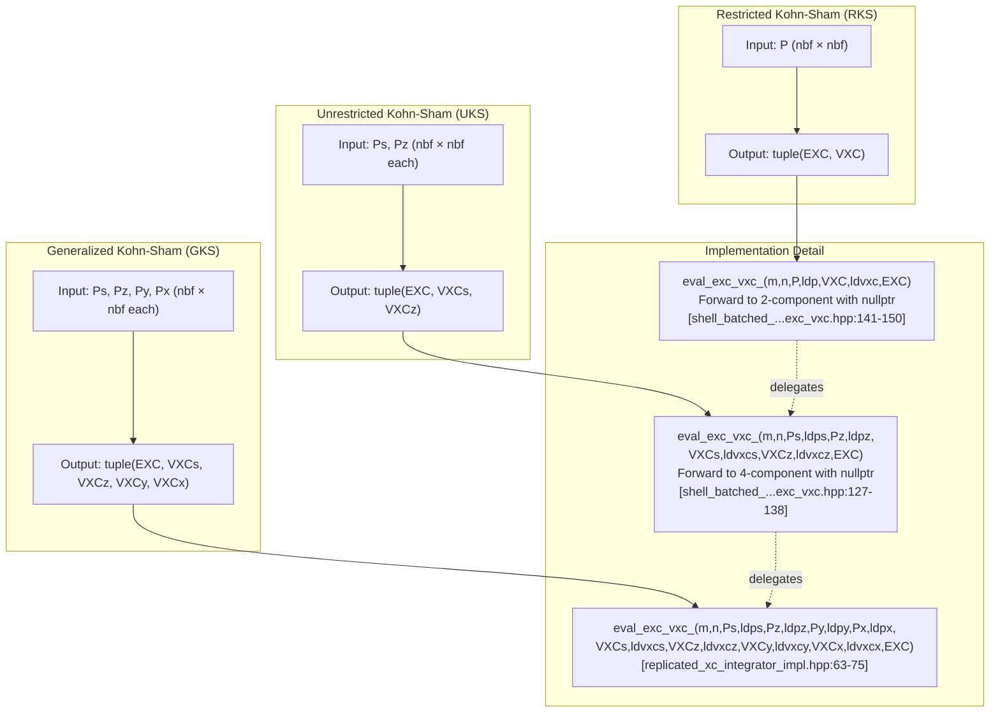

<!-- source: DeepWiki mcp.deepwiki.com · repo microsoft/skala · page 3 XCIntegrator API · fetched 2026-10-26 -->

# XCIntegrator API

<details>
<summary>Relevant source files</summary>

The following files were used as context for generating this wiki page:

- [third_party/gauxc/attic/include/gauxc/new_xc_integrator/impl.hpp](third_party/gauxc/attic/include/gauxc/new_xc_integrator/impl.hpp)
- [third_party/gauxc/attic/include/gauxc/new_xc_integrator/replicated/impl.hpp](third_party/gauxc/attic/include/gauxc/new_xc_integrator/replicated/impl.hpp)
- [third_party/gauxc/attic/include/gauxc/new_xc_integrator/replicated/replicated_xc_integrator_impl.hpp](third_party/gauxc/attic/include/gauxc/new_xc_integrator/replicated/replicated_xc_integrator_impl.hpp)
- [third_party/gauxc/attic/include/gauxc/new_xc_integrator/replicated_xc_integrator.hpp](third_party/gauxc/attic/include/gauxc/new_xc_integrator/replicated_xc_integrator.hpp)
- [third_party/gauxc/attic/include/gauxc/new_xc_integrator/xc_integrator_impl.hpp](third_party/gauxc/attic/include/gauxc/new_xc_integrator/xc_integrator_impl.hpp)
- [third_party/gauxc/attic/include/gauxc/xc_integrator/impl.hpp](third_party/gauxc/attic/include/gauxc/xc_integrator/impl.hpp)
- [third_party/gauxc/attic/include/gauxc/xc_integrator/xc_integrator_impl.hpp](third_party/gauxc/attic/include/gauxc/xc_integrator/xc_integrator_impl.hpp)
- [third_party/gauxc/attic/src/new_integrator/replicated_xc_integrator_impl.cxx](third_party/gauxc/attic/src/new_integrator/replicated_xc_integrator_impl.cxx)
- [third_party/gauxc/include/gauxc/xc_integrator.hpp](third_party/gauxc/include/gauxc/xc_integrator.hpp)
- [third_party/gauxc/include/gauxc/xc_integrator/impl.hpp](third_party/gauxc/include/gauxc/xc_integrator/impl.hpp)
- [third_party/gauxc/include/gauxc/xc_integrator/replicated/impl.hpp](third_party/gauxc/include/gauxc/xc_integrator/replicated/impl.hpp)
- [third_party/gauxc/include/gauxc/xc_integrator/replicated/replicated_xc_integrator_impl.hpp](third_party/gauxc/include/gauxc/xc_integrator/replicated/replicated_xc_integrator_impl.hpp)
- [third_party/gauxc/include/gauxc/xc_integrator/replicated_xc_integrator.hpp](third_party/gauxc/include/gauxc/xc_integrator/replicated_xc_integrator.hpp)
- [third_party/gauxc/src/xc_integrator/replicated/device/incore_replicated_xc_device_integrator_dd.hpp](third_party/gauxc/src/xc_integrator/replicated/device/incore_replicated_xc_device_integrator_dd.hpp)
- [third_party/gauxc/src/xc_integrator/replicated/host/reference_replicated_xc_host_integrator_dd_psi_potential.hpp](third_party/gauxc/src/xc_integrator/replicated/host/reference_replicated_xc_host_integrator_dd_psi_potential.hpp)
- [third_party/gauxc/src/xc_integrator/replicated/replicated_xc_integrator_impl.cxx](third_party/gauxc/src/xc_integrator/replicated/replicated_xc_integrator_impl.cxx)
- [third_party/gauxc/src/xc_integrator/shell_batched/shell_batched_replicated_xc_integrator_dd_psi.hpp](third_party/gauxc/src/xc_integrator/shell_batched/shell_batched_replicated_xc_integrator_dd_psi.hpp)
- [third_party/gauxc/src/xc_integrator/shell_batched/shell_batched_replicated_xc_integrator_dd_psi_potential.hpp](third_party/gauxc/src/xc_integrator/shell_batched/shell_batched_replicated_xc_integrator_dd_psi_potential.hpp)
- [third_party/gauxc/src/xc_integrator/shell_batched/shell_batched_replicated_xc_integrator_exc.hpp](third_party/gauxc/src/xc_integrator/shell_batched/shell_batched_replicated_xc_integrator_exc.hpp)
- [third_party/gauxc/src/xc_integrator/shell_batched/shell_batched_replicated_xc_integrator_exc_grad.hpp](third_party/gauxc/src/xc_integrator/shell_batched/shell_batched_replicated_xc_integrator_exc_grad.hpp)
- [third_party/gauxc/src/xc_integrator/shell_batched/shell_batched_replicated_xc_integrator_exc_vxc.hpp](third_party/gauxc/src/xc_integrator/shell_batched/shell_batched_replicated_xc_integrator_exc_vxc.hpp)
- [third_party/gauxc/src/xc_integrator/shell_batched/shell_batched_replicated_xc_integrator_exx.hpp](third_party/gauxc/src/xc_integrator/shell_batched/shell_batched_replicated_xc_integrator_exx.hpp)
- [third_party/gauxc/src/xc_integrator/shell_batched/shell_batched_replicated_xc_integrator_fxc_contraction.hpp](third_party/gauxc/src/xc_integrator/shell_batched/shell_batched_replicated_xc_integrator_fxc_contraction.hpp)
- [third_party/gauxc/src/xc_integrator/shell_batched/shell_batched_replicated_xc_integrator_integrate_den.hpp](third_party/gauxc/src/xc_integrator/shell_batched/shell_batched_replicated_xc_integrator_integrate_den.hpp)

</details>


## Purpose and Scope

The `XCIntegrator` class template provides the primary public interface for evaluating exchange-correlation (XC) energies, potentials, and related quantities in density functional theory (DFT) calculations. This page documents the public API methods, their various overloads for different spin treatments, and the underlying Pointer-to-Implementation (PIMPL) architecture.

For details on specific integration methods and their parameters, see [Integration Methods](#3.1). For information on the PIMPL design pattern used throughout the integrator hierarchy, see [PIMPL Architecture](#3.2). For details on the task system and execution flow, see [System Architecture](#4).

**Sources:** [third_party/gauxc/include/gauxc/xc_integrator.hpp:1-96]()

---

## Class Template Structure

The `XCIntegrator<MatrixType>` class is parameterized by a matrix type, which defines how density and potential matrices are represented. The class defines several type aliases and return types used throughout the API:

| Type Alias | Definition | Purpose |
|------------|------------|---------|
| `matrix_type` | `MatrixType` | Template parameter type |
| `value_type` | `typename matrix_type::value_type` | Floating-point type (typically `double`) |
| `basisset_type` | `BasisSet<value_type>` | Basis set representation |
| `exc_vxc_type_rks` | `std::tuple<value_type, matrix_type>` | RKS energy + potential |
| `exc_vxc_type_uks` | `std::tuple<value_type, matrix_type, matrix_type>` | UKS energy + 2 potentials |
| `exc_vxc_type_gks` | `std::tuple<value_type, matrix_type, matrix_type, matrix_type, matrix_type>` | GKS energy + 4 potentials |
| `exc_grad_type` | `std::vector<value_type>` | XC gradient w.r.t. nuclear positions |
| `exx_type` | `matrix_type` | Exact exchange matrix |
| `fxc_contraction_type_rks` | `matrix_type` | RKS second-order functional derivative contraction |
| `fxc_contraction_type_uks` | `std::tuple<matrix_type, matrix_type>` | UKS second-order functional derivative contraction |
| `dd_psi_type` | `std::vector<value_type>` | Density-dependent integral projection |
| `dd_psi_potential_type` | `matrix_type` | Density-dependent potential matrix |

**Sources:** [third_party/gauxc/include/gauxc/xc_integrator.hpp:25-42]()

---

## PIMPL Pattern and Class Hierarchy



The architecture uses a double PIMPL pattern:

1. **First PIMPL Layer**: `XCIntegrator` owns a `unique_ptr<XCIntegratorImpl>`, which is a pure virtual base class defining the interface
2. **Second PIMPL Layer**: `ReplicatedXCIntegrator` (derived from `XCIntegratorImpl`) owns a `unique_ptr<ReplicatedXCIntegratorImpl>`, which contains the actual implementation logic

This design provides:
- **ABI stability**: Changes to implementation details don't break binary compatibility
- **Type erasure**: Different implementations can be swapped at runtime
- **Clean separation**: Public API is decoupled from implementation details

**Sources:** [third_party/gauxc/include/gauxc/xc_integrator.hpp:44-58](), [third_party/gauxc/include/gauxc/xc_integrator/replicated_xc_integrator.hpp:24-75](), [third_party/gauxc/include/gauxc/xc_integrator/replicated/replicated_xc_integrator_impl.hpp:21-204]()

---

## Core Integration Methods

The `XCIntegrator` API provides several integration methods, each with multiple overloads to support different spin treatments:

### Density Integration

```cpp
value_type integrate_den(const MatrixType& P);
```

Integrates the electron density to compute the total number of electrons. Used for validation and diagnostics.

**Sources:** [third_party/gauxc/include/gauxc/xc_integrator.hpp:60](), [third_party/gauxc/include/gauxc/xc_integrator/impl.hpp:28-32]()

### XC Energy Evaluation

```cpp
// RKS: Single density matrix
value_type eval_exc(const MatrixType& P, 
                    const IntegratorSettingsXC& = IntegratorSettingsXC{});

// UKS: Spin and z-component density matrices
value_type eval_exc(const MatrixType& Ps, const MatrixType& Pz, 
                    const IntegratorSettingsXC& = IntegratorSettingsXC{});

// GKS: All four spin components
value_type eval_exc(const MatrixType& Ps, const MatrixType& Pz, 
                    const MatrixType& Py, const MatrixType& Px,
                    const IntegratorSettingsXC& = IntegratorSettingsXC{});
```

Evaluates the XC energy without computing the XC potential. Returns a scalar energy value.

**Sources:** [third_party/gauxc/include/gauxc/xc_integrator.hpp:62-64](), [third_party/gauxc/include/gauxc/xc_integrator/impl.hpp:34-53]()

### XC Energy and Potential Evaluation

```cpp
// RKS: Returns tuple(EXC, VXC)
exc_vxc_type_rks eval_exc_vxc(const MatrixType& P,
                              const IntegratorSettingsXC& = IntegratorSettingsXC{});

// UKS: Returns tuple(EXC, VXCs, VXCz)
exc_vxc_type_uks eval_exc_vxc(const MatrixType& Ps, const MatrixType& Pz,
                              const IntegratorSettingsXC& = IntegratorSettingsXC{});

// GKS: Returns tuple(EXC, VXCs, VXCz, VXCy, VXCx)
exc_vxc_type_gks eval_exc_vxc(const MatrixType& Ps, const MatrixType& Pz,
                              const MatrixType& Py, const MatrixType& Px,
                              const IntegratorSettingsXC& = IntegratorSettingsXC{});
```

Evaluates both the XC energy and XC potential matrices. This is the most commonly used integration method in self-consistent field (SCF) calculations.

**Sources:** [third_party/gauxc/include/gauxc/xc_integrator.hpp:66-71](), [third_party/gauxc/include/gauxc/xc_integrator/impl.hpp:55-75]()

### OneDFT Functional Evaluation

```cpp
// UKS interface for 1DFT functionals
exc_vxc_type_uks eval_exc_vxc_onedft(const MatrixType& Ps, const MatrixType& Pz,
                                     const IntegratorSettingsXC& = IntegratorSettingsXC{});
```

Specialized method for evaluating machine-learned OneDFT functionals that require PyTorch integration (requires `GAUXC_ENABLE_ONEDFT`).

**Sources:** [third_party/gauxc/include/gauxc/xc_integrator.hpp:72-73](), [third_party/gauxc/include/gauxc/xc_integrator/impl.hpp:77-82]()

### XC Gradient Evaluation

```cpp
// RKS gradient
exc_grad_type eval_exc_grad(const MatrixType& P);

// UKS gradient
exc_grad_type eval_exc_grad(const MatrixType& Ps, const MatrixType& Pz);
```

Evaluates the XC energy gradient with respect to nuclear positions. Returns a `std::vector<value_type>` with `3 * natoms` elements (x, y, z components for each atom).

**Sources:** [third_party/gauxc/include/gauxc/xc_integrator.hpp:75-76](), [third_party/gauxc/include/gauxc/xc_integrator/impl.hpp:84-96]()

### Exact Exchange Evaluation

```cpp
exx_type eval_exx(const MatrixType& P,
                  const IntegratorSettingsEXX& = IntegratorSettingsEXX{});
```

Evaluates the exact exchange (Hartree-Fock exchange) matrix for hybrid functionals.

**Sources:** [third_party/gauxc/include/gauxc/xc_integrator.hpp:78-79](), [third_party/gauxc/include/gauxc/xc_integrator/impl.hpp:98-104]()

### Second-Order Functional Derivative Contraction

```cpp
// RKS contraction
fxc_contraction_type_rks eval_fxc_contraction(const MatrixType& P, 
                                              const MatrixType& tP,
                                              const IntegratorSettingsXC& = IntegratorSettingsXC{});

// UKS contraction
fxc_contraction_type_uks eval_fxc_contraction(const MatrixType& Ps, const MatrixType& Pz,
                                              const MatrixType& tPs, const MatrixType& tPz,
                                              const IntegratorSettingsXC& = IntegratorSettingsXC{});
```

Evaluates the contraction of the second-order functional derivative (f_xc) with trial density matrices. Used in linear response calculations and TDDFT.

**Sources:** [third_party/gauxc/include/gauxc/xc_integrator.hpp:81-84](), [third_party/gauxc/include/gauxc/xc_integrator/impl.hpp:106-120]()

### Density-Dependent Integrals

```cpp
// Evaluate density-dependent psi projection
dd_psi_type eval_dd_psi(const MatrixType& P, unsigned max_Ylm);

// Evaluate density-dependent potential matrix
dd_psi_potential_type eval_dd_psi_potential(const MatrixType& X, unsigned max_Ylm);
```

Specialized methods for density-dependent integrals projected onto spherical harmonic bases, used in advanced functionals.

**Sources:** [third_party/gauxc/include/gauxc/xc_integrator.hpp:86-87](), [third_party/gauxc/include/gauxc/xc_integrator/impl.hpp:122-134]()

---

## Method Dispatch and Implementation Flow



The method dispatch follows a consistent pattern through multiple layers:

1. **Public API Layer**: Methods validate PIMPL initialization and forward to implementation
2. **Interface Layer**: `XCIntegratorImpl` declares pure virtual methods
3. **Replicated Layer**: `ReplicatedXCIntegrator` allocates return matrices and calls implementation
4. **Implementation Layer**: `ReplicatedXCIntegratorImpl` provides the actual implementation or delegates to specialized subclasses

**Sources:** [third_party/gauxc/include/gauxc/xc_integrator/impl.hpp:55-75](), [third_party/gauxc/include/gauxc/xc_integrator/replicated/impl.hpp:103-114](), [third_party/gauxc/src/xc_integrator/replicated/replicated_xc_integrator_impl.cxx:66-74]()

---

## Spin Treatment Overload Tree



All spin treatment variants ultimately delegate to the 4-component GKS implementation, which handles all cases by checking for `nullptr` to determine which spin components are active. This design minimizes code duplication while supporting all spin treatments through a unified implementation.

**Sources:** [third_party/gauxc/src/xc_integrator/shell_batched/shell_batched_replicated_xc_integrator_exc_vxc.hpp:127-150](), [third_party/gauxc/include/gauxc/xc_integrator/replicated/replicated_xc_integrator_impl.hpp:56-75]()

---

## Accessor Methods

The API provides methods to access internal state and configuration:

```cpp
// Access timing information
const util::Timer& get_timings() const;

// Access load balancer (const and mutable)
const LoadBalancer& load_balancer() const;
LoadBalancer& load_balancer();
```

The `LoadBalancer` provides access to:
- Basis set configuration
- Molecular geometry
- Integration grid tasks
- Runtime environment (CPU/GPU)

**Sources:** [third_party/gauxc/include/gauxc/xc_integrator.hpp:89-91](), [third_party/gauxc/include/gauxc/xc_integrator/impl.hpp:138-153]()

---

## Exception Safety and Validation

All public API methods check that the PIMPL pointer is initialized before forwarding calls:

```cpp
if (not pimpl_) GAUXC_PIMPL_NOT_INITIALIZED();
```

The implementation layer performs additional validation:
- Matrix dimension checks: `m == n` (must be square)
- Size consistency: `m == nbf` (must match basis set size)
- Leading dimension validation: `ldp >= nbf`, `ldvxc >= nbf`, etc.

Example validation from shell-batched implementation:

```cpp
const int64_t nbf = basis.nbf();
if (m != n)
  GAUXC_GENERIC_EXCEPTION("P/VXC Must Be Square");
if (m != nbf)
  GAUXC_GENERIC_EXCEPTION("P/VXC Must Have Same Dimension as Basis");
if (ldps < nbf)
  GAUXC_GENERIC_EXCEPTION("Invalid LDPS");
```

**Sources:** [third_party/gauxc/include/gauxc/xc_integrator/impl.hpp:30](), [third_party/gauxc/src/xc_integrator/shell_batched/shell_batched_replicated_xc_integrator_exc_vxc.hpp:44-70]()

---

## Integration Settings

Two settings classes configure integration behavior:

### IntegratorSettingsXC

Settings specific to exchange-correlation integration. This is passed to:
- `eval_exc`
- `eval_exc_vxc`
- `eval_exc_vxc_onedft`
- `eval_fxc_contraction`

### IntegratorSettingsEXX

Settings specific to exact exchange integration. This is passed to:
- `eval_exx`

Both settings classes provide default-constructible instances, allowing methods to be called without explicit settings: `eval_exc_vxc(P)` uses `IntegratorSettingsXC{}` by default.

**Sources:** [third_party/gauxc/include/gauxc/xc_integrator.hpp:62-84]()

---

## Implementation Status by Method

Not all methods are implemented in all integrator variants. The shell-batched implementation provides NYI (Not Yet Implemented) stubs for some methods:

| Method | Shell-Batched Status | Reference Host Status |
|--------|---------------------|----------------------|
| `integrate_den` | NYI | Implemented |
| `eval_exc` | Implemented | Implemented |
| `eval_exc_vxc` | Implemented | Implemented |
| `eval_exc_grad` | NYI | Implemented |
| `eval_exx` | NYI | Implemented |
| `eval_fxc_contraction` | NYI | Implemented |
| `eval_dd_psi` | NYI | Implemented |
| `eval_dd_psi_potential` | NYI | Implemented |
| `eval_exc_vxc_onedft` | NYI | NYI on device |

**Sources:** [third_party/gauxc/src/xc_integrator/shell_batched/shell_batched_replicated_xc_integrator_integrate_den.hpp:17-23](), [third_party/gauxc/src/xc_integrator/shell_batched/shell_batched_replicated_xc_integrator_exc_grad.hpp:17-31](), [third_party/gauxc/src/xc_integrator/shell_batched/shell_batched_replicated_xc_integrator_exx.hpp:17-23](), [third_party/gauxc/src/xc_integrator/shell_batched/shell_batched_replicated_xc_integrator_fxc_contraction.hpp:17-42](), [third_party/gauxc/src/xc_integrator/shell_batched/shell_batched_replicated_xc_integrator_dd_psi.hpp:17-36]()

---

## Construction and Factory Pattern

The `XCIntegrator` class is constructed by passing a `unique_ptr` to an implementation object. Typically, integrator instances are created through factory functions (not shown in provided files) that handle:

1. Selection of appropriate implementation (shell-batched, reference, device)
2. Construction of `LoadBalancer` with molecular and basis set data
3. Construction of `LocalWorkDriver` for computation execution
4. Construction of `ReductionDriver` for MPI communication
5. Assembly of the complete integrator object

**Sources:** [third_party/gauxc/include/gauxc/xc_integrator.hpp:52-58](), [third_party/gauxc/include/gauxc/xc_integrator/impl.hpp:16-25]()

---

