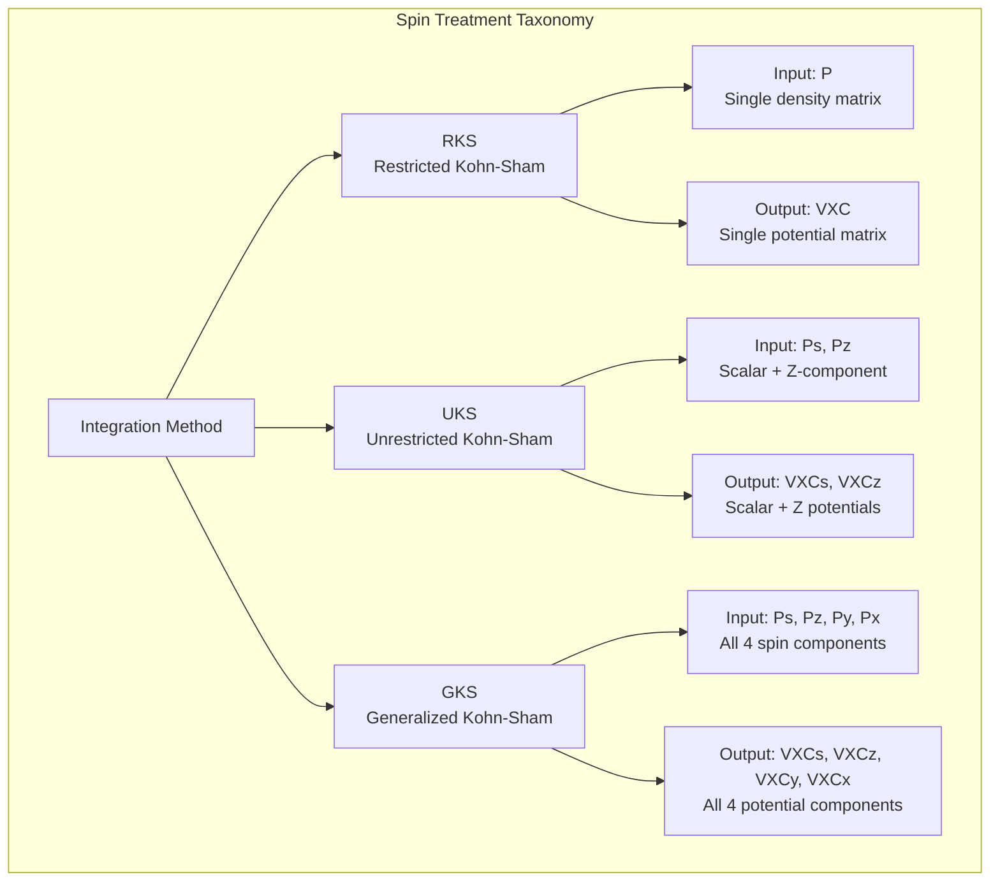
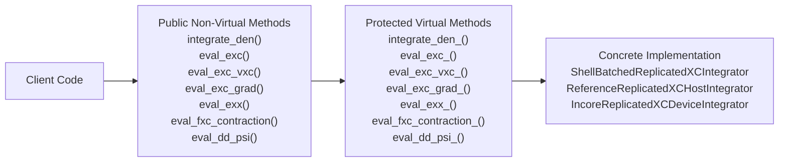
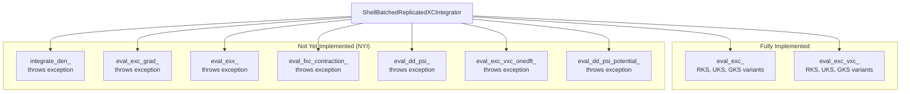
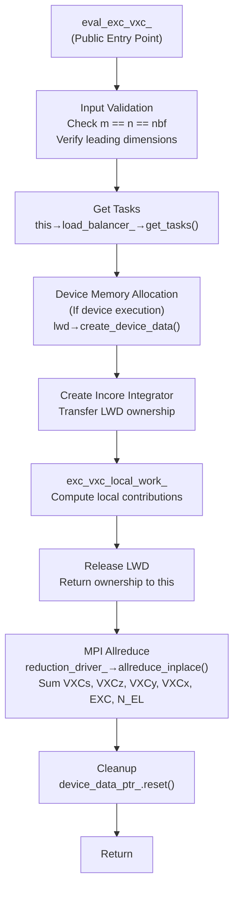
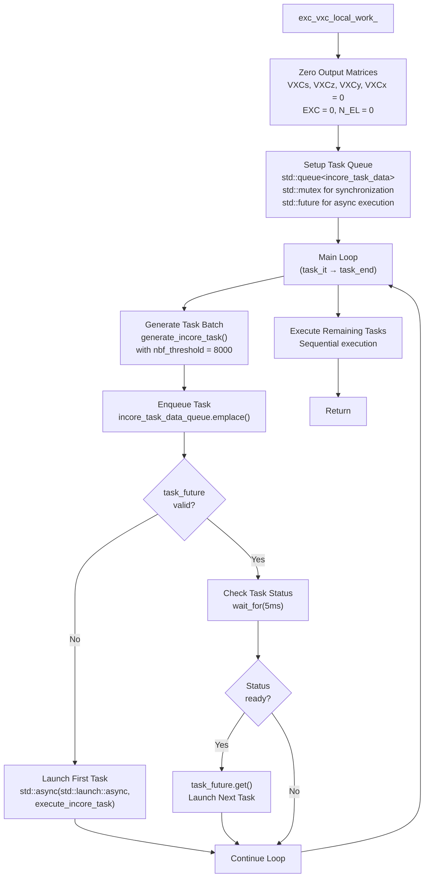
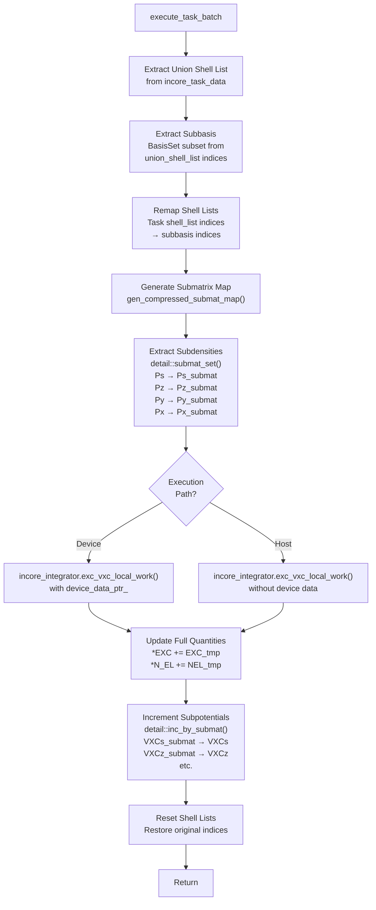
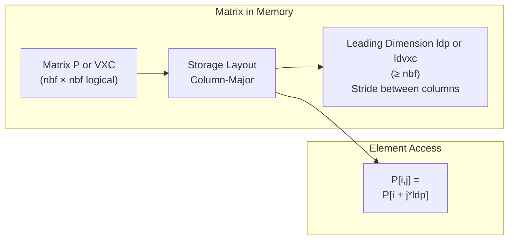
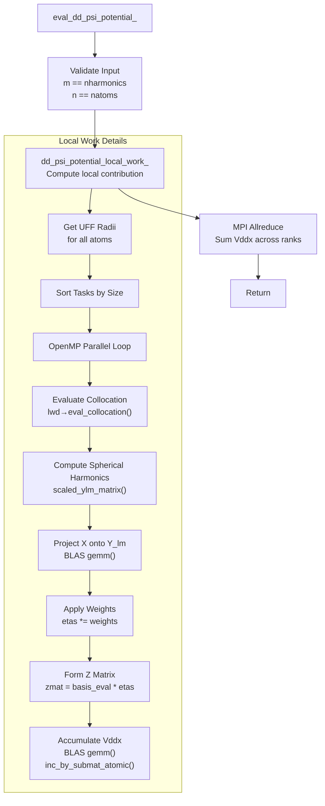
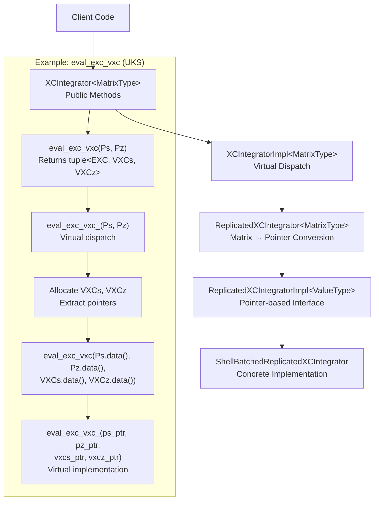

<!-- source: DeepWiki mcp.deepwiki.com · repo microsoft/skala · page 3.1 Integration Methods · fetched 2026-10-26 -->

# Integration Methods

<details>
<summary>Relevant source files</summary>

The following files were used as context for generating this wiki page:

- [third_party/gauxc/attic/include/gauxc/new_xc_integrator/impl.hpp](third_party/gauxc/attic/include/gauxc/new_xc_integrator/impl.hpp)
- [third_party/gauxc/attic/include/gauxc/new_xc_integrator/replicated/impl.hpp](third_party/gauxc/attic/include/gauxc/new_xc_integrator/replicated/impl.hpp)
- [third_party/gauxc/attic/include/gauxc/new_xc_integrator/replicated/replicated_xc_integrator_impl.hpp](third_party/gauxc/attic/include/gauxc/new_xc_integrator/replicated/replicated_xc_integrator_impl.hpp)
- [third_party/gauxc/attic/include/gauxc/new_xc_integrator/replicated_xc_integrator.hpp](third_party/gauxc/attic/include/gauxc/new_xc_integrator/replicated_xc_integrator.hpp)
- [third_party/gauxc/attic/include/gauxc/new_xc_integrator/xc_integrator_impl.hpp](third_party/gauxc/attic/include/gauxc/new_xc_integrator/xc_integrator_impl.hpp)
- [third_party/gauxc/attic/include/gauxc/xc_integrator/impl.hpp](third_party/gauxc/attic/include/gauxc/xc_integrator/impl.hpp)
- [third_party/gauxc/attic/include/gauxc/xc_integrator/xc_integrator_impl.hpp](third_party/gauxc/attic/include/gauxc/xc_integrator/xc_integrator_impl.hpp)
- [third_party/gauxc/attic/src/new_integrator/replicated_xc_integrator_impl.cxx](third_party/gauxc/attic/src/new_integrator/replicated_xc_integrator_impl.cxx)
- [third_party/gauxc/include/gauxc/xc_integrator.hpp](third_party/gauxc/include/gauxc/xc_integrator.hpp)
- [third_party/gauxc/include/gauxc/xc_integrator/impl.hpp](third_party/gauxc/include/gauxc/xc_integrator/impl.hpp)
- [third_party/gauxc/include/gauxc/xc_integrator/replicated/impl.hpp](third_party/gauxc/include/gauxc/xc_integrator/replicated/impl.hpp)
- [third_party/gauxc/include/gauxc/xc_integrator/replicated/replicated_xc_integrator_impl.hpp](third_party/gauxc/include/gauxc/xc_integrator/replicated/replicated_xc_integrator_impl.hpp)
- [third_party/gauxc/include/gauxc/xc_integrator/replicated_xc_integrator.hpp](third_party/gauxc/include/gauxc/xc_integrator/replicated_xc_integrator.hpp)
- [third_party/gauxc/src/xc_integrator/replicated/device/incore_replicated_xc_device_integrator_dd.hpp](third_party/gauxc/src/xc_integrator/replicated/device/incore_replicated_xc_device_integrator_dd.hpp)
- [third_party/gauxc/src/xc_integrator/replicated/host/reference_replicated_xc_host_integrator_dd_psi_potential.hpp](third_party/gauxc/src/xc_integrator/replicated/host/reference_replicated_xc_host_integrator_dd_psi_potential.hpp)
- [third_party/gauxc/src/xc_integrator/replicated/replicated_xc_integrator_impl.cxx](third_party/gauxc/src/xc_integrator/replicated/replicated_xc_integrator_impl.cxx)
- [third_party/gauxc/src/xc_integrator/shell_batched/shell_batched_replicated_xc_integrator_dd_psi.hpp](third_party/gauxc/src/xc_integrator/shell_batched/shell_batched_replicated_xc_integrator_dd_psi.hpp)
- [third_party/gauxc/src/xc_integrator/shell_batched/shell_batched_replicated_xc_integrator_dd_psi_potential.hpp](third_party/gauxc/src/xc_integrator/shell_batched/shell_batched_replicated_xc_integrator_dd_psi_potential.hpp)
- [third_party/gauxc/src/xc_integrator/shell_batched/shell_batched_replicated_xc_integrator_exc.hpp](third_party/gauxc/src/xc_integrator/shell_batched/shell_batched_replicated_xc_integrator_exc.hpp)
- [third_party/gauxc/src/xc_integrator/shell_batched/shell_batched_replicated_xc_integrator_exc_grad.hpp](third_party/gauxc/src/xc_integrator/shell_batched/shell_batched_replicated_xc_integrator_exc_grad.hpp)
- [third_party/gauxc/src/xc_integrator/shell_batched/shell_batched_replicated_xc_integrator_exc_vxc.hpp](third_party/gauxc/src/xc_integrator/shell_batched/shell_batched_replicated_xc_integrator_exc_vxc.hpp)
- [third_party/gauxc/src/xc_integrator/shell_batched/shell_batched_replicated_xc_integrator_exx.hpp](third_party/gauxc/src/xc_integrator/shell_batched/shell_batched_replicated_xc_integrator_exx.hpp)
- [third_party/gauxc/src/xc_integrator/shell_batched/shell_batched_replicated_xc_integrator_fxc_contraction.hpp](third_party/gauxc/src/xc_integrator/shell_batched/shell_batched_replicated_xc_integrator_fxc_contraction.hpp)
- [third_party/gauxc/src/xc_integrator/shell_batched/shell_batched_replicated_xc_integrator_integrate_den.hpp](third_party/gauxc/src/xc_integrator/shell_batched/shell_batched_replicated_xc_integrator_integrate_den.hpp)

</details>


## Purpose and Scope

This document details the integration methods provided by the `ReplicatedXCIntegratorImpl` class, which forms the interface for all XC integration operations. These methods compute various exchange-correlation (XC) quantities required for Density Functional Theory (DFT) calculations, including energies, potentials, gradients, and kernel contractions.

For information about the overall XCIntegrator API and PIMPL architecture, see [PIMPL Architecture](#3.2). For details on the execution of these methods (host vs device paths, task batching), see [System Architecture](#4) and [Shell Batched Integration](#5).

## Method Categories

The integration framework provides seven categories of computational methods:

| Category | Purpose | Output Quantities |
|----------|---------|-------------------|
| Density Integration | Integrate electron density | Electron count N_EL |
| XC Energy | Evaluate XC energy functional | Energy scalar EXC |
| XC Energy + Potential | Evaluate XC energy and potential | Energy EXC, Potential matrix VXC |
| XC Gradient | Compute nuclear gradient of XC energy | 3×N_atoms gradient vector |
| Exact Exchange | Evaluate exact exchange matrix | Exchange matrix K |
| XC Kernel Contraction | Contract XC kernel with trial density | FXC matrix |
| DD-PSI Methods | Density decomposition in spherical harmonics | Expansion coefficients |

Sources: [third_party/gauxc/include/gauxc/xc_integrator/replicated/replicated_xc_integrator_impl.hpp:39-106]()

## Spin Treatment Variants

Most integration methods support three spin treatments corresponding to different electronic structure theories:



**RKS (Restricted Kohn-Sham):** Used for closed-shell systems with paired electrons. Operates on a single density matrix `P` and produces a single XC potential matrix `VXC`.

**UKS (Unrestricted Kohn-Sham):** Used for open-shell systems with unpaired electrons. Operates on scalar (`Ps`) and z-component (`Pz`) density matrices, producing corresponding potential matrices `VXCs` and `VXCz`.

**GKS (Generalized Kohn-Sham):** Used for systems requiring full spin-density matrix treatment (e.g., spin-orbit coupling). Operates on all four spin components: scalar (`Ps`), z (`Pz`), y (`Py`), and x (`Px`), producing all four potential components.

Sources: [third_party/gauxc/include/gauxc/xc_integrator/replicated/replicated_xc_integrator_impl.hpp:42-75](), [third_party/gauxc/src/xc_integrator/shell_batched/shell_batched_replicated_xc_integrator_exc_vxc.hpp:32-41]()

## Virtual Method Interface

### ReplicatedXCIntegratorImpl Method Hierarchy

```mermaid
graph TB
    BASE["ReplicatedXCIntegratorImpl&lt;ValueType&gt;"]
    
    BASE --> IDEN["integrate_den_<br/>int64_t m, n<br/>const value_type* P, ldp<br/>value_type* N_EL"]
    
    BASE --> EGROUP["XC Energy Methods"]
    EGROUP --> ERKS["eval_exc_ (RKS)<br/>P, ldp → EXC"]
    EGROUP --> EUKS["eval_exc_ (UKS)<br/>Ps, ldps, Pz, ldpz → EXC"]
    EGROUP --> EGKS["eval_exc_ (GKS)<br/>Ps, Pz, Py, Px → EXC"]
    
    BASE --> VGROUP["XC Energy + Potential Methods"]
    VGROUP --> VRKS["eval_exc_vxc_ (RKS)<br/>P, ldp, VXC, ldvxc → EXC"]
    VGROUP --> VUKS["eval_exc_vxc_ (UKS)<br/>Ps, Pz, VXCs, VXCz → EXC"]
    VGROUP --> VGKS["eval_exc_vxc_ (GKS)<br/>Ps, Pz, Py, Px<br/>VXCs, VXCz, VXCy, VXCx → EXC"]
    VGROUP --> VONEDFT["eval_exc_vxc_onedft_<br/>Ps, Pz → VXCs, VXCz, EXC"]
    
    BASE --> GRAD["XC Gradient Methods"]
    GRAD --> GRKS["eval_exc_grad_ (RKS)<br/>P, ldp → EXC_GRAD"]
    GRAD --> GUKS["eval_exc_grad_ (UKS)<br/>Ps, Pz → EXC_GRAD"]
    
    BASE --> EXX["eval_exx_<br/>P, ldp, K, ldk<br/>IntegratorSettingsEXX"]
    
    BASE --> FXC["XC Kernel Contraction"]
    FXC --> FRKS["eval_fxc_contraction_ (RKS)<br/>P, tP → FXC"]
    FXC --> FUKS["eval_fxc_contraction_ (UKS)<br/>Ps, Pz, tPs, tPz → FXCs, FXCz"]
    
    BASE --> DD["DD-PSI Methods"]
    DD --> DDPSI["eval_dd_psi_<br/>P, max_Ylm → ddPsi"]
    DD --> DDPOT["eval_dd_psi_potential_<br/>X, max_Ylm → Vddx"]
```



All methods defined in `ReplicatedXCIntegratorImpl` are pure virtual (`= 0`), requiring concrete implementations to provide the computational logic. The base class also provides public non-virtual wrappers that invoke these virtual methods.

Sources: [third_party/gauxc/include/gauxc/xc_integrator/replicated/replicated_xc_integrator_impl.hpp:39-106]()

## Method Signatures and Parameters

### Density Integration

```cpp
void integrate_den_(int64_t m, int64_t n, const value_type* P,
                    int64_t ldp, value_type* N_EL);
```

Integrates the electron density to compute the total electron count. Used primarily for validation and testing.

- **Input:** Density matrix `P` (m×n with leading dimension `ldp`)
- **Output:** Total electron count `N_EL`

Sources: [third_party/gauxc/include/gauxc/xc_integrator/replicated/replicated_xc_integrator_impl.hpp:39-40]()

### XC Energy Evaluation

These methods evaluate the exchange-correlation energy without computing the potential matrix. Three spin variants exist:

**RKS Variant:**
```cpp
void eval_exc_(int64_t m, int64_t n, const value_type* P, int64_t ldp, 
               value_type* EXC, const IntegratorSettingsXC& ks_settings);
```

**UKS Variant:**
```cpp
void eval_exc_(int64_t m, int64_t n, const value_type* Ps, int64_t ldps,
               const value_type* Pz, int64_t ldpz, 
               value_type* EXC, const IntegratorSettingsXC& ks_settings);
```

**GKS Variant:**
```cpp
void eval_exc_(int64_t m, int64_t n, const value_type* Ps, int64_t ldps,
               const value_type* Pz, int64_t ldpz, 
               const value_type* Py, int64_t ldpy, 
               const value_type* Px, int64_t ldpx, 
               value_type* EXC, const IntegratorSettingsXC& ks_settings);
```

- **Inputs:** Density matrix/matrices, dimensions, leading dimensions
- **Output:** XC energy `EXC` (scalar)
- **Settings:** `IntegratorSettingsXC` for runtime control

Sources: [third_party/gauxc/include/gauxc/xc_integrator/replicated/replicated_xc_integrator_impl.hpp:42-51](), [third_party/gauxc/src/xc_integrator/shell_batched/shell_batched_replicated_xc_integrator_exc.hpp:32-127]()

### XC Energy and Potential Evaluation

These methods compute both the XC energy and the XC potential matrix (Fock matrix contribution). This is the most commonly used integration method during SCF iterations.

**RKS Variant:**
```cpp
void eval_exc_vxc_(int64_t m, int64_t n, const value_type* P,
                   int64_t ldp, value_type* VXC, int64_t ldvxc,
                   value_type* EXC, const IntegratorSettingsXC& ks_settings);
```

**UKS Variant:**
```cpp
void eval_exc_vxc_(int64_t m, int64_t n, const value_type* Ps, int64_t ldps,
                   const value_type* Pz, int64_t ldpz,
                   value_type* VXCs, int64_t ldvxcs,
                   value_type* VXCz, int64_t ldvxcz,
                   value_type* EXC, const IntegratorSettingsXC& ks_settings);
```

**GKS Variant:**
```cpp
void eval_exc_vxc_(int64_t m, int64_t n, const value_type* Ps, int64_t ldps,
                   const value_type* Pz, int64_t ldpz,
                   const value_type* Py, int64_t ldpy,
                   const value_type* Px, int64_t ldpx,
                   value_type* VXCs, int64_t ldvxcs,
                   value_type* VXCz, int64_t ldvxcz,
                   value_type* VXCy, int64_t ldvxcy,
                   value_type* VXCx, int64_t ldvxcx,
                   value_type* EXC, const IntegratorSettingsXC& ks_settings);
```

**OneDFT Variant:**
```cpp
void eval_exc_vxc_onedft_(int64_t m, int64_t n, const value_type* Ps, int64_t ldps,
                          const value_type* Pz, int64_t ldpz,
                          value_type* VXCs, int64_t ldvxcs,
                          value_type* VXCz, int64_t ldvxcz,
                          value_type* EXC, const IntegratorSettingsXC& ks_settings);
```

- **Inputs:** Density matrix/matrices with leading dimensions
- **Outputs:** 
  - XC energy `EXC` (scalar)
  - XC potential matrix/matrices `VXC*` with leading dimensions
- **Settings:** `IntegratorSettingsXC` for runtime control

The OneDFT variant uses machine-learned functionals (see [OneDFT Functional Integration](#10.3)).

Sources: [third_party/gauxc/include/gauxc/xc_integrator/replicated/replicated_xc_integrator_impl.hpp:53-82](), [third_party/gauxc/src/xc_integrator/shell_batched/shell_batched_replicated_xc_integrator_exc_vxc.hpp:32-150]()

### XC Energy Gradient

Computes the nuclear gradient of the XC energy (forces on atoms):

**RKS Variant:**
```cpp
void eval_exc_grad_(int64_t m, int64_t n, const value_type* P, int64_t ldp, 
                    value_type* EXC_GRAD);
```

**UKS Variant:**
```cpp
void eval_exc_grad_(int64_t m, int64_t n, const value_type* Ps, int64_t ldps, 
                    const value_type* Pz, int64_t ldpz, value_type* EXC_GRAD);
```

- **Inputs:** Density matrix/matrices
- **Output:** Gradient vector `EXC_GRAD` (length = 3×N_atoms)

Sources: [third_party/gauxc/include/gauxc/xc_integrator/replicated/replicated_xc_integrator_impl.hpp:83-86]()

### Exact Exchange Evaluation

Computes the exact exchange (HF exchange) matrix for hybrid functionals:

```cpp
void eval_exx_(int64_t m, int64_t n, const value_type* P,
               int64_t ldp, value_type* K, int64_t ldk,
               const IntegratorSettingsEXX& settings);
```

- **Inputs:** Density matrix `P`
- **Output:** Exchange matrix `K`
- **Settings:** `IntegratorSettingsEXX` for EXX-specific parameters

Sources: [third_party/gauxc/include/gauxc/xc_integrator/replicated/replicated_xc_integrator_impl.hpp:87-89]()

### XC Kernel Contraction

Contracts the XC kernel (second derivative of XC energy) with a trial density, used in TDDFT and response calculations:

**RKS Variant:**
```cpp
void eval_fxc_contraction_(int64_t m, int64_t n, 
                           const value_type* P, int64_t ldp,
                           const value_type* tP, int64_t ldtp,
                           value_type* FXC, int64_t ldfxc,
                           const IntegratorSettingsXC& ks_settings);
```

**UKS Variant:**
```cpp
void eval_fxc_contraction_(int64_t m, int64_t n, 
                           const value_type* Ps, int64_t ldps,   
                           const value_type* Pz, int64_t ldpz,
                           const value_type* tPs, int64_t ldtps,
                           const value_type* tPz, int64_t ldtpz,
                           value_type* FXCs, int64_t ldfxcs,
                           value_type* FXCz, int64_t ldfxcz,
                           const IntegratorSettingsXC& ks_settings);
```

- **Inputs:** Ground state density `P*`, trial density `tP*`
- **Output:** Contracted kernel matrix `FXC*`

Sources: [third_party/gauxc/include/gauxc/xc_integrator/replicated/replicated_xc_integrator_impl.hpp:90-102]()

### DD-PSI Methods

Specialized methods for density decomposition in spherical harmonics basis:

**DD-PSI Evaluation:**
```cpp
void eval_dd_psi_(int64_t m, int64_t n, const value_type* P, int64_t ldp, 
                  unsigned max_Ylm, value_type* ddPsi, int64_t ldPsi);
```

**DD-PSI Potential:**
```cpp
void eval_dd_psi_potential_(int64_t m, int64_t n, const value_type* X, 
                            unsigned max_Ylm, value_type* Vddx);
```

- **Inputs:** Density/expansion matrix, maximum angular momentum `max_Ylm`
- **Output:** Expansion coefficients `ddPsi` or potential `Vddx`

Sources: [third_party/gauxc/include/gauxc/xc_integrator/replicated/replicated_xc_integrator_impl.hpp:103-106]()

## Public API Wrappers

The `ReplicatedXCIntegratorImpl` class provides public non-virtual methods that wrap the protected virtual methods. These wrappers perform argument forwarding and serve as the stable interface for client code:



Example public wrapper:
```cpp
void eval_exc_vxc(int64_t m, int64_t n, const value_type* Ps, int64_t ldps,
                  const value_type* Pz, int64_t ldpz,
                  value_type* VXCs, int64_t ldvxcs,
                  value_type* VXCz, int64_t ldvxcz,
                  value_type* EXC, const IntegratorSettingsXC& ks_settings) {
    eval_exc_vxc_(m,n,Ps,ldps,Pz,ldpz,VXCs,ldvxcs,VXCz,ldvxcz,EXC,ks_settings);
}
```

This indirection enables the PIMPL pattern at a higher level (see [PIMPL Architecture](#3.2)).

Sources: [third_party/gauxc/src/xc_integrator/replicated/replicated_xc_integrator_impl.cxx:27-206]()

## Shell Batched Implementation

The `ShellBatchedReplicatedXCIntegrator` class provides a production-quality implementation of all virtual methods using a shell-batching strategy for improved performance.

### Implementation Status



The shell-batched implementation focuses on the most critical methods (`eval_exc_` and `eval_exc_vxc_`) needed for standard SCF calculations. Other methods throw `GAUXC_GENERIC_EXCEPTION("ShellBatched <method> NYI")`.

Sources: [third_party/gauxc/src/xc_integrator/shell_batched/shell_batched_replicated_xc_integrator_exc.hpp:31-128](), [third_party/gauxc/src/xc_integrator/shell_batched/shell_batched_replicated_xc_integrator_exc_vxc.hpp:31-150](), [third_party/gauxc/src/xc_integrator/shell_batched/shell_batched_replicated_xc_integrator_integrate_den.hpp:17-23](), [third_party/gauxc/src/xc_integrator/shell_batched/shell_batched_replicated_xc_integrator_exc_grad.hpp:17-31](), [third_party/gauxc/src/xc_integrator/shell_batched/shell_batched_replicated_xc_integrator_exx.hpp:17-23](), [third_party/gauxc/src/xc_integrator/shell_batched/shell_batched_replicated_xc_integrator_fxc_contraction.hpp:17-42](), [third_party/gauxc/src/xc_integrator/shell_batched/shell_batched_replicated_xc_integrator_dd_psi.hpp:17-36]()

### eval_exc_vxc_ Implementation Architecture

The `eval_exc_vxc_` implementation demonstrates the shell-batched strategy. The method follows this high-level flow:



Sources: [third_party/gauxc/src/xc_integrator/shell_batched/shell_batched_replicated_xc_integrator_exc_vxc.hpp:31-121]()

### Local Work Execution with Asynchronous Task Batching

The `exc_vxc_local_work_` method implements an asynchronous producer-consumer pattern for task execution:



This producer-consumer pattern allows task generation to proceed while previous tasks execute, hiding latency.

Sources: [third_party/gauxc/src/xc_integrator/shell_batched/shell_batched_replicated_xc_integrator_exc_vxc.hpp:154-270]()

### Task Batch Execution

Each task batch executes via `execute_task_batch`:



Key operations:
- **Subbasis extraction:** Creates a smaller basis containing only shells needed for the task batch
- **Submatrix operations:** Extract and increment use compressed maps to avoid full-matrix operations
- **Shell list remapping:** Converts global shell indices to local subbasis indices

Sources: [third_party/gauxc/src/xc_integrator/shell_batched/shell_batched_replicated_xc_integrator_exc_vxc.hpp:276-439]()

### Task Batch Generation

The `generate_incore_task` function (not shown in provided files but referenced at line 239) groups consecutive tasks with combined `nbf` (number of basis functions) below `nbf_threshold = 8000`. This batching:

1. Reduces overhead from separate subbasis extractions
2. Enables larger matrix operations for better BLAS performance
3. Amortizes data movement costs (especially for device execution)

Sources: [third_party/gauxc/src/xc_integrator/shell_batched/shell_batched_replicated_xc_integrator_exc_vxc.hpp:238-240]()

## Matrix Memory Layout

All density and potential matrices use column-major layout with explicit leading dimensions:



The leading dimension (`ldp`, `ldvxc`, etc.) allows matrices to be stored with padding or as views into larger matrices. All methods validate that `ld >= nbf`.

Sources: [third_party/gauxc/src/xc_integrator/shell_batched/shell_batched_replicated_xc_integrator_exc_vxc.hpp:48-69]()

## Reference Host Implementation

The `ReferenceReplicatedXCHostIntegrator` provides host-only implementations for methods not supported by shell batching. For example, `eval_dd_psi_potential_` is fully implemented on the host:



Sources: [third_party/gauxc/src/xc_integrator/replicated/host/reference_replicated_xc_host_integrator_dd_psi_potential.hpp:21-165]()

## Relation to XCIntegrator Public API

The integration methods discussed here form the implementation layer. The top-level `XCIntegrator<MatrixType>` class (see [XCIntegrator API](#3)) wraps these methods and provides matrix-based overloads:



Sources: [third_party/gauxc/include/gauxc/xc_integrator/impl.hpp:56-75](), [third_party/gauxc/include/gauxc/xc_integrator/replicated/impl.hpp:118-133]()

---

