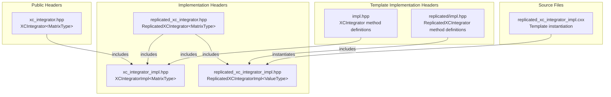
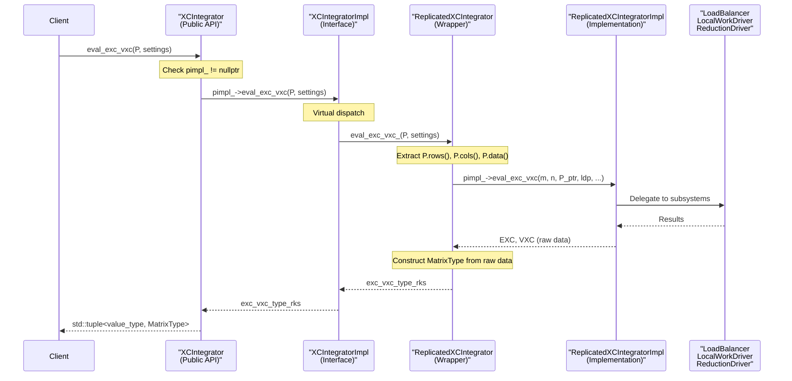
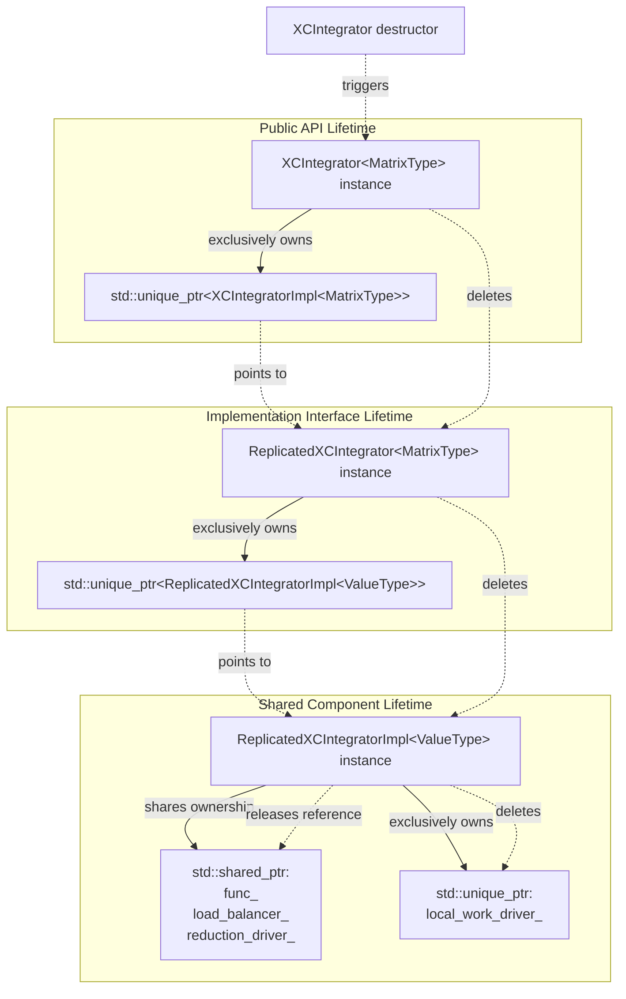

<!-- source: DeepWiki mcp.deepwiki.com · repo microsoft/skala · page 3.2 PIMPL Architecture · fetched 2026-10-26 -->

# PIMPL Architecture

<details>
<summary>Relevant source files</summary>

The following files were used as context for generating this wiki page:

- [third_party/gauxc/attic/include/gauxc/new_xc_integrator/impl.hpp](third_party/gauxc/attic/include/gauxc/new_xc_integrator/impl.hpp)
- [third_party/gauxc/attic/include/gauxc/new_xc_integrator/replicated/impl.hpp](third_party/gauxc/attic/include/gauxc/new_xc_integrator/replicated/impl.hpp)
- [third_party/gauxc/attic/include/gauxc/new_xc_integrator/replicated/replicated_xc_integrator_impl.hpp](third_party/gauxc/attic/include/gauxc/new_xc_integrator/replicated/replicated_xc_integrator_impl.hpp)
- [third_party/gauxc/attic/include/gauxc/new_xc_integrator/replicated_xc_integrator.hpp](third_party/gauxc/attic/include/gauxc/new_xc_integrator/replicated_xc_integrator.hpp)
- [third_party/gauxc/attic/include/gauxc/new_xc_integrator/xc_integrator_impl.hpp](third_party/gauxc/attic/include/gauxc/new_xc_integrator/xc_integrator_impl.hpp)
- [third_party/gauxc/attic/include/gauxc/xc_integrator/impl.hpp](third_party/gauxc/attic/include/gauxc/xc_integrator/impl.hpp)
- [third_party/gauxc/attic/include/gauxc/xc_integrator/xc_integrator_impl.hpp](third_party/gauxc/attic/include/gauxc/xc_integrator/xc_integrator_impl.hpp)
- [third_party/gauxc/attic/src/new_integrator/replicated_xc_integrator_impl.cxx](third_party/gauxc/attic/src/new_integrator/replicated_xc_integrator_impl.cxx)
- [third_party/gauxc/include/gauxc/xc_integrator.hpp](third_party/gauxc/include/gauxc/xc_integrator.hpp)
- [third_party/gauxc/include/gauxc/xc_integrator/impl.hpp](third_party/gauxc/include/gauxc/xc_integrator/impl.hpp)
- [third_party/gauxc/include/gauxc/xc_integrator/replicated/replicated_xc_integrator_impl.hpp](third_party/gauxc/include/gauxc/xc_integrator/replicated/replicated_xc_integrator_impl.hpp)
- [third_party/gauxc/include/gauxc/xc_integrator/replicated_xc_integrator.hpp](third_party/gauxc/include/gauxc/xc_integrator/replicated_xc_integrator.hpp)

</details>


## Purpose and Scope

This document describes the Pointer to Implementation (PIMPL) pattern used throughout GauXC's XCIntegrator API. The pattern provides a stable public interface while hiding implementation details and enabling polymorphic behavior. GauXC employs a two-level PIMPL hierarchy to separate concerns between API stability, implementation interface, and concrete execution strategies.

For information about the concrete implementation components (LoadBalancer, LocalWorkDriver, ReductionDriver), see [Core Components](#4.1). For details on execution paths, see [Execution Model: Host vs Device](#4.2).

## PIMPL Pattern Overview

The PIMPL (Pointer to Implementation) idiom separates a class's public interface from its implementation by storing a pointer to an implementation object. This provides:

- **Binary compatibility**: Implementation changes don't require recompiling client code
- **Compilation firewall**: Implementation headers are not exposed to clients
- **Interface stability**: Public API remains unchanged despite internal modifications
- **Polymorphism**: Different implementations can be swapped at runtime

GauXC uses PIMPL extensively to provide a stable API while supporting multiple execution backends (host, CUDA, HIP) and integration strategies (replicated, distributed).

**Sources:** [third_party/gauxc/include/gauxc/xc_integrator.hpp:1-96]()

## Two-Level PIMPL Hierarchy

GauXC employs a two-level PIMPL structure to separate API stability concerns from polymorphic implementation selection:

```mermaid
graph TB
    subgraph "Level 1: Public API Layer"
        XCI["XCIntegrator&lt;MatrixType&gt;<br/>Public API"]
        XCI_PIMPL["std::unique_ptr&lt;XCIntegratorImpl&lt;MatrixType&gt;&gt;<br/>pimpl_"]
        XCI -->|owns| XCI_PIMPL
    end
    
    subgraph "Level 1: Implementation Interface"
        XCII["XCIntegratorImpl&lt;MatrixType&gt;<br/>Abstract Base"]
        XCI_PIMPL -.->|points to| XCII
    end
    
    subgraph "Level 2: Concrete Wrapper"
        RXCI["ReplicatedXCIntegrator&lt;MatrixType&gt;<br/>Concrete Implementation"]
        RXCI_PIMPL["std::unique_ptr&lt;ReplicatedXCIntegratorImpl&lt;ValueType&gt;&gt;<br/>pimpl_"]
        RXCI -->|owns| RXCI_PIMPL
        XCII <|-- RXCI
    end
    
    subgraph "Level 2: Actual Implementation"
        RXCII["ReplicatedXCIntegratorImpl&lt;ValueType&gt;<br/>Core Logic"]
        RXCI_PIMPL -.->|points to| RXCII
        
        RXCII_MEMBERS["Members:<br/>func_<br/>load_balancer_<br/>local_work_driver_<br/>reduction_driver_<br/>timer_"]
        RXCII -->|contains| RXCII_MEMBERS
    end
    
    CLIENT["Client Code"] --> XCI
```

### Level 1: Public API to Implementation Interface

The first PIMPL level separates the public `XCIntegrator<MatrixType>` API from the abstract `XCIntegratorImpl<MatrixType>` interface.

**Public API Class: `XCIntegrator<MatrixType>`**

| Component | Type | Purpose |
|-----------|------|---------|
| `pimpl_` | `std::unique_ptr<XCIntegratorImpl<MatrixType>>` | Owns implementation interface |
| Public methods | Non-virtual | Forward calls to `pimpl_->method()` |
| Template parameter | `MatrixType` | Client's matrix representation |

**Implementation Interface: `XCIntegratorImpl<MatrixType>`**

| Component | Type | Purpose |
|-----------|------|---------|
| Virtual methods | Pure virtual (abstract) or virtual | Define implementation contract |
| Concrete implementations | Derived classes | `ReplicatedXCIntegrator`, `DistributedXCIntegrator` (future) |

**Sources:** 
- [third_party/gauxc/include/gauxc/xc_integrator.hpp:25-95]()
- [third_party/gauxc/include/gauxc/xc_integrator/xc_integrator_impl.hpp:1-135]()

### Level 2: Implementation Wrapper to Concrete Implementation

The second PIMPL level separates the polymorphic wrapper `ReplicatedXCIntegrator<MatrixType>` from the actual implementation `ReplicatedXCIntegratorImpl<ValueType>`.

**Implementation Wrapper: `ReplicatedXCIntegrator<MatrixType>`**

| Component | Type | Purpose |
|-----------|------|---------|
| Inheritance | `XCIntegratorImpl<MatrixType>` | Satisfies Level 1 interface |
| `pimpl_` | `std::unique_ptr<ReplicatedXCIntegratorImpl<ValueType>>` | Owns concrete implementation |
| Override methods | Virtual overrides | Convert `MatrixType` to raw pointers, forward to `pimpl_` |

**Concrete Implementation: `ReplicatedXCIntegratorImpl<ValueType>`**

| Component | Type | Purpose |
|-----------|------|---------|
| `func_` | `std::shared_ptr<functional_type>` | XC functional |
| `load_balancer_` | `std::shared_ptr<LoadBalancer>` | Task distribution |
| `local_work_driver_` | `std::unique_ptr<LocalWorkDriver>` | Computation execution |
| `reduction_driver_` | `std::shared_ptr<ReductionDriver>` | Result aggregation |
| `timer_` | `util::Timer` | Performance tracking |
| Implementation methods | Non-virtual | Core integration logic |

**Sources:**
- [third_party/gauxc/include/gauxc/xc_integrator/replicated_xc_integrator.hpp:24-80]()
- [third_party/gauxc/include/gauxc/xc_integrator/replicated/replicated_xc_integrator_impl.hpp:21-204]()

## Class Relationships and File Organization

The PIMPL classes are organized across multiple header and implementation files:



**File Organization:**

| File Path | Purpose | Key Definitions |
|-----------|---------|-----------------|
| `include/gauxc/xc_integrator.hpp` | Public API declaration | `XCIntegrator<MatrixType>` |
| `include/gauxc/xc_integrator/xc_integrator_impl.hpp` | Implementation interface | `XCIntegratorImpl<MatrixType>` (abstract base) |
| `include/gauxc/xc_integrator/replicated_xc_integrator.hpp` | Replicated wrapper | `ReplicatedXCIntegrator<MatrixType>` |
| `include/gauxc/xc_integrator/replicated/replicated_xc_integrator_impl.hpp` | Concrete implementation | `ReplicatedXCIntegratorImpl<ValueType>` |
| `include/gauxc/xc_integrator/impl.hpp` | Public API method bodies | Template function definitions |
| `src/xc_integrator/replicated/replicated_xc_integrator_impl.cxx` | Template instantiation | `extern template class` declarations |

**Sources:**
- [third_party/gauxc/include/gauxc/xc_integrator.hpp:1-8]()
- [third_party/gauxc/include/gauxc/xc_integrator/xc_integrator_impl.hpp:1-8]()
- [third_party/gauxc/include/gauxc/xc_integrator/replicated_xc_integrator.hpp:1-10]()
- [third_party/gauxc/include/gauxc/xc_integrator/replicated/replicated_xc_integrator_impl.hpp:1-16]()

## Method Forwarding Chain

Method calls traverse the two-level PIMPL hierarchy through a well-defined forwarding chain:



### Method Forwarding Example: `eval_exc_vxc`

The restricted Kohn-Sham (RKS) `eval_exc_vxc` method demonstrates the complete forwarding chain:

**Level 1: Public API (`XCIntegrator`)**

[third_party/gauxc/include/gauxc/xc_integrator/impl.hpp:56-60]()
```cpp
// Template method in impl.hpp
template <typename MatrixType>
typename XCIntegrator<MatrixType>::exc_vxc_type_rks
  XCIntegrator<MatrixType>::eval_exc_vxc(const MatrixType& P, 
                                         const IntegratorSettingsXC& ks_settings) {
  if( not pimpl_ ) GAUXC_PIMPL_NOT_INITIALIZED();
  return pimpl_->eval_exc_vxc(P, ks_settings);  // Forward to interface
};
```

**Level 1: Implementation Interface (`XCIntegratorImpl`)**

[third_party/gauxc/include/gauxc/xc_integrator/xc_integrator_impl.hpp:50-54]()
```cpp
// Virtual dispatch point
virtual exc_vxc_type_rks eval_exc_vxc_(const MatrixType&, 
                                       const IntegratorSettingsXC&) = 0;

exc_vxc_type_rks eval_exc_vxc(const MatrixType& P, 
                               const IntegratorSettingsXC& settings) {
  return eval_exc_vxc_(P, settings);  // Virtual dispatch
}
```

**Level 2: Implementation Wrapper (`ReplicatedXCIntegrator`)**

The wrapper converts from high-level `MatrixType` to raw pointers:

[third_party/gauxc/include/gauxc/xc_integrator/replicated_xc_integrator.hpp:50]()
```cpp
exc_vxc_type_rks eval_exc_vxc_(const MatrixType&, const IntegratorSettingsXC&) override;
```

Implementation extracts matrix properties and forwards:
```cpp
// In replicated/impl.cxx (pattern inferred from structure)
exc_vxc_type_rks ReplicatedXCIntegrator<MatrixType>::eval_exc_vxc_(
    const MatrixType& P, const IntegratorSettingsXC& settings) {
  
  matrix_type VXC(P.rows(), P.cols());
  value_type EXC;
  
  pimpl_->eval_exc_vxc(P.rows(), P.cols(), P.data(), P.rows(),
                       VXC.data(), VXC.rows(), &EXC, settings);
  
  return std::make_tuple(EXC, VXC);
}
```

**Level 2: Concrete Implementation (`ReplicatedXCIntegratorImpl`)**

[third_party/gauxc/include/gauxc/xc_integrator/replicated/replicated_xc_integrator_impl.hpp:53-55]()
```cpp
virtual void eval_exc_vxc_(int64_t m, int64_t n, const value_type* P,
                           int64_t ldp, value_type* VXC, int64_t ldvxc,
                           value_type* EXC, const IntegratorSettingsXC&) = 0;
```

Public wrapper [third_party/gauxc/include/gauxc/xc_integrator/replicated/replicated_xc_integrator_impl.hpp:132-134]():
```cpp
void eval_exc_vxc(int64_t m, int64_t n, const value_type* P,
                  int64_t ldp, value_type* VXC, int64_t ldvxc,
                  value_type* EXC, const IntegratorSettingsXC& ks_settings);
```

This method is pure virtual, implemented by derived classes that orchestrate `LoadBalancer`, `LocalWorkDriver`, and `ReductionDriver`.

**Sources:**
- [third_party/gauxc/include/gauxc/xc_integrator/impl.hpp:56-60]()
- [third_party/gauxc/include/gauxc/xc_integrator/xc_integrator_impl.hpp:50-54]()
- [third_party/gauxc/include/gauxc/xc_integrator/replicated_xc_integrator.hpp:50]()
- [third_party/gauxc/include/gauxc/xc_integrator/replicated/replicated_xc_integrator_impl.hpp:53-55,132-134]()

## Type Conversions Across PIMPL Layers

The two-level PIMPL hierarchy performs systematic type conversions at each layer:

| Layer | Input Types | Output Types | Conversion |
|-------|-------------|--------------|------------|
| `XCIntegrator<MatrixType>` | `MatrixType` (client's matrix class) | `exc_vxc_type_rks = std::tuple<value_type, MatrixType>` | Template-based, no conversion |
| `XCIntegratorImpl<MatrixType>` | `MatrixType` | `exc_vxc_type_rks` | Virtual dispatch only |
| `ReplicatedXCIntegrator<MatrixType>` | `MatrixType` | Raw pointers: `value_type*`, `int64_t` | Extract `.rows()`, `.cols()`, `.data()` |
| `ReplicatedXCIntegratorImpl<ValueType>` | Raw pointers: `const value_type*`, `int64_t` | Raw pointers: `value_type*`, `int64_t` | Direct pointer operations |

This layered conversion strategy allows:
- **Client flexibility**: `MatrixType` can be any matrix class (Eigen, custom, etc.)
- **Implementation uniformity**: Core logic operates on raw pointers, independent of client types
- **ABI stability**: Changes to `MatrixType` don't affect compiled implementation

**Sources:**
- [third_party/gauxc/include/gauxc/xc_integrator.hpp:30-31]()
- [third_party/gauxc/include/gauxc/xc_integrator/replicated/replicated_xc_integrator_impl.hpp:26-27]()

## Ownership and Lifecycle Management

The PIMPL pattern employs `std::unique_ptr` for exclusive ownership and clear lifecycle semantics:



### Constructor Patterns

**Public API Constructor** [third_party/gauxc/include/gauxc/xc_integrator/impl.hpp:16-18]():
```cpp
XCIntegrator<MatrixType>::XCIntegrator(std::unique_ptr<pimpl_type>&& pimpl)
  : pimpl_(std::move(pimpl)) { }
```

**Implementation Wrapper Constructor** [third_party/gauxc/include/gauxc/xc_integrator/replicated_xc_integrator.hpp:67-68]():
```cpp
ReplicatedXCIntegrator();
ReplicatedXCIntegrator(std::unique_ptr<pimpl_type>&&);
```

**Concrete Implementation Constructor** [third_party/gauxc/include/gauxc/xc_integrator/replicated/replicated_xc_integrator_impl.hpp:110-114]():
```cpp
ReplicatedXCIntegratorImpl(std::shared_ptr<functional_type>   func,
                           std::shared_ptr<LoadBalancer>      lb, 
                           std::unique_ptr<LocalWorkDriver>&& lwd,
                           std::shared_ptr<ReductionDriver>   rd);
```

### Destructor Chain

**Public API Destructor** [third_party/gauxc/include/gauxc/xc_integrator/impl.hpp:21-22]():
```cpp
template <typename MatrixType>
XCIntegrator<MatrixType>::~XCIntegrator() noexcept = default;
```

**Implementation Wrapper Destructor** [third_party/gauxc/include/gauxc/xc_integrator/replicated_xc_integrator.hpp:70]():
```cpp
~ReplicatedXCIntegrator() noexcept;
```

**Concrete Implementation Destructor** [third_party/gauxc/include/gauxc/xc_integrator/replicated/replicated_xc_integrator_impl.hpp:116]():
```cpp
virtual ~ReplicatedXCIntegratorImpl() noexcept;
```

All destructors are `noexcept` and rely on automatic `std::unique_ptr` and `std::shared_ptr` cleanup.

### Move Semantics

The PIMPL objects support move construction but prohibit copying:

**Deleted Copy Operations** [third_party/gauxc/include/gauxc/xc_integrator.hpp:57]():
```cpp
XCIntegrator(const XCIntegrator&) = delete;
```

**Move Constructor** [third_party/gauxc/include/gauxc/xc_integrator/impl.hpp:24-25]():
```cpp
template <typename MatrixType>
XCIntegrator<MatrixType>::XCIntegrator(XCIntegrator&&) noexcept = default;
```

This design ensures:
- **Unique ownership**: Each PIMPL pointer has exactly one owner
- **Exception safety**: RAII guarantees proper cleanup on exceptions
- **Move efficiency**: Transferring ownership is a pointer move, not a deep copy

**Sources:**
- [third_party/gauxc/include/gauxc/xc_integrator.hpp:52-58]()
- [third_party/gauxc/include/gauxc/xc_integrator/impl.hpp:16-25]()
- [third_party/gauxc/include/gauxc/xc_integrator/replicated_xc_integrator.hpp:67-73]()
- [third_party/gauxc/include/gauxc/xc_integrator/replicated/replicated_xc_integrator_impl.hpp:110-116]()

## Initialization and Null Pointer Checks

The PIMPL implementation includes defensive null pointer checks to prevent undefined behavior:

**Null Check Macro** (inferred from usage pattern):
```cpp
#define GAUXC_PIMPL_NOT_INITIALIZED() \
  throw std::runtime_error("XCIntegrator not initialized")
```

**Usage in Public API** [third_party/gauxc/include/gauxc/xc_integrator/impl.hpp:30-31,58-59]():
```cpp
if( not pimpl_ ) GAUXC_PIMPL_NOT_INITIALIZED();
return pimpl_->integrate_den(P);

if( not pimpl_ ) GAUXC_PIMPL_NOT_INITIALIZED();
return pimpl_->eval_exc_vxc(P, ks_settings);
```

This pattern appears in all public API methods, ensuring that:
- Default-constructed objects cannot be used
- Moved-from objects are detected
- Clear error messages guide users to proper initialization

**Sources:**
- [third_party/gauxc/include/gauxc/xc_integrator/impl.hpp:30-31,36-38,58-59,102-103]()

## Benefits and Design Rationale

The two-level PIMPL architecture provides multiple benefits for the GauXC library:

### Compilation Firewall

**Problem**: Exposing implementation details in headers forces recompilation of all client code when implementation changes.

**Solution**: The PIMPL pattern hides implementation headers.

| What Client Sees | What's Hidden |
|------------------|---------------|
| `xc_integrator.hpp` (public API) | `replicated_xc_integrator_impl.hpp` (implementation details) |
| Method signatures | `LoadBalancer`, `LocalWorkDriver`, `ReductionDriver` headers |
| Template parameter `MatrixType` | CUDA/HIP device code, host-specific implementations |

**Impact**: Changing GPU kernel implementations or load balancing strategies doesn't require recompiling client applications.

### Binary Compatibility

**Problem**: Adding virtual methods to a class breaks ABI compatibility.

**Solution**: Virtual methods are added to hidden implementation classes, not the public API.

The public `XCIntegrator<MatrixType>` class can add new methods without breaking binary compatibility:
- New methods forward to existing virtual interface
- Implementation classes override new virtual methods
- Old compiled code continues to work with new libraries

### Polymorphic Implementation Selection

**Problem**: Need to support multiple execution strategies (replicated, distributed) and backends (host, CUDA, HIP).

**Solution**: Two-level polymorphism.

**Level 1 Polymorphism** (data distribution strategy):
```
XCIntegratorImpl<MatrixType>
├── ReplicatedXCIntegrator<MatrixType>  (all ranks have full data)
└── DistributedXCIntegrator<MatrixType> (data partitioned across ranks)
```

**Level 2 Polymorphism** (execution backend):
```
ReplicatedXCIntegratorImpl<ValueType>
├── HostReplicatedXCIntegratorImpl      (CPU execution)
├── CUDAReplicatedXCIntegratorImpl      (NVIDIA GPU)
└── HIPReplicatedXCIntegratorImpl       (AMD GPU)
```

This allows runtime selection of both data model and execution backend.

### Template Complexity Management

**Problem**: `XCIntegrator<MatrixType>` is a template, which could lead to code bloat if all logic is templated.

**Solution**: Template only the thin wrapper; implementation uses concrete types.

**Templated Layer** (minimal code):
- `XCIntegrator<MatrixType>`: Matrix type conversions
- `ReplicatedXCIntegrator<MatrixType>`: Extract raw pointers from `MatrixType`

**Non-templated Layer** (bulk of code):
- `ReplicatedXCIntegratorImpl<double>`: Operates on `double*` regardless of client matrix type
- `ReplicatedXCIntegratorImpl<float>`: Separate instantiation for single precision

Only two template instantiations exist [third_party/gauxc/include/gauxc/xc_integrator/replicated/replicated_xc_integrator_impl.hpp:207]():
```cpp
extern template class ReplicatedXCIntegratorImpl<double>;
```

This minimizes code duplication across different `MatrixType` instantiations.

**Sources:**
- [third_party/gauxc/include/gauxc/xc_integrator.hpp:1-96]()
- [third_party/gauxc/include/gauxc/xc_integrator/replicated/replicated_xc_integrator_impl.hpp:207]()

## Template Instantiation Strategy

GauXC employs explicit template instantiation to reduce compilation time and binary size:

### Extern Template Declarations

**ReplicatedXCIntegratorImpl** [third_party/gauxc/include/gauxc/xc_integrator/replicated/replicated_xc_integrator_impl.hpp:207]():
```cpp
extern template class ReplicatedXCIntegratorImpl<double>;
```

This declaration tells the compiler:
- Don't instantiate `ReplicatedXCIntegratorImpl<double>` in this translation unit
- The definition exists in a separate `.cxx` file
- Link against the pre-compiled instantiation

### Explicit Instantiation in Source Files

Pattern observed in attic files [third_party/gauxc/attic/src/new_integrator/replicated_xc_integrator_impl.cxx:42]():
```cpp
template class ReplicatedXCIntegratorImpl<double>;
```

This pattern ensures:
- **Single instantiation**: Template is compiled exactly once
- **Faster builds**: Client code doesn't re-instantiate templates
- **Smaller binaries**: One copy of template code, not N copies

### Supported Precision Levels

Based on the extern template declarations, GauXC explicitly supports:
- `double` precision (primary)
- `float` precision (likely, though not shown in provided excerpts)

Complex types (`std::complex<double>`) may be supported for future features but are not currently instantiated.

**Sources:**
- [third_party/gauxc/include/gauxc/xc_integrator/replicated/replicated_xc_integrator_impl.hpp:207]()
- [third_party/gauxc/attic/src/new_integrator/replicated_xc_integrator_impl.cxx:42]()

## Accessor Methods and Component Access

The PIMPL implementation provides controlled access to internal components:

### Timer Access

[third_party/gauxc/include/gauxc/xc_integrator/replicated/replicated_xc_integrator_impl.hpp:194]():
```cpp
inline const util::Timer& get_timings() const { return timer_; }
```

[third_party/gauxc/include/gauxc/xc_integrator/impl.hpp:138-141]():
```cpp
const util::Timer& XCIntegrator<MatrixType>::get_timings() const {
  if( not pimpl_ ) GAUXC_PIMPL_NOT_INITIALIZED();
  return pimpl_->get_timings();
}
```

### LoadBalancer Access

[third_party/gauxc/include/gauxc/xc_integrator/replicated/replicated_xc_integrator_impl.hpp:200-203]():
```cpp
inline const auto& load_balancer() const { return *load_balancer_; }
inline auto& load_balancer() { return *load_balancer_; }
inline const auto& get_load_balancer() const { return load_balancer(); }
inline auto& get_load_balancer() { return load_balancer(); }
```

[third_party/gauxc/include/gauxc/xc_integrator/impl.hpp:144-153]():
```cpp
const LoadBalancer& XCIntegrator<MatrixType>::load_balancer() const {
  if( not pimpl_ ) GAUXC_PIMPL_NOT_INITIALIZED();
  return pimpl_->load_balancer();
}

LoadBalancer& XCIntegrator<MatrixType>::load_balancer() {
  if( not pimpl_ ) GAUXC_PIMPL_NOT_INITIALIZED();
  return pimpl_->load_balancer();
}
```

### LocalWorkDriver Release

Unique among accessors, `release_local_work_driver()` transfers ownership out of the implementation:

[third_party/gauxc/include/gauxc/xc_integrator/replicated/replicated_xc_integrator_impl.hpp:196-198]():
```cpp
inline std::unique_ptr<LocalWorkDriver> release_local_work_driver() {
  return std::move(local_work_driver_);
}
```

This enables advanced use cases where the client needs direct control over the `LocalWorkDriver` for custom integration workflows.

**Sources:**
- [third_party/gauxc/include/gauxc/xc_integrator/replicated/replicated_xc_integrator_impl.hpp:194,196-203]()
- [third_party/gauxc/include/gauxc/xc_integrator/impl.hpp:138-153]()

## Summary

The GauXC PIMPL architecture employs a sophisticated two-level design:

| Level | Public Class | PIMPL Pointer | Target Class | Purpose |
|-------|--------------|---------------|--------------|---------|
| 1 | `XCIntegrator<MatrixType>` | `std::unique_ptr<XCIntegratorImpl<MatrixType>>` | `ReplicatedXCIntegrator<MatrixType>` | API stability, polymorphic data model selection |
| 2 | `ReplicatedXCIntegrator<MatrixType>` | `std::unique_ptr<ReplicatedXCIntegratorImpl<ValueType>>` | `ReplicatedXCIntegratorImpl<ValueType>` | Type conversion, backend selection |

This design achieves:
- **Stable public API**: `XCIntegrator` interface never changes
- **Binary compatibility**: Internal changes don't require client recompilation
- **Polymorphic flexibility**: Runtime selection of data models and execution backends
- **Compile-time efficiency**: Template instantiation limited to thin wrappers
- **Clear ownership**: `std::unique_ptr` provides RAII and move semantics

The pattern is essential for GauXC's support of multiple platforms (CPU, CUDA, HIP), multiple parallelism models (replicated, distributed), and multiple client matrix types while maintaining a stable, easy-to-use public interface.

---

