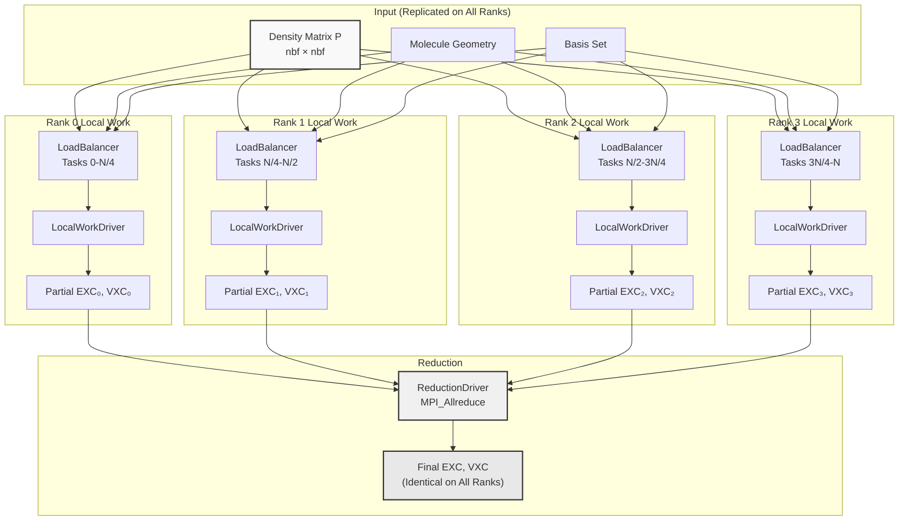
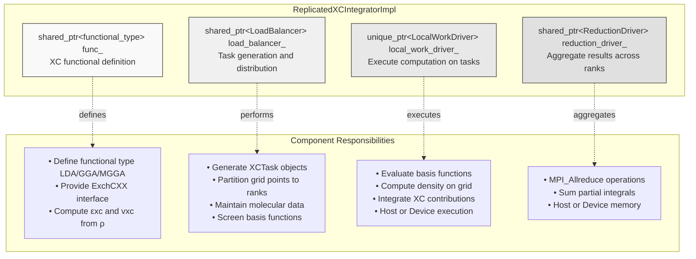
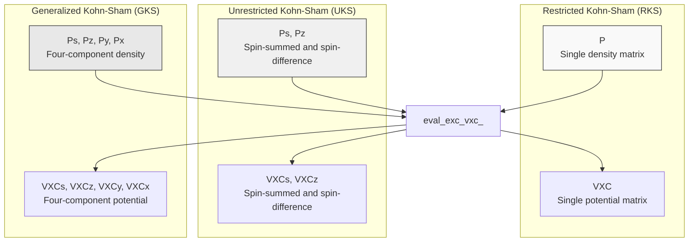
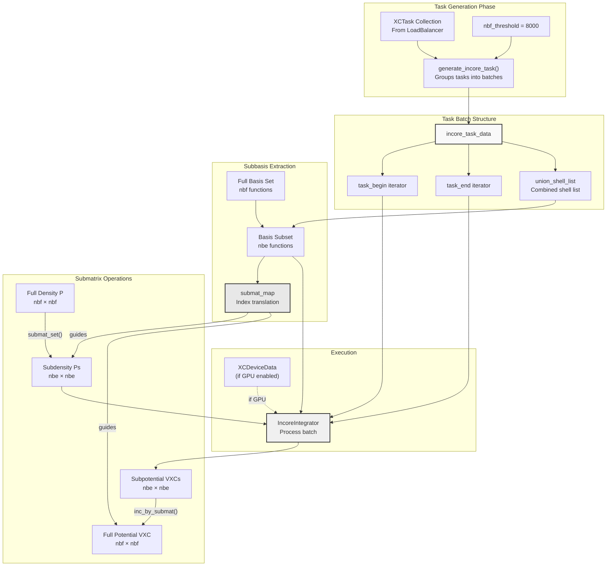
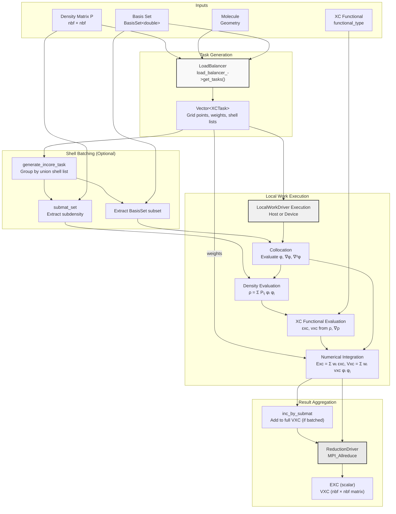

<!-- source: DeepWiki mcp.deepwiki.com · repo microsoft/skala · page 4 System Architecture · fetched 2026-10-26 -->

# System Architecture

<details>
<summary>Relevant source files</summary>

The following files were used as context for generating this wiki page:

- [third_party/gauxc/attic/include/gauxc/new_xc_integrator/impl.hpp](third_party/gauxc/attic/include/gauxc/new_xc_integrator/impl.hpp)
- [third_party/gauxc/attic/include/gauxc/new_xc_integrator/replicated/impl.hpp](third_party/gauxc/attic/include/gauxc/new_xc_integrator/replicated/impl.hpp)
- [third_party/gauxc/attic/include/gauxc/new_xc_integrator/replicated/replicated_xc_integrator_impl.hpp](third_party/gauxc/attic/include/gauxc/new_xc_integrator/replicated/replicated_xc_integrator_impl.hpp)
- [third_party/gauxc/attic/include/gauxc/new_xc_integrator/replicated_xc_integrator.hpp](third_party/gauxc/attic/include/gauxc/new_xc_integrator/replicated_xc_integrator.hpp)
- [third_party/gauxc/attic/include/gauxc/new_xc_integrator/xc_integrator_impl.hpp](third_party/gauxc/attic/include/gauxc/new_xc_integrator/xc_integrator_impl.hpp)
- [third_party/gauxc/attic/include/gauxc/xc_integrator/impl.hpp](third_party/gauxc/attic/include/gauxc/xc_integrator/impl.hpp)
- [third_party/gauxc/attic/include/gauxc/xc_integrator/xc_integrator_impl.hpp](third_party/gauxc/attic/include/gauxc/xc_integrator/xc_integrator_impl.hpp)
- [third_party/gauxc/attic/src/new_integrator/replicated_xc_integrator_impl.cxx](third_party/gauxc/attic/src/new_integrator/replicated_xc_integrator_impl.cxx)
- [third_party/gauxc/include/gauxc/xc_integrator.hpp](third_party/gauxc/include/gauxc/xc_integrator.hpp)
- [third_party/gauxc/include/gauxc/xc_integrator/impl.hpp](third_party/gauxc/include/gauxc/xc_integrator/impl.hpp)
- [third_party/gauxc/include/gauxc/xc_integrator/replicated/impl.hpp](third_party/gauxc/include/gauxc/xc_integrator/replicated/impl.hpp)
- [third_party/gauxc/include/gauxc/xc_integrator/replicated/replicated_xc_integrator_impl.hpp](third_party/gauxc/include/gauxc/xc_integrator/replicated/replicated_xc_integrator_impl.hpp)
- [third_party/gauxc/include/gauxc/xc_integrator/replicated_xc_integrator.hpp](third_party/gauxc/include/gauxc/xc_integrator/replicated_xc_integrator.hpp)
- [third_party/gauxc/src/xc_integrator/replicated/device/incore_replicated_xc_device_integrator_dd.hpp](third_party/gauxc/src/xc_integrator/replicated/device/incore_replicated_xc_device_integrator_dd.hpp)
- [third_party/gauxc/src/xc_integrator/replicated/host/reference_replicated_xc_host_integrator_dd_psi_potential.hpp](third_party/gauxc/src/xc_integrator/replicated/host/reference_replicated_xc_host_integrator_dd_psi_potential.hpp)
- [third_party/gauxc/src/xc_integrator/replicated/replicated_xc_integrator_impl.cxx](third_party/gauxc/src/xc_integrator/replicated/replicated_xc_integrator_impl.cxx)
- [third_party/gauxc/src/xc_integrator/shell_batched/shell_batched_replicated_xc_integrator_dd_psi.hpp](third_party/gauxc/src/xc_integrator/shell_batched/shell_batched_replicated_xc_integrator_dd_psi.hpp)
- [third_party/gauxc/src/xc_integrator/shell_batched/shell_batched_replicated_xc_integrator_dd_psi_potential.hpp](third_party/gauxc/src/xc_integrator/shell_batched/shell_batched_replicated_xc_integrator_dd_psi_potential.hpp)
- [third_party/gauxc/src/xc_integrator/shell_batched/shell_batched_replicated_xc_integrator_exc.hpp](third_party/gauxc/src/xc_integrator/shell_batched/shell_batched_replicated_xc_integrator_exc.hpp)
- [third_party/gauxc/src/xc_integrator/shell_batched/shell_batched_replicated_xc_integrator_exc_grad.hpp](third_party/gauxc/src/xc_integrator/shell_batched/shell_batched_replicated_xc_integrator_exc_grad.hpp)
- [third_party/gauxc/src/xc_integrator/shell_batched/shell_batched_replicated_xc_integrator_exc_vxc.hpp](third_party/gauxc/src/xc_integrator/shell_batched/shell_batched_replicated_xc_integrator_exc_vxc.hpp)
- [third_party/gauxc/src/xc_integrator/shell_batched/shell_batched_replicated_xc_integrator_exx.hpp](third_party/gauxc/src/xc_integrator/shell_batched/shell_batched_replicated_xc_integrator_exx.hpp)
- [third_party/gauxc/src/xc_integrator/shell_batched/shell_batched_replicated_xc_integrator_fxc_contraction.hpp](third_party/gauxc/src/xc_integrator/shell_batched/shell_batched_replicated_xc_integrator_fxc_contraction.hpp)
- [third_party/gauxc/src/xc_integrator/shell_batched/shell_batched_replicated_xc_integrator_integrate_den.hpp](third_party/gauxc/src/xc_integrator/shell_batched/shell_batched_replicated_xc_integrator_integrate_den.hpp)

</details>


## Purpose and Scope

This page describes the overall architecture of GauXC, focusing on the organizational structure of components, design patterns, and data flow through the integration pipeline. It provides a conceptual framework for understanding how the major subsystems interact to perform XC integration.

For detailed information about specific components, see [Core Components](#4.1). For execution paths and runtime behavior, see [Execution Model: Host vs Device](#4.2). For task organization and data structures, see [Task System and Data Structures](#4.3). For the public API, see [XCIntegrator API](#3).

---

## Architectural Overview

GauXC employs a layered architecture with clear separation between interface, implementation, and execution:

```mermaid
graph TB
    subgraph "Public API Layer"
        XCI["XCIntegrator&lt;MatrixType&gt;<br/>Public template class"]
    end
    
    subgraph "Implementation Layer"
        XCII["XCIntegratorImpl&lt;MatrixType&gt;<br/>Abstract base"]
        RXCI["ReplicatedXCIntegrator&lt;MatrixType&gt;<br/>Replicated data implementation"]
    end
    
    subgraph "PIMPL Layer"
        RXCII["ReplicatedXCIntegratorImpl&lt;ValueType&gt;<br/>Type-erased implementation"]
        SBXCII["ShellBatchedReplicatedXCIntegratorImpl<br/>Shell batching strategy"]
        IRXCII["IncoreReplicatedXCIntegratorImpl<br/>Full in-core strategy"]
    end
    
    subgraph "Core Components"
        FUNC["functional_type<br/>XC Functional"]
        LB["LoadBalancer<br/>Task generation"]
        LWD["LocalWorkDriver<br/>Computation execution"]
        RD["ReductionDriver<br/>MPI aggregation"]
    end
    
    XCI -->|"owns via unique_ptr"| XCII
    XCII <|--|"inherits"| RXCI
    RXCI -->|"owns via unique_ptr"| RXCII
    RXCII <|--|"inherits"| SBXCII
    RXCII <|--|"inherits"| IRXCII
    
    RXCII -->|"shared_ptr"| FUNC
    RXCII -->|"shared_ptr"| LB
    RXCII -->|"unique_ptr"| LWD
    RXCII -->|"shared_ptr"| RD
    
    style XCI fill:#f9f9f9,stroke:#333,stroke-width:2px
    style RXCII fill:#f0f0f0,stroke:#333,stroke-width:2px
    style SBXCII fill:#e8e8e8,stroke:#333,stroke-width:1px
```

**Architecture Diagram: Class Hierarchy and Ownership Model**

The architecture uses three levels of indirection:
1. **Public API**: Template classes parameterized on `MatrixType`
2. **Implementation Bridge**: Type-preserving implementation classes
3. **PIMPL Core**: Type-erased (`ValueType` only) implementation holding execution components

Sources: [include/gauxc/xc_integrator.hpp:25-95](), [include/gauxc/xc_integrator/replicated_xc_integrator.hpp:24-76](), [include/gauxc/xc_integrator/replicated/replicated_xc_integrator_impl.hpp:20-204]()

---

## PIMPL Pattern

GauXC extensively uses the Pointer to Implementation (PIMPL) pattern to achieve binary stability and separate interface from implementation. This pattern appears at multiple levels:

### XCIntegrator PIMPL Structure

```mermaid
graph LR
    subgraph "Public Interface"
        XCI["XCIntegrator&lt;MatrixType&gt;"]
        XCI_PIMPL["unique_ptr&lt;XCIntegratorImpl&lt;MatrixType&gt;&gt;"]
    end
    
    subgraph "Implementation Polymorphism"
        XCII["XCIntegratorImpl&lt;MatrixType&gt;<br/>(abstract)"]
        RXCI["ReplicatedXCIntegrator&lt;MatrixType&gt;<br/>(concrete)"]
    end
    
    subgraph "Type Erasure Layer"
        RXCI_PIMPL["unique_ptr&lt;ReplicatedXCIntegratorImpl&lt;ValueType&gt;&gt;"]
        RXCII["ReplicatedXCIntegratorImpl&lt;ValueType&gt;<br/>(abstract)"]
    end
    
    subgraph "Concrete Implementations"
        SBXCII["ShellBatchedReplicatedXCIntegrator"]
        IRXCII["IncoreReplicatedXCIntegrator"]
    end
    
    XCI -->|"owns"| XCI_PIMPL
    XCI_PIMPL -.->|"polymorphic"| XCII
    XCII <|-- RXCI
    
    RXCI -->|"owns"| RXCI_PIMPL
    RXCI_PIMPL -.->|"polymorphic"| RXCII
    RXCII <|-- SBXCII
    RXCII <|-- IRXCII
    
    style XCI fill:#f9f9f9,stroke:#333,stroke-width:2px
    style RXCII fill:#f0f0f0,stroke:#333,stroke-width:2px
```

**PIMPL Layering Diagram**

The double-PIMPL structure serves two purposes:
- **First PIMPL** (`XCIntegrator` → `XCIntegratorImpl`): Enables polymorphism over data distribution strategies (replicated vs distributed)
- **Second PIMPL** (`ReplicatedXCIntegrator` → `ReplicatedXCIntegratorImpl`): Erases `MatrixType`, leaving only `ValueType`, and enables selection of execution strategy (shell-batched vs incore)

All public methods on `XCIntegrator` follow this delegation pattern:
```cpp
// Public method in XCIntegrator
value_type eval_exc(const MatrixType& P, const IntegratorSettingsXC& settings) {
    if( not pimpl_ ) GAUXC_PIMPL_NOT_INITIALIZED();
    return pimpl_->eval_exc(P, settings);
}
```

Sources: [include/gauxc/xc_integrator.hpp:44-48](), [include/gauxc/xc_integrator/replicated_xc_integrator.hpp:42-44](), [include/gauxc/xc_integrator/impl.hpp:16-154](), [include/gauxc/xc_integrator/replicated/impl.hpp:19-281]()

---

## Replicated Data Model

The `ReplicatedXCIntegrator` class implements a **replicated data model** where all input data (density matrices, molecular geometry, basis set) is replicated across all MPI ranks. This contrasts with distributed models where data is partitioned.

### Key Characteristics

| Aspect | Replicated Model Behavior |
|--------|---------------------------|
| **Input Data** | Full density matrix `P` present on every rank |
| **Task Distribution** | Each rank processes a subset of grid points/tasks |
| **Local Computation** | Each rank computes partial `EXC` and `VXC` contributions |
| **Result Aggregation** | MPI Allreduce sums contributions from all ranks |
| **Memory Overhead** | O(nbf²) per rank (duplicated) |
| **Communication** | Single allreduce at end; no intermediate communication |

The replicated model simplifies implementation because each rank has all information needed to evaluate any task. Work distribution is performed by the `LoadBalancer`, which assigns different grid point batches to different ranks.

### Data Flow in Replicated Model



**Replicated Data Flow Across MPI Ranks**

Sources: [include/gauxc/xc_integrator/replicated_xc_integrator.hpp:19-23](), [src/xc_integrator/shell_batched/shell_batched_replicated_xc_integrator_exc_vxc.hpp:104-115]()

---

## Core Components and Their Roles

The `ReplicatedXCIntegratorImpl` base class holds references to four core components that orchestrate the integration process:



**Core Component Responsibilities**

### Ownership and Lifetime

- **`func_`**: Shared pointer allows multiple integrators to share the same functional definition
- **`load_balancer_`**: Shared pointer enables sharing of expensive load balancing state
- **`local_work_driver_`**: Unique pointer indicates exclusive ownership; can be temporarily transferred to incore integrators
- **`reduction_driver_`**: Shared pointer allows sharing of MPI communicator state

The `LocalWorkDriver` is unique among these components because ownership can be temporarily released during execution via `release_local_work_driver()` and later restored. This pattern appears in shell-batched execution where the driver is passed to incore integrator instances for task batch execution.

Sources: [include/gauxc/xc_integrator/replicated/replicated_xc_integrator_impl.hpp:30-34](), [include/gauxc/xc_integrator/replicated/replicated_xc_integrator_impl.hpp:196-198]()

For detailed descriptions of each component's implementation, see [Core Components](#4.1).

---

## Integration Methods and Spin Treatments

`ReplicatedXCIntegratorImpl` defines a comprehensive set of virtual methods for different integration tasks and spin treatments:

### Integration Method Categories

| Method Family | Purpose | Variants |
|---------------|---------|----------|
| `integrate_den_` | Compute electron count | RKS only |
| `eval_exc_` | Compute XC energy only | RKS, UKS, GKS |
| `eval_exc_vxc_` | Compute XC energy and potential | RKS, UKS, GKS |
| `eval_exc_grad_` | Compute XC energy gradient | RKS, UKS |
| `eval_exx_` | Compute exact exchange | RKS only |
| `eval_fxc_contraction_` | Compute XC kernel contraction | RKS, UKS |
| `eval_dd_psi_` | Compute spherical harmonic projection | Generic |
| `eval_dd_psi_potential_` | Compute potential from projection | Generic |

### Spin Treatment Signatures



**Spin Treatment Input/Output Structure**

Each `eval_exc_vxc_` overload has a corresponding non-virtual public wrapper that validates inputs and delegates to the virtual implementation. For example:

```cpp
// Public wrapper (non-virtual)
void eval_exc_vxc(int64_t m, int64_t n, const value_type* P,
                  int64_t ldp, value_type* VXC, int64_t ldvxc,
                  value_type* EXC, const IntegratorSettingsXC& ks_settings);

// Virtual implementation (pure virtual in base)
virtual void eval_exc_vxc_(int64_t m, int64_t n, const value_type* P,
                           int64_t ldp, value_type* VXC, int64_t ldvxc,
                           value_type* EXC, const IntegratorSettingsXC& ks_settings) = 0;
```

Sources: [include/gauxc/xc_integrator/replicated/replicated_xc_integrator_impl.hpp:39-106](), [src/xc_integrator/replicated/replicated_xc_integrator_impl.cxx:67-135]()

---

## Shell-Batched Execution Strategy

`ShellBatchedReplicatedXCIntegrator` implements a sophisticated batching strategy that groups tasks based on their union of shell lists to improve data locality and reduce memory overhead.

### Shell Batching Architecture



**Shell-Batched Execution Flow**

### Batching Algorithm

The `generate_incore_task()` function groups consecutive tasks until the union of their shell lists exceeds `nbf_threshold`:

1. Start with empty `union_shell_list`
2. For each task, compute union with current shell list
3. If union size ≤ threshold, add task to batch
4. If union size > threshold, finalize current batch and start new one

This strategy ensures that:
- Each batch operates on a manageable subbasis (nbe ≤ threshold)
- Memory allocations for subdensities and subpotentials remain bounded
- Multiple tasks can be processed with the same subbasis extraction

### Asynchronous Execution

Shell batches are executed asynchronously using a producer-consumer pattern:

```cpp
std::queue<incore_task_data> incore_task_data_queue;
std::future<void> task_future;

// Producer: Generate batches
while(task_it != task_end) {
    incore_task_data_queue.emplace(generate_incore_task(...));
    task_it = incore_task_data_queue.back().task_end;
    
    // Consumer: Execute batches asynchronously
    if(not task_future.valid()) {
        task_future = std::async(std::launch::async, execute_incore_task);
    } else if(task_future.wait_for(5ms) == std::future_status::ready) {
        task_future.get();
        task_future = std::async(std::launch::async, execute_incore_task);
    }
}
```

This overlaps batch generation with batch execution, improving GPU utilization.

Sources: [src/xc_integrator/shell_batched/shell_batched_replicated_xc_integrator_exc_vxc.hpp:230-270](), [src/xc_integrator/shell_batched/shell_batched_replicated_xc_integrator_exc_vxc.hpp:274-439]()

For details on task data structures, see [Task System and Data Structures](#4.3). For details on submatrix operations, see [Submatrix Operations](#5.2).

---

## Method Delegation Pattern

All integration methods follow a consistent delegation pattern from public API through the PIMPL layers to concrete implementations:

### Delegation Chain for `eval_exc_vxc`

```mermaid
flowchart LR
    subgraph "Layer 1: Public API"
        L1_PUB["XCIntegrator::eval_exc_vxc<br/>MatrixType& P"]
    end
    
    subgraph "Layer 2: Impl Bridge"
        L2_PRIV["XCIntegratorImpl::eval_exc_vxc_<br/>MatrixType& P"]
        L2_CONCRETE["ReplicatedXCIntegrator::eval_exc_vxc_<br/>MatrixType& P"]
    end
    
    subgraph "Layer 3: PIMPL Core"
        L3_PUB["ReplicatedXCIntegratorImpl::eval_exc_vxc<br/>value_type* P, ldp"]
        L3_PRIV["ReplicatedXCIntegratorImpl::eval_exc_vxc_<br/>value_type* P, ldp"]
    end
    
    subgraph "Layer 4: Concrete Strategy"
        L4_IMPL["ShellBatchedReplicatedXCIntegrator::eval_exc_vxc_<br/>value_type* P, ldp"]
        L4_WORK["ShellBatchedReplicatedXCIntegrator::exc_vxc_local_work_<br/>Executes task batches"]
    end
    
    L1_PUB -->|"pimpl_->eval_exc_vxc(P)"| L2_PRIV
    L2_PRIV -->|"virtual dispatch"| L2_CONCRETE
    L2_CONCRETE -->|"pimpl_->eval_exc_vxc(...)<br/>Extract P.data(), P.rows()"| L3_PUB
    L3_PUB -->|"eval_exc_vxc_(...)<br/>virtual dispatch"| L3_PRIV
    L3_PRIV -->|"virtual dispatch"| L4_IMPL
    L4_IMPL -->|"calls"| L4_WORK
    
    style L1_PUB fill:#f9f9f9,stroke:#333,stroke-width:2px
    style L2_CONCRETE fill:#f0f0f0,stroke:#333,stroke-width:2px
    style L4_IMPL fill:#e8e8e8,stroke:#333,stroke-width:2px
```



**Method Delegation Through PIMPL Layers**

Each layer performs specific transformations:

1. **Layer 1 (Public API)**: Template method on `MatrixType`, validates PIMPL initialization
2. **Layer 2 (Impl Bridge)**: Virtual method enabling polymorphism over data distribution models
3. **Layer 3 (PIMPL Core)**: Non-template method on raw pointers, wraps virtual `_` method
4. **Layer 4 (Concrete Strategy)**: Implements actual integration logic

This pattern appears for all 10+ integration method families.

Sources: [include/gauxc/xc_integrator/impl.hpp:55-60](), [include/gauxc/xc_integrator/replicated/impl.hpp:103-115](), [src/xc_integrator/replicated/replicated_xc_integrator_impl.cxx:66-74](), [src/xc_integrator/shell_batched/shell_batched_replicated_xc_integrator_exc_vxc.hpp:30-121]()

---

## Integration Pipeline Data Flow

The complete integration pipeline for computing XC energy and potential follows this data flow:



**Complete Integration Pipeline Data Flow**

The pipeline executes in six stages:

1. **Task Generation**: `LoadBalancer` generates `XCTask` objects from molecular data
2. **Shell Batching**: Tasks optionally grouped and subbasis/subdensity extracted
3. **Collocation**: Basis functions evaluated on grid points
4. **Density Evaluation**: Density computed from basis functions and density matrix
5. **Integration**: XC functional evaluated and integrated with quadrature weights
6. **Reduction**: Partial results aggregated across MPI ranks

Sources: [src/xc_integrator/shell_batched/shell_batched_replicated_xc_integrator_exc_vxc.hpp:30-121](), [src/xc_integrator/shell_batched/shell_batched_replicated_xc_integrator_exc_vxc.hpp:154-270]()

For execution-specific details, see [Execution Model: Host vs Device](#4.2).

---

## Code Organization by Integration Strategy

The codebase is organized to separate different integration strategies:

### Directory Structure

```
src/xc_integrator/
├── replicated/                           # Replicated data implementations
│   ├── replicated_xc_integrator_impl.cxx # Base implementation
│   ├── host/                             # Host-only implementations
│   │   └── reference_replicated_xc_host_integrator*.hpp
│   ├── device/                           # Device implementations
│   │   └── incore_replicated_xc_device_integrator*.hpp
│   └── ...
├── shell_batched/                        # Shell batching strategy
│   ├── shell_batched_replicated_xc_integrator_exc_vxc.hpp
│   ├── shell_batched_replicated_xc_integrator_exc.hpp
│   ├── shell_batched_replicated_xc_integrator_exx.hpp
│   └── ...
└── ...
```

### Implementation File Naming Convention

Shell-batched implementations follow a systematic naming pattern:
- `shell_batched_replicated_xc_integrator_exc_vxc.hpp`: Energy + potential
- `shell_batched_replicated_xc_integrator_exc.hpp`: Energy only
- `shell_batched_replicated_xc_integrator_exc_grad.hpp`: Energy gradient
- `shell_batched_replicated_xc_integrator_exx.hpp`: Exact exchange
- `shell_batched_replicated_xc_integrator_integrate_den.hpp`: Density integration
- `shell_batched_replicated_xc_integrator_fxc_contraction.hpp`: XC kernel contraction
- `shell_batched_replicated_xc_integrator_dd_psi.hpp`: Spherical harmonic projection
- `shell_batched_replicated_xc_integrator_dd_psi_potential.hpp`: Projection potential

Each file contains the `eval_*_()` virtual method implementation for that specific integration task.

### Feature Availability Matrix

| Integration Method | ShellBatched | IncoreHost | IncoreDevice |
|--------------------|--------------|------------|--------------|
| `integrate_den` | ❌ NYI | ✓ | ❌ NYI |
| `eval_exc` | ✓ | ✓ | ✓ |
| `eval_exc_vxc` | ✓ | ✓ | ✓ |
| `eval_exc_grad` | ❌ NYI | ✓ | ❌ NYI |
| `eval_exx` | ❌ NYI | ✓ | ❌ NYI |
| `eval_fxc_contraction` | ❌ NYI | ✓ | ❌ NYI |
| `eval_dd_psi` | ❌ NYI | ✓ | ❌ NYI |
| `eval_dd_psi_potential` | ❌ NYI | ✓ | ❌ NYI |
| `eval_exc_vxc_onedft` | ❌ NYI | ✓ | ❌ NYI |

Not-Yet-Implemented (NYI) methods throw `GAUXC_GENERIC_EXCEPTION`.

Sources: [src/xc_integrator/shell_batched/shell_batched_replicated_xc_integrator_exc.hpp:1-134](), [src/xc_integrator/shell_batched/shell_batched_replicated_xc_integrator_exx.hpp:16-23](), [src/xc_integrator/shell_batched/shell_batched_replicated_xc_integrator_exc_grad.hpp:16-32](), [src/xc_integrator/shell_batched/shell_batched_replicated_xc_integrator_integrate_den.hpp:16-24]()

---

## Summary

The GauXC system architecture employs several key design patterns:

1. **Layered PIMPL**: Double indirection enables polymorphism over data models and execution strategies while maintaining binary stability
2. **Replicated Data Model**: All ranks hold full input data; work distribution via task partitioning; single reduction at end
3. **Component Composition**: Four core components (Functional, LoadBalancer, LocalWorkDriver, ReductionDriver) orchestrate the integration
4. **Shell Batching**: Tasks grouped by union shell lists to improve data locality and reduce memory overhead
5. **Asynchronous Execution**: Producer-consumer pattern overlaps batch generation with execution
6. **Submatrix Operations**: Extract and operate on relevant subbasis/subdensity to minimize memory and computation
7. **Virtual Method Delegation**: Consistent pattern from public API through PIMPL layers to concrete implementations

For implementation details of specific subsystems, see:
- [Core Components](#4.1) for LoadBalancer, LocalWorkDriver, and ReductionDriver
- [Execution Model: Host vs Device](#4.2) for computational execution paths
- [Task System and Data Structures](#4.3) for XCTask and related structures

---

