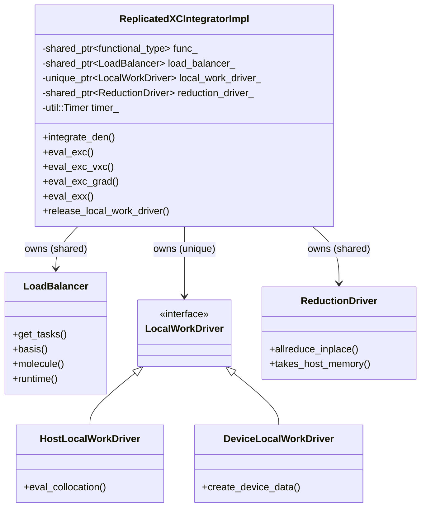
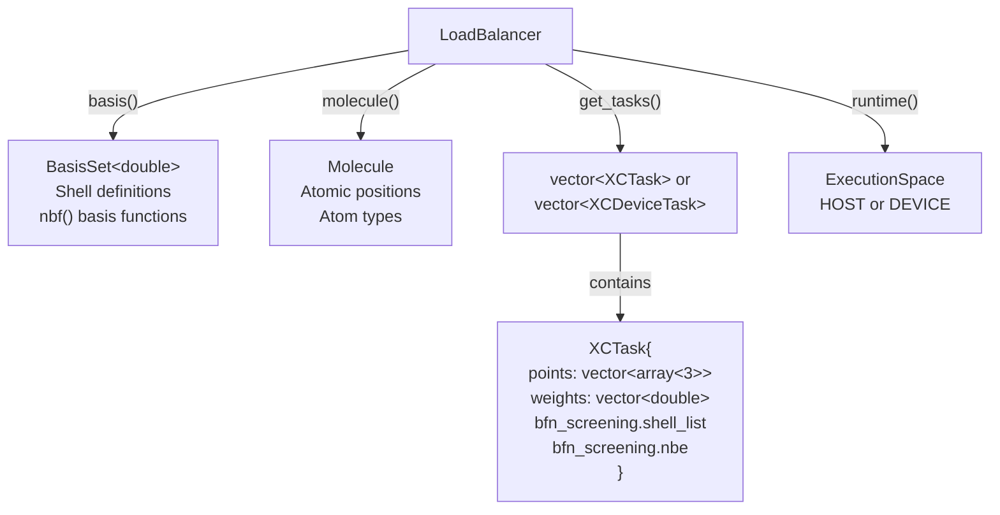
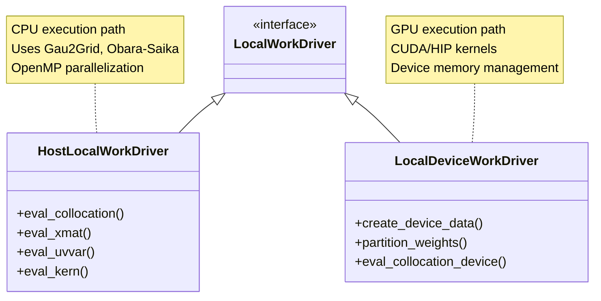
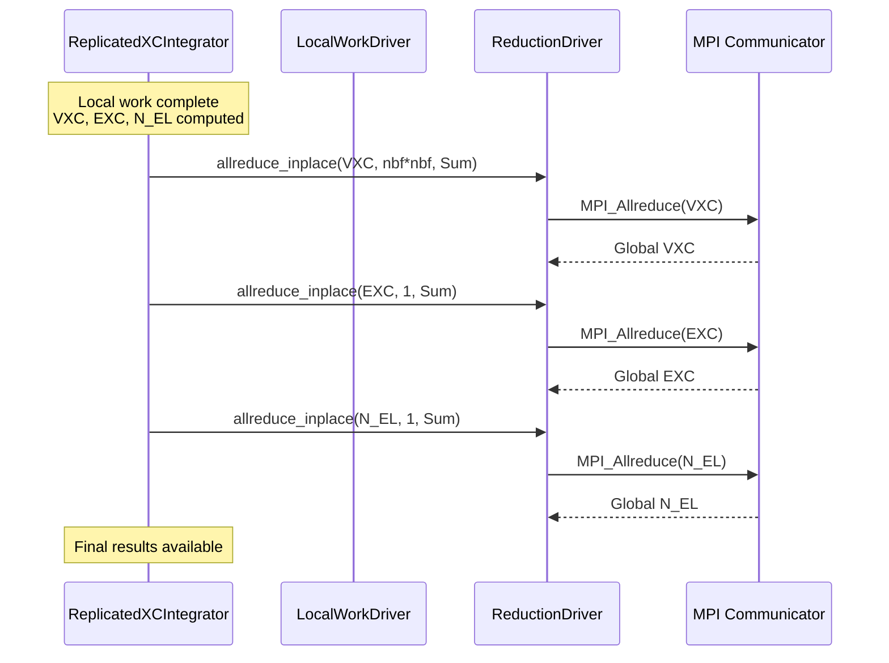
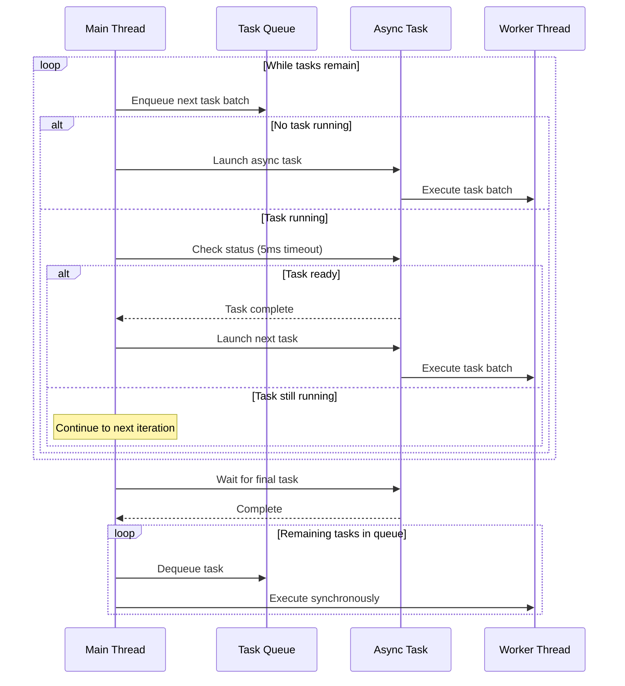

<!-- source: DeepWiki mcp.deepwiki.com · repo microsoft/skala · page 4.1 Core Components · fetched 2026-10-26 -->

# Core Components

<details>
<summary>Relevant source files</summary>

The following files were used as context for generating this wiki page:

- [third_party/gauxc/attic/include/gauxc/new_xc_integrator/impl.hpp](third_party/gauxc/attic/include/gauxc/new_xc_integrator/impl.hpp)
- [third_party/gauxc/attic/include/gauxc/new_xc_integrator/replicated/impl.hpp](third_party/gauxc/attic/include/gauxc/new_xc_integrator/replicated/impl.hpp)
- [third_party/gauxc/attic/include/gauxc/new_xc_integrator/replicated/replicated_xc_integrator_impl.hpp](third_party/gauxc/attic/include/gauxc/new_xc_integrator/replicated/replicated_xc_integrator_impl.hpp)
- [third_party/gauxc/attic/include/gauxc/new_xc_integrator/replicated_xc_integrator.hpp](third_party/gauxc/attic/include/gauxc/new_xc_integrator/replicated_xc_integrator.hpp)
- [third_party/gauxc/attic/include/gauxc/new_xc_integrator/xc_integrator_impl.hpp](third_party/gauxc/attic/include/gauxc/new_xc_integrator/xc_integrator_impl.hpp)
- [third_party/gauxc/attic/include/gauxc/xc_integrator/impl.hpp](third_party/gauxc/attic/include/gauxc/xc_integrator/impl.hpp)
- [third_party/gauxc/attic/include/gauxc/xc_integrator/xc_integrator_impl.hpp](third_party/gauxc/attic/include/gauxc/xc_integrator/xc_integrator_impl.hpp)
- [third_party/gauxc/attic/src/new_integrator/replicated_xc_integrator_impl.cxx](third_party/gauxc/attic/src/new_integrator/replicated_xc_integrator_impl.cxx)
- [third_party/gauxc/include/gauxc/xc_integrator.hpp](third_party/gauxc/include/gauxc/xc_integrator.hpp)
- [third_party/gauxc/include/gauxc/xc_integrator/impl.hpp](third_party/gauxc/include/gauxc/xc_integrator/impl.hpp)
- [third_party/gauxc/include/gauxc/xc_integrator/replicated/impl.hpp](third_party/gauxc/include/gauxc/xc_integrator/replicated/impl.hpp)
- [third_party/gauxc/include/gauxc/xc_integrator/replicated/replicated_xc_integrator_impl.hpp](third_party/gauxc/include/gauxc/xc_integrator/replicated/replicated_xc_integrator_impl.hpp)
- [third_party/gauxc/include/gauxc/xc_integrator/replicated_xc_integrator.hpp](third_party/gauxc/include/gauxc/xc_integrator/replicated_xc_integrator.hpp)
- [third_party/gauxc/src/xc_integrator/replicated/device/incore_replicated_xc_device_integrator_dd.hpp](third_party/gauxc/src/xc_integrator/replicated/device/incore_replicated_xc_device_integrator_dd.hpp)
- [third_party/gauxc/src/xc_integrator/replicated/host/reference_replicated_xc_host_integrator_dd_psi_potential.hpp](third_party/gauxc/src/xc_integrator/replicated/host/reference_replicated_xc_host_integrator_dd_psi_potential.hpp)
- [third_party/gauxc/src/xc_integrator/replicated/replicated_xc_integrator_impl.cxx](third_party/gauxc/src/xc_integrator/replicated/replicated_xc_integrator_impl.cxx)
- [third_party/gauxc/src/xc_integrator/shell_batched/shell_batched_replicated_xc_integrator_dd_psi.hpp](third_party/gauxc/src/xc_integrator/shell_batched/shell_batched_replicated_xc_integrator_dd_psi.hpp)
- [third_party/gauxc/src/xc_integrator/shell_batched/shell_batched_replicated_xc_integrator_dd_psi_potential.hpp](third_party/gauxc/src/xc_integrator/shell_batched/shell_batched_replicated_xc_integrator_dd_psi_potential.hpp)
- [third_party/gauxc/src/xc_integrator/shell_batched/shell_batched_replicated_xc_integrator_exc.hpp](third_party/gauxc/src/xc_integrator/shell_batched/shell_batched_replicated_xc_integrator_exc.hpp)
- [third_party/gauxc/src/xc_integrator/shell_batched/shell_batched_replicated_xc_integrator_exc_grad.hpp](third_party/gauxc/src/xc_integrator/shell_batched/shell_batched_replicated_xc_integrator_exc_grad.hpp)
- [third_party/gauxc/src/xc_integrator/shell_batched/shell_batched_replicated_xc_integrator_exc_vxc.hpp](third_party/gauxc/src/xc_integrator/shell_batched/shell_batched_replicated_xc_integrator_exc_vxc.hpp)
- [third_party/gauxc/src/xc_integrator/shell_batched/shell_batched_replicated_xc_integrator_exx.hpp](third_party/gauxc/src/xc_integrator/shell_batched/shell_batched_replicated_xc_integrator_exx.hpp)
- [third_party/gauxc/src/xc_integrator/shell_batched/shell_batched_replicated_xc_integrator_fxc_contraction.hpp](third_party/gauxc/src/xc_integrator/shell_batched/shell_batched_replicated_xc_integrator_fxc_contraction.hpp)
- [third_party/gauxc/src/xc_integrator/shell_batched/shell_batched_replicated_xc_integrator_integrate_den.hpp](third_party/gauxc/src/xc_integrator/shell_batched/shell_batched_replicated_xc_integrator_integrate_den.hpp)

</details>


## Purpose and Scope

This page documents the three core subsystems that form the foundation of GauXC's integration pipeline: **LoadBalancer**, **LocalWorkDriver**, and **ReductionDriver**. These components are coordinated by `ReplicatedXCIntegratorImpl` to perform numerical integration of exchange-correlation functionals. This page focuses on the architectural relationships, responsibilities, and interaction patterns between these components. For details on task batching strategies, see [Task System and Data Structures](#4.3). For the execution model differences between host and device paths, see [Execution Model: Host vs Device](#4.2).

**Sources:** [third_party/gauxc/include/gauxc/xc_integrator/replicated/replicated_xc_integrator_impl.hpp:1-211]()

---

## Component Overview

The integration pipeline is orchestrated by three distinct subsystems that follow a clear separation of concerns:

| Component | Responsibility | Shared Ownership | Primary Output |
|-----------|---------------|------------------|----------------|
| `LoadBalancer` | Generate computational tasks from molecular geometry and basis set | Shared (`std::shared_ptr`) | `std::vector<XCTask>` or `std::vector<XCDeviceTask>` |
| `LocalWorkDriver` | Execute tasks on host or device hardware | Unique (`std::unique_ptr`) | Partial integrals (EXC, VXC, N_EL) |
| `ReductionDriver` | Aggregate results across MPI ranks | Shared (`std::shared_ptr`) | Global reduced quantities |

**Sources:** [third_party/gauxc/include/gauxc/xc_integrator/replicated/replicated_xc_integrator_impl.hpp:29-34]()

---

## ReplicatedXCIntegratorImpl: The Coordinator

### Class Structure



**Sources:** [third_party/gauxc/include/gauxc/xc_integrator/replicated/replicated_xc_integrator_impl.hpp:20-38]()

### Constructor and Initialization

The `ReplicatedXCIntegratorImpl` is initialized with all three core components plus an XC functional:

```
ReplicatedXCIntegratorImpl(
    std::shared_ptr<functional_type>   func,
    std::shared_ptr<LoadBalancer>      lb, 
    std::unique_ptr<LocalWorkDriver>&& lwd,
    std::shared_ptr<ReductionDriver>   rd
)
```

This constructor establishes the component ownership model: `LoadBalancer` and `ReductionDriver` are shared across subsystems, while `LocalWorkDriver` has exclusive ownership that can be transferred.

**Sources:** [third_party/gauxc/include/gauxc/xc_integrator/replicated/replicated_xc_integrator_impl.hpp:110-114](), [third_party/gauxc/src/xc_integrator/replicated/replicated_xc_integrator_impl.cxx:14-20]()

### Ownership Transfer Pattern

A critical feature of the design is the ability to transfer `LocalWorkDriver` ownership:

```cpp
inline std::unique_ptr<LocalWorkDriver> release_local_work_driver() {
    return std::move(local_work_driver_);
}
```

This enables temporary delegation of the driver to incore integrators during batch processing, as seen in the shell-batched implementation.

**Sources:** [third_party/gauxc/include/gauxc/xc_integrator/replicated/replicated_xc_integrator_impl.hpp:196-198]()

---

## LoadBalancer: Task Distribution

The `LoadBalancer` is responsible for generating computational tasks from molecular data. It provides access to:

1. **Basis set information** via `basis()`
2. **Molecular geometry** via `molecule()`
3. **Task lists** via `get_tasks()`
4. **Runtime configuration** via `runtime()`

### Task Generation Flow



**Sources:** [third_party/gauxc/include/gauxc/xc_integrator/replicated/replicated_xc_integrator_impl.hpp:200-203](), [third_party/gauxc/src/xc_integrator/shell_batched/shell_batched_replicated_xc_integrator_exc_vxc.hpp:44-73]()

### Usage Pattern in Integration

The typical usage pattern retrieves the task list at the start of integration:

```cpp
auto& tasks = this->load_balancer_->get_tasks();
```

Tasks are then partitioned and processed by the `LocalWorkDriver`. The `LoadBalancer` is accessed as a shared pointer, allowing multiple subsystems to query basis and molecular information without duplication.

**Sources:** [third_party/gauxc/src/xc_integrator/shell_batched/shell_batched_replicated_xc_integrator_exc_vxc.hpp:73]()

---

## LocalWorkDriver: Computation Execution

### Polymorphic Execution Strategy

The `LocalWorkDriver` is an abstract interface with two primary implementations:



**Sources:** [third_party/gauxc/src/xc_integrator/shell_batched/shell_batched_replicated_xc_integrator_exc_vxc.hpp:10-13](), [third_party/gauxc/src/xc_integrator/shell_batched/shell_batched_replicated_xc_integrator_exc_vxc.hpp:77]()

### Device-Specific Initialization

For device execution, the driver is dynamically cast to access GPU-specific methods:

```cpp
#ifdef GAUXC_HAS_DEVICE
auto* lwd = dynamic_cast<LocalDeviceWorkDriver*>(this->local_work_driver_.get());
auto rt = detail::as_device_runtime(this->load_balancer_->runtime());
device_data_ptr_ = lwd->create_device_data(rt);
#endif
```

This pattern allows the same interface to support both host and device execution paths without compile-time branching at the integrator level.

**Sources:** [third_party/gauxc/src/xc_integrator/shell_batched/shell_batched_replicated_xc_integrator_exc_vxc.hpp:75-84]()

### Ownership Delegation to Incore Integrators

During shell-batched integration, ownership of the `LocalWorkDriver` is temporarily transferred to an incore integrator:

```cpp
incore_integrator_type incore_integrator(
    this->func_, 
    this->load_balancer_,
    this->release_local_work_driver(),  // Transfer ownership
    this->reduction_driver_
);

// ... work is performed by incore_integrator ...

// Reclaim ownership
this->local_work_driver_ = std::move(incore_integrator.release_local_work_driver());
```

This design allows the incore integrator to have exclusive control over work execution while maintaining the overall architecture.

**Sources:** [third_party/gauxc/src/xc_integrator/shell_batched/shell_batched_replicated_xc_integrator_exc_vxc.hpp:87-101]()

---

## ReductionDriver: Result Aggregation

### MPI Allreduce Operations

The `ReductionDriver` performs global reduction of local contributions across MPI ranks. Its primary method is:

```cpp
void allreduce_inplace(value_type* data, size_t count, ReductionOp op)
```

### Typical Reduction Workflow



**Sources:** [third_party/gauxc/src/xc_integrator/shell_batched/shell_batched_replicated_xc_integrator_exc_vxc.hpp:105-115]()

### Memory Location Validation

The driver includes a safety check to ensure it operates on host-accessible memory:

```cpp
if (not this->reduction_driver_->takes_host_memory())
    GAUXC_GENERIC_EXCEPTION("This Module Only Works With Host Reductions");
```

This validation is critical for the shell-batched implementation, which performs reductions after transferring device data to the host.

**Sources:** [third_party/gauxc/src/xc_integrator/shell_batched/shell_batched_replicated_xc_integrator_exc_vxc.hpp:106-107]()

### Reduction Sequence

For a typical `eval_exc_vxc` call with unrestricted (UKS) spin treatment, the reduction sequence is:

1. `VXCs` (spin-scalar potential, `nbf*nbf` elements)
2. `VXCz` (spin-z potential, `nbf*nbf` elements) 
3. `VXCy` (spin-y potential, `nbf*nbf` elements, if GKS)
4. `VXCx` (spin-x potential, `nbf*nbf` elements, if GKS)
5. `EXC` (energy, 1 element)
6. `N_EL` (electron count, 1 element)

**Sources:** [third_party/gauxc/src/xc_integrator/shell_batched/shell_batched_replicated_xc_integrator_exc_vxc.hpp:109-114]()

---

## Component Interaction: Integration Pipeline

### Complete eval_exc_vxc Workflow

```mermaid
flowchart TB
    START["eval_exc_vxc(P, VXC, EXC)"]
    
    subgraph "Validation Phase"
        VALIDATE["Validate matrix dimensions<br/>Check LDP, LDVXC vs nbf"]
    end
    
    subgraph "Task Generation Phase"
        GET_TASKS["load_balancer_->get_tasks()"]
        TASKS["vector&lt;XCTask&gt; tasks"]
    end
    
    subgraph "Device Setup (if applicable)"
        CHECK_DEVICE{"Is device<br/>integrator?"}
        ALLOC_DEVICE["lwd->create_device_data(runtime)"]
        DEVICE_DATA["device_data_ptr_"]
    end
    
    subgraph "Ownership Transfer"
        CREATE_INCORE["Create IncoreIntegrator<br/>Transfer LWD ownership"]
        INCORE["incore_integrator"]
    end
    
    subgraph "Local Work Phase"
        ZERO_HOST["Zero VXC, EXC, N_EL on host"]
        QUEUE["Task queue management"]
        BATCH_GEN["Generate incore tasks<br/>with union_shell_list"]
        EXTRACT_SUB["Extract submatrix from P"]
        EXECUTE["Execute task batch<br/>incore_integrator.exc_vxc_local_work()"]
        INCREMENT["Increment VXC submatrix"]
    end
    
    subgraph "Ownership Recovery"
        RELEASE["Release LWD from incore_integrator<br/>Transfer back to integrator"]
    end
    
    subgraph "Reduction Phase"
        REDUCE_VXC["reduction_driver_->allreduce(VXC)"]
        REDUCE_EXC["reduction_driver_->allreduce(EXC)"]
        REDUCE_NEL["reduction_driver_->allreduce(N_EL)"]
    end
    
    subgraph "Cleanup"
        FREE_DEVICE["device_data_ptr_.reset()"]
    end
    
    END["Return to caller"]
    
    START --> VALIDATE
    VALIDATE --> GET_TASKS
    GET_TASKS --> TASKS
    TASKS --> CHECK_DEVICE
    CHECK_DEVICE -->|Yes| ALLOC_DEVICE
    CHECK_DEVICE -->|No| CREATE_INCORE
    ALLOC_DEVICE --> DEVICE_DATA
    DEVICE_DATA --> CREATE_INCORE
    CREATE_INCORE --> INCORE
    INCORE --> ZERO_HOST
    ZERO_HOST --> QUEUE
    QUEUE --> BATCH_GEN
    BATCH_GEN --> EXTRACT_SUB
    EXTRACT_SUB --> EXECUTE
    EXECUTE --> INCREMENT
    INCREMENT -->|More tasks| BATCH_GEN
    INCREMENT -->|Done| RELEASE
    RELEASE --> REDUCE_VXC
    REDUCE_VXC --> REDUCE_EXC
    REDUCE_EXC --> REDUCE_NEL
    REDUCE_NEL --> FREE_DEVICE
    FREE_DEVICE --> END
```



**Sources:** [third_party/gauxc/src/xc_integrator/shell_batched/shell_batched_replicated_xc_integrator_exc_vxc.hpp:31-121](), [third_party/gauxc/src/xc_integrator/shell_batched/shell_batched_replicated_xc_integrator_exc_vxc.hpp:154-270]()

### Asynchronous Task Execution

The shell-batched implementation uses an asynchronous producer-consumer pattern for task execution:



**Sources:** [third_party/gauxc/src/xc_integrator/shell_batched/shell_batched_replicated_xc_integrator_exc_vxc.hpp:230-269]()

---

## Timing and Performance Monitoring

The `ReplicatedXCIntegratorImpl` includes a `util::Timer` member that tracks operations:

```cpp
util::Timer timer_;
```

Key timed operations include:

| Timer Label | Operation | Component |
|-------------|-----------|-----------|
| `"XCIntegrator.DeviceAlloc"` | Device memory allocation | `LocalDeviceWorkDriver` |
| `"XCIntegrator.LocalWork"` | Task execution | `LocalWorkDriver` |
| `"XCIntegrator.ZeroHost"` | Host memory initialization | N/A |
| `"XCIntegrator.CopySubBasis"` | Subbasis extraction | N/A |
| `"XCIntegrator.RecalcShellList"` | Shell list recalculation | N/A |
| `"XCIntegrator.ExtractSubDensity"` | Density submatrix extraction | N/A |
| `"XCIntegrator.IncrementSubPotential"` | Potential accumulation | N/A |
| `"XCIntegrator.ResetShellList"` | Shell list restoration | N/A |
| `"XCIntegrator.Allreduce"` | MPI reduction | `ReductionDriver` |

The timer is accessible via `get_timings()` for external profiling.

**Sources:** [third_party/gauxc/include/gauxc/xc_integrator/replicated/replicated_xc_integrator_impl.hpp:36](), [third_party/gauxc/include/gauxc/xc_integrator/replicated/replicated_xc_integrator_impl.hpp:194](), [third_party/gauxc/src/xc_integrator/shell_batched/shell_batched_replicated_xc_integrator_exc_vxc.hpp:81-98](), [third_party/gauxc/src/xc_integrator/shell_batched/shell_batched_replicated_xc_integrator_exc_vxc.hpp:175-198]()

---

## Summary

The three core components form a clean separation of concerns:

- **LoadBalancer**: Manages task generation and provides read-only access to basis and molecular data
- **LocalWorkDriver**: Executes computational kernels on host or device, with polymorphic dispatch
- **ReductionDriver**: Aggregates partial results across distributed memory

The `ReplicatedXCIntegratorImpl` coordinates these components through a well-defined ownership model: shared ownership for stateless query objects (`LoadBalancer`, `ReductionDriver`), and transferable unique ownership for stateful executors (`LocalWorkDriver`). This design enables flexible task batching strategies while maintaining clear component boundaries.

---

