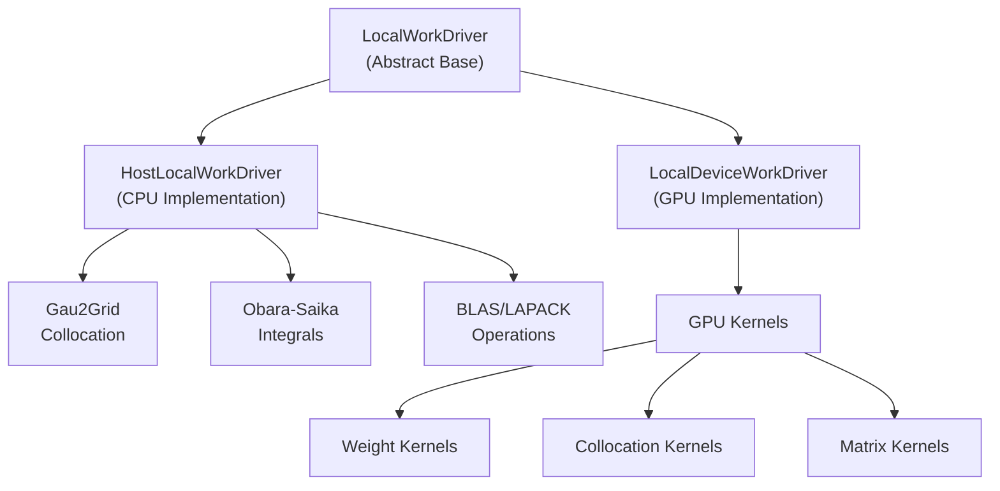
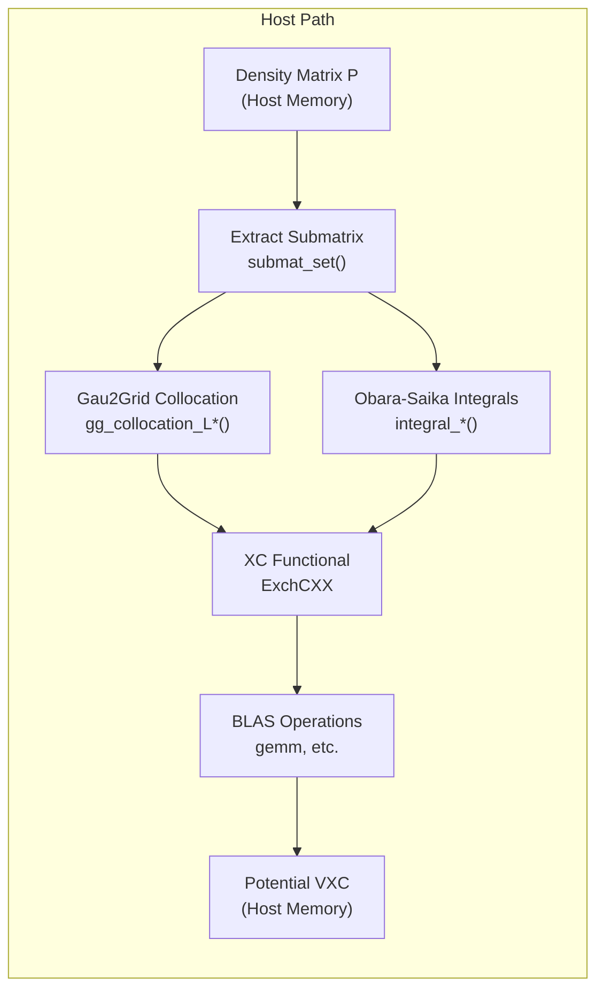
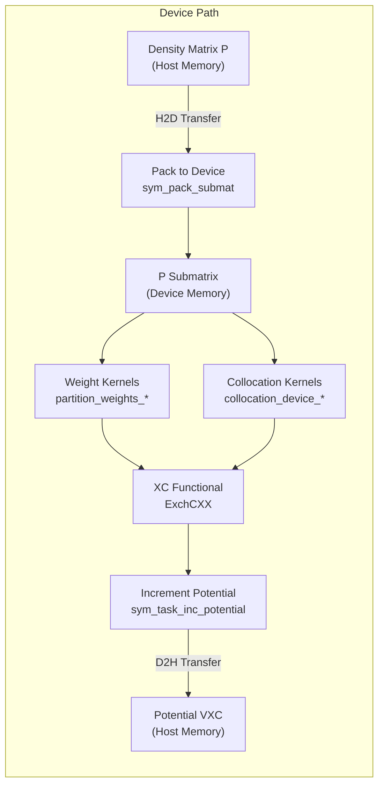

<!-- source: DeepWiki mcp.deepwiki.com · repo microsoft/skala · page 4.2 Execution Model: Host vs Device · fetched 2026-10-26 -->

# Execution Model: Host vs Device

<details>
<summary>Relevant source files</summary>

The following files were used as context for generating this wiki page:

- [third_party/gauxc/CMakeLists.txt](third_party/gauxc/CMakeLists.txt)
- [third_party/gauxc/attic/src/integrator/cuda/gauxc-cuda_integrator.cmake](third_party/gauxc/attic/src/integrator/cuda/gauxc-cuda_integrator.cmake)
- [third_party/gauxc/attic/src/new_integrator/device/cuda/gauxc-cuda.cmake](third_party/gauxc/attic/src/new_integrator/device/cuda/gauxc-cuda.cmake)
- [third_party/gauxc/attic/src/new_integrator/device/hip/gauxc-hip.cmake](third_party/gauxc/attic/src/new_integrator/device/hip/gauxc-hip.cmake)
- [third_party/gauxc/cmake/gauxc-config.cmake.in](third_party/gauxc/cmake/gauxc-config.cmake.in)
- [third_party/gauxc/cmake/gauxc-cub.cmake](third_party/gauxc/cmake/gauxc-cub.cmake)
- [third_party/gauxc/cmake/gauxc-cutlass.cmake](third_party/gauxc/cmake/gauxc-cutlass.cmake)
- [third_party/gauxc/include/gauxc/gauxc_config.hpp.in](third_party/gauxc/include/gauxc/gauxc_config.hpp.in)
- [third_party/gauxc/include/gauxc/util/environment.hpp](third_party/gauxc/include/gauxc/util/environment.hpp)
- [third_party/gauxc/include/gauxc/xc_integrator/replicated/impl.hpp](third_party/gauxc/include/gauxc/xc_integrator/replicated/impl.hpp)
- [third_party/gauxc/src/CMakeLists.txt](third_party/gauxc/src/CMakeLists.txt)
- [third_party/gauxc/src/external/CMakeLists.txt](third_party/gauxc/src/external/CMakeLists.txt)
- [third_party/gauxc/src/xc_integrator/local_work_driver/device/CMakeLists.txt](third_party/gauxc/src/xc_integrator/local_work_driver/device/CMakeLists.txt)
- [third_party/gauxc/src/xc_integrator/local_work_driver/device/cuda/CMakeLists.txt](third_party/gauxc/src/xc_integrator/local_work_driver/device/cuda/CMakeLists.txt)
- [third_party/gauxc/src/xc_integrator/local_work_driver/device/hip/CMakeLists.txt](third_party/gauxc/src/xc_integrator/local_work_driver/device/hip/CMakeLists.txt)
- [third_party/gauxc/src/xc_integrator/replicated/device/incore_replicated_xc_device_integrator_dd.hpp](third_party/gauxc/src/xc_integrator/replicated/device/incore_replicated_xc_device_integrator_dd.hpp)
- [third_party/gauxc/src/xc_integrator/replicated/host/reference_replicated_xc_host_integrator_dd_psi_potential.hpp](third_party/gauxc/src/xc_integrator/replicated/host/reference_replicated_xc_host_integrator_dd_psi_potential.hpp)
- [third_party/gauxc/src/xc_integrator/replicated/replicated_xc_integrator_impl.cxx](third_party/gauxc/src/xc_integrator/replicated/replicated_xc_integrator_impl.cxx)
- [third_party/gauxc/src/xc_integrator/shell_batched/shell_batched_replicated_xc_integrator_dd_psi.hpp](third_party/gauxc/src/xc_integrator/shell_batched/shell_batched_replicated_xc_integrator_dd_psi.hpp)
- [third_party/gauxc/src/xc_integrator/shell_batched/shell_batched_replicated_xc_integrator_dd_psi_potential.hpp](third_party/gauxc/src/xc_integrator/shell_batched/shell_batched_replicated_xc_integrator_dd_psi_potential.hpp)
- [third_party/gauxc/src/xc_integrator/shell_batched/shell_batched_replicated_xc_integrator_exc.hpp](third_party/gauxc/src/xc_integrator/shell_batched/shell_batched_replicated_xc_integrator_exc.hpp)
- [third_party/gauxc/src/xc_integrator/shell_batched/shell_batched_replicated_xc_integrator_exc_grad.hpp](third_party/gauxc/src/xc_integrator/shell_batched/shell_batched_replicated_xc_integrator_exc_grad.hpp)
- [third_party/gauxc/src/xc_integrator/shell_batched/shell_batched_replicated_xc_integrator_exc_vxc.hpp](third_party/gauxc/src/xc_integrator/shell_batched/shell_batched_replicated_xc_integrator_exc_vxc.hpp)
- [third_party/gauxc/src/xc_integrator/shell_batched/shell_batched_replicated_xc_integrator_exx.hpp](third_party/gauxc/src/xc_integrator/shell_batched/shell_batched_replicated_xc_integrator_exx.hpp)
- [third_party/gauxc/src/xc_integrator/shell_batched/shell_batched_replicated_xc_integrator_fxc_contraction.hpp](third_party/gauxc/src/xc_integrator/shell_batched/shell_batched_replicated_xc_integrator_fxc_contraction.hpp)
- [third_party/gauxc/src/xc_integrator/shell_batched/shell_batched_replicated_xc_integrator_integrate_den.hpp](third_party/gauxc/src/xc_integrator/shell_batched/shell_batched_replicated_xc_integrator_integrate_den.hpp)
- [third_party/gauxc/tests/environment.cxx](third_party/gauxc/tests/environment.cxx)

</details>


## Purpose and Scope

This document describes GauXC's dual execution model, which supports both CPU-based (host) and GPU-based (device) computation paths. It covers the build-time configuration that enables these execution modes, the runtime abstraction layer that selects between them, and the fundamental differences in data flow and computational kernels between host and device execution.

For details on specific host computation algorithms, see [Host Computation](#6). For GPU kernel implementations, see [Device Computation](#7). For the overall system architecture context, see [System Architecture](#4).

## Build-Time Configuration

GauXC's execution model is configured at build time through CMake options that control which execution backends are compiled into the library.

### Feature Flags

The build system uses the following options to enable execution backends:

| CMake Option | Default | Purpose | Sets Flag |
|--------------|---------|---------|-----------|
| `GAUXC_ENABLE_HOST` | ON | Enable CPU execution path | `GAUXC_HAS_HOST` |
| `GAUXC_ENABLE_CUDA` | OFF | Enable NVIDIA GPU execution | `GAUXC_HAS_CUDA` |
| `GAUXC_ENABLE_HIP` | OFF | Enable AMD GPU execution | `GAUXC_HAS_HIP` |

These options are processed to set feature flags used throughout the codebase:

```cpp
#cmakedefine GAUXC_HAS_HOST
#cmakedefine GAUXC_HAS_CUDA
#cmakedefine GAUXC_HAS_HIP
#cmakedefine GAUXC_HAS_DEVICE
```

The `GAUXC_HAS_DEVICE` flag is automatically set when either CUDA or HIP is enabled:

```cmake
if( GAUXC_HAS_CUDA OR GAUXC_HAS_HIP )
  set( GAUXC_HAS_DEVICE TRUE CACHE BOOL "Enable Device Code" )
endif()
```

**Sources:** [third_party/gauxc/CMakeLists.txt:97-112](), [third_party/gauxc/include/gauxc/gauxc_config.hpp.in:10-36]()

### Execution Path Requirements

At least one execution path must be enabled. The build system enforces this constraint:

```cmake
if( NOT (${GAUXC_HAS_HOST} OR ${GAUXC_HAS_DEVICE}) )
  message( FATAL_ERROR "Neither Host nor Device Integrators have been enabled!" )
endif()
```

When both host and device backends are enabled, the library can dynamically select between them at runtime based on the `LocalWorkDriver` configuration.

**Sources:** [third_party/gauxc/CMakeLists.txt:116-118]()

### Angular Momentum Limits

The execution model imposes different maximum angular momentum (L) values for host and device:

```cpp
#ifdef GAUXC_HAS_HOST
  set(GAUXC_CPU_XC_MAX_AM     6) 
  set(GAUXC_CPU_SNLINK_MAX_AM 6)
#endif

#ifdef GAUXC_HAS_DEVICE
  set(GAUXC_GPU_XC_MAX_AM     4) 
  set(GAUXC_GPU_SNLINK_MAX_AM 2)
#endif
```

These limits reflect practical tradeoffs:
- **Host (L=6)**: Larger maximum due to code generation flexibility and CPU memory capacity
- **Device (L=4)**: Lower maximum due to GPU register pressure and kernel complexity

The runtime can query these limits using `gauxc_max_am(ExecutionSpace, SupportedAlg)`.

**Sources:** [third_party/gauxc/src/CMakeLists.txt:116-124](), [third_party/gauxc/include/gauxc/util/environment.hpp:14-40]()

## Runtime Abstraction: LocalWorkDriver

### Polymorphic Dispatch

The `LocalWorkDriver` abstract base class provides the runtime interface for task execution. Concrete implementations handle either host or device execution:



**Sources:** [third_party/gauxc/src/xc_integrator/shell_batched/shell_batched_replicated_xc_integrator_exc_vxc.hpp:10-13]()

### Driver Selection and Ownership

The integrator implementations hold a `std::unique_ptr<LocalWorkDriver>` and transfer ownership to incore integrators during task execution:

```cpp
// Generate incore integrator instance, transfer ownership of LWD
incore_integrator_type incore_integrator( this->func_, this->load_balancer_,
  this->release_local_work_driver(), this->reduction_driver_ );

// ... execute tasks ...

// Release ownership of LWD back to this integrator instance
this->local_work_driver_ = std::move( incore_integrator.release_local_work_driver() );
```

This pattern allows the integrator to reuse the same `LocalWorkDriver` across multiple batches while temporarily delegating control to the incore integrator.

**Sources:** [third_party/gauxc/src/xc_integrator/shell_batched/shell_batched_replicated_xc_integrator_exc_vxc.hpp:86-101]()

## Conditional Compilation and Runtime Dispatch

### Compile-Time Branching

Device-specific code is guarded by preprocessor directives:

```cpp
#ifdef GAUXC_HAS_DEVICE
  // Allocate Device memory
  auto* lwd = dynamic_cast<LocalDeviceWorkDriver*>(this->local_work_driver_.get() );
  auto rt  = detail::as_device_runtime(this->load_balancer_->runtime());
  if constexpr (IncoreIntegratorType::is_device) {
    device_data_ptr_ = 
      this->timer_.time_op("XCIntegrator.DeviceAlloc",
        [&](){ return lwd->create_device_data(rt); });
  }
#endif
```

This ensures device-specific code is only compiled when GPU support is enabled.

**Sources:** [third_party/gauxc/src/xc_integrator/shell_batched/shell_batched_replicated_xc_integrator_exc_vxc.hpp:75-84]()

### Runtime Type Detection

When both host and device paths are available, the code uses `constexpr` to select the appropriate path:

```cpp
#ifdef GAUXC_HAS_DEVICE
  if constexpr (IncoreIntegratorType::is_device) {
    incore_integrator.exc_vxc_local_work( basis_subset, Ps_submat, nbe, 
      Pz_submat, nbe, Py_submat, nbe, Px_submat, nbe, VXCs_submat, nbe,
      VXCz_submat, nbe, VXCy_submat, nbe, VXCx_submat, nbe,
      &EXC_tmp, &NEL_tmp, task_begin, task_end, *device_data_ptr_ );
  } else if constexpr (not IncoreIntegratorType::is_device) {
#endif
    incore_integrator.exc_vxc_local_work( basis_subset, Ps_submat, nbe, 
      Pz_submat, nbe, Py_submat, nbe, Px_submat, nbe, VXCs_submat, nbe,
      VXCz_submat, nbe, VXCy_submat, nbe, VXCx_submat, nbe,
      &EXC_tmp, &NEL_tmp, IntegratorSettingsKS{}, task_begin, task_end );
#ifdef GAUXC_HAS_DEVICE
  }
#endif
```

The `is_device` static member determines which branch is taken at compile time, eliminating runtime overhead.

**Sources:** [third_party/gauxc/src/xc_integrator/shell_batched/shell_batched_replicated_xc_integrator_exc_vxc.hpp:391-406]()

## Data Flow Comparison

### Host Execution Pipeline



The host execution path operates entirely in host memory with explicit subbasis extraction and BLAS-based matrix operations.

**Sources:** [third_party/gauxc/src/xc_integrator/shell_batched/shell_batched_replicated_xc_integrator_exc_vxc.hpp:366-428]()

### Device Execution Pipeline



The device path performs explicit host-to-device transfers, executes GPU kernels, and transfers results back with atomic accumulation.

**Sources:** [third_party/gauxc/src/xc_integrator/shell_batched/shell_batched_replicated_xc_integrator_exc_vxc.hpp:391-407]()

## Task Data Structures

### XCTask (Host)

The host execution path uses `XCTask` objects which contain:

| Field | Type | Purpose |
|-------|------|---------|
| `points` | `std::vector<std::array<double,3>>` | Grid point coordinates |
| `weights` | `std::vector<double>` | Integration weights |
| `bfn_screening` | `BFNScreening` | Shell list and basis function screening |
| `iParent` | `int32_t` | Parent atom index |

Host tasks operate directly on these CPU-resident data structures without explicit memory management.

**Sources:** [third_party/gauxc/src/xc_integrator/replicated/host/reference_replicated_xc_host_integrator_dd_psi_potential.hpp:99-109]()

### XCDeviceTask (Device)

Device tasks extend the basic task structure with GPU-specific metadata managed by the `LocalDeviceWorkDriver`. Device memory allocation is handled separately:

```cpp
auto* lwd = dynamic_cast<LocalDeviceWorkDriver*>(this->local_work_driver_.get() );
auto rt  = detail::as_device_runtime(this->load_balancer_->runtime());
device_data_ptr_ = lwd->create_device_data(rt);
```

The `device_data_ptr_` is passed to the incore integrator for the duration of task execution and released afterward.

**Sources:** [third_party/gauxc/src/xc_integrator/shell_batched/shell_batched_replicated_xc_integrator_exc_vxc.hpp:75-84,118-119]()

## Computational Differences

### Collocation: Gau2Grid vs GPU Kernels

**Host (Gau2Grid)**:
- Generated C code specialized by angular momentum: `gg_collocation_L0`, `gg_collocation_L1`, etc.
- SIMD vectorization via compiler pragmas (`PRAGMA_VECTORIZE`)
- Block-based processing with aligned memory (`ALIGNED_MALLOC`)
- Supports up to L=6

**Device (GPU Kernels)**:
- Template-specialized CUDA/HIP kernels: `collocation_device_masked_kernel`, `collocation_device_shell_to_task_*`
- Warp-level parallelism and shared memory optimizations
- Separate kernels for spherical vs. Cartesian coordinates
- Supports up to L=4

For detailed kernel documentation, see [Gau2Grid Collocation System](#6.1) and [Collocation Kernels](#7.2).

**Sources:** [third_party/gauxc/src/CMakeLists.txt:116-124]()

### Matrix Operations

**Host**:
- Uses BLAS/LAPACK for dense linear algebra
- `submat_set()` and `inc_by_submat()` for submatrix extraction/accumulation
- Sequential or OpenMP-parallelized operations

**Device**:
- Specialized GPU kernels: `sym_pack_submat`, `asym_pack_submat` for packing
- `sym_task_inc_potential`, `asym_task_inc_potential` for accumulation
- Atomic operations for concurrent updates

For detailed matrix kernel documentation, see [Matrix Operations](#7.3).

**Sources:** [third_party/gauxc/src/xc_integrator/shell_batched/shell_batched_replicated_xc_integrator_exc_vxc.hpp:373-387,412-428]()

### Weight Calculation

**Host**:
- Computed as part of load balancer task generation
- Stored in `XCTask::weights` array
- Modified using smooth step functions on CPU

**Device**:
- Dedicated GPU kernels: `partition_weights_*_SoA`
- Two-stage computation: distance calculation (`compute_point_center_dist`) followed by SSF modification (`modify_weights_ssf_kernel`)
- Warp-level optimizations with dynamic work assignment

For detailed weight kernel documentation, see [Weight Calculation Kernels](#7.1).

## Code Organization by Execution Path

### Host Implementation Files

The host execution path is implemented across several directories:

| Component | Location | Purpose |
|-----------|----------|---------|
| Host Work Driver | `src/xc_integrator/local_work_driver/host/` | CPU task execution |
| Gau2Grid Integration | `src/external/` | Generated collocation kernels |
| Obara-Saika Integrals | Referenced in host driver | Gaussian integral evaluation |

Host-specific code is conditionally compiled when `GAUXC_HAS_HOST` is defined.

**Sources:** [third_party/gauxc/include/gauxc/gauxc_config.hpp.in:27-30]()

### Device Implementation Files

The device execution path has platform-specific organization:

| Component | Location | Purpose |
|-----------|----------|---------|
| Device Work Driver | `src/xc_integrator/local_work_driver/device/` | Base device functionality |
| CUDA Implementation | `src/xc_integrator/local_work_driver/device/cuda/` | NVIDIA GPU kernels |
| HIP Implementation | `src/xc_integrator/local_work_driver/device/hip/` | AMD GPU kernels |

Device code uses conditional compilation with `GAUXC_HAS_DEVICE`, `GAUXC_HAS_CUDA`, and `GAUXC_HAS_HIP`.

**Sources:** [third_party/gauxc/src/xc_integrator/local_work_driver/device/CMakeLists.txt:1-34](), [third_party/gauxc/src/xc_integrator/local_work_driver/device/cuda/CMakeLists.txt:1-53](), [third_party/gauxc/src/xc_integrator/local_work_driver/device/hip/CMakeLists.txt:1-33]()

### Integrator Dispatch Logic

The shell-batched integrator template is parameterized by both a base integrator type and an incore integrator type:

```cpp
template <typename BaseIntegratorType, typename IncoreIntegratorType>
class ShellBatchedReplicatedXCIntegrator : public BaseIntegratorType {
  // ...
  incore_integrator_type incore_integrator;
};
```

The `IncoreIntegratorType` determines whether host or device execution is used, with the `is_device` static member controlling compile-time branching.

**Sources:** [third_party/gauxc/src/xc_integrator/shell_batched/shell_batched_replicated_xc_integrator_exc_vxc.hpp:30-89]()

## Platform Abstraction

### CUDA vs HIP Support

GauXC supports both NVIDIA (CUDA) and AMD (HIP) GPUs through compile-time selection:

```cmake
if(GAUXC_HAS_CUDA)
  add_subdirectory( cuda )
endif()

if(GAUXC_HAS_HIP)
  add_subdirectory( hip )
endif()
```

The kernel implementations are largely parallel, with platform-specific wrappers handling API differences. For details on the abstraction strategy, see [Platform Abstraction: CUDA and HIP](#9).

**Sources:** [third_party/gauxc/src/xc_integrator/local_work_driver/device/CMakeLists.txt:27-33]()

### Dependency Management

The device execution path requires additional dependencies configured at build time:

| Dependency | Purpose | Required When |
|------------|---------|---------------|
| CUDAToolkit | CUDA runtime and libraries | `GAUXC_HAS_CUDA` |
| HIP Runtime | HIP runtime and libraries | `GAUXC_HAS_HIP` |
| MAGMA | GPU linear algebra | `GAUXC_ENABLE_MAGMA` |
| NCCL | Multi-GPU communication | `GAUXC_ENABLE_NCCL` |
| CUTLASS | Tensor operations | `GAUXC_ENABLE_CUTLASS` |

The host path requires BLAS/LAPACK, discovered through CMake's `find_package(BLAS)`.

**Sources:** [third_party/gauxc/cmake/gauxc-config.cmake.in:34-65](), [third_party/gauxc/src/CMakeLists.txt:116-124]()

---

