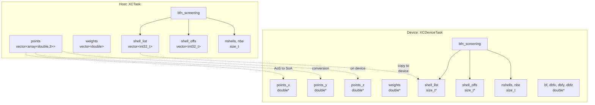
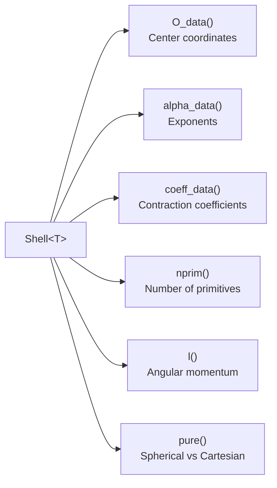
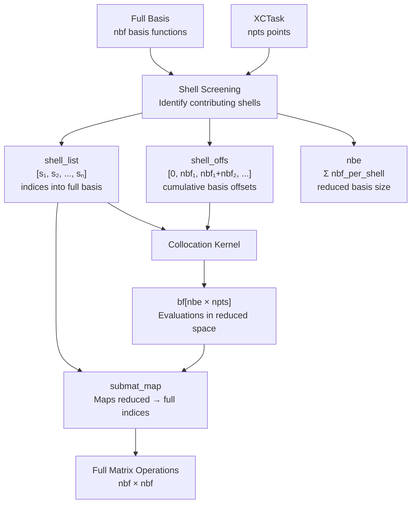
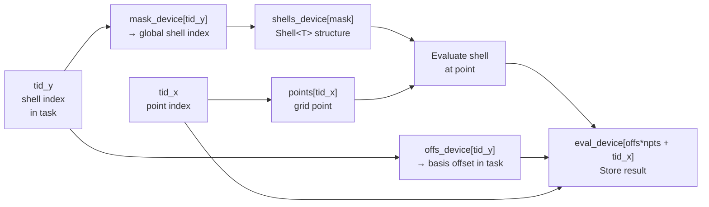
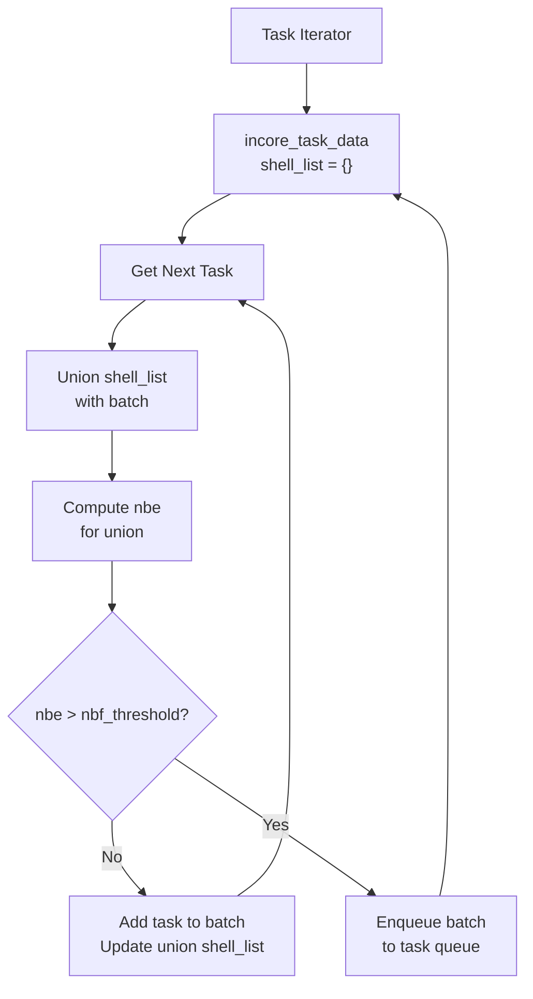
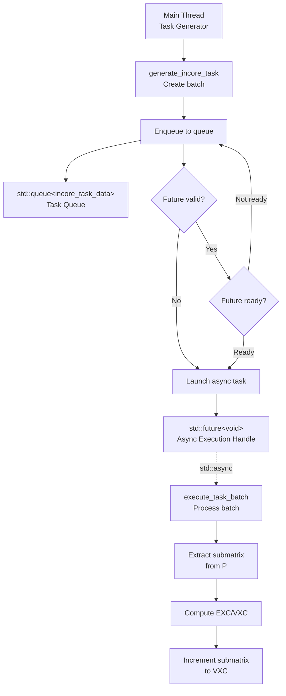
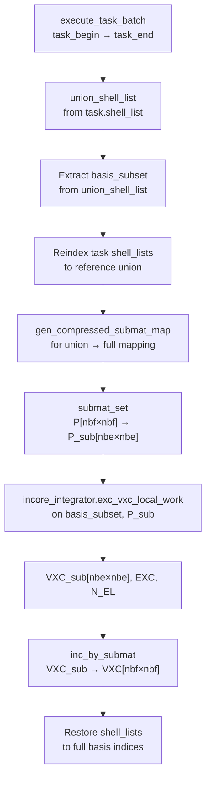
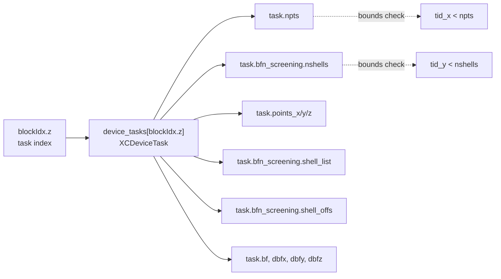

<!-- source: DeepWiki mcp.deepwiki.com · repo microsoft/skala · page 4.3 Task System and Data Structures · fetched 2026-10-26 -->

# Task System and Data Structures

<details>
<summary>Relevant source files</summary>

The following files were used as context for generating this wiki page:

- [third_party/gauxc/attic/src/integrator/cuda/collocation_masked_combined_kernels.hpp](third_party/gauxc/attic/src/integrator/cuda/collocation_masked_combined_kernels.hpp)
- [third_party/gauxc/attic/src/integrator/cuda/collocation_masked_kernels.hpp](third_party/gauxc/attic/src/integrator/cuda/collocation_masked_kernels.hpp)
- [third_party/gauxc/attic/src/new_integrator/device/cuda/collocation_masked_combined_kernels.hpp](third_party/gauxc/attic/src/new_integrator/device/cuda/collocation_masked_combined_kernels.hpp)
- [third_party/gauxc/attic/src/new_integrator/device/cuda/collocation_masked_kernels.hpp](third_party/gauxc/attic/src/new_integrator/device/cuda/collocation_masked_kernels.hpp)
- [third_party/gauxc/attic/src/new_integrator/device/hip/collocation_masked_combined_kernels.hpp](third_party/gauxc/attic/src/new_integrator/device/hip/collocation_masked_combined_kernels.hpp)
- [third_party/gauxc/attic/src/new_integrator/device/hip/collocation_masked_kernels.hpp](third_party/gauxc/attic/src/new_integrator/device/hip/collocation_masked_kernels.hpp)
- [third_party/gauxc/include/gauxc/xc_integrator/replicated/impl.hpp](third_party/gauxc/include/gauxc/xc_integrator/replicated/impl.hpp)
- [third_party/gauxc/src/xc_integrator/local_work_driver/device/cuda/kernels/collocation/collocation_radial.hpp](third_party/gauxc/src/xc_integrator/local_work_driver/device/cuda/kernels/collocation/collocation_radial.hpp)
- [third_party/gauxc/src/xc_integrator/local_work_driver/device/cuda/kernels/collocation_masked_combined_kernels.hpp](third_party/gauxc/src/xc_integrator/local_work_driver/device/cuda/kernels/collocation_masked_combined_kernels.hpp)
- [third_party/gauxc/src/xc_integrator/local_work_driver/device/cuda/kernels/collocation_masked_kernels.hpp](third_party/gauxc/src/xc_integrator/local_work_driver/device/cuda/kernels/collocation_masked_kernels.hpp)
- [third_party/gauxc/src/xc_integrator/local_work_driver/device/hip/kernels/collocation_masked_combined_kernels.hpp](third_party/gauxc/src/xc_integrator/local_work_driver/device/hip/kernels/collocation_masked_combined_kernels.hpp)
- [third_party/gauxc/src/xc_integrator/local_work_driver/device/hip/kernels/collocation_masked_kernels.hpp](third_party/gauxc/src/xc_integrator/local_work_driver/device/hip/kernels/collocation_masked_kernels.hpp)
- [third_party/gauxc/src/xc_integrator/replicated/device/incore_replicated_xc_device_integrator_dd.hpp](third_party/gauxc/src/xc_integrator/replicated/device/incore_replicated_xc_device_integrator_dd.hpp)
- [third_party/gauxc/src/xc_integrator/replicated/host/reference_replicated_xc_host_integrator_dd_psi_potential.hpp](third_party/gauxc/src/xc_integrator/replicated/host/reference_replicated_xc_host_integrator_dd_psi_potential.hpp)
- [third_party/gauxc/src/xc_integrator/replicated/replicated_xc_integrator_impl.cxx](third_party/gauxc/src/xc_integrator/replicated/replicated_xc_integrator_impl.cxx)
- [third_party/gauxc/src/xc_integrator/shell_batched/shell_batched_replicated_xc_integrator_dd_psi.hpp](third_party/gauxc/src/xc_integrator/shell_batched/shell_batched_replicated_xc_integrator_dd_psi.hpp)
- [third_party/gauxc/src/xc_integrator/shell_batched/shell_batched_replicated_xc_integrator_dd_psi_potential.hpp](third_party/gauxc/src/xc_integrator/shell_batched/shell_batched_replicated_xc_integrator_dd_psi_potential.hpp)
- [third_party/gauxc/src/xc_integrator/shell_batched/shell_batched_replicated_xc_integrator_exc.hpp](third_party/gauxc/src/xc_integrator/shell_batched/shell_batched_replicated_xc_integrator_exc.hpp)
- [third_party/gauxc/src/xc_integrator/shell_batched/shell_batched_replicated_xc_integrator_exc_grad.hpp](third_party/gauxc/src/xc_integrator/shell_batched/shell_batched_replicated_xc_integrator_exc_grad.hpp)
- [third_party/gauxc/src/xc_integrator/shell_batched/shell_batched_replicated_xc_integrator_exc_vxc.hpp](third_party/gauxc/src/xc_integrator/shell_batched/shell_batched_replicated_xc_integrator_exc_vxc.hpp)
- [third_party/gauxc/src/xc_integrator/shell_batched/shell_batched_replicated_xc_integrator_exx.hpp](third_party/gauxc/src/xc_integrator/shell_batched/shell_batched_replicated_xc_integrator_exx.hpp)
- [third_party/gauxc/src/xc_integrator/shell_batched/shell_batched_replicated_xc_integrator_fxc_contraction.hpp](third_party/gauxc/src/xc_integrator/shell_batched/shell_batched_replicated_xc_integrator_fxc_contraction.hpp)
- [third_party/gauxc/src/xc_integrator/shell_batched/shell_batched_replicated_xc_integrator_integrate_den.hpp](third_party/gauxc/src/xc_integrator/shell_batched/shell_batched_replicated_xc_integrator_integrate_den.hpp)

</details>


This page documents the task system and core data structures used to organize computational work in GauXC. It covers the `XCTask` and `XCDeviceTask` structures, the shell screening mechanism, and how tasks are batched for efficient execution. For details on how tasks are generated and distributed, see [Task Batching Strategy](#5.1). For information on submatrix operations that work with tasks, see [Submatrix Operations](#5.2).

## Overview

GauXC organizes exchange-correlation integration work into discrete tasks, each representing a batch of grid points with associated metadata. The task system serves two primary purposes:

1. **Load distribution**: Tasks partition the integration grid across computational units (CPU threads or GPU blocks)
2. **Data locality**: Each task carries only the basis function shells needed for its grid points, enabling efficient submatrix operations

Tasks exist in two variants: `XCTask` for host execution and `XCDeviceTask` for device (GPU) execution. Both share common structure but differ in memory layout and access patterns.

## Core Task Data Structures

### XCTask: Host Task Structure

The `XCTask` structure organizes host-side computational work. Key fields include:

| Field | Type | Purpose |
|-------|------|---------|
| `points` | `std::vector<std::array<double,3>>` | Grid point coordinates (x,y,z) |
| `weights` | `std::vector<double>` | Integration weights at each point |
| `bfn_screening` | Screening structure | Shell list and metadata |
| `iParent` | `int32_t` | Atom index for atom-centered grids |

The `bfn_screening` sub-structure contains:

| Field | Type | Purpose |
|-------|------|---------|
| `shell_list` | `std::vector<int32_t>` | Indices of shells needed for this task |
| `shell_offs` | `std::vector<int32_t>` | Basis function offsets for each shell |
| `nshells` | `size_t` | Number of shells in shell_list |
| `nbe` | `size_t` | Number of basis functions (effective basis size) |

Sources: [third_party/gauxc/src/xc_integrator/shell_batched/shell_batched_replicated_xc_integrator_exc_vxc.hpp:100-439](), [third_party/gauxc/src/xc_integrator/local_work_driver/device/hip/kernels/collocation_masked_combined_kernels.hpp:34-46]()

### XCDeviceTask: Device Task Structure

`XCDeviceTask` mirrors `XCTask` but uses device-accessible memory with Structure-of-Arrays (SoA) layout for coalesced GPU memory access:

| Field | Type | Purpose |
|-------|------|---------|
| `points_x`, `points_y`, `points_z` | `double*` | Separate arrays for point coordinates |
| `weights` | `double*` | Integration weights |
| `bf`, `dbfx`, `dbfy`, `dbfz` | `double*` | Basis function evaluations and derivatives |
| `bfn_screening.shell_list` | `size_t*` | Device pointer to shell indices |
| `bfn_screening.shell_offs` | `size_t*` | Device pointer to shell offsets |
| `npts` | `size_t` | Number of points in this task |

The SoA layout (separate x/y/z arrays) enables vectorized loads on the GPU and improves memory bandwidth utilization.

Sources: [third_party/gauxc/src/xc_integrator/local_work_driver/device/cuda/kernels/collocation_masked_combined_kernels.hpp:34-47](), [third_party/gauxc/src/xc_integrator/local_work_driver/device/hip/kernels/collocation_masked_combined_kernels.hpp:40-44]()

### Task Structure Comparison



Sources: [third_party/gauxc/src/xc_integrator/local_work_driver/device/cuda/kernels/collocation_masked_combined_kernels.hpp:34-47](), [third_party/gauxc/src/xc_integrator/local_work_driver/device/hip/kernels/collocation_masked_combined_kernels.hpp:34-47]()

## Shell Screening System

Shell screening reduces computational cost by identifying which basis function shells contribute significantly to a task's grid points. Only shells with non-negligible overlap are included in each task.

### Shell<T> Data Structure

The `Shell<T>` template represents a single contracted Gaussian shell:



GPU kernels access shell data via these accessor methods to compute radial and angular components of basis functions.

Sources: [third_party/gauxc/src/xc_integrator/local_work_driver/device/cuda/kernels/collocation_masked_kernels.hpp:42-68](), [third_party/gauxc/src/xc_integrator/local_work_driver/device/cuda/kernels/collocation/collocation_radial.hpp:16-45]()

### Screening Data Flow



The screening process:
1. For each task's grid points, determine which shells have significant contribution
2. Build `shell_list` containing indices of contributing shells
3. Build `shell_offs` with cumulative offsets for indexing into reduced basis
4. Compute `nbe` (effective basis size) = sum of basis functions across selected shells
5. Generate `submat_map` for translating between reduced and full matrix spaces

Sources: [third_party/gauxc/src/xc_integrator/shell_batched/shell_batched_replicated_xc_integrator_exc_vxc.hpp:313-323](), [third_party/gauxc/src/xc_integrator/shell_batched/shell_batched_replicated_xc_integrator_exc_vxc.hpp:367-371]()

### Masked Kernel Indexing

GPU kernels use the screening data to evaluate only necessary basis functions:



This indexing pattern appears consistently across masked collocation kernels at [third_party/gauxc/src/xc_integrator/local_work_driver/device/cuda/kernels/collocation_masked_kernels.hpp:36-61]().

Sources: [third_party/gauxc/src/xc_integrator/local_work_driver/device/cuda/kernels/collocation_masked_kernels.hpp:30-71](), [third_party/gauxc/src/xc_integrator/local_work_driver/device/hip/kernels/collocation_masked_kernels.hpp:30-72]()

## Task Batching for Shell-Batched Execution

The shell-batched integrator groups multiple tasks together to amortize overhead and enable larger submatrix operations.

### incore_task_data Structure

Tasks are batched into `incore_task_data` structures with these key components:

| Field | Purpose |
|-------|---------|
| `task_begin`, `task_end` | Iterator range over tasks in this batch |
| `shell_list` | Union of all shell_lists across tasks in batch |

The union shell list enables a single submatrix extraction for the entire batch rather than per-task extractions.

Sources: [third_party/gauxc/src/xc_integrator/shell_batched/shell_batched_replicated_xc_integrator_exc_vxc.hpp:202-243]()

### NBF Threshold and Batching

The constant `nbf_threshold = 8000` at [third_party/gauxc/src/xc_integrator/shell_batched/shell_batched_replicated_xc_integrator_exc_vxc.hpp:172]() controls task batching:



This algorithm creates batches that stay under the threshold, ensuring submatrices remain cache-friendly while maximizing batch size.

Sources: [third_party/gauxc/src/xc_integrator/shell_batched/shell_batched_replicated_xc_integrator_exc_vxc.hpp:234-243]()

### Shell List Transformation

Tasks within a batch undergo shell list reindexing to reference the union shell list:

**Before batching** (task references full basis):
```
task.bfn_screening.shell_list = [5, 12, 23, 47]  // indices into full basis
```

**After union** (batch has union list):
```
union_shell_list = [5, 12, 23, 47, 18, 31]  // all shells needed by batch
```

**Reindexed** (task references union):
```
task.bfn_screening.shell_list = [0, 1, 2, 3]  // indices into union_shell_list
```

This transformation occurs at [third_party/gauxc/src/xc_integrator/shell_batched/shell_batched_replicated_xc_integrator_exc_vxc.hpp:313-323]():

```cpp
for( auto _it = task_begin; _it != task_end; ++_it ) {
  auto union_list_idx = 0;
  auto& cur_shell_list = _it->bfn_screening.shell_list;
  for( auto j = 0ul; j < cur_shell_list.size(); ++j ) {
    while( union_shell_list[union_list_idx] != cur_shell_list[j] )
      union_list_idx++;
    cur_shell_list[j] = union_list_idx;
  }
}
```

After batch execution, shell lists are restored to full basis indexing at [third_party/gauxc/src/xc_integrator/shell_batched/shell_batched_replicated_xc_integrator_exc_vxc.hpp:432-437]().

Sources: [third_party/gauxc/src/xc_integrator/shell_batched/shell_batched_replicated_xc_integrator_exc_vxc.hpp:313-437]()

## Task Execution Pipeline

### Asynchronous Task Queue

The shell-batched integrator uses a producer-consumer pattern with asynchronous task execution:



The queue is protected by a mutex (`queue_mod_ex` at [third_party/gauxc/src/xc_integrator/shell_batched/shell_batched_replicated_xc_integrator_exc_vxc.hpp:205]()) for thread-safe access.

Sources: [third_party/gauxc/src/xc_integrator/shell_batched/shell_batched_replicated_xc_integrator_exc_vxc.hpp:201-269]()

### Task Batch Execution Steps

Each `execute_task_batch` invocation performs the following operations:



This sequence is implemented in [third_party/gauxc/src/xc_integrator/shell_batched/shell_batched_replicated_xc_integrator_exc_vxc.hpp:274-439]().

Key operations:
- **Extract subbasis** ([lines 295-301]()): Creates `BasisSet` containing only shells in `union_shell_list`
- **Submatrix extraction** ([lines 373-387]()): `submat_set` copies `nbe×nbe` block from full `nbf×nbf` density matrix
- **Submatrix increment** ([lines 412-428]()): `inc_by_submat` atomically accumulates results back to full matrix

Sources: [third_party/gauxc/src/xc_integrator/shell_batched/shell_batched_replicated_xc_integrator_exc_vxc.hpp:274-439]()

## Device Task Organization

Device tasks use a different execution model where multiple tasks are processed concurrently using 3D GPU grids.

### Multi-Task Kernel Launch

The combined masked kernels process multiple tasks simultaneously:

```cpp
// Kernel launch with Z-dimension for task parallelism
collocation_device_masked_combined_kernel<<<grid, block>>>(
  ntasks,          // Number of tasks
  shells_device,   // All shells
  device_tasks     // Array of XCDeviceTask
);
```

Inside the kernel at [third_party/gauxc/src/xc_integrator/local_work_driver/device/cuda/kernels/collocation_masked_combined_kernels.hpp:32-87]():

```cpp
if( blockIdx.z < ntasks ) {
  auto& task = device_tasks[ blockIdx.z ];
  // tid_x indexes points, tid_y indexes shells
  // Each thread block processes one task
}
```

The `blockIdx.z` dimension selects which task to process, enabling concurrent execution across tasks.

Sources: [third_party/gauxc/src/xc_integrator/local_work_driver/device/cuda/kernels/collocation_masked_combined_kernels.hpp:23-89](), [third_party/gauxc/src/xc_integrator/local_work_driver/device/hip/kernels/collocation_masked_combined_kernels.hpp:24-89]()

### Task-Specific Data Access

Each GPU thread accesses task-specific data through the `XCDeviceTask` structure:



This allows each thread block to independently process its assigned task with no inter-task synchronization required.

Sources: [third_party/gauxc/src/xc_integrator/local_work_driver/device/cuda/kernels/collocation_masked_combined_kernels.hpp:34-84]()

## Summary

The task system organizes computational work through:

1. **XCTask/XCDeviceTask**: Core structures holding grid points, weights, and screening data
2. **Shell screening**: `bfn_screening` reduces basis size from `nbf` to `nbe` per task
3. **Task batching**: Groups tasks with union shell lists under `nbf_threshold` for efficient submatrix operations
4. **Asynchronous execution**: Producer-consumer pattern with task queue and futures
5. **Device parallelism**: 3D grid launches process multiple tasks concurrently

This design balances memory efficiency (reduced basis), computational efficiency (batching), and parallel scalability (concurrent task execution).

---

