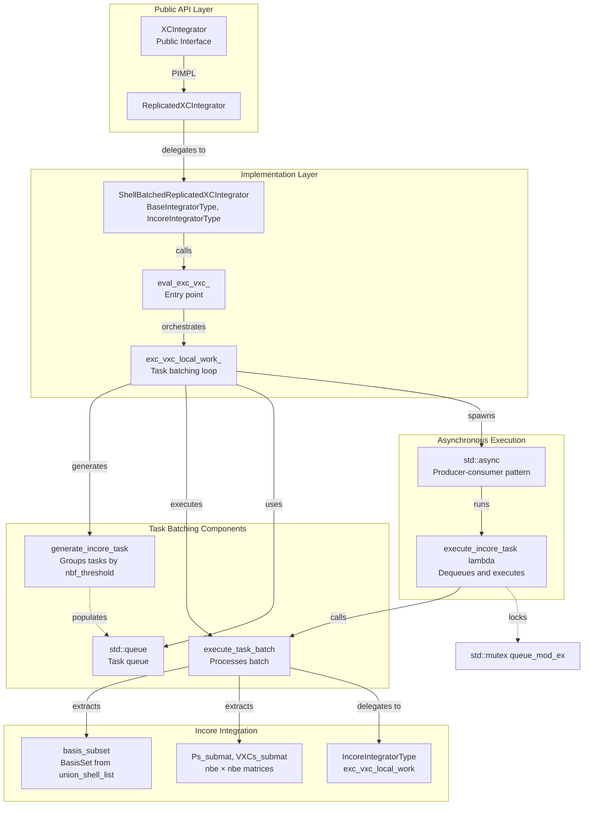
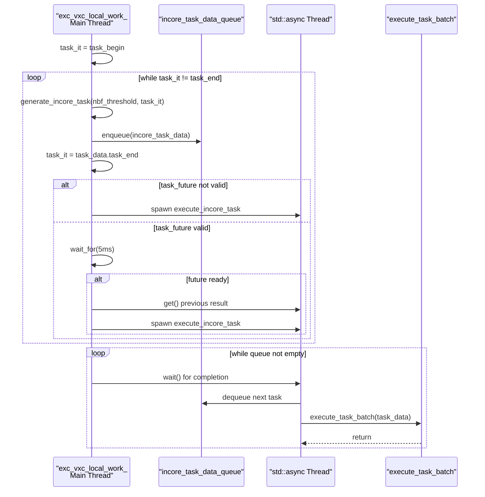
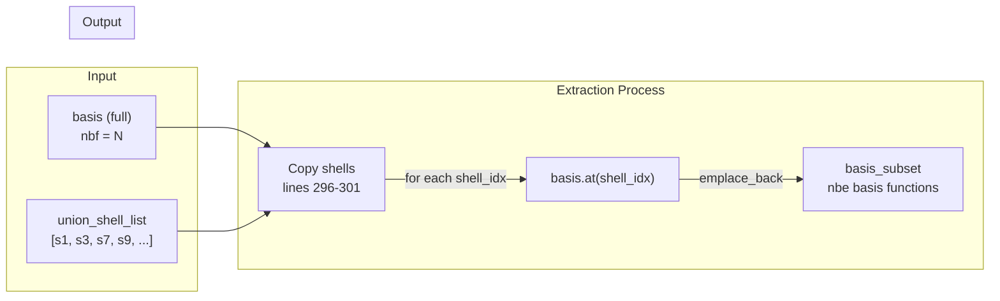
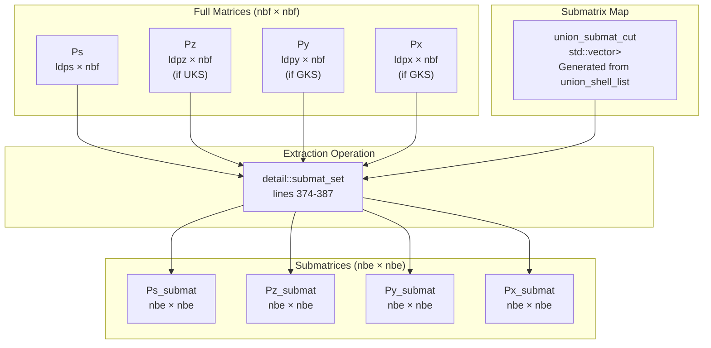
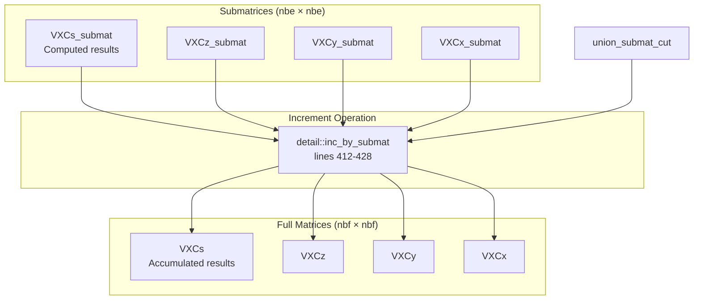
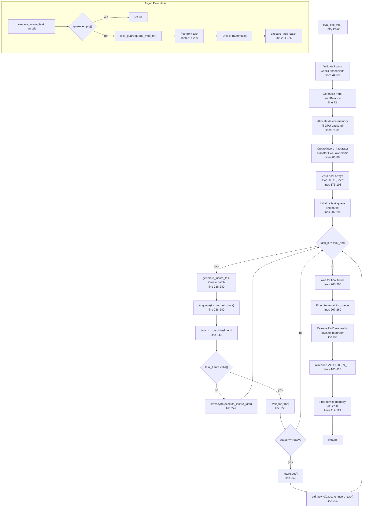
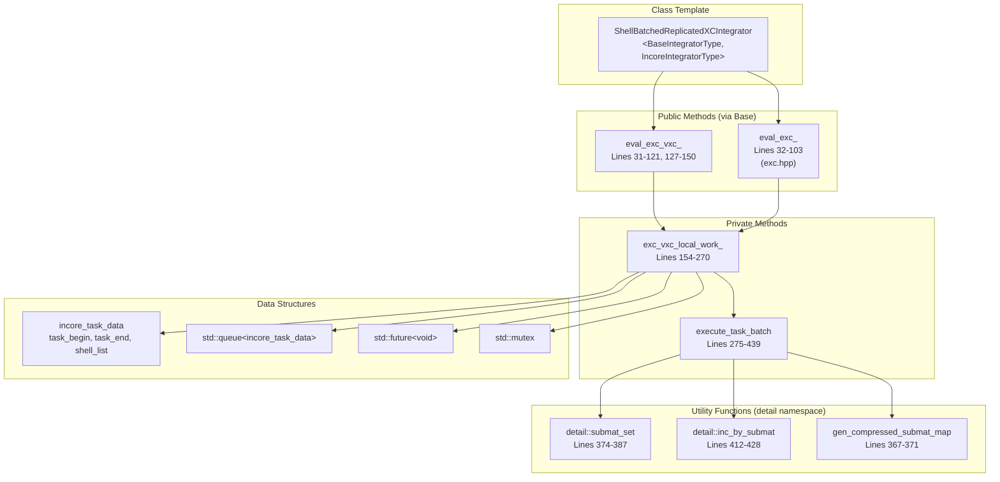

<!-- source: DeepWiki mcp.deepwiki.com · repo microsoft/skala · page 5 Shell Batched Integration · fetched 2026-10-26 -->

# Shell Batched Integration

<details>
<summary>Relevant source files</summary>

The following files were used as context for generating this wiki page:

- [third_party/gauxc/include/gauxc/xc_integrator/replicated/impl.hpp](third_party/gauxc/include/gauxc/xc_integrator/replicated/impl.hpp)
- [third_party/gauxc/src/xc_integrator/replicated/device/incore_replicated_xc_device_integrator_dd.hpp](third_party/gauxc/src/xc_integrator/replicated/device/incore_replicated_xc_device_integrator_dd.hpp)
- [third_party/gauxc/src/xc_integrator/replicated/host/reference_replicated_xc_host_integrator_dd_psi_potential.hpp](third_party/gauxc/src/xc_integrator/replicated/host/reference_replicated_xc_host_integrator_dd_psi_potential.hpp)
- [third_party/gauxc/src/xc_integrator/replicated/replicated_xc_integrator_impl.cxx](third_party/gauxc/src/xc_integrator/replicated/replicated_xc_integrator_impl.cxx)
- [third_party/gauxc/src/xc_integrator/shell_batched/shell_batched_replicated_xc_integrator_dd_psi.hpp](third_party/gauxc/src/xc_integrator/shell_batched/shell_batched_replicated_xc_integrator_dd_psi.hpp)
- [third_party/gauxc/src/xc_integrator/shell_batched/shell_batched_replicated_xc_integrator_dd_psi_potential.hpp](third_party/gauxc/src/xc_integrator/shell_batched/shell_batched_replicated_xc_integrator_dd_psi_potential.hpp)
- [third_party/gauxc/src/xc_integrator/shell_batched/shell_batched_replicated_xc_integrator_exc.hpp](third_party/gauxc/src/xc_integrator/shell_batched/shell_batched_replicated_xc_integrator_exc.hpp)
- [third_party/gauxc/src/xc_integrator/shell_batched/shell_batched_replicated_xc_integrator_exc_grad.hpp](third_party/gauxc/src/xc_integrator/shell_batched/shell_batched_replicated_xc_integrator_exc_grad.hpp)
- [third_party/gauxc/src/xc_integrator/shell_batched/shell_batched_replicated_xc_integrator_exc_vxc.hpp](third_party/gauxc/src/xc_integrator/shell_batched/shell_batched_replicated_xc_integrator_exc_vxc.hpp)
- [third_party/gauxc/src/xc_integrator/shell_batched/shell_batched_replicated_xc_integrator_exx.hpp](third_party/gauxc/src/xc_integrator/shell_batched/shell_batched_replicated_xc_integrator_exx.hpp)
- [third_party/gauxc/src/xc_integrator/shell_batched/shell_batched_replicated_xc_integrator_fxc_contraction.hpp](third_party/gauxc/src/xc_integrator/shell_batched/shell_batched_replicated_xc_integrator_fxc_contraction.hpp)
- [third_party/gauxc/src/xc_integrator/shell_batched/shell_batched_replicated_xc_integrator_integrate_den.hpp](third_party/gauxc/src/xc_integrator/shell_batched/shell_batched_replicated_xc_integrator_integrate_den.hpp)

</details>


## Purpose and Scope

This page documents the shell batching strategy used by `ShellBatchedReplicatedXCIntegrator` to optimize exchange-correlation integration by grouping tasks based on their combined basis function count. Shell batching reduces computational overhead by extracting minimal subbases and working with smaller submatrices.

For information about the overall system architecture, see [System Architecture](#4). For details on task data structures, see [Task System and Data Structures](#4.3). For submatrix operations in the context of GPU kernels, see [Submatrix Operations](#5.2).

**Sources:** [third_party/gauxc/src/xc_integrator/shell_batched/shell_batched_replicated_xc_integrator_exc_vxc.hpp:1-444]()

## Overview

Shell batching is a computational optimization that groups multiple `XCTask` objects together when their combined basis function count falls below a threshold. Instead of processing each task independently with the full basis set, the algorithm:

1. **Batches tasks** based on the total number of basis functions (`nbf`) in their union shell list
2. **Extracts a subbasis** containing only the shells needed by the batch
3. **Extracts submatrices** of the density matrix corresponding to the subbasis
4. **Executes integration** using the smaller subbasis and submatrices
5. **Accumulates results** back into the full density and potential matrices

This approach significantly reduces memory footprint and computational cost when processing small tasks, particularly on GPU devices where memory transfers are expensive.

**Key Parameters:**
- `nbf_threshold`: Set to `8000` by default [line 172]()
- Determines maximum combined basis functions per batch

**Sources:** [third_party/gauxc/src/xc_integrator/shell_batched/shell_batched_replicated_xc_integrator_exc_vxc.hpp:154-270]()

## Architectural Context



**Diagram: Shell Batched Integration Architecture**

This diagram shows how `ShellBatchedReplicatedXCIntegrator` orchestrates task batching and asynchronous execution. The `eval_exc_vxc_` method serves as the entry point, which delegates to `exc_vxc_local_work_` to manage the producer-consumer pattern. Tasks are generated by `generate_incore_task`, enqueued, and executed asynchronously by `execute_task_batch`.

**Sources:** 
- [third_party/gauxc/src/xc_integrator/shell_batched/shell_batched_replicated_xc_integrator_exc_vxc.hpp:31-121]()
- [third_party/gauxc/src/xc_integrator/shell_batched/shell_batched_replicated_xc_integrator_exc_vxc.hpp:154-270]()

## Task Batching Strategy

### The `incore_task_data` Structure

The batching algorithm uses an `incore_task_data` structure to represent a batch of tasks:

```cpp
struct incore_task_data {
  host_task_iterator task_begin;  // First task in batch
  host_task_iterator task_end;    // One past last task
  std::vector<int32_t> shell_list; // Union shell list
};
```

**Sources:** [third_party/gauxc/src/xc_integrator/shell_batched/shell_batched_replicated_xc_integrator_exc_vxc.hpp:202-203]()

### Union Shell List Construction

The `generate_incore_task` function (not shown in provided files but referenced at [line 239]()) creates a union of shell lists from multiple tasks:

1. **Input:** Iterator range `[task_it, task_end)` and `nbf_threshold`
2. **Algorithm:** 
   - Start with first task's shell list
   - Add subsequent tasks' shells to union until combined `nbf` exceeds threshold
   - Store union shell list in `incore_task_data.shell_list`
3. **Output:** `incore_task_data` containing task range and union shell list

This union shell list defines the minimal subbasis needed for the batch.

**Sources:** [third_party/gauxc/src/xc_integrator/shell_batched/shell_batched_replicated_xc_integrator_exc_vxc.hpp:238-243]()

### Asynchronous Producer-Consumer Pattern

The batching loop implements a producer-consumer pattern using `std::async` and `std::future`:



**Diagram: Asynchronous Task Execution Pattern**

The main thread generates tasks and enqueues them while asynchronously spawning execution threads. It uses a 5ms polling interval to check if the current async task has completed before spawning the next one.

**Sources:** [third_party/gauxc/src/xc_integrator/shell_batched/shell_batched_replicated_xc_integrator_exc_vxc.hpp:234-269]()

### Producer-Consumer Implementation Details

| Component | Implementation | Purpose |
|-----------|---------------|---------|
| **Queue** | `std::queue<incore_task_data>` | Stores batches to be executed |
| **Mutex** | `std::mutex queue_mod_ex` | Protects queue modifications |
| **Future** | `std::future<void> task_future` | Tracks async execution status |
| **Polling** | `wait_for(std::chrono::milliseconds(5))` | Non-blocking status check |
| **Executor Lambda** | `execute_incore_task` | Dequeues and executes batches |

The `execute_incore_task` lambda [lines 208-227]():
1. Checks if queue is empty (early return)
2. Locks mutex with `std::lock_guard`
3. Moves front task from queue
4. Unlocks mutex automatically
5. Calls `execute_task_batch` with task data

**Sources:** [third_party/gauxc/src/xc_integrator/shell_batched/shell_batched_replicated_xc_integrator_exc_vxc.hpp:202-227](), [third_party/gauxc/src/xc_integrator/shell_batched/shell_batched_replicated_xc_integrator_exc_vxc.hpp:232-269]()

## Submatrix Operations

### Subbasis Extraction

The `execute_task_batch` function first extracts a subbasis from the union shell list:



**Diagram: Subbasis Extraction Process**

The subbasis contains only the shells referenced in the union shell list, resulting in `nbe` basis functions where `nbe << nbf` for small task batches.

**Sources:** [third_party/gauxc/src/xc_integrator/shell_batched/shell_batched_replicated_xc_integrator_exc_vxc.hpp:296-301]()

### Shell List Remapping

After extracting the subbasis, shell lists in individual tasks must be remapped from full-basis indices to subbasis indices:

**Original state:**
- `union_shell_list = [3, 7, 12, 15]` (indices into full basis)
- `task.shell_list = [3, 12, 15]` (subset of union, indices into full basis)

**Remapping algorithm [lines 313-323]():**
```
for each task in [task_begin, task_end):
  union_list_idx = 0
  for j in range(task.shell_list.size()):
    // Find position in union list
    while union_shell_list[union_list_idx] != task.shell_list[j]:
      union_list_idx++
    // Replace with subbasis index
    task.shell_list[j] = union_list_idx
```

**After remapping:**
- `union_shell_list = [3, 7, 12, 15]` (unchanged)
- `task.shell_list = [0, 2, 3]` (indices into basis_subset)

This remapping enables the incore integrator to work with the subbasis directly.

**Sources:** [third_party/gauxc/src/xc_integrator/shell_batched/shell_batched_replicated_xc_integrator_exc_vxc.hpp:313-323]()

### Density Submatrix Extraction

The `submat_set` function extracts density submatrices corresponding to the subbasis:



**Diagram: Density Submatrix Extraction**

The `union_submat_cut` mapping is generated by `gen_compressed_submat_map` [lines 367-371]() and describes which blocks of the full matrix correspond to each shell pair in the subbasis.

**Sources:** [third_party/gauxc/src/xc_integrator/shell_batched/shell_batched_replicated_xc_integrator_exc_vxc.hpp:326-387]()

### Potential Submatrix Increment

After integration, potential submatrices are incremented back into the full matrices using `inc_by_submat`:



**Diagram: Potential Submatrix Increment**

The same `union_submat_cut` mapping used for extraction is used for increment, ensuring consistency between density extraction and potential accumulation.

**Sources:** [third_party/gauxc/src/xc_integrator/shell_batched/shell_batched_replicated_xc_integrator_exc_vxc.hpp:412-428]()

### Shell List Reset

After integration completes, shell lists are restored to full-basis indices [lines 432-437]():

```
for each task in [task_begin, task_end):
  for j in range(task.shell_list.size()):
    // Map subbasis index back to full basis index
    task.shell_list[j] = union_shell_list[task.shell_list[j]]
```

This reset is necessary because the tasks may be reused or the shell lists may be accessed by other parts of the code.

**Sources:** [third_party/gauxc/src/xc_integrator/shell_batched/shell_batched_replicated_xc_integrator_exc_vxc.hpp:432-437]()

## Complete Execution Pipeline



**Diagram: Complete Execution Pipeline**

This flowchart shows the complete execution flow from the `eval_exc_vxc_` entry point through task batching, asynchronous execution, and final reduction.

**Sources:** [third_party/gauxc/src/xc_integrator/shell_batched/shell_batched_replicated_xc_integrator_exc_vxc.hpp:31-121](), [third_party/gauxc/src/xc_integrator/shell_batched/shell_batched_replicated_xc_integrator_exc_vxc.hpp:154-270]()

## Task Batch Execution Details

### Memory Allocation Strategy

For each task batch, temporary memory is allocated on the host [lines 326-363]():

| Array | Size | Purpose |
|-------|------|---------|
| `Ps_submat` | `nbe × nbe` | Spin-averaged density (or alpha density for UKS) |
| `VXCs_submat` | `nbe × nbe` | Spin-averaged potential (or alpha potential) |
| `Pz_submat` | `nbe × nbe` | Z-component density (UKS/GKS) |
| `VXCz_submat` | `nbe × nbe` | Z-component potential (UKS/GKS) |
| `Py_submat` | `nbe × nbe` | Y-component density (GKS only) |
| `VXCy_submat` | `nbe × nbe` | Y-component potential (GKS only) |
| `Px_submat` | `nbe × nbe` | X-component density (GKS only) |
| `VXCx_submat` | `nbe × nbe` | X-component potential (GKS only) |

All arrays are allocated as `std::vector<double>` for automatic memory management. Potential arrays (`VXC*_submat`) are zero-initialized [lines 342, 351, 360]().

**Sources:** [third_party/gauxc/src/xc_integrator/shell_batched/shell_batched_replicated_xc_integrator_exc_vxc.hpp:326-363]()

### Integration Dispatch

The actual integration is dispatched to the `incore_integrator` based on device availability [lines 391-406]():

**Device path (GPU):**
```cpp
incore_integrator.exc_vxc_local_work(
  basis_subset, 
  Ps_submat, nbe, Pz_submat, nbe, Py_submat, nbe, Px_submat, nbe,
  VXCs_submat, nbe, VXCz_submat, nbe, VXCy_submat, nbe, VXCx_submat, nbe,
  &EXC_tmp, &NEL_tmp, 
  task_begin, task_end, 
  *device_data_ptr_  // Device-specific data
);
```

**Host path (CPU):**
```cpp
incore_integrator.exc_vxc_local_work(
  basis_subset,
  Ps_submat, nbe, Pz_submat, nbe, Py_submat, nbe, Px_submat, nbe,
  VXCs_submat, nbe, VXCz_submat, nbe, VXCy_submat, nbe, VXCx_submat, nbe,
  &EXC_tmp, &NEL_tmp,
  IntegratorSettingsKS{},  // Settings instead of device data
  task_begin, task_end
);
```

The compile-time check `if constexpr (IncoreIntegratorType::is_device)` ensures the correct overload is called.

**Sources:** [third_party/gauxc/src/xc_integrator/shell_batched/shell_batched_replicated_xc_integrator_exc_vxc.hpp:391-406]()

### Result Accumulation

After integration, results are accumulated [lines 409-428]():

1. **Energy and electron count** are added to running totals:
   ```cpp
   *EXC += EXC_tmp;
   *N_EL += NEL_tmp;
   ```

2. **Potential submatrices** are incremented into full matrices:
   ```cpp
   detail::inc_by_submat(nbf, nbf, nbe, nbe, 
                         VXCs, ldvxcs,      // Full matrix
                         VXCs_submat, nbe,  // Submatrix
                         union_submat_cut); // Mapping
   ```

The `inc_by_submat` function performs the inverse of `submat_set`, adding submatrix elements to the appropriate locations in the full matrix.

**Sources:** [third_party/gauxc/src/xc_integrator/shell_batched/shell_batched_replicated_xc_integrator_exc_vxc.hpp:409-428]()

## Performance Characteristics

### Memory Reduction

For a task batch with `nbe = 500` and full basis `nbf = 2000`:

| Matrix Type | Full Size | Submatrix Size | Memory Reduction |
|-------------|-----------|----------------|------------------|
| Density (single) | 2000² = 4M doubles | 500² = 250K doubles | **16×** smaller |
| Density (UKS, 2 matrices) | 8M doubles | 500K doubles | **16×** smaller |
| Density (GKS, 4 matrices) | 16M doubles | 1M doubles | **16×** smaller |

For GPU execution, this directly reduces host-to-device transfer overhead.

### Batching Efficiency

The `nbf_threshold = 8000` was chosen empirically [line 172](). For a system with `nbf = 2000`:
- A single shell might contribute ~10-50 basis functions
- A batch could contain ~160-800 shells before exceeding threshold
- Multiple small tasks can be processed together, amortizing overhead

### Asynchronous Overlap

The producer-consumer pattern enables overlap between:
- Task batch generation (main thread)
- Integration computation (async thread)
- Minimal synchronization (5ms polling, line 250)

This overlap is most beneficial when the incore integrator performs significant computation (e.g., GPU kernel execution).

**Sources:** [third_party/gauxc/src/xc_integrator/shell_batched/shell_batched_replicated_xc_integrator_exc_vxc.hpp:172](), [third_party/gauxc/src/xc_integrator/shell_batched/shell_batched_replicated_xc_integrator_exc_vxc.hpp:234-269]()

## Relationship to Other Integration Methods

The `ShellBatchedReplicatedXCIntegrator` provides implementations for several integration methods, but many are marked as "Not Yet Implemented" (NYI):

| Method | Status | File Reference |
|--------|--------|----------------|
| `eval_exc_vxc_` | **Implemented** | [shell_batched_replicated_xc_integrator_exc_vxc.hpp:31-439]() |
| `eval_exc_` | **Implemented** | [shell_batched_replicated_xc_integrator_exc.hpp:31-128]() |
| `eval_exx_` | NYI | [shell_batched_replicated_xc_integrator_exx.hpp:17-23]() |
| `eval_exc_grad_` | NYI | [shell_batched_replicated_xc_integrator_exc_grad.hpp:17-31]() |
| `integrate_den_` | NYI | [shell_batched_replicated_xc_integrator_integrate_den.hpp:17-23]() |
| `eval_fxc_contraction_` | NYI | [shell_batched_replicated_xc_integrator_fxc_contraction.hpp:17-42]() |
| `eval_dd_psi_` | NYI | [shell_batched_replicated_xc_integrator_dd_psi.hpp:17-36]() |
| `eval_dd_psi_potential_` | NYI | [shell_batched_replicated_xc_integrator_dd_psi_potential.hpp:17-21]() |

The `eval_exc_` implementation [shell_batched_replicated_xc_integrator_exc.hpp:31-128]() reuses the `exc_vxc_local_work_` function by passing `nullptr` for all VXC matrices [lines 82-83](), demonstrating code reuse within the batching framework.

**Sources:** [third_party/gauxc/src/xc_integrator/shell_batched/shell_batched_replicated_xc_integrator_exc.hpp:80-84]()

## Comparison with Reference Implementation

Unlike the shell-batched approach, the reference `ReplicatedXCIntegratorImpl` processes each task independently without batching. Key differences:

| Aspect | Shell Batched | Reference |
|--------|---------------|-----------|
| **Basis** | Extracts minimal subbasis per batch | Uses full basis for all tasks |
| **Matrices** | Extracts `nbe × nbe` submatrices | Uses full `nbf × nbf` matrices |
| **Execution** | Asynchronous batches | Sequential task processing |
| **Memory** | Reduced by subbasis size | Full basis memory always |
| **Complexity** | Higher (batching overhead) | Lower (direct processing) |
| **Optimal for** | Small tasks, GPU execution | Large tasks, CPU execution |

**Sources:** [third_party/gauxc/src/xc_integrator/replicated/replicated_xc_integrator_impl.cxx:13-135](), [third_party/gauxc/include/gauxc/xc_integrator/replicated/impl.hpp:19-282]()

## Code Entity Mapping

### Key Classes and Functions



**Diagram: Code Entity Relationships**

This diagram maps the primary code entities in the shell batched integration system, showing how template classes, methods, data structures, and utility functions relate to each other.

**Sources:** [third_party/gauxc/src/xc_integrator/shell_batched/shell_batched_replicated_xc_integrator_exc_vxc.hpp:1-444]()

### File Organization

The shell batched integrator is organized into separate header files by functionality:

```
src/xc_integrator/shell_batched/
├── shell_batched_replicated_xc_integrator_exc_vxc.hpp (main implementation)
├── shell_batched_replicated_xc_integrator_exc.hpp
├── shell_batched_replicated_xc_integrator_exx.hpp (NYI)
├── shell_batched_replicated_xc_integrator_exc_grad.hpp (NYI)
├── shell_batched_replicated_xc_integrator_integrate_den.hpp (NYI)
├── shell_batched_replicated_xc_integrator_fxc_contraction.hpp (NYI)
├── shell_batched_replicated_xc_integrator_dd_psi.hpp (NYI)
└── shell_batched_replicated_xc_integrator_dd_psi_potential.hpp (NYI)
```

Each file implements one or more related methods of the `ShellBatchedReplicatedXCIntegrator` class template, following a separation of concerns pattern.

**Sources:** All files in list above

---

