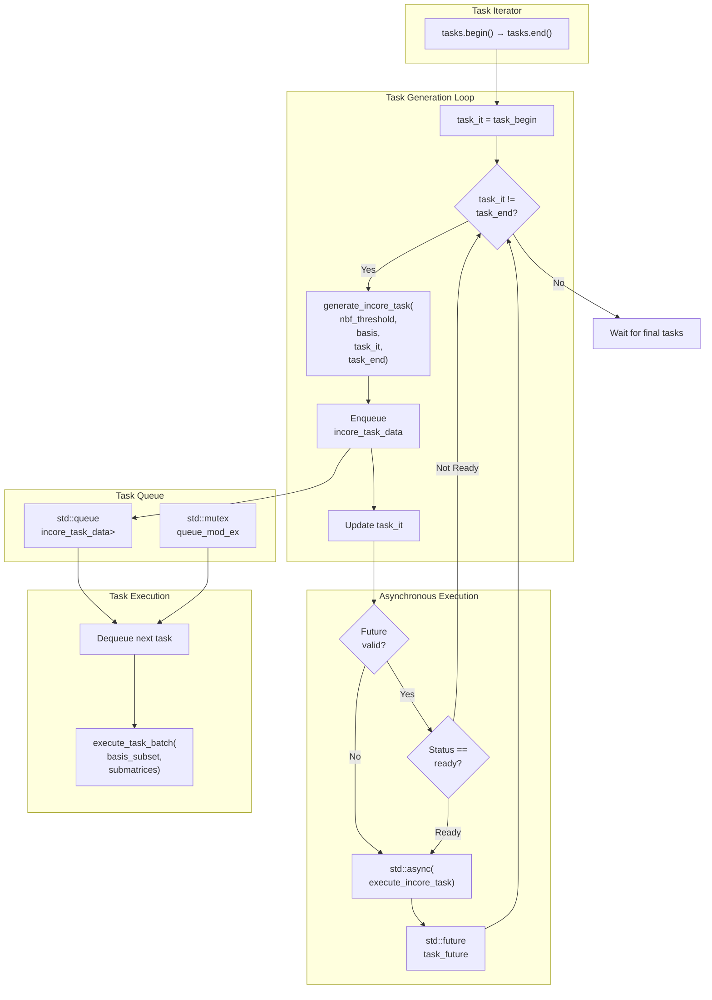
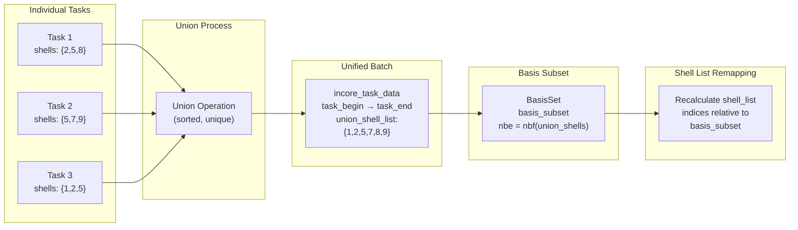
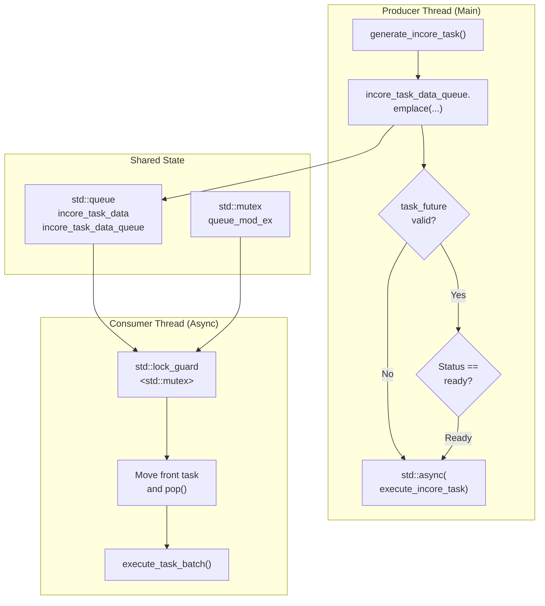
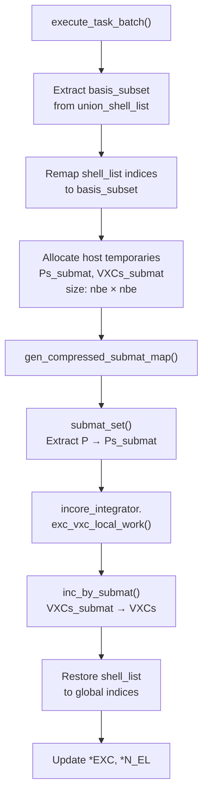

<!-- source: DeepWiki mcp.deepwiki.com · repo microsoft/skala · page 5.1 Task Batching Strategy · fetched 2026-10-26 -->

# Task Batching Strategy

<details>
<summary>Relevant source files</summary>

The following files were used as context for generating this wiki page:

- [third_party/gauxc/include/gauxc/xc_integrator/replicated/impl.hpp](third_party/gauxc/include/gauxc/xc_integrator/replicated/impl.hpp)
- [third_party/gauxc/src/xc_integrator/replicated/device/incore_replicated_xc_device_integrator_dd.hpp](third_party/gauxc/src/xc_integrator/replicated/device/incore_replicated_xc_device_integrator_dd.hpp)
- [third_party/gauxc/src/xc_integrator/replicated/host/reference_replicated_xc_host_integrator_dd_psi_potential.hpp](third_party/gauxc/src/xc_integrator/replicated/host/reference_replicated_xc_host_integrator_dd_psi_potential.hpp)
- [third_party/gauxc/src/xc_integrator/replicated/replicated_xc_integrator_impl.cxx](third_party/gauxc/src/xc_integrator/replicated/replicated_xc_integrator_impl.cxx)
- [third_party/gauxc/src/xc_integrator/shell_batched/shell_batched_replicated_xc_integrator_dd_psi.hpp](third_party/gauxc/src/xc_integrator/shell_batched/shell_batched_replicated_xc_integrator_dd_psi.hpp)
- [third_party/gauxc/src/xc_integrator/shell_batched/shell_batched_replicated_xc_integrator_dd_psi_potential.hpp](third_party/gauxc/src/xc_integrator/shell_batched/shell_batched_replicated_xc_integrator_dd_psi_potential.hpp)
- [third_party/gauxc/src/xc_integrator/shell_batched/shell_batched_replicated_xc_integrator_exc.hpp](third_party/gauxc/src/xc_integrator/shell_batched/shell_batched_replicated_xc_integrator_exc.hpp)
- [third_party/gauxc/src/xc_integrator/shell_batched/shell_batched_replicated_xc_integrator_exc_grad.hpp](third_party/gauxc/src/xc_integrator/shell_batched/shell_batched_replicated_xc_integrator_exc_grad.hpp)
- [third_party/gauxc/src/xc_integrator/shell_batched/shell_batched_replicated_xc_integrator_exc_vxc.hpp](third_party/gauxc/src/xc_integrator/shell_batched/shell_batched_replicated_xc_integrator_exc_vxc.hpp)
- [third_party/gauxc/src/xc_integrator/shell_batched/shell_batched_replicated_xc_integrator_exx.hpp](third_party/gauxc/src/xc_integrator/shell_batched/shell_batched_replicated_xc_integrator_exx.hpp)
- [third_party/gauxc/src/xc_integrator/shell_batched/shell_batched_replicated_xc_integrator_fxc_contraction.hpp](third_party/gauxc/src/xc_integrator/shell_batched/shell_batched_replicated_xc_integrator_fxc_contraction.hpp)
- [third_party/gauxc/src/xc_integrator/shell_batched/shell_batched_replicated_xc_integrator_integrate_den.hpp](third_party/gauxc/src/xc_integrator/shell_batched/shell_batched_replicated_xc_integrator_integrate_den.hpp)

</details>


## Purpose and Scope

This document describes the task batching strategy used in GauXC's shell-batched integration framework to group computational tasks and execute them asynchronously. The batching strategy reduces memory allocation overhead and enables efficient basis set extraction by combining multiple `XCTask` objects into unified batches.

For information about the overall shell batched integration framework, see [Shell Batched Integration](#5). For details on submatrix operations used during task execution, see [Submatrix Operations](#5.2).

## Overview

The task batching strategy addresses a key performance challenge: when processing many small integration tasks, individually extracting subbases and allocating memory for each task creates significant overhead. The solution groups tasks into batches where a unified "union shell list" combines all shells needed by the batch, allowing a single larger subbasis extraction followed by multiple task executions.

The batching strategy has three key components:

1. **Threshold-Based Grouping**: Tasks are grouped until the union shell list reaches a size threshold (`nbf_threshold = 8000` basis functions)
2. **Union Shell List Construction**: Shell lists from multiple tasks are combined into a unified list
3. **Asynchronous Producer-Consumer Pattern**: Task generation and execution overlap using futures and queues

**Sources**: [third_party/gauxc/src/xc_integrator/shell_batched/shell_batched_replicated_xc_integrator_exc_vxc.hpp:154-270]()

## Task Batching Flow



**Sources**: [third_party/gauxc/src/xc_integrator/shell_batched/shell_batched_replicated_xc_integrator_exc_vxc.hpp:234-269]()

## NBF Threshold and Task Grouping

### Threshold Value

The batching strategy uses a hardcoded threshold to control batch size:

```cpp
const uint32_t nbf_threshold = 8000;
```

This value represents the maximum number of basis functions (`nbf`) allowed in the union shell list for a batch. When `generate_incore_task` combines shell lists from consecutive tasks, it stops when adding another task would exceed this threshold.

### Rationale

The 8000 basis function threshold balances several competing factors:

| Factor | Impact of Larger Batches | Impact of Smaller Batches |
|--------|-------------------------|---------------------------|
| **Memory Usage** | Higher temporary storage for subbasis | Lower memory footprint |
| **Extraction Overhead** | Fewer `submat_set` calls | More frequent extractions |
| **Cache Efficiency** | May exceed L3 cache | Better cache locality |
| **Parallelism** | Fewer batches to overlap | More opportunities for async overlap |

**Sources**: [third_party/gauxc/src/xc_integrator/shell_batched/shell_batched_replicated_xc_integrator_exc_vxc.hpp:172]()

## Task Generation and Batching

### `incore_task_data` Structure

While not explicitly defined in the provided files, the structure contains:

- `task_begin`: Iterator to first task in batch
- `task_end`: Iterator to one-past-last task in batch  
- `shell_list`: Union of all shell lists from tasks in batch

### `generate_incore_task` Function

The function signature and usage pattern:

```cpp
incore_task_data generate_incore_task(
    uint32_t nbf_threshold,
    const basis_type& basis,
    host_task_iterator& task_it,
    host_task_iterator task_end
)
```

This function:
1. Starts with `task_it` pointing to the first task to include
2. Iterates forward, building a union shell list
3. Stops when adding the next task would exceed `nbf_threshold`
4. Returns an `incore_task_data` object with the batch and union shell list
5. Advances `task_it` to point past the last included task

**Sources**: [third_party/gauxc/src/xc_integrator/shell_batched/shell_batched_replicated_xc_integrator_exc_vxc.hpp:238-243]()

## Union Shell List Construction



### Shell List Unification

The `union_shell_list` is constructed by `generate_incore_task` to include all unique shells referenced by any task in the batch. This unified list serves two purposes:

1. **Basis Subset Extraction**: Create a minimal basis containing only shells needed by the batch
2. **Shell List Remapping**: Provide a mapping from global shell indices to local indices within the subset

### Basis Subset Construction

After generating a batch, `execute_task_batch` extracts the relevant subbasis:

```cpp
BasisSet<double> basis_subset; 
basis_subset.reserve(union_shell_list.size());
for( auto i : union_shell_list ) {
    basis_subset.emplace_back( basis.at(i) );
}
const size_t nbe = basis_subset.nbf();
```

This creates a compact basis containing exactly the shells needed for the batch, reducing the size of all subsequent operations.

**Sources**: [third_party/gauxc/src/xc_integrator/shell_batched/shell_batched_replicated_xc_integrator_exc_vxc.hpp:292-310]()

### Shell List Remapping

Each task's `shell_list` contains indices into the full `basis`. After creating `basis_subset`, these indices must be remapped to reference the subset:

```cpp
for( auto _it = task_begin; _it != task_end; ++_it ) {
    auto union_list_idx = 0;
    auto& cur_shell_list = _it->bfn_screening.shell_list;
    for( auto j = 0ul; j < cur_shell_list.size(); ++j ) {
        while( union_shell_list[union_list_idx] != cur_shell_list[j] )
            union_list_idx++;
        cur_shell_list[j] = union_list_idx;
    }
}
```

This algorithm:
1. For each task in the batch
2. For each shell index in the task's shell list
3. Find that shell's position in `union_shell_list`
4. Replace the global index with the position index

After batch processing, the shell lists are restored to global indices:

```cpp
for( auto _it = task_begin; _it != task_end; ++_it ) 
for( auto j = 0ul; j < _it->bfn_screening.shell_list.size(); ++j ) {
    _it->bfn_screening.shell_list[j] = 
        union_shell_list[_it->bfn_screening.shell_list[j]];
}
```

**Sources**: [third_party/gauxc/src/xc_integrator/shell_batched/shell_batched_replicated_xc_integrator_exc_vxc.hpp:313-323](), [third_party/gauxc/src/xc_integrator/shell_batched/shell_batched_replicated_xc_integrator_exc_vxc.hpp:432-437]()

## Asynchronous Producer-Consumer Pattern

### Queue and Synchronization Primitives



**Sources**: [third_party/gauxc/src/xc_integrator/shell_batched/shell_batched_replicated_xc_integrator_exc_vxc.hpp:201-232]()

### Producer: Main Thread

The main thread in `exc_vxc_local_work_` acts as the producer:

```cpp
std::queue<incore_task_data> incore_task_data_queue;
std::mutex queue_mod_ex;
std::future<void> task_future;

auto task_it = task_begin;
while( task_it != task_end ) {
    // Generate and enqueue task
    incore_task_data_queue.emplace(
        generate_incore_task( nbf_threshold, basis, task_it, task_end )
    );
    
    // Update iterator for next task generation
    task_it = incore_task_data_queue.back().task_end;
    
    if( not task_future.valid() ) {
        // Launch first async task
        task_future = std::async( std::launch::async, execute_incore_task );
    } else {
        // Check status with 5ms timeout
        auto status = task_future.wait_for( std::chrono::milliseconds(5) );
        if( status == std::future_status::ready ) {
            task_future.get();  // Retrieve result
            task_future = std::async( std::launch::async, execute_incore_task ); 
        }
    }
}
```

Key design features:

- **Non-blocking**: Uses `wait_for(5ms)` instead of blocking `wait()`
- **Overlap**: Task generation continues while async task executes
- **Exception Safety**: `task_future.get()` propagates exceptions from async thread

**Sources**: [third_party/gauxc/src/xc_integrator/shell_batched/shell_batched_replicated_xc_integrator_exc_vxc.hpp:234-258]()

### Consumer: Async Thread

The `execute_incore_task` lambda runs in async threads:

```cpp
auto execute_incore_task = [&]() {
    if( incore_task_data_queue.empty() ) return;
    
    incore_task_data next_task;
    {
        std::lock_guard<std::mutex> lock(queue_mod_ex);
        next_task = std::move( incore_task_data_queue.front() );
        incore_task_data_queue.pop();
    }
    
    execute_task_batch( next_task, basis, mol, Ps, ldps, Pz, ldpz,
        Py, ldpy, Px, ldpx, VXCs, ldvxcs, VXCz, ldvxcz, VXCy, ldvxcy,
        VXCx, ldvxcx, EXC, N_EL, incore_integrator );
};
```

The lock scope is minimized to only cover queue access, allowing `execute_task_batch` to run without holding the mutex.

**Sources**: [third_party/gauxc/src/xc_integrator/shell_batched/shell_batched_replicated_xc_integrator_exc_vxc.hpp:208-227]()

### Cleanup Phase

After the main loop completes, remaining tasks are executed sequentially:

```cpp
if( task_future.valid() ) {
    task_future.wait();
    task_future.get(); // Propagate trailing exceptions
}
while( not incore_task_data_queue.empty() ) {
    execute_incore_task();
}
```

This ensures all queued tasks complete before returning.

**Sources**: [third_party/gauxc/src/xc_integrator/shell_batched/shell_batched_replicated_xc_integrator_exc_vxc.hpp:263-269]()

## Task Batch Execution

### Execution Flow



**Sources**: [third_party/gauxc/src/xc_integrator/shell_batched/shell_batched_replicated_xc_integrator_exc_vxc.hpp:276-439]()

### Memory Allocation

For a batch with `nbe` basis functions in the subset:

| Array | Size | Purpose |
|-------|------|---------|
| `Ps_submat` | `nbe × nbe` | Scalar density submatrix |
| `Pz_submat` | `nbe × nbe` | Spin-z density (UKS/GKS) |
| `Py_submat` | `nbe × nbe` | Spin-y density (GKS) |
| `Px_submat` | `nbe × nbe` | Spin-x density (GKS) |
| `VXCs_submat` | `nbe × nbe` | Scalar potential accumulator |
| `VXCz_submat` | `nbe × nbe` | Spin-z potential (UKS/GKS) |
| `VXCy_submat` | `nbe × nbe` | Spin-y potential (GKS) |
| `VXCx_submat` | `nbe × nbe` | Spin-x potential (GKS) |

These allocations are much smaller than the full `nbf × nbf` matrices, reducing memory traffic.

**Sources**: [third_party/gauxc/src/xc_integrator/shell_batched/shell_batched_replicated_xc_integrator_exc_vxc.hpp:327-363]()

### Submatrix Operations

The compressed submatrix map (`union_submat_cut`) defines how to extract blocks:

```cpp
std::vector<std::array<int32_t,3>> union_submat_cut;
std::tie(union_submat_cut, std::ignore) = 
    gen_compressed_submat_map( basis_map, union_shell_list, 
        basis.nbf(), basis.nbf() );
```

Each element `[row_start, col_start, block_size]` defines a contiguous block to extract or increment.

**Extraction** (full → sub):
```cpp
detail::submat_set( basis.nbf(), basis.nbf(), nbe, nbe, 
    Ps, ldps, Ps_submat, nbe, union_submat_cut );
```

**Increment** (sub → full):
```cpp
detail::inc_by_submat( basis.nbf(), basis.nbf(), nbe, nbe, 
    VXCs, ldvxcs, VXCs_submat, nbe, union_submat_cut );
```

**Sources**: [third_party/gauxc/src/xc_integrator/shell_batched/shell_batched_replicated_xc_integrator_exc_vxc.hpp:367-387](), [third_party/gauxc/src/xc_integrator/shell_batched/shell_batched_replicated_xc_integrator_exc_vxc.hpp:412-428]()

### Delegation to Incore Integrator

The actual XC integration is delegated to the appropriate incore integrator:

```cpp
#ifdef GAUXC_HAS_DEVICE
if constexpr (IncoreIntegratorType::is_device) {
    incore_integrator.exc_vxc_local_work( 
        basis_subset, Ps_submat, nbe, 
        Pz_submat, nbe, Py_submat, nbe, Px_submat, nbe, 
        VXCs_submat, nbe, VXCz_submat, nbe, 
        VXCy_submat, nbe, VXCx_submat, nbe,
        &EXC_tmp, &NEL_tmp, task_begin, task_end, *device_data_ptr_ );
} else
#endif
{
    incore_integrator.exc_vxc_local_work( 
        basis_subset, Ps_submat, nbe, 
        Pz_submat, nbe, Py_submat, nbe, Px_submat, nbe,
        VXCs_submat, nbe, VXCz_submat, nbe, 
        VXCy_submat, nbe, VXCx_submat, nbe,
        &EXC_tmp, &NEL_tmp, IntegratorSettingsKS{}, task_begin, task_end );
}
```

The device path receives a `device_data_ptr_` for GPU memory management, while the host path does not.

**Sources**: [third_party/gauxc/src/xc_integrator/shell_batched/shell_batched_replicated_xc_integrator_exc_vxc.hpp:391-406]()

## Performance Considerations

### Benefits of Task Batching

| Aspect | Without Batching | With Batching |
|--------|-----------------|---------------|
| **Basis Extractions** | One per task | One per batch (~10-100× fewer) |
| **Memory Allocations** | `N_tasks × nbf²` | `N_batches × nbe²` (nbe ≪ nbf) |
| **Shell List Updates** | Once per task | Twice per batch (remap + restore) |
| **Cache Efficiency** | Poor (full matrix) | Better (smaller submatrix) |
| **Async Overlap** | Not possible | Task generation overlaps execution |

### Tuning Considerations

The `nbf_threshold = 8000` value may need adjustment based on:

- **System Size**: Larger molecules may benefit from smaller thresholds
- **Basis Set**: Larger basis sets increase `nbe` per shell
- **Hardware**: GPU execution may prefer larger batches to amortize kernel launch overhead
- **Memory**: Constrained systems may need smaller thresholds

**Sources**: [third_party/gauxc/src/xc_integrator/shell_batched/shell_batched_replicated_xc_integrator_exc_vxc.hpp:172]()

## Key Data Structures

### `incore_task_data`

```
struct incore_task_data {
    host_task_iterator task_begin;      // First task in batch
    host_task_iterator task_end;        // One-past-last task
    std::vector<int32_t> shell_list;    // Union shell list
};
```

### Task Queue Components

| Component | Type | Purpose |
|-----------|------|---------|
| `incore_task_data_queue` | `std::queue<incore_task_data>` | FIFO queue of batches |
| `queue_mod_ex` | `std::mutex` | Protects queue access |
| `task_future` | `std::future<void>` | Tracks async execution |

### Execution Context

The `execute_task_batch` function receives extensive context:

- **Basis Information**: `basis`, `mol`, `basis_subset`, `union_shell_list`
- **Input Matrices**: `Ps`, `Pz`, `Py`, `Px` (full size `nbf × nbf`)
- **Output Matrices**: `VXCs`, `VXCz`, `VXCy`, `VXCx` (full size `nbf × nbf`)
- **Scalars**: `EXC`, `N_EL` (accumulated energy and electron count)
- **Integrator**: `incore_integrator` (host or device integrator instance)

**Sources**: [third_party/gauxc/src/xc_integrator/shell_batched/shell_batched_replicated_xc_integrator_exc_vxc.hpp:276-286]()

---

