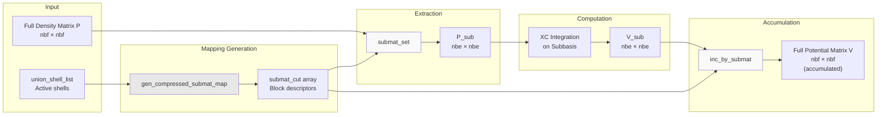
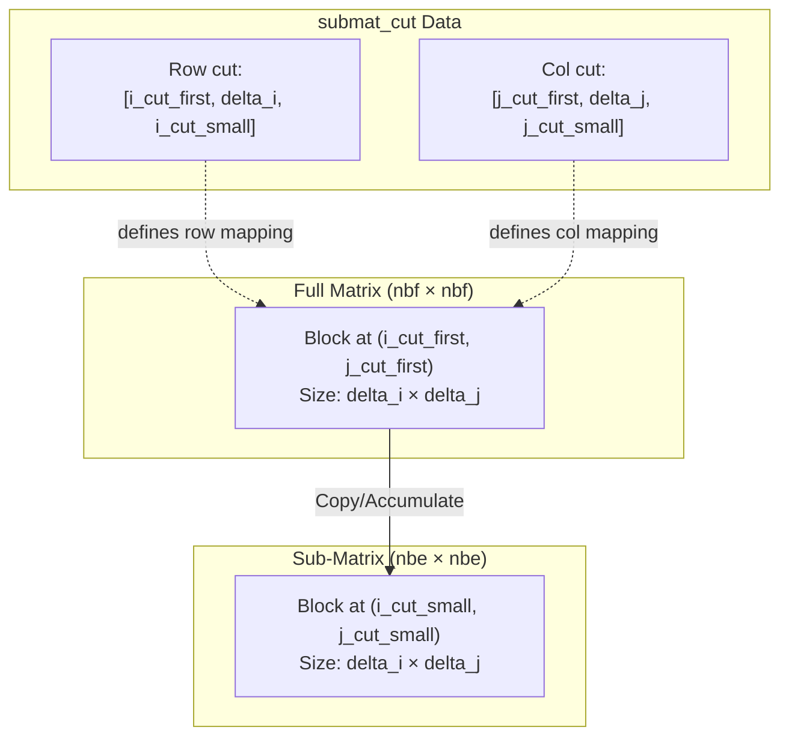
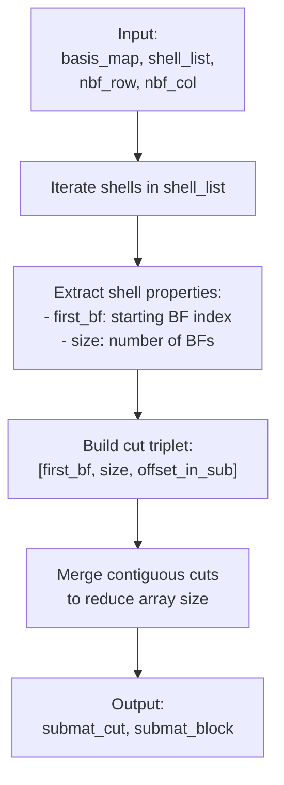
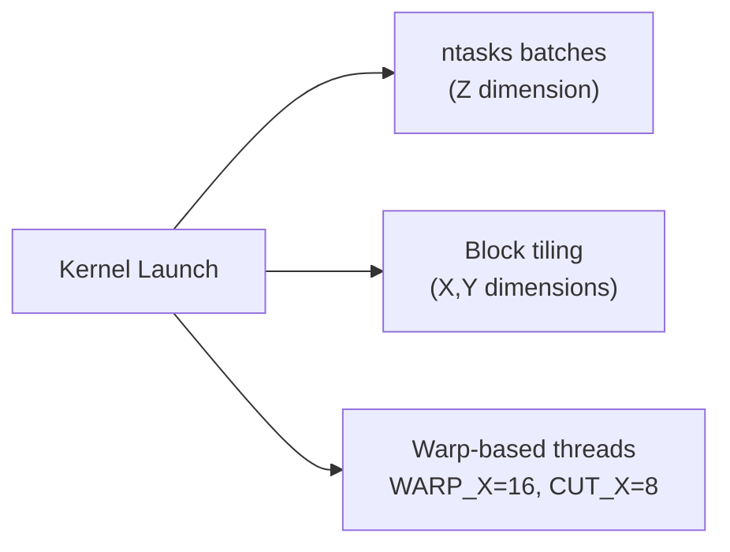
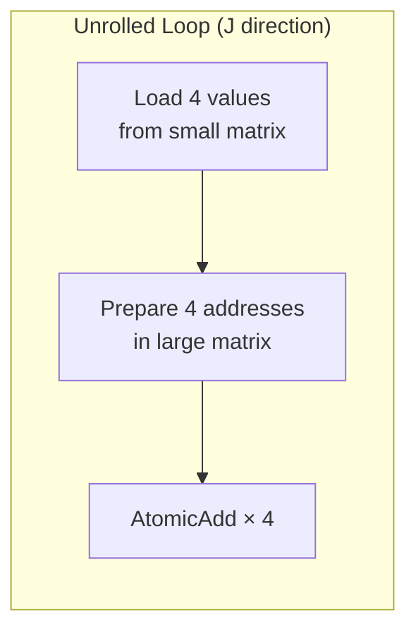
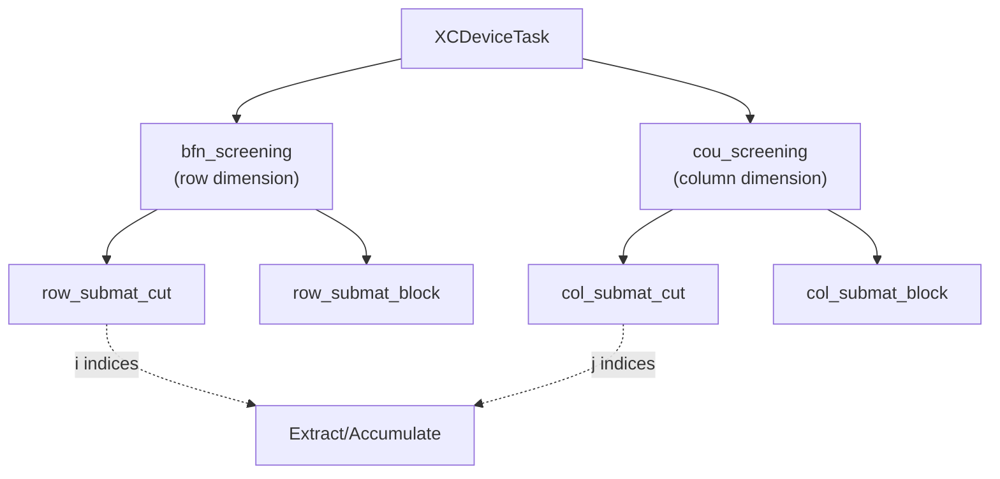
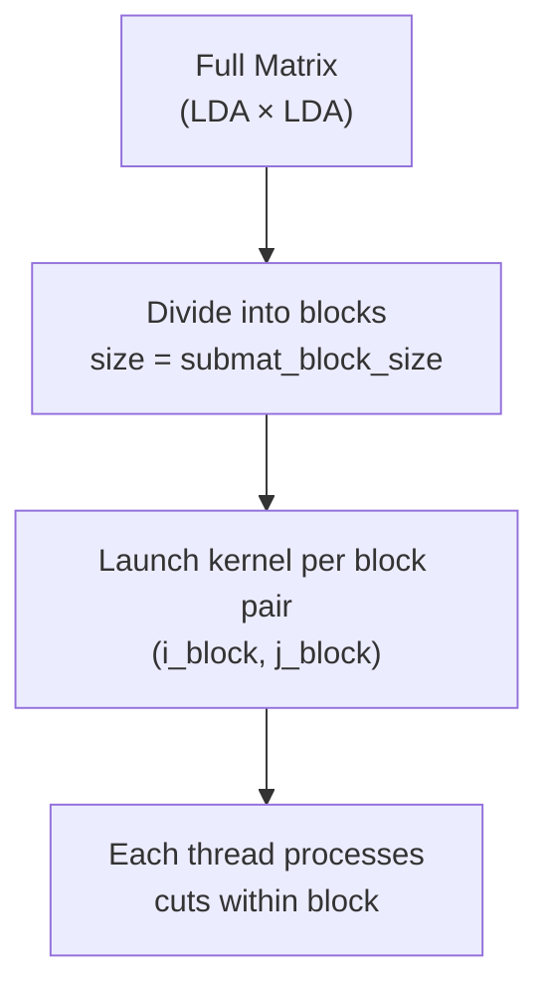
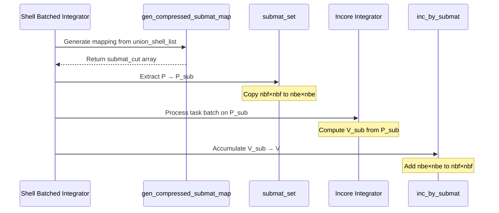
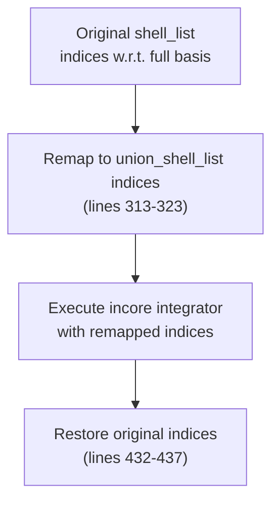

<!-- source: DeepWiki mcp.deepwiki.com · repo microsoft/skala · page 5.2 Submatrix Operations · fetched 2026-10-26 -->

# Submatrix Operations

<details>
<summary>Relevant source files</summary>

The following files were used as context for generating this wiki page:

- [third_party/gauxc/attic/src/integrator/cuda/cuda_pack_density.cu](third_party/gauxc/attic/src/integrator/cuda/cuda_pack_density.cu)
- [third_party/gauxc/attic/src/new_integrator/device/cuda/cuda_inc_potential.cu](third_party/gauxc/attic/src/new_integrator/device/cuda/cuda_inc_potential.cu)
- [third_party/gauxc/attic/src/new_integrator/device/cuda/cuda_pack_density.cu](third_party/gauxc/attic/src/new_integrator/device/cuda/cuda_pack_density.cu)
- [third_party/gauxc/attic/src/new_integrator/device/hip/hip_inc_potential.hip](third_party/gauxc/attic/src/new_integrator/device/hip/hip_inc_potential.hip)
- [third_party/gauxc/attic/src/new_integrator/device/hip/hip_pack_density.hip](third_party/gauxc/attic/src/new_integrator/device/hip/hip_pack_density.hip)
- [third_party/gauxc/include/gauxc/xc_integrator/replicated/impl.hpp](third_party/gauxc/include/gauxc/xc_integrator/replicated/impl.hpp)
- [third_party/gauxc/src/xc_integrator/local_work_driver/device/cuda/kernels/cuda_inc_potential.cu](third_party/gauxc/src/xc_integrator/local_work_driver/device/cuda/kernels/cuda_inc_potential.cu)
- [third_party/gauxc/src/xc_integrator/local_work_driver/device/cuda/kernels/pack_submat.cu](third_party/gauxc/src/xc_integrator/local_work_driver/device/cuda/kernels/pack_submat.cu)
- [third_party/gauxc/src/xc_integrator/local_work_driver/device/hip/kernels/hip_inc_potential.hip](third_party/gauxc/src/xc_integrator/local_work_driver/device/hip/kernels/hip_inc_potential.hip)
- [third_party/gauxc/src/xc_integrator/local_work_driver/device/hip/kernels/pack_submat.hip](third_party/gauxc/src/xc_integrator/local_work_driver/device/hip/kernels/pack_submat.hip)
- [third_party/gauxc/src/xc_integrator/replicated/device/incore_replicated_xc_device_integrator_dd.hpp](third_party/gauxc/src/xc_integrator/replicated/device/incore_replicated_xc_device_integrator_dd.hpp)
- [third_party/gauxc/src/xc_integrator/replicated/host/reference_replicated_xc_host_integrator_dd_psi_potential.hpp](third_party/gauxc/src/xc_integrator/replicated/host/reference_replicated_xc_host_integrator_dd_psi_potential.hpp)
- [third_party/gauxc/src/xc_integrator/replicated/replicated_xc_integrator_impl.cxx](third_party/gauxc/src/xc_integrator/replicated/replicated_xc_integrator_impl.cxx)
- [third_party/gauxc/src/xc_integrator/shell_batched/shell_batched_replicated_xc_integrator_dd_psi.hpp](third_party/gauxc/src/xc_integrator/shell_batched/shell_batched_replicated_xc_integrator_dd_psi.hpp)
- [third_party/gauxc/src/xc_integrator/shell_batched/shell_batched_replicated_xc_integrator_dd_psi_potential.hpp](third_party/gauxc/src/xc_integrator/shell_batched/shell_batched_replicated_xc_integrator_dd_psi_potential.hpp)
- [third_party/gauxc/src/xc_integrator/shell_batched/shell_batched_replicated_xc_integrator_exc.hpp](third_party/gauxc/src/xc_integrator/shell_batched/shell_batched_replicated_xc_integrator_exc.hpp)
- [third_party/gauxc/src/xc_integrator/shell_batched/shell_batched_replicated_xc_integrator_exc_grad.hpp](third_party/gauxc/src/xc_integrator/shell_batched/shell_batched_replicated_xc_integrator_exc_grad.hpp)
- [third_party/gauxc/src/xc_integrator/shell_batched/shell_batched_replicated_xc_integrator_exc_vxc.hpp](third_party/gauxc/src/xc_integrator/shell_batched/shell_batched_replicated_xc_integrator_exc_vxc.hpp)
- [third_party/gauxc/src/xc_integrator/shell_batched/shell_batched_replicated_xc_integrator_exx.hpp](third_party/gauxc/src/xc_integrator/shell_batched/shell_batched_replicated_xc_integrator_exx.hpp)
- [third_party/gauxc/src/xc_integrator/shell_batched/shell_batched_replicated_xc_integrator_fxc_contraction.hpp](third_party/gauxc/src/xc_integrator/shell_batched/shell_batched_replicated_xc_integrator_fxc_contraction.hpp)
- [third_party/gauxc/src/xc_integrator/shell_batched/shell_batched_replicated_xc_integrator_integrate_den.hpp](third_party/gauxc/src/xc_integrator/shell_batched/shell_batched_replicated_xc_integrator_integrate_den.hpp)

</details>


## Purpose and Scope

Submatrix operations enable efficient extraction and accumulation of matrix data when working with a reduced basis set. In the shell batching strategy (see [Task Batching Strategy](#5.1)), computational tasks operate on a subset of the full basis functions defined by a `union_shell_list`. Rather than working with the full density matrix **P** (nbf × nbf) and potential matrix **V** (nbf × nbf), these operations extract relevant submatrices **P_sub** (nbe × nbe) for computation, then accumulate results back to the full matrices.

This page documents the `submat_set` extraction operation, the `inc_by_submat` accumulation operation, and the `submat_map` data structure that enables efficient mapping between full and reduced matrix spaces. For information about how tasks are generated and batched, see [Task Batching Strategy](#5.1).

---

## Computational Pattern

### Extract-Compute-Accumulate Workflow



**Figure 1: Submatrix Extract-Compute-Accumulate Pattern**

The workflow operates in three stages:

1. **Mapping Generation**: `gen_compressed_submat_map` generates a compressed map from `union_shell_list`
2. **Extraction**: `submat_set` copies elements from full matrix **P** to sub-matrix **P_sub**
3. **Accumulation**: `inc_by_submat` adds elements from **V_sub** back to full matrix **V**

Sources: [shell_batched_replicated_xc_integrator_exc_vxc.hpp:367-428]()

---

## Data Structures

### submat_cut Array

The `submat_cut` array is a compressed representation of the mapping between full and sub-matrix indices. Each block is described by three integers:

| Field | Type | Description |
|-------|------|-------------|
| `i_cut_first` | `int32_t` | Starting index in full matrix |
| `delta_i` | `int32_t` | Number of contiguous elements |
| `i_cut_small` | `int32_t` | Starting index in sub-matrix |

The array is stored as a flat buffer with 3 integers per cut: `[i_cut_first, delta_i, i_cut_small, ...]`. For a matrix operation, both row and column dimensions have their own cut descriptors, so a 2D block is defined by a pair of cuts.



**Figure 2: submat_cut Block Mapping**

Sources: [cuda/cuda_inc_potential.cu:52-63](), [pack_submat.cu:58-67]()

---

### submat_block Array

The `submat_block` array provides a hierarchical tiling structure to enable efficient block-based kernel launches on GPUs. It divides the `submat_cut` array into blocks of cuts.

```
submat_block[i] = starting index in submat_cut for block i
submat_block[i+1] = ending index (exclusive) for block i
```

This enables launching kernels over blocks of cuts rather than individual cuts, improving GPU occupancy and reducing launch overhead.

Sources: [pack_submat.cu:46-55](), [cuda_inc_potential.cu:46-51]()

---

### Mapping Generation

The `gen_compressed_submat_map` function generates the `submat_cut` array from a `shell_list` and `BasisSetMap`:



**Figure 3: Submatrix Map Generation**

The function creates one `submat_cut` entry for each contiguous block of basis functions in the shell list. Contiguous shells are merged to minimize the number of cuts.

Sources: [shell_batched_replicated_xc_integrator_exc_vxc.hpp:367-371]()

---

## Host Operations

### submat_set Function

The `detail::submat_set` function extracts elements from a large matrix into a smaller matrix according to the `submat_cut` mapping.

**Function Signature:**
```cpp
void submat_set(int64_t M_large, int64_t N_large,
                int64_t M_small, int64_t N_small,
                const double* A_large, int64_t LDA,
                double* A_small, int64_t LDAS,
                const std::vector<std::array<int32_t,3>>& submat_cut);
```

**Operation:**
- **A_large**: Source matrix (M_large × N_large)
- **A_small**: Destination matrix (M_small × N_small)
- **LDA, LDAS**: Leading dimensions
- **submat_cut**: Array of [first, delta, small] triplets

For each row cut `i_cut` and column cut `j_cut`:
```
A_small[i_cut_small : i_cut_small+delta_i, 
        j_cut_small : j_cut_small+delta_j] 
  = 
A_large[i_cut_first : i_cut_first+delta_i,
        j_cut_first : j_cut_first+delta_j]
```

Sources: [shell_batched_replicated_xc_integrator_exc_vxc.hpp:373-387]()

---

### inc_by_submat Function

The `detail::inc_by_submat` function accumulates elements from a small matrix into a larger matrix, performing the inverse of `submat_set`.

**Function Signature:**
```cpp
void inc_by_submat(int64_t M_large, int64_t N_large,
                   int64_t M_small, int64_t N_small,
                   double* A_large, int64_t LDA,
                   const double* A_small, int64_t LDAS,
                   const std::vector<std::array<int32_t,3>>& submat_cut);
```

**Operation:**
For each row cut `i_cut` and column cut `j_cut`:
```
A_large[i_cut_first : i_cut_first+delta_i,
        j_cut_first : j_cut_first+delta_j] 
  += 
A_small[i_cut_small : i_cut_small+delta_i, 
        j_cut_small : j_cut_small+delta_j]
```

The host implementation may use atomic operations when accumulating in multi-threaded contexts.

Sources: [shell_batched_replicated_xc_integrator_exc_vxc.hpp:412-428](), [reference_replicated_xc_host_integrator_dd_psi_potential.hpp:160-161]()

---

## Device Operations

GPU implementations provide both symmetric and asymmetric variants with optimized memory access patterns.

### Symmetric Pack and Increment

#### sym_pack_submat Kernel

**Launch Configuration:**


**Figure 4: GPU Kernel Launch Structure**

The `sym_pack_submat` kernel extracts density matrix elements:

**Key Parameters:**
- **ntasks**: Number of tasks to process in parallel
- **device_tasks**: Array of `XCDeviceTask` structures
- **A**: Source matrix (full density)
- **LDA**: Leading dimension of A
- **submat_block_size**: Block size for tiling

**Thread Organization:**
- `blockIdx.z`: Task index
- `threadIdx.x % WARP_X`: Column index within warp (WARP_X=16)
- `threadIdx.y % CUT_X`: Row cut index (CUT_X=8)

Sources: [pack_submat.cu:109-124](), [pack_submat.cu:22-102]()

---

#### sym_task_inc_potential Kernel

The increment kernel performs the inverse operation, accumulating sub-matrix results back to the full potential matrix using atomic operations.

**Atomic Accumulation:**
```cpp
atomicAdd(ABig_begin + I + J*LDA, ASmall_begin[I + J*LDAS]);
```

The use of `atomicAdd` ensures thread-safe accumulation when multiple threads write to overlapping regions of the full matrix.

**Loop Unrolling:**
The kernel uses an unrolling factor of 4 (`UNROLL_FACTOR=4`) to improve instruction-level parallelism:



**Figure 5: Loop Unrolling in Increment Kernel**

Sources: [cuda_inc_potential.cu:97-117](), [cuda_inc_potential.cu:25-94]()

---

### Asymmetric Pack and Increment

For exact exchange (EXX) calculations and other asymmetric cases, separate row and column screening may apply different shell lists to rows and columns.

#### asym_pack_submat Kernel

Uses separate `submat_cut` arrays for rows and columns:

| Field | Description |
|-------|-------------|
| `task.bfn_screening.submat_cut` | Row basis function screening |
| `task.cou_screening.submat_cut` | Column Coulomb screening |



**Figure 6: Asymmetric Screening Structure**

Sources: [pack_submat.cu:134-239](), [cuda_inc_potential.cu:123-218]()

---

#### asym_task_inc_potential Kernel

Mirrors the asymmetric pack operation but accumulates with atomic operations:

```cpp
// Row cuts from bfn_screening
const auto* row_submat_cut_device = task.bfn_screening.submat_cut;
// Column cuts from cou_screening  
const auto* col_submat_cut_device = task.cou_screening.submat_cut;
```

This enables independent screening in row and column dimensions, which is essential for exact exchange calculations where Coulomb screening may differ from basis function screening.

Sources: [cuda_inc_potential.cu:123-218]()

---

## Memory Optimization Techniques

### Block Tiling Strategy

The block tiling approach divides large matrices into manageable blocks to:

1. **Reduce kernel launch overhead**: Launch over blocks rather than individual cuts
2. **Improve cache locality**: Process spatially coherent regions
3. **Enable concurrent execution**: Multiple blocks can execute in parallel



**Figure 7: Block Tiling Strategy**

The number of kernel launches is `n_launch × n_launch` where:
```
n_launch = div_ceil(LDA, submat_block_size)
```

Sources: [pack_submat.cu:117-124](), [cuda_inc_potential.cu:109-117]()

---

### Vectorized Memory Access

The CUDA kernels use vectorized loads and stores with unrolling to maximize memory bandwidth:

```cpp
#define WARP_X 16       // Threads in X dimension
#define WARP_Y 1        // Threads in Y dimension  
#define UNROLL_FACTOR 4 // Loop unrolling factor
#define EFF_UNROLL 4    // Effective unroll
```

**Memory Access Pattern:**
- Load/store 4 doubles per thread per iteration
- Use `double2` vectorized loads where applicable
- Cache streaming hint with `__stcs` (CUDA 11.0+) to suggest eviction

Sources: [pack_submat.cu:15-20](), [cuda_pack_density.cu:13-18]()

---

### HIP vs CUDA Implementation Differences

| Aspect | CUDA | HIP |
|--------|------|-----|
| **Stream Type** | `cudaStream_t` | `hipStream_t` |
| **Launch Syntax** | `kernel<<<blocks,threads,smem,stream>>>()` | `hipLaunchKernelGGL(kernel, blocks, threads, smem, stream, ...)` |
| **Vectorized Store** | `__stcs(addr, val)` | `__stcs(addr, val)` (HIP 11000+) |
| **Atomic Operations** | `atomicAdd` | `atomicAdd` (identical) |
| **Warp Size** | 32 (NVIDIA) | 64 (AMD) |

The HIP implementation in [pack_submat.hip:70-78]() and [hip_inc_potential.hip:65-80]() uses a simpler thread organization without the CUDA-optimized block tiling for submat_block.

Sources: [pack_submat.hip:1-81](), [hip_inc_potential.hip:1-85]()

---

## Integration in Shell Batching

### Task Execution Flow

The shell batched integrator uses submatrix operations within the `execute_task_batch` function:



**Figure 8: Submatrix Operations in Task Execution**

Sources: [shell_batched_replicated_xc_integrator_exc_vxc.hpp:275-439]()

---

### Shell List Transformation

During task execution, shell lists are temporarily remapped to reference the subbasis:



**Figure 9: Shell List Remapping**

The remapping process:
1. **Before computation**: Map each shell index from full basis to union_shell_list index
2. **During computation**: Use remapped indices with subbasis
3. **After computation**: Restore original indices for next task batch

Sources: [shell_batched_replicated_xc_integrator_exc_vxc.hpp:313-323](), [shell_batched_replicated_xc_integrator_exc_vxc.hpp:432-437]()

---

## Performance Considerations

### When to Use Submatrix Operations

Submatrix extraction provides performance benefits when:

| Condition | Benefit |
|-----------|---------|
| `nbe << nbf` | Reduced memory footprint |
| Sparse shell lists | Better cache utilization |
| GPU execution | Fewer data transfers |
| Multiple tasks with overlapping shells | Amortized extraction cost |

The threshold `nbf_threshold = 8000` (line 172) determines when shell batching is activated. For smaller basis sets, the overhead of submatrix operations may exceed the benefit.

Sources: [shell_batched_replicated_xc_integrator_exc_vxc.hpp:172]()

---

### Memory Savings

For a task with `nbe` active basis functions out of `nbf` total:

**Memory per matrix:**
- Full matrix: `nbf × nbf × sizeof(double)` bytes
- Sub-matrix: `nbe × nbe × sizeof(double)` bytes
- Savings ratio: `1 - (nbe/nbf)²`

**Example:** For `nbf=1000`, `nbe=100`:
- Full: 8 MB per matrix
- Sub: 80 KB per matrix  
- Savings: 99%

Sources: [shell_batched_replicated_xc_integrator_exc_vxc.hpp:295-363]()

---

## Summary Tables

### Function Reference

| Function | Location | Purpose |
|----------|----------|---------|
| `gen_compressed_submat_map` | Host utility | Generate submat_cut from shell_list |
| `submat_set` | Host | Extract full → sub matrix |
| `inc_by_submat` | Host | Accumulate sub → full matrix |
| `sym_pack_submat` | CUDA/HIP | GPU extract (symmetric) |
| `asym_pack_submat` | CUDA/HIP | GPU extract (asymmetric) |
| `sym_task_inc_potential` | CUDA/HIP | GPU accumulate (symmetric) |
| `asym_task_inc_potential` | CUDA/HIP | GPU accumulate (asymmetric) |

Sources: [shell_batched_replicated_xc_integrator_exc_vxc.hpp:367-428](), [pack_submat.cu:109-239](), [cuda_inc_potential.cu:97-218]()

---

### Kernel Constants

| Constant | Value | Purpose |
|----------|-------|---------|
| `WARP_X` | 16 | Thread block width |
| `WARP_Y` | 1 | Thread block height |
| `CUT_X` | 8 | Cut processing in X |
| `CUT_Y` | 8 | Cut processing in Y |
| `UNROLL_FACTOR` | 4 | Loop unroll count |

Sources: [pack_submat.cu:15-20](), [cuda_inc_potential.cu:14-22]()

---

