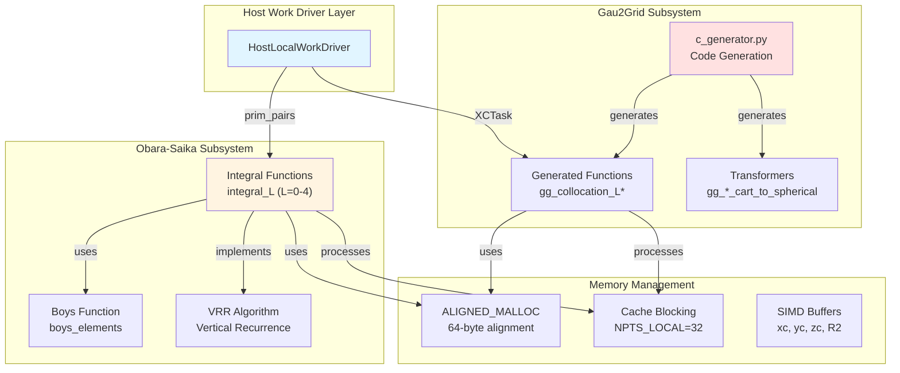
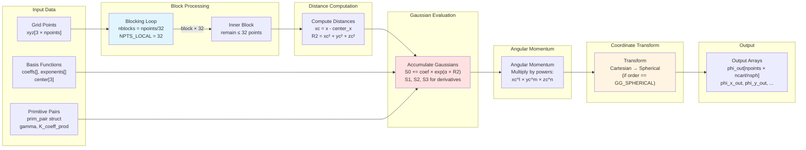
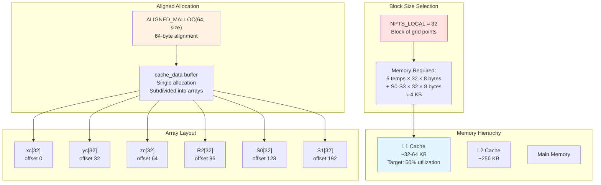
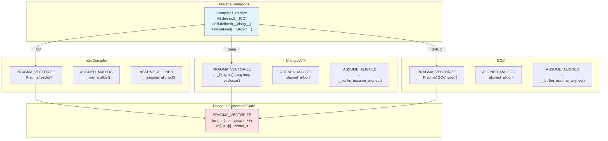
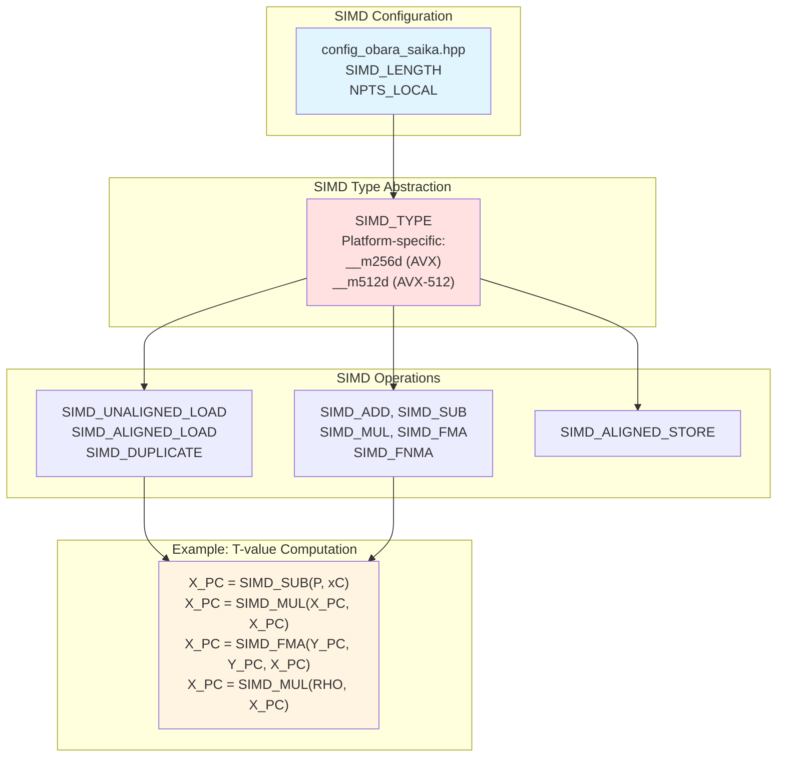
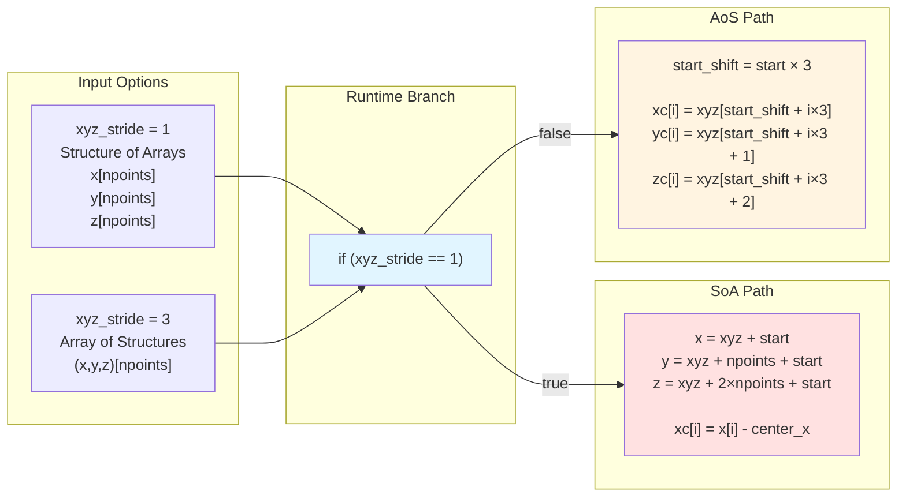
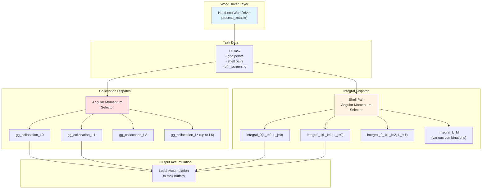

<!-- source: DeepWiki mcp.deepwiki.com · repo microsoft/skala · page 6 Host Computation · fetched 2026-10-26 -->

# Host Computation

<details>
<summary>Relevant source files</summary>

The following files were used as context for generating this wiki page:

- [third_party/gauxc/external/gau2grid/generated_source/gau2grid/gau2grid_pragma.h](third_party/gauxc/external/gau2grid/generated_source/gau2grid/gau2grid_pragma.h)
- [third_party/gauxc/external/gau2grid/generated_source/gau2grid_deriv1.c](third_party/gauxc/external/gau2grid/generated_source/gau2grid_deriv1.c)
- [third_party/gauxc/external/gau2grid/generated_source/gau2grid_deriv2.c](third_party/gauxc/external/gau2grid/generated_source/gau2grid_deriv2.c)
- [third_party/gauxc/external/gau2grid/generated_source/gau2grid_deriv3.c](third_party/gauxc/external/gau2grid/generated_source/gau2grid_deriv3.c)
- [third_party/gauxc/external/gau2grid/generated_source/gau2grid_phi.c](third_party/gauxc/external/gau2grid/generated_source/gau2grid_phi.c)
- [third_party/gauxc/external/gau2grid/src/gau2grid/c_generator.py](third_party/gauxc/external/gau2grid/src/gau2grid/c_generator.py)
- [third_party/gauxc/external/gau2grid/src/gau2grid/c_pragma.py](third_party/gauxc/external/gau2grid/src/gau2grid/c_pragma.py)
- [third_party/gauxc/src/xc_integrator/local_work_driver/host/obara_saika/src/integral_0.cxx](third_party/gauxc/src/xc_integrator/local_work_driver/host/obara_saika/src/integral_0.cxx)
- [third_party/gauxc/src/xc_integrator/local_work_driver/host/obara_saika/src/integral_1.cxx](third_party/gauxc/src/xc_integrator/local_work_driver/host/obara_saika/src/integral_1.cxx)
- [third_party/gauxc/src/xc_integrator/local_work_driver/host/obara_saika/src/integral_2.cxx](third_party/gauxc/src/xc_integrator/local_work_driver/host/obara_saika/src/integral_2.cxx)
- [third_party/gauxc/src/xc_integrator/local_work_driver/host/obara_saika/src/integral_2_1.cxx](third_party/gauxc/src/xc_integrator/local_work_driver/host/obara_saika/src/integral_2_1.cxx)
- [third_party/gauxc/src/xc_integrator/local_work_driver/host/obara_saika/src/integral_2_2.cxx](third_party/gauxc/src/xc_integrator/local_work_driver/host/obara_saika/src/integral_2_2.cxx)
- [third_party/gauxc/src/xc_integrator/local_work_driver/host/obara_saika/src/integral_3.cxx](third_party/gauxc/src/xc_integrator/local_work_driver/host/obara_saika/src/integral_3.cxx)
- [third_party/gauxc/src/xc_integrator/local_work_driver/host/obara_saika/src/integral_3_2.cxx](third_party/gauxc/src/xc_integrator/local_work_driver/host/obara_saika/src/integral_3_2.cxx)
- [third_party/gauxc/src/xc_integrator/local_work_driver/host/obara_saika/src/integral_4.cxx](third_party/gauxc/src/xc_integrator/local_work_driver/host/obara_saika/src/integral_4.cxx)
- [third_party/gauxc/src/xc_integrator/local_work_driver/host/obara_saika/src/integral_4_0.cxx](third_party/gauxc/src/xc_integrator/local_work_driver/host/obara_saika/src/integral_4_0.cxx)
- [third_party/gauxc/src/xc_integrator/local_work_driver/host/obara_saika/src/integral_4_1.cxx](third_party/gauxc/src/xc_integrator/local_work_driver/host/obara_saika/src/integral_4_1.cxx)
- [third_party/gauxc/src/xc_integrator/local_work_driver/host/obara_saika/src/integral_4_3.cxx](third_party/gauxc/src/xc_integrator/local_work_driver/host/obara_saika/src/integral_4_3.cxx)

</details>


## Purpose and Scope

This page provides an overview of GauXC's CPU-based computation paths for evaluating exchange-correlation integrals on the host processor. Host computation serves as an alternative to GPU-based computation (see [Device Computation](#7)) and is selected at runtime based on build configuration and available hardware.

The host computation system consists of two primary subsystems:
- **Gau2Grid collocation** for evaluating Gaussian basis functions at grid points (detailed in [Gau2Grid Collocation System](#6.1))
- **Obara-Saika integral evaluation** for computing electron repulsion integrals (detailed in [Obara-Saika Integral Evaluation](#6.2))

Both subsystems employ aggressive SIMD vectorization, cache-aware blocking strategies, and aligned memory allocation to maximize CPU performance.

**Sources:** [third_party/gauxc/external/gau2grid/src/gau2grid/c_generator.py:1-316](), [third_party/gauxc/src/xc_integrator/local_work_driver/host/obara_saika/src/integral_0.cxx:1-50]()

## System Architecture

### Component Overview



**Component Mapping to Code:**

| Component | Primary Files | Key Functions |
|-----------|--------------|---------------|
| Code Generator | `c_generator.py` | `generate_c_gau2grid()`, `shell_c_generator()` |
| Collocation Runtime | `gau2grid_phi.c`, `gau2grid_deriv1.c`, etc. | `gg_collocation_L0()` through `gg_collocation_L6()` |
| Integral Evaluation | `integral_0.cxx` through `integral_4_3.cxx` | `integral_0()` through `integral_4_3()` |
| Boys Functions | `chebyshev_boys_computation.hpp` | `boys_elements<M>()` |
| Memory Utilities | `gau2grid_pragma.h` | `ALIGNED_MALLOC()`, `ASSUME_ALIGNED()` |

**Sources:** [third_party/gauxc/external/gau2grid/src/gau2grid/c_generator.py:36-56](), [third_party/gauxc/src/xc_integrator/local_work_driver/host/obara_saika/src/integral_0.cxx:17-28](), [third_party/gauxc/external/gau2grid/generated_source/gau2grid/gau2grid_pragma.h:1-50]()

## Computational Pipeline

### Data Flow Through Host Computation



**Processing Steps:**

1. **Block Initialization** [gau2grid_phi.c:28-29](): Points are divided into blocks of `NPTS_LOCAL=32` to fit in L1 cache
2. **Distance Computation** [gau2grid_phi.c:88-95](): Compute `xc = x - center_x` and `R2 = xc² + yc² + zc²` for each point
3. **Gaussian Accumulation** [gau2grid_phi.c:120-131](): Loop over primitives, accumulating `S0 += coef × exp(α × R2)`
4. **Derivative Generation** (if needed): Compute `S1`, `S2`, `S3` for gradients, Hessians, third derivatives
5. **Angular Momentum Application**: Multiply by powers of `xc`, `yc`, `zc` based on shell angular momentum
6. **Coordinate Transformation**: Convert from Cartesian to spherical harmonics if requested

**Sources:** [third_party/gauxc/external/gau2grid/generated_source/gau2grid_phi.c:25-147](), [third_party/gauxc/external/gau2grid/generated_source/gau2grid_deriv1.c:84-162]()

## Memory Layout and Blocking Strategy

### Cache Hierarchy Optimization

The host computation system uses a carefully designed memory layout to maximize cache utilization:



**Memory Management Details:**

| Aspect | Implementation | Source |
|--------|---------------|--------|
| Alignment | 64-byte alignment for SIMD operations | [gau2grid_pragma.h:19-70]() |
| Block Size | `NPTS_LOCAL = 32` points per block | [gau2grid_phi.c:28]() |
| Single Allocation | All temps in one `cache_data` buffer | [gau2grid_phi.c:41-53]() |
| Pointer Arithmetic | Subdivide buffer with offsets | [gau2grid_phi.c:42-53]() |

**Example from L0 collocation:**

```c
// Single aligned allocation
double* cache_data = (double*)ALIGNED_MALLOC(64, 192 * sizeof(double));

// Subdivide into component arrays with proper alignment
double* xc = cache_data + 0;     ASSUME_ALIGNED(xc, 64);
double* yc = cache_data + 32;    ASSUME_ALIGNED(yc, 64);
double* zc = cache_data + 64;    ASSUME_ALIGNED(zc, 64);
double* R2 = cache_data + 96;    ASSUME_ALIGNED(R2, 64);
double* S0 = cache_data + 128;   ASSUME_ALIGNED(S0, 64);
```

**Sources:** [third_party/gauxc/external/gau2grid/generated_source/gau2grid_phi.c:40-53](), [third_party/gauxc/external/gau2grid/generated_source/gau2grid/gau2grid_pragma.h:16-70]()

## SIMD Vectorization Strategy

### Compiler Abstraction Layer

Host computation achieves portability across compilers while maintaining SIMD performance through a pragma abstraction layer:



**Vectorization Patterns:**

1. **Distance Computation** [gau2grid_phi.c:86-98]():
```c
PRAGMA_VECTORIZE
for (unsigned long i = 0; i < remain; i++) {
    xc[i] = x[i] - center_x;
    yc[i] = y[i] - center_y;
    zc[i] = z[i] - center_z;
    R2[i] = xc[i] * xc[i];
    R2[i] += yc[i] * yc[i];
    R2[i] += zc[i] * zc[i];
    S0[i] = 0.0;
}
```

2. **Gaussian Accumulation** [gau2grid_phi.c:124-129]():
```c
PRAGMA_VECTORIZE
for (unsigned long i = 0; i < remain; i++) {
    const double width = alpha_n1 * R2[i];
    const double T1 = coef * exp(width);
    S0[i] += T1;
}
```

3. **Output Assembly** [gau2grid_phi.c:134-137]():
```c
PRAGMA_VECTORIZE
for (unsigned long i = 0; i < remain; i++) {
    phi_out[start + i] = S0[i];
}
```

**Sources:** [third_party/gauxc/external/gau2grid/generated_source/gau2grid/gau2grid_pragma.h:1-70](), [third_party/gauxc/external/gau2grid/generated_source/gau2grid_phi.c:86-137]()

### Obara-Saika SIMD Implementation

The Obara-Saika integral evaluation uses explicit SIMD intrinsics for maximum performance:



**SIMD Operations in Integral Evaluation:**

The integral functions use SIMD throughout the VRR algorithm. Example from `integral_0.cxx`:

```c
// Load grid points (unaligned)
SIMD_TYPE xC = SIMD_UNALIGNED_LOAD((_point_outer + p_inner + 0 * npts));
SIMD_TYPE yC = SIMD_UNALIGNED_LOAD((_point_outer + p_inner + 1 * npts));

// Compute distance components
SIMD_TYPE X_PC = SIMD_SUB(SIMD_DUPLICATE(&xA), xC);
SIMD_TYPE Y_PC = SIMD_SUB(SIMD_DUPLICATE(&yA), yC);

// Compute R² using FMA (fused multiply-add)
X_PC = SIMD_MUL(X_PC, X_PC);
X_PC = SIMD_FMA(Y_PC, Y_PC, X_PC);
X_PC = SIMD_FMA(Z_PC, Z_PC, X_PC);

// Scale by RHO and store aligned
X_PC = SIMD_MUL(SIMD_DUPLICATE(&RHO), X_PC);
SIMD_ALIGNED_STORE((Tval + p_inner), X_PC);
```

**Sources:** [third_party/gauxc/src/xc_integrator/local_work_driver/host/obara_saika/src/integral_0.cxx:58-72](), [third_party/gauxc/src/xc_integrator/local_work_driver/host/obara_saika/src/integral_1.cxx:58-77]()

## Dual Code Path Support

### XYZ Stride Handling

The generated code supports two memory layouts for grid point data to accommodate different calling conventions:



**Implementation Details:**

Both paths use the same vectorization pragma to ensure SIMD compilation regardless of stride:

**Structure of Arrays (stride=1):**
```c
if (xyz_stride == 1) {
    const double* x = xyz + start;
    const double* y = xyz + npoints + start;
    const double* z = xyz + 2 * npoints + start;
    PRAGMA_VECTORIZE
    for (unsigned long i = 0; i < remain; i++) {
        xc[i] = x[i] - center_x;
        yc[i] = y[i] - center_y;
        zc[i] = z[i] - center_z;
        // ... rest of computation
    }
}
```

**Array of Structures (stride=3):**
```c
else {
    unsigned int start_shift = start * xyz_stride;
    PRAGMA_VECTORIZE
    for (unsigned long i = 0; i < remain; i++) {
        xc[i] = xyz[start_shift + i * xyz_stride] - center_x;
        yc[i] = xyz[start_shift + i * xyz_stride + 1] - center_y;
        zc[i] = xyz[start_shift + i * xyz_stride + 2] - center_z;
        // ... rest of computation
    }
}
```

**Sources:** [third_party/gauxc/external/gau2grid/generated_source/gau2grid_phi.c:82-117](), [third_party/gauxc/external/gau2grid/generated_source/gau2grid_deriv1.c:93-130]()

## Integration with Work Driver

### Host Work Driver Interface

The host computation system is invoked through the `HostLocalWorkDriver`, which manages task distribution and data marshaling:



**Function Dispatch Pattern:**

The runtime selects appropriate functions based on angular momentum using a helper function pattern. For collocation:

```c
void gg_collocation(int L, const unsigned long npoints, ...) {
    // Runtime dispatch based on L
    if (L == 0) {
        gg_collocation_L0(npoints, xyz, ...);
    } else if (L == 1) {
        gg_collocation_L1(npoints, xyz, ...);
    } else if (L == 2) {
        gg_collocation_L2(npoints, xyz, ...);
    }
    // ... up to max_L
    else {
        exit(0);  // Unsupported angular momentum
    }
}
```

For integrals, the dispatch is two-dimensional based on `(L_i, L_j)` shell pair angular momenta:

```c
// Example: shell pair with L_i=2, L_j=1
integral_2_1(npts, points, rA, rB, nprim_pairs, prim_pairs, 
             Xi, Xj, ldX, Gi, Gj, ldG, weights, boys_table);
```

**Sources:** [third_party/gauxc/external/gau2grid/src/gau2grid/c_generator.py:265-285](), [third_party/gauxc/src/xc_integrator/local_work_driver/host/obara_saika/src/integral_2_1.cxx:17-30]()

## Performance Considerations

### Key Optimization Strategies

| Strategy | Implementation | Benefit |
|----------|---------------|---------|
| **Cache Blocking** | `NPTS_LOCAL=32` points per block | ~4KB fits in L1 cache |
| **Memory Alignment** | 64-byte aligned allocations | Enables efficient SIMD loads/stores |
| **Single Buffer Allocation** | One `cache_data` buffer subdivided | Reduces allocation overhead, improves locality |
| **SIMD Vectorization** | Compiler pragmas + explicit intrinsics | 4-8× throughput on modern CPUs |
| **Loop Unrolling** | Generated code avoids runtime branches | Reduces control flow overhead |
| **Aligned Assume** | `ASSUME_ALIGNED` compiler hints | Allows aligned vector instructions |

### Scalar Fallback

Both subsystems include scalar fallback loops for remaining points when `npoints % NPTS_LOCAL != 0`:

```c
// Process remaining points after block loop
for (p_outer = npts_upper; p_outer < npts; p_outer++) {
    // Scalar computation for final points
    // (typically < 32 points)
}
```

This ensures correctness for arbitrary `npoints` values while maintaining vectorization for the bulk of the computation.

**Sources:** [third_party/gauxc/external/gau2grid/generated_source/gau2grid_phi.c:28-138](), [third_party/gauxc/src/xc_integrator/local_work_driver/host/obara_saika/src/integral_0.cxx:36-100]()

## Summary

Host computation in GauXC provides a high-performance CPU-based alternative to GPU execution through two complementary subsystems:

1. **Gau2Grid** handles basis function collocation using Python-generated, SIMD-optimized C kernels with support for angular momenta up to L=6 and derivatives up to third order

2. **Obara-Saika** evaluates electron repulsion integrals using vertical recurrence relations with explicit SIMD intrinsics and Boys function evaluation

Both systems employ:
- Cache-aware blocking (`NPTS_LOCAL=32`)
- 64-byte aligned memory allocation
- Aggressive SIMD vectorization
- Compiler-portable pragma abstraction

The result is CPU performance that efficiently utilizes modern processor features including AVX/AVX-512 vector units, while maintaining portability across Intel, Clang, and GCC compilers.

For implementation details, see [Gau2Grid Collocation System](#6.1) and [Obara-Saika Integral Evaluation](#6.2).

---

