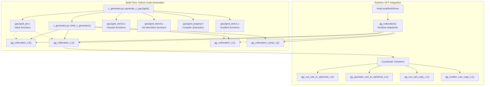
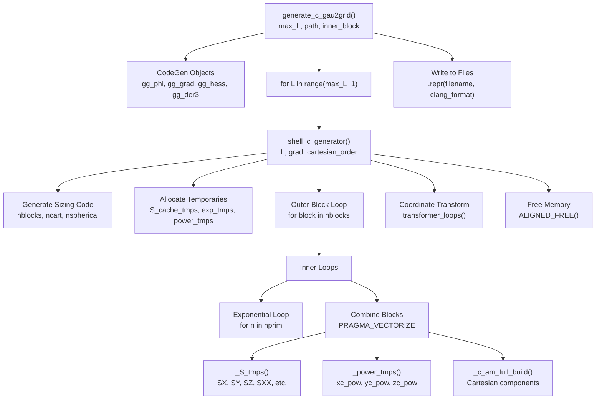
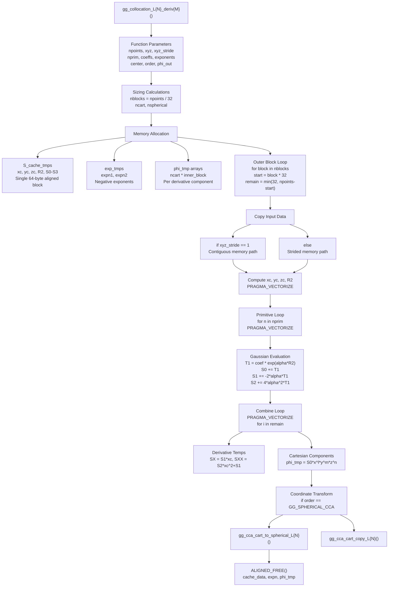
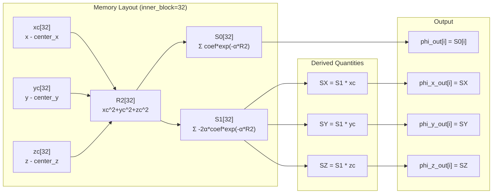
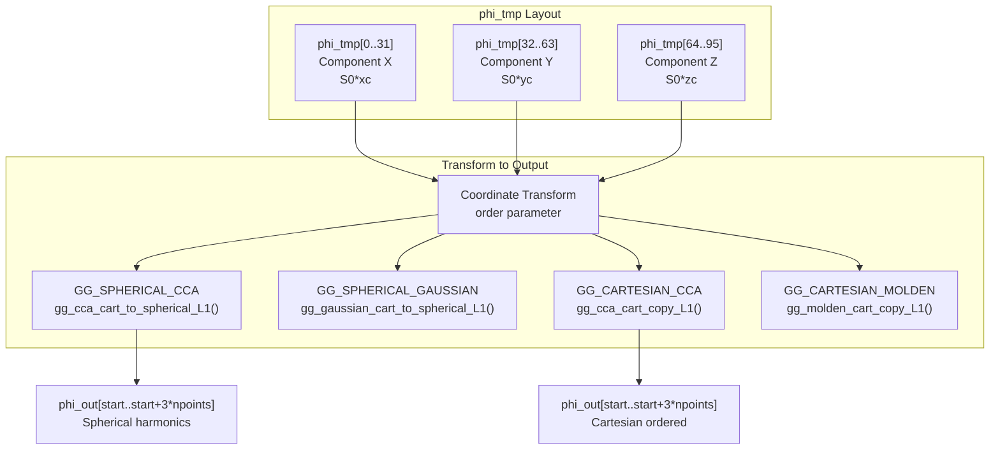
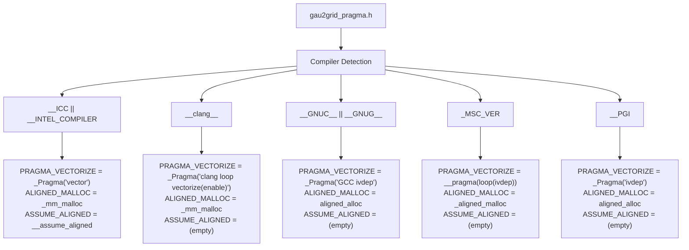
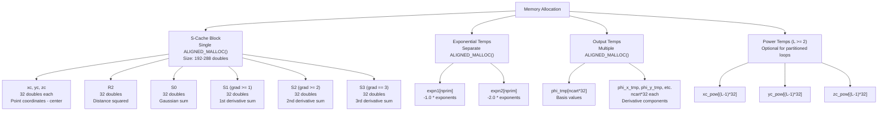
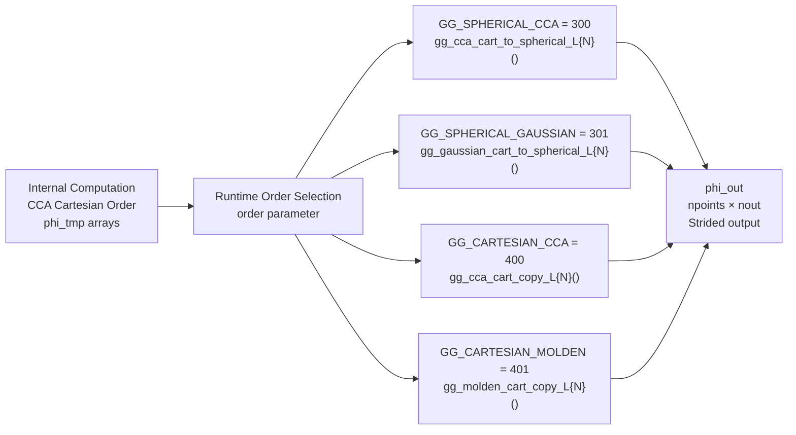
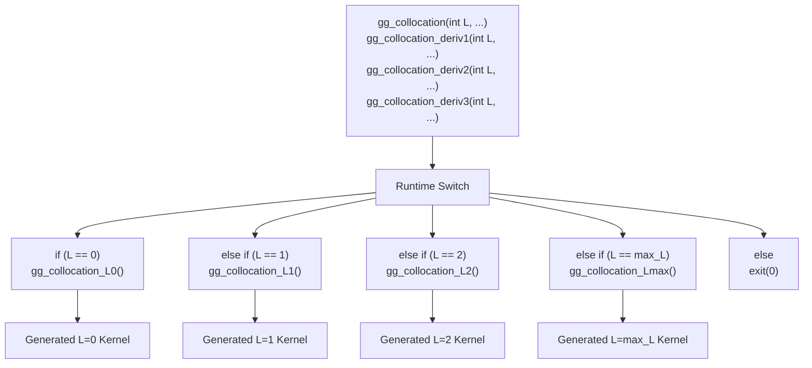
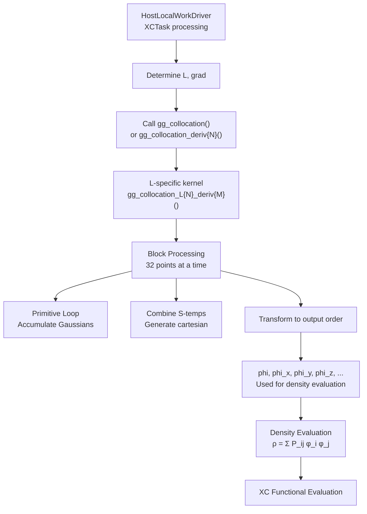

<!-- source: DeepWiki mcp.deepwiki.com · repo microsoft/skala · page 6.1 Gau2Grid Collocation System · fetched 2026-10-26 -->

# Gau2Grid Collocation System

<details>
<summary>Relevant source files</summary>

The following files were used as context for generating this wiki page:

- [third_party/gauxc/external/gau2grid/generated_source/gau2grid/gau2grid_pragma.h](third_party/gauxc/external/gau2grid/generated_source/gau2grid/gau2grid_pragma.h)
- [third_party/gauxc/external/gau2grid/generated_source/gau2grid_deriv1.c](third_party/gauxc/external/gau2grid/generated_source/gau2grid_deriv1.c)
- [third_party/gauxc/external/gau2grid/generated_source/gau2grid_deriv2.c](third_party/gauxc/external/gau2grid/generated_source/gau2grid_deriv2.c)
- [third_party/gauxc/external/gau2grid/generated_source/gau2grid_deriv3.c](third_party/gauxc/external/gau2grid/generated_source/gau2grid_deriv3.c)
- [third_party/gauxc/external/gau2grid/generated_source/gau2grid_phi.c](third_party/gauxc/external/gau2grid/generated_source/gau2grid_phi.c)
- [third_party/gauxc/external/gau2grid/src/gau2grid/c_generator.py](third_party/gauxc/external/gau2grid/src/gau2grid/c_generator.py)
- [third_party/gauxc/external/gau2grid/src/gau2grid/c_pragma.py](third_party/gauxc/external/gau2grid/src/gau2grid/c_pragma.py)

</details>


## Purpose and Scope

The Gau2Grid Collocation System is a Python-based code generation framework that produces highly optimized C kernels for evaluating Gaussian basis functions on computational grids. It generates specialized functions for each angular momentum level (L=0 through L=6 on CPU) and derivative order (values, gradients, Hessians, third derivatives), with SIMD vectorization and cache-friendly memory layouts. The generated code is used exclusively in the host (CPU) execution path within GauXC.

For GPU-based collocation, see [Collocation Kernels](#7.2). For the overall host computation framework, see [Host Computation](#6).

## System Architecture

The Gau2Grid system consists of two distinct phases: code generation (performed at build time) and runtime execution (performed during DFT calculations).

### Code Generation to Runtime Flow



**Sources:** [third_party/gauxc/external/gau2grid/src/gau2grid/c_generator.py:36-315]()

### File Organization

| File | Purpose | Generated Functions |
|------|---------|-------------------|
| `c_generator.py` | Python code generator | `generate_c_gau2grid()`, `shell_c_generator()` |
| `gau2grid_phi.c` | Basis function values | `gg_collocation_L0()` through `gg_collocation_L6()` |
| `gau2grid_deriv1.c` | First derivatives (gradients) | `gg_collocation_L0_deriv1()` through `gg_collocation_L6_deriv1()` |
| `gau2grid_deriv2.c` | Second derivatives (Hessians) | `gg_collocation_L0_deriv2()` through `gg_collocation_L6_deriv2()` |
| `gau2grid_deriv3.c` | Third derivatives | `gg_collocation_L0_deriv3()` through `gg_collocation_L6_deriv3()` |
| `gau2grid_pragma.h` | Compiler pragma abstraction | `PRAGMA_VECTORIZE`, `ALIGNED_MALLOC()`, `ASSUME_ALIGNED()` |
| `gau2grid_transform.c` | Coordinate transformations | `gg_cca_cart_to_spherical_L{N}()`, `gg_gaussian_cart_to_spherical_L{N}()` |

**Sources:** [third_party/gauxc/external/gau2grid/src/gau2grid/c_generator.py:58-314]()

## Code Generation Pipeline

### Generator Function Hierarchy



**Sources:** [third_party/gauxc/external/gau2grid/src/gau2grid/c_generator.py:36-315](), [third_party/gauxc/external/gau2grid/src/gau2grid/c_generator.py:317-833]()

### Key Generation Parameters

| Parameter | Value | Purpose |
|-----------|-------|---------|
| `max_L` | 6 (CPU) | Maximum angular momentum compiled |
| `inner_block` | 32 (default) | Points processed per inner loop iteration |
| `ALIGN_SIZE` | 64 bytes | Memory alignment for SIMD operations |
| `cartesian_order` | "cca" | Internal cartesian ordering (CCA standard) |
| `grad` | 0, 1, 2, 3 | Derivative order to generate |

**Sources:** [third_party/gauxc/external/gau2grid/src/gau2grid/c_generator.py:33-36](), [third_party/gauxc/external/gau2grid/src/gau2grid/c_generator.py:362-387]()

## Generated Kernel Structure

### Block Processing Architecture

All generated collocation functions follow a three-level nested loop structure designed for cache efficiency:



**Sources:** [third_party/gauxc/external/gau2grid/generated_source/gau2grid_phi.c:25-147](), [third_party/gauxc/external/gau2grid/generated_source/gau2grid_deriv1.c:25-176]()

### Example: L=0 Gradient Kernel

The following structure appears in `gg_collocation_L0_deriv1()`:



**Sources:** [third_party/gauxc/external/gau2grid/generated_source/gau2grid_deriv1.c:25-176]()

### L=1 Component Indexing

For angular momentum L=1, cartesian components (X, Y, Z) are laid out in strided temporary arrays:



**Sources:** [third_party/gauxc/external/gau2grid/generated_source/gau2grid_phi.c:257-286](), [third_party/gauxc/external/gau2grid/generated_source/gau2grid_deriv1.c:302-372]()

## Memory Management and SIMD Optimization

### Compiler Pragma Abstraction

The pragma system provides portable SIMD hints and memory alignment across compilers:



**Sources:** [third_party/gauxc/external/gau2grid/generated_source/gau2grid/gau2grid_pragma.h:1-99](), [third_party/gauxc/external/gau2grid/src/gau2grid/c_pragma.py:1-106]()

### Macro Definitions

| Macro | Intel ICC | Clang | GCC | MSVC | Purpose |
|-------|-----------|-------|-----|------|---------|
| `PRAGMA_VECTORIZE` | `_Pragma("vector")` | `_Pragma("clang loop vectorize(enable)")` | `_Pragma("GCC ivdep")` | `__pragma(loop(ivdep))` | Enable SIMD vectorization |
| `ALIGNED_MALLOC(a,s)` | `_mm_malloc(s,a)` | `_mm_malloc(s,a)` | `aligned_alloc(a,s)` | `_aligned_malloc(s,a)` | Allocate aligned memory |
| `ALIGNED_FREE(p)` | `_mm_free(p)` | `_mm_free(p)` | `free(p)` | `_aligned_free(p)` | Free aligned memory |
| `ASSUME_ALIGNED(p,w)` | `__assume_aligned(p,w)` | (empty) | (empty) | (empty) | Compiler hint for alignment |
| `PRAGMA_RESTRICT` | `__restrict__` | `__restrict__` | `__restrict__` | `__restrict` | Pointer aliasing hint |

**Sources:** [third_party/gauxc/external/gau2grid/generated_source/gau2grid/gau2grid_pragma.h:16-99]()

### Memory Allocation Strategy

The generated kernels allocate temporaries in three categories:



**Sources:** [third_party/gauxc/external/gau2grid/src/gau2grid/c_generator.py:426-481](), [third_party/gauxc/external/gau2grid/generated_source/gau2grid_deriv2.c:40-83]()

### Cache Efficiency Design

The block size (`inner_block = 32`) is chosen to fit within L1 cache:

| Angular Momentum | Derivative Order | Total Temporaries | Memory (doubles) | Memory (KB) |
|-----------------|------------------|-------------------|------------------|-------------|
| L=0 | grad=0 | 6 S-temps + 1 output | 192 + 32 = 224 | 1.75 |
| L=0 | grad=1 | 7 S-temps + 4 outputs | 224 + 128 = 352 | 2.75 |
| L=1 | grad=1 | 7 S-temps + 12 outputs | 224 + 384 = 608 | 4.75 |
| L=2 | grad=2 | 8 S-temps + 60 outputs | 256 + 1920 = 2176 | 17.0 |

The generator warns when this exceeds a 4096-double (32KB) threshold, approximately 50% of typical L1 cache.

**Sources:** [third_party/gauxc/external/gau2grid/src/gau2grid/c_generator.py:360-383]()

## Coordinate System Support

### Transformation Pipeline

Gau2Grid computes all basis functions internally in CCA cartesian order, then transforms to the requested output order:



**Sources:** [third_party/gauxc/external/gau2grid/src/gau2grid/c_generator.py:130-136](), [third_party/gauxc/external/gau2grid/src/gau2grid/c_generator.py:15-30]()

### Transform Function Generation

For each angular momentum L, four transformation functions are generated:

| Function Pattern | Purpose | Source Module |
|-----------------|---------|---------------|
| `gg_cca_cart_to_spherical_L{N}(remain, phi_tmp, 32, phi_out+start, npoints)` | CCA cartesian → spherical harmonics | `RSH.py` |
| `gg_gaussian_cart_to_spherical_L{N}(...)` | Gaussian cartesian → spherical | `RSH.py` |
| `gg_cca_cart_copy_L{N}(...)` | CCA cartesian copy | `c_util_generator.py` |
| `gg_molden_cart_copy_L{N}(...)` | Molden cartesian copy | `c_util_generator.py` |

Each also has a `_sum` variant for accumulation rather than direct copy.

**Sources:** [third_party/gauxc/external/gau2grid/src/gau2grid/c_generator.py:165-191](), [third_party/gauxc/external/gau2grid/src/gau2grid/c_generator.py:719-733]()

## Runtime Dispatch

### Convenience Function Generation

The generator creates L-polymorphic wrapper functions that dispatch to the appropriate L-specific kernel:



**Sources:** [third_party/gauxc/external/gau2grid/src/gau2grid/c_generator.py:265-285]()

### Function Signatures

All collocation functions share a common signature pattern:

```
void gg_collocation_L{N}_deriv{M}(
    const unsigned long npoints,           // Number of grid points
    const double* PRAGMA_RESTRICT xyz,     // Point coordinates
    const unsigned long xyz_stride,        // Memory stride for xyz
    const int nprim,                       // Number of primitives
    const double* PRAGMA_RESTRICT coeffs,  // Contraction coefficients
    const double* PRAGMA_RESTRICT exponents, // Gaussian exponents
    const double* PRAGMA_RESTRICT center,  // Shell center [x, y, z]
    const int order,                       // Output ordering (GG_*)
    double* PRAGMA_RESTRICT phi_out,       // Basis function output
    // ... additional derivative outputs for deriv{M} > 0
)
```

**Sources:** [third_party/gauxc/external/gau2grid/src/gau2grid/c_generator.py:389-403]()

## Integration with GauXC Host Path

Gau2Grid kernels are invoked during host-based collocation within the GauXC integration pipeline:



The generated code handles only the collocation step; density evaluation and XC functional computation occur in separate GauXC modules.

**Sources:** Based on system architecture diagrams showing Gau2Grid in host execution path

---

**Primary Sources:**
- [third_party/gauxc/external/gau2grid/src/gau2grid/c_generator.py:1-1735]()
- [third_party/gauxc/external/gau2grid/src/gau2grid/c_pragma.py:1-106]()
- [third_party/gauxc/external/gau2grid/generated_source/gau2grid_phi.c:1-1085]()
- [third_party/gauxc/external/gau2grid/generated_source/gau2grid_deriv1.c:1-2527]()
- [third_party/gauxc/external/gau2grid/generated_source/gau2grid_deriv2.c:1-4527]()
- [third_party/gauxc/external/gau2grid/generated_source/gau2grid_deriv3.c:1-6863]()
- [third_party/gauxc/external/gau2grid/generated_source/gau2grid/gau2grid_pragma.h:1-99]()

---

