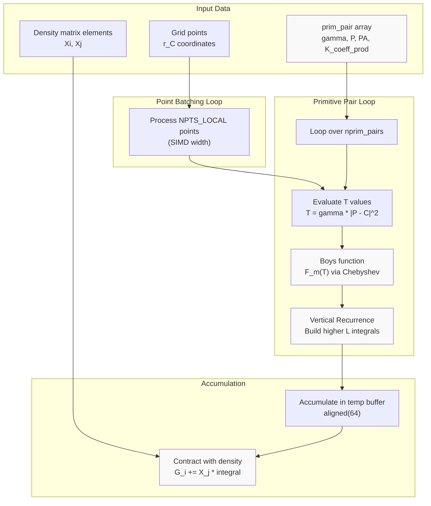
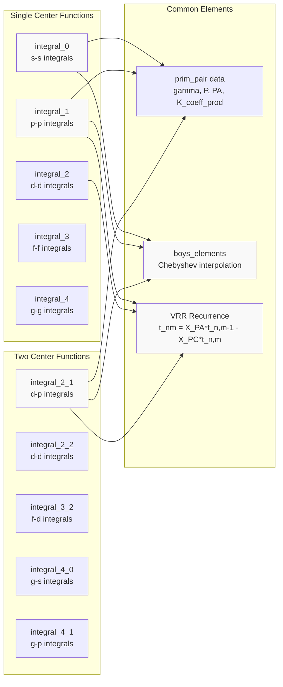
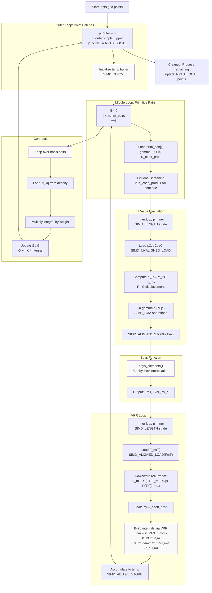
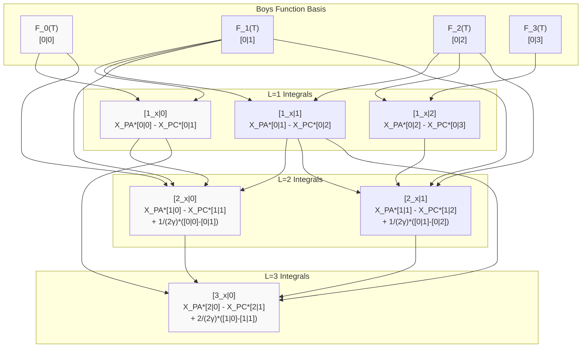

<!-- source: DeepWiki mcp.deepwiki.com · repo microsoft/skala · page 6.2 Obara-Saika Integral Evaluation · fetched 2026-10-26 -->

# Obara-Saika Integral Evaluation

<details>
<summary>Relevant source files</summary>

The following files were used as context for generating this wiki page:

- [third_party/gauxc/src/xc_integrator/local_work_driver/host/obara_saika/src/integral_0.cxx](third_party/gauxc/src/xc_integrator/local_work_driver/host/obara_saika/src/integral_0.cxx)
- [third_party/gauxc/src/xc_integrator/local_work_driver/host/obara_saika/src/integral_1.cxx](third_party/gauxc/src/xc_integrator/local_work_driver/host/obara_saika/src/integral_1.cxx)
- [third_party/gauxc/src/xc_integrator/local_work_driver/host/obara_saika/src/integral_2.cxx](third_party/gauxc/src/xc_integrator/local_work_driver/host/obara_saika/src/integral_2.cxx)
- [third_party/gauxc/src/xc_integrator/local_work_driver/host/obara_saika/src/integral_2_1.cxx](third_party/gauxc/src/xc_integrator/local_work_driver/host/obara_saika/src/integral_2_1.cxx)
- [third_party/gauxc/src/xc_integrator/local_work_driver/host/obara_saika/src/integral_2_2.cxx](third_party/gauxc/src/xc_integrator/local_work_driver/host/obara_saika/src/integral_2_2.cxx)
- [third_party/gauxc/src/xc_integrator/local_work_driver/host/obara_saika/src/integral_3.cxx](third_party/gauxc/src/xc_integrator/local_work_driver/host/obara_saika/src/integral_3.cxx)
- [third_party/gauxc/src/xc_integrator/local_work_driver/host/obara_saika/src/integral_3_2.cxx](third_party/gauxc/src/xc_integrator/local_work_driver/host/obara_saika/src/integral_3_2.cxx)
- [third_party/gauxc/src/xc_integrator/local_work_driver/host/obara_saika/src/integral_4.cxx](third_party/gauxc/src/xc_integrator/local_work_driver/host/obara_saika/src/integral_4.cxx)
- [third_party/gauxc/src/xc_integrator/local_work_driver/host/obara_saika/src/integral_4_0.cxx](third_party/gauxc/src/xc_integrator/local_work_driver/host/obara_saika/src/integral_4_0.cxx)
- [third_party/gauxc/src/xc_integrator/local_work_driver/host/obara_saika/src/integral_4_1.cxx](third_party/gauxc/src/xc_integrator/local_work_driver/host/obara_saika/src/integral_4_1.cxx)
- [third_party/gauxc/src/xc_integrator/local_work_driver/host/obara_saika/src/integral_4_3.cxx](third_party/gauxc/src/xc_integrator/local_work_driver/host/obara_saika/src/integral_4_3.cxx)

</details>


## Purpose and Scope

This document describes the Obara-Saika algorithm implementation for evaluating Gaussian integrals on the host (CPU) in GauXC. The Obara-Saika method computes integrals of the form:

```
∫ φ_i(r) φ_j(r) / |r - r_C| dr
```

where φ_i and φ_j are contracted Gaussian basis functions, and r_C are grid points. These integrals are fundamental to exchange-correlation energy evaluation in density functional theory.

For GPU-based integral evaluation, see [Device Computation](#7). For basis function collocation (evaluating φ values without the 1/|r-r_C| kernel), see [Gau2Grid Collocation System](#6.1).

**Sources**: [third_party/gauxc/src/xc_integrator/local_work_driver/host/obara_saika/src/integral_0.cxx:1-217](), [third_party/gauxc/src/xc_integrator/local_work_driver/host/obara_saika/src/integral_1.cxx:1-50]()

---

## Algorithm Overview

The Obara-Saika algorithm evaluates Gaussian integrals using **Vertical Recurrence Relations (VRR)** to build higher angular momentum integrals from lower ones. The key steps are:

1. Evaluate **T values**: Scaled squared distances T = γ|P - C|² where P is the Gaussian center
2. Compute **Boys functions** F_m(T) using Chebyshev interpolation
3. Apply **VRR** to recursively build integrals for higher angular momentum
4. Accumulate contributions from all primitive Gaussian pairs
5. Contract results with density matrix elements

The algorithm processes multiple grid points simultaneously using SIMD vectorization for computational efficiency.



**Diagram: Obara-Saika Computational Flow**

**Sources**: [third_party/gauxc/src/xc_integrator/local_work_driver/host/obara_saika/src/integral_1.cxx:36-163](), [third_party/gauxc/src/xc_integrator/local_work_driver/host/obara_saika/src/integral_2_1.cxx:38-266]()

---

## Function Hierarchy and Naming Convention

The Obara-Saika implementation provides a family of functions specialized by angular momentum quantum numbers:

### Single-Center Integrals

Functions `integral_X` evaluate integrals where both basis functions are centered at the same point (rB is unused):

| Function | Angular Momentum | Buffer Size | Max Boys Order |
|----------|------------------|-------------|----------------|
| `integral_0` | L=0 (s-functions) | 1 × NPTS_LOCAL | 0 |
| `integral_1` | L=1 (p-functions) | 9 × NPTS_LOCAL | 2 |
| `integral_2` | L=2 (d-functions) | 31 × NPTS_LOCAL | 4 |
| `integral_3` | L=3 (f-functions) | 74 × NPTS_LOCAL | 6 |
| `integral_4` | L=4 (g-functions) | 145 × NPTS_LOCAL | 8 |

### Two-Center Integrals

Functions `integral_X_Y` evaluate integrals where basis functions are centered at different points (rA and rB):

| Function | Angular Momenta (L_A, L_B) | Buffer Size | Max Boys Order |
|----------|---------------------------|-------------|----------------|
| `integral_2_1` | (2, 1) | 16 × NPTS_LOCAL | 3 |
| `integral_2_2` | (2, 2) | 31 × NPTS_LOCAL | 4 |
| `integral_3_2` | (3, 2) | 46 × NPTS_LOCAL | 5 |
| `integral_4_0` | (4, 0) | 15 × NPTS_LOCAL | 4 |
| `integral_4_1` | (4, 1) | 36 × NPTS_LOCAL | 5 |



**Diagram: Integral Function Organization**

**Sources**: [third_party/gauxc/src/xc_integrator/local_work_driver/host/obara_saika/src/integral_0.cxx:17-28](), [third_party/gauxc/src/xc_integrator/local_work_driver/host/obara_saika/src/integral_2_1.cxx:17-30](), [third_party/gauxc/src/xc_integrator/local_work_driver/host/obara_saika/src/integral_4.cxx:17-28]()

---

## Data Structures

### prim_pair Structure

The `prim_pair` structure encapsulates pre-computed data for pairs of primitive Gaussians:

```cpp
struct prim_pair {
    double gamma;          // Exponent sum: α + β
    double gamma_inv;      // 1 / gamma
    point P;               // Weighted center: (αA + βB)/(α + β)
    point PA;              // P - A displacement vector
    double K_coeff_prod;   // Pre-factor including normalization
};
```

For single-center integrals where A = B, the `PA` vector is zero and can be treated as a compile-time constant.

### point Structure

Simple 3D coordinate structure:

```cpp
struct point {
    double x;
    double y;
    double z;
};
```

### Buffer Organization

Each integral function allocates an aligned buffer containing:

| Buffer Region | Purpose | Size |
|--------------|---------|------|
| `temp` | Accumulated integral results | varies by angular momentum |
| `Tval` | T values for Boys function | NPTS_LOCAL |
| `Tval_inv_e` | exp(-T) / T for recurrence | NPTS_LOCAL |
| `FmT` | Boys function F_m(T) values | NPTS_LOCAL |

Buffer alignment to 64 bytes ensures optimal SIMD performance:

```cpp
__attribute__((__aligned__(64))) double buffer[74 * NPTS_LOCAL + 3 * NPTS_LOCAL];
```

**Sources**: [third_party/gauxc/src/xc_integrator/local_work_driver/host/obara_saika/include/cpu/integral_data_types.hpp](), [third_party/gauxc/src/xc_integrator/local_work_driver/host/obara_saika/src/integral_3.cxx:29-34](), [third_party/gauxc/src/xc_integrator/local_work_driver/host/obara_saika/src/integral_4_1.cxx:31-36]()

---

## Computational Pipeline

The integral evaluation follows a nested loop structure optimized for cache locality and SIMD execution:



**Diagram: Obara-Saika Pipeline Flow**

### Key Loop Structure

1. **Outer loop (p_outer)**: Processes points in batches of `NPTS_LOCAL` for SIMD efficiency
2. **Primitive pair loop (ij)**: Accumulates contributions from all contracted Gaussian primitives
3. **Inner SIMD loop (p_inner)**: Vectorized processing within each batch

**Sources**: [third_party/gauxc/src/xc_integrator/local_work_driver/host/obara_saika/src/integral_2.cxx:36-163](), [third_party/gauxc/src/xc_integrator/local_work_driver/host/obara_saika/src/integral_3.cxx:36-162]()

---

## T Value and Boys Function Evaluation

### T Value Computation

T values represent scaled squared distances between the Gaussian center P and grid points C:

```
T = γ|P - C|² = γ[(x_P - x_C)² + (y_P - y_C)² + (z_P - z_C)²]
```

Implementation uses fused multiply-add (FMA) operations for efficiency:

```cpp
// From integral_3.cxx:58-72
SIMD_TYPE X_PC = SIMD_SUB(SIMD_DUPLICATE(&(xA)), xC);
SIMD_TYPE Y_PC = SIMD_SUB(SIMD_DUPLICATE(&(yA)), yC);
SIMD_TYPE Z_PC = SIMD_SUB(SIMD_DUPLICATE(&(zA)), zC);

X_PC = SIMD_MUL(X_PC, X_PC);              // X_PC²
X_PC = SIMD_FMA(Y_PC, Y_PC, X_PC);        // X_PC² + Y_PC²
X_PC = SIMD_FMA(Z_PC, Z_PC, X_PC);        // X_PC² + Y_PC² + Z_PC²
X_PC = SIMD_MUL(SIMD_DUPLICATE(&(RHO)), X_PC);  // γ * |PC|²
```

### Boys Function Evaluation

Boys functions F_m(T) are defined as:

```
F_m(T) = ∫₀¹ t^(2m) exp(-Tt²) dt
```

They are evaluated using Chebyshev interpolation via `boys_elements<M>()`:

```cpp
// From integral_3.cxx:75
boys_elements<6>(NPTS_LOCAL, Tval, Tval_inv_e, FmT, boys_table);
```

The template parameter M specifies the highest order needed. For angular momentum L, the maximum Boys order is 2L.

### Downward Recurrence

After obtaining F_m(T), lower-order Boys functions are computed via downward recurrence:

```
F_{m-1}(T) = [(2T · F_m(T) + exp(-T)/T)] / (2m + 1)
```

```cpp
// From integral_3.cxx:92-98
t06 = SIMD_ALIGNED_LOAD((FmT + p_inner));  // F_6(T)
t05 = SIMD_MUL(SIMD_ADD(SIMD_MUL(tval, t06), tval_inv_e), SIMD_SET1(0.18181818181818182323));
t04 = SIMD_MUL(SIMD_ADD(SIMD_MUL(tval, t05), tval_inv_e), SIMD_SET1(0.22222222222222220989));
t03 = SIMD_MUL(SIMD_ADD(SIMD_MUL(tval, t04), tval_inv_e), SIMD_SET1(0.28571428571428569843));
t02 = SIMD_MUL(SIMD_ADD(SIMD_MUL(tval, t03), tval_inv_e), SIMD_SET1(0.40000000000000002220));
t01 = SIMD_MUL(SIMD_ADD(SIMD_MUL(tval, t02), tval_inv_e), SIMD_SET1(0.66666666666666662966));
t00 = SIMD_MUL(SIMD_ADD(SIMD_MUL(tval, t01), tval_inv_e), SIMD_SET1(2.00000000000000000000));
```

**Sources**: [third_party/gauxc/src/xc_integrator/local_work_driver/host/obara_saika/src/integral_3.cxx:57-98](), [third_party/gauxc/src/xc_integrator/local_work_driver/host/obara_saika/include/cpu/chebyshev_boys_computation.hpp]()

---

## Vertical Recurrence Relations (VRR)

The VRR builds higher angular momentum integrals from lower ones using the recurrence relation:

```
[i+1_x,j|m] = X_PA · [i,j|m] - X_PC · [i,j|m+1] 
              + i/(2γ) · ([i-1,j|m] - [i-1,j|m+1])
```

where:
- `[i,j|m]` denotes an integral with angular momentum (i_x, i_y, i_z) on center A, (j_x, j_y, j_z) on center B
- m is the Boys function order
- X_PA = x_P - x_A is the P-to-A displacement
- X_PC = x_P - x_C is the P-to-grid-point displacement
- γ = RHO is the Gaussian exponent sum

### VRR Example: Building x²-integrals

From `integral_1.cxx`, building L=2 integrals for x-direction:

```cpp
// From integral_1.cxx:106-114
// Start with t10 (L=1 in x)
t10 = SIMD_MUL(SIMD_DUPLICATE(&(X_PA)), t00);  // X_PA * [0|0]
t10 = SIMD_FNMA(X_PC, t01, t10);               // - X_PC * [0|1]

// Build t20 (L=2 in x) from t10
t20 = SIMD_MUL(SIMD_DUPLICATE(&(X_PA)), t10);  // X_PA * [1|0]
t20 = SIMD_FNMA(X_PC, t11, t20);               // - X_PC * [1|1]
tx = SIMD_SUB(t00, t01);                        // [0|0] - [0|1]
ty = SIMD_SET1(0.5 * 1);                        // i/(2γ) coefficient
ty = SIMD_MUL(ty, SIMD_DUPLICATE(&(RHO_INV)));
t20 = SIMD_FMA(tx, ty, t20);                    // + correction term
```

### VRR for Two-Center Integrals

Two-center integrals require additional terms involving X_AB = x_A - x_B displacement. The implementation handles this by pre-computing powers of X_AB and using binomial expansion:

```cpp
// From integral_2_1.cxx:345-349
X_ABp = SCALAR_MUL(X_ABp, X_AB);               // X_AB^p
comb_m_i = SCALAR_MUL(comb_m_i * 1, SCALAR_RECIPROCAL(1));  // Binomial coefficient
const_value = comb_m_i * comb_n_j * comb_p_k * X_ABp * Y_ABp * Z_ABp;
```



**Diagram: VRR Dependency Tree for x-direction Integrals**

**Sources**: [third_party/gauxc/src/xc_integrator/local_work_driver/host/obara_saika/src/integral_1.cxx:99-161](), [third_party/gauxc/src/xc_integrator/local_work_driver/host/obara_saika/src/integral_2.cxx:107-155](), [third_party/gauxc/src/xc_integrator/local_work_driver/host/obara_saika/src/integral_3.cxx:107-230]()

---

## SIMD Vectorization Strategy

### NPTS_LOCAL Batching

All integral functions process `NPTS_LOCAL` grid points simultaneously using SIMD instructions. This constant is typically 16-64 depending on architecture and SIMD width.

```cpp
// From config_obara_saika.hpp
#define NPTS_LOCAL 64  // Example value
```

Points are processed in batches:

```cpp
// From integral_2.cxx:36-38
size_t npts_upper = NPTS_LOCAL * (npts / NPTS_LOCAL);
size_t p_outer = 0;
for(p_outer = 0; p_outer < npts_upper; p_outer += NPTS_LOCAL) {
```

### SIMD Abstraction Layer

The code uses a platform-agnostic SIMD abstraction that maps to native intrinsics:

| Abstraction | Purpose | Example Mapping (AVX) |
|-------------|---------|---------------------|
| `SIMD_TYPE` | Vector register type | `__m256d` |
| `SIMD_LENGTH` | Elements per vector | 4 (doubles) |
| `SIMD_LOAD` | Aligned load | `_mm256_load_pd` |
| `SIMD_UNALIGNED_LOAD` | Unaligned load | `_mm256_loadu_pd` |
| `SIMD_STORE` | Aligned store | `_mm256_store_pd` |
| `SIMD_ADD` | Vector addition | `_mm256_add_pd` |
| `SIMD_MUL` | Vector multiplication | `_mm256_mul_pd` |
| `SIMD_FMA` | Fused multiply-add | `_mm256_fmadd_pd` |
| `SIMD_FNMA` | Fused negate-mul-add | `_mm256_fnmadd_pd` |
| `SIMD_DUPLICATE` | Broadcast scalar | `_mm256_broadcast_sd` |
| `SIMD_ZERO` | Zero vector | `_mm256_setzero_pd` |

### Aligned Memory Allocation

Buffer alignment to 64-byte boundaries ensures optimal SIMD load/store performance:

```cpp
// From integral_3.cxx:29
__attribute__((__aligned__(64))) double buffer[74 * NPTS_LOCAL + 3 * NPTS_LOCAL];
```

### Inner Loop Vectorization

The innermost loops stride by `SIMD_LENGTH` to process vector registers:

```cpp
// From integral_3.cxx:78-90
for(size_t p_inner = 0; p_inner < NPTS_LOCAL; p_inner += SIMD_LENGTH) {
    SIMD_TYPE xC = SIMD_UNALIGNED_LOAD((_point_outer + p_inner + 0 * npts));
    SIMD_TYPE yC = SIMD_UNALIGNED_LOAD((_point_outer + p_inner + 1 * npts));
    SIMD_TYPE zC = SIMD_UNALIGNED_LOAD((_point_outer + p_inner + 2 * npts));
    // ... SIMD operations
    SIMD_TYPE tval = SIMD_ALIGNED_LOAD((Tval + p_inner));
    // ... more SIMD operations
    SIMD_ALIGNED_STORE((temp + index * NPTS_LOCAL + p_inner), result);
}
```

### Scalar Fallback

For the remainder when `npts % NPTS_LOCAL ≠ 0`, scalar code handles the cleanup:

```cpp
// From integral_0.cxx:137-151
for(; p_inner < npts_inner; p_inner += SCALAR_LENGTH) {
    SCALAR_TYPE xC = SCALAR_LOAD((_point_outer + p_inner + 0 * npts));
    // ... scalar operations using SCALAR_* macros
    SCALAR_STORE((Tval + p_inner), X_PC);
}
```

**Sources**: [third_party/gauxc/src/xc_integrator/local_work_driver/host/obara_saika/src/config_obara_saika.hpp](), [third_party/gauxc/src/xc_integrator/local_work_driver/host/obara_saika/src/integral_3.cxx:29-162](), [third_party/gauxc/src/xc_integrator/local_work_driver/host/obara_saika/src/integral_0.cxx:119-151]()

---

## Integration and Contraction

After VRR computation accumulates integrals in the `temp` buffer, the final step contracts these with density matrix elements to produce gradient contributions.

### Contraction Formula

For each basis function pair (i, j), the gradient update is:

```
G_i += w(r) · X_j · ∫ φ_i(r) φ_j(r) / |r - r_C| dr
G_j += w(r) · X_i · ∫ φ_i(r) φ_j(r) / |r - r_C| dr
```

where:
- `w(r)` is the integration weight at grid point r
- `X_i, X_j` are density matrix elements
- `G_i, G_j` are the accumulated gradients

### Implementation Example

From `integral_2_1.cxx`, the contraction loop:

```cpp
// From integral_2_1.cxx:268-294
for(size_t p_inner = 0; p_inner < NPTS_LOCAL; p_inner += SIMD_LENGTH) {
    double *Xik = (Xi + p_outer + p_inner);
    double *Xjk = (Xj + p_outer + p_inner);
    double *Gik = (Gi + p_outer + p_inner);
    double *Gjk = (Gj + p_outer + p_inner);

    SIMD_TYPE const_value_v = SIMD_UNALIGNED_LOAD((weights + p_outer + p_inner));
    
    // For each integral component
    tx = SIMD_UNALIGNED_LOAD((Xik + 0 * ldX));  // Load X_i
    ty = SIMD_UNALIGNED_LOAD((Xjk + 0 * ldX));  // Load X_j
    tz = SIMD_UNALIGNED_LOAD((Gik + 0 * ldG));  // Load G_i
    tw = SIMD_UNALIGNED_LOAD((Gjk + 0 * ldG));  // Load G_j
    
    t0 = SIMD_ALIGNED_LOAD((temp + 6 * NPTS_LOCAL + p_inner));  // Load integral
    t0 = SIMD_MUL(t0, const_value_w);           // Multiply by weight
    
    tz = SIMD_FMA(ty, t0, tz);                  // G_i += X_j * integral
    tw = SIMD_FMA(tx, t0, tw);                  // G_j += X_i * integral
    
    SIMD_UNALIGNED_STORE((Gik + 0 * ldG), tz);
    SIMD_UNALIGNED_STORE((Gjk + 0 * ldG), tw);
}
```

### Two-Center Binomial Expansion

For two-center integrals, the displacement X_AB = x_A - x_B requires binomial expansion. Each term is weighted by binomial coefficients:

```cpp
// From integral_2_1.cxx:345-359
X_ABp = 1.0; comb_m_i = 1.0;  // Powers and coefficients
Y_ABp = 1.0; comb_n_j = 1.0;
Z_ABp = 1.0; comb_p_k = 1.0;
const_value = comb_m_i * comb_n_j * comb_p_k * X_ABp * Y_ABp * Z_ABp;
const_value_w = SIMD_MUL(const_value_v, SIMD_DUPLICATE(&(const_value)));

// Contract this term
tz = SIMD_FMA(ty, t0, tz);  // G_i contribution

// Next term: X_ABp *= X_AB, update binomial coefficient
X_ABp = SCALAR_MUL(X_ABp, X_AB);
comb_m_i = SCALAR_MUL(comb_m_i * 1, SCALAR_RECIPROCAL(1));
```

**Sources**: [third_party/gauxc/src/xc_integrator/local_work_driver/host/obara_saika/src/integral_2_1.cxx:268-445](), [third_party/gauxc/src/xc_integrator/local_work_driver/host/obara_saika/src/integral_1.cxx:165-260]()

---

## Primitive Pair Screening

To avoid computing negligible contributions, primitive pairs can be screened based on their coefficient magnitude:

```cpp
// From integral_2_1.cxx:60-61
double eval = prim_pairs[ij].K_coeff_prod;
if(std::abs(eval) < shpair_screen_tol) continue;
```

The `K_coeff_prod` contains:
- Gaussian normalization constants
- Exponential pre-factor exp(-αβ|A-B|²/(α+β))
- Contraction coefficients

This screening is only applied in two-center integral functions where the exponential decay with distance makes it effective. Single-center functions (where A = B) do not include this check since all primitives at the same center contribute significantly.

**Sources**: [third_party/gauxc/src/xc_integrator/local_work_driver/host/obara_saika/src/integral_2_1.cxx:60-62](), [third_party/gauxc/src/xc_integrator/local_work_driver/host/obara_saika/src/integral_2_2.cxx:60-62]()

---

## Summary

The Obara-Saika implementation in GauXC provides:

1. **Efficient CPU evaluation** of Gaussian integrals using VRR and Boys functions
2. **SIMD vectorization** processing NPTS_LOCAL points simultaneously 
3. **Hierarchical functions** specialized by angular momentum (L=0 to L=4)
4. **Both single-center and two-center** integral variants
5. **Memory-aligned buffers** for optimal SIMD performance
6. **Primitive screening** to skip negligible contributions
7. **Direct contraction** with density matrix elements to produce gradients

The algorithm is well-suited to modern CPUs with wide SIMD units, providing an efficient host-side complement to GPU-based integration kernels.

**Sources**: All source files referenced throughout this document.

---

