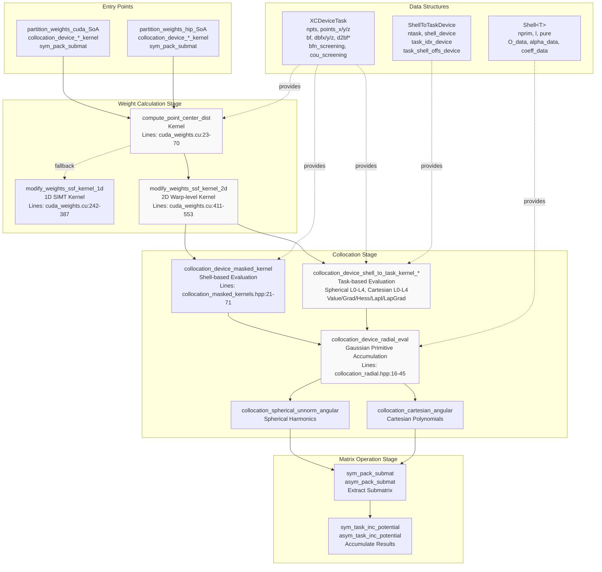
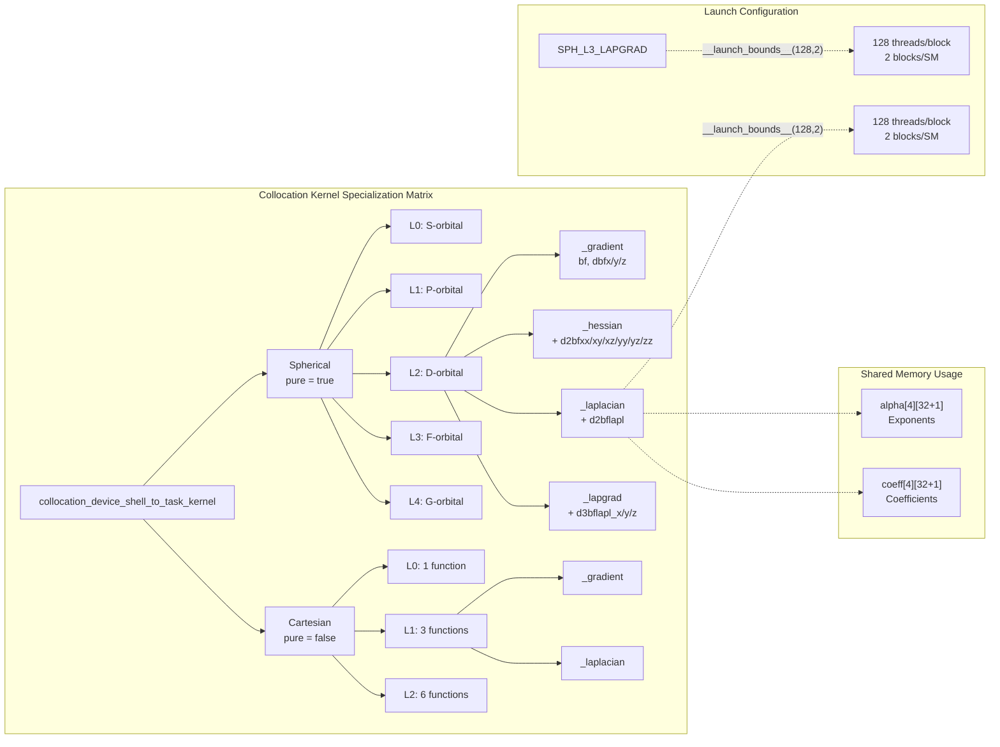
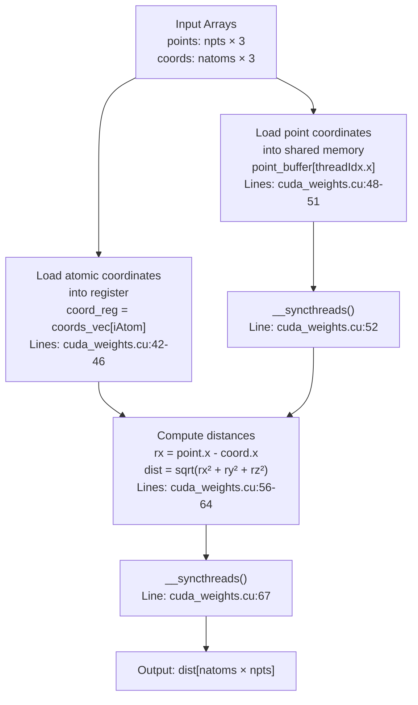
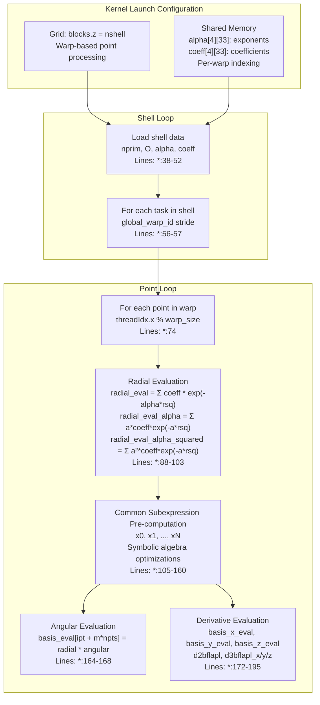

<!-- source: DeepWiki mcp.deepwiki.com · repo microsoft/skala · page 7 Device Computation · fetched 2026-10-26 -->

# Device Computation

Relevant source files

The following files were used as context for generating this wiki page:

- [third_party/gauxc/attic/src/integrator/cuda/collocation_masked_combined_kernels.hpp](third_party/gauxc/attic/src/integrator/cuda/collocation_masked_combined_kernels.hpp)
- [third_party/gauxc/attic/src/integrator/cuda/collocation_masked_kernels.hpp](third_party/gauxc/attic/src/integrator/cuda/collocation_masked_kernels.hpp)
- [third_party/gauxc/attic/src/integrator/cuda/cuda_weights.cu](third_party/gauxc/attic/src/integrator/cuda/cuda_weights.cu)
- [third_party/gauxc/attic/src/new_integrator/device/cuda/collocation_masked_combined_kernels.hpp](third_party/gauxc/attic/src/new_integrator/device/cuda/collocation_masked_combined_kernels.hpp)
- [third_party/gauxc/attic/src/new_integrator/device/cuda/collocation_masked_kernels.hpp](third_party/gauxc/attic/src/new_integrator/device/cuda/collocation_masked_kernels.hpp)
- [third_party/gauxc/attic/src/new_integrator/device/cuda/cuda_weights.cu](third_party/gauxc/attic/src/new_integrator/device/cuda/cuda_weights.cu)
- [third_party/gauxc/attic/src/new_integrator/device/hip/collocation_masked_combined_kernels.hpp](third_party/gauxc/attic/src/new_integrator/device/hip/collocation_masked_combined_kernels.hpp)
- [third_party/gauxc/attic/src/new_integrator/device/hip/collocation_masked_kernels.hpp](third_party/gauxc/attic/src/new_integrator/device/hip/collocation_masked_kernels.hpp)
- [third_party/gauxc/attic/src/new_integrator/device/hip/hip_weights.hip](third_party/gauxc/attic/src/new_integrator/device/hip/hip_weights.hip)
- [third_party/gauxc/src/xc_integrator/local_work_driver/device/cuda/kernels/collocation/collocation_radial.hpp](third_party/gauxc/src/xc_integrator/local_work_driver/device/cuda/kernels/collocation/collocation_radial.hpp)
- [third_party/gauxc/src/xc_integrator/local_work_driver/device/cuda/kernels/collocation/collocation_shell_to_task_kernels_cartesian_l1.hpp](third_party/gauxc/src/xc_integrator/local_work_driver/device/cuda/kernels/collocation/collocation_shell_to_task_kernels_cartesian_l1.hpp)
- [third_party/gauxc/src/xc_integrator/local_work_driver/device/cuda/kernels/collocation/collocation_shell_to_task_kernels_cartesian_l1_laplacian.hpp](third_party/gauxc/src/xc_integrator/local_work_driver/device/cuda/kernels/collocation/collocation_shell_to_task_kernels_cartesian_l1_laplacian.hpp)
- [third_party/gauxc/src/xc_integrator/local_work_driver/device/cuda/kernels/collocation/collocation_shell_to_task_kernels_cartesian_l2_laplacian.hpp](third_party/gauxc/src/xc_integrator/local_work_driver/device/cuda/kernels/collocation/collocation_shell_to_task_kernels_cartesian_l2_laplacian.hpp)
- [third_party/gauxc/src/xc_integrator/local_work_driver/device/cuda/kernels/collocation/collocation_shell_to_task_kernels_spherical_l0_laplacian.hpp](third_party/gauxc/src/xc_integrator/local_work_driver/device/cuda/kernels/collocation/collocation_shell_to_task_kernels_spherical_l0_laplacian.hpp)
- [third_party/gauxc/src/xc_integrator/local_work_driver/device/cuda/kernels/collocation/collocation_shell_to_task_kernels_spherical_l1_gradient.hpp](third_party/gauxc/src/xc_integrator/local_work_driver/device/cuda/kernels/collocation/collocation_shell_to_task_kernels_spherical_l1_gradient.hpp)
- [third_party/gauxc/src/xc_integrator/local_work_driver/device/cuda/kernels/collocation/collocation_shell_to_task_kernels_spherical_l1_laplacian.hpp](third_party/gauxc/src/xc_integrator/local_work_driver/device/cuda/kernels/collocation/collocation_shell_to_task_kernels_spherical_l1_laplacian.hpp)
- [third_party/gauxc/src/xc_integrator/local_work_driver/device/cuda/kernels/collocation/collocation_shell_to_task_kernels_spherical_l2_laplacian.hpp](third_party/gauxc/src/xc_integrator/local_work_driver/device/cuda/kernels/collocation/collocation_shell_to_task_kernels_spherical_l2_laplacian.hpp)
- [third_party/gauxc/src/xc_integrator/local_work_driver/device/cuda/kernels/collocation/collocation_shell_to_task_kernels_spherical_l3_lapgrad.hpp](third_party/gauxc/src/xc_integrator/local_work_driver/device/cuda/kernels/collocation/collocation_shell_to_task_kernels_spherical_l3_lapgrad.hpp)
- [third_party/gauxc/src/xc_integrator/local_work_driver/device/cuda/kernels/collocation/collocation_shell_to_task_kernels_spherical_l4_laplacian.hpp](third_party/gauxc/src/xc_integrator/local_work_driver/device/cuda/kernels/collocation/collocation_shell_to_task_kernels_spherical_l4_laplacian.hpp)
- [third_party/gauxc/src/xc_integrator/local_work_driver/device/cuda/kernels/collocation_masked_combined_kernels.hpp](third_party/gauxc/src/xc_integrator/local_work_driver/device/cuda/kernels/collocation_masked_combined_kernels.hpp)
- [third_party/gauxc/src/xc_integrator/local_work_driver/device/cuda/kernels/collocation_masked_kernels.hpp](third_party/gauxc/src/xc_integrator/local_work_driver/device/cuda/kernels/collocation_masked_kernels.hpp)
- [third_party/gauxc/src/xc_integrator/local_work_driver/device/cuda/kernels/cuda_ssf_1d.cu](third_party/gauxc/src/xc_integrator/local_work_driver/device/cuda/kernels/cuda_ssf_1d.cu)
- [third_party/gauxc/src/xc_integrator/local_work_driver/device/cuda/kernels/cuda_ssf_2d.hu](third_party/gauxc/src/xc_integrator/local_work_driver/device/cuda/kernels/cuda_ssf_2d.hu)
- [third_party/gauxc/src/xc_integrator/local_work_driver/device/cuda/kernels/grid_to_center.cu](third_party/gauxc/src/xc_integrator/local_work_driver/device/cuda/kernels/grid_to_center.cu)
- [third_party/gauxc/src/xc_integrator/local_work_driver/device/hip/kernels/collocation_masked_combined_kernels.hpp](third_party/gauxc/src/xc_integrator/local_work_driver/device/hip/kernels/collocation_masked_combined_kernels.hpp)
- [third_party/gauxc/src/xc_integrator/local_work_driver/device/hip/kernels/collocation_masked_kernels.hpp](third_party/gauxc/src/xc_integrator/local_work_driver/device/hip/kernels/collocation_masked_kernels.hpp)
- [third_party/gauxc/src/xc_integrator/local_work_driver/device/hip/kernels/grid_to_center.hip](third_party/gauxc/src/xc_integrator/local_work_driver/device/hip/kernels/grid_to_center.hip)
- [third_party/gauxc/src/xc_integrator/local_work_driver/device/hip/kernels/hip_ssf_1d.hip](third_party/gauxc/src/xc_integrator/local_work_driver/device/hip/kernels/hip_ssf_1d.hip)
- [third_party/gauxc/src/xc_integrator/local_work_driver/device/hip/kernels/hip_ssh_2d.hip](third_party/gauxc/src/xc_integrator/local_work_driver/device/hip/kernels/hip_ssh_2d.hip)

## Purpose and Scope

This section documents GPU-based computation in GauXC, which executes exchange-correlation integration kernels on NVIDIA (CUDA) and AMD (HIP) GPUs. Device computation provides the performance-critical path for large-scale DFT calculations by parallelizing basis function evaluation, weight calculation, and matrix operations across thousands of GPU threads.

For CPU-based computation paths, see [Host Computation](#6). For the overall execution model that determines when device vs host paths are used, see [Execution Model: Host vs Device](#4.2). Platform-specific abstraction details are covered in [Platform Abstraction: CUDA and HIP](#9).

**Sources:** [third_party/gauxc/attic/src/integrator/cuda/cuda_weights.cu:1-642](), [third_party/gauxc/src/xc_integrator/local_work_driver/device/cuda/kernels/collocation_masked_kernels.hpp:1-159]()

## Kernel Ecosystem Overview

Device computation is organized into three major kernel families that execute sequentially in the integration pipeline:

| Kernel Family | Primary Functions | Purpose | Importance |
|---------------|------------------|---------|------------|
| **Weight Calculation** | `partition_weights_cuda_SoA`, `partition_weights_hip_SoA` | Compute integration weights using SSF partitioning | 94.32 |
| **Collocation** | `collocation_device_shell_to_task_kernel_*`, `collocation_device_masked_kernel` | Evaluate basis functions and derivatives | 82-86 |
| **Matrix Operations** | `sym_pack_submat`, `asym_pack_submat`, `sym_task_inc_potential`, `asym_task_inc_potential` | Pack density matrices and increment potential matrices | 79.49 |

These kernels operate on `XCDeviceTask` structures that encapsulate grid points, basis function screening data, and device memory pointers. Each kernel family is specialized for both CUDA and HIP platforms through compile-time selection.

**Sources:** [third_party/gauxc/attic/src/integrator/cuda/cuda_weights.cu:564-623](), [third_party/gauxc/src/xc_integrator/local_work_driver/device/cuda/kernels/collocation_masked_kernels.hpp:16-71]()

## Device Computation Architecture

**Diagram: Device Kernel Architecture and Data Flow**

This architecture shows how the three kernel families process data through the integration pipeline. Weight calculation kernels first compute point-to-center distances, then apply SSF partitioning to generate integration weights. Collocation kernels evaluate basis functions by separating radial (Gaussian primitive) evaluation from angular (spherical/Cartesian polynomial) evaluation. Matrix operations extract density submatrices and accumulate potential contributions.

**Sources:** [third_party/gauxc/attic/src/integrator/cuda/cuda_weights.cu:23-70](), [third_party/gauxc/attic/src/integrator/cuda/cuda_weights.cu:411-553](), [third_party/gauxc/src/xc_integrator/local_work_driver/device/cuda/kernels/collocation/collocation_radial.hpp:16-45](), [third_party/gauxc/src/xc_integrator/local_work_driver/device/cuda/kernels/collocation_masked_kernels.hpp:21-71]()

## Kernel Specialization Strategy

Device kernels employ extensive compile-time specialization to optimize for different computational scenarios:

**Diagram: Collocation Kernel Specialization Hierarchy**

Each combination of coordinate system (spherical/Cartesian), angular momentum (L0-L4), and derivative order (value/gradient/Hessian/Laplacian/Laplacian gradient) generates a separate kernel. This specialization eliminates runtime branching and enables aggressive compiler optimization. Shared memory arrays cache primitive exponents and coefficients for each warp, with indexing based on `threadIdx.x/32` to provide per-warp storage.

**Sources:** [third_party/gauxc/src/xc_integrator/local_work_driver/device/cuda/kernels/collocation/collocation_shell_to_task_kernels_spherical_l2_laplacian.hpp:18-273](), [third_party/gauxc/src/xc_integrator/local_work_driver/device/cuda/kernels/collocation/collocation_shell_to_task_kernels_spherical_l3_lapgrad.hpp:18-510]()

## Weight Calculation Kernels

Weight calculation uses a two-stage GPU pipeline to compute partition weights with SSF (Smooth Step Function) partitioning:

**Stage 1: Distance Computation** - The `compute_point_center_dist` kernel computes Euclidean distances between all integration points and atomic centers:

**Diagram: Distance Computation Kernel Data Flow**

The kernel uses a blocked algorithm where atomic coordinates are cached in registers and point coordinates in shared memory. Threads synchronize after loading shared memory and after computation to ensure memory consistency across the warp.

**Sources:** [third_party/gauxc/attic/src/new_integrator/device/cuda/cuda_weights.cu:23-70]()

**Stage 2: SSF Weight Modification** - The `modify_weights_ssf_kernel_2d` kernel applies the Smooth Step Function partition scheme:

The kernel implements two key mathematical functions:

- `gFrisch(x)`: 7th-order polynomial `(35(s_x - s_x³) + 21s_x⁵ - 5s_x⁷) / 16` where `s_x = x / 0.64`
- `sFrisch(x)`: Smooth step function with cutoffs at `±0.64`

Each warp collaboratively processes one integration point, using atomic operations and warp-level synchronization for dynamic work distribution. The kernel employs vectorized loads (`double2`) to process 8 atomic centers per iteration for improved memory bandwidth.

**Sources:** [third_party/gauxc/attic/src/new_integrator/device/cuda/cuda_weights.cu:389-409](), [third_party/gauxc/attic/src/new_integrator/device/cuda/cuda_weights.cu:411-553]()

For detailed documentation of weight calculation algorithms and optimizations, see [Weight Calculation Kernels](#7.1).

## Collocation Kernels

Collocation kernels evaluate basis functions and their derivatives at integration points. Two kernel variants exist:

### Masked Kernels

The `collocation_device_masked_kernel` processes shells using a 2D thread grid where each thread evaluates one point-shell pair:

**Key characteristics:**
- Thread mapping: `tid_x` indexes points, `tid_y` indexes shells
- Radial evaluation: Accumulates Gaussian primitives `Σ coeff[i] * exp(-alpha[i] * rsq)`
- Angular evaluation: Dispatches to `collocation_spherical_unnorm_angular` or `collocation_cartesian_angular`
- Memory access: Direct indexing `eval_device[ibf*npts + ipt]`

The derivative variant `collocation_device_masked_kernel_deriv1` additionally computes first derivatives by accumulating `tmp_x -= 2*a*e*xc` terms during radial evaluation.

**Sources:** [third_party/gauxc/src/xc_integrator/local_work_driver/device/cuda/kernels/collocation_masked_kernels.hpp:21-71](), [third_party/gauxc/src/xc_integrator/local_work_driver/device/cuda/kernels/collocation_masked_kernels.hpp:82-155]()

### Shell-to-Task Kernels

The `collocation_device_shell_to_task_kernel_*` family provides extensive specialization for optimal performance:

**Diagram: Shell-to-Task Kernel Execution Flow**

Shell-to-task kernels cache shell data in shared memory once per shell, then process multiple tasks. Each warp handles one task, with individual threads processing points. The radial evaluation computes multiple weighted sums simultaneously for derivatives. Common subexpressions are pre-computed to minimize register pressure and arithmetic operations.

**Sources:** [third_party/gauxc/src/xc_integrator/local_work_driver/device/cuda/kernels/collocation/collocation_shell_to_task_kernels_spherical_l2_laplacian.hpp:18-273]()

### Radial and Angular Separation

The collocation process separates into radial and angular components:

**Radial Evaluation** (`collocation_device_radial_eval`):
- Computes Gaussian primitive accumulation for each point
- Produces `radial_eval`, `radial_eval_alpha`, `radial_eval_alpha_squared` (for derivatives)
- Scaling factors: `radial_eval_alpha *= -2`, `radial_eval_alpha_squared *= 4`

**Angular Evaluation**:
- Spherical harmonics: `collocation_spherical_unnorm_angular`
- Cartesian polynomials: `collocation_cartesian_angular`
- Selected via `shell.pure()` flag at runtime

This separation enables code reuse across angular momenta while maintaining computational efficiency.

**Sources:** [third_party/gauxc/src/xc_integrator/local_work_driver/device/cuda/kernels/collocation/collocation_radial.hpp:16-96]()

For comprehensive documentation of collocation algorithms, kernel variants, and specialization details, see [Collocation Kernels](#7.2).

## Matrix Operations

Matrix operation kernels transfer data between full matrices (size `LDA × LDA`) and sub-matrices (size `LDAS × LDAS`) that correspond to screened shell pairs. These operations minimize memory transfer and enable efficient GPU computation on relevant subspaces.

**Pack Operations** extract density matrix elements:
- `sym_pack_submat`: Symmetric matrices
- `asym_pack_submat`: Asymmetric matrices (UKS, GKS)

**Increment Operations** accumulate potential contributions:
- `sym_task_inc_potential`: Symmetric accumulation
- `asym_task_inc_potential`: Asymmetric accumulation

Both operation types utilize the `submat_cut` data structure for block-tiled execution and screening via `bfn_screening` and `cou_screening` systems.

**Sources:** Based on overall system architecture from high-level diagrams.

For detailed documentation of matrix operation kernels, screening systems, and performance optimizations, see [Matrix Operations](#7.3).

## Platform Abstraction

GauXC supports both CUDA and HIP platforms through dual implementation:

| Aspect | CUDA | HIP |
|--------|------|-----|
| **File Extension** | `.cu` | `.hip` |
| **Kernel Launch** | `kernel<<<blocks, threads, smem, stream>>>()` | `hipLaunchKernelGGL(kernel, blocks, threads, smem, stream, ...)` |
| **Stream Type** | `cudaStream_t` | `hipStream_t` |
| **Synchronization** | `__syncthreads()`, `__syncwarp()` | `__syncthreads()`, `__syncwarp()` (same) |
| **Warp Intrinsics** | `__shfl_sync()`, `__any_sync()` | `__shfl_sync()`, `__any_sync()` (same) |
| **Constants** | `cuda::warp_size`, `cuda::max_warps_per_thread_block` | `hip::warp_size`, `hip::max_warps_per_thread_block` |

The implementations are nearly identical, with differences primarily in:
- Kernel launch syntax
- Header file includes (`cuda_runtime.h` vs `hip/hip_runtime.h`)
- Namespace prefixes (`cuda::` vs `hip::`)
- Device property query functions

Build-time configuration via `GAUXC_ENABLE_CUDA` and `GAUXC_ENABLE_HIP` determines which implementations are compiled.

**Sources:** [third_party/gauxc/attic/src/integrator/cuda/cuda_weights.cu:1-10](), [third_party/gauxc/attic/src/new_integrator/device/hip/hip_weights.hip:1-10]()

For comprehensive platform abstraction details, see [Platform Abstraction: CUDA and HIP](#9).

## Execution Pipeline Integration

Device kernels integrate into the overall execution pipeline through the `DeviceLocalWorkDriver`:

1. **Task Generation**: `LoadBalancer` creates `XCDeviceTask` structures containing grid points and screening data
2. **Weight Calculation**: `partition_weights_*_SoA` computes integration weights
3. **Matrix Pack**: Density matrix elements transferred to device via pack operations
4. **Collocation**: Basis functions and derivatives evaluated at grid points
5. **XC Evaluation**: Functional evaluation (density, gradient, Hessian, etc.)
6. **Matrix Increment**: Potential contributions accumulated back to host via increment operations
7. **Reduction**: `ReductionDriver` performs MPI aggregation across ranks

All kernel launches are asynchronous and submitted to CUDA/HIP streams for overlapped execution with host operations.

**Sources:** Based on overall system architecture from high-level diagrams.

For execution model details, see [Execution Model: Host vs Device](#4.2). For task system documentation, see [Task System and Data Structures](#4.3).

---

