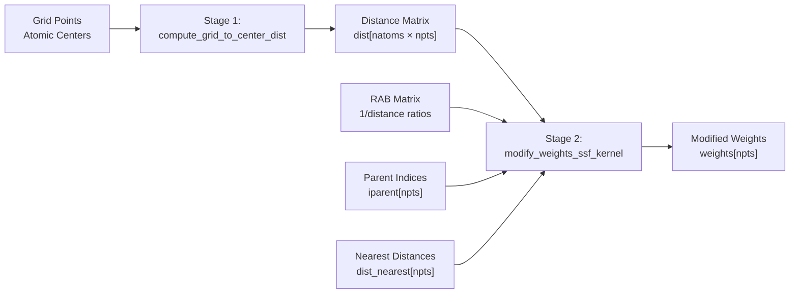
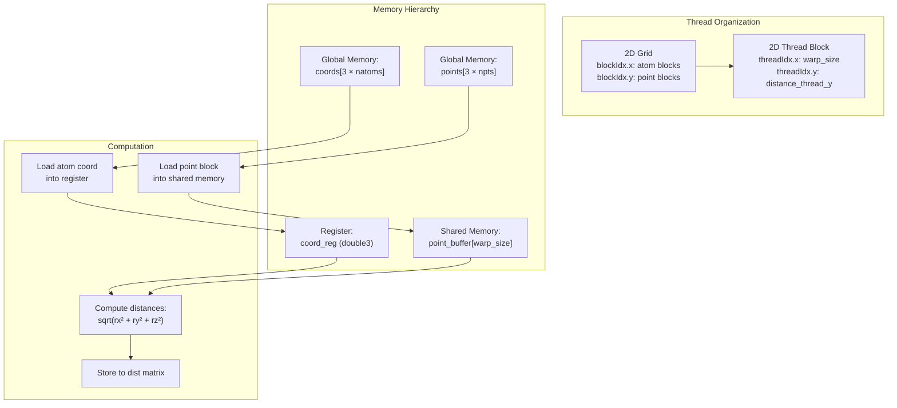
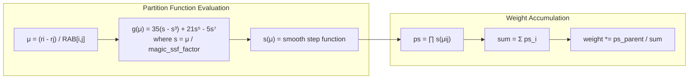
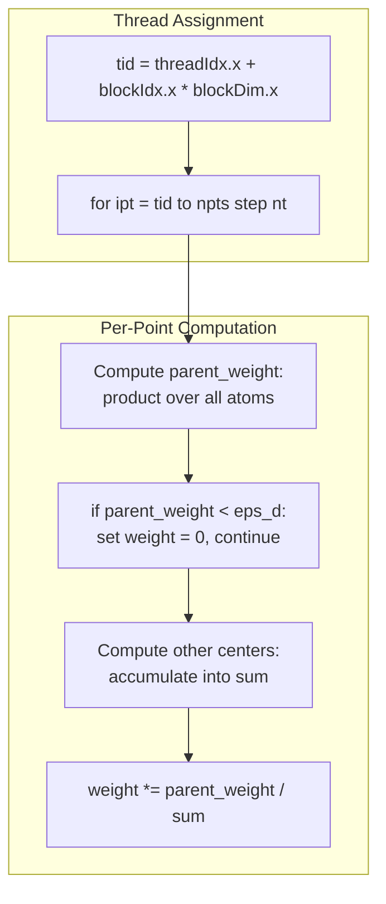
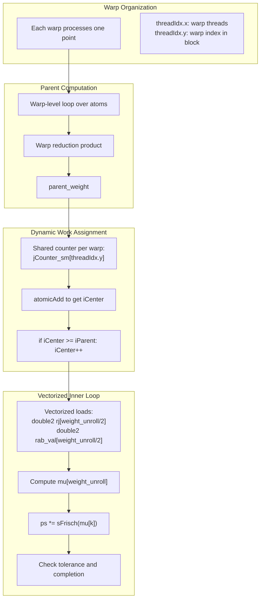
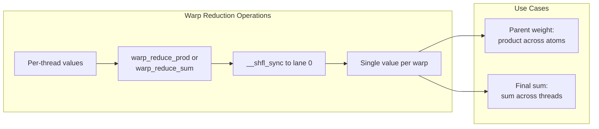
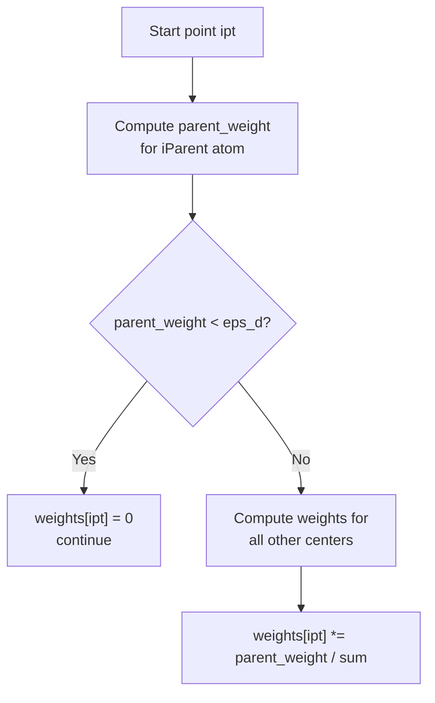
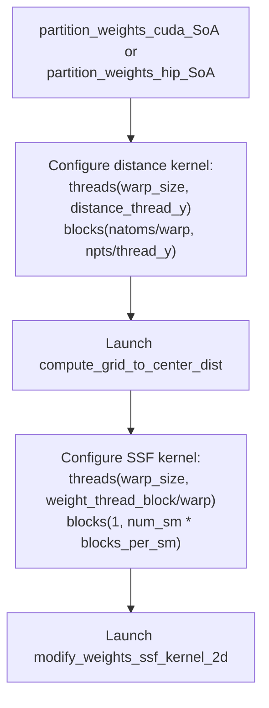

<!-- source: DeepWiki mcp.deepwiki.com · repo microsoft/skala · page 7.1 Weight Calculation Kernels · fetched 2026-10-26 -->

# Weight Calculation Kernels

<details>
<summary>Relevant source files</summary>

The following files were used as context for generating this wiki page:

- [third_party/gauxc/attic/src/integrator/cuda/cuda_weights.cu](third_party/gauxc/attic/src/integrator/cuda/cuda_weights.cu)
- [third_party/gauxc/attic/src/new_integrator/device/cuda/cuda_weights.cu](third_party/gauxc/attic/src/new_integrator/device/cuda/cuda_weights.cu)
- [third_party/gauxc/attic/src/new_integrator/device/hip/hip_weights.hip](third_party/gauxc/attic/src/new_integrator/device/hip/hip_weights.hip)
- [third_party/gauxc/src/xc_integrator/local_work_driver/device/cuda/kernels/cuda_ssf_1d.cu](third_party/gauxc/src/xc_integrator/local_work_driver/device/cuda/kernels/cuda_ssf_1d.cu)
- [third_party/gauxc/src/xc_integrator/local_work_driver/device/cuda/kernels/cuda_ssf_2d.hu](third_party/gauxc/src/xc_integrator/local_work_driver/device/cuda/kernels/cuda_ssf_2d.hu)
- [third_party/gauxc/src/xc_integrator/local_work_driver/device/cuda/kernels/grid_to_center.cu](third_party/gauxc/src/xc_integrator/local_work_driver/device/cuda/kernels/grid_to_center.cu)
- [third_party/gauxc/src/xc_integrator/local_work_driver/device/hip/kernels/grid_to_center.hip](third_party/gauxc/src/xc_integrator/local_work_driver/device/hip/kernels/grid_to_center.hip)
- [third_party/gauxc/src/xc_integrator/local_work_driver/device/hip/kernels/hip_ssf_1d.hip](third_party/gauxc/src/xc_integrator/local_work_driver/device/hip/kernels/hip_ssf_1d.hip)
- [third_party/gauxc/src/xc_integrator/local_work_driver/device/hip/kernels/hip_ssh_2d.hip](third_party/gauxc/src/xc_integrator/local_work_driver/device/hip/kernels/hip_ssh_2d.hip)

</details>


## Purpose and Scope

Weight calculation kernels compute partition weights for numerical integration grids on GPU devices. These kernels implement the Smooth Step Function (SSF) partitioning scheme to distribute integration weights across atomic centers, ensuring that each grid point's contribution is properly assigned. The computation follows a two-stage pipeline: distance calculation followed by weight modification using Frisch partition functions.

This page focuses specifically on the GPU kernel implementations. For host-based computation paths, see [Host Computation](#6). For the overall device execution model, see [Execution Model: Host vs Device](#4.2).

**Sources:** [third_party/gauxc/attic/src/integrator/cuda/cuda_weights.cu:1-642](), [third_party/gauxc/src/xc_integrator/local_work_driver/device/cuda/kernels/grid_to_center.cu:1-85]()

## Two-Stage Computational Pipeline

Weight calculation proceeds in two distinct stages, each implemented as a separate GPU kernel launch:



**Diagram: Weight Calculation Pipeline**

The first stage computes all pairwise distances between grid points and atomic centers, storing results in a dense matrix. The second stage uses these precomputed distances along with auxiliary data (RAB matrix, parent indices, nearest distances) to modify integration weights according to the SSF partitioning scheme.

**Sources:** [third_party/gauxc/attic/src/integrator/cuda/cuda_weights.cu:564-623](), [third_party/gauxc/attic/src/new_integrator/device/cuda/cuda_weights.cu:564-623]()

## Distance Computation Stage

### Kernel Interface and Layout

The distance computation kernel calculates Euclidean distances between all grid points and atomic centers:

| Function | Platform | File |
|----------|----------|------|
| `compute_point_center_dist` | CUDA (legacy) | [attic/src/integrator/cuda/cuda_weights.cu:23-70]() |
| `compute_grid_to_center_dist` | CUDA | [src/.../device/cuda/kernels/grid_to_center.cu:14-67]() |
| `compute_grid_to_center_dist` | HIP | [src/.../device/hip/kernels/grid_to_center.hip:16-45]() |

**Kernel Signature:**
```cpp
__global__ void compute_grid_to_center_dist(
    size_t npts,           // Number of grid points
    size_t natoms,         // Number of atomic centers
    const double* coords,  // Atomic coordinates (3 × natoms)
    const double* points_x,// Grid point x-coordinates
    const double* points_y,// Grid point y-coordinates  
    const double* points_z,// Grid point z-coordinates
    double* dist,          // Output: distance matrix
    size_t lddist          // Leading dimension of dist
)
```

**Sources:** [third_party/gauxc/src/xc_integrator/local_work_driver/device/cuda/kernels/grid_to_center.cu:14-24]()

### Blocked Algorithm with Shared Memory

The CUDA implementation uses a sophisticated blocked algorithm to maximize memory throughput:



**Diagram: Distance Kernel Memory Access Pattern**

The algorithm processes data in blocks of size `warp_size` (32 for CUDA):

1. **Outer loop (atoms):** Each block iteration processes `warp_size` atoms
2. **Inner loop (points):** Each iteration processes `warp_size` points
3. **Atom coordinates** are loaded once per outer iteration into registers
4. **Point coordinates** are loaded into shared memory for reuse across threads
5. **Synchronization** (`__syncthreads()`) ensures shared memory consistency

**Sources:** [third_party/gauxc/src/xc_integrator/local_work_driver/device/cuda/kernels/grid_to_center.cu:26-67](), [third_party/gauxc/attic/src/integrator/cuda/cuda_weights.cu:23-70]()

### Launch Configuration

The kernel launch parameters are carefully tuned for occupancy:

| Parameter | CUDA Value | HIP Value |
|-----------|------------|-----------|
| `threads.x` | `cuda::warp_size` (32) | `hip::warp_size` |
| `threads.y` | `max_warps_per_thread_block / 2` | `max_warps_per_thread_block` |
| `blocks.x` | `div_ceil(natoms, threads.x)` | `div_ceil(natoms, threads.x)` |
| `blocks.y` | `div_ceil(npts, threads.y * distance_thread_y)` | `div_ceil(npts, threads.y)` |

**Sources:** [third_party/gauxc/src/xc_integrator/local_work_driver/device/cuda/kernels/grid_to_center.cu:69-82](), [third_party/gauxc/src/xc_integrator/local_work_driver/device/hip/kernels/grid_to_center.hip:47-59]()

## SSF Partition Function

### Mathematical Foundation

The Smooth Step Function (SSF) partitioning uses Frisch partition functions to create smooth weight transitions between atomic centers:



**Diagram: SSF Weight Calculation Flow**

**Device Functions:**

```cpp
__device__ __inline__ double gFrisch(double x) {
    const double s_x  = x * 1.5625;  // x / magic_ssf_factor
    const double s_x2 = s_x  * s_x;
    const double s_x3 = s_x  * s_x2;
    const double s_x5 = s_x3 * s_x2;
    const double s_x7 = s_x5 * s_x2;
    return ((35.)*(s_x - s_x3) + (21.)*s_x5 - (5.)*s_x7);
}

__device__ __inline__ double sFrisch(double x) {
    if( fabs(x) < magic_ssf_factor ) 
        return (0.5 - (0.5/16.0) * gFrisch(x));
    else if( x >= magic_ssf_factor ) 
        return 0.;
    else 
        return 1.;
}
```

The constant `magic_ssf_factor` is defined as `0.64` in [common/integrator_constants.hpp]().

**Sources:** [third_party/gauxc/attic/src/integrator/cuda/cuda_weights.cu:389-408](), [third_party/gauxc/src/xc_integrator/local_work_driver/device/cuda/kernels/cuda_ssf_2d.hu:17-36](), [third_party/gauxc/src/xc_integrator/local_work_driver/device/hip/kernels/hip_ssh_2d.hip:19-38]()

### Distance Cutoff Optimization

An early-exit optimization skips points where the parent atom is sufficiently close:

```cpp
const double dist_cutoff = 0.5 * (1 - magic_ssf_factor) * dist_nearest[ipt];
if( local_dist_scratch[iParent] < dist_cutoff ) continue;
```

If the parent atom's distance is less than `0.5 * (1 - 0.64) = 0.18` times the nearest neighbor distance, the weight modification is skipped entirely, as the point is clearly dominated by the parent atom.

**Sources:** [third_party/gauxc/attic/src/integrator/cuda/cuda_weights.cu:292-294](), [third_party/gauxc/src/xc_integrator/local_work_driver/device/cuda/kernels/cuda_ssf_1d.cu:65-67]()

## SSF Kernel Variants

### 1D Kernel: Point-Level Parallelism

The 1D variant (`modify_weights_ssf_kernel_1d`) parallelizes over grid points, with each thread processing one point independently:



**Diagram: 1D SSF Kernel Execution Flow**

**Key Characteristics:**
- **Parallelization:** 1D grid over points (`tid_x` in range `[0, npts)`)
- **Thread independence:** No inter-thread communication required
- **Memory access:** Each thread reads entire distance row for its point
- **Work distribution:** Simple grid-stride loop

**Launch Parameters:**
- `threads.x = max_threads_per_thread_block` (typically 256 or 1024)
- `blocks.x = div_ceil(npts, threads.x)`

**Sources:** [third_party/gauxc/src/xc_integrator/local_work_driver/device/cuda/kernels/cuda_ssf_1d.cu:20-127](), [third_party/gauxc/src/xc_integrator/local_work_driver/device/hip/kernels/hip_ssf_1d.hip:23-128]()

### 2D Kernel: Warp-Level Parallelism

The 2D variant (`modify_weights_ssf_kernel_2d`) uses warps as the fundamental unit of work, with sophisticated dynamic load balancing:



**Diagram: 2D SSF Kernel Work Distribution**

**Key Characteristics:**

| Feature | Implementation |
|---------|---------------|
| **Work unit** | Entire warp processes single point |
| **Parent computation** | Warp-level reduction across atom chunks |
| **Dynamic assignment** | Atomic counter assigns `iCenter` values to threads |
| **Vectorization** | `double2` loads for 2× data throughput |
| **Loop unrolling** | `weight_unroll = 4` iterations per loop |
| **Termination** | `__any_sync(0xffffffff, cont)` checks if any thread still working |

**Sources:** [third_party/gauxc/src/xc_integrator/local_work_driver/device/cuda/kernels/cuda_ssf_2d.hu:38-187](), [third_party/gauxc/src/xc_integrator/local_work_driver/device/hip/kernels/hip_ssh_2d.hip:40-184]()

### Template Parameters

The 2D kernel uses compile-time template parameters for optimization:

```cpp
template <uint32_t weight_unroll,             // Unrolling factor (4)
          uint32_t weight_thread_block,       // Threads per block
          uint32_t weight_thread_block_per_sm // Blocks per SM
          >
__global__ __launch_bounds__(weight_thread_block, weight_thread_block_per_sm)
void modify_weights_ssf_kernel_2d(...)
```

These parameters are specified via the `alg_constants::HipAoSScheme1` or `alg_constants::CudaAoSScheme1` constants.

**Sources:** [third_party/gauxc/src/xc_integrator/local_work_driver/device/cuda/kernels/cuda_ssf_2d.hu:38-42](), [third_party/gauxc/src/xc_integrator/local_work_driver/device/hip/kernels/hip_ssh_2d.hip:40-44]()

## Warp-Level Optimizations

### Warp Reduction Primitives

The 2D kernel relies on warp-level reduction operations to efficiently compute products and sums within a warp:



**Diagram: Warp-Level Reduction Strategy**

**Parent Weight Computation:**
```cpp
for( int jCenter = threadIdx.x; jCenter < natom_block; jCenter += blockDim.x ) {
    double contribution = 1.0;
    if (jCenter < natoms && iParent != jCenter) {
        const double rj = local_dist_scratch[jCenter];
        const double mu = (ri - rj) * local_rab[jCenter];
        contribution = sFrisch(mu);
    }
    contribution = warp_reduce_prod<warp_size>(contribution);
    parent_weight *= contribution;
    if (parent_weight < weight_tol) break;
}
```

**Sources:** [third_party/gauxc/src/xc_integrator/local_work_driver/device/cuda/kernels/cuda_ssf_2d.hu:82-95](), [third_party/gauxc/src/xc_integrator/local_work_driver/device/hip/kernels/hip_ssh_2d.hip:84-96]()

### Dynamic Work Assignment with Atomics

To balance workload across threads within a warp, the kernel uses a shared atomic counter:

```cpp
__shared__ int jCounter_sm[max_warps_per_thread_block];
int* jCounter = reinterpret_cast<int*>(jCounter_sm) + threadIdx.y;

// Initialize counter
if (threadIdx.x == 0) jCounter[0] = 0;
__syncwarp();

// Each thread atomically gets next iCenter
int iCenter = atomicAdd(jCounter, 1);
if (iCenter >= iParent) iCenter++;  // Skip parent
```

This allows threads to dynamically acquire work items as they complete their current `iCenter`, preventing idle threads when some centers terminate early due to weight tolerance.

**Sources:** [third_party/gauxc/src/xc_integrator/local_work_driver/device/cuda/kernels/cuda_ssf_2d.hu:58-114](), [third_party/gauxc/attic/src/integrator/cuda/cuda_weights.cu:428-481]()

### Vectorized Memory Access

The inner loop uses vectorized `double2` loads to improve memory bandwidth utilization:

```cpp
double2 rj[weight_unroll/2];
double2 rab_val[weight_unroll/2];
double mu[weight_unroll];

#pragma unroll
for (int k = 0; k < weight_unroll/2; k++) {
    rj[k]      = *((double2*)(local_dist_scratch + jCenter) + k);
    rab_val[k] = *((double2*)(local_rab          + jCenter) + k); 
}

#pragma unroll
for (int k = 0; k < weight_unroll/2; k++) {
    mu[2*k+0] = (ri - rj[k].x) * rab_val[k].x;
    mu[2*k+1] = (ri - rj[k].y) * rab_val[k].y; 
}
```

With `weight_unroll = 4`, each iteration processes 4 atom pairs using 2 vectorized loads, reducing memory transactions by half.

**Sources:** [third_party/gauxc/src/xc_integrator/local_work_driver/device/cuda/kernels/cuda_ssf_2d.hu:128-142](), [third_party/gauxc/attic/src/integrator/cuda/cuda_weights.cu:495-510]()

## Parent-First Computation Strategy

Both 1D and 2D kernels employ a "parent-first" strategy that optimizes for the common case where the parent atom dominates:



**Diagram: Parent-First Execution Logic**

**Benefits:**
1. **Early termination:** If parent weight is negligible, skip all other centers
2. **Cache efficiency:** Parent distances likely already in cache from distance cutoff check
3. **Reduced computation:** Sum accumulation already includes parent contribution

**Constants:**
- `weight_tol = 1e-10` - tolerance for early termination of product accumulation
- `eps_d = std::numeric_limits<double>::epsilon()` - threshold for zero weights

**Sources:** [third_party/gauxc/src/xc_integrator/local_work_driver/device/cuda/kernels/cuda_ssf_1d.cu:71-97](), [third_party/gauxc/src/xc_integrator/local_work_driver/device/cuda/kernels/cuda_ssf_2d.hu:75-103]()

## Top-Level Entry Point

The `partition_weights_*_SoA` function coordinates the two-stage pipeline:



**Diagram: Top-Level Orchestration**

**Function Signature:**
```cpp
template <typename F>
void partition_weights_cuda_SoA(
    XCWeightAlg    weight_alg,          // Weight algorithm (SSF or Becke)
    size_t         npts,                // Number of grid points
    size_t         LDatoms,             // Leading dimension for atom data
    size_t         natoms,              // Number of atoms
    const F*       points_device,       // Grid point coordinates
    const int32_t* iparent_device,      // Parent atom indices
    const F*       dist_nearest_device, // Nearest neighbor distances
    const F*       rab_device,          // RAB matrix (1/distance ratios)
    const F*       atomic_coords_device,// Atomic coordinates
    F*             weights_device,      // Integration weights (input/output)
    F*             dist_scratch_device, // Scratch space for distances
    cudaStream_t   stream               // CUDA stream
);
```

The function is templated on floating-point type `F` (typically `double`) and explicitly instantiated for supported types.

**Sources:** [third_party/gauxc/attic/src/integrator/cuda/cuda_weights.cu:563-623](), [third_party/gauxc/attic/src/new_integrator/device/cuda/cuda_weights.cu:564-637]()

## Platform Differences: CUDA vs HIP

The implementations for CUDA and HIP are nearly identical, with minor differences in API calls:

| Operation | CUDA | HIP |
|-----------|------|-----|
| **Kernel launch** | `kernel<<<blocks, threads, 0, stream>>>(...)` | `hipLaunchKernelGGL(kernel, blocks, threads, 0, stream, ...)` |
| **Warp any** | `__any_sync(0xffffffff, cont)` | `__any(cont)` |
| **Thread sync** | `__syncwarp()` | No explicit sync needed |
| **Stream type** | `cudaStream_t` | `hipStream_t` |

The core algorithmic code (SSF functions, loop structure, memory access patterns) is identical between platforms, demonstrating effective code reuse through abstraction.

**Sources:** [third_party/gauxc/attic/src/integrator/cuda/cuda_weights.cu:556-623](), [third_party/gauxc/attic/src/new_integrator/device/hip/hip_weights.hip:557-624]()

---

