<!-- source: DeepWiki mcp.deepwiki.com · repo microsoft/skala · page 7.2 Collocation Kernels · fetched 2026-10-26 -->

# Collocation Kernels

<details>
<summary>Relevant source files</summary>

The following files were used as context for generating this wiki page:

- [third_party/gauxc/attic/src/integrator/cuda/collocation_masked_combined_kernels.hpp](third_party/gauxc/attic/src/integrator/cuda/collocation_masked_combined_kernels.hpp)
- [third_party/gauxc/attic/src/integrator/cuda/collocation_masked_kernels.hpp](third_party/gauxc/attic/src/integrator/cuda/collocation_masked_kernels.hpp)
- [third_party/gauxc/attic/src/new_integrator/device/cuda/collocation_masked_combined_kernels.hpp](third_party/gauxc/attic/src/new_integrator/device/cuda/collocation_masked_combined_kernels.hpp)
- [third_party/gauxc/attic/src/new_integrator/device/cuda/collocation_masked_kernels.hpp](third_party/gauxc/attic/src/new_integrator/device/cuda/collocation_masked_kernels.hpp)
- [third_party/gauxc/attic/src/new_integrator/device/hip/collocation_masked_combined_kernels.hpp](third_party/gauxc/attic/src/new_integrator/device/hip/collocation_masked_combined_kernels.hpp)
- [third_party/gauxc/attic/src/new_integrator/device/hip/collocation_masked_kernels.hpp](third_party/gauxc/attic/src/new_integrator/device/hip/collocation_masked_kernels.hpp)
- [third_party/gauxc/src/xc_integrator/local_work_driver/device/cuda/kernels/collocation/collocation_radial.hpp](third_party/gauxc/src/xc_integrator/local_work_driver/device/cuda/kernels/collocation/collocation_radial.hpp)
- [third_party/gauxc/src/xc_integrator/local_work_driver/device/cuda/kernels/collocation/collocation_shell_to_task_kernels_cartesian_l1.hpp](third_party/gauxc/src/xc_integrator/local_work_driver/device/cuda/kernels/collocation/collocation_shell_to_task_kernels_cartesian_l1.hpp)
- [third_party/gauxc/src/xc_integrator/local_work_driver/device/cuda/kernels/collocation/collocation_shell_to_task_kernels_cartesian_l1_hessian.hpp](third_party/gauxc/src/xc_integrator/local_work_driver/device/cuda/kernels/collocation/collocation_shell_to_task_kernels_cartesian_l1_hessian.hpp)
- [third_party/gauxc/src/xc_integrator/local_work_driver/device/cuda/kernels/collocation/collocation_shell_to_task_kernels_cartesian_l1_lapgrad.hpp](third_party/gauxc/src/xc_integrator/local_work_driver/device/cuda/kernels/collocation/collocation_shell_to_task_kernels_cartesian_l1_lapgrad.hpp)
- [third_party/gauxc/src/xc_integrator/local_work_driver/device/cuda/kernels/collocation/collocation_shell_to_task_kernels_cartesian_l1_laplacian.hpp](third_party/gauxc/src/xc_integrator/local_work_driver/device/cuda/kernels/collocation/collocation_shell_to_task_kernels_cartesian_l1_laplacian.hpp)
- [third_party/gauxc/src/xc_integrator/local_work_driver/device/cuda/kernels/collocation/collocation_shell_to_task_kernels_cartesian_l2_lapgrad.hpp](third_party/gauxc/src/xc_integrator/local_work_driver/device/cuda/kernels/collocation/collocation_shell_to_task_kernels_cartesian_l2_lapgrad.hpp)
- [third_party/gauxc/src/xc_integrator/local_work_driver/device/cuda/kernels/collocation/collocation_shell_to_task_kernels_cartesian_l2_laplacian.hpp](third_party/gauxc/src/xc_integrator/local_work_driver/device/cuda/kernels/collocation/collocation_shell_to_task_kernels_cartesian_l2_laplacian.hpp)
- [third_party/gauxc/src/xc_integrator/local_work_driver/device/cuda/kernels/collocation/collocation_shell_to_task_kernels_cartesian_l3_hessian.hpp](third_party/gauxc/src/xc_integrator/local_work_driver/device/cuda/kernels/collocation/collocation_shell_to_task_kernels_cartesian_l3_hessian.hpp)
- [third_party/gauxc/src/xc_integrator/local_work_driver/device/cuda/kernels/collocation/collocation_shell_to_task_kernels_cartesian_l3_laplacian.hpp](third_party/gauxc/src/xc_integrator/local_work_driver/device/cuda/kernels/collocation/collocation_shell_to_task_kernels_cartesian_l3_laplacian.hpp)
- [third_party/gauxc/src/xc_integrator/local_work_driver/device/cuda/kernels/collocation/collocation_shell_to_task_kernels_cartesian_l4_gradient.hpp](third_party/gauxc/src/xc_integrator/local_work_driver/device/cuda/kernels/collocation/collocation_shell_to_task_kernels_cartesian_l4_gradient.hpp)
- [third_party/gauxc/src/xc_integrator/local_work_driver/device/cuda/kernels/collocation/collocation_shell_to_task_kernels_spherical_l0_hessian.hpp](third_party/gauxc/src/xc_integrator/local_work_driver/device/cuda/kernels/collocation/collocation_shell_to_task_kernels_spherical_l0_hessian.hpp)
- [third_party/gauxc/src/xc_integrator/local_work_driver/device/cuda/kernels/collocation/collocation_shell_to_task_kernels_spherical_l0_laplacian.hpp](third_party/gauxc/src/xc_integrator/local_work_driver/device/cuda/kernels/collocation/collocation_shell_to_task_kernels_spherical_l0_laplacian.hpp)
- [third_party/gauxc/src/xc_integrator/local_work_driver/device/cuda/kernels/collocation/collocation_shell_to_task_kernels_spherical_l1_gradient.hpp](third_party/gauxc/src/xc_integrator/local_work_driver/device/cuda/kernels/collocation/collocation_shell_to_task_kernels_spherical_l1_gradient.hpp)
- [third_party/gauxc/src/xc_integrator/local_work_driver/device/cuda/kernels/collocation/collocation_shell_to_task_kernels_spherical_l1_hessian.hpp](third_party/gauxc/src/xc_integrator/local_work_driver/device/cuda/kernels/collocation/collocation_shell_to_task_kernels_spherical_l1_hessian.hpp)
- [third_party/gauxc/src/xc_integrator/local_work_driver/device/cuda/kernels/collocation/collocation_shell_to_task_kernels_spherical_l1_lapgrad.hpp](third_party/gauxc/src/xc_integrator/local_work_driver/device/cuda/kernels/collocation/collocation_shell_to_task_kernels_spherical_l1_lapgrad.hpp)
- [third_party/gauxc/src/xc_integrator/local_work_driver/device/cuda/kernels/collocation/collocation_shell_to_task_kernels_spherical_l1_laplacian.hpp](third_party/gauxc/src/xc_integrator/local_work_driver/device/cuda/kernels/collocation/collocation_shell_to_task_kernels_spherical_l1_laplacian.hpp)
- [third_party/gauxc/src/xc_integrator/local_work_driver/device/cuda/kernels/collocation/collocation_shell_to_task_kernels_spherical_l2_hessian.hpp](third_party/gauxc/src/xc_integrator/local_work_driver/device/cuda/kernels/collocation/collocation_shell_to_task_kernels_spherical_l2_hessian.hpp)
- [third_party/gauxc/src/xc_integrator/local_work_driver/device/cuda/kernels/collocation/collocation_shell_to_task_kernels_spherical_l2_lapgrad.hpp](third_party/gauxc/src/xc_integrator/local_work_driver/device/cuda/kernels/collocation/collocation_shell_to_task_kernels_spherical_l2_lapgrad.hpp)
- [third_party/gauxc/src/xc_integrator/local_work_driver/device/cuda/kernels/collocation/collocation_shell_to_task_kernels_spherical_l2_laplacian.hpp](third_party/gauxc/src/xc_integrator/local_work_driver/device/cuda/kernels/collocation/collocation_shell_to_task_kernels_spherical_l2_laplacian.hpp)
- [third_party/gauxc/src/xc_integrator/local_work_driver/device/cuda/kernels/collocation/collocation_shell_to_task_kernels_spherical_l3_hessian.hpp](third_party/gauxc/src/xc_integrator/local_work_driver/device/cuda/kernels/collocation/collocation_shell_to_task_kernels_spherical_l3_hessian.hpp)
- [third_party/gauxc/src/xc_integrator/local_work_driver/device/cuda/kernels/collocation/collocation_shell_to_task_kernels_spherical_l3_lapgrad.hpp](third_party/gauxc/src/xc_integrator/local_work_driver/device/cuda/kernels/collocation/collocation_shell_to_task_kernels_spherical_l3_lapgrad.hpp)
- [third_party/gauxc/src/xc_integrator/local_work_driver/device/cuda/kernels/collocation/collocation_shell_to_task_kernels_spherical_l4_hessian.hpp](third_party/gauxc/src/xc_integrator/local_work_driver/device/cuda/kernels/collocation/collocation_shell_to_task_kernels_spherical_l4_hessian.hpp)
- [third_party/gauxc/src/xc_integrator/local_work_driver/device/cuda/kernels/collocation/collocation_shell_to_task_kernels_spherical_l4_lapgrad.hpp](third_party/gauxc/src/xc_integrator/local_work_driver/device/cuda/kernels/collocation/collocation_shell_to_task_kernels_spherical_l4_lapgrad.hpp)
- [third_party/gauxc/src/xc_integrator/local_work_driver/device/cuda/kernels/collocation/collocation_shell_to_task_kernels_spherical_l4_laplacian.hpp](third_party/gauxc/src/xc_integrator/local_work_driver/device/cuda/kernels/collocation/collocation_shell_to_task_kernels_spherical_l4_laplacian.hpp)
- [third_party/gauxc/src/xc_integrator/local_work_driver/device/cuda/kernels/collocation_masked_combined_kernels.hpp](third_party/gauxc/src/xc_integrator/local_work_driver/device/cuda/kernels/collocation_masked_combined_kernels.hpp)
- [third_party/gauxc/src/xc_integrator/local_work_driver/device/cuda/kernels/collocation_masked_kernels.hpp](third_party/gauxc/src/xc_integrator/local_work_driver/device/cuda/kernels/collocation_masked_kernels.hpp)
- [third_party/gauxc/src/xc_integrator/local_work_driver/device/hip/kernels/collocation_masked_combined_kernels.hpp](third_party/gauxc/src/xc_integrator/local_work_driver/device/hip/kernels/collocation_masked_combined_kernels.hpp)
- [third_party/gauxc/src/xc_integrator/local_work_driver/device/hip/kernels/collocation_masked_kernels.hpp](third_party/gauxc/src/xc_integrator/local_work_driver/device/hip/kernels/collocation_masked_kernels.hpp)

</details>


Collocation kernels are GPU kernels responsible for evaluating basis functions and their derivatives at quadrature points during XC integration. These kernels form the core computational component of the device execution path, computing φ(r), ∇φ(r), ∇²φ(r), and higher-order derivatives needed for density and potential evaluation.

**Scope:** This page covers GPU collocation kernel implementation and architecture. For host-based collocation using Gau2Grid, see [Gau2Grid Collocation System](#6.1). For weight calculation kernels, see [Weight Calculation Kernels](#7.1). For the overall device computation pipeline, see [Device Execution Model](#4.2).

## Overview of Collocation Architecture

The collocation kernel system employs two distinct architectures depending on task organization:

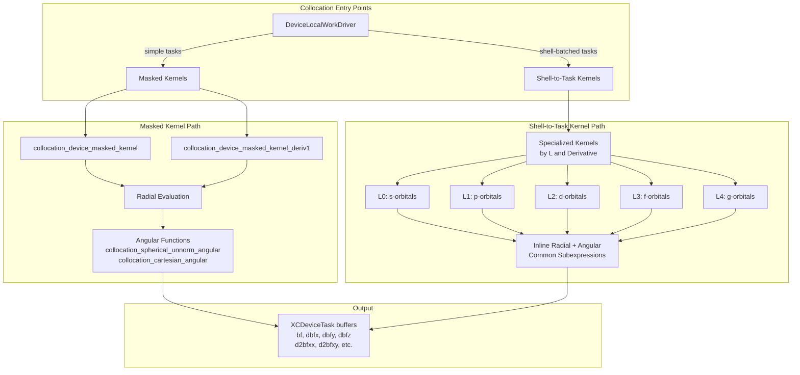

**Sources:** 
- [third_party/gauxc/src/xc_integrator/local_work_driver/device/cuda/kernels/collocation_masked_kernels.hpp:21-72]()
- [third_party/gauxc/src/xc_integrator/local_work_driver/device/cuda/kernels/collocation/collocation_shell_to_task_kernels_spherical_l4_lapgrad.hpp:18-657]()

## Masked Collocation Kernels

Masked collocation kernels use a simple 2D grid organization where each thread evaluates one basis function at one point. This architecture is used for tasks with fewer shells or when shell-to-task batching is not employed.

### Kernel Signature and Grid Organization

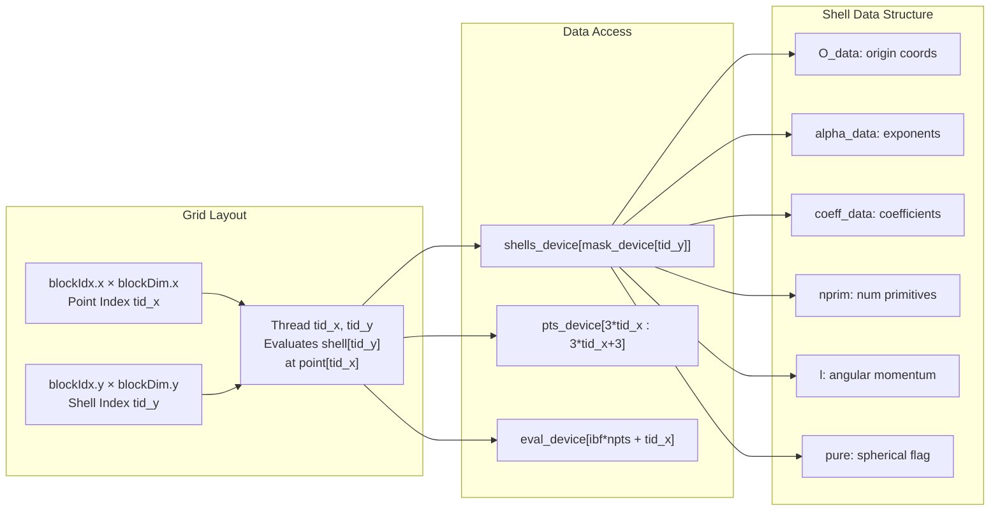

The masked kernel function signatures distinguish between value-only and derivative evaluations:

| Kernel | Output Buffers | Use Case |
|--------|---------------|----------|
| `collocation_device_masked_kernel` | `eval_device` | Basis function values only |
| `collocation_device_masked_kernel_deriv1` | `eval_device`, `deval_device_x/y/z` | First derivatives (gradient) |

**Sources:**
- [third_party/gauxc/src/xc_integrator/local_work_driver/device/cuda/kernels/collocation_masked_kernels.hpp:21-72]()
- [third_party/gauxc/src/xc_integrator/local_work_driver/device/cuda/kernels/collocation_masked_kernels.hpp:81-156]()

### Radial and Angular Separation

Masked kernels separate radial and angular evaluation:

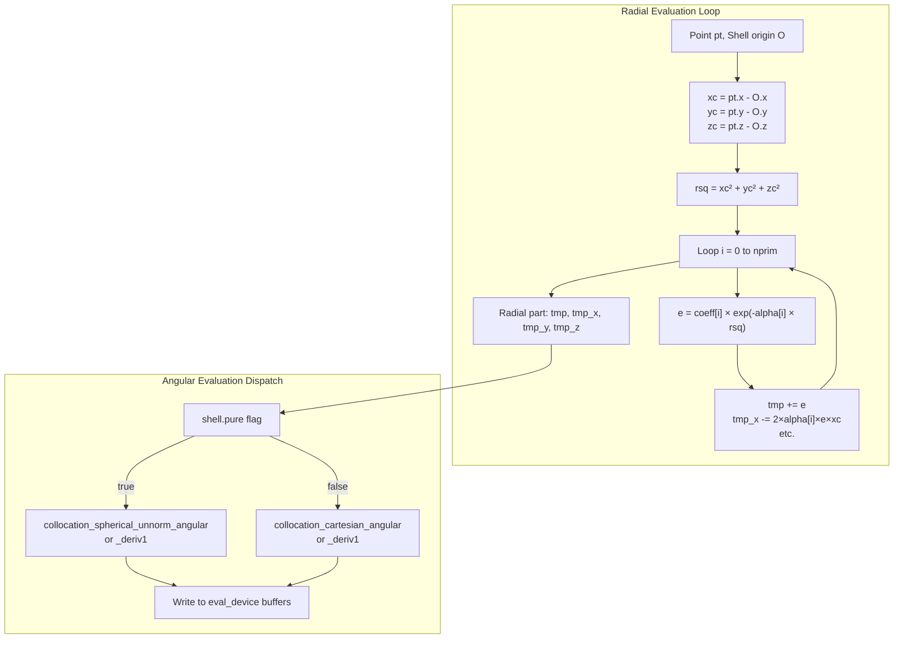

The radial evaluation accumulates Gaussian primitives:

```
radial_eval = Σ(i=0 to nprim) coeff[i] × exp(-alpha[i] × rsq)
```

For derivatives, the chain rule gives:
```
∂/∂x (radial_eval) = Σ(i=0 to nprim) -2×alpha[i]×xc × coeff[i] × exp(-alpha[i] × rsq)
```

**Sources:**
- [third_party/gauxc/src/xc_integrator/local_work_driver/device/cuda/kernels/collocation_masked_kernels.hpp:50-60]()
- [third_party/gauxc/src/xc_integrator/local_work_driver/device/cuda/kernels/collocation_masked_kernels.hpp:118-130]()

## Shell-to-Task Kernels

Shell-to-task kernels are highly specialized kernels where each kernel is compiled for a specific angular momentum and derivative order. They use a 3D grid organization with warp-level parallelism.

### Grid and Warp Organization

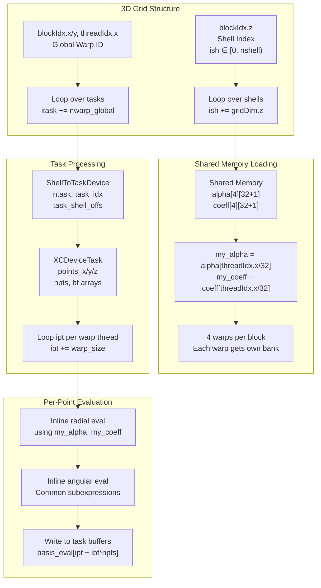

The kernel launch bounds specify occupancy:
```cpp
__global__ __launch_bounds__(128,2) void collocation_device_shell_to_task_kernel_*
```
This indicates 128 threads per block with a minimum of 2 blocks per SM for occupancy.

**Sources:**
- [third_party/gauxc/src/xc_integrator/local_work_driver/device/cuda/kernels/collocation/collocation_shell_to_task_kernels_spherical_l4_lapgrad.hpp:18-29]()
- [third_party/gauxc/src/xc_integrator/local_work_driver/device/cuda/kernels/collocation/collocation_shell_to_task_kernels_spherical_l4_lapgrad.hpp:30-52]()

### Shared Memory Bank Optimization

The shared memory layout is optimized to avoid bank conflicts:

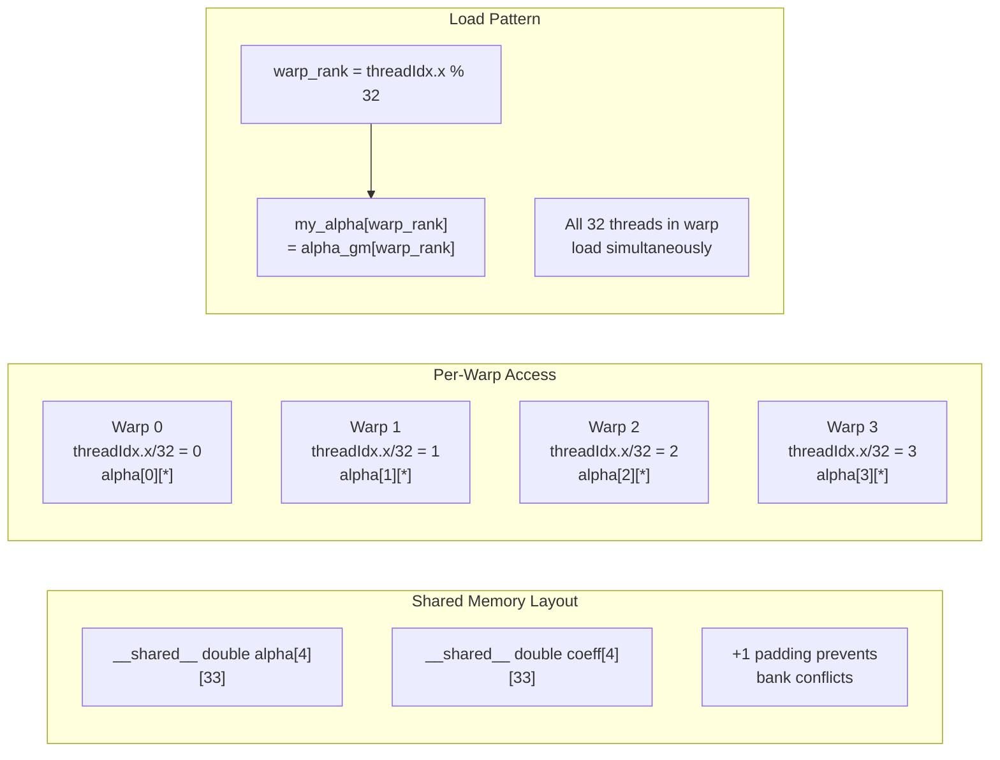

The constant `detail::shell_nprim_max == cuda::warp_size == 32` ensures coalesced loads.

**Sources:**
- [third_party/gauxc/src/xc_integrator/local_work_driver/device/cuda/kernels/collocation/collocation_shell_to_task_kernels_spherical_l4_lapgrad.hpp:25-28]()
- [third_party/gauxc/src/xc_integrator/local_work_driver/device/cuda/kernels/collocation/collocation_shell_to_task_kernels_spherical_l4_lapgrad.hpp:45-52]()

### Inline Radial Evaluation with Derivative Accumulation

Shell-to-task kernels compute radial terms inline without function calls:

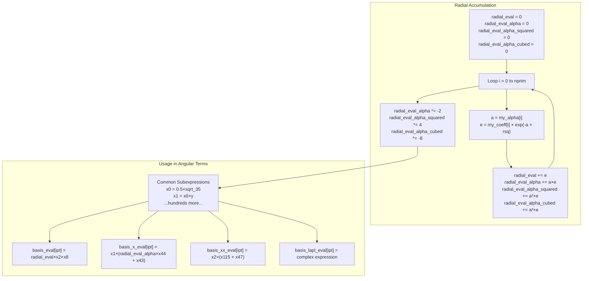

The scaling factors arise from the chain rule:
- `radial_eval_alpha *= -2` because ∂/∂x exp(-a×r²) = -2a×x×exp(-a×r²)
- `radial_eval_alpha_squared *= 4` because second derivatives introduce (2a)² factor
- `radial_eval_alpha_cubed *= -8` because third derivatives introduce -(2a)³ factor

**Sources:**
- [third_party/gauxc/src/xc_integrator/local_work_driver/device/cuda/kernels/collocation/collocation_shell_to_task_kernels_spherical_l4_lapgrad.hpp:97-115]()
- [third_party/gauxc/src/xc_integrator/local_work_driver/device/cuda/kernels/collocation/collocation_shell_to_task_kernels_spherical_l4_lapgrad.hpp:117-398]()

## Kernel Specialization Matrix

Each shell-to-task kernel is specialized for a specific combination of parameters. The full naming pattern is:

```
collocation_device_shell_to_task_kernel_{coord}_{deriv}_{L}
```

### Complete Specialization Table

| Component | Options | Example |
|-----------|---------|---------|
| Coordinate System | `spherical`, `cartesian` | `spherical` |
| Derivative Order | `gradient`, `hessian`, `laplacian`, `lapgrad` | `lapgrad` |
| Angular Momentum | `0`, `1`, `2`, `3`, `4` | `4` |

**Derivative Orders:**

| Name | Outputs | Buffers Written |
|------|---------|-----------------|
| Value (implied) | φ | `bf` |
| `gradient` | φ, ∂φ/∂x, ∂φ/∂y, ∂φ/∂z | `bf`, `dbfx`, `dbfy`, `dbfz` |
| `hessian` | φ, ∂φ/∂x, ∂²φ/∂x², ∂²φ/∂x∂y, etc. | `bf`, `dbfx/y/z`, `d2bfxx/xy/xz/yy/yz/zz` |
| `laplacian` | φ, ∂φ/∂x, ∇²φ | `bf`, `dbfx/y/z`, `d2bflapl` |
| `lapgrad` | φ, ∂φ/∂x, ∇²φ, ∂(∇²φ)/∂x | `bf`, `dbfx/y/z`, `d2bflapl`, `d3bflapl_x/y/z` |

**Angular Momentum (L) and Basis Function Counts:**

| L | Symbol | Spherical Count | Cartesian Count | File Pattern |
|---|--------|-----------------|-----------------|--------------|
| 0 | s | 1 | 1 | `*_l0_*.hpp` |
| 1 | p | 3 | 3 | `*_l1_*.hpp` |
| 2 | d | 5 | 6 | `*_l2_*.hpp` |
| 3 | f | 7 | 10 | `*_l3_*.hpp` |
| 4 | g | 9 | 15 | `*_l4_*.hpp` |

### Example Kernel Instances

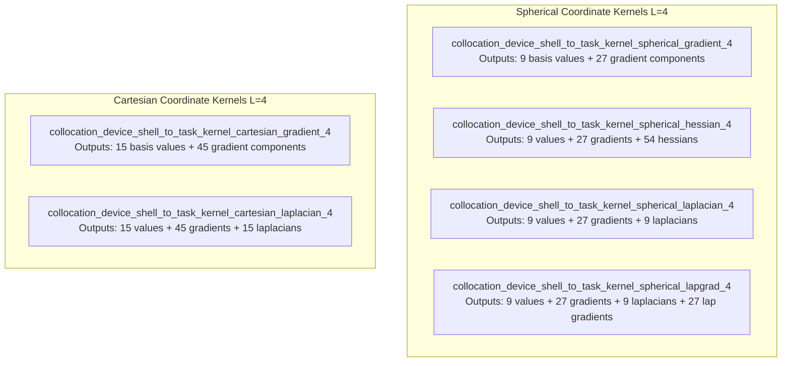

**Sources:**
- [third_party/gauxc/src/xc_integrator/local_work_driver/device/cuda/kernels/collocation/collocation_shell_to_task_kernels_spherical_l4_lapgrad.hpp:18]()
- [third_party/gauxc/src/xc_integrator/local_work_driver/device/cuda/kernels/collocation/collocation_shell_to_task_kernels_spherical_l4_hessian.hpp:18]()
- [third_party/gauxc/src/xc_integrator/local_work_driver/device/cuda/kernels/collocation/collocation_shell_to_task_kernels_cartesian_l4_gradient.hpp:18]()

## Common Subexpression Evaluation

Shell-to-task kernels extensively use common subexpression (CSE) optimization. The compiler-generated CSE terms are computed once and reused across all derivative evaluations.

### CSE Pattern for L=4 Spherical Lapgrad

The kernel computes hundreds of common subexpressions:

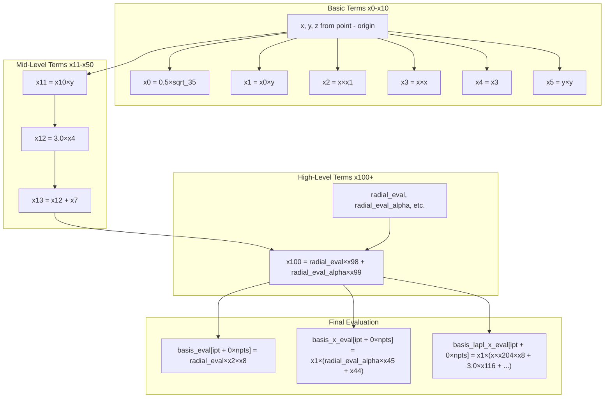

For the L=4 spherical lapgrad kernel, there are 279 common subexpressions (x0 through x278) computed before any basis function output.

**Example CSE dependencies** from [third_party/gauxc/src/xc_integrator/local_work_driver/device/cuda/kernels/collocation/collocation_shell_to_task_kernels_spherical_l4_lapgrad.hpp:118-398]():
```cpp
const auto x0 = 0.5*sqrt_35;          // constant factor
const auto x1 = x0*y;                 // scaled y coordinate
const auto x2 = x*x1;                 // x×y term
const auto x13 = x12 + x7;            // polynomial combination
const auto x100 = radial_eval*x98 + radial_eval_alpha*x99;  // radial+angular mixing
```

**Sources:**
- [third_party/gauxc/src/xc_integrator/local_work_driver/device/cuda/kernels/collocation/collocation_shell_to_task_kernels_spherical_l4_lapgrad.hpp:118-398]()

## Output Buffer Organization

Collocation kernels write to `XCDeviceTask` buffers with a specific memory layout:

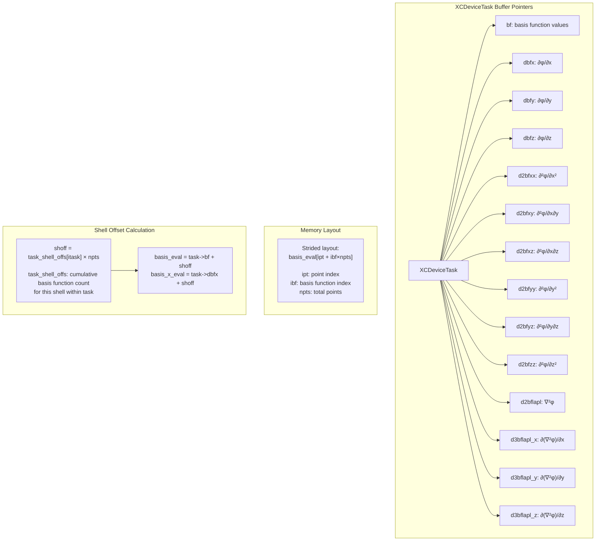

The strided layout `[ipt + ibf*npts]` ensures:
- Coalesced writes within a warp (consecutive threads write consecutive points)
- Contiguous storage of all points for a single basis function
- Efficient access patterns for subsequent density evaluation kernels

**Sources:**
- [third_party/gauxc/src/xc_integrator/local_work_driver/device/cuda/kernels/collocation/collocation_shell_to_task_kernels_spherical_l4_lapgrad.hpp:58-78]()
- [third_party/gauxc/src/xc_integrator/local_work_driver/device/cuda/kernels/collocation/collocation_shell_to_task_kernels_spherical_l4_lapgrad.hpp:401-553]()

## Performance Optimizations

### Loop Unrolling Pragma

Critical loops use `#pragma unroll 1` to prevent automatic unrolling:

```cpp
#pragma unroll 1
for( int ipt = threadIdx.x % cuda::warp_size; ipt < npts; ipt += cuda::warp_size ) {
    // point evaluation
}

#pragma unroll 1
for( uint32_t i = 0; i < nprim; ++i ) {
    // primitive accumulation
}
```

This prevents register pressure from excessive unrolling while allowing manual optimization of the kernel body.

### Register Usage Strategy

The kernels balance register usage across competing demands:

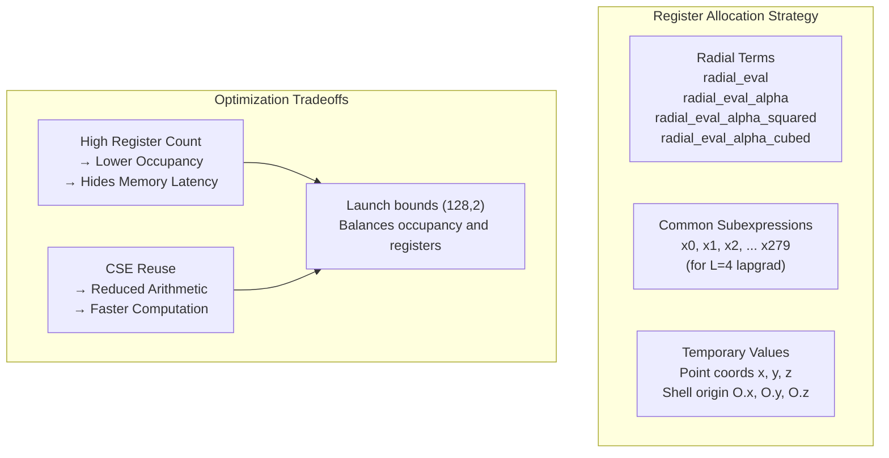

The `__launch_bounds__(128,2)` directive ensures at least 2 thread blocks per SM, preventing excessive register allocation from limiting occupancy.

### Shared Memory Coalescing

The coefficient/exponent loading pattern ensures coalesced global memory access:

```cpp
static_assert( detail::shell_nprim_max == cuda::warp_size );
const int warp_rank = threadIdx.x % cuda::warp_size;
my_alpha[warp_rank] = alpha_gm[warp_rank];  // All 32 threads load consecutively
my_coeff[warp_rank] = coeff_gm[warp_rank];
```

This produces a single 256-byte (32 doubles) coalesced transaction per warp.

**Sources:**
- [third_party/gauxc/src/xc_integrator/local_work_driver/device/cuda/kernels/collocation/collocation_shell_to_task_kernels_spherical_l4_lapgrad.hpp:73-83]()
- [third_party/gauxc/src/xc_integrator/local_work_driver/device/cuda/kernels/collocation/collocation_shell_to_task_kernels_spherical_l4_lapgrad.hpp:102-111]()
- [third_party/gauxc/src/xc_integrator/local_work_driver/device/cuda/kernels/collocation/collocation_shell_to_task_kernels_spherical_l4_lapgrad.hpp:18]()

## Platform Abstraction: CUDA and HIP

Collocation kernels are implemented for both CUDA (NVIDIA) and HIP (AMD) platforms through separate file hierarchies:

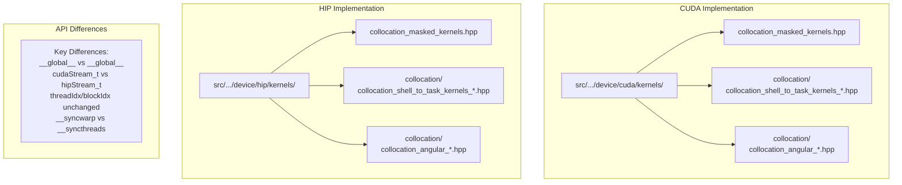

The implementations are nearly identical; the primary difference is the inclusion of platform-specific headers:

**CUDA:**
```cpp
// No special include, CUDA intrinsics available by default
```

**HIP:**
```cpp
#include "hip/hip_runtime.h"
```

Both platforms use the same kernel logic, warp size (32), and shared memory patterns.

**Sources:**
- [third_party/gauxc/src/xc_integrator/local_work_driver/device/cuda/kernels/collocation_masked_kernels.hpp:1-9]()
- [third_party/gauxc/src/xc_integrator/local_work_driver/device/hip/kernels/collocation_masked_kernels.hpp:1-16]()

## Radial Evaluation Utilities

For masked kernels, radial evaluation is factored into utility functions in `collocation_radial.hpp`:

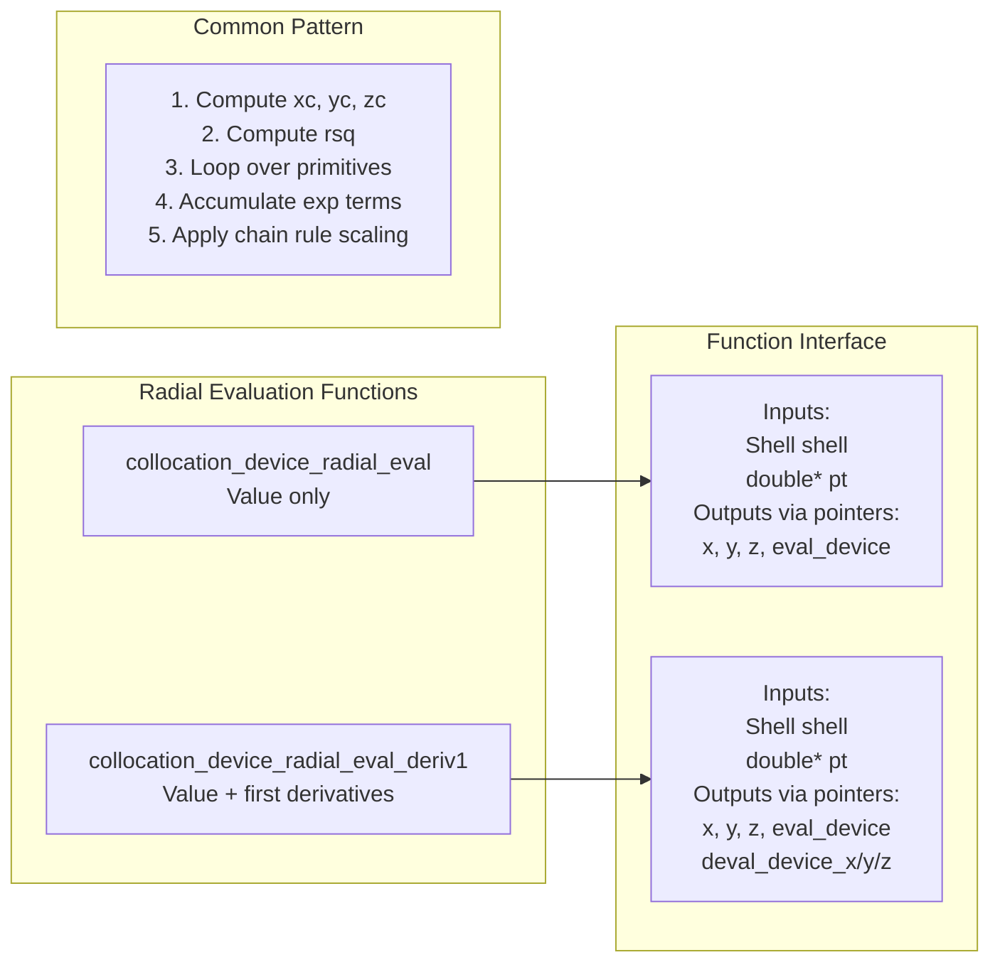

These inline device functions are called by masked kernels to separate concerns:

```cpp
__inline__ __device__ void collocation_device_radial_eval(
  const Shell<double>& shell, const double* pt,
  double* x, double* y, double* z, double* eval_device
)
```

**Sources:**
- [third_party/gauxc/src/xc_integrator/local_work_driver/device/cuda/kernels/collocation/collocation_radial.hpp:16-45]()
- [third_party/gauxc/src/xc_integrator/local_work_driver/device/cuda/kernels/collocation/collocation_radial.hpp:49-96]()

## Task Assignment: ShellToTaskDevice Structure

The `ShellToTaskDevice` structure coordinates mapping between shells and computational tasks:

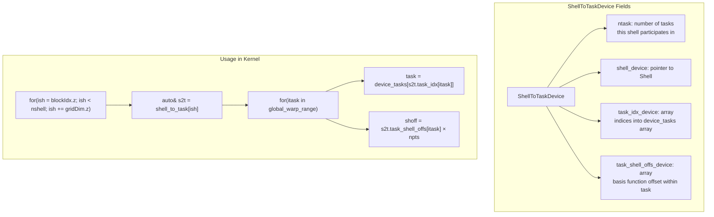

This structure enables:
- One shell to contribute to multiple tasks
- Efficient warp-level distribution across tasks
- Correct indexing into task-specific basis function buffers

**Sources:**
- [third_party/gauxc/src/xc_integrator/local_work_driver/device/cuda/kernels/collocation/collocation_shell_to_task_kernels_spherical_l4_lapgrad.hpp:30-34]()
- [third_party/gauxc/src/xc_integrator/local_work_driver/device/cuda/kernels/collocation/collocation_shell_to_task_kernels_spherical_l4_lapgrad.hpp:54-63]()

---

