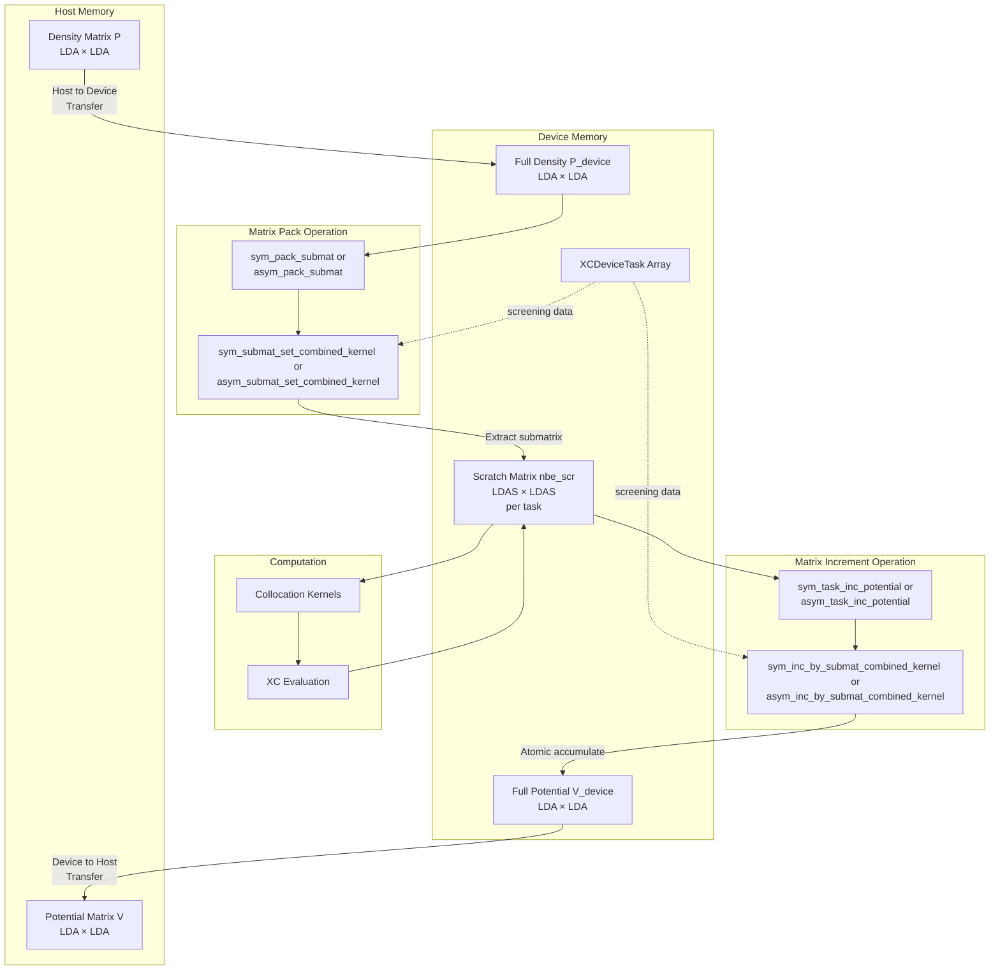
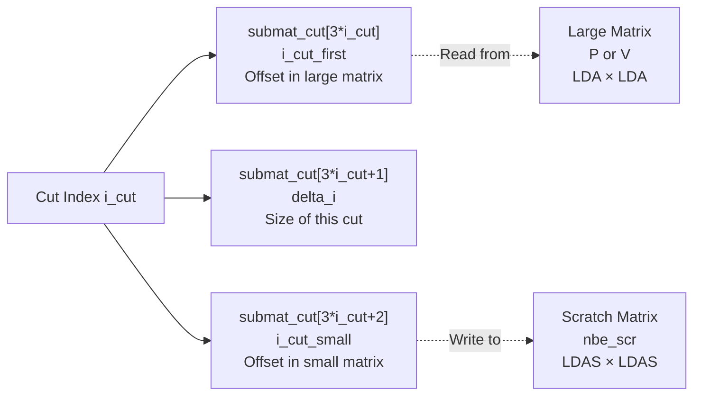
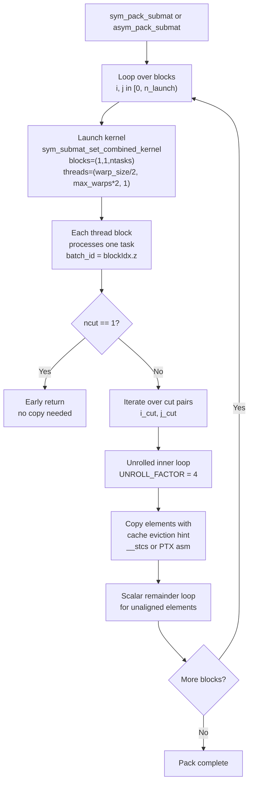
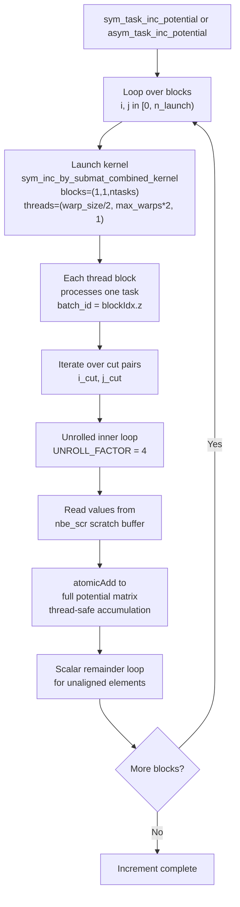

<!-- source: DeepWiki mcp.deepwiki.com · repo microsoft/skala · page 7.3 Matrix Operations · fetched 2026-10-26 -->

# Matrix Operations

<details>
<summary>Relevant source files</summary>

The following files were used as context for generating this wiki page:

- [third_party/gauxc/attic/src/integrator/cuda/cuda_pack_density.cu](third_party/gauxc/attic/src/integrator/cuda/cuda_pack_density.cu)
- [third_party/gauxc/attic/src/new_integrator/device/cuda/cuda_inc_potential.cu](third_party/gauxc/attic/src/new_integrator/device/cuda/cuda_inc_potential.cu)
- [third_party/gauxc/attic/src/new_integrator/device/cuda/cuda_pack_density.cu](third_party/gauxc/attic/src/new_integrator/device/cuda/cuda_pack_density.cu)
- [third_party/gauxc/attic/src/new_integrator/device/hip/hip_inc_potential.hip](third_party/gauxc/attic/src/new_integrator/device/hip/hip_inc_potential.hip)
- [third_party/gauxc/attic/src/new_integrator/device/hip/hip_pack_density.hip](third_party/gauxc/attic/src/new_integrator/device/hip/hip_pack_density.hip)
- [third_party/gauxc/src/xc_integrator/local_work_driver/device/cuda/kernels/cuda_inc_potential.cu](third_party/gauxc/src/xc_integrator/local_work_driver/device/cuda/kernels/cuda_inc_potential.cu)
- [third_party/gauxc/src/xc_integrator/local_work_driver/device/cuda/kernels/pack_submat.cu](third_party/gauxc/src/xc_integrator/local_work_driver/device/cuda/kernels/pack_submat.cu)
- [third_party/gauxc/src/xc_integrator/local_work_driver/device/hip/kernels/hip_inc_potential.hip](third_party/gauxc/src/xc_integrator/local_work_driver/device/hip/kernels/hip_inc_potential.hip)
- [third_party/gauxc/src/xc_integrator/local_work_driver/device/hip/kernels/pack_submat.hip](third_party/gauxc/src/xc_integrator/local_work_driver/device/hip/kernels/pack_submat.hip)

</details>


## Purpose and Scope

This document describes the GPU matrix operation kernels in GauXC that manage data transfer between full-size density/potential matrices and task-specific submatrices. These operations enable efficient GPU computation by extracting only the basis function subsets relevant to each task, thereby reducing memory footprint and computational cost.

For information about the broader device execution pipeline, see [Device Computation](#7). For details on the task structure and shell screening that determines submatrix bounds, see [Task System and Data Structures](#4.3).

## Overview

Matrix operations in GauXC serve two complementary purposes in the device execution pipeline:

1. **Pack Density**: Extract task-relevant submatrices from the full density matrix **P** (size LDA × LDA) into compact scratch matrices (size LDAS × LDAS) on the device before computation
2. **Increment Potential**: Accumulate computed contributions from scratch matrices back into the full potential matrix **V** (size LDA × LDA) using atomic operations

Both operations come in symmetric and asymmetric variants to handle different computational scenarios (e.g., LDA/GGA functionals vs. exact exchange).



Sources: [src/xc_integrator/local_work_driver/device/cuda/kernels/pack_submat.cu:1-243](), [src/xc_integrator/local_work_driver/device/cuda/kernels/cuda_inc_potential.cu:1-223]()

## Data Structures and Screening System

### XCDeviceTask Structure

Each task contains screening metadata that defines which submatrix regions are relevant:

| Field | Type | Description |
|-------|------|-------------|
| `bfn_screening.submat_cut` | `int32_t*` | Array of cut descriptors (3 integers per cut) |
| `bfn_screening.submat_block` | `int32_t*` | Block boundaries for tiled execution |
| `bfn_screening.nbe` | `int32_t` | Leading dimension of small matrix (LDAS) |
| `bfn_screening.ncut` | `int32_t` | Number of cuts in the screening |
| `cou_screening.submat_cut` | `int32_t*` | Column cut descriptors (asymmetric only) |
| `cou_screening.submat_block` | `int32_t*` | Column block boundaries (asymmetric only) |
| `nbe_scr` | `double*` | Pointer to scratch matrix buffer |

### Submatrix Cut Descriptor

Each cut is described by three consecutive integers in the `submat_cut` array:



Sources: [src/xc_integrator/local_work_driver/device/cuda/kernels/pack_submat.cu:58-67](), [src/xc_integrator/local_work_driver/device/cuda/kernels/cuda_inc_potential.cu:54-63]()

### Symmetric vs Asymmetric Screening

| Operation | Row Screening | Column Screening | Use Case |
|-----------|---------------|------------------|----------|
| Symmetric | `bfn_screening` | `bfn_screening` (same) | LDA, GGA functionals; density matrix is symmetric |
| Asymmetric | `bfn_screening` | `cou_screening` | Exact exchange; density matrix need not be symmetric |

Sources: [src/xc_integrator/local_work_driver/device/cuda/kernels/pack_submat.cu:134-217](), [src/xc_integrator/local_work_driver/device/cuda/kernels/cuda_inc_potential.cu:123-196]()

## Pack Density Operations

Pack operations extract submatrices from the full density matrix on device memory into task-specific scratch buffers.

### Symmetric Pack

**Function**: `sym_pack_submat(size_t ntasks, XCDeviceTask* device_tasks, const double* A, int32_t LDA, int32_t submat_block_size, device_queue queue)`

**Kernel**: `sym_submat_set_combined_kernel`

This operation reads from a large symmetric matrix `A` and writes to each task's `nbe_scr` buffer:

```
ASmall[i_cut_small + j_cut_small*LDAS] = ABig[i_cut_first + j_cut_first*LDA]
```

The kernel iterates over all cut pairs (i_cut, j_cut) from the same `bfn_screening.submat_cut` array.

**Key Implementation Details**:
- Early exit for single-cut tasks: `if (task.bfn_screening.ncut == 1) return` [pack_submat.cu:36]()
- Cache eviction hints using `__stcs` or inline PTX assembly to suggest eviction of written data [pack_submat.cu:86-90]()
- Block-tiled execution using `submat_block_size` to divide work across multiple kernel launches

Sources: [src/xc_integrator/local_work_driver/device/cuda/kernels/pack_submat.cu:109-124](), [src/xc_integrator/local_work_driver/device/cuda/kernels/pack_submat.cu:22-102]()

### Asymmetric Pack

**Function**: `asym_pack_submat(size_t ntasks, XCDeviceTask* device_tasks, const double* A, int32_t LDA, int32_t submat_block_size, device_queue queue)`

**Kernel**: `asym_submat_set_combined_kernel`

Similar to symmetric pack but uses separate row and column screening:
- Row indices from `bfn_screening.submat_cut`
- Column indices from `cou_screening.submat_cut`

This allows extraction of rectangular (non-symmetric) submatrices for operations like exact exchange where the density matrix structure differs.

Sources: [src/xc_integrator/local_work_driver/device/cuda/kernels/pack_submat.cu:224-239](), [src/xc_integrator/local_work_driver/device/cuda/kernels/pack_submat.cu:134-217]()

### Pack Operation Flow



Sources: [src/xc_integrator/local_work_driver/device/cuda/kernels/pack_submat.cu:109-124](), [src/xc_integrator/local_work_driver/device/cuda/kernels/pack_submat.cu:57-101]()

## Increment Potential Operations

Increment operations perform the inverse operation: they accumulate computed values from scratch buffers back into the full potential matrix using atomic operations.

### Symmetric Increment

**Function**: `sym_task_inc_potential(size_t ntasks, XCDeviceTask* device_tasks, double* V_device, size_t LDV, size_t submat_block_size, device_queue queue)`

**Kernel**: `sym_inc_by_submat_combined_kernel`

This operation reads from each task's `nbe_scr` buffer and atomically adds to the large matrix `V`:

```
atomicAdd(ABig + I + J*LDA, ASmall[I + J*LDAS])
```

**Atomic Operations**: Required because multiple tasks may contribute to the same matrix element. The `atomicAdd` ensures thread-safe accumulation.

Sources: [src/xc_integrator/local_work_driver/device/cuda/kernels/cuda_inc_potential.cu:97-117](), [src/xc_integrator/local_work_driver/device/cuda/kernels/cuda_inc_potential.cu:25-94]()

### Asymmetric Increment

**Function**: `asym_task_inc_potential(size_t ntasks, XCDeviceTask* device_tasks, double* V_device, size_t LDV, size_t submat_block_size, device_queue queue)`

**Kernel**: `asym_inc_by_submat_combined_kernel`

Uses separate row (`bfn_screening`) and column (`cou_screening`) indices to handle non-symmetric potential matrices.

Sources: [src/xc_integrator/local_work_driver/device/cuda/kernels/cuda_inc_potential.cu:198-218](), [src/xc_integrator/local_work_driver/device/cuda/kernels/cuda_inc_potential.cu:123-196]()

### Increment Operation Flow



Sources: [src/xc_integrator/local_work_driver/device/cuda/kernels/cuda_inc_potential.cu:97-117](), [src/xc_integrator/local_work_driver/device/cuda/kernels/cuda_inc_potential.cu:68-90]()

## Thread Organization and Kernel Configuration

### Thread Block Layout

All matrix operation kernels use a fixed thread block configuration:

```c++
dim3 threads(cuda::warp_size/2, cuda::max_warps_per_thread_block * 2, 1);
// Typically: threads(16, 8, 1) = 128 threads per block
dim3 blocks(1, 1, ntasks);
// One block per task in z-dimension
```

**Thread Indexing**:
- `tid_xx = threadIdx.x % WARP_X` (typically 0-15)
- `tid_xy = threadIdx.x / WARP_X` (typically 0-7 for first warp half)
- `tid_yx = threadIdx.y % CUT_X` (typically 0-7)
- `tid_yy = threadIdx.y / CUT_X` (typically 0)

This organization enables:
- WARP_X (16) threads to process contiguous matrix rows
- Multiple warps (tid_xy, tid_yy) to process different columns and cuts
- Block-level parallelism over tasks (blockIdx.z)

Sources: [src/xc_integrator/local_work_driver/device/cuda/kernels/pack_submat.cu:114](), [src/xc_integrator/local_work_driver/device/cuda/kernels/cuda_inc_potential.cu:106]()

### Launch Bounds and Occupancy

```c++
__global__ __launch_bounds__(1024, 1)
```

- Maximum threads per block: 1024
- Minimum blocks per SM: 1 (conservative to maximize register availability)

Sources: [src/xc_integrator/local_work_driver/device/cuda/kernels/pack_submat.cu:23](), [src/xc_integrator/local_work_driver/device/cuda/kernels/cuda_inc_potential.cu:25]()

### Block-Tiled Execution

To handle large matrices, both pack and increment operations use block-tiled launches:

```c++
auto n_launch = util::div_ceil(LDA, submat_block_size);
for (int i = 0; i < n_launch; i++) 
for (int j = 0; j < n_launch; j++) {
    kernel<<<blocks, threads, 0, stream>>>(ntasks, device_tasks, A, LDA, i, j);
}
```

The kernel uses `submat_block_device[block_y]` and `submat_block_device[block_x]` to determine which cuts fall within the current tile, limiting the iteration space and improving cache locality.

Sources: [src/xc_integrator/local_work_driver/device/cuda/kernels/pack_submat.cu:109-124](), [src/xc_integrator/local_work_driver/device/cuda/kernels/cuda_inc_potential.cu:109-116]()

## Optimizations

### Loop Unrolling

Both kernels employ explicit loop unrolling with `UNROLL_FACTOR = 4`:

```c++
#define UNROLL_FACTOR 4
#define EFF_UNROLL 4  // Effective unroll for column iteration

for(J = tid_xy; J < (delta_j / EFF_UNROLL) * EFF_UNROLL; J += EFF_UNROLL) {
    for(int I = tid_xx; I < delta_i; I += WARP_X) {
        double val[UNROLL_FACTOR];
        double* address[UNROLL_FACTOR];
        #pragma unroll
        for (int k = 0; k < UNROLL_FACTOR; k++) {
            val[k] = ABig_begin[I + (J + k*WARP_Y)*LDA];
            address[k] = ASmall_begin + I + (J + k*WARP_Y) * LDAS;
        }
        #pragma unroll
        for (int k = 0; k < UNROLL_FACTOR; k++) {
            // Store operation
        }
    }
}
```

This reduces loop overhead and enables better instruction-level parallelism.

Sources: [src/xc_integrator/local_work_driver/device/cuda/kernels/pack_submat.cu:72-93](), [src/xc_integrator/local_work_driver/device/cuda/kernels/cuda_inc_potential.cu:72-84]()

### Cache Eviction Hints (Pack Only)

Pack operations use cache streaming stores to suggest eviction of written data:

```c++
#if (CUDART_VERSION >= 11000)
    __stcs(address[k], val[k]);
#else
    asm ("st.global.cs.f64 [%0], %1;" :: "l"(address[k]), "d"(val[k]));
#endif
```

The `.cs` cache modifier indicates "cache streaming" - the data is written through the cache but marked for early eviction. This is beneficial because the packed scratch matrices are immediately consumed by collocation kernels and do not need to persist in cache.

Sources: [src/xc_integrator/local_work_driver/device/cuda/kernels/pack_submat.cu:86-90]()

### Scalar Remainder Loop

After the unrolled loop, a scalar loop handles remaining elements:

```c++
for ( ; J < delta_j; J += WARP_Y) {
    for( int I = tid_xx; I < delta_i; I += WARP_X ) {
        // Scalar copy or atomic operation
    }
}
```

This ensures correctness when `delta_j` is not a multiple of `EFF_UNROLL`.

Sources: [src/xc_integrator/local_work_driver/device/cuda/kernels/pack_submat.cu:95-99](), [src/xc_integrator/local_work_driver/device/cuda/kernels/cuda_inc_potential.cu:86-90]()

### Performance Characteristics

| Operation | Memory Pattern | Atomic Required | Cache Hint |
|-----------|----------------|-----------------|------------|
| Pack (Symmetric) | Read LDA-strided, Write LDAS-strided | No | Stream evict (.cs) |
| Pack (Asymmetric) | Read LDA-strided, Write LDAS-strided | No | Stream evict (.cs) |
| Increment (Symmetric) | Read LDAS-strided, Write LDA-strided | Yes (atomicAdd) | Default |
| Increment (Asymmetric) | Read LDAS-strided, Write LDA-strided | Yes (atomicAdd) | Default |

**Bottleneck Analysis**:
- Pack operations are typically memory-bandwidth limited due to streaming reads/writes
- Increment operations may be limited by atomic serialization when many tasks contribute to the same matrix elements
- Block-tiled execution improves cache reuse for both operations

Sources: [src/xc_integrator/local_work_driver/device/cuda/kernels/pack_submat.cu:1-243](), [src/xc_integrator/local_work_driver/device/cuda/kernels/cuda_inc_potential.cu:1-223]()

## Platform Support

Matrix operations are implemented for both CUDA and HIP:

### CUDA Implementation
- [src/xc_integrator/local_work_driver/device/cuda/kernels/pack_submat.cu]()
- [src/xc_integrator/local_work_driver/device/cuda/kernels/cuda_inc_potential.cu]()

### HIP Implementation
- [src/xc_integrator/local_work_driver/device/hip/kernels/pack_submat.hip]()
- [src/xc_integrator/local_work_driver/device/hip/kernels/hip_inc_potential.hip]()

**Note**: The HIP implementation uses a simpler thread organization without the advanced unrolling and cache hints present in the CUDA version [pack_submat.hip:18-67](), [hip_inc_potential.hip:17-63]().

For details on platform abstraction, see [Platform Abstraction: CUDA and HIP](#9).

Sources: [src/xc_integrator/local_work_driver/device/cuda/kernels/pack_submat.cu:1-243](), [src/xc_integrator/local_work_driver/device/hip/kernels/pack_submat.hip:1-81]()

---

