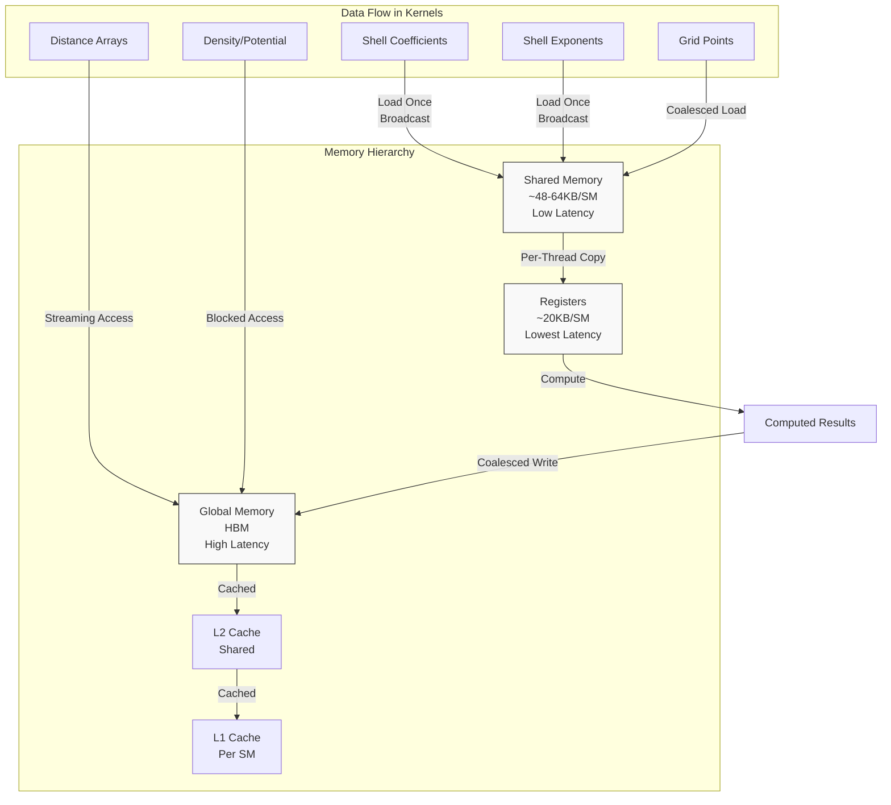
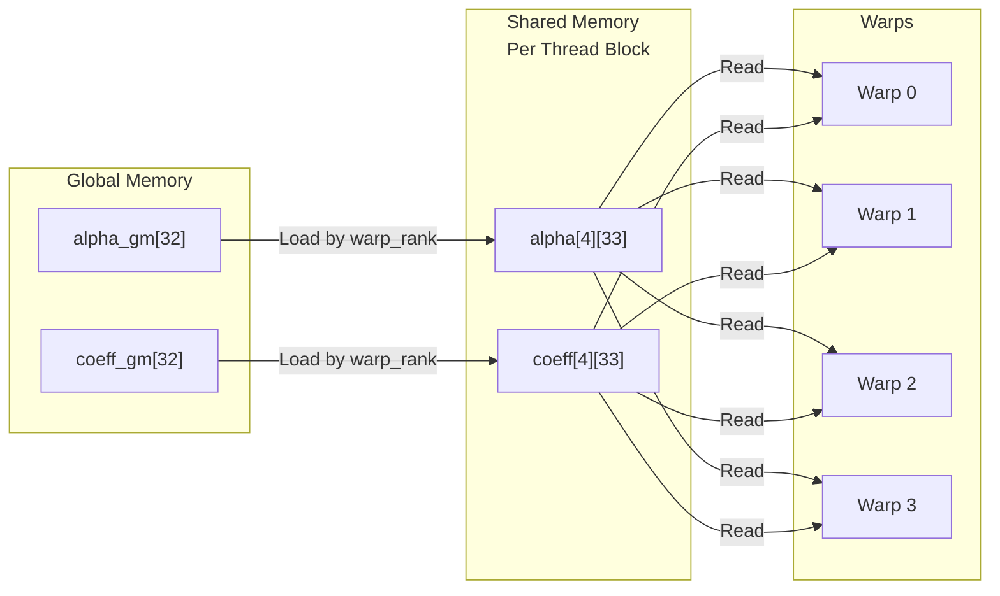
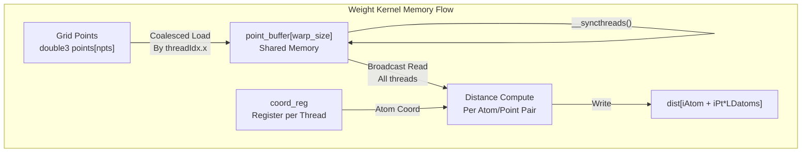
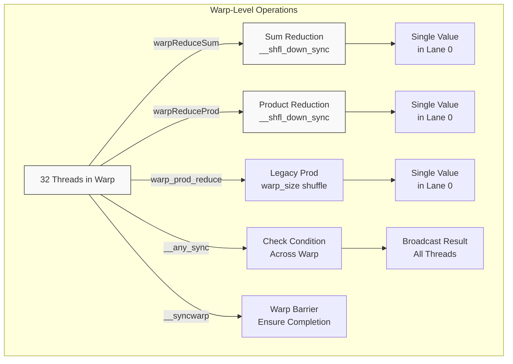
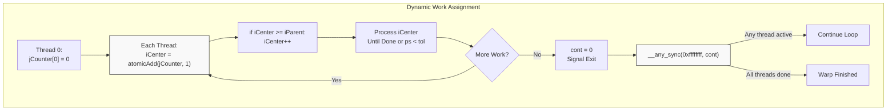
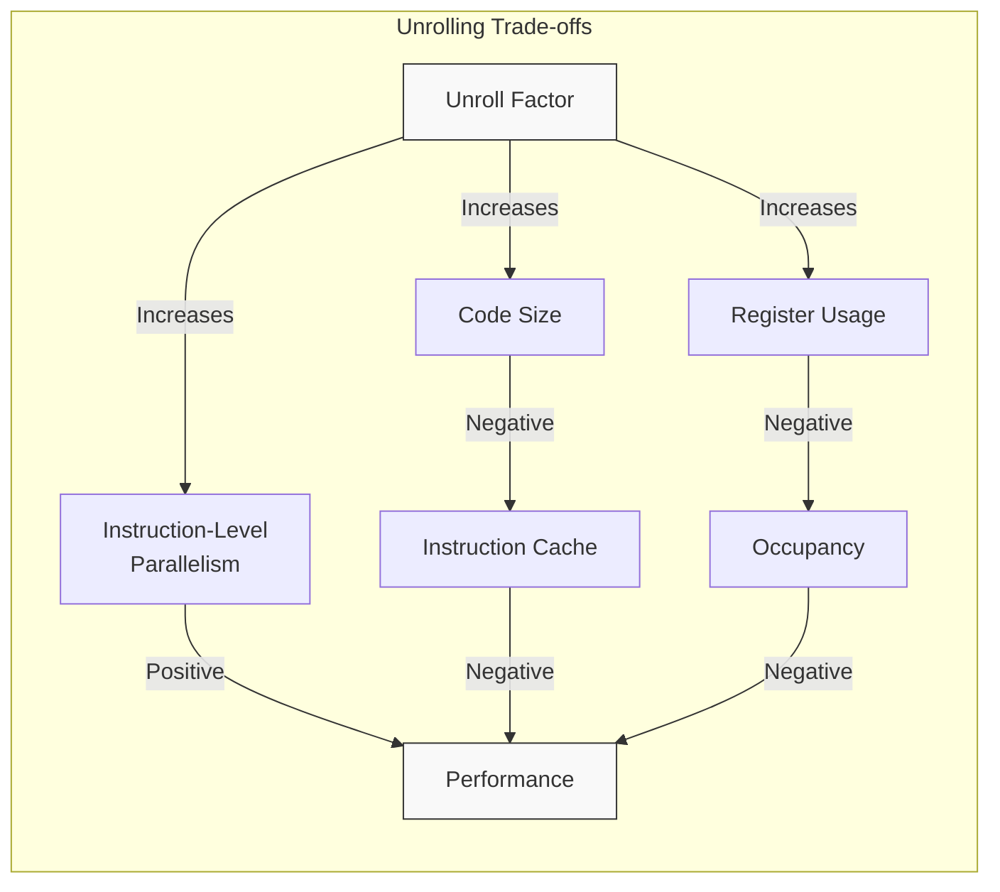
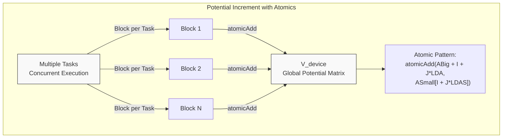
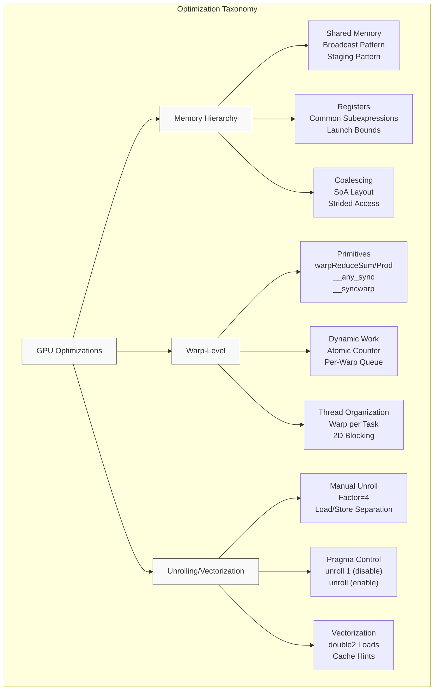

<!-- source: DeepWiki mcp.deepwiki.com · repo microsoft/skala · page 8 GPU Kernel Optimization Techniques · fetched 2026-10-26 -->

# GPU Kernel Optimization Techniques

<details>
<summary>Relevant source files</summary>

The following files were used as context for generating this wiki page:

- [third_party/gauxc/attic/src/integrator/cuda/cuda_pack_density.cu](third_party/gauxc/attic/src/integrator/cuda/cuda_pack_density.cu)
- [third_party/gauxc/attic/src/integrator/cuda/cuda_weights.cu](third_party/gauxc/attic/src/integrator/cuda/cuda_weights.cu)
- [third_party/gauxc/attic/src/new_integrator/device/cuda/cuda_inc_potential.cu](third_party/gauxc/attic/src/new_integrator/device/cuda/cuda_inc_potential.cu)
- [third_party/gauxc/attic/src/new_integrator/device/cuda/cuda_pack_density.cu](third_party/gauxc/attic/src/new_integrator/device/cuda/cuda_pack_density.cu)
- [third_party/gauxc/attic/src/new_integrator/device/cuda/cuda_weights.cu](third_party/gauxc/attic/src/new_integrator/device/cuda/cuda_weights.cu)
- [third_party/gauxc/attic/src/new_integrator/device/hip/hip_inc_potential.hip](third_party/gauxc/attic/src/new_integrator/device/hip/hip_inc_potential.hip)
- [third_party/gauxc/attic/src/new_integrator/device/hip/hip_pack_density.hip](third_party/gauxc/attic/src/new_integrator/device/hip/hip_pack_density.hip)
- [third_party/gauxc/attic/src/new_integrator/device/hip/hip_weights.hip](third_party/gauxc/attic/src/new_integrator/device/hip/hip_weights.hip)
- [third_party/gauxc/src/xc_integrator/local_work_driver/device/cuda/kernels/collocation/collocation_shell_to_task_kernels_cartesian_l1.hpp](third_party/gauxc/src/xc_integrator/local_work_driver/device/cuda/kernels/collocation/collocation_shell_to_task_kernels_cartesian_l1.hpp)
- [third_party/gauxc/src/xc_integrator/local_work_driver/device/cuda/kernels/collocation/collocation_shell_to_task_kernels_cartesian_l1_laplacian.hpp](third_party/gauxc/src/xc_integrator/local_work_driver/device/cuda/kernels/collocation/collocation_shell_to_task_kernels_cartesian_l1_laplacian.hpp)
- [third_party/gauxc/src/xc_integrator/local_work_driver/device/cuda/kernels/collocation/collocation_shell_to_task_kernels_cartesian_l2_laplacian.hpp](third_party/gauxc/src/xc_integrator/local_work_driver/device/cuda/kernels/collocation/collocation_shell_to_task_kernels_cartesian_l2_laplacian.hpp)
- [third_party/gauxc/src/xc_integrator/local_work_driver/device/cuda/kernels/collocation/collocation_shell_to_task_kernels_spherical_l0_laplacian.hpp](third_party/gauxc/src/xc_integrator/local_work_driver/device/cuda/kernels/collocation/collocation_shell_to_task_kernels_spherical_l0_laplacian.hpp)
- [third_party/gauxc/src/xc_integrator/local_work_driver/device/cuda/kernels/collocation/collocation_shell_to_task_kernels_spherical_l1_gradient.hpp](third_party/gauxc/src/xc_integrator/local_work_driver/device/cuda/kernels/collocation/collocation_shell_to_task_kernels_spherical_l1_gradient.hpp)
- [third_party/gauxc/src/xc_integrator/local_work_driver/device/cuda/kernels/collocation/collocation_shell_to_task_kernels_spherical_l1_laplacian.hpp](third_party/gauxc/src/xc_integrator/local_work_driver/device/cuda/kernels/collocation/collocation_shell_to_task_kernels_spherical_l1_laplacian.hpp)
- [third_party/gauxc/src/xc_integrator/local_work_driver/device/cuda/kernels/collocation/collocation_shell_to_task_kernels_spherical_l2_laplacian.hpp](third_party/gauxc/src/xc_integrator/local_work_driver/device/cuda/kernels/collocation/collocation_shell_to_task_kernels_spherical_l2_laplacian.hpp)
- [third_party/gauxc/src/xc_integrator/local_work_driver/device/cuda/kernels/collocation/collocation_shell_to_task_kernels_spherical_l3_lapgrad.hpp](third_party/gauxc/src/xc_integrator/local_work_driver/device/cuda/kernels/collocation/collocation_shell_to_task_kernels_spherical_l3_lapgrad.hpp)
- [third_party/gauxc/src/xc_integrator/local_work_driver/device/cuda/kernels/collocation/collocation_shell_to_task_kernels_spherical_l4_laplacian.hpp](third_party/gauxc/src/xc_integrator/local_work_driver/device/cuda/kernels/collocation/collocation_shell_to_task_kernels_spherical_l4_laplacian.hpp)
- [third_party/gauxc/src/xc_integrator/local_work_driver/device/cuda/kernels/cuda_inc_potential.cu](third_party/gauxc/src/xc_integrator/local_work_driver/device/cuda/kernels/cuda_inc_potential.cu)
- [third_party/gauxc/src/xc_integrator/local_work_driver/device/cuda/kernels/cuda_ssf_1d.cu](third_party/gauxc/src/xc_integrator/local_work_driver/device/cuda/kernels/cuda_ssf_1d.cu)
- [third_party/gauxc/src/xc_integrator/local_work_driver/device/cuda/kernels/cuda_ssf_2d.hu](third_party/gauxc/src/xc_integrator/local_work_driver/device/cuda/kernels/cuda_ssf_2d.hu)
- [third_party/gauxc/src/xc_integrator/local_work_driver/device/cuda/kernels/grid_to_center.cu](third_party/gauxc/src/xc_integrator/local_work_driver/device/cuda/kernels/grid_to_center.cu)
- [third_party/gauxc/src/xc_integrator/local_work_driver/device/cuda/kernels/pack_submat.cu](third_party/gauxc/src/xc_integrator/local_work_driver/device/cuda/kernels/pack_submat.cu)
- [third_party/gauxc/src/xc_integrator/local_work_driver/device/hip/kernels/grid_to_center.hip](third_party/gauxc/src/xc_integrator/local_work_driver/device/hip/kernels/grid_to_center.hip)
- [third_party/gauxc/src/xc_integrator/local_work_driver/device/hip/kernels/hip_inc_potential.hip](third_party/gauxc/src/xc_integrator/local_work_driver/device/hip/kernels/hip_inc_potential.hip)
- [third_party/gauxc/src/xc_integrator/local_work_driver/device/hip/kernels/hip_ssf_1d.hip](third_party/gauxc/src/xc_integrator/local_work_driver/device/hip/kernels/hip_ssf_1d.hip)
- [third_party/gauxc/src/xc_integrator/local_work_driver/device/hip/kernels/hip_ssh_2d.hip](third_party/gauxc/src/xc_integrator/local_work_driver/device/hip/kernels/hip_ssh_2d.hip)
- [third_party/gauxc/src/xc_integrator/local_work_driver/device/hip/kernels/pack_submat.hip](third_party/gauxc/src/xc_integrator/local_work_driver/device/hip/kernels/pack_submat.hip)

</details>


## Purpose and Scope

This document describes the cross-cutting optimization strategies employed throughout GauXC's GPU kernel ecosystem to maximize performance on NVIDIA and AMD accelerators. These techniques are applied across all major kernel families: weight calculation, collocation, and matrix operations. For kernel-specific implementation details, see [Weight Calculation Kernels](#7.1), [Collocation Kernels](#7.2), and [Matrix Operations](#7.3). For platform abstraction concerns, see [Platform Abstraction: CUDA and HIP](#9).

The optimizations documented here target the full memory hierarchy (registers, shared memory, L1/L2 cache, global memory), exploit warp-level parallelism, and balance instruction-level parallelism against register pressure. All techniques are portable across CUDA and HIP backends.

---

## Memory Hierarchy Optimization

GPU performance critically depends on efficient use of the memory hierarchy. GauXC kernels employ a multi-tier strategy to minimize global memory traffic and maximize data reuse through shared memory and registers.

### Memory Access Patterns



**Sources:** [third_party/gauxc/attic/src/integrator/cuda/cuda_weights.cu:23-70](), [third_party/gauxc/src/xc_integrator/local_work_driver/device/cuda/kernels/collocation/collocation_shell_to_task_kernels_spherical_l2_laplacian.hpp:24-52]()

### Shared Memory Usage

Shared memory serves as a programmer-managed cache with explicit control over data placement and lifetime. GauXC uses shared memory for two primary patterns:

**Pattern 1: Broadcast Small Arrays**

Collocation kernels load shell-specific data (exponents and coefficients) into shared memory once per block, then all warps read from shared memory instead of global memory. This reduces global memory traffic by the number of warps per block.



Implementation in collocation kernels:

- Shared memory arrays: `__shared__ double alpha[4][detail::shell_nprim_max + 1]` and `__shared__ double coeff[4][detail::shell_nprim_max + 1]`
- One extra element (`+ 1`) avoids bank conflicts
- Per-warp indexing: `double* my_alpha = alpha[threadIdx.x/32]`
- Load pattern: `my_alpha[warp_rank] = alpha_gm[warp_rank]` using warp rank as index

**Sources:** [third_party/gauxc/src/xc_integrator/local_work_driver/device/cuda/kernels/collocation/collocation_shell_to_task_kernels_spherical_l2_laplacian.hpp:25-52](), [third_party/gauxc/src/xc_integrator/local_work_driver/device/cuda/kernels/collocation/collocation_shell_to_task_kernels_spherical_l3_lapgrad.hpp:25-52]()

**Pattern 2: Cooperative Data Staging**

Weight calculation kernels use shared memory as a staging area for point coordinates, enabling coalesced global memory reads followed by broadcast to all threads processing different atoms.



Distance computation kernel structure:

1. Load atom coordinates into registers: `coord_reg = coords_vec[iAtom]`
2. Coalesced load of point block: `point_buffer[threadIdx.x] = points_vec[iPt_load]`
3. Synchronize: `__syncthreads()`
4. Inner loop over shared memory: compute distances for all point/atom pairs
5. Write results with `#pragma unroll 2` directive

**Sources:** [third_party/gauxc/attic/src/integrator/cuda/cuda_weights.cu:23-70](), [third_party/gauxc/src/xc_integrator/local_work_driver/device/cuda/kernels/grid_to_center.cu:14-67]()

### Register Pressure Management

Register allocation directly impacts occupancy (active warps per SM). GauXC kernels carefully manage register usage through:

**Common Subexpression Hoisting**

Collocation kernels pre-compute all common subexpressions and store them in named register variables. This reduces redundant computation while accepting increased register count.

Example from L2 spherical laplacian kernel:

```
const auto x0 = sqrt_3*y; 
const auto x1 = x*x0; 
const auto x2 = x0*z; 
...
const auto x53 = 7.0*radial_eval_alpha + x28 + x37 + x41;
```

The kernel computes 54 common subexpressions (x0-x53) before evaluating the 5 basis functions. Each intermediate is stored in a register variable. This approach trades register pressure for reduced FLOPs.

**Sources:** [third_party/gauxc/src/xc_integrator/local_work_driver/device/cuda/kernels/collocation/collocation_shell_to_task_kernels_spherical_l2_laplacian.hpp:105-161]()

**Launch Bounds Specification**

All kernels explicitly specify launch bounds to guide the compiler's register allocation:

- `__launch_bounds__(128,2)`: 128 threads/block, 2 blocks/SM minimum
- `__launch_bounds__(256,2)`: 256 threads/block, 2 blocks/SM minimum  
- `__launch_bounds__(512,2)`: 512 threads/block, 2 blocks/SM minimum
- `__launch_bounds__(1024,1)`: 1024 threads/block, 1 block/SM minimum

Higher thread counts reduce register availability per thread but increase occupancy. The choice depends on kernel computational intensity.

**Sources:** [third_party/gauxc/src/xc_integrator/local_work_driver/device/cuda/kernels/collocation/collocation_shell_to_task_kernels_spherical_l2_laplacian.hpp:18](), [third_party/gauxc/src/xc_integrator/local_work_driver/device/cuda/kernels/cuda_inc_potential.cu:25]()

### Coalesced Memory Access

**Coalescing Requirements**

Modern GPUs achieve maximum memory bandwidth when threads in a warp access consecutive memory addresses. GauXC ensures coalescing through:

1. **Structure-of-Arrays (SoA) Layout**: Grid points stored as separate x, y, z arrays instead of array-of-structures
2. **Strided Access Patterns**: Matrix operations use `threadIdx.x` for fastest-moving dimension
3. **Aligned Allocations**: All device arrays aligned to cache line boundaries

**Matrix Packing Example**

The submatrix packing kernel demonstrates optimal coalescing:

```
Thread Organization:
- tid_xx = threadIdx.x % WARP_X     // 16 threads (0-15)
- tid_xy = threadIdx.x / WARP_X     // warp index
- WARP_X = 16, WARP_Y = 1

Memory Access:
for( int I = tid_xx; I < delta_i; I += WARP_X ) {
    val[k] = ABig_begin[I + (J + k*WARP_Y)*LDA];
}
```

All 16 threads in the inner dimension access consecutive addresses `I, I+1, I+2, ..., I+15`, producing a single coalesced 128-byte transaction.

**Sources:** [third_party/gauxc/src/xc_integrator/local_work_driver/device/cuda/kernels/pack_submat.cu:74-81](), [third_party/gauxc/attic/src/new_integrator/device/cuda/cuda_pack_density.cu:40-92]()

**Vectorized Loads**

For improved memory throughput, weight kernels use `double2` vector types:

```cpp
double2 rj[weight_unroll/2];
double2 rab_val[weight_unroll/2];

#pragma unroll
for (int k = 0; k < weight_unroll/2; k++) {
    rj[k]      = *((double2*)(local_dist_scratch + jCenter) + k);
    rab_val[k] = *((double2*)(local_rab          + jCenter) + k); 
}
```

Each `double2` load fetches two consecutive doubles in a single transaction, doubling effective bandwidth compared to scalar loads.

**Sources:** [third_party/gauxc/attic/src/integrator/cuda/cuda_weights.cu:495-504](), [third_party/gauxc/attic/src/new_integrator/device/cuda/cuda_weights.cu:495-504]()

---

## Warp-Level Parallelism

CUDA and HIP execute threads in groups of 32 (warps) with lockstep SIMT execution. GauXC exploits warp-level primitives for efficient intra-warp communication and synchronization.

### Warp Primitives



**Sources:** [third_party/gauxc/attic/src/integrator/cuda/cuda_weights.cu:458-544](), [third_party/gauxc/src/xc_integrator/local_work_driver/device/hip/kernels/hip_ssh_2d.hip:84-175]()

**Warp Reduction Implementations**

Sum reduction using shuffle instructions:

```cpp
__device__ __inline__ double warpReduceSum(double val) {
    for (int offset = warpSize/2; offset > 0; offset /= 2) 
        val += __shfl_down_sync(0xffffffff, val, offset);
    return val;
}
```

Product reduction for weight computation:

```cpp
__device__ __inline__ double warpReduceProd(double val) {
    for (int offset = warpSize/2; offset > 0; offset /= 2)
        val *= __shfl_down_sync(0xffffffff, val, offset);
    return val;
}
```

The `0xffffffff` mask indicates all 32 threads participate. The reduction completes in `log2(32) = 5` steps without shared memory.

**Sources:** [third_party/gauxc/src/xc_integrator/local_work_driver/device/hip/kernels/hip_ssh_2d.hip:84-96]()

### Dynamic Work Distribution

The 2D SSF weight kernel uses atomics for dynamic per-thread work assignment, achieving load balancing when iteration counts vary:



Key implementation details:

1. **Shared counter per warp**: `__shared__ int jCounter_sm[max_warps_per_thread_block]`
2. **Atomic work grabbing**: `int iCenter = atomicAdd(jCounter, 1)`
3. **Early exit check**: `if( !(ps > weight_tol && iCount < LDatoms) )`
4. **Warp-wide synchronization**: `while (__any_sync(0xffffffff, cont))`

This pattern enables threads to grab new work dynamically when they finish early, avoiding warp divergence from static assignment.

**Sources:** [third_party/gauxc/attic/src/integrator/cuda/cuda_weights.cu:472-539](), [third_party/gauxc/attic/src/new_integrator/device/cuda/cuda_weights.cu:472-539]()

### Thread Organization Strategies

Different kernel families use different thread organization strategies based on their computational characteristics:

| Kernel Family | Thread Organization | Rationale |
|---------------|-------------------|-----------|
| Collocation | Warp per task, thread per point | Points independent, maximize parallelism |
| Weight 1D | Thread per point | Scalar computation over atoms |
| Weight 2D | Warp per point, thread per atom | Cooperative work on partition function |
| Matrix Pack/Inc | 2D block (16×64 or 16×128) | Optimize memory coalescing |
| Distance Compute | 2D grid, blocks over atoms/points | Balance coverage and coalescing |

**Collocation Thread Mapping**

```cpp
const int global_warp_id = (threadIdx.x + blockIdx.x*blockDim.x) / cuda::warp_size;
const int nwarp_global   = max((blockDim.x*gridDim.x) / cuda::warp_size, 1);

for( int itask = global_warp_id; itask < ntasks; itask += nwarp_global ) {
    // ... load task data ...
    for( int ipt = threadIdx.x % cuda::warp_size; ipt < npts; ipt += cuda::warp_size ) {
        // ... evaluate basis function at point ipt ...
    }
}
```

Each warp processes one task, with threads within the warp handling different points. Tasks are distributed across warps using a grid-stride loop pattern.

**Sources:** [third_party/gauxc/src/xc_integrator/local_work_driver/device/cuda/kernels/collocation/collocation_shell_to_task_kernels_spherical_l2_laplacian.hpp:41-74]()

**Matrix Operation Thread Mapping**

```cpp
const int tid_xx = threadIdx.x % WARP_X;  // 0-15: inner dimension
const int tid_xy = threadIdx.x / WARP_X;  // warp index
const int tid_yx = threadIdx.y % CUT_X;   // 0-7: cut X
const int tid_yy = threadIdx.y / CUT_X;   // 0-7: cut Y

// WARP_X=16, WARP_Y=1, CUT_X=8, CUT_Y=8
// Total: (16*2) x (8*2) = 32 x 16 = 512 threads per block (up to 1024)
```

This 4-level indexing scheme enables:
- `tid_xx`: Coalesced memory access (16 consecutive threads)
- `tid_xy`: Multiple warps process different columns
- `tid_yx`, `tid_yy`: Multiple blocks process different submatrix cuts

**Sources:** [third_party/gauxc/src/xc_integrator/local_work_driver/device/cuda/kernels/pack_submat.cu:40-50](), [third_party/gauxc/src/xc_integrator/local_work_driver/device/cuda/kernels/cuda_inc_potential.cu:40-50]()

---

## Loop Unrolling and Vectorization

Loop unrolling exposes instruction-level parallelism and reduces loop overhead at the cost of increased instruction cache pressure and register usage. GauXC employs both compiler-directed and manual unrolling strategies.

### Explicit Loop Unrolling

**Compile-Time Unrolling with Pragmas**

Collocation kernels use `#pragma unroll 1` to disable automatic unrolling for the outer point loop, while allowing unrolling of inner primitive loops:

```cpp
#pragma unroll 1
for( int ipt = threadIdx.x % cuda::warp_size; ipt < npts; ipt += cuda::warp_size ) {
    // ... variable trip count, don't unroll ...
    
    #pragma unroll 1
    for( uint32_t i = 0; i < nprim; ++i ) {
        const auto a = my_alpha[i];
        const auto e = my_coeff[i] * std::exp( - a * rsq );
        radial_eval += e;
        radial_eval_alpha += a * e;
        radial_eval_alpha_squared += a * a * e;
    }
}
```

The `nprim` loop iterates up to 32 times (fixed by `shell_nprim_max`). The `#pragma unroll 1` directive prevents unrolling since `nprim` is runtime-variable, avoiding code bloat.

**Sources:** [third_party/gauxc/src/xc_integrator/local_work_driver/device/cuda/kernels/collocation/collocation_shell_to_task_kernels_spherical_l2_laplacian.hpp:73-100]()

**Manual Unrolling in Matrix Operations**

Matrix pack and increment kernels manually unroll the inner loop with `UNROLL_FACTOR=4`:

```cpp
#define UNROLL_FACTOR 4

for( J = tid_xy; J < (delta_j / EFF_UNROLL) * EFF_UNROLL; J += EFF_UNROLL ) {
    for( int I = tid_xx; I < delta_i; I += WARP_X ) {
        double val[UNROLL_FACTOR];
        double* address[UNROLL_FACTOR];
        
        #pragma unroll
        for (int k = 0; k < UNROLL_FACTOR; k++) {
            val[k] = ABig_begin[I + (J + k*WARP_Y)*LDA];
            address[k] = ASmall_begin + I + (J + k*WARP_Y) * LDAS;
        }
        
        #pragma unroll
        for (int k = 0; k < UNROLL_FACTOR; k++) {
            __stcs(address[k], val[k]);  // or atomicAdd for increment
        }
    }
}
```

This approach:
1. Processes 4 columns per iteration (unroll factor)
2. Separates load and store phases to hide memory latency
3. Uses array temporaries that the compiler maps to registers
4. Applies `#pragma unroll` to guarantee compile-time unrolling

**Sources:** [third_party/gauxc/src/xc_integrator/local_work_driver/device/cuda/kernels/pack_submat.cu:72-93](), [third_party/gauxc/src/xc_integrator/local_work_driver/device/cuda/kernels/cuda_inc_potential.cu:72-83]()

### Vectorized Memory Operations

**Double2 Loads in Weight Kernels**

```cpp
#define weight_unroll 4

double2 rj[weight_unroll/2];        // 2 elements
double2 rab_val[weight_unroll/2];   // 2 elements
double mu[weight_unroll];           // 4 elements

#pragma unroll
for (int k = 0; k < weight_unroll/2; k++) {
    rj[k]      = *((double2*)(local_dist_scratch + jCenter) + k);
    rab_val[k] = *((double2*)(local_rab          + jCenter) + k); 
}

#pragma unroll
for (int k = 0; k < weight_unroll/2; k++) {
    mu[2*k+0] = (ri - rj[k].x) * rab_val[k].x;
    mu[2*k+1] = (ri - rj[k].y) * rab_val[k].y;
}

#pragma unroll
for (int k = 0; k < weight_unroll; k++) {
    if((iCenter != jCenter + k) && (jCenter + k < natoms)) {
        mu[k] = sFrisch( mu[k] );
        ps *= mu[k];
    }
}
```

Memory efficiency analysis:
- 2 `double2` loads fetch 4 doubles in 2 transactions (vs. 4 scalar loads = 4 transactions)
- Compiler can pipeline the loads with computation
- Unpack phase is register-only (no memory traffic)
- Compute phase processes 4 values per iteration

**Sources:** [third_party/gauxc/attic/src/integrator/cuda/cuda_weights.cu:495-518](), [third_party/gauxc/attic/src/new_integrator/device/cuda/cuda_weights.cu:495-518]()

**Cache Hint Instructions**

Pack kernels use cache streaming hints to optimize cache utilization:

```cpp
#if (CUDART_VERSION >= 11000)
    __stcs(address[k], val[k]);  // stream, evict-first policy
#else
    asm ("st.global.cs.f64 [%0], %1;" :: "l"(address[k]), "d"(val[k]));
#endif
```

The `.cs` cache hint tells the memory system that this data is streaming (written once, not reused), allowing it to bypass or evict from L1 cache, making room for data that will be reused.

**Sources:** [third_party/gauxc/src/xc_integrator/local_work_driver/device/cuda/kernels/pack_submat.cu:86-90](), [third_party/gauxc/attic/src/new_integrator/device/cuda/cuda_pack_density.cu:80-84]()

### Balancing Unrolling and Register Pressure



**Kernel-Specific Unrolling Decisions**

| Kernel | Unroll Factor | Justification |
|--------|--------------|---------------|
| Matrix pack/increment | 4 | Balance between ILP and register arrays |
| Weight SSF 2D | 4 | Vectorized loads require multiple registers |
| Collocation L0-L2 | 1 (disabled) | Variable trip count, high register use |
| Distance compute | 2 | Small unroll for simple loop body |

The collocation kernels already consume many registers for common subexpressions (50+ intermediates), so disabling loop unrolling prevents register spilling.

Matrix kernels have simple loop bodies with predictable trip counts, making unrolling beneficial despite increased register usage.

**Sources:** [third_party/gauxc/src/xc_integrator/local_work_driver/device/cuda/kernels/collocation/collocation_shell_to_task_kernels_spherical_l2_laplacian.hpp:73-100](), [third_party/gauxc/src/xc_integrator/local_work_driver/device/cuda/kernels/pack_submat.cu:15-20]()

---

## Atomic Operations

Atomic operations enable safe concurrent updates to shared memory locations at the cost of serialization. GauXC uses atomics strategically where unavoidable.

### Increment Potential Kernel



Implementation:

```cpp
for( J = tid_xy; J < (delta_j / EFF_UNROLL) * EFF_UNROLL; J += EFF_UNROLL ) {
    for( int I = tid_xx; I < delta_i; I += WARP_X ) {
        double val[UNROLL_FACTOR];
        double* address[UNROLL_FACTOR];
        
        #pragma unroll
        for (int k = 0; k < UNROLL_FACTOR; k++) {
            val[k] = ASmall_begin[I + (J+k*WARP_Y)*LDAS];
            address[k] = ABig_begin + I + (J+k*WARP_Y)*LDA;
        }
        
        #pragma unroll
        for (int k = 0; k < UNROLL_FACTOR; k++) {
            atomicAdd(address[k], val[k]);
        }
    }
}
```

**Atomic Usage Rationale:**

Multiple tasks may contribute to overlapping regions of the potential matrix. Without atomics, race conditions would produce incorrect results. The unrolled pattern amortizes atomic overhead by processing 4 elements per inner loop iteration.

**Sources:** [third_party/gauxc/src/xc_integrator/local_work_driver/device/cuda/kernels/cuda_inc_potential.cu:68-83](), [third_party/gauxc/attic/src/new_integrator/device/cuda/cuda_inc_potential.cu:68-83]()

### Warp-Level Atomic Work Queue

The 2D weight kernel uses a shared memory atomic counter for dynamic work distribution:

```cpp
__shared__ int jCounter_sm[max_warps_per_thread_block];
int* jCounter = reinterpret_cast<int *>(jCounter_sm) + threadIdx.y;

// Thread 0 initializes counter
if (threadIdx.x == 0) {
    jCounter[0] = 0;
}
__syncwarp();

// All threads grab work atomically
int iCenter = atomicAdd(jCounter, 1);
```

This pattern uses a per-warp counter in shared memory (fast atomic operations) rather than global memory (slow atomic operations). Each warp has an independent counter to avoid contention.

**Sources:** [third_party/gauxc/attic/src/integrator/cuda/cuda_weights.cu:472-481](), [third_party/gauxc/src/xc_integrator/local_work_driver/device/hip/kernels/hip_ssh_2d.hip:60-61]()

---

## Synchronization Strategies

GPU kernels require explicit synchronization to coordinate parallel work. GauXC uses a hierarchy of synchronization primitives based on scope.

### Synchronization Hierarchy

| Primitive | Scope | Cost | Use Case |
|-----------|-------|------|----------|
| `__syncthreads()` | Thread block | High | Shared memory coherence across warps |
| `__syncwarp()` | Warp | Low | Ensure warp convergence |
| `__any_sync()` | Warp | Low | Check condition across warp |
| `__shfl_sync()` | Warp | Very Low | Intra-warp communication |

**Block-Level Synchronization**

Distance computation requires block-level synchronization to ensure all threads have loaded data into shared memory before consumption:

```cpp
for (int i = blockIdx.y; i < coords_block; i += gridDim.y) {
    const int iPt_load = i * cuda::warp_size + threadIdx.x;
    if (iPt_load < npts) {
        point_buffer[threadIdx.x].x = points_x[iPt_load];
        point_buffer[threadIdx.x].y = points_y[iPt_load];
        point_buffer[threadIdx.x].z = points_z[iPt_load];
    }
    __syncthreads();  // Barrier: all threads must complete loads
    
    // ... computation using point_buffer ...
    
    __syncthreads();  // Barrier: all threads must complete before next load
}
```

Two synchronization points ensure:
1. All threads complete loads before any thread reads shared memory
2. All threads complete computation before overwriting shared memory

**Sources:** [third_party/gauxc/src/xc_integrator/local_work_driver/device/cuda/kernels/grid_to_center.cu:41-65]()

**Warp-Level Synchronization**

Weight kernels use warp-level synchronization for lightweight coordination:

```cpp
if (threadIdx.x == 0) {
    jCounter[0] = 0;
}
__syncwarp();  // Ensure counter initialized before all threads read

int iCenter = atomicAdd(jCounter, 1);
// ... process iCenter ...

__syncwarp();  // Ensure all threads complete before reduction
sum = warpReduceSum(sum);
```

`__syncwarp()` is faster than `__syncthreads()` because it only synchronizes the 32 threads in a warp, not the entire block.

**Sources:** [third_party/gauxc/attic/src/integrator/cuda/cuda_weights.cu:468-476](), [third_party/gauxc/attic/src/integrator/cuda/cuda_weights.cu:543-544]()

---

## Performance Tuning Parameters

GauXC exposes several compile-time constants that tune kernel behavior:

### Weight Kernel Constants

```cpp
// In integrator_constants.hpp or cuda_device_constants.hpp
constexpr uint32_t weight_unroll = 4;
constexpr uint32_t weight_thread_block = 128;
constexpr uint32_t weight_thread_block_per_sm = 4;
```

- `weight_unroll`: Number of loop iterations processed per step (vectorization factor)
- `weight_thread_block`: Threads per block (occupancy control)
- `weight_thread_block_per_sm`: Minimum blocks per SM (guides register allocation)

Launch configuration:
```cpp
dim3 threads( warp_size, weight_thread_block / warp_size );
dim3 blocks( 1, get_device_sm_count(0) * weight_thread_block_per_sm );
```

**Sources:** [third_party/gauxc/attic/src/integrator/cuda/cuda_weights.cu:595-596]()

### Matrix Operation Constants

```cpp
#define WARP_X 16          // Threads for coalescing
#define WARP_Y 1           // Column stride
#define UNROLL_FACTOR 4    // Loop unroll depth
#define EFF_UNROLL 4       // Effective unroll
#define CUT_X 8            // Submatrix blocking X
#define CUT_Y 8            // Submatrix blocking Y
```

Block configuration:
```cpp
dim3 threads( warp_size/2, max_warps_per_thread_block * 2, 1 );
dim3 blocks( 1, 1, ntasks );
```

Results in 512-1024 threads per block with 2D layout for optimal memory access patterns.

**Sources:** [third_party/gauxc/src/xc_integrator/local_work_driver/device/cuda/kernels/pack_submat.cu:15-20](), [third_party/gauxc/src/xc_integrator/local_work_driver/device/cuda/kernels/cuda_inc_potential.cu:14-22]()

### Collocation Kernel Launch Bounds

Different angular momentum levels use different launch bounds based on register requirements:

| L-value | Launch Bounds | Threads | Blocks/SM |
|---------|---------------|---------|-----------|
| L=0 | `(256,2)` | 256 | 2 |
| L=1 | `(256,2)` or `(512,2)` | 256-512 | 2 |
| L=2 | `(128,2)` | 128 | 2 |
| L=3 | `(128,2)` | 128 | 2 |
| L=4 | `(128,2)` | 128 | 2 |

Higher L-values generate more intermediate expressions, consuming more registers. Lower thread counts ensure sufficient registers per thread without spilling.

**Sources:** [third_party/gauxc/src/xc_integrator/local_work_driver/device/cuda/kernels/collocation/collocation_shell_to_task_kernels_spherical_l0_laplacian.hpp:18](), [third_party/gauxc/src/xc_integrator/local_work_driver/device/cuda/kernels/collocation/collocation_shell_to_task_kernels_spherical_l2_laplacian.hpp:18]()

---

## Optimization Techniques Summary



**Sources:** All sections above

The techniques documented in this page are applied throughout the kernel ecosystem with kernel-specific tuning. Weight kernels emphasize warp-level parallelism and dynamic work distribution. Collocation kernels optimize for register usage and shared memory broadcasts. Matrix operations focus on memory coalescing and unrolled atomic operations. Together, these optimizations enable GauXC to achieve efficient GPU utilization across diverse computational patterns.

---

