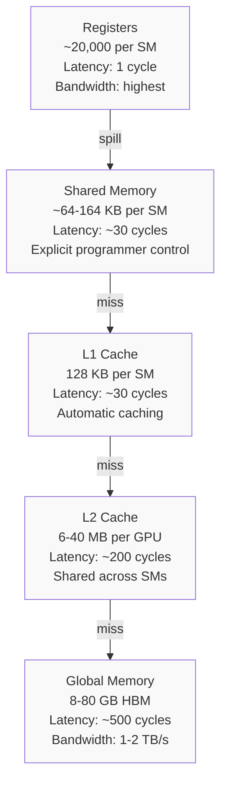
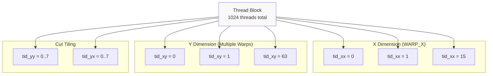
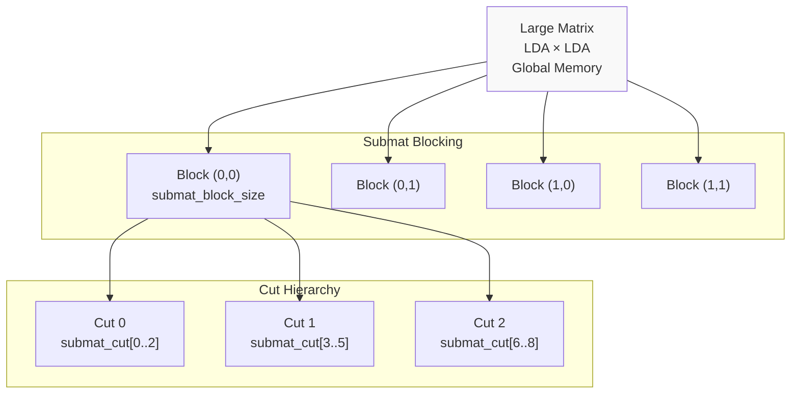

<!-- source: DeepWiki mcp.deepwiki.com · repo microsoft/skala · page 8.1 Memory Hierarchy Optimization · fetched 2026-10-26 -->

# Memory Hierarchy Optimization

<details>
<summary>Relevant source files</summary>

The following files were used as context for generating this wiki page:

- [third_party/gauxc/attic/src/integrator/cuda/cuda_pack_density.cu](third_party/gauxc/attic/src/integrator/cuda/cuda_pack_density.cu)
- [third_party/gauxc/attic/src/new_integrator/device/cuda/cuda_inc_potential.cu](third_party/gauxc/attic/src/new_integrator/device/cuda/cuda_inc_potential.cu)
- [third_party/gauxc/attic/src/new_integrator/device/cuda/cuda_pack_density.cu](third_party/gauxc/attic/src/new_integrator/device/cuda/cuda_pack_density.cu)
- [third_party/gauxc/attic/src/new_integrator/device/hip/hip_inc_potential.hip](third_party/gauxc/attic/src/new_integrator/device/hip/hip_inc_potential.hip)
- [third_party/gauxc/attic/src/new_integrator/device/hip/hip_pack_density.hip](third_party/gauxc/attic/src/new_integrator/device/hip/hip_pack_density.hip)
- [third_party/gauxc/src/xc_integrator/local_work_driver/device/cuda/kernels/collocation/collocation_shell_to_task_kernels_cartesian_l1.hpp](third_party/gauxc/src/xc_integrator/local_work_driver/device/cuda/kernels/collocation/collocation_shell_to_task_kernels_cartesian_l1.hpp)
- [third_party/gauxc/src/xc_integrator/local_work_driver/device/cuda/kernels/collocation/collocation_shell_to_task_kernels_cartesian_l1_laplacian.hpp](third_party/gauxc/src/xc_integrator/local_work_driver/device/cuda/kernels/collocation/collocation_shell_to_task_kernels_cartesian_l1_laplacian.hpp)
- [third_party/gauxc/src/xc_integrator/local_work_driver/device/cuda/kernels/collocation/collocation_shell_to_task_kernels_cartesian_l2_laplacian.hpp](third_party/gauxc/src/xc_integrator/local_work_driver/device/cuda/kernels/collocation/collocation_shell_to_task_kernels_cartesian_l2_laplacian.hpp)
- [third_party/gauxc/src/xc_integrator/local_work_driver/device/cuda/kernels/collocation/collocation_shell_to_task_kernels_spherical_l0_laplacian.hpp](third_party/gauxc/src/xc_integrator/local_work_driver/device/cuda/kernels/collocation/collocation_shell_to_task_kernels_spherical_l0_laplacian.hpp)
- [third_party/gauxc/src/xc_integrator/local_work_driver/device/cuda/kernels/collocation/collocation_shell_to_task_kernels_spherical_l1_gradient.hpp](third_party/gauxc/src/xc_integrator/local_work_driver/device/cuda/kernels/collocation/collocation_shell_to_task_kernels_spherical_l1_gradient.hpp)
- [third_party/gauxc/src/xc_integrator/local_work_driver/device/cuda/kernels/collocation/collocation_shell_to_task_kernels_spherical_l1_laplacian.hpp](third_party/gauxc/src/xc_integrator/local_work_driver/device/cuda/kernels/collocation/collocation_shell_to_task_kernels_spherical_l1_laplacian.hpp)
- [third_party/gauxc/src/xc_integrator/local_work_driver/device/cuda/kernels/collocation/collocation_shell_to_task_kernels_spherical_l2_laplacian.hpp](third_party/gauxc/src/xc_integrator/local_work_driver/device/cuda/kernels/collocation/collocation_shell_to_task_kernels_spherical_l2_laplacian.hpp)
- [third_party/gauxc/src/xc_integrator/local_work_driver/device/cuda/kernels/collocation/collocation_shell_to_task_kernels_spherical_l3_lapgrad.hpp](third_party/gauxc/src/xc_integrator/local_work_driver/device/cuda/kernels/collocation/collocation_shell_to_task_kernels_spherical_l3_lapgrad.hpp)
- [third_party/gauxc/src/xc_integrator/local_work_driver/device/cuda/kernels/collocation/collocation_shell_to_task_kernels_spherical_l4_laplacian.hpp](third_party/gauxc/src/xc_integrator/local_work_driver/device/cuda/kernels/collocation/collocation_shell_to_task_kernels_spherical_l4_laplacian.hpp)
- [third_party/gauxc/src/xc_integrator/local_work_driver/device/cuda/kernels/cuda_inc_potential.cu](third_party/gauxc/src/xc_integrator/local_work_driver/device/cuda/kernels/cuda_inc_potential.cu)
- [third_party/gauxc/src/xc_integrator/local_work_driver/device/cuda/kernels/pack_submat.cu](third_party/gauxc/src/xc_integrator/local_work_driver/device/cuda/kernels/pack_submat.cu)
- [third_party/gauxc/src/xc_integrator/local_work_driver/device/hip/kernels/hip_inc_potential.hip](third_party/gauxc/src/xc_integrator/local_work_driver/device/hip/kernels/hip_inc_potential.hip)
- [third_party/gauxc/src/xc_integrator/local_work_driver/device/hip/kernels/pack_submat.hip](third_party/gauxc/src/xc_integrator/local_work_driver/device/hip/kernels/pack_submat.hip)

</details>


## Purpose and Scope

This page documents the memory hierarchy optimization strategies employed throughout GauXC's GPU kernel ecosystem. These optimizations exploit the multi-level memory architecture of modern GPUs (registers, shared memory, L1/L2 cache, global memory) to maximize computational throughput and minimize memory bandwidth bottlenecks.

For general GPU optimization techniques including warp-level parallelism, see [8.2](#8.2). For loop unrolling and vectorization strategies, see [8.3](#8.3). For the overall collocation kernel architecture, see [7.2](#7.2). For matrix operation kernels, see [7.3](#7.3).

---

## GPU Memory Hierarchy Overview

Modern GPUs provide a multi-tiered memory hierarchy with vastly different performance characteristics:



GauXC kernels are carefully designed to maximize register and shared memory usage while ensuring coalesced global memory access patterns.

---

## Shared Memory Optimization in Collocation Kernels

### Shell Coefficient Caching

All collocation kernels cache Gaussian primitive coefficients and exponents in shared memory to avoid repeated global memory accesses. The pattern is consistent across all angular momentum levels:

```mermaid
graph LR
    GM["Global Memory<br/>shell->alpha_data()<br/>shell->coeff_data()"]
    SM["Shared Memory<br/>alpha[4][32+1]<br/>coeff[4][32+1]"]
    WARP1["Warp 0"]
    WARP2["Warp 1"]
    WARP3["Warp 2"]
    WARP4["Warp 3"]
    
    GM -->|cooperative load<br/>first warp cycle| SM
    SM -->|my_alpha = alpha[warp_id]<br/>my_coeff = coeff[warp_id]| WARP1
    SM --> WARP2
    SM --> WARP3
    SM --> WARP4
    
    style GM fill:#f9f9f9
    style SM fill:#f9f9f9
```

**Implementation Pattern:**

[collocation_shell_to_task_kernels_spherical_l2_laplacian.hpp:25-28]()
```cpp
__shared__ double alpha[4][detail::shell_nprim_max + 1]; 
__shared__ double coeff[4][detail::shell_nprim_max + 1];
double* my_alpha = alpha[threadIdx.x/32];
double* my_coeff = coeff[threadIdx.x/32];
```

The shared memory array is 2D: first dimension indexes warps (4 warps per block), second dimension holds up to 32 primitive functions. The `+1` padding prevents bank conflicts when warps access their respective arrays.

[collocation_shell_to_task_kernels_spherical_l2_laplacian.hpp:44-52]()
```cpp
// Read in coeffs/exps into SM on first warp
{
  auto* coeff_gm = shell->coeff_data();
  auto* alpha_gm = shell->alpha_data();
  static_assert( detail::shell_nprim_max == cuda::warp_size );
  const int warp_rank = threadIdx.x % cuda::warp_size;
  my_alpha[warp_rank] = alpha_gm[warp_rank];
  my_coeff[warp_rank] = coeff_gm[warp_rank];
}
```

Each thread in the block loads one element, ensuring fully coalesced access. The `static_assert` guarantees that `shell_nprim_max == 32`, enabling one element per thread.

**Sources:** [collocation_shell_to_task_kernels_spherical_l2_laplacian.hpp:25-52](), [collocation_shell_to_task_kernels_spherical_l3_lapgrad.hpp:25-52](), [collocation_shell_to_task_kernels_spherical_l4_laplacian.hpp:25-52]()

---

## Register Pressure Management

### Radial Evaluation Accumulation

Collocation kernels accumulate radial basis function evaluations directly into register variables, avoiding intermediate memory operations:

[collocation_shell_to_task_kernels_spherical_l2_laplacian.hpp:87-100]()
```cpp
// Evaluate radial part of bfn
double radial_eval = 0.;
double radial_eval_alpha = 0.;
double radial_eval_alpha_squared = 0.;

#pragma unroll 1
for( uint32_t i = 0; i < nprim; ++i ) {
  const auto a = my_alpha[i];
  const auto e = my_coeff[i] * std::exp( - a * rsq );
  
  radial_eval += e;
  radial_eval_alpha += a * e;
  radial_eval_alpha_squared += a * a * e;
}
```

This loop accumulates up to 32 Gaussian primitives into three register variables. The `#pragma unroll 1` directive prevents automatic unrolling, which would increase register pressure and potentially cause register spilling.

### Common Subexpression Computation

Higher angular momentum kernels compute extensive common subexpressions and store them in registers:

[collocation_shell_to_task_kernels_spherical_l2_laplacian.hpp:105-160]()
```cpp
// Common Subexpressions
const auto x0 = sqrt_3*y; 
const auto x1 = x*x0; 
const auto x2 = x0*z; 
// ... (54 more lines of subexpression definitions)
const auto x54 = -x48;
```

For L=2 spherical Laplacian kernels, 55 common subexpressions are pre-computed and held in registers. This pattern scales dramatically with angular momentum and derivative order:

| Kernel Type | Angular Momentum | Derivative | Subexpressions |
|-------------|-----------------|------------|----------------|
| L0 Laplacian | 0 | ∇² | 4 |
| L1 Laplacian | 1 | ∇² | 10 |
| L2 Laplacian | 2 | ∇² | 55 |
| L3 Lapgrad | 3 | ∇(∇²) | 295 |
| L4 Laplacian | 4 | ∇² | 175 |

The compiler is expected to optimize register allocation, keeping frequently-used subexpressions in registers while spilling less-used ones.

**Sources:** [collocation_shell_to_task_kernels_spherical_l2_laplacian.hpp:87-160](), [collocation_shell_to_task_kernels_spherical_l3_lapgrad.hpp:96-295](), [collocation_shell_to_task_kernels_spherical_l4_laplacian.hpp:87-175]()

---

## Coalesced Memory Access in Matrix Operations

### Block-Tiled Access Pattern

Matrix pack and increment kernels organize threads to ensure coalesced global memory accesses. The thread organization divides work into two hierarchies:



[cuda_inc_potential.cu:14-22]()
```cpp
#define WARP_X 16
#define WARP_Y 1
#define UNROLL_FACTOR 4
#define EFF_UNROLL 4
#define CUT_X 8
#define CUT_Y 8
```

[cuda_inc_potential.cu:40-46]()
```cpp
const int tid_xx = threadIdx.x % WARP_X;
const int tid_xy = threadIdx.x / WARP_X;

const int tid_yx = threadIdx.y % CUT_X;
const int tid_yy = threadIdx.y / CUT_X;
```

- `tid_xx`: Position within a 16-element row (for coalesced access)
- `tid_xy`: Which "micro-warp" handles this column iteration
- `tid_yx`, `tid_yy`: Position within the CUT_X × CUT_Y cut tile

This organization ensures that consecutive threads access consecutive memory locations, enabling coalesced 128-byte transactions.

**Sources:** [cuda_inc_potential.cu:14-46](), [pack_submat.cu:15-50](), [attic/src/new_integrator/device/cuda/cuda_pack_density.cu:13-44]()

---

## Vectorized Loads and Loop Unrolling

### Double-Buffered Unrolled Loops

Matrix operations use explicit loop unrolling with array buffering to hide memory latency:

[cuda_inc_potential.cu:68-93]()
```cpp
int J;
for( J = tid_xy; J < (delta_j / EFF_UNROLL) * EFF_UNROLL; J += EFF_UNROLL ) {
  for( int I = tid_xx; I < delta_i; I += WARP_X ) {
    
    double val[UNROLL_FACTOR];
    double* address[UNROLL_FACTOR];
#pragma unroll
    for (int k = 0; k < UNROLL_FACTOR; k++) {
      val[k] = ASmall_begin[I + (J+k*WARP_Y)*LDAS];
      address[k] = ABig_begin + I + (J+k*WARP_Y)*LDA;
    }
#pragma unroll
    for (int k = 0; k < UNROLL_FACTOR; k++) {
      atomicAdd(address[k], val[k] );
    }
  }
}
```

This pattern:
1. **Outer loop** iterates in steps of `EFF_UNROLL = 4`, processing 4 columns per iteration
2. **First unrolled loop** loads 4 values into register arrays `val[4]` and `address[4]`
3. **Second unrolled loop** issues 4 atomic adds

Separating loads from stores enables instruction-level parallelism: while the first atomic add stalls, subsequent loads can execute.

### Scalar Fallback

A scalar loop handles the remainder when `delta_j` is not divisible by 4:

[cuda_inc_potential.cu:86-90]()
```cpp
for ( ; J < delta_j; J += WARP_Y) {
  for( int I = tid_xx; I < delta_i; I += WARP_X ) {
    atomicAdd(ABig_begin + I + J*LDA, ASmall_begin[I + J*LDAS] );
  }
}
```

**Sources:** [cuda_inc_potential.cu:68-90](), [pack_submat.cu:72-99](), [attic/src/new_integrator/device/cuda/cuda_inc_potential.cu:67-90]()

---

## Cache Control Hints

### Streaming Stores with `__stcs`

Pack density kernels use streaming stores to bypass L1 cache when writing to the small submatrix:

[pack_submat.cu:84-91]()
```cpp
#pragma unroll
for (int k = 0; k < UNROLL_FACTOR; k++) {
  // Suggest that the result be evicted first.
#if (CUDART_VERSION >= 11000)
  __stcs(address[k], val[k]);
#else
  asm ("st.global.cs.f64 [%0], %1;" :: "l"(address[k]), "d"(val[k]));
#endif
}
```

The `__stcs` intrinsic (or equivalent PTX `st.global.cs`) marks the store as "cache streaming," indicating that:
- The data is unlikely to be reused soon
- L1 cache should prioritize evicting this line
- Prevents pollution of L1 with data destined for immediate consumption by collocation kernels

This is crucial because:
1. The packed submatrix (`nbe_scr`) is read once by collocation kernels
2. Writing through L1 would evict other hot data (shell coefficients, point coordinates)
3. Streaming stores allow the data to flow directly to L2/global memory

**HIP Implementation:** HIP kernels use the same pattern with conditional compilation:

[attic/src/integrator/cuda/cuda_pack_density.cu:79-85]()
```cpp
#if (CUDART_VERSION >= 11000)
  __stcs(address[k], val[k]);
#else
  asm ("st.global.cs.f64 [%0], %1;" :: "l"(address[k]), "d"(val[k]));
#endif
```

**Sources:** [pack_submat.cu:84-91](), [attic/src/new_integrator/device/cuda/cuda_pack_density.cu:78-86](), [attic/src/integrator/cuda/cuda_pack_density.cu:79-85]()

---

## Thread Organization for Memory Efficiency

### Kernel Launch Bounds

All performance-critical kernels specify launch bounds to guide register allocation:

[collocation_shell_to_task_kernels_spherical_l2_laplacian.hpp:18]()
```cpp
__global__ __launch_bounds__(128,2) void collocation_device_shell_to_task_kernel_spherical_laplacian_2(
```

The `__launch_bounds__(128,2)` directive specifies:
- **First parameter (128)**: Maximum threads per block = 4 warps × 32 threads
- **Second parameter (2)**: Minimum blocks per SM for optimal occupancy

This informs the compiler's register allocation strategy:
- Limit register usage to enable 2 blocks per SM
- Spill to local memory if necessary to meet occupancy target
- Balance register pressure vs. occupancy

Different kernels use different bounds based on their computational intensity:

| Kernel Type | Launch Bounds | Warps/Block | Strategy |
|-------------|---------------|-------------|----------|
| L0-L1 Collocation | `(256,2)` | 8 | High occupancy, lower register pressure |
| L2-L4 Collocation | `(128,2)` | 4 | Moderate occupancy, higher registers |
| Matrix Pack/Inc | `(1024,1)` | 32 | Maximum occupancy, simple computation |

### Block-Tiled Submatrix Processing

Matrix kernels process large matrices in block-tiled fashion to improve cache reuse:



[cuda_inc_potential.cu:109-116]()
```cpp
auto n_launch = util::div_ceil( LDV, submat_block_size );
for (int i = 0; i < n_launch; i++) 
for (int j = 0; j < n_launch; j++) {
  sym_inc_by_submat_combined_kernel<<< blocks, threads, 0, stream >>>(
    ntasks, device_tasks, V_device, LDV, i, j
  );
}
```

The nested loop launches `n_launch²` kernels, each processing a `submat_block_size × submat_block_size` tile. Within each tile, the cut structure further subdivides work based on shell screening.

**Sources:** [cuda_inc_potential.cu:109-116](), [pack_submat.cu:117-124](), [hip_inc_potential.hip:65-80]()

---

## Memory Access Pattern Summary

The following table summarizes memory hierarchy usage across kernel types:

| Kernel Family | Shared Memory | Register Usage | Global Memory Pattern | Cache Hints |
|---------------|---------------|----------------|----------------------|-------------|
| **Collocation** | Shell coefficients (α, c) | 55-295 subexpressions | Read points (coalesced), write basis (strided by npts) | Default caching |
| **Pack Density** | None | 4-element buffers | Read large matrix (coalesced), write small (streaming) | `__stcs` for writes |
| **Increment Potential** | None | 4-element buffers | Read small (coalesced), atomic add to large | Default caching |
| **Weight Kernels** | Point/center data | Distance calculations | Read points/centers (coalesced), write weights (coalesced) | Default caching |

**Sources:** All files in the provided list, especially [collocation_shell_to_task_kernels_spherical_l2_laplacian.hpp](), [cuda_inc_potential.cu](), [pack_submat.cu]()

---

