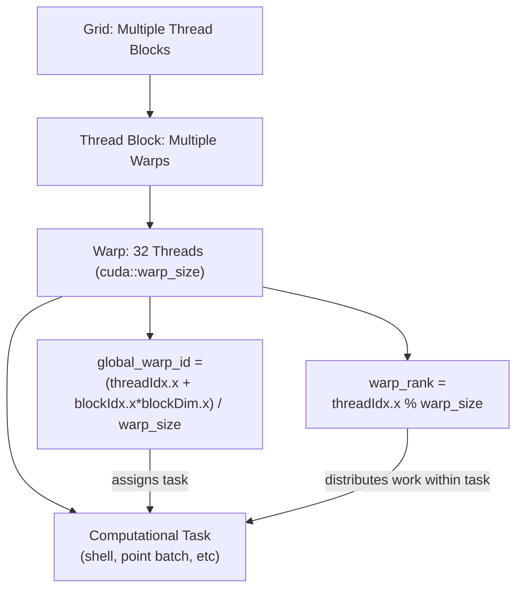
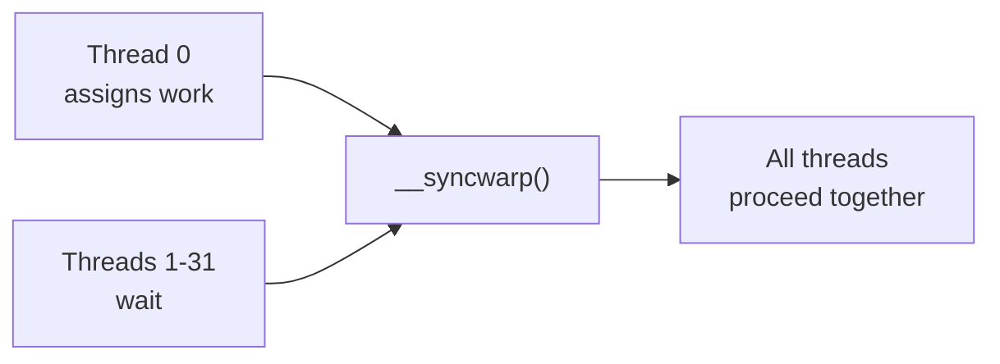
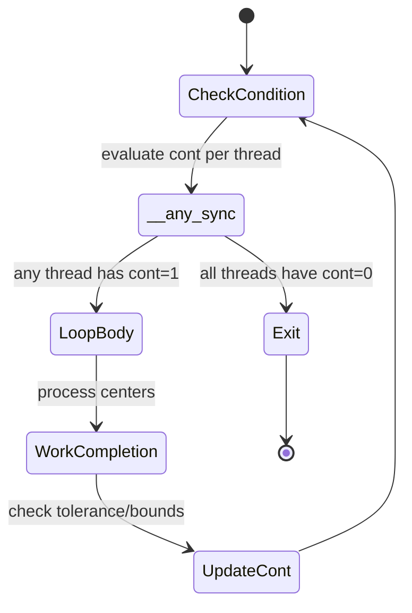
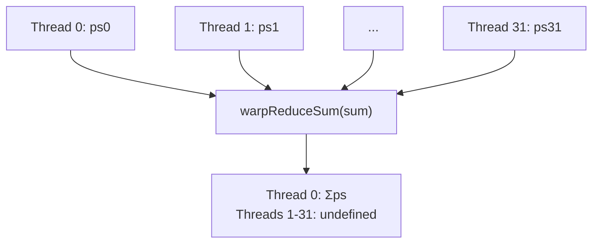
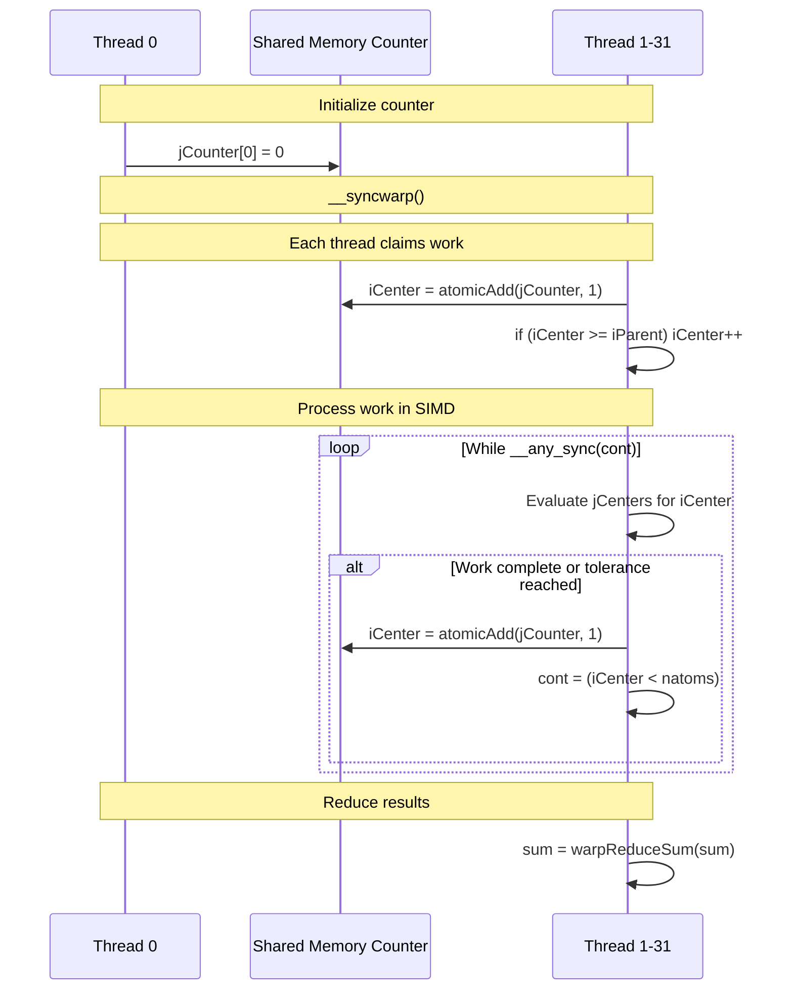
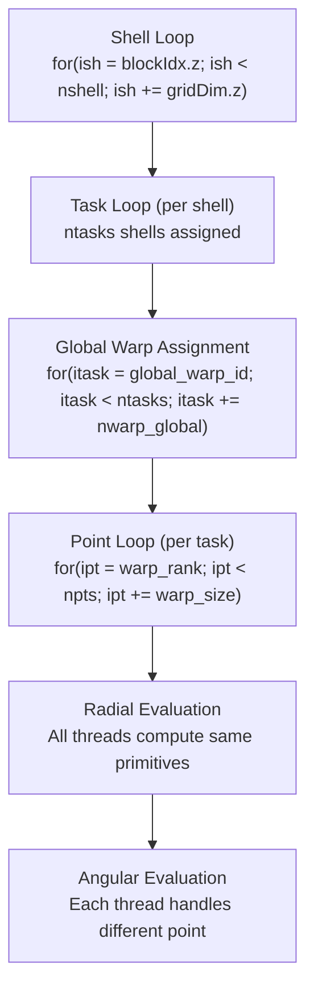
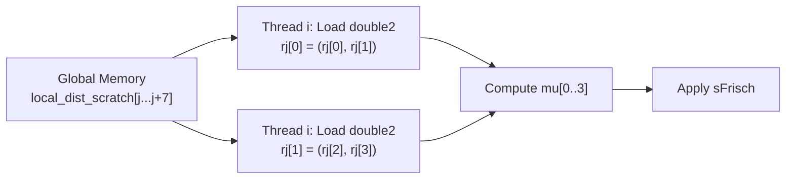
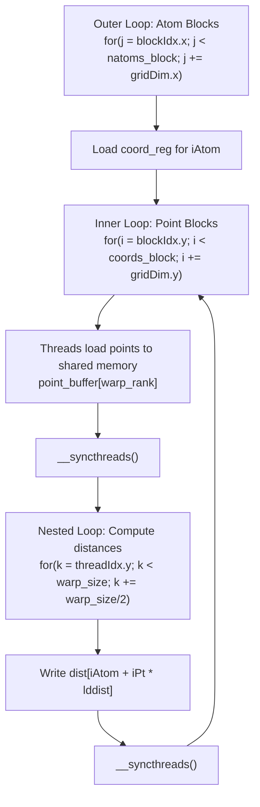

<!-- source: DeepWiki mcp.deepwiki.com · repo microsoft/skala · page 8.2 Warp-Level Parallelism · fetched 2026-10-26 -->

# Warp-Level Parallelism

<details>
<summary>Relevant source files</summary>

The following files were used as context for generating this wiki page:

- [third_party/gauxc/attic/src/integrator/cuda/cuda_weights.cu](third_party/gauxc/attic/src/integrator/cuda/cuda_weights.cu)
- [third_party/gauxc/attic/src/new_integrator/device/cuda/cuda_weights.cu](third_party/gauxc/attic/src/new_integrator/device/cuda/cuda_weights.cu)
- [third_party/gauxc/attic/src/new_integrator/device/hip/hip_weights.hip](third_party/gauxc/attic/src/new_integrator/device/hip/hip_weights.hip)
- [third_party/gauxc/src/xc_integrator/local_work_driver/device/cuda/kernels/collocation/collocation_shell_to_task_kernels_cartesian_l1.hpp](third_party/gauxc/src/xc_integrator/local_work_driver/device/cuda/kernels/collocation/collocation_shell_to_task_kernels_cartesian_l1.hpp)
- [third_party/gauxc/src/xc_integrator/local_work_driver/device/cuda/kernels/collocation/collocation_shell_to_task_kernels_cartesian_l1_laplacian.hpp](third_party/gauxc/src/xc_integrator/local_work_driver/device/cuda/kernels/collocation/collocation_shell_to_task_kernels_cartesian_l1_laplacian.hpp)
- [third_party/gauxc/src/xc_integrator/local_work_driver/device/cuda/kernels/collocation/collocation_shell_to_task_kernels_cartesian_l2_laplacian.hpp](third_party/gauxc/src/xc_integrator/local_work_driver/device/cuda/kernels/collocation/collocation_shell_to_task_kernels_cartesian_l2_laplacian.hpp)
- [third_party/gauxc/src/xc_integrator/local_work_driver/device/cuda/kernels/collocation/collocation_shell_to_task_kernels_spherical_l0_laplacian.hpp](third_party/gauxc/src/xc_integrator/local_work_driver/device/cuda/kernels/collocation/collocation_shell_to_task_kernels_spherical_l0_laplacian.hpp)
- [third_party/gauxc/src/xc_integrator/local_work_driver/device/cuda/kernels/collocation/collocation_shell_to_task_kernels_spherical_l1_gradient.hpp](third_party/gauxc/src/xc_integrator/local_work_driver/device/cuda/kernels/collocation/collocation_shell_to_task_kernels_spherical_l1_gradient.hpp)
- [third_party/gauxc/src/xc_integrator/local_work_driver/device/cuda/kernels/collocation/collocation_shell_to_task_kernels_spherical_l1_laplacian.hpp](third_party/gauxc/src/xc_integrator/local_work_driver/device/cuda/kernels/collocation/collocation_shell_to_task_kernels_spherical_l1_laplacian.hpp)
- [third_party/gauxc/src/xc_integrator/local_work_driver/device/cuda/kernels/collocation/collocation_shell_to_task_kernels_spherical_l2_laplacian.hpp](third_party/gauxc/src/xc_integrator/local_work_driver/device/cuda/kernels/collocation/collocation_shell_to_task_kernels_spherical_l2_laplacian.hpp)
- [third_party/gauxc/src/xc_integrator/local_work_driver/device/cuda/kernels/collocation/collocation_shell_to_task_kernels_spherical_l3_lapgrad.hpp](third_party/gauxc/src/xc_integrator/local_work_driver/device/cuda/kernels/collocation/collocation_shell_to_task_kernels_spherical_l3_lapgrad.hpp)
- [third_party/gauxc/src/xc_integrator/local_work_driver/device/cuda/kernels/collocation/collocation_shell_to_task_kernels_spherical_l4_laplacian.hpp](third_party/gauxc/src/xc_integrator/local_work_driver/device/cuda/kernels/collocation/collocation_shell_to_task_kernels_spherical_l4_laplacian.hpp)
- [third_party/gauxc/src/xc_integrator/local_work_driver/device/cuda/kernels/cuda_ssf_1d.cu](third_party/gauxc/src/xc_integrator/local_work_driver/device/cuda/kernels/cuda_ssf_1d.cu)
- [third_party/gauxc/src/xc_integrator/local_work_driver/device/cuda/kernels/cuda_ssf_2d.hu](third_party/gauxc/src/xc_integrator/local_work_driver/device/cuda/kernels/cuda_ssf_2d.hu)
- [third_party/gauxc/src/xc_integrator/local_work_driver/device/cuda/kernels/grid_to_center.cu](third_party/gauxc/src/xc_integrator/local_work_driver/device/cuda/kernels/grid_to_center.cu)
- [third_party/gauxc/src/xc_integrator/local_work_driver/device/hip/kernels/grid_to_center.hip](third_party/gauxc/src/xc_integrator/local_work_driver/device/hip/kernels/grid_to_center.hip)
- [third_party/gauxc/src/xc_integrator/local_work_driver/device/hip/kernels/hip_ssf_1d.hip](third_party/gauxc/src/xc_integrator/local_work_driver/device/hip/kernels/hip_ssf_1d.hip)
- [third_party/gauxc/src/xc_integrator/local_work_driver/device/hip/kernels/hip_ssh_2d.hip](third_party/gauxc/src/xc_integrator/local_work_driver/device/hip/kernels/hip_ssh_2d.hip)

</details>


## Purpose and Scope

This page documents warp-level parallelism techniques employed throughout GauXC's GPU kernel ecosystem. A warp is the fundamental unit of execution on GPU architectures (32 threads on both NVIDIA and AMD hardware), and efficient warp-level programming is critical for achieving high performance. This document covers warp synchronization primitives, warp reduction operations, dynamic work distribution strategies, and memory access patterns optimized for warp execution.

For general GPU optimization strategies, see [GPU Kernel Optimization Techniques](#8). For memory hierarchy optimization including shared memory usage, see [Memory Hierarchy Optimization](#8.1). For loop-level optimizations, see [Loop Unrolling and Vectorization](#8.3).

## Warp Fundamentals in GauXC

GauXC kernels are designed around warp-granular work distribution. Tasks are assigned to warps rather than individual threads, with threads within a warp cooperating to process data points or computational sub-problems.



**Thread Organization Pattern**

The codebase consistently uses the following thread organization:

| Variable | Definition | Purpose |
|----------|-----------|---------|
| `global_warp_id` | `(threadIdx.x + blockIdx.x*blockDim.x) / cuda::warp_size` | Assigns tasks to warps across grid |
| `nwarp_global` | `(blockDim.x*gridDim.x) / cuda::warp_size` | Total warps in grid for strided iteration |
| `warp_rank` | `threadIdx.x % cuda::warp_size` | Thread index within warp (0-31) |

Sources: [third_party/gauxc/src/xc_integrator/local_work_driver/device/cuda/kernels/collocation/collocation_shell_to_task_kernels_spherical_l2_laplacian.hpp:41-42](), [third_party/gauxc/src/xc_integrator/local_work_driver/device/cuda/kernels/collocation/collocation_shell_to_task_kernels_spherical_l3_lapgrad.hpp:41-42]()

## Warp Synchronization Primitives

GauXC employs several warp-level synchronization primitives to coordinate thread execution within a warp.

### `__syncwarp()` - Warp Barrier

Ensures all threads in the warp reach the same execution point before proceeding. Used extensively in the 2D SSF weight kernel to coordinate work assignment:



Key usage in [third_party/gauxc/attic/src/new_integrator/device/cuda/cuda_weights.cu:468-470]():
```
if (threadIdx.x == 0)
  weights_device[ipt] = 0.;
__syncwarp();
```

And in work counter initialization [third_party/gauxc/attic/src/new_integrator/device/cuda/cuda_weights.cu:473-476]():
```
if (threadIdx.x == 0) {
  jCounter[0] = 0;
}
__syncwarp();
```

### `__any_sync()` - Warp-Level Predicate

Checks if any thread in the warp satisfies a condition, enabling dynamic convergence control. The SSF 2D kernel uses this to continue iterating until all threads complete their work:



Implementation at [third_party/gauxc/attic/src/new_integrator/device/cuda/cuda_weights.cu:493]():
```
while (__any_sync(0xffffffff, cont)) {
  if (cont) {
    // Process work...
    if( !(ps > weight_tol && iCount < LDatoms )) {
      cont = (iCenter < natoms);  // May set to 0
    }
  }
}
```

The mask `0xffffffff` indicates all 32 threads in the warp participate.

### `__shfl_sync()` - Warp Shuffle

Exchanges data between threads in a warp without shared memory. Used to broadcast the parent weight value:

[third_party/gauxc/attic/src/integrator/cuda/cuda_weights.cu:229]():
```
parent_weight = __shfl_sync(0xffffffff, parent_weight, iParent % 32, 32);
```

This broadcasts the value from thread `iParent % 32` to all threads in the warp.

Sources: [third_party/gauxc/attic/src/new_integrator/device/cuda/cuda_weights.cu:468-476](), [third_party/gauxc/attic/src/new_integrator/device/cuda/cuda_weights.cu:493](), [third_party/gauxc/attic/src/integrator/cuda/cuda_weights.cu:229]()

## Warp Reduction Operations

Warp reductions aggregate values across all threads in a warp efficiently using tree-based communication.

### `warpReduceSum` - Summation

Sums values from all threads in the warp. Critical for aggregating partial results in the SSF weight kernel:



Implementation pattern at [third_party/gauxc/attic/src/new_integrator/device/cuda/cuda_weights.cu:543-548]():
```
__syncwarp();
sum = warpReduceSum(sum);
if (threadIdx.x == 0) {
  sum += parent_weight;
  weights_device[ipt] *= parent_weight / sum;
}
```

### `warpReduceProd` - Product

Computes the product of values across threads. Used in the parent weight calculation where each thread processes a subset of centers:

[third_party/gauxc/attic/src/new_integrator/device/cuda/cuda_weights.cu:458-462]():
```
for( int jCenter = threadIdx.x; jCenter < natom_block; jCenter+=blockDim.x ) {
  double contribution = 1.0;
  if (jCenter < natoms && iParent != jCenter) {
    contribution = sFrisch( mu );
  }
  contribution = warpReduceProd(contribution);
  parent_weight *= contribution;
}
```

Each thread computes a contribution for its assigned centers, then the warp-wide product is computed.

Sources: [third_party/gauxc/attic/src/new_integrator/device/cuda/cuda_weights.cu:543-548](), [third_party/gauxc/attic/src/new_integrator/device/cuda/cuda_weights.cu:458-462]()

## Dynamic Work Assignment Pattern

The 2D SSF weight kernel employs a sophisticated dynamic work assignment pattern where threads within a warp dynamically claim work using atomic operations.

### Work Assignment Architecture



### Per-Warp Shared Memory Counter

The kernel uses shared memory to maintain a work counter for each warp:

[third_party/gauxc/attic/src/new_integrator/device/cuda/cuda_weights.cu:428-430]():
```
__shared__ int jCounter_sm[max_warps_per_thread_block];
int* jCounter = reinterpret_cast<int *>(jCounter_sm) + threadIdx.y;
```

This allocates one counter per warp in the thread block. The `threadIdx.y` dimension identifies the warp within the block.

### Atomic Work Claiming

Threads use `atomicAdd` to claim work items atomically:

[third_party/gauxc/attic/src/new_integrator/device/cuda/cuda_weights.cu:480-482]():
```
int iCenter = atomicAdd(jCounter, 1);
if (iCenter >= iParent) iCenter++;  // Skip parent
```

When a thread completes work, it claims another item:

[third_party/gauxc/attic/src/new_integrator/device/cuda/cuda_weights.cu:525-527]():
```
sum += ps;
iCenter = atomicAdd(jCounter, 1);
if (iCenter >= iParent) iCenter++;
```

### Load Balancing Mechanism

This pattern provides automatic load balancing:

| Feature | Benefit |
|---------|---------|
| Dynamic assignment | Threads that finish early take on more work |
| Early termination | Threads can exit work loop when `ps < weight_tol` |
| Warp-synchronous | All threads process same `jCenter` simultaneously for coalesced access |
| Skip parent | `if (iCenter >= iParent) iCenter++` avoids self-interaction |

Sources: [third_party/gauxc/attic/src/new_integrator/device/cuda/cuda_weights.cu:428-430](), [third_party/gauxc/attic/src/new_integrator/device/cuda/cuda_weights.cu:480-482](), [third_party/gauxc/attic/src/new_integrator/device/cuda/cuda_weights.cu:525-527]()

## Collocation Kernel Warp Organization

Collocation kernels organize work at the warp level with each warp processing a full task (shell evaluation at a set of points).

### Task-to-Warp Assignment



Implementation at [third_party/gauxc/src/xc_integrator/local_work_driver/device/cuda/kernels/collocation/collocation_shell_to_task_kernels_spherical_l2_laplacian.hpp:30-74]():

```
for( auto ish = blockIdx.z; ish < nshell; ish += gridDim.z ) {
  const uint32_t ntasks = shell_to_task[ish].ntask;
  // ...
  for( int itask = global_warp_id; itask < ntasks; itask += nwarp_global ) {
    // ...
    for( int ipt = threadIdx.x % cuda::warp_size; ipt < npts; ipt += cuda::warp_size ) {
      // Each thread evaluates basis at different point
    }
  }
}
```

### Shared Memory Per-Warp Data

Shell coefficients and exponents are loaded into shared memory with separate arrays for each warp:

[third_party/gauxc/src/xc_integrator/local_work_driver/device/cuda/kernels/collocation/collocation_shell_to_task_kernels_spherical_l2_laplacian.hpp:25-28]():
```
__shared__ double alpha[4][detail::shell_nprim_max + 1]; 
__shared__ double coeff[4][detail::shell_nprim_max + 1];
double* my_alpha = alpha[threadIdx.x/32];
double* my_coeff = coeff[threadIdx.x/32];
```

The first dimension `[4]` allows for 4 warps per thread block (128 threads / 32 threads per warp). Each warp accesses its own row using `threadIdx.x/32`.

### Loading Coefficients

The warp rank is used to parallelize coefficient loading:

[third_party/gauxc/src/xc_integrator/local_work_driver/device/cuda/kernels/collocation/collocation_shell_to_task_kernels_spherical_l2_laplacian.hpp:44-52]():
```
{
  auto* coeff_gm = shell->coeff_data();
  auto* alpha_gm = shell->alpha_data();
  static_assert( detail::shell_nprim_max == cuda::warp_size );
  const int warp_rank = threadIdx.x % cuda::warp_size;
  my_alpha[warp_rank] = alpha_gm[warp_rank];
  my_coeff[warp_rank] = coeff_gm[warp_rank];
}
```

Since `shell_nprim_max == warp_size == 32`, each thread loads one coefficient, achieving full coalescing.

Sources: [third_party/gauxc/src/xc_integrator/local_work_driver/device/cuda/kernels/collocation/collocation_shell_to_task_kernels_spherical_l2_laplacian.hpp:25-52]()

## Memory Access Patterns for Warp Efficiency

### Vectorized Loads with `double2`

The SSF kernel uses vectorized loads to improve memory throughput by loading two `double` values per instruction:



Implementation at [third_party/gauxc/attic/src/new_integrator/device/cuda/cuda_weights.cu:495-518]():
```
double2 rj[weight_unroll/2];
double2 rab_val[weight_unroll/2];
double mu[weight_unroll];

#pragma unroll
for (int k = 0; k < weight_unroll/2; k++) {
  rj[k]      = *((double2*)(local_dist_scratch + jCenter) + k);
  rab_val[k] = *((double2*)(local_rab          + jCenter) + k); 
}

#pragma unroll
for (int k = 0; k < weight_unroll/2; k++) {
  mu[2*k+0] = (ri - rj[k].x) * rab_val[k].x;
  mu[2*k+1] = (ri - rj[k].y) * rab_val[k].y; 
}

#pragma unroll
for (int k = 0; k < weight_unroll; k++) {
  if((iCenter != jCenter + k) && (jCenter + k < natoms)) {
    mu[k] = sFrisch( mu[k] );
    ps *= mu[k];
  }
}
```

With `weight_unroll = 4`, this processes 4 values per iteration using 2 `double2` loads.

### Coalesced Access Pattern

The entire warp processes the same `jCenter` value simultaneously, ensuring memory accesses are coalesced:

| Thread | Loads From | Access Pattern |
|--------|-----------|----------------|
| 0 | `jCenter + 0, jCenter + 1` | Sequential, coalesced |
| 1 | `jCenter + 0, jCenter + 1` | Same addresses as Thread 0 |
| ... | `jCenter + 0, jCenter + 1` | Broadcast from cache |
| 31 | `jCenter + 0, jCenter + 1` | Broadcast from cache |

All threads read the same `jCenter` location, which is efficiently handled by the L1 cache broadcasting mechanism.

### Wrap-Around Access

The kernel wraps the `jCenter` index to avoid modulo operations:

[third_party/gauxc/attic/src/new_integrator/device/cuda/cuda_weights.cu:537-538]():
```
jCenter += weight_unroll;
jCenter = (jCenter < LDatoms) ? jCenter : 0;
```

This conditional assignment is faster than `jCenter = (jCenter + weight_unroll) % LDatoms`.

Sources: [third_party/gauxc/attic/src/new_integrator/device/cuda/cuda_weights.cu:495-538]()

## Platform-Specific Warp Primitives

### CUDA vs HIP API Differences

| Operation | CUDA | HIP | Notes |
|-----------|------|-----|-------|
| Warp size constant | `cuda::warp_size` | `hip::warp_size` | Both = 32 |
| Warp barrier | `__syncwarp()` | `__syncwarp()` | Identical |
| Warp any | `__any_sync(mask, pred)` | `__any(pred)` | HIP uses older API without mask |
| Warp shuffle | `__shfl_sync(mask, var, src, width)` | `__shfl(var, src, width)` | CUDA requires mask |
| Warp reduction | `warpReduceSum<cuda::warp_size>` | `warp_reduce_sum<hip::warp_size>` | Template parameter |

### HIP Warp Primitive Example

HIP version at [third_party/gauxc/src/xc_integrator/local_work_driver/device/hip/kernels/hip_ssh_2d.hip:125]():
```
while (__any(cont)) {  // No mask parameter in HIP
  // ...
}
```

Compared to CUDA at [third_party/gauxc/attic/src/new_integrator/device/cuda/cuda_weights.cu:493]():
```
while (__any_sync(0xffffffff, cont)) {  // Requires mask
  // ...
}
```

### Warp Reduction Implementation

HIP uses namespaced template functions [third_party/gauxc/src/xc_integrator/local_work_driver/device/hip/kernels/hip_ssh_2d.hip:91-92]():
```
contribution = hip::warp_reduce_prod<hip::warp_size>(contribution);
// ...
sum = hip::warp_reduce_sum<hip::warp_size>(sum);
```

While CUDA uses similar template functions in the extensions header [third_party/gauxc/attic/src/new_integrator/device/cuda/cuda_weights.cu:458]():
```
contribution = warpReduceProd(contribution);
```

Sources: [third_party/gauxc/attic/src/new_integrator/device/cuda/cuda_weights.cu:458-493](), [third_party/gauxc/src/xc_integrator/local_work_driver/device/hip/kernels/hip_ssh_2d.hip:91-125]()

## Grid-to-Center Distance Kernel

The `compute_grid_to_center_dist` kernel demonstrates warp-level organization for 2D data access patterns.

### Blocked Algorithm with Shared Memory



Implementation at [third_party/gauxc/src/xc_integrator/local_work_driver/device/cuda/kernels/grid_to_center.cu:26-67]():

Key features:
1. **Shared memory buffer**: `__shared__ double3 point_buffer[cuda::warp_size]` stores point coordinates
2. **Register storage**: `register double3 coord_reg` stores atomic coordinate (one per thread)
3. **Double buffering**: Points loaded to shared memory, processed, then next batch loaded
4. **Partial unroll**: `#pragma unroll 2` on the computation loop

The `threadIdx.y` dimension (set to `distance_thread_y` in launch config) enables multiple threads to work on different points within the shared memory buffer simultaneously.

### Launch Configuration

[third_party/gauxc/src/xc_integrator/local_work_driver/device/cuda/kernels/grid_to_center.cu:73-80]():
```
const int distance_thread_y = cuda::max_warps_per_thread_block / 2;
dim3 threads( cuda::warp_size, distance_thread_y );
dim3 blocks( util::div_ceil( natoms,   threads.x), 
             util::div_ceil( npts, threads.y * distance_thread_y) );
```

This creates thread blocks of size `(32, distance_thread_y)`, with each block covering:
- X-dimension: Up to 32 atoms (one per thread in x)
- Y-dimension: Up to `distance_thread_y * distance_thread_y` points

Sources: [third_party/gauxc/src/xc_integrator/local_work_driver/device/cuda/kernels/grid_to_center.cu:14-80]()

## Performance Considerations

### Warp Divergence

The dynamic work assignment pattern minimizes warp divergence through several mechanisms:

| Technique | Implementation | Benefit |
|-----------|----------------|---------|
| Synchronous jCenter iteration | All threads process same `jCenter` | SIMD execution maintained |
| Early exit with `cont` | `cont = (iCenter < natoms)` | Threads exit coherently |
| Tolerance-based exit | `if( !(ps > weight_tol && iCount < LDatoms))` | Natural convergence |
| `__any_sync` for continuation | `while (__any_sync(0xffffffff, cont))` | Warp exits when all threads done |

### Occupancy Tuning

Kernels use `__launch_bounds__` to guide register allocation:

[third_party/gauxc/attic/src/new_integrator/device/cuda/cuda_weights.cu:410-411]():
```
__global__ __launch_bounds__(weight_thread_block, weight_thread_block_per_sm)
void modify_weights_ssf_kernel_2d(...)
```

Where:
- `weight_thread_block = 128` (threads per block, 4 warps)
- `weight_thread_block_per_sm = 4` (minimum blocks per SM)

This ensures at least `128 × 4 = 512` threads per SM, maintaining high occupancy.

For collocation kernels:

[third_party/gauxc/src/xc_integrator/local_work_driver/device/cuda/kernels/collocation/collocation_shell_to_task_kernels_spherical_l2_laplacian.hpp:18]():
```
__global__ __launch_bounds__(128,2) void collocation_device_shell_to_task_kernel_spherical_laplacian_2(...)
```

This uses 128 threads per block with 2 blocks per SM minimum.

### Shared Memory Bank Conflicts

The per-warp array organization avoids bank conflicts:

```
alpha[warp_id][element]
      ^^^^^^^^  ^^^^^^^
      Different  Same for all threads in warp
      for each   -> Broadcast, no conflict
      warp
```

When `threadIdx.x/32` differs between warps, they access different rows. When threads in the same warp access `alpha[warp_id][warp_rank]`, each accesses a different bank (assuming `shell_nprim_max` aligns with 32).

Sources: [third_party/gauxc/attic/src/new_integrator/device/cuda/cuda_weights.cu:410-411](), [third_party/gauxc/src/xc_integrator/local_work_driver/device/cuda/kernels/collocation/collocation_shell_to_task_kernels_spherical_l2_laplacian.hpp:18-28]()

---

