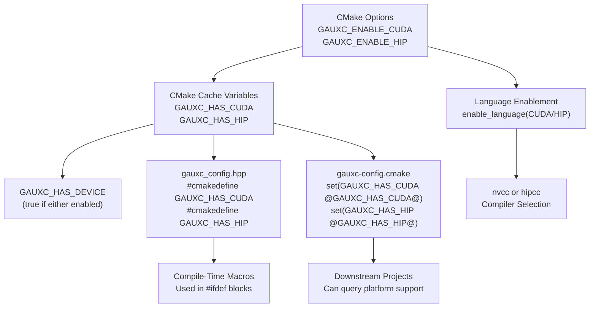
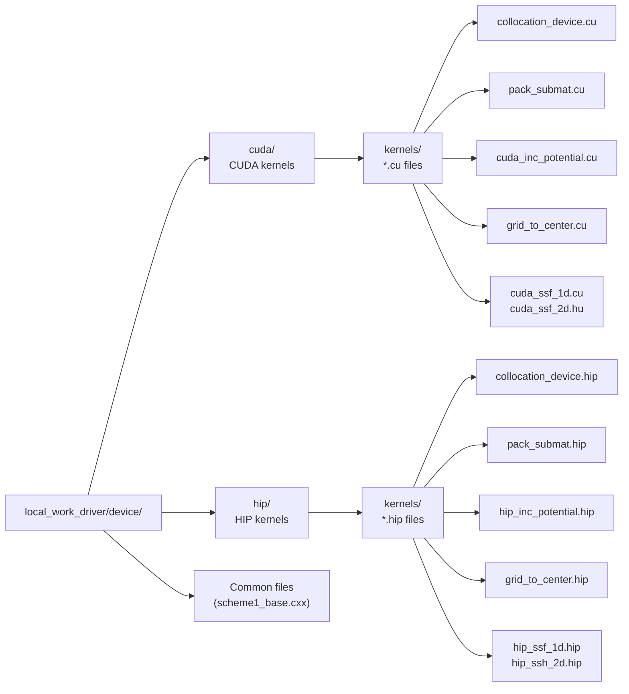
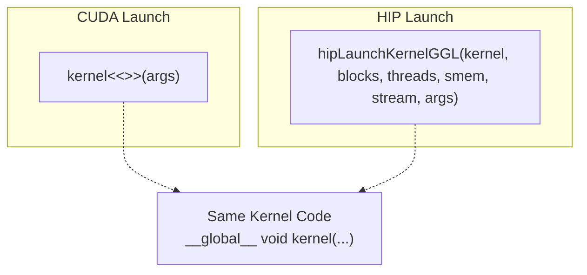
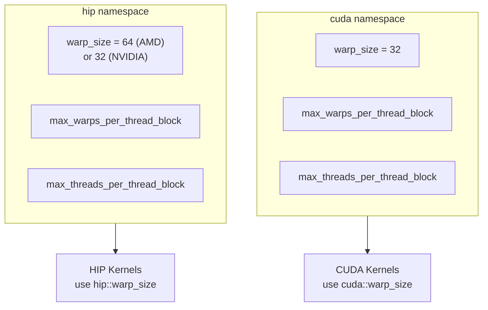
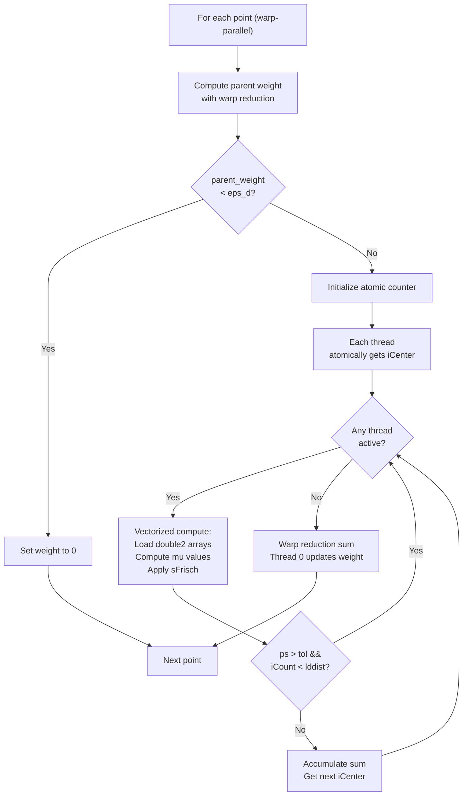
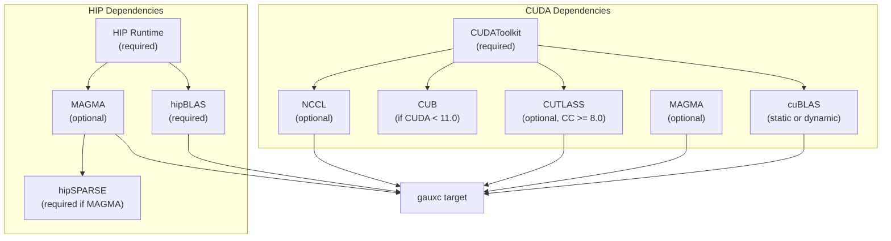
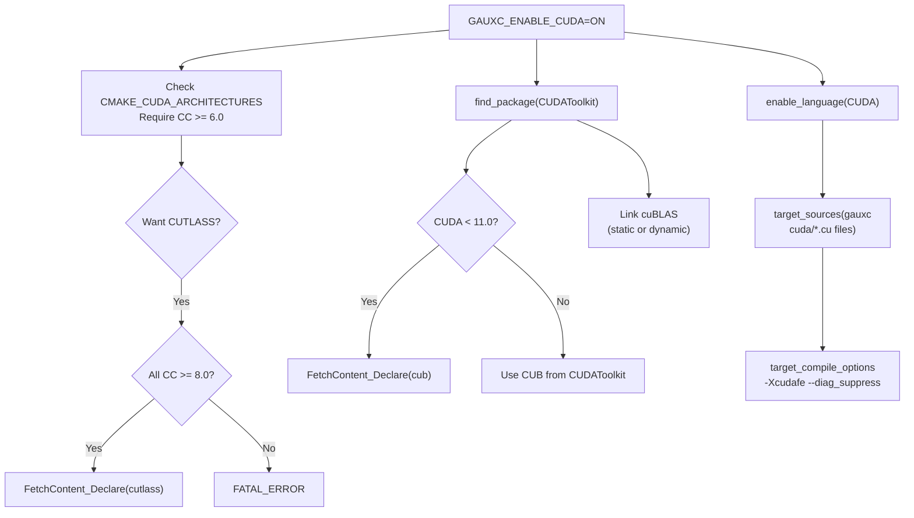
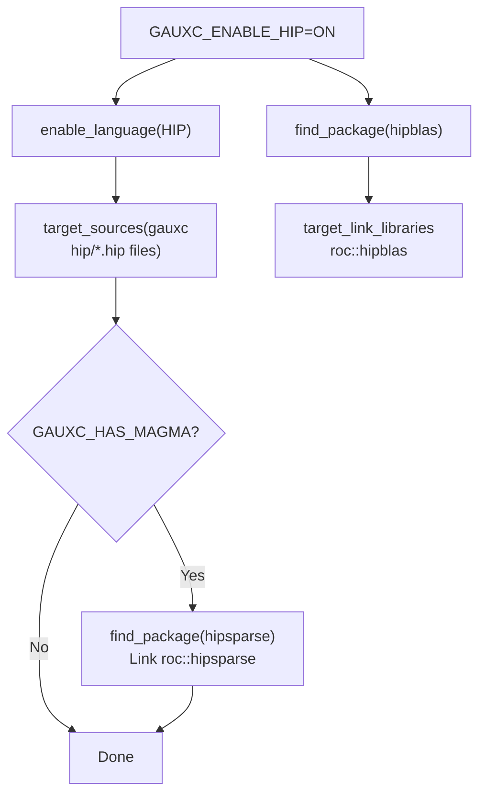

<!-- source: DeepWiki mcp.deepwiki.com · repo microsoft/skala · page 9 Platform Abstraction: CUDA and HIP · fetched 2026-10-26 -->

# Platform Abstraction: CUDA and HIP

<details>
<summary>Relevant source files</summary>

The following files were used as context for generating this wiki page:

- [third_party/gauxc/CMakeLists.txt](third_party/gauxc/CMakeLists.txt)
- [third_party/gauxc/attic/src/integrator/cuda/cuda_pack_density.cu](third_party/gauxc/attic/src/integrator/cuda/cuda_pack_density.cu)
- [third_party/gauxc/attic/src/integrator/cuda/cuda_weights.cu](third_party/gauxc/attic/src/integrator/cuda/cuda_weights.cu)
- [third_party/gauxc/attic/src/integrator/cuda/gauxc-cuda_integrator.cmake](third_party/gauxc/attic/src/integrator/cuda/gauxc-cuda_integrator.cmake)
- [third_party/gauxc/attic/src/new_integrator/device/cuda/cuda_inc_potential.cu](third_party/gauxc/attic/src/new_integrator/device/cuda/cuda_inc_potential.cu)
- [third_party/gauxc/attic/src/new_integrator/device/cuda/cuda_pack_density.cu](third_party/gauxc/attic/src/new_integrator/device/cuda/cuda_pack_density.cu)
- [third_party/gauxc/attic/src/new_integrator/device/cuda/cuda_weights.cu](third_party/gauxc/attic/src/new_integrator/device/cuda/cuda_weights.cu)
- [third_party/gauxc/attic/src/new_integrator/device/cuda/gauxc-cuda.cmake](third_party/gauxc/attic/src/new_integrator/device/cuda/gauxc-cuda.cmake)
- [third_party/gauxc/attic/src/new_integrator/device/hip/gauxc-hip.cmake](third_party/gauxc/attic/src/new_integrator/device/hip/gauxc-hip.cmake)
- [third_party/gauxc/attic/src/new_integrator/device/hip/hip_inc_potential.hip](third_party/gauxc/attic/src/new_integrator/device/hip/hip_inc_potential.hip)
- [third_party/gauxc/attic/src/new_integrator/device/hip/hip_pack_density.hip](third_party/gauxc/attic/src/new_integrator/device/hip/hip_pack_density.hip)
- [third_party/gauxc/attic/src/new_integrator/device/hip/hip_weights.hip](third_party/gauxc/attic/src/new_integrator/device/hip/hip_weights.hip)
- [third_party/gauxc/cmake/gauxc-config.cmake.in](third_party/gauxc/cmake/gauxc-config.cmake.in)
- [third_party/gauxc/cmake/gauxc-cub.cmake](third_party/gauxc/cmake/gauxc-cub.cmake)
- [third_party/gauxc/cmake/gauxc-cutlass.cmake](third_party/gauxc/cmake/gauxc-cutlass.cmake)
- [third_party/gauxc/include/gauxc/gauxc_config.hpp.in](third_party/gauxc/include/gauxc/gauxc_config.hpp.in)
- [third_party/gauxc/include/gauxc/util/environment.hpp](third_party/gauxc/include/gauxc/util/environment.hpp)
- [third_party/gauxc/src/CMakeLists.txt](third_party/gauxc/src/CMakeLists.txt)
- [third_party/gauxc/src/external/CMakeLists.txt](third_party/gauxc/src/external/CMakeLists.txt)
- [third_party/gauxc/src/xc_integrator/local_work_driver/device/CMakeLists.txt](third_party/gauxc/src/xc_integrator/local_work_driver/device/CMakeLists.txt)
- [third_party/gauxc/src/xc_integrator/local_work_driver/device/cuda/CMakeLists.txt](third_party/gauxc/src/xc_integrator/local_work_driver/device/cuda/CMakeLists.txt)
- [third_party/gauxc/src/xc_integrator/local_work_driver/device/cuda/kernels/cuda_inc_potential.cu](third_party/gauxc/src/xc_integrator/local_work_driver/device/cuda/kernels/cuda_inc_potential.cu)
- [third_party/gauxc/src/xc_integrator/local_work_driver/device/cuda/kernels/cuda_ssf_1d.cu](third_party/gauxc/src/xc_integrator/local_work_driver/device/cuda/kernels/cuda_ssf_1d.cu)
- [third_party/gauxc/src/xc_integrator/local_work_driver/device/cuda/kernels/cuda_ssf_2d.hu](third_party/gauxc/src/xc_integrator/local_work_driver/device/cuda/kernels/cuda_ssf_2d.hu)
- [third_party/gauxc/src/xc_integrator/local_work_driver/device/cuda/kernels/grid_to_center.cu](third_party/gauxc/src/xc_integrator/local_work_driver/device/cuda/kernels/grid_to_center.cu)
- [third_party/gauxc/src/xc_integrator/local_work_driver/device/cuda/kernels/pack_submat.cu](third_party/gauxc/src/xc_integrator/local_work_driver/device/cuda/kernels/pack_submat.cu)
- [third_party/gauxc/src/xc_integrator/local_work_driver/device/hip/CMakeLists.txt](third_party/gauxc/src/xc_integrator/local_work_driver/device/hip/CMakeLists.txt)
- [third_party/gauxc/src/xc_integrator/local_work_driver/device/hip/kernels/grid_to_center.hip](third_party/gauxc/src/xc_integrator/local_work_driver/device/hip/kernels/grid_to_center.hip)
- [third_party/gauxc/src/xc_integrator/local_work_driver/device/hip/kernels/hip_inc_potential.hip](third_party/gauxc/src/xc_integrator/local_work_driver/device/hip/kernels/hip_inc_potential.hip)
- [third_party/gauxc/src/xc_integrator/local_work_driver/device/hip/kernels/hip_ssf_1d.hip](third_party/gauxc/src/xc_integrator/local_work_driver/device/hip/kernels/hip_ssf_1d.hip)
- [third_party/gauxc/src/xc_integrator/local_work_driver/device/hip/kernels/hip_ssh_2d.hip](third_party/gauxc/src/xc_integrator/local_work_driver/device/hip/kernels/hip_ssh_2d.hip)
- [third_party/gauxc/src/xc_integrator/local_work_driver/device/hip/kernels/pack_submat.hip](third_party/gauxc/src/xc_integrator/local_work_driver/device/hip/kernels/pack_submat.hip)
- [third_party/gauxc/tests/environment.cxx](third_party/gauxc/tests/environment.cxx)

</details>


## Purpose and Scope

This page documents GauXC's dual platform support for NVIDIA GPUs (via CUDA) and AMD GPUs (via HIP). GauXC maintains separate but functionally equivalent implementations of all GPU kernels to target both hardware ecosystems. The abstraction is primarily achieved through build-time selection, parallel directory structures, and minimal runtime polymorphism.

For details on specific GPU kernel implementations, see:
- Weight calculation kernels: [7.1](#7.1)
- Collocation kernels: [7.2](#7.2)
- Matrix operations: [7.3](#7.3)

For build system configuration, see [2.1](#2.1) and [2.2](#2.2).

---

## Build-Time Platform Selection

GauXC uses CMake options to select which GPU platform(s) to compile for. The build system enables the appropriate language support and sets feature flags that control compilation.

### Configuration Options

The top-level CMakeLists.txt defines two mutually independent options:

```cmake
option( GAUXC_ENABLE_CUDA "Enable CUDA Bindings" OFF )
option( GAUXC_ENABLE_HIP  "Enable HIP Bindings"  OFF )
```

These options control:
1. Language enablement (`enable_language(CUDA)` or `enable_language(HIP)`)
2. Feature flag generation (`GAUXC_HAS_CUDA`, `GAUXC_HAS_HIP`)
3. Source file inclusion (different kernel directories)
4. Library linkage (cuBLAS vs hipBLAS, etc.)

**Sources:** [third_party/gauxc/CMakeLists.txt:30-32](), [third_party/gauxc/CMakeLists.txt:97-105]()

### Feature Flag Propagation



**Build-Time Selection Flow**

**Sources:** [third_party/gauxc/CMakeLists.txt:97-112](), [third_party/gauxc/src/CMakeLists.txt:154-165](), [third_party/gauxc/include/gauxc/gauxc_config.hpp.in:10-12](), [third_party/gauxc/cmake/gauxc-config.cmake.in:14-15]()

### Platform-Specific Requirements

| Platform | Minimum Version | Required Libraries | Optional Libraries |
|----------|----------------|-------------------|-------------------|
| CUDA | CC 6.0+ (FP64 atomics) | CUDAToolkit, cuBLAS | MAGMA, NCCL, CUTLASS (CC 8.0+), CUB (<11.0) |
| HIP | N/A | hipBLAS | MAGMA (+ hipSPARSE) |

**Sources:** [third_party/gauxc/src/xc_integrator/local_work_driver/device/cuda/CMakeLists.txt:36-40](), [third_party/gauxc/cmake/gauxc-cutlass.cmake:1-5](), [third_party/gauxc/src/xc_integrator/local_work_driver/device/hip/CMakeLists.txt:28-32]()

---

## Dual Implementation Strategy

GauXC maintains two complete, parallel implementations of all GPU kernels. The implementations share algorithmic structure but differ in platform-specific API calls.

### Directory Structure Mapping



**Parallel Directory Structure**

Each kernel category has corresponding implementations in both `cuda/` and `hip/` subdirectories with nearly identical functionality.

**Sources:** [third_party/gauxc/src/xc_integrator/local_work_driver/device/cuda/CMakeLists.txt:8-29](), [third_party/gauxc/src/xc_integrator/local_work_driver/device/hip/CMakeLists.txt:8-26]()

### CMake Integration

The parent CMakeLists.txt conditionally includes platform-specific subdirectories:

```cmake
if(GAUXC_HAS_CUDA)
  add_subdirectory( cuda )
endif()

if(GAUXC_HAS_HIP)
  add_subdirectory( hip )
endif()
```

**Sources:** [third_party/gauxc/src/xc_integrator/local_work_driver/device/CMakeLists.txt:27-33]()

---

## API Differences and Abstraction

While kernel algorithms are identical, the platforms differ in stream types, kernel launch syntax, and certain intrinsics.

### Stream Type Abstraction

| CUDA | HIP |
|------|-----|
| `cudaStream_t` | `hipStream_t` |
| `cudaStream_t stream = queue.queue_as<util::cuda_stream>()` | `hipStream_t stream = queue.queue_as<util::hip_stream>()` |

**Sources:** [third_party/gauxc/src/xc_integrator/local_work_driver/device/cuda/kernels/cuda_inc_potential.cu:104](), [third_party/gauxc/src/xc_integrator/local_work_driver/device/hip/kernels/hip_inc_potential.hip:73]()

### Kernel Launch Syntax



**Kernel Launch Syntax Comparison**

#### CUDA Example
```cpp
// From cuda_inc_potential.cu
sym_inc_by_submat_combined_kernel<<< blocks, threads, 0, stream >>>(
  ntasks, device_tasks, V_device, LDV, i, j
);
```

#### HIP Example
```cpp
// From hip_inc_potential.hip
hipLaunchKernelGGL(inc_by_submat_combined_kernel, blocks, threads, 0, stream, 
  ntasks, device_tasks, V_device, LDV
);
```

**Sources:** [third_party/gauxc/src/xc_integrator/local_work_driver/device/cuda/kernels/cuda_inc_potential.cu:112-114](), [third_party/gauxc/src/xc_integrator/local_work_driver/device/hip/kernels/hip_inc_potential.hip:76-78]()

### Warp-Level Intrinsics

Most warp intrinsics are identical, but some have subtle differences:

| Operation | CUDA | HIP |
|-----------|------|-----|
| Warp sync | `__syncwarp()` | `__syncwarp()` (or none) |
| Any predicate | `__any_sync(0xffffffff, cond)` | `__any(cond)` |
| Shuffle | `__shfl_sync(0xffffffff, val, idx, width)` | `__shfl_sync(...)` or `__shfl(...)` |

**Sources:** [third_party/gauxc/src/xc_integrator/local_work_driver/device/cuda/kernels/cuda_ssf_2d.hu:126](), [third_party/gauxc/src/xc_integrator/local_work_driver/device/hip/kernels/hip_ssh_2d.hip:125]()

### Memory Operation Differences

Cache streaming stores differ between CUDA and HIP:

#### CUDA Implementation
```cpp
#if (CUDART_VERSION >= 11000)
  __stcs(address[k], val[k]);
#else
  asm ("st.global.cs.f64 [%0], %1;" :: "l"(address[k]), "d"(val[k]));
#endif
```

#### HIP Implementation
```cpp
#if (HIPRT_VERSION >= 11000)
  __stcs(address[k], val[k]);
#else
  asm ("st.global.cs.f64 [%0], %1;" :: "l"(address[k]), "d"(val[k]));
#endif
```

Note: HIP versions often use `CUDART_VERSION` patterns in older code, which may be a legacy artifact.

**Sources:** [third_party/gauxc/src/xc_integrator/local_work_driver/device/cuda/kernels/pack_submat.cu:86-90](), [third_party/gauxc/attic/src/new_integrator/device/hip/hip_pack_density.hip:81-85]()

---

## Device Constants Abstraction

Platform-specific constants (warp size, thread block limits) are namespaced to enable compile-time selection.

### Constants Organization



**Device Constants Namespace Pattern**

**Sources:** [third_party/gauxc/src/xc_integrator/local_work_driver/device/cuda/kernels/grid_to_center.cu:26-29](), [third_party/gauxc/src/xc_integrator/local_work_driver/device/hip/kernels/grid_to_center.hip:52]()

### Usage in Kernels

```cpp
// CUDA version
dim3 threads( cuda::warp_size, cuda::max_warps_per_thread_block );

// HIP version  
dim3 threads( hip::warp_size, hip::max_warps_per_thread_block );
```

**Sources:** [third_party/gauxc/src/xc_integrator/local_work_driver/device/cuda/kernels/cuda_inc_potential.cu:106](), [third_party/gauxc/src/xc_integrator/local_work_driver/device/hip/kernels/hip_inc_potential.hip:74]()

---

## Common Kernel Implementations

Despite API differences, the core algorithmic implementations are nearly identical. The following example demonstrates this for the SSF 2D weight modification kernel.

### SSF 2D Kernel Comparison

Both CUDA and HIP versions implement the same Smooth Step Function (SSF) weight partitioning algorithm with warp-level parallelism and dynamic work assignment.

#### Shared Algorithm Structure



**SSF 2D Algorithm Flow (identical in CUDA and HIP)**

**Sources:** [third_party/gauxc/src/xc_integrator/local_work_driver/device/cuda/kernels/cuda_ssf_2d.hu:42-187](), [third_party/gauxc/src/xc_integrator/local_work_driver/device/hip/kernels/hip_ssh_2d.hip:44-184]()

### Key Implementation Patterns

Both implementations share:

1. **Frisch partition functions** - Identical mathematical formulation:
   ```cpp
   __device__ __inline__ double sFrisch(double x) {
       if( fabs(x) < integrator::magic_ssf_factor<> ) 
           return (0.5 - (0.5/ 16.0) * gFrisch(x));
       else if( x >= integrator::magic_ssf_factor<> ) return 0.;
       else return 1.;
   }
   ```

2. **Vectorized loading** - `double2` arrays for memory coalescing:
   ```cpp
   double2 rj[weight_unroll/2];
   double2 rab_val[weight_unroll/2];
   ```

3. **Warp-level reductions** - Product reduction for parent weight, sum reduction for final accumulation

4. **Atomic work assignment** - Dynamic load balancing via `atomicAdd(jCounter, 1)`

5. **Early termination** - Distance cutoff and weight tolerance checks

The primary differences are limited to:
- Kernel launch syntax (`<<<>>>` vs `hipLaunchKernelGGL`)
- Warp sync intrinsics (`__any_sync(0xffffffff, ...)` vs `__any(...)`)
- Namespace for device constants (`cuda::` vs `hip::`)

**Sources:** [third_party/gauxc/src/xc_integrator/local_work_driver/device/cuda/kernels/cuda_ssf_2d.hu:17-36](), [third_party/gauxc/src/xc_integrator/local_work_driver/device/hip/kernels/hip_ssh_2d.hip:19-38]()

---

## Platform-Specific Dependencies

Each platform requires different external libraries for linear algebra operations and optional features.

### Dependency Matrix



**Platform-Specific Dependency Graph**

**Sources:** [third_party/gauxc/cmake/gauxc-config.cmake.in:44-53](), [third_party/gauxc/src/xc_integrator/local_work_driver/device/cuda/CMakeLists.txt:43-53](), [third_party/gauxc/src/xc_integrator/local_work_driver/device/hip/CMakeLists.txt:28-32]()

### CUB Version Handling (CUDA)

CUB is implicitly included in CUDA 11.0+, but must be fetched for earlier versions:

```cmake
if( CUDAToolkit_VERSION VERSION_LESS "11.0.0" )
  FetchContent_Declare(cub ...)
  add_library( gauxc_cub INTERFACE IMPORTED )
else()
  # Use CUB from CUDAToolkit
endif()
```

**Sources:** [third_party/gauxc/cmake/gauxc-cub.cmake:3-29]()

### CUTLASS Requirements (CUDA)

CUTLASS requires compute capability 8.0 or higher:

```cmake
foreach( cuda_arch ${CMAKE_CUDA_ARCHITECTURES} )
  if( NOT cuda_arch GREATER_EQUAL 80 )
    message(FATAL_ERROR "GauXC Requires CUDA CC >= 8.0 For CUTLASS")
  endif()
endforeach()
```

**Sources:** [third_party/gauxc/cmake/gauxc-cutlass.cmake:1-6]()

### MAGMA and hipSPARSE (HIP)

HIP builds require an additional hipSPARSE dependency when MAGMA is enabled:

```cmake
if(GAUXC_HAS_MAGMA)
  # MAGMA requires linkage to hipSPARSE for some strange reason....
  find_package( hipsparse REQUIRED )
  target_link_libraries( gauxc PUBLIC roc::hipsparse )
endif()
```

**Sources:** [third_party/gauxc/src/xc_integrator/local_work_driver/device/hip/CMakeLists.txt:28-32]()

---

## Build System Integration

The build system integrates platform-specific sources, compiler flags, and linkage through conditional logic.

### CUDA Build Configuration



**CUDA Build Configuration Flow**

**Sources:** [third_party/gauxc/src/xc_integrator/local_work_driver/device/cuda/CMakeLists.txt:31-53](), [third_party/gauxc/cmake/gauxc-cub.cmake:1-31](), [third_party/gauxc/cmake/gauxc-cutlass.cmake:1-34]()

### HIP Build Configuration



**HIP Build Configuration Flow**

**Sources:** [third_party/gauxc/src/xc_integrator/local_work_driver/device/hip/CMakeLists.txt:1-33]()

### Source File Organization

| Kernel Category | CUDA Source | HIP Source |
|----------------|-------------|------------|
| Collocation | `collocation_device.cu` | `collocation_device.hip` |
| Weight (1D) | `cuda_ssf_1d.cu` | `hip_ssf_1d.hip` |
| Weight (2D) | `cuda_aos_scheme1_weights.cu` | `hip_ssh_2d.hip` |
| Grid Distance | `grid_to_center.cu` | `grid_to_center.hip` |
| Pack Submatrix | `pack_submat.cu` | `pack_submat.hip` |
| Increment Potential | `cuda_inc_potential.cu` | `hip_inc_potential.hip` |
| BLAS Extensions | `cublas_extensions.cu` | `hipblas_extensions.hip` |
| UV Variables | `uvvars.cu` | `uvvars.hip` |
| Z-Matrix/VXC | `zmat_vxc.cu` | `zmat_vxc.hip` |
| Symmetrize | `symmetrize_mat.cu` | `symmetrize_mat.hip` |

**Sources:** [third_party/gauxc/src/xc_integrator/local_work_driver/device/cuda/CMakeLists.txt:8-29](), [third_party/gauxc/src/xc_integrator/local_work_driver/device/hip/CMakeLists.txt:8-26]()

---

## Runtime Platform Detection

While most platform selection happens at build time, runtime code can query which platform is available through the generated configuration header.

### Compile-Time Macros

The `gauxc_config.hpp` header defines platform availability:

```cpp
#cmakedefine GAUXC_HAS_CUDA
#cmakedefine GAUXC_HAS_HIP
#cmakedefine GAUXC_HAS_DEVICE  // Set if either is enabled
```

Code can use these for conditional compilation:

```cpp
#ifdef GAUXC_HAS_CUDA
  // CUDA-specific code path
#endif

#ifdef GAUXC_HAS_HIP
  // HIP-specific code path
#endif
```

**Sources:** [third_party/gauxc/include/gauxc/gauxc_config.hpp.in:10-36]()

### Host/Device Decorator

A unified decorator macro enables code sharing between host and device:

```cpp
#if defined(__CUDACC__) || defined(__HIPCC__)
  #define HOST_DEVICE_ACCESSIBLE __host__ __device__
#else
  #define HOST_DEVICE_ACCESSIBLE
#endif
```

This allows functions to be compiled for both CPU and GPU when compiling with nvcc or hipcc.

**Sources:** [third_party/gauxc/include/gauxc/gauxc_config.hpp.in:38-42]()

### Maximum Angular Momentum Query

The `gauxc_max_am()` function provides runtime queries for platform-specific limits:

```cpp
inline int gauxc_max_am(ExecutionSpace ex, SupportedAlg alg) {
  switch(ex) {
    #ifdef GAUXC_HAS_DEVICE
    case ExecutionSpace::Device:
      switch(alg) {
        case SupportedAlg::XC: 
          return GAUXC_GPU_XC_MAX_AM;  // 4 for GPU
        // ...
      }
    #endif
    // ...
  }
}
```

This enables applications to determine supported angular momentum at runtime based on the compiled platform.

**Sources:** [third_party/gauxc/include/gauxc/util/environment.hpp:14-40]()

---

## Summary: Platform Abstraction Strategy

GauXC's platform abstraction follows these principles:

1. **Build-time selection**: CMake options control which platform(s) to compile
2. **Parallel implementations**: Separate but equivalent kernel directories for CUDA and HIP
3. **Minimal API translation**: Differences isolated to kernel launch syntax and stream types
4. **Shared algorithms**: Core numerical implementations are nearly identical
5. **Namespace-based constants**: Platform-specific values selected via namespace
6. **Feature flag propagation**: Configuration headers and CMake exports communicate platform support

This design prioritizes **maintainability** (algorithm changes propagate to both platforms) over **code reuse** (no shared templated kernels), accepting moderate code duplication as a trade-off for build simplicity and platform-specific optimization opportunities.

**Sources:** All sections above

---

