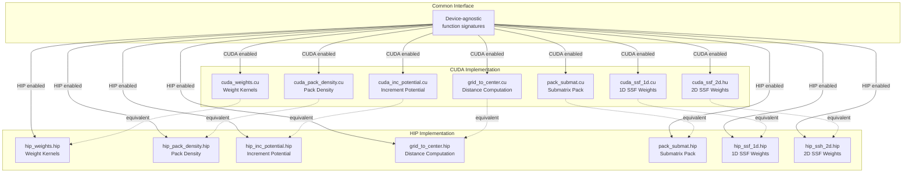
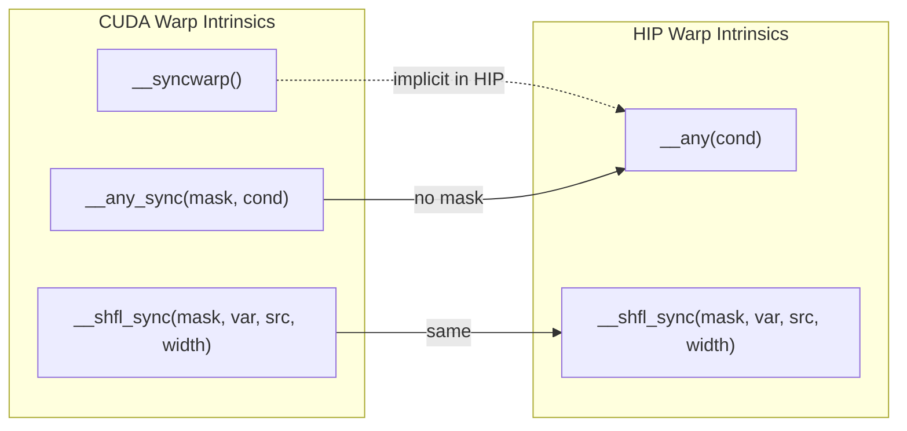

<!-- source: DeepWiki mcp.deepwiki.com · repo microsoft/skala · page 9.1 CUDA vs HIP API Mapping · fetched 2026-10-26 -->

# CUDA vs HIP API Mapping

<details>
<summary>Relevant source files</summary>

The following files were used as context for generating this wiki page:

- [third_party/gauxc/attic/src/integrator/cuda/cuda_pack_density.cu](third_party/gauxc/attic/src/integrator/cuda/cuda_pack_density.cu)
- [third_party/gauxc/attic/src/integrator/cuda/cuda_weights.cu](third_party/gauxc/attic/src/integrator/cuda/cuda_weights.cu)
- [third_party/gauxc/attic/src/new_integrator/device/cuda/cuda_inc_potential.cu](third_party/gauxc/attic/src/new_integrator/device/cuda/cuda_inc_potential.cu)
- [third_party/gauxc/attic/src/new_integrator/device/cuda/cuda_pack_density.cu](third_party/gauxc/attic/src/new_integrator/device/cuda/cuda_pack_density.cu)
- [third_party/gauxc/attic/src/new_integrator/device/cuda/cuda_weights.cu](third_party/gauxc/attic/src/new_integrator/device/cuda/cuda_weights.cu)
- [third_party/gauxc/attic/src/new_integrator/device/hip/hip_inc_potential.hip](third_party/gauxc/attic/src/new_integrator/device/hip/hip_inc_potential.hip)
- [third_party/gauxc/attic/src/new_integrator/device/hip/hip_pack_density.hip](third_party/gauxc/attic/src/new_integrator/device/hip/hip_pack_density.hip)
- [third_party/gauxc/attic/src/new_integrator/device/hip/hip_weights.hip](third_party/gauxc/attic/src/new_integrator/device/hip/hip_weights.hip)
- [third_party/gauxc/src/xc_integrator/local_work_driver/device/cuda/kernels/cuda_inc_potential.cu](third_party/gauxc/src/xc_integrator/local_work_driver/device/cuda/kernels/cuda_inc_potential.cu)
- [third_party/gauxc/src/xc_integrator/local_work_driver/device/cuda/kernels/cuda_ssf_1d.cu](third_party/gauxc/src/xc_integrator/local_work_driver/device/cuda/kernels/cuda_ssf_1d.cu)
- [third_party/gauxc/src/xc_integrator/local_work_driver/device/cuda/kernels/cuda_ssf_2d.hu](third_party/gauxc/src/xc_integrator/local_work_driver/device/cuda/kernels/cuda_ssf_2d.hu)
- [third_party/gauxc/src/xc_integrator/local_work_driver/device/cuda/kernels/grid_to_center.cu](third_party/gauxc/src/xc_integrator/local_work_driver/device/cuda/kernels/grid_to_center.cu)
- [third_party/gauxc/src/xc_integrator/local_work_driver/device/cuda/kernels/pack_submat.cu](third_party/gauxc/src/xc_integrator/local_work_driver/device/cuda/kernels/pack_submat.cu)
- [third_party/gauxc/src/xc_integrator/local_work_driver/device/hip/kernels/grid_to_center.hip](third_party/gauxc/src/xc_integrator/local_work_driver/device/hip/kernels/grid_to_center.hip)
- [third_party/gauxc/src/xc_integrator/local_work_driver/device/hip/kernels/hip_inc_potential.hip](third_party/gauxc/src/xc_integrator/local_work_driver/device/hip/kernels/hip_inc_potential.hip)
- [third_party/gauxc/src/xc_integrator/local_work_driver/device/hip/kernels/hip_ssf_1d.hip](third_party/gauxc/src/xc_integrator/local_work_driver/device/hip/kernels/hip_ssf_1d.hip)
- [third_party/gauxc/src/xc_integrator/local_work_driver/device/hip/kernels/hip_ssh_2d.hip](third_party/gauxc/src/xc_integrator/local_work_driver/device/hip/kernels/hip_ssh_2d.hip)
- [third_party/gauxc/src/xc_integrator/local_work_driver/device/hip/kernels/pack_submat.hip](third_party/gauxc/src/xc_integrator/local_work_driver/device/hip/kernels/pack_submat.hip)

</details>


## Purpose and Scope

This page documents the API-level differences between CUDA and HIP implementations in GauXC's GPU kernels. It covers syntax variations in kernel launches, stream management, warp-level intrinsics, and platform-specific optimizations. This material focuses on the mechanical translation between CUDA and HIP APIs rather than algorithmic differences.

For information about how the build system selects between CUDA and HIP backends at compile time, see [Build-Time Platform Selection](#9.2). For general GPU kernel optimization techniques that apply to both platforms, see [GPU Kernel Optimization Techniques](#8).

---

## Parallel Implementation Structure

GauXC maintains separate but functionally equivalent implementations for CUDA and HIP. Each GPU kernel exists in two versions with nearly identical algorithmic content but platform-specific API calls.



**Sources:** [third_party/gauxc/attic/src/integrator/cuda/cuda_weights.cu](), [third_party/gauxc/attic/src/new_integrator/device/hip/hip_weights.hip](), [third_party/gauxc/attic/src/new_integrator/device/cuda/cuda_pack_density.cu](), [third_party/gauxc/attic/src/new_integrator/device/hip/hip_pack_density.hip]()

---

## Kernel Launch Syntax

The most visible difference between CUDA and HIP is the kernel launch mechanism. CUDA uses chevron syntax while HIP uses a macro wrapper.

### CUDA Kernel Launch

CUDA kernels are launched using the `<<<>>>` chevron notation:

```cpp
kernel_name<<< blocks, threads, shared_mem, stream >>>(arg1, arg2, ...);
```

Example from [third_party/gauxc/attic/src/integrator/cuda/cuda_weights.cu:559]():
```cpp
reciprocal_kernel<<<threads, blocks, 0, stream>>>(length, vec);
```

Example from [third_party/gauxc/attic/src/new_integrator/device/cuda/cuda_weights.cu:586-588]():
```cpp
compute_point_center_dist<<< blocks, threads, 0, stream>>>(
  npts, LDatoms, natoms, atomic_coords_device, points_device, dist_scratch_device
);
```

### HIP Kernel Launch

HIP uses the `hipLaunchKernelGGL` macro which wraps kernel arguments:

```cpp
hipLaunchKernelGGL(kernel_name, dim3(blocks), dim3(threads), shared_mem, stream, arg1, arg2, ...);
```

Example from [third_party/gauxc/attic/src/new_integrator/device/hip/hip_weights.hip:560]():
```cpp
hipLaunchKernelGGL(reciprocal_kernel, dim3(threads), dim3(blocks), 0, stream, length, vec);
```

Example from [third_party/gauxc/attic/src/new_integrator/device/hip/hip_weights.hip:587-589]():
```cpp
hipLaunchKernelGGL(compute_point_center_dist, dim3(blocks), dim3(threads), 0, stream, 
  npts, LDatoms, natoms, atomic_coords_device, points_device, dist_scratch_device
);
```

**Key Differences:**
- HIP requires explicit `dim3()` construction for grid and block dimensions
- HIP kernel arguments are passed as variadic arguments to the macro, not in separate `()` after launch configuration

**Sources:** [third_party/gauxc/attic/src/integrator/cuda/cuda_weights.cu:556-560](), [third_party/gauxc/attic/src/new_integrator/device/hip/hip_weights.hip:557-561]()

---

## Stream Types and Queue Abstraction

### Stream Type Definitions

| Platform | Stream Type | Example |
|----------|-------------|---------|
| CUDA | `cudaStream_t` | [third_party/gauxc/attic/src/integrator/cuda/cuda_weights.cu:556]() |
| HIP | `hipStream_t` | [third_party/gauxc/attic/src/new_integrator/device/hip/hip_weights.hip:557]() |

### Queue Extraction from Device Queue

Both platforms use a `device_queue` abstraction that wraps the platform-specific stream. The extraction pattern differs slightly:

**CUDA:**
```cpp
cudaStream_t stream = queue.queue_as<util::cuda_stream>();
```
From [third_party/gauxc/src/xc_integrator/local_work_driver/device/cuda/kernels/cuda_inc_potential.cu:104]()

**HIP:**
```cpp
hipStream_t stream = queue.queue_as<util::hip_stream>();
```
From [third_party/gauxc/src/xc_integrator/local_work_driver/device/hip/kernels/hip_inc_potential.hip:73]()

The `util::cuda_stream` and `util::hip_stream` types are distinct template specializations that enable compile-time selection of the appropriate stream type.

**Sources:** [third_party/gauxc/src/xc_integrator/local_work_driver/device/cuda/kernels/cuda_inc_potential.cu:104](), [third_party/gauxc/src/xc_integrator/local_work_driver/device/hip/kernels/hip_inc_potential.hip:73]()

---

## Warp-Level Intrinsics

Warp-level primitives exhibit subtle but important differences between CUDA and HIP, particularly in synchronization and shuffle operations.



### Synchronization: `__syncwarp()`

**CUDA:** Explicitly uses `__syncwarp()` to synchronize threads within a warp.

Example from [third_party/gauxc/src/xc_integrator/local_work_driver/device/cuda/kernels/cuda_ssf_2d.hu:101]():
```cpp
__syncwarp();
```

**HIP:** Often omits explicit warp synchronization calls. The HIP programming model assumes certain implicit synchronization points.

Example from [third_party/gauxc/src/xc_integrator/local_work_driver/device/hip/kernels/hip_ssh_2d.hip:102]():
```cpp
// No __syncwarp() call before continue statement
```

### Warp Vote: `__any_sync()` vs `__any()`

**CUDA:** Uses `__any_sync(mask, condition)` with an explicit warp mask.

Example from [third_party/gauxc/attic/src/new_integrator/device/cuda/cuda_weights.cu:493]():
```cpp
while (__any_sync(0xffffffff, cont)) {
```

Also from [third_party/gauxc/src/xc_integrator/local_work_driver/device/cuda/kernels/cuda_ssf_2d.hu:126]():
```cpp
while (__any_sync(0xffffffff, cont)) {
```

**HIP:** Uses `__any(condition)` without an explicit mask parameter.

Example from [third_party/gauxc/attic/src/new_integrator/device/hip/hip_weights.hip:494]():
```cpp
while (__any(cont)) {
```

Also from [third_party/gauxc/src/xc_integrator/local_work_driver/device/hip/kernels/hip_ssh_2d.hip:125]():
```cpp
while (__any(cont)) {
```

**Mask Meaning:** The `0xffffffff` mask in CUDA represents all 32 threads in a warp participating. HIP's `__any()` implicitly uses all active threads.

### Shuffle Operations

**Both CUDA and HIP** support `__shfl_sync()` with similar signatures, though CUDA code sometimes uses it while HIP code may use alternative approaches.

Example from CUDA [third_party/gauxc/attic/src/integrator/cuda/cuda_weights.cu:135]():
```cpp
parent_weight = __shfl_sync(0xffffffff, parent_weight, iParent % 32, 32 );
```

Example from HIP [third_party/gauxc/attic/src/new_integrator/device/hip/hip_weights.hip:136]():
```cpp
parent_weight = __shfl_sync(0xffffffff, parent_weight, iParent % 32, 32 );
```

**Sources:** [third_party/gauxc/attic/src/new_integrator/device/cuda/cuda_weights.cu:493](), [third_party/gauxc/attic/src/new_integrator/device/hip/hip_weights.hip:494](), [third_party/gauxc/src/xc_integrator/local_work_driver/device/cuda/kernels/cuda_ssf_2d.hu:126](), [third_party/gauxc/src/xc_integrator/local_work_driver/device/hip/kernels/hip_ssh_2d.hip:125]()

---

## Register Variable Declaration

**CUDA:** Often uses the `register` keyword to suggest register allocation.

Example from [third_party/gauxc/attic/src/integrator/cuda/cuda_weights.cu:33]():
```cpp
register double3 coord_reg;
```

Example from [third_party/gauxc/src/xc_integrator/local_work_driver/device/cuda/kernels/grid_to_center.cu:27]():
```cpp
register double3 coord_reg;
```

**HIP:** Typically omits the `register` keyword, relying on compiler optimizations.

Example from [third_party/gauxc/attic/src/new_integrator/device/hip/hip_weights.hip:34]():
```cpp
double3 coord_reg;
```

The `register` keyword is a hint to the compiler and does not guarantee register allocation on modern GPUs. HIP compilers perform similar optimizations without the explicit keyword.

**Sources:** [third_party/gauxc/attic/src/integrator/cuda/cuda_weights.cu:33](), [third_party/gauxc/attic/src/new_integrator/device/hip/hip_weights.hip:34](), [third_party/gauxc/src/xc_integrator/local_work_driver/device/cuda/kernels/grid_to_center.cu:27]()

---

## Cache Control and PTX Assembly

### CUDA Cache Streaming Stores

CUDA provides low-level cache control through PTX assembly and the `__stcs()` builtin (available in CUDA 11.0+).

Example from [third_party/gauxc/attic/src/integrator/cuda/cuda_pack_density.cu:79-84]():
```cpp
// Suggest that the result be evicted first.
#if (CUDART_VERSION >= 11000)
  __stcs(address[k], val[k]);
#else
  asm ("st.global.cs.f64 [%0], %1;" :: "l"(address[k]), "d"(val[k]));
#endif
```

The `st.global.cs.f64` PTX instruction performs a store operation with cache streaming hint, suggesting the written data should bypass L1 cache or be evicted first.

### HIP Cache Control

HIP supports similar operations with a version check on `HIPRT_VERSION`:

Example from [third_party/gauxc/attic/src/new_integrator/device/hip/hip_pack_density.hip:81-85]():
```cpp
#if (HIPRT_VERSION >= 11000)
  __stcs(address[k], val[k]);
#else
  asm ("st.global.cs.f64 [%0], %1;" :: "l"(address[k]), "d"(val[k]));
#endif
```

**Platform Note:** The inline assembly syntax is identical, but HIP on AMD GPUs translates this to equivalent AMD ISA instructions during compilation.

**Sources:** [third_party/gauxc/attic/src/integrator/cuda/cuda_pack_density.cu:79-84](), [third_party/gauxc/attic/src/new_integrator/device/hip/hip_pack_density.hip:81-85](), [third_party/gauxc/attic/src/new_integrator/device/cuda/cuda_pack_density.cu:80-84]()

---

## Device Constants and Namespaces

GauXC uses namespace-qualified constants to provide platform-specific values for warp size, thread block limits, and other architectural parameters.

### CUDA Device Constants

CUDA kernels reference constants in the `cuda::` namespace:

```cpp
cuda::warp_size
cuda::max_warps_per_thread_block
cuda::max_threads_per_thread_block
```

Example from [third_party/gauxc/src/xc_integrator/local_work_driver/device/cuda/kernels/grid_to_center.cu:73-76]():
```cpp
const int distance_thread_y = cuda::max_warps_per_thread_block / 2;
dim3 threads( cuda::warp_size, distance_thread_y );
dim3 blocks( util::div_ceil( natoms,   threads.x), 
             util::div_ceil( npts, threads.y * distance_thread_y) );
```

### HIP Device Constants

HIP kernels reference constants in the `hip::` namespace:

```cpp
hip::warp_size
hip::max_warps_per_thread_block
hip::max_threads_per_thread_block
```

Example from [third_party/gauxc/src/xc_integrator/local_work_driver/device/hip/kernels/grid_to_center.hip:52-54]():
```cpp
dim3 threads( hip::warp_size, hip::max_warps_per_thread_block );
dim3 blocks( util::div_ceil( natoms, threads.x ),
             util::div_ceil( npts, threads.y ) );
```

### Constant Definitions

These constants are defined in platform-specific header files:
- CUDA: `device_specific/cuda_device_constants.hpp`
- HIP: `device_specific/hip_device_constants.hpp`

Referenced in:
- [third_party/gauxc/src/xc_integrator/local_work_driver/device/cuda/kernels/grid_to_center.cu:10]()
- [third_party/gauxc/src/xc_integrator/local_work_driver/device/hip/kernels/grid_to_center.hip:11]()

**Sources:** [third_party/gauxc/src/xc_integrator/local_work_driver/device/cuda/kernels/grid_to_center.cu:73-76](), [third_party/gauxc/src/xc_integrator/local_work_driver/device/hip/kernels/grid_to_center.hip:52-54]()

---

## Warp Reduction Functions

Both platforms implement custom warp reduction primitives, but they are namespaced differently.

### CUDA Warp Reductions

CUDA code uses `cuda::warp_reduce_sum` and `cuda::warp_reduce_prod`:

Example from [third_party/gauxc/src/xc_integrator/local_work_driver/device/cuda/kernels/cuda_ssf_2d.hu:89]():
```cpp
contribution = cuda::warp_reduce_prod<cuda::warp_size>(contribution);
```

Example from [third_party/gauxc/src/xc_integrator/local_work_driver/device/cuda/kernels/cuda_ssf_2d.hu:177]():
```cpp
sum = cuda::warp_reduce_sum<cuda::warp_size>(sum);
```

### HIP Warp Reductions

HIP code uses `hip::warp_reduce_sum` and `hip::warp_reduce_prod`:

Example from [third_party/gauxc/src/xc_integrator/local_work_driver/device/hip/kernels/hip_ssh_2d.hip:91]():
```cpp
contribution = hip::warp_reduce_prod<hip::warp_size>(contribution);
```

Example from [third_party/gauxc/src/xc_integrator/local_work_driver/device/hip/kernels/hip_ssh_2d.hip:175]():
```cpp
sum = hip::warp_reduce_sum<hip::warp_size>(sum);
```

These functions are implemented using warp shuffle operations and are defined in:
- CUDA: `cuda_extensions.hpp` or similar
- HIP: `hip_extensions.hpp`

Referenced in:
- [third_party/gauxc/src/xc_integrator/local_work_driver/device/cuda/kernels/cuda_ssf_2d.hu:8]()
- [third_party/gauxc/src/xc_integrator/local_work_driver/device/hip/kernels/hip_ssh_2d.hip:9]()

**Sources:** [third_party/gauxc/src/xc_integrator/local_work_driver/device/cuda/kernels/cuda_ssf_2d.hu:89](), [third_party/gauxc/src/xc_integrator/local_work_driver/device/hip/kernels/hip_ssh_2d.hip:91](), [third_party/gauxc/src/xc_integrator/local_work_driver/device/cuda/kernels/cuda_ssf_2d.hu:177](), [third_party/gauxc/src/xc_integrator/local_work_driver/device/hip/kernels/hip_ssh_2d.hip:175]()

---

## API Mapping Summary

The following table summarizes key API differences between CUDA and HIP implementations:

| Feature | CUDA | HIP | Notes |
|---------|------|-----|-------|
| **Kernel Launch** | `kernel<<<b,t,s,st>>>(args)` | `hipLaunchKernelGGL(kernel, dim3(b), dim3(t), s, st, args)` | HIP requires explicit `dim3()` and macro wrapper |
| **Stream Type** | `cudaStream_t` | `hipStream_t` | Type-safe stream abstraction |
| **Warp Synchronization** | `__syncwarp()` | Often omitted | HIP has different implicit sync semantics |
| **Warp Vote (any)** | `__any_sync(0xffffffff, cond)` | `__any(cond)` | HIP omits mask parameter |
| **Shuffle** | `__shfl_sync(mask, var, src, w)` | `__shfl_sync(mask, var, src, w)` | Same signature |
| **Register Keyword** | `register double3 var;` | `double3 var;` | HIP omits `register` hint |
| **Cache Control** | `__stcs()` or PTX asm | `__stcs()` or PTX asm | Same syntax, different ISA |
| **Warp Size Constant** | `cuda::warp_size` | `hip::warp_size` | Namespace-qualified |
| **Max Threads** | `cuda::max_threads_per_thread_block` | `hip::max_threads_per_thread_block` | Namespace-qualified |
| **Warp Reduction** | `cuda::warp_reduce_sum<N>()` | `hip::warp_reduce_sum<N>()` | Namespace-qualified |
| **Stream Extraction** | `queue.queue_as<util::cuda_stream>()` | `queue.queue_as<util::hip_stream>()` | Type-based dispatch |
| **File Extension** | `.cu`, `.cuh`, `.hu` | `.hip` | Different source file conventions |

**Sources:** All sections above

---

## Code Duplication Strategy

GauXC employs **full duplication** rather than preprocessor abstraction for CUDA and HIP implementations. Each kernel exists in two complete source files.

### Rationale for Duplication

**Advantages:**
1. **Build System Simplicity**: CMake can conditionally compile CUDA or HIP files based on `GAUXC_ENABLE_CUDA` and `GAUXC_ENABLE_HIP` flags without complex preprocessing
2. **Platform-Specific Optimization**: Each implementation can be tuned independently for NVIDIA vs AMD architectures
3. **Debugging Clarity**: Platform-specific compilation errors are isolated to their respective files
4. **No Macro Pollution**: Avoids complex conditional compilation that obscures algorithmic logic

**Disadvantages:**
1. **Maintenance Burden**: Algorithm changes must be synchronized across both implementations
2. **Code Volume**: Approximately 2x source code for GPU kernels

### Synchronization Points

Algorithm-identical pairs that require synchronized maintenance:

| CUDA Implementation | HIP Implementation | Functionality |
|---------------------|-------------------|---------------|
| `cuda_weights.cu` | `hip_weights.hip` | Weight partition kernels |
| `cuda_pack_density.cu` | `hip_pack_density.hip` | Density matrix packing |
| `cuda_inc_potential.cu` | `hip_inc_potential.hip` | Potential matrix increment |
| `grid_to_center.cu` | `grid_to_center.hip` | Grid-to-center distances |
| `pack_submat.cu` | `pack_submat.hip` | Submatrix extraction |
| `cuda_ssf_1d.cu` | `hip_ssf_1d.hip` | 1D SSF weight modification |
| `cuda_ssf_2d.hu` | `hip_ssh_2d.hip` | 2D SSF weight modification |

**Sources:** All file pairs listed in the table

---

## Build System Integration

The build system selects between CUDA and HIP implementations through CMake conditionals. This process is documented in detail in [Build-Time Platform Selection](#9.2), but the key mechanism involves:

1. **File Discovery**: CMake identifies `.cu` and `.hip` files in the source tree
2. **Conditional Compilation**: 
   - If `GAUXC_ENABLE_CUDA=ON`, compile `.cu` files with `nvcc` or CUDA language support
   - If `GAUXC_ENABLE_HIP=ON`, compile `.hip` files with HIP compiler
3. **Linker Separation**: CUDA and HIP object files are mutually exclusive; only one platform's compiled kernels link into the final library

This clean separation at the file level avoids preprocessor conditionals within kernel code.

**Sources:** Referenced build system structure from overview diagrams

---

