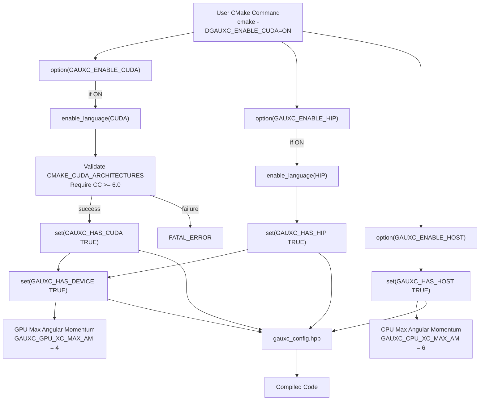
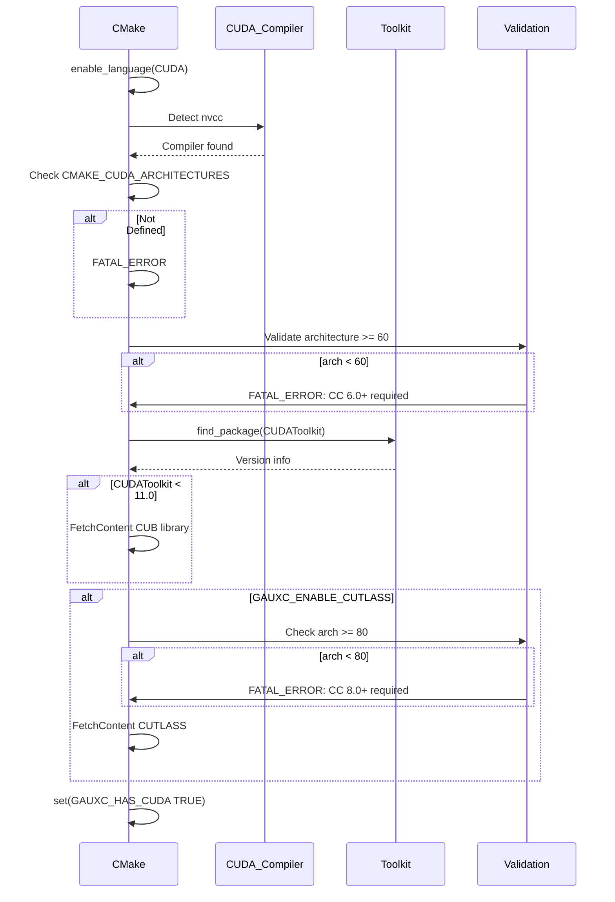
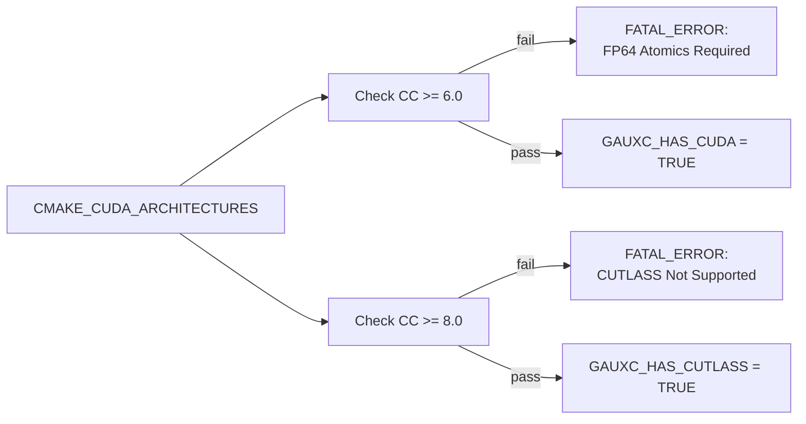
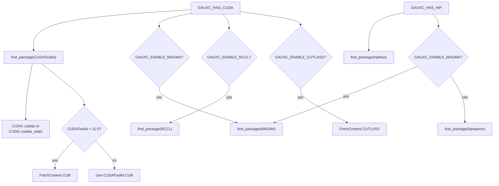
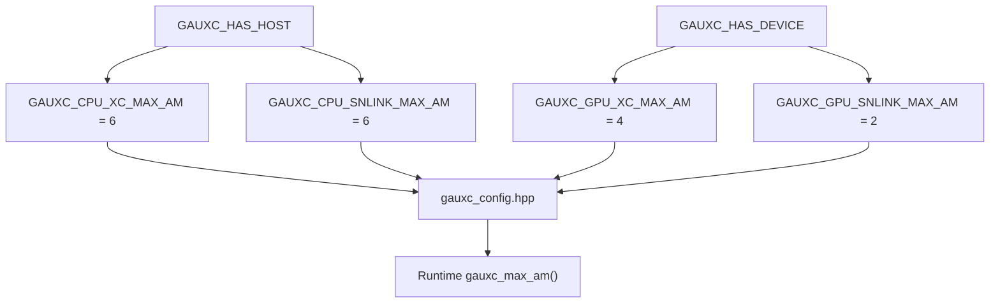
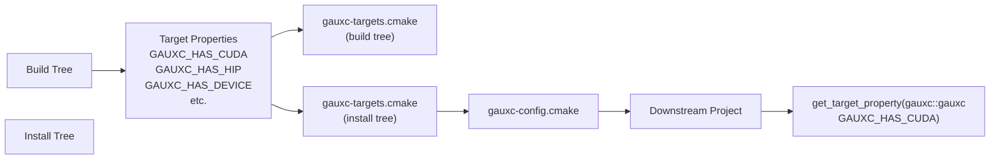
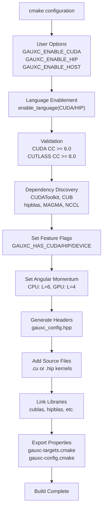

<!-- source: DeepWiki mcp.deepwiki.com · repo microsoft/skala · page 9.2 Build-Time Platform Selection · fetched 2026-10-26 -->

# Build-Time Platform Selection

<details>
<summary>Relevant source files</summary>

The following files were used as context for generating this wiki page:

- [third_party/gauxc/CMakeLists.txt](third_party/gauxc/CMakeLists.txt)
- [third_party/gauxc/attic/src/integrator/cuda/gauxc-cuda_integrator.cmake](third_party/gauxc/attic/src/integrator/cuda/gauxc-cuda_integrator.cmake)
- [third_party/gauxc/attic/src/new_integrator/device/cuda/gauxc-cuda.cmake](third_party/gauxc/attic/src/new_integrator/device/cuda/gauxc-cuda.cmake)
- [third_party/gauxc/attic/src/new_integrator/device/hip/gauxc-hip.cmake](third_party/gauxc/attic/src/new_integrator/device/hip/gauxc-hip.cmake)
- [third_party/gauxc/cmake/gauxc-config.cmake.in](third_party/gauxc/cmake/gauxc-config.cmake.in)
- [third_party/gauxc/cmake/gauxc-cub.cmake](third_party/gauxc/cmake/gauxc-cub.cmake)
- [third_party/gauxc/cmake/gauxc-cutlass.cmake](third_party/gauxc/cmake/gauxc-cutlass.cmake)
- [third_party/gauxc/include/gauxc/gauxc_config.hpp.in](third_party/gauxc/include/gauxc/gauxc_config.hpp.in)
- [third_party/gauxc/include/gauxc/util/environment.hpp](third_party/gauxc/include/gauxc/util/environment.hpp)
- [third_party/gauxc/src/CMakeLists.txt](third_party/gauxc/src/CMakeLists.txt)
- [third_party/gauxc/src/external/CMakeLists.txt](third_party/gauxc/src/external/CMakeLists.txt)
- [third_party/gauxc/src/xc_integrator/local_work_driver/device/CMakeLists.txt](third_party/gauxc/src/xc_integrator/local_work_driver/device/CMakeLists.txt)
- [third_party/gauxc/src/xc_integrator/local_work_driver/device/cuda/CMakeLists.txt](third_party/gauxc/src/xc_integrator/local_work_driver/device/cuda/CMakeLists.txt)
- [third_party/gauxc/src/xc_integrator/local_work_driver/device/hip/CMakeLists.txt](third_party/gauxc/src/xc_integrator/local_work_driver/device/hip/CMakeLists.txt)
- [third_party/gauxc/tests/environment.cxx](third_party/gauxc/tests/environment.cxx)

</details>


## Purpose and Scope

This document explains how GauXC selects GPU platforms (CUDA or HIP) at build time through CMake configuration. It details the CMake option system (`GAUXC_ENABLE_CUDA`, `GAUXC_ENABLE_HIP`), how these options trigger language enablement and dependency discovery, compute capability validation, and how platform selection affects compilation through generated headers and exported package properties.

For runtime execution path selection between host and device code, see [Execution Model: Host vs Device](#4.2). For CUDA vs HIP API differences, see [CUDA vs HIP API Mapping](#9.1). For build system configuration more broadly, see [CMake Options and Feature Flags](#2.1).

---

## Option-to-Feature Flag Mapping

GauXC uses a two-layer system to control platform selection:

1. **User-facing options** (`GAUXC_ENABLE_*`): Set by users during CMake configuration
2. **Internal feature flags** (`GAUXC_HAS_*`): Set by CMake based on successful discovery and validation

### Configuration Flow



**Sources:** [third_party/gauxc/CMakeLists.txt:30-112](), [third_party/gauxc/src/CMakeLists.txt:116-124]()

### Option Definitions

The top-level CMakeLists.txt defines user-facing options with default values:

| Option | Default | Purpose |
|--------|---------|---------|
| `GAUXC_ENABLE_HOST` | `ON` | Enable CPU execution path |
| `GAUXC_ENABLE_CUDA` | `OFF` | Enable NVIDIA GPU support |
| `GAUXC_ENABLE_HIP` | `OFF` | Enable AMD GPU support |
| `GAUXC_ENABLE_MAGMA` | `ON` (if device enabled) | Enable MAGMA linear algebra library |
| `GAUXC_ENABLE_NCCL` | `OFF` (if CUDA enabled) | Enable NCCL multi-GPU collectives |
| `GAUXC_ENABLE_CUTLASS` | `OFF` (if CUDA enabled) | Enable CUTLASS linear algebra templates |

**Sources:** [third_party/gauxc/CMakeLists.txt:30-55]()

### Feature Flag Initialization

All feature flags are initialized to `FALSE` and marked as advanced cache variables:

```cmake
set( GAUXC_HAS_HOST       FALSE CACHE BOOL "" FORCE )
set( GAUXC_HAS_CUDA       FALSE CACHE BOOL "" FORCE )
set( GAUXC_HAS_HIP        FALSE CACHE BOOL "" FORCE )
set( GAUXC_HAS_DEVICE     FALSE CACHE BOOL "" FORCE )
set( GAUXC_HAS_MAGMA      FALSE CACHE BOOL "" FORCE )
set( GAUXC_HAS_NCCL       FALSE CACHE BOOL "" FORCE )
set( GAUXC_HAS_CUTLASS    FALSE CACHE BOOL "" FORCE )
```

**Sources:** [third_party/gauxc/CMakeLists.txt:58-84]()

---

## Language Enablement Process

### CUDA Language Enablement

When `GAUXC_ENABLE_CUDA=ON`, the build system performs the following steps:



**Sources:** [third_party/gauxc/CMakeLists.txt:97-100](), [third_party/gauxc/src/xc_integrator/local_work_driver/device/cuda/CMakeLists.txt:31-41](), [third_party/gauxc/cmake/gauxc-cutlass.cmake:1-6]()

### HIP Language Enablement

When `GAUXC_ENABLE_HIP=ON`:

```cmake
if( GAUXC_ENABLE_HIP )
  enable_language( HIP )
  set( GAUXC_HAS_HIP TRUE CACHE BOOL "GauXC has HIP and will build HIP bindings" FORCE )
endif()
```

The HIP language enablement is simpler than CUDA—no architecture validation is performed, as ROCm handles compatibility differently.

**Sources:** [third_party/gauxc/CMakeLists.txt:102-105]()

### Device Flag Derivation

The `GAUXC_HAS_DEVICE` flag is derived from the presence of either CUDA or HIP:

```cmake
if( GAUXC_HAS_CUDA OR GAUXC_HAS_HIP )
  set( GAUXC_HAS_DEVICE TRUE CACHE BOOL "Enable Device Code" )
else()
  set( GAUXC_HAS_DEVICE FALSE CACHE BOOL "Enable Device Code" )
endif()
```

This flag is used throughout the codebase to enable device-specific compilation units and set platform-specific parameters.

**Sources:** [third_party/gauxc/CMakeLists.txt:108-112]()

---

## Compute Capability Validation

### CUDA Architecture Requirements

GauXC enforces minimum compute capabilities for different features:



#### Base CUDA Requirements (CC 6.0+)

The minimum compute capability 6.0 is required for double-precision atomic operations, which are used extensively in the `sym_task_inc_potential` and `asym_task_inc_potential` kernels:

```cmake
foreach( cuda_arch ${CMAKE_CUDA_ARCHITECTURES} )
  if( cuda_arch LESS 60 )
    message(FATAL_ERROR "GauXC Requires CUDA CC 6.0+ For FP64 Atomics")
  endif()
endforeach()
```

**Sources:** [third_party/gauxc/src/xc_integrator/local_work_driver/device/cuda/CMakeLists.txt:36-41]()

#### CUTLASS Requirements (CC 8.0+)

When `GAUXC_ENABLE_CUTLASS=ON`, additional validation ensures compute capability 8.0 or higher:

```cmake
foreach( cuda_arch ${CMAKE_CUDA_ARCHITECTURES} )
  if( NOT cuda_arch GREATER_EQUAL 80 )
    message(FATAL_ERROR "GauXC Requires CUDA CC >= 8.0 For CUTLASS")
  endif()
endforeach()
```

**Sources:** [third_party/gauxc/cmake/gauxc-cutlass.cmake:1-6]()

### Setting Architecture Manually

Users must explicitly set `CMAKE_CUDA_ARCHITECTURES` when enabling CUDA:

```bash
cmake -DGAUXC_ENABLE_CUDA=ON \
      -DCMAKE_CUDA_ARCHITECTURES="60;70;80" \
      ..
```

If not set, CMake generates a fatal error:

```cmake
if( NOT DEFINED CMAKE_CUDA_ARCHITECTURES )
  message( FATAL_ERROR "CMAKE_CUDA_ARCHITECTURES Must Be Set" )
endif()
```

**Sources:** [third_party/gauxc/src/xc_integrator/local_work_driver/device/cuda/CMakeLists.txt:31-34]()

---

## Platform-Specific Dependencies

### Dependency Discovery Tree



**Sources:** [third_party/gauxc/cmake/gauxc-cub.cmake:1-31](), [third_party/gauxc/cmake/gauxc-cutlass.cmake:1-34](), [third_party/gauxc/src/xc_integrator/local_work_driver/device/hip/CMakeLists.txt:28-32]()

### CUDA-Specific Dependencies

#### CUB Library

For CUDA versions below 11.0, CUB must be fetched separately:

```cmake
if( CUDAToolkit_VERSION VERSION_LESS "11.0.0" )
  FetchContent_Declare(
    cub
    GIT_REPOSITORY ${GAUXC_CUB_REPOSITORY} 
    GIT_TAG        ${GAUXC_CUB_REVISION} 
  )
  # Creates gauxc_cub INTERFACE target
endif()
```

For CUDA 11.0+, CUB is included with the toolkit and no separate fetch is needed.

**Sources:** [third_party/gauxc/cmake/gauxc-cub.cmake:1-31]()

#### cuBLAS Linking

The build supports both static and dynamic linking of cuBLAS:

```cmake
if(NOT GAUXC_LINK_CUDA_STATIC)
  target_link_libraries( gauxc PUBLIC CUDA::cublas )
else()
  target_link_libraries( gauxc PUBLIC CUDA::cublas_static )
endif()
```

**Sources:** [third_party/gauxc/attic/src/integrator/cuda/gauxc-cuda_integrator.cmake:67-71]()

#### CUTLASS Templates

When enabled, CUTLASS is fetched and configured:

```cmake
FetchContent_Declare(
  cutlass
  GIT_REPOSITORY ${GAUXC_CUTLASS_REPOSITORY} 
  GIT_TAG        ${GAUXC_CUTLASS_REVISION} 
)

add_library( gauxc_cutlass INTERFACE IMPORTED )
set_target_properties( gauxc_cutlass PROPERTIES 
  INTERFACE_INCLUDE_DIRECTORIES 
    "${cutlass_SOURCE_DIR}/include;${cutlass_SOURCE_DIR}/tools/util/include"
)
```

**Sources:** [third_party/gauxc/cmake/gauxc-cutlass.cmake:14-31]()

### HIP-Specific Dependencies

HIP requires `hipblas` and optionally `hipsparse` (when MAGMA is enabled):

```cmake
find_package( hipblas REQUIRED )
target_link_libraries( gauxc PUBLIC roc::hipblas )

if(GAUXC_HAS_MAGMA)
  find_package( hipsparse REQUIRED )
  target_link_libraries( gauxc PUBLIC roc::hipsparse )
endif()
```

**Sources:** [third_party/gauxc/src/xc_integrator/local_work_driver/device/hip/CMakeLists.txt:28-32](), [third_party/gauxc/attic/src/new_integrator/device/hip/gauxc-hip.cmake:1-43]()

---

## Angular Momentum Limits

### Platform-Dependent Limits

The maximum angular momentum supported differs between CPU and GPU platforms:



### Limits Table

| Platform | XC/DEN Max AM | SNLINK Max AM | Reason |
|----------|---------------|---------------|--------|
| CPU | 6 | 6 | Gau2Grid generates up to L=6 kernels |
| GPU | 4 | 2 | Register pressure limits GPU kernel complexity |

**Sources:** [third_party/gauxc/src/CMakeLists.txt:116-124]()

### Configuration in CMakeLists.txt

```cmake
if(GAUXC_HAS_HOST)
  set(GAUXC_CPU_XC_MAX_AM     6) 
  set(GAUXC_CPU_SNLINK_MAX_AM 6)
endif()

if(GAUXC_HAS_DEVICE)
  set(GAUXC_GPU_XC_MAX_AM     4) 
  set(GAUXC_GPU_SNLINK_MAX_AM 2)
endif()
```

These values are substituted into `gauxc_config.hpp.in` during configuration.

**Sources:** [third_party/gauxc/src/CMakeLists.txt:116-124]()

### Runtime Access

The `gauxc_max_am()` function uses preprocessor conditionals to return the appropriate limit:

```cpp
inline int gauxc_max_am(ExecutionSpace ex, SupportedAlg alg) {
  switch(ex) {
    #ifdef GAUXC_HAS_HOST
    case ExecutionSpace::Host:
      switch(alg) {
        case SupportedAlg::XC: 
          return GAUXC_CPU_XC_MAX_AM;
        // ...
      }
    #endif
    #ifdef GAUXC_HAS_DEVICE
    case ExecutionSpace::Device:
      switch(alg) {
        case SupportedAlg::XC: 
          return GAUXC_GPU_XC_MAX_AM;
        // ...
      }
    #endif
  }
}
```

**Sources:** [third_party/gauxc/include/gauxc/util/environment.hpp:14-40]()

---

## Generated Header Configuration

### gauxc_config.hpp Generation

The build system uses CMake's `configure_file()` to generate a platform-specific header:

```cmake
configure_file( 
  ${PROJECT_SOURCE_DIR}/include/gauxc/gauxc_config.hpp.in
  ${PROJECT_BINARY_DIR}/include/gauxc/gauxc_config.hpp
)
```

**Sources:** [third_party/gauxc/src/CMakeLists.txt:135-138]()

### Template Structure

The input template `gauxc_config.hpp.in` contains CMake variables:

```cpp
#pragma once

#cmakedefine GAUXC_HAS_HOST
#cmakedefine GAUXC_HAS_CUDA
#cmakedefine GAUXC_HAS_HIP
#cmakedefine GAUXC_HAS_DEVICE
#cmakedefine GAUXC_HAS_MAGMA
#cmakedefine GAUXC_HAS_NCCL
#cmakedefine GAUXC_HAS_CUTLASS

#ifdef GAUXC_HAS_HOST
#cmakedefine GAUXC_CPU_XC_MAX_AM     @GAUXC_CPU_XC_MAX_AM@
#cmakedefine GAUXC_CPU_SNLINK_MAX_AM @GAUXC_CPU_SNLINK_MAX_AM@
#endif

#ifdef GAUXC_HAS_DEVICE
#cmakedefine GAUXC_GPU_XC_MAX_AM     @GAUXC_GPU_XC_MAX_AM@
#cmakedefine GAUXC_GPU_SNLINK_MAX_AM @GAUXC_GPU_SNLINK_MAX_AM@
#endif
```

**Sources:** [third_party/gauxc/include/gauxc/gauxc_config.hpp.in:10-36]()

### Preprocessor Macro Usage

Code uses these macros for conditional compilation:

```cpp
#ifdef GAUXC_HAS_CUDA
  // CUDA-specific code
  enable_language(CUDA);
#endif

#ifdef GAUXC_HAS_HIP
  // HIP-specific code
  enable_language(HIP);
#endif

#ifdef GAUXC_HAS_DEVICE
  // Common device code
  device_executor.execute();
#endif
```

The `HOST_DEVICE_ACCESSIBLE` macro is also defined to support functions callable from both host and device:

```cpp
#if defined(__CUDACC__) || defined(__HIPCC__)
  #define HOST_DEVICE_ACCESSIBLE __host__ __device__
#else
  #define HOST_DEVICE_ACCESSIBLE
#endif
```

**Sources:** [third_party/gauxc/include/gauxc/gauxc_config.hpp.in:38-42]()

---

## Package Export System

### Export Properties

The build system exports all feature flags as target properties for downstream consumption:



**Sources:** [third_party/gauxc/src/CMakeLists.txt:152-196]()

### Property Setting

All feature flags are set as target properties:

```cmake
set_target_properties(gauxc
  PROPERTIES
    "GAUXC_HAS_HOST"       ${GAUXC_HAS_HOST}
    "GAUXC_HAS_DEVICE"     ${GAUXC_HAS_DEVICE}
    "GAUXC_HAS_CUDA"       ${GAUXC_HAS_CUDA}
    "GAUXC_HAS_HIP"        ${GAUXC_HAS_HIP}
    "GAUXC_HAS_MAGMA"      ${GAUXC_HAS_MAGMA}
    "GAUXC_HAS_CUTLASS"    ${GAUXC_HAS_CUTLASS}
    "GAUXC_HAS_NCCL"       ${GAUXC_HAS_NCCL}
    "GAUXC_CPU_XC_MAX_AM"     ${GAUXC_CPU_XC_MAX_AM}     
    "GAUXC_GPU_XC_MAX_AM"     ${GAUXC_GPU_XC_MAX_AM}     
    # ...
)
set_property(TARGET gauxc APPEND PROPERTY EXPORT_PROPERTIES "${export_properties}")
```

**Sources:** [third_party/gauxc/src/CMakeLists.txt:173-191]()

### Package Config File

The `gauxc-config.cmake.in` template propagates feature flags to downstream projects:

```cmake
set( GAUXC_HAS_HOST       @GAUXC_HAS_HOST@      )
set( GAUXC_HAS_CUDA       @GAUXC_HAS_CUDA@      )
set( GAUXC_HAS_HIP        @GAUXC_HAS_HIP@       )
set( GAUXC_HAS_MAGMA      @GAUXC_HAS_MAGMA@     )
set( GAUXC_HAS_NCCL       @GAUXC_HAS_NCCL@      )
set( GAUXC_HAS_CUTLASS    @GAUXC_HAS_CUTLASS@   )

if( GAUXC_HAS_CUDA )
  enable_language( CUDA )
  find_dependency( CUDAToolkit @CUDAToolkit_VERSION@ EXACT )
  if( GAUXC_HAS_MAGMA )
    find_dependency( MAGMA )
  endif()
  if( GAUXC_HAS_NCCL )
    find_dependency( NCCL )
  endif()
endif()
```

This ensures downstream projects automatically enable the CUDA or HIP language and find required dependencies.

**Sources:** [third_party/gauxc/cmake/gauxc-config.cmake.in:13-57]()

---

## Source File Organization by Platform

### CMakeLists.txt Platform Branching

The build system uses conditional subdirectory inclusion based on enabled platforms:

```cmake
if(GAUXC_HAS_CUDA)
  add_subdirectory( cuda )
endif()

if(GAUXC_HAS_HIP)
  add_subdirectory( hip )
endif()
```

**Sources:** [third_party/gauxc/src/xc_integrator/local_work_driver/device/CMakeLists.txt:27-33]()

### CUDA Source Files

When `GAUXC_HAS_CUDA=TRUE`, the CUDA subdirectory adds `.cu` source files:

```cmake
target_sources(gauxc PRIVATE
  kernels/collocation_device.cu
  kernels/grid_to_center.cu
  kernels/cuda_ssf_1d.cu
  cuda_aos_scheme1_weights.cu
  kernels/pack_submat.cu
  kernels/cublas_extensions.cu
  kernels/uvvars.cu
  kernels/zmat_vxc.cu
  kernels/cuda_inc_potential.cu
  # ...
)
```

**Sources:** [third_party/gauxc/src/xc_integrator/local_work_driver/device/cuda/CMakeLists.txt:8-29]()

### HIP Source Files

When `GAUXC_HAS_HIP=TRUE`, the HIP subdirectory adds `.hip` source files:

```cmake
target_sources(gauxc PRIVATE
  kernels/collocation_device.hip
  kernels/grid_to_center.hip
  kernels/hip_ssf_1d.hip
  kernels/hip_ssh_2d.hip
  kernels/pack_submat.hip
  kernels/hipblas_extensions.hip
  kernels/uvvars.hip
  kernels/zmat_vxc.hip
  kernels/hip_inc_potential.hip
  # ...
)
```

**Sources:** [third_party/gauxc/src/xc_integrator/local_work_driver/device/hip/CMakeLists.txt:8-26]()

### File Extension Semantics

| Extension | Language | Compiler | Platform |
|-----------|----------|----------|----------|
| `.cu` | CUDA C++ | `nvcc` | NVIDIA GPUs |
| `.hip` | HIP C++ | `hipcc` | AMD GPUs |
| `.cxx` | C++ | `g++`/`clang++` | Host or device data structures |

---

## Build Validation Logic

### Mutual Exclusivity Check

The build system does not enforce mutual exclusivity between CUDA and HIP—both can theoretically be enabled simultaneously, though this is not a common use case. However, at least one execution backend must be enabled:

```cmake
if( NOT (${GAUXC_HAS_HOST} OR ${GAUXC_HAS_DEVICE}) )
  message( FATAL_ERROR "Neither Host nor Device Integrators have been enabled!" )
endif()
```

**Sources:** [third_party/gauxc/CMakeLists.txt:116-118]()

### Example Build Configurations

#### CUDA-Only Build
```bash
cmake -DGAUXC_ENABLE_CUDA=ON \
      -DGAUXC_ENABLE_HOST=OFF \
      -DCMAKE_CUDA_ARCHITECTURES="70;80" \
      ..
```

#### HIP-Only Build
```bash
cmake -DGAUXC_ENABLE_HIP=ON \
      -DGAUXC_ENABLE_HOST=OFF \
      ..
```

#### Hybrid CPU+CUDA Build
```bash
cmake -DGAUXC_ENABLE_CUDA=ON \
      -DGAUXC_ENABLE_HOST=ON \
      -DCMAKE_CUDA_ARCHITECTURES="60;70;80" \
      ..
```

#### CPU-Only Build
```bash
cmake -DGAUXC_ENABLE_HOST=ON \
      -DGAUXC_ENABLE_CUDA=OFF \
      -DGAUXC_ENABLE_HIP=OFF \
      ..
```

---

## Summary of Build-Time Decisions



**Sources:** [third_party/gauxc/CMakeLists.txt:1-133](), [third_party/gauxc/src/CMakeLists.txt:1-248]()

---

