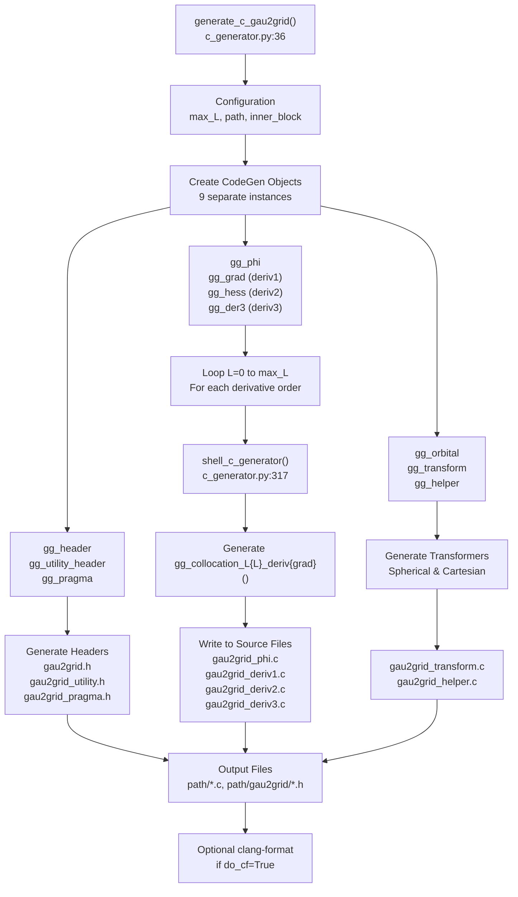
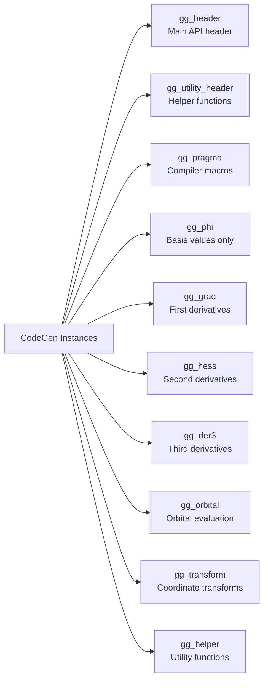
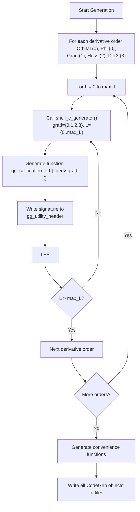
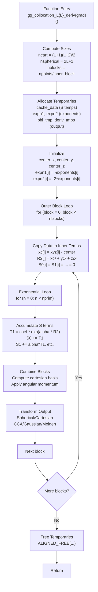
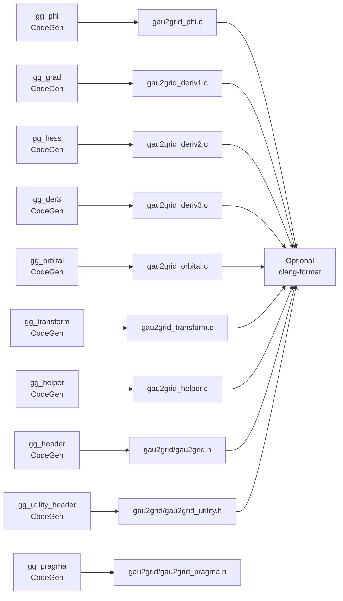
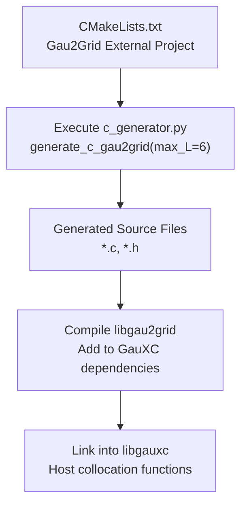

<!-- source: DeepWiki mcp.deepwiki.com · repo microsoft/skala · extra page Code Generation Pipeline · fetched 2026-10-26 -->

# Code Generation Pipeline

<details>
<summary>Relevant source files</summary>

The following files were used as context for generating this wiki page:

- [third_party/gauxc/external/gau2grid/generated_source/gau2grid/gau2grid_pragma.h](third_party/gauxc/external/gau2grid/generated_source/gau2grid/gau2grid_pragma.h)
- [third_party/gauxc/external/gau2grid/generated_source/gau2grid_deriv1.c](third_party/gauxc/external/gau2grid/generated_source/gau2grid_deriv1.c)
- [third_party/gauxc/external/gau2grid/generated_source/gau2grid_deriv2.c](third_party/gauxc/external/gau2grid/generated_source/gau2grid_deriv2.c)
- [third_party/gauxc/external/gau2grid/generated_source/gau2grid_deriv3.c](third_party/gauxc/external/gau2grid/generated_source/gau2grid_deriv3.c)
- [third_party/gauxc/external/gau2grid/generated_source/gau2grid_phi.c](third_party/gauxc/external/gau2grid/generated_source/gau2grid_phi.c)
- [third_party/gauxc/external/gau2grid/src/gau2grid/c_generator.py](third_party/gauxc/external/gau2grid/src/gau2grid/c_generator.py)
- [third_party/gauxc/external/gau2grid/src/gau2grid/c_pragma.py](third_party/gauxc/external/gau2grid/src/gau2grid/c_pragma.py)

</details>


## Purpose and Scope

This document details the Python-based code generation pipeline that produces optimized C kernels for basis function collocation in the Gau2Grid library. The pipeline generates specialized functions for each angular momentum level (L=0 to max_L) and derivative order (values, gradients, Hessians, third derivatives). For information about the generated kernel structure and runtime behavior, see [Generated Kernel Structure](#6.1.2). For compiler-specific optimizations applied to the generated code, see [Compiler Pragma System](#6.1.3).

The code generation process is implemented in Python and executed at build time by the CMake system as an external project. It produces static C source files that are compiled into the final library.

## Pipeline Architecture



**Sources:** [third_party/gauxc/external/gau2grid/src/gau2grid/c_generator.py:36-315]()

## Main Entry Point: `generate_c_gau2grid`

The `generate_c_gau2grid` function orchestrates the entire code generation process. It is invoked by the CMake build system with parameters that control the generated code characteristics.

### Function Signature and Parameters

| Parameter | Type | Default | Purpose |
|-----------|------|---------|---------|
| `max_L` | int | required | Maximum angular momentum (CPU: L=6, GPU: L=4) |
| `path` | str | `"."` | Output directory for generated files |
| `inner_block` | str/int | `"auto"` | SIMD block size (auto-computed or explicit) |
| `do_cf` | bool | `True` | Apply clang-format to output files |

**Sources:** [third_party/gauxc/external/gau2grid/src/gau2grid/c_generator.py:36-53]()

### CodeGen Object Creation

The pipeline creates nine distinct `CodeGen` instances, each responsible for generating a specific component:



Each `CodeGen` object accumulates code via `write()`, `start_c_block()`, and `close_c_block()` methods, then outputs to disk via `repr(filename, clang_format)`.

**Sources:** [third_party/gauxc/external/gau2grid/src/gau2grid/c_generator.py:58-92]()

### Generation Loop Structure

The core generation logic iterates over derivative orders and angular momentum levels:



**Sources:** [third_party/gauxc/external/gau2grid/src/gau2grid/c_generator.py:218-285]()

## Shell-Specific Code Generation: `shell_c_generator`

The `shell_c_generator` function generates a complete C function for a specific angular momentum and derivative order. This is the workhorse of the code generation system.

### Function Parameters

| Parameter | Type | Default | Purpose |
|-----------|------|---------|---------|
| `cg` | CodeGen | required | Target CodeGen object |
| `L` | int | required | Angular momentum (0-6 typical) |
| `function_name` | str | `""` | Override default naming |
| `grad` | int | `0` | Derivative order (0-3) |
| `cartesian_order` | str | `"row"` | Internal ordering (always "cca" in practice) |
| `inner_block` | str/int | `"auto"` | SIMD vectorization width |
| `orbital` | bool | `False` | Generate orbital-specific variant |

**Sources:** [third_party/gauxc/external/gau2grid/src/gau2grid/c_generator.py:317-334]()

### Generated Function Structure

Each generated function follows a consistent structure:



**Sources:** [third_party/gauxc/external/gau2grid/src/gau2grid/c_generator.py:404-778]()

### Inner Block Size Calculation

The `inner_block` parameter controls SIMD vectorization width and is computed to fit within L1 cache:

```python
# Auto-calculation logic (lines 362-382)
if inner_block == "auto":
    cache_limit_doubles = 4096  # Target ~50% of 64KB L1
    basic_lines = 5 + grad      # xc, yc, zc, R2, S0, [S1, S2, S3]
    
    if paritioned_loops:
        nlines = basic_lines + ncart
    else:
        nlines = basic_lines + ncart * (1 + len(deriv_indices))
    
    inner_block = 32  # Default SIMD width
    
    if nlines * inner_block > cache_limit_doubles:
        # Warn: L1 cache limit exceeded
```

For high angular momentum and derivative orders, the system emits a warning when the working set exceeds the assumed 16KB L1 cache limit.

**Sources:** [third_party/gauxc/external/gau2grid/src/gau2grid/c_generator.py:360-382]()

## Output File Organization

The code generation pipeline produces a structured set of files:

### Header Files

| File | Location | Purpose |
|------|----------|---------|
| `gau2grid.h` | `path/gau2grid/` | Main public API, order definitions |
| `gau2grid_utility.h` | `path/gau2grid/` | Internal function declarations |
| `gau2grid_pragma.h` | `path/gau2grid/` | Compiler-specific macros |

### Source Files

| File | Location | Contains |
|------|----------|----------|
| `gau2grid_phi.c` | `path/` | `gg_collocation_L*()` functions (grad=0) |
| `gau2grid_deriv1.c` | `path/` | `gg_collocation_L*_deriv1()` functions |
| `gau2grid_deriv2.c` | `path/` | `gg_collocation_L*_deriv2()` functions |
| `gau2grid_deriv3.c` | `path/` | `gg_collocation_L*_deriv3()` functions |
| `gau2grid_orbital.c` | `path/` | `gg_orbitals_L*()` functions |
| `gau2grid_transform.c` | `path/` | Coordinate transformation utilities |
| `gau2grid_helper.c` | `path/` | Convenience wrapper functions |

**Sources:** [third_party/gauxc/external/gau2grid/src/gau2grid/c_generator.py:294-314]()

### File Generation Workflow



**Sources:** [third_party/gauxc/external/gau2grid/src/gau2grid/c_generator.py:299-314]()

## Coordinate System Transformations

The pipeline generates transformation functions to convert between different coordinate ordering conventions:

### Transformation Types

| Transform | Function Pattern | Purpose |
|-----------|------------------|---------|
| Spherical CCA | `gg_cca_cart_to_spherical_L*` | Cartesian → Spherical (CCA order) |
| Spherical Gaussian | `gg_gaussian_cart_to_spherical_L*` | Cartesian → Spherical (Gaussian order) |
| Cartesian CCA | `gg_cca_cart_copy_L*` | Copy with CCA ordering |
| Cartesian Molden | `gg_molden_cart_copy_L*` | Copy with Molden ordering |

Each transformation type is generated for both standard output and sum-accumulation:

```python
# Standard transformers (lines 166-177)
for order in ["cca", "gaussian"]:
    for L in range(max_L + 1):
        sig = RSH.transformation_c_generator(
            gg_transform, L, cartesian_order, order, align=ALIGN_SIZE, prefix=order
        )

# Sum transformers (lines 173-177)
sig = RSH.transformation_c_generator_sum(
    gg_transform, L, cartesian_order, order, align=ALIGN_SIZE, prefix=order
)
```

**Sources:** [third_party/gauxc/external/gau2grid/src/gau2grid/c_generator.py:164-191]()

### Runtime Dispatch

Generated collocation functions use runtime dispatch to select the appropriate transformation:

```c
// Example from generated code (gau2grid_deriv1.c:340-372)
if (order == GG_SPHERICAL_CCA) {
    gg_cca_cart_to_spherical_L1(remain, phi_tmp, 32, (phi_out + start), npoints);
    gg_cca_cart_to_spherical_L1(remain, phi_x_tmp, 32, (phi_x_out + start), npoints);
    // ...
} else if (order == GG_SPHERICAL_GAUSSIAN) {
    gg_gaussian_cart_to_spherical_L1(remain, phi_tmp, 32, (phi_out + start), npoints);
    // ...
} else if (order == GG_CARTESIAN_CCA) {
    gg_cca_cart_copy_L1(remain, phi_tmp, 32, (phi_out + start), npoints);
    // ...
} else if (order == GG_CARTESIAN_MOLDEN) {
    gg_molden_cart_copy_L1(remain, phi_tmp, 32, (phi_out + start), npoints);
}
```

**Sources:** [third_party/gauxc/external/gau2grid/generated_source/gau2grid_deriv1.c:340-372]()

## Helper and Convenience Functions

The pipeline generates wrapper functions that dispatch to the correct angular-momentum-specific implementation:

### Dispatcher Generation

For each derivative order, a convenience function is created:

```c
// Example: gg_collocation_deriv1() dispatcher
void gg_collocation_deriv1(int L, /* same params as gg_collocation_L*_deriv1 */) {
    if (L == 0) {
        gg_collocation_L0_deriv1(/* params */);
    } else if (L == 1) {
        gg_collocation_L1_deriv1(/* params */);
    } else if (L == 2) {
        gg_collocation_L2_deriv1(/* params */);
    // ... up to max_L
    } else {
        exit(0);  // Requested L exceeds compiled maximum
    }
}
```

This pattern is generated in [third_party/gauxc/external/gau2grid/src/gau2grid/c_generator.py:265-284]().

**Sources:** [third_party/gauxc/external/gau2grid/src/gau2grid/c_generator.py:253-285]()

## Code Optimization and Post-Processing

The generator applies several optimization passes to the generated code:

### Algebraic Simplification

After generating the function body, the pipeline removes common inefficiencies:

```python
# Remove array indexing artifacts (line 783-784)
cg.data[x] = cg.data[x].replace("[0 + ", "[")

# Remove multiplication by 1 (lines 826-831)
cg.data[x] = cg.data[x].replace(" * 1;", ";")
cg.data[x] = cg.data[x].replace(" * 1.0;", ";")
cg.data[x] = cg.data[x].replace("= 1 * ", "= ")
cg.data[x] = cg.data[x].replace("= 1.0 * ", "= ")
```

### Common Subexpression Elimination

For non-partitioned loops, the generator performs simple CSE:

```python
# Track single-assignment temporaries (lines 786-823)
rep_data = {}
for line in code:
    if " = " in line and "*" not in line and "+" not in line:
        key, data = line.split(" = ")
        rep_data[key.strip()] = data.strip()
        # Remove this line, propagate value
```

This eliminates intermediate variables like `A = 1` and directly substitutes the value.

**Sources:** [third_party/gauxc/external/gau2grid/src/gau2grid/c_generator.py:780-832]()

## Pragma and Compiler Abstraction

The pipeline generates `gau2grid_pragma.h` to abstract compiler-specific features:

### Macro Definitions

| Macro | Purpose | Compiler-Specific Implementations |
|-------|---------|----------------------------------|
| `ALIGNED_MALLOC(align, size)` | Allocate aligned memory | `_mm_malloc` (Intel/Clang), `_aligned_malloc` (MSVC), `aligned_alloc` (GCC), `malloc` (Darwin) |
| `ALIGNED_FREE(ptr)` | Free aligned memory | `_mm_free`, `_aligned_free`, `free` |
| `ASSUME_ALIGNED(ptr, width)` | Alignment hint | `__assume_aligned` (Intel only) |
| `PRAGMA_VECTORIZE` | SIMD vectorization directive | `_Pragma("vector")` (Intel), `_Pragma("clang loop vectorize(enable)")` (Clang), `_Pragma("GCC ivdep")` (GCC), `__pragma(loop(ivdep))` (MSVC) |
| `PRAGMA_RESTRICT` | Pointer aliasing hint | `__restrict__` or `__restrict` |

The pragma generation is handled by `c_pragma.build_pragma_header()` which outputs conditional compilation blocks for each supported compiler.

**Sources:** [third_party/gauxc/external/gau2grid/src/gau2grid/c_pragma.py:1-106](), [third_party/gauxc/external/gau2grid/generated_source/gau2grid/gau2grid_pragma.h:1-99]()

## Integration with Build System

The code generation pipeline is invoked as a CMake external project:



The maximum angular momentum is a build-time parameter, typically set to L=6 for CPU code. This differs from the GPU kernel generation which uses template-based specialization up to L=4 (as described in diagram 4 of the high-level architecture).

**Sources:** Based on Diagram 5 (Build System and Dependency Management) and the contextual information about Gau2Grid as an external project.

---

